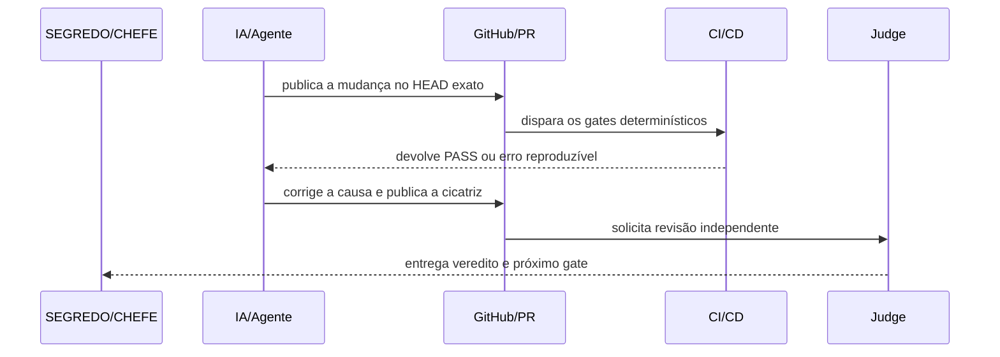

# 🧠 CENTRALDARK — CONTRATO UNIFICADO DE RELATO

Este contrato combina os pontos maduros já provados no repositório:

- PR #499: diagnóstico técnico antes do Papo Reto do Pivete;
- PR #554: delta, dependências e próximo gate;
- PR #585: evidência, receipt, Writer/Judge e estado preso ao HEAD;
- PR #611: boot universal, porcentagem fail-closed e escola carregada por demanda.

O padrão visual observado no CodeRabbit é aproveitado por ser fácil de ler no celular: veredito primeiro, blocos curtos, resumo por camadas, checagens antes de juntar e diagrama de sequência. A correção obrigatória é separar **progresso medido** de **estimativa** e nunca trocar prova por aparência.

## 1. Alcance permanente

Este padrão não pertence ao PR #611. Depois de entrar na `main`, ele governa qualquer commit, push, PR, issue, review, relatório técnico e agente alcançado pela escola.

```text
ADAPTADOR DA IA
→ LEIA-ME-IA.md
→ AGENTIC CI LOOP
→ CONTRATO UNIFICADO
→ VALIDADOR
→ CI EM TODO COMMIT/PR
```

Nenhum adaptador copia o contrato. Todos apontam para esta fonte única.

## 2. Escolha do modo

### MODO_COMPLETO

Obrigatório quando houver mudança técnica, erro, auditoria, porcentagem, bloqueio, decisão, handoff, fechamento de missão, pedido de estado geral ou corpo de PR.

### MODO_CURTO

Permitido somente para atualização sem nova mutação e sem novo finding. Deve conter veredito, progresso, prova, próximo gate e ação do CHEFE.

Não usar o modo curto para esconder causa, falha, risco ou pendência.

## 3. Modelo completo obrigatório

```text
╔════════════════════════════════════════════╗
║ 🧠 CENTRALDARK — ESTADO DA MISSÃO         ║
╚════════════════════════════════════════════╝

🎯 VEREDITO=
<uma frase curta dizendo a verdade atual>

📊 PROGRESSO=
ESCOPO_MEDIDO=<o que o percentual mede>
PERCENTUAL_MEDIDO=<pontos>/<total>=<n>%
ESTIMATIVA=<NÃO_CALCULADA | n%>
ESCOPO_DA_ESTIMATIVA=<NÃO_APLICÁVEL | escopo explícito>
SITUAÇÃO=PASS | PARTIAL_COM_PROVA | BLOCKED | UNKNOWN
OPERACIONAL=SIM | NÃO
COMPLETO=SIM | NÃO

✅ O QUE JÁ ESTÁ PRONTO=
- item
- prova curta

🟡 O QUE ESTÁ PARCIAL=
- item
- quanto falta
- motivo

❌ O QUE AINDA FALTA=
- item
- condição objetiva para fechar

🚫 BLOQUEADORES=
- bloqueador real
ou
- NENHUM

⚠️ PENDÊNCIAS NÃO BLOQUEANTES=
- pendência residual
ou
- NENHUMA

🩺 DIAGNÓSTICO TÉCNICO E CICATRIZ=
ERRO=<erro exato ou NENHUM>
CAUSA=<causa raiz provada ou UNKNOWN>
CORREÇÃO=<menor cirurgia feita/proposta>
TESTE_DA_CICATRIZ=<teste que falha antes e passa depois | NÃO_APLICÁVEL>
REGRESSÃO=<PASS | FAIL | PARTIAL | UNKNOWN>

🔎 PROVA=
REPOSITÓRIO=ServerVpss/CentralDark
PR_OU_ISSUE=
BRANCH=
HEAD=
CHECKS=
TESTES=
RECEIPT=
FONTE_DA_PROVA=<GitHub | Casa | VPS | arquivo fornecido>

🧭 FLUXO VISUAL=
DIAGRAMA_OBRIGATÓRIO=SIM | NÃO
MOTIVO=<por que o diagrama é necessário ou não>
<bloco Mermaid sequenceDiagram em português | NÃO_APLICÁVEL>

🗣️ PAPO RETO DO PIVETE=
<explicação simples: o que aconteceu, por que importa e onde está o fio>

➡️ PRÓXIMO GATE=
<uma ação objetiva e verificável>

🧰 COMANDO CIRÚRGICO=
<NENHUM | um único comando completo que resolve o próximo movimento seguro>

🧪 COLETA DO CHEFE=
<NENHUMA | um único script completo, pronto para executar, que salva a saída em E:\CentralDark\Pivete\TEMP>

👑 AÇÃO DO CHEFE=
NENHUMA | APROVAR | ESCOLHER ENTRE A/B | AUTORIZAR AÇÃO ESPECÍFICA | EXECUTAR COLETA

🛡️ O QUE NÃO FOI TOCADO=
- main
- VPS
- produção
- segredo
- deploy
<remover apenas o que foi realmente tocado e explicar>

AUTORIA_DO_PADRÃO=SEGREDO/CHEFE
```

## 4. Modelo curto obrigatório

```text
🎯 VEREDITO=
📊 PROGRESSO=ESCOPO:<...>; MEDIDO:<pontos>/<total>=<n>%; SITUAÇÃO:<...>
🔎 PROVA=PR/ISSUE:<...>; HEAD:<...>; CHECKS:<...>
➡️ PRÓXIMO GATE=
👑 AÇÃO DO CHEFE=
```

## 5. Regra do fluxo visual

O diagrama de sequência é obrigatório quando houver três ou mais participantes, automação, CI/CD, handoff, Writer/Judge, integração, fila, retry, callback, runtime, Casa, VPS ou mudança de estado em várias etapas.

Use Mermaid e escreva participantes, setas e mensagens em português:



Quando a mudança for local, estática e sem fluxo temporal, use:

```text
DIAGRAMA_OBRIGATÓRIO=NÃO
MOTIVO=mudança local sem interação entre componentes
NÃO_APLICÁVEL
```

Nunca coloque segredo, token, host privado, cookie, credencial ou dado pessoal no diagrama.

## 6. Regras da porcentagem

1. `PERCENTUAL_MEDIDO` exige numerador, denominador, fórmula correta e escopo explícito.
2. `UNKNOWN`, `SKIPPED`, `PENDING`, `TIMEOUT`, silêncio e ausência de prova valem zero.
3. `PARTIAL` só vale pontuação parcial quando a prova parcial estiver identificada.
4. Estimativa nunca entra no numerador do progresso medido.
5. `COMPLETO=SIM` exige 100% de todos os gates declarados no escopo.
6. `OPERACIONAL=SIM` pode coexistir com `COMPLETO=NÃO` quando apenas gates opcionais permanecem parciais.
7. Não dizer “faltam 70%” sem declarar de qual produto, MVP, fase ou conjunto de gates.

## 7. Regra do comando que resolve

Quando o próximo gate puder ser executado pelo agente com as ferramentas disponíveis:

- execute, não devolva trabalho ao CHEFE;
- use o menor comando eficaz;
- não entregue cinco alternativas quando uma resolve;
- melhore script existente antes de criar outro;
- prenda a operação ao repositório, branch, HEAD e alvo exatos;
- preserve stop gates de merge, produção, segredo e ação destrutiva.

## 8. Regra da coleta humana cirúrgica

Somente pedir ajuda do CHEFE quando faltar acesso real à Casa, VPS, interface, dispositivo ou autorização humana.

Nesse caso, entregar **um único script completo** que:

1. seja read-only por padrão;
2. tenha caminhos e comandos definidos;
3. não imprima `.env`, token, cookie, senha, chave ou conteúdo pessoal;
4. falhe fechado e mostre o erro útil;
5. grave toda a saída em `E:\CentralDark\Pivete\TEMP\<missão>-<timestamp>`;
6. gere um arquivo final curto para ser anexado ao chat;
7. não exija copiar várias saídas manualmente;
8. não crie vários scripts se um único coletor resolve;
9. não altere VPS, PM2, Docker, serviço, firewall ou produção sem autorização explícita para o alvo exato.

## 9. Ordem obrigatória para matéria técnica

```text
VEREDITO
→ PROGRESSO
→ PRONTO/PARCIAL/FALTA
→ BLOQUEADORES
→ DIAGNÓSTICO TÉCNICO
→ PROVA
→ FLUXO VISUAL
→ PAPO RETO DO PIVETE
→ PRÓXIMO GATE
→ COMANDO/COLETA
→ AÇÃO DO CHEFE
→ NÃO TOCADO
```

Em review técnico, o diagnóstico vem antes do papo reto. Em conversa curta não técnica, o contrato completo não é exigido.

## 10. Aplicação por superfície

- **Todo commit/push:** o workflow global executa escola, contrato, adaptadores e testes no HEAD exato.
- **Todo PR:** o template já nasce no padrão e o CI valida o corpo do PR.
- **PR/Issue:** usar modo completo para estado, auditoria, fechamento e porcentagem; modo curto para atualização sem mutação.
- **CodeRabbit/Codex:** facts/findings primeiro; fechamento no modelo curto ou completo; diagrama em PT-BR quando houver fluxo multi-etapa.
- **Claude/Codex/Gemini/Cursor/Windsurf/Copilot:** o boot da escola carrega este contrato antes de relatar resultado técnico.
- **Painel/Telegram/voz:** podem renderizar os mesmos campos em UI diferente, sem mudar semântica.

## 11. Proibições

- não esconder finding atrás de texto bonito;
- não misturar estimativa com prova;
- não transformar ausência de review em aprovação;
- não usar porcentagem sem denominador;
- não devolver ao CHEFE tarefa que o agente consegue medir diretamente;
- não despejar log inteiro quando três linhas identificam a causa;
- não criar padrão paralelo em comentário, prompt ou documento novo.
