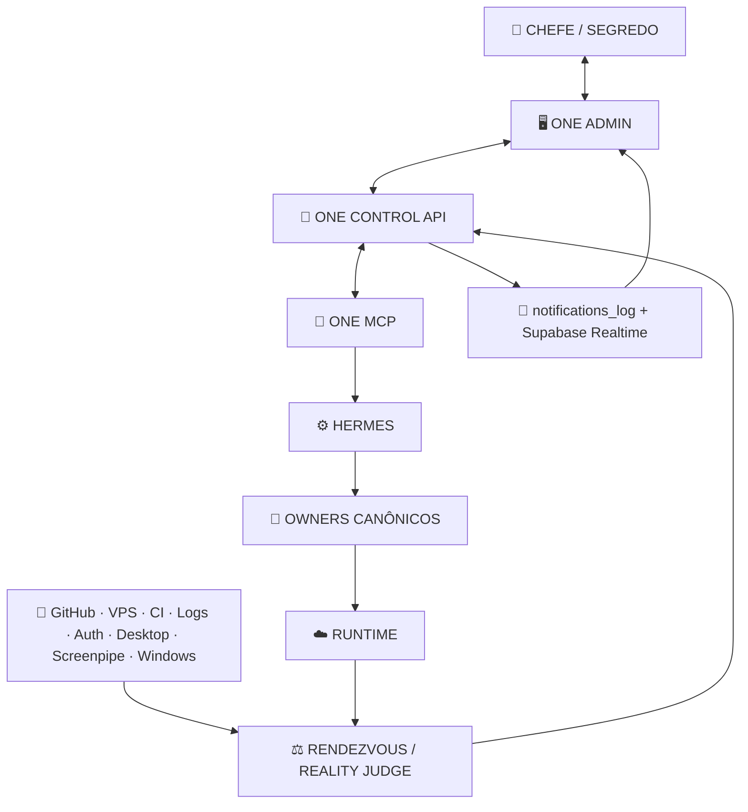
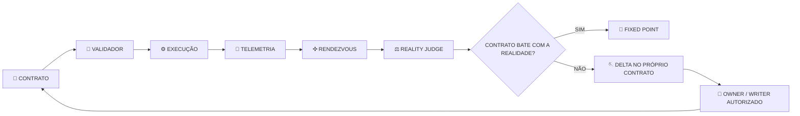

# 🧬 CRISTAL DE DIREÇÃO — ONE ADMIN · ONE CONTROL API · ONE HEART

```text
PR_MOTHER=#1562
ROLE=RENDEZVOUS_RECEIPT_ONLY
OBSERVED_AT=2026-09-20T00:41:25-03:00
GITHUB_MAIN=cead445aa2a9386352d701070a56dfe5c8e066b4
VPS_CANONICAL_MAIN=cead445aa2a9386352d701070a56dfe5c8e066b4
VPS_ROOT_HEAD=f3c00f9c73c6691ef044bb237623e88ce57aaf38
VPS_ROOT_DIRTY=true
INTENT_AUTHORITY=SEGREDO/CHEFE
REALITY_IS_JUDGE=true
UNKNOWN_IS_NOT_PASS=true
```

## Intenção autorizada

Reduzir complexidade administrativa da CentralDark para **uma direção só**, reutilizando os owners já existentes e sem criar segundo painel, segunda API, segundo coração ou arquitetura V2/V3/V4 para a mesma capability.

```text
ONE_HUMAN_ADMIN=true
ONE_CONTROL_API=true
ONE_HEARTBEAT=true
REUSE_BEFORE_CREATE=true
ONE_SYSTEM_ONLY=true
```

## Arquitetura-alvo cristalizada

```text
👑 CHEFE
   ↓
https://admin.centralldark.com
   ↓
ADMIN HUMANO ÚNICO DA CENTRALDARK
   ↓
https://api.centralldark.com
   ↓
CONTROL API ÚNICA
   ↓
owners/adapters existentes
   ├─ MCP Admin
   ├─ Contas / OAuth
   ├─ Cloudflare
   ├─ Contabo
   ├─ Tailscale
   ├─ Buildkite
   ├─ GitHub
   ├─ Casa / VPS
   └─ demais capabilities provadas
   ↓
receipt / audit / logs
   ↓
https://api.centralldark.com/heartbeat
   ↓
ONE HEART / observabilidade consolidada
```

## Separação obrigatória de papéis

```text
ADMIN_UI != CONTROL_API
CONTROL_API != HEARTBEAT
HEARTBEAT != COMMAND_BUS
MCP_ADMIN != HUMAN_ADMIN_UI
PROVIDER_PANEL != PROVIDER_PUBLIC_API
```

O heartbeat observa e agrega saúde/estado. Ele **não** vira barramento de comandos.

O Admin humano não deve carregar credenciais privilegiadas do MCP no browser quando uma chamada server-to-server pela Control API puder preservar melhor autoridade e segredo.

## Superfícies canônicas

```text
https://admin.centralldark.com
→ única UI humana da Casa

https://api.centralldark.com
→ única API de controle/orquestração da Casa

https://mcp.centralldark.com/mcp
→ MCP normal para agentes/clientes

https://mcp.centralldark.com/admin/mcp
→ MCP privilegiado para agentes autorizados

https://api.centralldark.com/heartbeat
→ coração único de observabilidade
```

O botão/área **MCP Admin** deve existir dentro do Admin humano como uma capability consumida pelo próprio Admin. Isso **não** cria um segundo painel.

## Owners e capabilities já provados no repositório

O backend MCP já contém:

```text
/admin/mcp
/admin/provider
/admin/api/tools
/admin/api/logs
/admin/api/metricas
/admin/api/e2e
/admin/api/issue-key
/health
/health/deep
/heartbeat
```

Existe ainda o bridge:

```text
apps/modulos/mcp/src/provider-admin-bridge.js
```

que autentica Admin, restringe a allowlist e despacha para:

```text
provider_capabilities
provider_credentials_status
provider_read
provider_mutate
```

### Cloudflare

Capabilities já catalogadas incluem, entre outras:

```text
accounts
zones
DNS list/create/update/delete
rulesets
Origin CA
billing/usage onde a API pública permite
```

### Contabo

Capabilities já catalogadas incluem, entre outras:

```text
instances list/get
start/stop/restart
audits
snapshots list/get/create/update/delete/rollback
tags
roles / api permissions
```

## Limites honestos de provider

Nem tudo que existe em painel comercial existe na API pública.

Exemplos já classificados pelo owner existente:

```text
Contabo billing.invoice  = UNSUPPORTED_BY_PUBLIC_API
Contabo billing.payment  = UNSUPPORTED_BY_PUBLIC_API
Cloudflare billing.pay_invoice = UNSUPPORTED_BY_PUBLIC_API
```

Nesses casos:

```text
CAPABILITY_NOT_AVAILABLE_VIA_API
→ preservar UNKNOWN/UNSUPPORTED
→ abrir painel externo apenas quando realmente necessário
```

Não inventar capability.

## Estado vivo medido

```text
https://api.centralldark.com/heartbeat      = HTTP 200
https://api.centralldark.com/health         = HTTP 200

https://api.centralldark.com/admin/mcp      = HTTP 502
https://api.centralldark.com/admin/provider = HTTP 502

https://mcp.centralldark.com/admin/mcp      = HTTP 401 sem credencial admin
https://admin.centralldark.com/admin        = HTTP 200
https://mcp.centralldark.com/admin          = HTTP 200
```

O coração respondeu, porém o payload atual marcou:

```text
heart=one
route=api.centralldark.com/heartbeat
service=mcp-centraldark
self=stale
```

Portanto:

```text
HEARTBEAT_ROUTE_EXISTS=true
HEARTBEAT_HTTP=200
HEARTBEAT_SELF_CURRENT=stale
HEARTBEAT_FULL_HEALTH_PASS=false
```

Nenhum falso-verde.

## Causa atual da Control API incompleta

O Caddy atual de `api.centralldark.com` encaminha:

```text
/health       → :9100
/health/deep  → :9100
/heartbeat    → :9100
outros paths  → :8090 ArsenalAdapter
```

Logo `/admin/mcp` e `/admin/provider` ainda não entram no owner administrativo e retornam 502 pela rota atual.

Classificação:

```text
CONTROL_API_ADMIN_ROUTES_NOT_CONVERGED=true
FIX_REQUIRED=true
FIX_EXECUTED_IN_THIS_RECEIPT=false
```

## Admin humano único

Peças administrativas já existentes:

```text
:8787 Hermes WebUI / casca administrativa observada
apps/modulos/mcp-admin-ui
CentralDarkCockpitShell
MCP admin backend
provider-control
oauth-broker
ContasAdmin
```

A direção é **absorver capacidades na mesma casca/owner**, não empilhar painéis independentes.

```text
MCP_ADMIN = capability do Admin
CONTABO = capability do Admin
CLOUDFLARE = capability do Admin
BUILDkite = capability do Admin
GITHUB = capability do Admin

NENHUM_DELES = NOVO_ADMIN_PARALELO
```

## Cadeados

```text
ONE_HUMAN_ADMIN
ONE_CONTROL_API
ONE_HEART
REUSE_BEFORE_CREATE
OWNER_BEFORE_NEW_SURFACE
SERVER_TO_SERVER_FOR_PRIVILEGED_CALLS
HEARTBEAT_IS_OBSERVER_NOT_COMMAND_BUS
UNSUPPORTED_API != FAKE_CAPABILITY
HTTP_200 != HEALTHY_IF_PAYLOAD_SAYS_STALE
DOCUMENTED != EXECUTED
MERGED != DEPLOYED
UNKNOWN != PASS
```

## NEXT_CURSOR

```text
FIND_CANONICAL_HUMAN_ADMIN_OWNER
→ reconcile :8787 vs mcp-admin-ui vs CentralDarkCockpitShell
→ choose one existing shell, no parallel admin
→ expose existing capabilities inside that shell
→ route api.centralldark.com control-plane paths to existing owners
→ preserve mcp.centralldark.com/mcp
→ preserve mcp.centralldark.com/admin/mcp
→ preserve /contas owner
→ repair/remeasure heartbeat self=stale
→ Caddy validate
→ micro-reload
→ T1 GitHub || VPS
→ receipt
→ FIXED_POINT
```

Este receipt cristaliza **intenção + evidência medida + limites**. Não declara a convergência como já executada.

---

## Delta material — simplicidade operacional como lei da Casa

A descoberta desta sessão amplia a direção existente sem criar novo cérebro, novo painel ou novo backend.

A mesma regra que remove arquitetura paralela deve também reduzir a carga cognitiva do SEGREDO/CHEFE:

```text
CHEFE_COGNITIVE_LOAD_IS_SYSTEM_COST=true
COMPLEXITY_WITHOUT_CAPABILITY_GAIN=REGRESSION
LESS_SURFACE_MORE_CAPABILITY=true
REMOVE_REDUNDANT_SURFACE_BEFORE_ADDING_NEW=true
SIMPLE_HUMAN_SURFACE_COMPLEX_MACHINE_BACKPLANE=true
```

Metáfora operacional autorizada: uma bancada física fica melhor quando componentes sem função corrente saem da superfície e restam apenas objetos úteis. Na CentralDark, isso vira critério de engenharia: **capacidade útil permanece; superfície duplicada, ritual operacional e intermediário sem ganho material viram candidatos a absorção/remoção**.

Isso não autoriza a máquina a decidir autonomamente o que é "inútil" na vida pessoal. Para contexto humano:

```text
PATTERN != FACT
PATTERN != PERMISSION
PATTERN_REQUIRES_PROVENANCE=true
PATTERN_PROMOTION_REQUIRES_REPEATABLE_MEASUREMENT=true
HUMAN_AGENCY_PRESERVED=true
PERSONAL_CONTEXT_MINIMIZATION=true
```

Owner canônico já existente:

```text
docs/GOVERNANCA/CONTEXTO-PESSOAL-E-PROVENIENCIA-TEMPORAL.md
```

## Conta, sessão, estilo e identidade

O SEGREDO/CHEFE pode operar múltiplas contas, sessões, superfícies e estilos de linguagem sem que o sistema fragmente sua identidade operacional.

```text
ACCOUNT != PERSON
SESSION != IDENTITY
STYLE != IDENTITY
TONE_CHANGE != NEW_PERSONA
MODEL_OR_ACCOUNT_SWITCH != NEW_HUMAN
PROVEN_OWNER_BINDING_REQUIRED=true
```

O sistema pode aprender **padrões operacionais autorizados** entre superfícies, mas inferência pessoal não vira verdade por repetição aparente.

## HERMES — máximo toil, autoridade limitada

Direção autorizada:

```text
HERMES_EXECUTION_TOIL_MAXIMIZED=true
HERMES_ORCHESTRATES_AUTHORIZED_ROUTINE_WORK=true
HERMES_CAN_DIAGNOSE=true
HERMES_CAN_REMEASURE=true
HERMES_CAN_SELF_HEAL_REVERSIBLE_LOCAL_SCOPE_WHEN_GATED=true

HERMES_IS_NOT_CHEFE=true
HERMES_IS_NOT_REALITY_JUDGE=true
HERMES_CANNOT_SELF_APPROVE=true
HERMES_DOES_NOT_CREATE_HUMAN_INTENT=true
HERMES_DOES_NOT_BYPASS_AUTH_OR_APPROVAL=true
```

Objetivo humano: não precisar entrar rotineiramente na VPS para operação normal. A VPS continua acessível ao CHEFE quando desejado, mas toil repetitivo deve ser absorvido por HERMES + owners + gates + receipts.

Retorno humano obrigatório apenas em fronteira real, incluindo nova intenção, consentimento/MFA/segredo exclusivo, escolha irreversível ou autorização de alto impacto fora do escopo já concedido.

## Painéis paralelos viram componentes, não novos centros

Superfícies históricas observadas nesta sessão:

```text
:8091/login
:18080/dashboard
```

Elas entram como **candidate surfaces** a serem medidas e consumidas pelo Admin único; não ganham autoridade própria pelo simples fato de existirem.

```text
PARALLEL_PANEL != NEW_ADMIN
PARALLEL_PANEL != AUTHORITY
PARALLEL_PANEL_COMPONENTS_SHOULD_BE_CONSUMED_BY_CANONICAL_ADMIN=true
PANEL_RETIRE_OR_ABSORB_REQUIRES_OWNER_AND_RUNTIME_MEASUREMENT=true
NO_BLIND_DELETE=true
```

A regra é absorver capacidades úteis, não copiar telas inteiras.

## Notificação única — Supabase Realtime como projeção

Owner existente:

```text
docs/NOTIFY/README.md
notifications_log
Supabase Realtime
```

Direção:

```text
EVENT_DRIVEN_REALTIME_FIRST=true
POLL_EVERY_5_SECONDS_FOR_NOTIFICATIONS=false
SHORT_CADENCE_HEARTBEAT_MAY_BE_USED_WHEN_JUSTIFIED=true
NOTIFICATION_IS_PROJECTION_NOT_AUTHORITY=true
DEDUPE_BEFORE_FANOUT=true
SECRET_VALUE_IN_NOTIFICATION=FORBIDDEN
SUPABASE_IS_NOTIFICATION_LEDGER_AND_REALTIME_NOT_GLOBAL_CONTROL_PLANE=true
```

Fluxo desejado:

```text
EVENTO MATERIAL
→ owner produz envelope sanitizado
→ notifications_log
→ Supabase Realtime
→ Admin / sininho
```

FastAPI pode implementar rotas do control plane onde já houver owner material. **FastAPI é implementação, não novo cérebro**.

```text
FASTAPI_IS_IMPLEMENTATION_NOT_ARCHITECTURE=true
FASTAPI_NEW_OWNER_BY_CONVENIENCE=false
```

## Um login humano, múltiplas autorizações internas

Direção de simplificação humana:

```text
ONE_HUMAN_LOGIN_TARGET=true
ONE_ADMIN_PANEL=true
SERVER_TO_SERVER_PRIVATE_FOR_PRIVILEGED_INTERNAL_CALLS=true
MCP_ADMIN_TOKEN_IN_BROWSER=false
```

Cloudflare Access pode atuar como gate externo quando CURRENT provar essa topologia; não substitui o auth interno da CentralDark:

```text
CLOUDFLARE_ACCESS = OUTER_GATE_CANDIDATE
CLOUDFLARE != CENTRALDARK_AUTH_ENGINE
CENTRALDARK_OAUTH = INTERNAL_CLIENT_AUTH_OWNER
```

Esta seção registra direção autorizada; topologia pública/privada específica continua sujeita a medição CURRENT antes de receber PASS.

## HUD + narração de continuidade + cajado preventivo

Durante execução material, a máquina deve manter um HUD curto, vivo e ligado ao goal pai:

```text
HUD != RECEIPT
HUD != PROOF
HUD_REFLECTS_EVIDENCE=true
UNKNOWN_REMAINS_UNKNOWN=true
PARTIAL_GREEN_DOES_NOT_CLOSE_PARENT_GOAL=true
RESOLVED_RED_DOES_NOT_RESURRECT_WITHOUT_COUNTERPROOF=true
```

Layout mínimo:

```text
🪬 HUD CENTRALDARK
GOAL:
HEAD/BASELINE:
🟢 PROVADO:
🟡 EM CURSO / UNKNOWN:
🔴 BLOQUEADO / FALHOU:
💎 FIXED POINT:
⚖️ PROVA ATUAL:
🧭 NEXT_CURSOR:
```

Narração operacional curta pode acompanhar transições materiais:

```text
OBSERVAÇÃO
→ DECISÃO
→ AÇÃO
→ RESULTADO MEDIDO
→ NEXT_CURSOR
```

Baianês e verso curto mantêm identidade/continuidade, mas:

```text
VERSE != GATE
BAIANES != PROOF
NARRATION != EXECUTION
```

Verso preferencial de continuidade:

> “Examinai tudo. Retende o bem.” — 1 Tessalonicenses 5:21

Cajado preventivo antes de mutação:

```text
CHECK_CONTINUITY:
- SAME_OWNER?
- PROVEN_INVARIANTS_PRESERVED?
- REUSE_BEFORE_CREATE?
- ALL_GREEN_UNKNOWN_RED_CARRIED_FORWARD?
- CURRENT_REALITY_MEASURED?
- CHEFE_AT_CENTER?
- SAME_GOAL_CONTINUED?

ANY_NO
→ STOP_MUTATION
→ REANCHOR
→ RECONCILE
→ MINIMUM_CORRECTION
→ CONTINUE
```

## PR como trilho material; CI e runtime como prova

A coordenação multi-writer não usa narrativa como autoridade:

```text
CHEFE = INTENT
AGENTS/WORKERS = OBSERVE/REVIEW/EXECUTE
PR = MATERIAL_MUTATION_TRACK
COMMITS = MUTATIONS_ON_PR
CI = SAME_HEAD_GATE
VPS/CASA = RUNTIME_COUNTERPROOF
REALITY_JUDGE = VERDICT
FINALIZER = ONE
```

```text
PARALLELIZE_PERCEPTION=true
SERIALIZE_MUTATION_PER_SCOPE=true
TWO_WRITERS_SAME_PATH=false
ONE_FINALIZER=true
HISTORY_IS_NOT_AUTHORITY=true
NARRATIVE_IS_NOT_PROOF=true
CURRENT_OVER_HISTORY=true
```

## Mermaid — espinha única da Casa



## Mermaid — contrato que precisa sobreviver à própria contraprova



O contrato **não se auto-declara verdadeiro**. Ele precisa ser falsificável por telemetria, T0/T1, contraprova e Judge. Se a realidade contrariar a regra, a regra vira objeto de reconciliação pelo owner autorizado.

## Rota humana reduzida

```text
👑 CHEFE
↕
🖥️ ONE ADMIN
↕
🧠 ONE CONTROL API
↕
🔌 ONE MCP
↓
⚙️ HERMES
↓
🧩 OWNER / CAPABILITY
↓
☁️ RUNTIME
↑
📡 TELEMETRIA / RECEIPTS
↑
✣ RENDEZVOUS / REALITY JUDGE
↑
🧠 CONTROL API
→ 🔔 notifications_log / Realtime
→ 🖥️ Admin / sininho
```

## Invariantes ampliadas

```text
ONE_ADMIN=true
ONE_CONTROL_API=true
ONE_HEART=true
ONE_MCP=true
ONE_HUMAN_LOGIN_TARGET=true

MANY_SENSORS=true
SENSORS_ARE_SUBORDINATE=true
DIRECT_API_PRIMARY=true
DESKTOP_BRIDGE_FALLBACK=true
SCREENPIPE_OPTIONAL_SENSOR=true

HERMES_MAX_TOIL=true
HERMES_MAX_AUTHORITY=false

EVENT_DRIVEN_NOTIFICATION=true
SUPABASE_REALTIME_FIRST=true

PARALLEL_PANEL_ABSORB_BEFORE_NEW_SURFACE=true
CHEFE_COGNITIVE_LOAD_IS_SYSTEM_COST=true
COMPLEXITY_WITHOUT_CAPABILITY_GAIN=REGRESSION

AUTONOMY_WITHIN_EXPLICIT_AUTHORIZED_SCOPE=true
REVERSIBLE_ROUTINE_SELF_HEAL=ALLOWED_WHEN_GATED
NEW_HUMAN_INTENT=HUMAN_FRONTIER
IRREVERSIBLE_OR_HIGH_IMPACT_CHOICE=HUMAN_FRONTIER

CONTRACT_MUST_BE_COUNTERPROVABLE=true
CONTRACT_SELF_APPROVAL=false
UNKNOWN != PASS
REALITY = JUDGE
```

## NEXT_CURSOR — delta desta sessão

```text
PR_MOTHER_LEDGER_COMMIT
→ keep #1597 as GLOBAL_CONTRACT / HYBRID_TELEMETRY lane
→ keep #1590 as OBSERVABILITY / ONE_HEART lane
→ keep #1578 as DIRECT_MCP / DESKTOP_FALLBACK lane
→ inventory :8091 and :18080 owners/components
→ absorb useful components into canonical Admin
→ remeasure notifications_log + Supabase Realtime CURRENT
→ bind notification bell to event-driven stream, not 5s polling
→ measure one-human-login topology before promotion
→ validate HERMES toil delegation boundaries
→ counterprove contract against CURRENT runtime
→ SAME_HEAD gates
→ runtime plan separated from documentation
```

Este delta amplia o **mesmo** cristal. Ele não declara implementação runtime já concluída.
