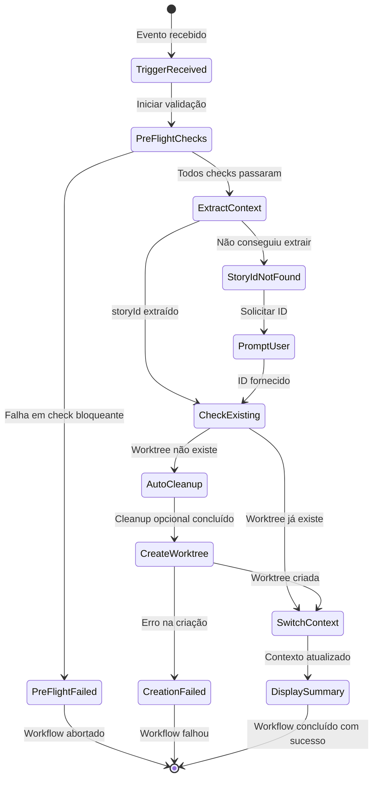
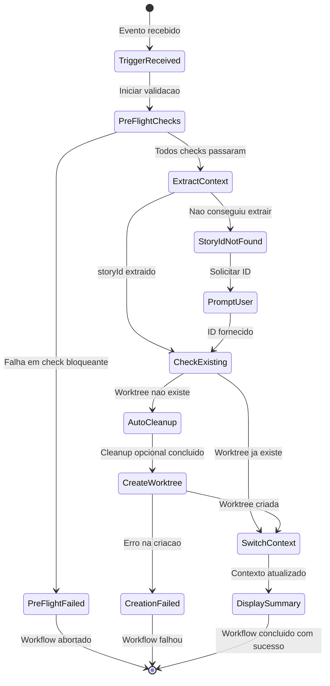

# COMANDO - auto-worktree-workflow.md
**Origem:** E:\CentralDark\_MAPA_CASA\PASTA DO CHEFE JOGA ARQUIOVOS QUAIS QUUER SER GARIMPO DO CHEFE\aiox-core\docs\aios-workflows\auto-worktree-workflow.md
**SHA:** d5819df5029d44ef
**Timestamp:** 2026-08-28T02:02:32.412100
**Portoes:** {"ocorrencias": true, "ganho": true, "contraprova": true, "sha": true}

## Ouro Extraido

### Contratos
- Navigate:   cd {worktree.path}

### Ouro Bruto (primeiros 5000 chars)
```
# Auto-Worktree Workflow

**Versão:** 1.0
**Criado:** 2026-01-28
**Autor:** @architect (Aria)
**Story:** 1.4 - Epic 1 - Worktree Manager

---

## Visão Geral

O **Auto-Worktree** é um workflow de automação que cria e gerencia worktrees Git isoladas para desenvolvimento de stories. Faz parte da infraestrutura **Auto-Claude ADE** (Autonomous Development Engine), permitindo desenvolvimento paralelo de multiplas stories sem conflitos entre branches.

### Principais Beneficios

| Benefício | Descrição |
|-----------|-----------|
| **Isolamento** | Cada story trabalha em um diretório e branch separados |
| **Paralelismo** | Multiplas stories podem ser desenvolvidas simultaneamente |
| **Automação** | Worktrees são criadas automaticamente ao iniciar uma story |
| **Limpeza** | Worktrees obsoletas podem ser removidas automaticamente |

### Quando o Workflow é Acionado

1. **Evento `story_started`**: Quando `@dev` inicia uma story
2. **Evento `story_assigned`**: Quando `@po` atribui uma story (opcional)
3. **Comando manual**: `*auto-worktree`

---

## Diagrama do Workflow

### Fluxo Principal

```mermaid
flowchart TB
    subgraph TRIGGER["Trigger"]
        T1[story_started<br/>@dev]
        T2[story_assigned<br/>@po]
        T3[*auto-worktree<br/>manual]
    end

    subgraph PREFLIGHT["Pre-Flight Checks"]
        PF1{Repositório Git?}
        PF2{Suporte a Worktree?}
        PF3{WorktreeManager?}
        PF4{Limite de Worktrees?}
    end

    subgraph WORKFLOW["Sequência do Workflow"]
        S1["STEP 1: Extract Story Context<br/>Extrair ID da Story"]
        S2["STEP 2: Check Existing<br/>Verificar Worktree Existente"]
        S3["STEP 3: Auto Cleanup<br/>Limpar Worktrees Obsoletas"]
        S4["STEP 4: Create Worktree<br/>Criar Worktree Isolada"]
        S5["STEP 5: Switch Context<br/>Mudar para Worktree"]
        S6["STEP 6: Display Summary<br/>Exibir Resumo"]
    end

    subgraph OUTPUT["Saída"]
        O1[storyId]
        O2[worktree.path]
        O3[worktree.branch]
        O4[worktree.status]
    end

    T1 --> PF1
    T2 --> PF1
    T3 --> PF1

    PF1 -->|Sim| PF2
    PF1 -->|Não| ERR1[Erro: Não é repositório git]

    PF2 -->|Sim| PF3
    PF2 -->|Não| ERR2[Erro: Git < 2.5]

    PF3 -->|Existe| PF4
    PF3 -->|Não existe| ERR3[Erro: AIOS incompleto]

    PF4 -->|OK| S1
    PF4 -->|Limite| WARN1[Aviso: Próximo do limite]
    WARN1 --> S1

    S1 --> S2
    S2 -->|Existe| S5
    S2 -->|Não existe| S3
    S3 --> S4
    S4 -->|Sucesso| S5
    S4 -->|Falha| ERR4[Erro: Criação falhou]
    S5 --> S6
    S6 --> O1
    S6 --> O2
    S6 --> O3
    S6 --> O4

    style TRIGGER fill:#e1f5fe
    style PREFLIGHT fill:#fff3e0
    style WORKFLOW fill:#e8f5e9
    style OUTPUT fill:#f3e5f5
    style ERR1 fill:#ffcdd2
    style ERR2 fill:#ffcdd2
    style ERR3 fill:#ffcdd2
    style ERR4 fill:#ffcdd2
    style WARN1 fill:#fff9c4
```

### Diagrama de Estados



### Arquitetura de Componentes

```mermaid
graph TB
    subgraph AIOS["AIOS Core"]
        WF[auto-worktree.yaml<br/>Workflow Definição]
        TK[create-worktree.md<br/>Task Definição]
    end

    subgraph INFRA["Infrastructure"]
        WM[worktree-manager.js<br/>WorktreeManager Class]
        GIT[Git CLI<br/>git worktree]
    end

    subgraph FS["File System"]
        WT[.aios/worktrees/{storyId}/<br/>Worktree Directory]
        LOG[.aios/logs/merges/<br/>Merge Audit Logs]
    end

    subgraph AGENTS["Agentes"]
        DEV[@dev<br/>Gage - DevOps]
        PO[@po<br/>Product Owner]
    end

    DEV -->|Inicia story| WF
    PO -->|Atribui story| WF
    WF -->|Executa| TK
    TK -->|Usa| WM
    WM -->|Executa| GIT
    GIT -->|Cria| WT
    WM -->|Grava logs| LOG

    style AIOS fill:#e3f2fd
    style INFRA fill:#fce4ec
    style FS fill:#f3e5f5
    style AGENTS fill:#e8f5e9
```

---

## Steps Detalhados

### Step 1: Extract Story Context

| Propriedade | Valor |
|-------------|-------|
| **Phase** | 1 - Extract Context |
| **Action** | `extract_story_info` |
| **Agente** | Sistema (automático) |
| **Blocki
```

---

# COMANDO - AUTO-WORKTREE-WORKFLOW.md
**Origem:** E:\CentralDark\_MAPA_CASA\PASTA DO CHEFE JOGA ARQUIOVOS QUAIS QUUER SER GARIMPO DO CHEFE\aiox-core\docs\guides\workflows\AUTO-WORKTREE-WORKFLOW.md
**SHA:** 79f568c3d649c96d
**Timestamp:** 2026-08-28T02:02:37.339754
**Portoes:** {"ocorrencias": true, "ganho": true, "contraprova": true, "sha": true}

## Ouro Extraido

### Contratos
- Navigate:   cd {worktree.path}

### Ouro Bruto (primeiros 5000 chars)
```
# Auto-Worktree Workflow

**Versao:** 1.0
**Criado:** 2026-01-28
**Autor:** @architect (Aria)
**Story:** 1.4 - Epic 1 - Worktree Manager

---

## Visao Geral

O **Auto-Worktree** e um workflow de automacao que cria e gerencia worktrees Git isoladas para desenvolvimento de stories. Faz parte da infraestrutura **Auto-Claude ADE** (Autonomous Development Engine), permitindo desenvolvimento paralelo de multiplas stories sem conflitos entre branches.

### Principais Beneficios

| Beneficio | Descricao |
|-----------|-----------|
| **Isolamento** | Cada story trabalha em um diretorio e branch separados |
| **Paralelismo** | Multiplas stories podem ser desenvolvidas simultaneamente |
| **Automacao** | Worktrees sao criadas automaticamente ao iniciar uma story |
| **Limpeza** | Worktrees obsoletas podem ser removidas automaticamente |

### Quando o Workflow e Acionado

1. **Evento `story_started`**: Quando `@dev` inicia uma story
2. **Evento `story_assigned`**: Quando `@po` atribui uma story (opcional)
3. **Comando manual**: `*auto-worktree`

---

## Diagrama do Workflow

### Fluxo Principal

```mermaid
flowchart TB
    subgraph TRIGGER["Trigger"]
        T1[story_started<br/>@dev]
        T2[story_assigned<br/>@po]
        T3[*auto-worktree<br/>manual]
    end

    subgraph PREFLIGHT["Pre-Flight Checks"]
        PF1{Repositorio Git?}
        PF2{Suporte a Worktree?}
        PF3{WorktreeManager?}
        PF4{Limite de Worktrees?}
    end

    subgraph WORKFLOW["Sequencia do Workflow"]
        S1["STEP 1: Extract Story Context<br/>Extrair ID da Story"]
        S2["STEP 2: Check Existing<br/>Verificar Worktree Existente"]
        S3["STEP 3: Auto Cleanup<br/>Limpar Worktrees Obsoletas"]
        S4["STEP 4: Create Worktree<br/>Criar Worktree Isolada"]
        S5["STEP 5: Switch Context<br/>Mudar para Worktree"]
        S6["STEP 6: Display Summary<br/>Exibir Resumo"]
    end

    subgraph OUTPUT["Saida"]
        O1[storyId]
        O2[worktree.path]
        O3[worktree.branch]
        O4[worktree.status]
    end

    T1 --> PF1
    T2 --> PF1
    T3 --> PF1

    PF1 -->|Sim| PF2
    PF1 -->|Nao| ERR1[Erro: Nao e repositorio git]

    PF2 -->|Sim| PF3
    PF2 -->|Nao| ERR2[Erro: Git < 2.5]

    PF3 -->|Existe| PF4
    PF3 -->|Nao existe| ERR3[Erro: AIOS incompleto]

    PF4 -->|OK| S1
    PF4 -->|Limite| WARN1[Aviso: Proximo do limite]
    WARN1 --> S1

    S1 --> S2
    S2 -->|Existe| S5
    S2 -->|Nao existe| S3
    S3 --> S4
    S4 -->|Sucesso| S5
    S4 -->|Falha| ERR4[Erro: Criacao falhou]
    S5 --> S6
    S6 --> O1
    S6 --> O2
    S6 --> O3
    S6 --> O4

    style TRIGGER fill:#e1f5fe
    style PREFLIGHT fill:#fff3e0
    style WORKFLOW fill:#e8f5e9
    style OUTPUT fill:#f3e5f5
    style ERR1 fill:#ffcdd2
    style ERR2 fill:#ffcdd2
    style ERR3 fill:#ffcdd2
    style ERR4 fill:#ffcdd2
    style WARN1 fill:#fff9c4
```

### Diagrama de Estados



### Arquitetura de Componentes

```mermaid
graph TB
    subgraph AIOS["AIOS Core"]
        WF[auto-worktree.yaml<br/>Workflow Definition]
        TK[create-worktree.md<br/>Task Definition]
    end

    subgraph INFRA["Infrastructure"]
        WM[worktree-manager.js<br/>WorktreeManager Class]
        GIT[Git CLI<br/>git worktree]
    end

    subgraph FS["File System"]
        WT[.aios/worktrees/{storyId}/<br/>Worktree Directory]
        LOG[.aios/logs/merges/<br/>Merge Audit Logs]
    end

    subgraph AGENTS["Agentes"]
        DEV[@dev<br/>Gage - DevOps]
        PO[@po<br/>Product Owner]
    end

    DEV -->|Inicia story| WF
    PO -->|Atribui story| WF
    WF -->|Executa| TK
    TK -->|Usa| WM
    WM -->|Executa| GIT
    GIT -->|Cria| WT
    WM -->|Grava logs| LOG

    style AIOS fill:#e3f2fd
    style INFRA fill:#fce4ec
    style FS fill:#f3e5f5
    style AGENTS fill:#e8f5e9
```

---

## Steps Detalhados

### Step 1: Extract Story Context

| Propriedade | Valor |
|-------------|-------|
| **Phase** | 1 - Extract Context |
| **Action** | `extract_story_info` |
| **Agente** | Sistema (automatico) |
| **Bloc
```