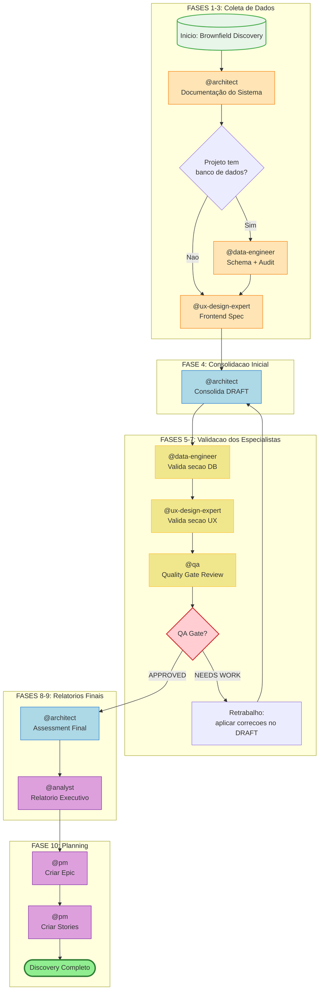

# COMANDO - brownfield-discovery-workflow.md
**Origem:** E:\CentralDark\_MAPA_CASA\PASTA DO CHEFE JOGA ARQUIOVOS QUAIS QUUER SER GARIMPO DO CHEFE\aiox-core\docs\aios-workflows\brownfield-discovery-workflow.md
**SHA:** 2335622c60327ffd
**Timestamp:** 2026-08-28T02:02:32.558090
**Portoes:** {"ocorrencias": true, "ganho": true, "contraprova": true, "sha": true}

## Ouro Extraido

### Decisoes
- - **Decisão:** `APPROVED` | `NEEDS WORK`

### Gaps
- PENDENTE: Revisão do @data-engineer
- PENDENTE: Revisão do @ux-design-expert

### Ouro Bruto (primeiros 5000 chars)
```
# Workflow: Brownfield Discovery

**ID:** `brownfield-discovery`
**Versão:** 2.0
**Tipo:** Brownfield (Projetos Existentes)
**Duração Estimada:** 4-8 horas
**Última Atualização:** 2026-02-04

---

## Visão Geral

O **Brownfield Discovery** é um workflow multi-agente completo para avaliação de débito técnico em projetos existentes. Projetado especificamente para projetos migrando de plataformas como Lovable, v0.dev, ou codebases legados, este workflow:

- Documenta o sistema de forma abrangente
- Identifica debitos tecnicos em todas as camadas (sistema, database, frontend)
- Valida achados com especialistas de domínio
- Gera relatórios executivos para stakeholders
- Cria epics e stories prontas para desenvolvimento

### Casos de Uso Principais

| Cenário | Recomendado |
|---------|-------------|
| Migração de projeto Lovable/v0.dev | Sim |
| Auditoria completa de codebase | Sim |
| Planejamento de modernização | Sim |
| Assessment pre-investimento | Sim |
| Onboarding em projeto legado | Sim |
| Due diligence técnica | Sim |
| Novo projeto (greenfield) | Não - use workflows `greenfield-*` |
| Enhancement isolado | Não - use `brownfield-create-story` |

---

## Diagrama do Workflow



---

## Diagrama de Sequência Detalhado

```mermaid
sequenceDiagram
    autonumber
    participant U as Usuário
    participant AR as @architect<br/>Aria
    participant DE as @data-engineer<br/>Dara
    participant UX as @ux-design-expert<br/>Uma
    participant QA as @qa<br/>Quinn
    participant AN as @analyst<br/>Atlas
    participant PM as @pm<br/>Morgan

    rect rgb(255, 248, 220)
        Note over AR,UX: FASES 1-3: Coleta de Dados (Paralelizável)
        U->>AR: Iniciar Brownfield Discovery
        AR->>AR: *document-project
        AR-->>U: docs/architecture/system-architecture.md

        alt Projeto tem database
            U->>DE: Auditar banco de dados
            DE->>DE: *db-schema-audit + *security-audit
            DE-->>U: supabase/docs/SCHEMA.md + DB-AUDIT.md
        end

        U->>UX: Documentar frontend
        UX->>UX: *create-front-end-spec
        UX-->>U: docs/frontend/frontend-spec.md
    end

    rect rgb(173, 216, 230)
        Note over AR: FASE 4: Consolidacao Inicial
        U->>AR: Consolidar todos os achados
        AR->>AR: Ler todos os documentos
        AR-->>U: docs/prd/technical-debt-DRAFT.md
    end

    rect rgb(240, 230, 140)
        Note over DE,QA: FASES 5-7: Validacao dos Especialistas
        U->>DE: Revisar seção Database
        DE->>DE: Validar + estimar + priorizar
        DE-->>U: docs/reviews/db-specialist-review.md

        U->>UX: Revisar seção UX/Frontend
        UX->>UX: Validar + estimar + priorizar
        UX-->>U: docs/reviews/ux-specialist-review.md

        U->>QA: Quality Gate Review
        QA->>QA: Verificar gaps + riscos + dependências

        alt QA Gate APPROVED
            QA-->>U: docs/reviews/qa-review.md (APPROVED)
        else QA Gate NEEDS WORK
            QA-->>U: docs/reviews/qa-review.md (NEEDS WORK)
            Note over AR: Retorna para FASE 4
        end
    end

    rect rgb(221, 160, 221)
        Note over AR,PM: FASES 8-10: Finalização
        U->>AR: Criar assessment final
        AR->>AR: Incorporar to
```

---

# COMANDO - BROWNFIELD-DISCOVERY-WORKFLOW.md
**Origem:** E:\CentralDark\_MAPA_CASA\PASTA DO CHEFE JOGA ARQUIOVOS QUAIS QUUER SER GARIMPO DO CHEFE\aiox-core\docs\guides\workflows\BROWNFIELD-DISCOVERY-WORKFLOW.md
**SHA:** 1a61beb9d41ce42f
**Timestamp:** 2026-08-28T02:02:37.448263
**Portoes:** {"ocorrencias": true, "ganho": true, "contraprova": true, "sha": true}

## Ouro Extraido

### Decisoes
- - **Decisao:** `APPROVED` | `NEEDS WORK`

### Gaps
- PENDENTE: Revisao do @data-engineer
- PENDENTE: Revisao do @ux-design-expert

### Ouro Bruto (primeiros 5000 chars)
```
# Workflow: Brownfield Discovery

**ID:** `brownfield-discovery`
**Versao:** 2.0
**Tipo:** Brownfield (Projetos Existentes)
**Duracao Estimada:** 4-8 horas
**Ultima Atualizacao:** 2026-02-04

---

## Visao Geral

O **Brownfield Discovery** e um workflow multi-agente completo para avaliacao de debito tecnico em projetos existentes. Projetado especificamente para projetos migrando de plataformas como Lovable, v0.dev, ou codebases legados, este workflow:

- Documenta o sistema de forma abrangente
- Identifica debitos tecnicos em todas as camadas (sistema, database, frontend)
- Valida achados com especialistas de dominio
- Gera relatorios executivos para stakeholders
- Cria epics e stories prontas para desenvolvimento

### Casos de Uso Principais

| Cenario | Recomendado |
|---------|-------------|
| Migracao de projeto Lovable/v0.dev | Sim |
| Auditoria completa de codebase | Sim |
| Planejamento de modernizacao | Sim |
| Assessment pre-investimento | Sim |
| Onboarding em projeto legado | Sim |
| Due diligence tecnica | Sim |
| Novo projeto (greenfield) | Nao - use workflows `greenfield-*` |
| Enhancement isolado | Nao - use `brownfield-create-story` |

---

## Diagrama do Workflow


---

## Diagrama de Sequencia Detalhado

```mermaid
sequenceDiagram
    autonumber
    participant U as Usuario
    participant AR as @architect<br/>Aria
    participant DE as @data-engineer<br/>Dara
    participant UX as @ux-design-expert<br/>Uma
    participant QA as @qa<br/>Quinn
    participant AN as @analyst<br/>Atlas
    participant PM as @pm<br/>Morgan

    rect rgb(255, 248, 220)
        Note over AR,UX: FASES 1-3: Coleta de Dados (Paralelizavel)
        U->>AR: Iniciar Brownfield Discovery
        AR->>AR: *document-project
        AR-->>U: docs/architecture/system-architecture.md

        alt Projeto tem database
            U->>DE: Auditar banco de dados
            DE->>DE: *db-schema-audit + *security-audit
            DE-->>U: supabase/docs/SCHEMA.md + DB-AUDIT.md
        end

        U->>UX: Documentar frontend
        UX->>UX: *create-front-end-spec
        UX-->>U: docs/frontend/frontend-spec.md
    end

    rect rgb(173, 216, 230)
        Note over AR: FASE 4: Consolidacao Inicial
        U->>AR: Consolidar todos os achados
        AR->>AR: Ler todos os documentos
        AR-->>U: docs/prd/technical-debt-DRAFT.md
    end

    rect rgb(240, 230, 140)
        Note over DE,QA: FASES 5-7: Validacao dos Especialistas
        U->>DE: Revisar secao Database
        DE->>DE: Validar + estimar + priorizar
        DE-->>U: docs/reviews/db-specialist-review.md

        U->>UX: Revisar secao UX/Frontend
        UX->>UX: Validar + estimar + priorizar
        UX-->>U: docs/reviews/ux-specialist-review.md

        U->>QA: Quality Gate Review
        QA->>QA: Verificar gaps + riscos + dependencias

        alt QA Gate APPROVED
            QA-->>U: docs/reviews/qa-review.md (APPROVED)
        else QA Gate NEEDS WORK
            QA-->>U: docs/reviews/qa-review.md (NEEDS WORK)
            Note over AR: Retorna para FASE 4
        end
    end

    rect rgb(221, 160, 221)
        Note over AR,PM: FASES 8-10: Finalizacao
        U->>AR: Criar assessment final
        AR->>AR: Incorporar to
```