```mermaid
flowchart TB
    subgraph CLASSIFICATION["1. CLASSIFICAÇÃO DO ENHANCEMENT"]
        START[("Inicio: Brownfield Enhancement")] --> ANALYST_CLASSIFY
        ANALYST_CLASSIFY["@analyst<br/>Classificar escopo do enhancement"]
    end

    ANALYST_CLASSIFY --> DECISION_SIZE{{"Tamanho do Enhancement?"}}

    subgraph ROUTING["2. ROTEAMENTO POR TAMANHO"]
        DECISION_SIZE -->|"Single Story<br/>(< 4 horas)"| PM_STORY
        DECISION_SIZE -->|"Small Feature<br/>(1-3 Stories)"| PM_EPIC
        DECISION_SIZE -->|"Major Enhancement<br/>(Múltiplos Epics)"| ANALYST_DOCS

        PM_STORY["@pm<br/>brownfield-create-story"]
        PM_EPIC["@pm<br/>brownfield-create-epic"]
    end

    PM_STORY --> EXIT_STORY[/"Saida: Dev Implementation"/]
    PM_EPIC --> EXIT_EPIC[/"Saida: Story Creation"/]

    subgraph DOCUMENTATION["3. VERIFICAÇÃO DE DOCUMENTACAO"]
        ANALYST_DOCS["@analyst<br/>Verificar documentação existente"]
        ANALYST_DOCS --> DECISION_DOCS{{"Documentação Adequada?"}}
        DECISION_DOCS -->|Nao| ARCHITECT_DOCPROJ["@architect<br/>document-project"]
        DECISION_DOCS -->|Sim| PM_PRD["@pm<br/>Criar brownfield-prd.md"]
        ARCHITECT_DOCPROJ --> PM_PRD
    end

    subgraph PLANNING["4. PLANEJAMENTO"]
        PM_PRD --> DECISION_ARCH{{"Mudancas<br/>Arquiteturais?"}}
        DECISION_ARCH -->|Sim| ARCHITECT_ARCH["@architect<br/>Criar architecture.md"]
        DECISION_ARCH -->|Nao| PO_VALIDATE
        ARCHITECT_ARCH --> PO_VALIDATE["@po<br/>Validar artifacts<br/>(po-master-checklist)"]
    end

    subgraph VALIDATION["5. VALIDAÇÃO E CORREÇÃO"]
        PO_VALIDATE --> DECISION_ISSUES{{"PO encontrou<br/>problemas?"}}
        DECISION_ISSUES -->|Sim| FIX_ISSUES["Corrigir issues<br/>(agente relevante)"]
        FIX_ISSUES --> PO_VALIDATE
        DECISION_ISSUES -->|Nao| PO_SHARD["@po<br/>Shard documents"]
    end

    subgraph DEVELOPMENT["6. CICLO DE DESENVOLVIMENTO"]
        PO_SHARD --> SM_STORY["@sm<br/>Criar story"]
        SM_STORY --> DECISION_STORY_TYPE{{"Tipo de<br/>Documentação?"}}
        DECISION_STORY_TYPE -->|"PRD Sharded"| SM_NEXT["create-next-story"]
        DECISION_STORY_TYPE -->|"Brownfield Docs"| SM_BROWNFIELD["create-brownfield-story"]
        SM_NEXT --> DECISION_REVIEW{{"Revisar draft?"}}
        SM_BROWNFIELD --> DECISION_REVIEW
        DECISION_REVIEW -->|Sim| REVIEW_APPROVE["Revisar & Aprovar"]
        DECISION_REVIEW -->|Nao| DEV_IMPLEMENT
        REVIEW_APPROVE --> DEV_IMPLEMENT["@dev<br/>Implementar story"]
    end

    subgraph QA_CYCLE["7. CICLO DE QA"]
        DEV_IMPLEMENT --> DECISION_QA{{"QA Review?"}}
        DECISION_QA -->|Sim| QA_REVIEW["@qa<br/>Review implementation"]
        DECISION_QA -->|Nao| DECISION_MORE_STORIES
        QA_REVIEW --> DECISION_QA_ISSUES{{"Issues?"}}
        DECISION_QA_ISSUES -->|Sim| DEV_FIX["@dev<br/>Corrigir feedback"]
        DECISION_QA_ISSUES -->|Nao| DECISION_MORE_STORIES
        DEV_FIX --> QA_REVIEW
    end

    subgraph COMPLETION["8. FINALIZAÇÃO"]
        DECISION_MORE_STORIES{{"Mais stories?"}}
        DECISION_MORE_STORIES -->|Sim| SM_STORY
        DECISION_MORE_STORIES -->|Nao| DECISION_RETRO
        DECISION_RETRO{{"Retrospectiva?"}}
        DECISION_RETRO -->|Sim| PO_RETRO["@po<br/>Epic Retrospective"]
        DECISION_RETRO -->|Nao| COMPLETE
        PO_RETRO --> COMPLETE[("Projeto Completo")]
    end

    style START fill:#87CEEB
    style COMPLETE fill:#90EE90
    style EXIT_STORY fill:#90EE90
    style EXIT_EPIC fill:#90EE90
    style PM_STORY fill:#87CEEB
    style PM_EPIC fill:#87CEEB
    style PM_PRD fill:#FFE4B5
    style ARCHITECT_ARCH fill:#FFE4B5
    style PO_SHARD fill:#ADD8E6
    style SM_STORY fill:#ADD8E6
    style DEV_IMPLEMENT fill:#ADD8E6
    style REVIEW_APPROVE fill:#F0E68C
    style QA_REVIEW fill:#F0E68C
    
```

# COMANDO - brownfield-fullstack-workflow.md
**Origem:** E:\CentralDark\_MAPA_CASA\PASTA DO CHEFE JOGA ARQUIOVOS QUAIS QUUER SER GARIMPO DO CHEFE\aiox-core\docs\aios-workflows\brownfield-fullstack-workflow.md
**SHA:** adc06e7d8085d431
**Timestamp:** 2026-08-28T02:02:32.569838
**Portoes:** {"ocorrencias": true, "ganho": true, "contraprova": true, "sha": true}

## Ouro Extraido

### Decisoes
- **Decisão:**

### Ouro Bruto (primeiros 5000 chars)
```
# Workflow: Brownfield Full-Stack Enhancement

> **Versão:** 1.0.0
> **Criado:** 2026-02-04
> **Tipo:** Desenvolvimento Brownfield
> **Status:** Documentação Oficial
> **Arquivo Fonte:** `.aios-core/development/workflows/brownfield-fullstack.yaml`

---

## Visão Geral

O workflow **Brownfield Full-Stack Enhancement** e projetado para aprimorar aplicações full-stack existentes com novas funcionalidades, modernização ou mudanças significativas. Este workflow lida com análise de sistemas existentes e integração segura, garantindo que as modificacoes não quebrem funcionalidades ja estabelecidas.

### Quando Usar Este Workflow

**Use este workflow quando:**

- O aprimoramento requer stories coordenadas
- Mudancas arquiteturais sao necessarias
- Trabalho significativo de integração e requerido
- Avaliacao e mitigação de riscos sao necessarias
- Múltiplos membros da equipe trabalharao em mudanças relacionadas

**Tipos de Projeto Suportados:**

- `feature-addition` - Adição de novas funcionalidades
- `refactoring` - Refatoração de código existente
- `modernization` - Modernização de tecnologias
- `integration-enhancement` - Aprimoramento de integrações

---

## Diagrama Principal do Workflow



---

# COMANDO - BROWNFIELD-FULLSTACK-WORKFLOW.md
**Origem:** E:\CentralDark\_MAPA_CASA\PASTA DO CHEFE JOGA ARQUIOVOS QUAIS QUUER SER GARIMPO DO CHEFE\aiox-core\docs\guides\workflows\BROWNFIELD-FULLSTACK-WORKFLOW.md
**SHA:** 41470d73e6170b83
**Timestamp:** 2026-08-28T02:02:37.392626
**Portoes:** {"ocorrencias": true, "ganho": true, "contraprova": true, "sha": true}

## Ouro Extraido

### Decisoes
- **Decisao:**

### Ouro Bruto (primeiros 5000 chars)
```
# Workflow: Brownfield Full-Stack Enhancement

> **Versao:** 1.0.0
> **Criado:** 2026-02-04
> **Tipo:** Desenvolvimento Brownfield
> **Status:** Documentacao Oficial
> **Arquivo Fonte:** `.aios-core/development/workflows/brownfield-fullstack.yaml`

---

## Visao Geral

O workflow **Brownfield Full-Stack Enhancement** e projetado para aprimorar aplicacoes full-stack existentes com novas funcionalidades, modernizacao ou mudancas significativas. Este workflow lida com analise de sistemas existentes e integracao segura, garantindo que as modificacoes nao quebrem funcionalidades ja estabelecidas.

### Quando Usar Este Workflow

**Use este workflow quando:**

- O aprimoramento requer stories coordenadas
- Mudancas arquiteturais sao necessarias
- Trabalho significativo de integracao e requerido
- Avaliacao e mitigacao de riscos sao necessarias
- Multiplos membros da equipe trabalharao em mudancas relacionadas

**Tipos de Projeto Suportados:**

- `feature-addition` - Adicao de novas funcionalidades
- `refactoring` - Refatoracao de codigo existente
- `modernization` - Modernizacao de tecnologias
- `integration-enhancement` - Aprimoramento de integracoes

---

## Diagrama Principal do Workflow

