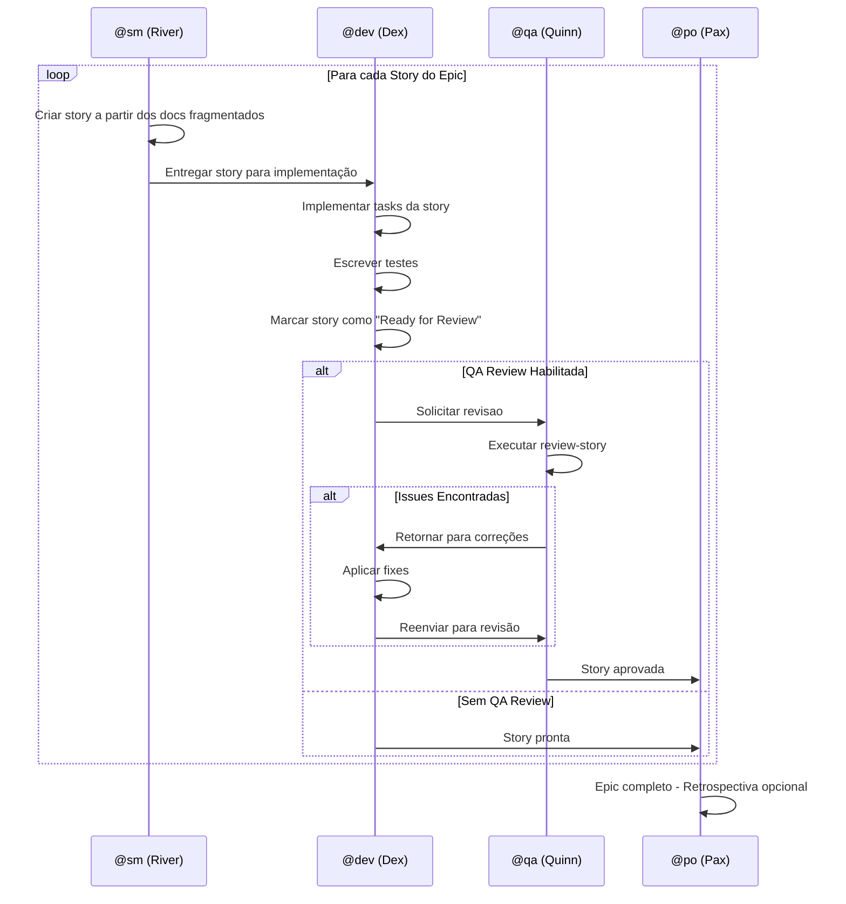
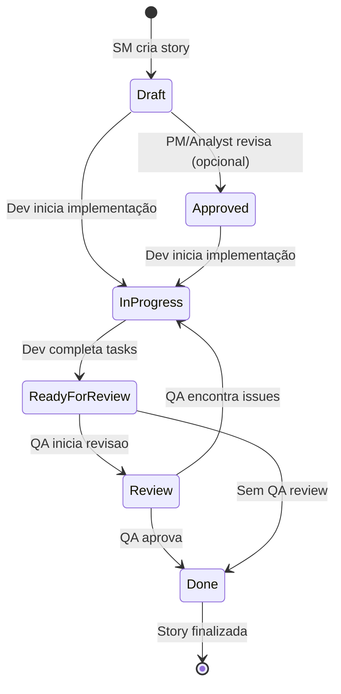
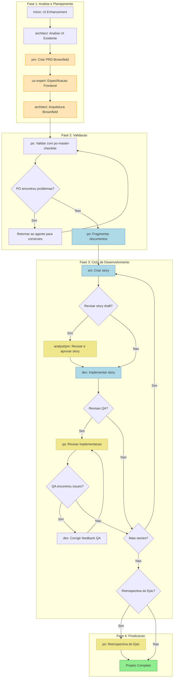
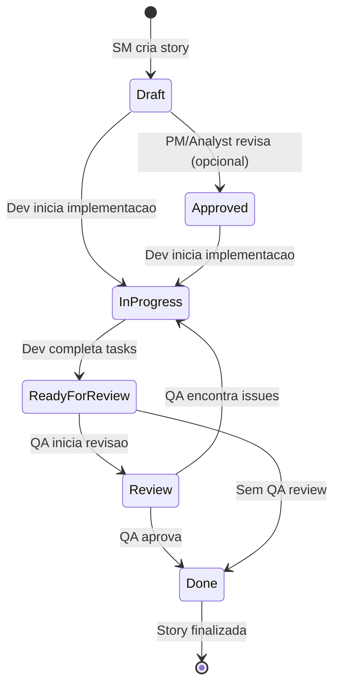

# COMANDO - brownfield-ui-workflow.md
**Origem:** E:\CentralDark\_MAPA_CASA\PASTA DO CHEFE JOGA ARQUIOVOS QUAIS QUUER SER GARIMPO DO CHEFE\aiox-core\docs\aios-workflows\brownfield-ui-workflow.md
**SHA:** 59bdefdf8da09987
**Timestamp:** 2026-08-28T02:02:32.596592
**Portoes:** {"ocorrencias": true, "ganho": true, "contraprova": true, "sha": true}

## Ouro Extraido

### Comandos
- 2. Executar comando: `*draft`
- 2. Executar comando: `*develop {story-id}`
- 2. Executar comando: `*review {story-id}`

### Ouro Bruto (primeiros 5000 chars)
```
# Workflow Brownfield UI/Frontend Enhancement

> **ID:** `brownfield-ui`
> **Tipo:** Brownfield (projeto existente)
> **Versão:** 1.0
> **Última Atualização:** 2026-02-04

## Sumário

- [Visão Geral](#visao-geral)
- [Diagrama do Workflow](#diagrama-do-workflow)
- [Steps Detalhados](#steps-detalhados)
- [Agentes Participantes](#agentes-participantes)
- [Tasks Executadas](#tasks-executadas)
- [Pré-requisitos](#pre-requisitos)
- [Entradas e Saidas](#entradas-e-saidas)
- [Pontos de Decisão](#pontos-de-decisao)
- [Troubleshooting](#troubleshooting)
- [Referências](#referencias)

---

## Visão Geral

O **Brownfield UI/Frontend Enhancement Workflow** é um fluxo de trabalho estruturado para aprimorar aplicações frontend existentes. Ele abrange desde a análise inicial do sistema legado até a implementação completa de novas funcionalidades, modernização de componentes ou atualização do design.

### Casos de Uso

| Tipo de Projeto | Descrição |
|-----------------|-----------|
| **UI Modernization** | Atualização de interfaces legadas para padrões modernos |
| **Framework Migration** | Migração entre frameworks (ex: jQuery para React) |
| **Design Refresh** | Atualização visual seguindo novos padrões de design |
| **Frontend Enhancement** | Adição de novas funcionalidades ao frontend existente |

### Benefícios

- Análise estruturada do sistema existente antes de modificações
- Integração segura com código legado
- Validação de qualidade em cada etapa
- Documentação completa de decisões arquiteturais

---

## Diagrama do Workflow

### Diagrama Principal de Fluxo


### Legenda de Cores

| Cor | Significado |
|-----|-------------|
| Verde Claro | Conclusão do workflow |
| Azul Claro | Steps de execução principal |
| Laranja Claro | Criação de artefatos de documentação |
| Amarelo Claro | Steps opcionais de revisão |

### Diagrama de Ciclo de Desenvolvimento



### Diagrama de Estados da Story



---

## Steps Detalhados

### S
```

---

# COMANDO - BROWNFIELD-UI-WORKFLOW.md
**Origem:** E:\CentralDark\_MAPA_CASA\PASTA DO CHEFE JOGA ARQUIOVOS QUAIS QUUER SER GARIMPO DO CHEFE\aiox-core\docs\guides\workflows\BROWNFIELD-UI-WORKFLOW.md
**SHA:** b526cb19f316d54a
**Timestamp:** 2026-08-28T02:02:37.423453
**Portoes:** {"ocorrencias": true, "ganho": true, "contraprova": true, "sha": true}

## Ouro Extraido

### Comandos
- 2. Executar comando: `*draft`
- 2. Executar comando: `*develop {story-id}`
- 2. Executar comando: `*review {story-id}`

### Ouro Bruto (primeiros 5000 chars)
```
# Workflow Brownfield UI/Frontend Enhancement

> **ID:** `brownfield-ui`
> **Tipo:** Brownfield (projeto existente)
> **Versao:** 1.0
> **Ultima Atualizacao:** 2026-02-04

## Sumario

- [Visao Geral](#visao-geral)
- [Diagrama do Workflow](#diagrama-do-workflow)
- [Steps Detalhados](#steps-detalhados)
- [Agentes Participantes](#agentes-participantes)
- [Tasks Executadas](#tasks-executadas)
- [Pre-requisitos](#pre-requisitos)
- [Entradas e Saidas](#entradas-e-saidas)
- [Pontos de Decisao](#pontos-de-decisao)
- [Troubleshooting](#troubleshooting)
- [Referencias](#referencias)

---

## Visao Geral

O **Brownfield UI/Frontend Enhancement Workflow** e um fluxo de trabalho estruturado para aprimorar aplicacoes frontend existentes. Ele abrange desde a analise inicial do sistema legado ate a implementacao completa de novas funcionalidades, modernizacao de componentes ou atualizacao do design.

### Casos de Uso

| Tipo de Projeto | Descricao |
|-----------------|-----------|
| **UI Modernization** | Atualizacao de interfaces legadas para padroes modernos |
| **Framework Migration** | Migracao entre frameworks (ex: jQuery para React) |
| **Design Refresh** | Atualizacao visual seguindo novos padroes de design |
| **Frontend Enhancement** | Adicao de novas funcionalidades ao frontend existente |

### Beneficios

- Analise estruturada do sistema existente antes de modificacoes
- Integracao segura com codigo legado
- Validacao de qualidade em cada etapa
- Documentacao completa de decisoes arquiteturais

---

## Diagrama do Workflow

### Diagrama Principal de Fluxo



### Legenda de Cores

| Cor | Significado |
|-----|-------------|
| Verde Claro | Conclusao do workflow |
| Azul Claro | Steps de execucao principal |
| Laranja Claro | Criacao de artefatos de documentacao |
| Amarelo Claro | Steps opcionais de revisao |

### Diagrama de Ciclo de Desenvolvimento


### Diagrama de Estados da Story



---

## Steps Detalhados

### S
```

---

# COMANDO - BROWNFIELD-UI-WORKFLOW.md
**Origem:** E:\CentralDark\_MAPA_CASA\PASTA DO CHEFE JOGA ARQUIOVOS QUAIS QUUER SER GARIMPO DO CHEFE\aiox-core\docs\guides\workflows\.extracted_AIOS-WORKFLOWS\BROWNFIELD-UI-WORKFLOW.md
**SHA:** 9e2b63a381d069cf
**Timestamp:** 2026-08-28T02:02:37.740983
**Portoes:** {"ocorrencias": true, "ganho": true, "contraprova": true, "sha": true}

## Ouro Extraido

### Comandos
- 2. Executar comando: `*draft`
- 2. Executar comando: `*develop {story-id}`
- 2. Executar comando: `*review {story-id}`

### Ouro Bruto (primeiros 5000 chars)
```
# Workflow Brownfield UI/Frontend Enhancement

> **ID:** `brownfield-ui`
> **Tipo:** Brownfield (projeto existente)
> **Versao:** 1.0
> **Ultima Atualizacao:** 2026-02-04

## Sumario

- [Visao Geral](#visao-geral)
- [Diagrama do Workflow](#diagrama-do-workflow)
- [Steps Detalhados](#steps-detalhados)
- [Agentes Participantes](#agentes-participantes)
- [Tasks Executadas](#tasks-executadas)
- [Pre-requisitos](#pre-requisitos)
- [Entradas e Saidas](#entradas-e-saidas)
- [Pontos de Decisao](#pontos-de-decisao)
- [Troubleshooting](#troubleshooting)
- [Referencias](#referencias)

---

## Visao Geral

O **Brownfield UI/Frontend Enhancement Workflow** e um fluxo de trabalho estruturado para aprimorar aplicacoes frontend existentes. Ele abrange desde a analise inicial do sistema legado ate a implementacao completa de novas funcionalidades, modernizacao de componentes ou atualizacao do design.

### Casos de Uso

| Tipo de Projeto | Descricao |
|-----------------|-----------|
| **UI Modernization** | Atualizacao de interfaces legadas para padroes modernos |
| **Framework Migration** | Migracao entre frameworks (ex: jQuery para React) |
| **Design Refresh** | Atualizacao visual seguindo novos padroes de design |
| **Frontend Enhancement** | Adicao de novas funcionalidades ao frontend existente |

### Beneficios

- Analise estruturada do sistema existente antes de modificacoes
- Integracao segura com codigo legado
- Validacao de qualidade em cada etapa
- Documentacao completa de decisoes arquiteturais

---

## Diagrama do Workflow

### Diagrama Principal de Fluxo


### Legenda de Cores

| Cor | Significado |
|-----|-------------|
| Verde Claro | Conclusao do workflow |
| Azul Claro | Steps de execucao principal |
| Laranja Claro | Criacao de artefatos de documentacao |
| Amarelo Claro | Steps opcionais de revisao |

### Diagrama de Ciclo de Desenvolvimento


### Diagrama de Estados da Story


---

## Steps Detalhados

### S
```