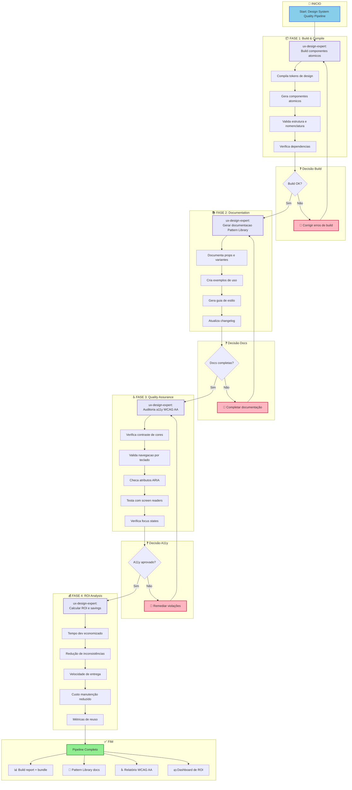
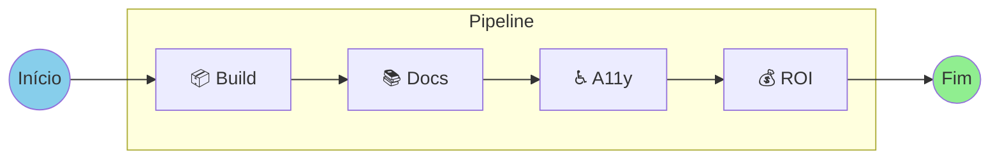
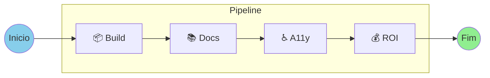
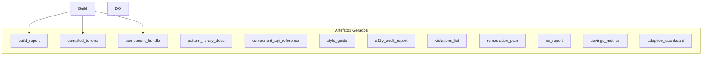

# COMANDO - design-system-build-quality-workflow.md
**Origem:** E:\CentralDark\_MAPA_CASA\PASTA DO CHEFE JOGA ARQUIOVOS QUAIS QUUER SER GARIMPO DO CHEFE\aiox-core\docs\aios-workflows\design-system-build-quality-workflow.md
**SHA:** 661db7322ede0be2
**Timestamp:** 2026-08-28T02:02:32.612408
**Portoes:** {"ocorrencias": true, "ganho": true, "contraprova": true, "sha": true}

## Ouro Extraido

### Comandos
- A[Start: Design System Quality Pipeline]

### Ouro Bruto (primeiros 5000 chars)
```
# Design System Build Quality Pipeline

**Workflow ID:** `design-system-build-quality`
**Versão:** 1.0.0
**Tipo:** Brownfield
**Status:** Production Ready

---

## Visão Geral

O **Design System Build Quality Pipeline** é um workflow pós-migração para Design Systems. Ele encadeia sequencialmente as etapas de build, documentação, auditoria de acessibilidade e cálculo de ROI para garantir qualidade e mensurar valor entregue.

### Propósito

Este pipeline garante que após a migração ou criação de um Design System:

1. **Componentes compilam corretamente** - Build de tokens e componentes atômicos
2. **Documentação está completa** - Pattern Library com exemplos e guias
3. **Acessibilidade é validada** - Conformidade WCAG 2.1 AA
4. **ROI é mensurado** - Métricas de economia e valor entregue

### Quando Usar

| Cenário | Recomendação |
|---------|--------------|
| Após migração de Design System | Fortemente recomendado |
| Release de nova versão do Pattern Library | Obrigatório |
| Auditoria periódica de qualidade | Recomendado (trimestral) |
| Validação pré-produção de componentes | Obrigatório |
| Geração de métricas para stakeholders | Conforme necessidade |

### Tipos de Projeto Suportados

- `design-system`
- `component-library`
- `pattern-library`
- `ui-migration`

---

## Diagrama do Workflow

### Fluxo Principal



### Visão Simplificada



#### Fluxo de Dependências


---

# COMANDO - DESIGN-SYSTEM-BUILD-QUALITY-WORKFLOW.md
**Origem:** E:\CentralDark\_MAPA_CASA\PASTA DO CHEFE JOGA ARQUIOVOS QUAIS QUUER SER GARIMPO DO CHEFE\aiox-core\docs\guides\workflows\DESIGN-SYSTEM-BUILD-QUALITY-WORKFLOW.md
**SHA:** 6a28e4ebc23cee8e
**Timestamp:** 2026-08-28T02:02:37.462103
**Portoes:** {"ocorrencias": true, "ganho": true, "contraprova": true, "sha": true}

## Ouro Extraido

### Comandos
- A[Start: Design System Quality Pipeline]

### Ouro Bruto (primeiros 5000 chars)
```
# Design System Build Quality Pipeline

**Workflow ID:** `design-system-build-quality`
**Versao:** 1.0.0
**Tipo:** Brownfield
**Status:** Production Ready

---

## Visao Geral

O **Design System Build Quality Pipeline** e um workflow pos-migracao para Design Systems. Ele encadeia sequencialmente as etapas de build, documentacao, auditoria de acessibilidade e calculo de ROI para garantir qualidade e mensurar valor entregue.

### Proposito

Este pipeline garante que apos a migracao ou criacao de um Design System:

1. **Componentes compilam corretamente** - Build de tokens e componentes atomicos
2. **Documentacao esta completa** - Pattern Library com exemplos e guias
3. **Acessibilidade e validada** - Conformidade WCAG 2.1 AA
4. **ROI e mensurado** - Metricas de economia e valor entregue

### Quando Usar

| Cenario | Recomendacao |
|---------|--------------|
| Apos migracao de Design System | Fortemente recomendado |
| Release de nova versao do Pattern Library | Obrigatorio |
| Auditoria periodica de qualidade | Recomendado (trimestral) |
| Validacao pre-producao de componentes | Obrigatorio |
| Geracao de metricas para stakeholders | Conforme necessidade |

### Tipos de Projeto Suportados

- `design-system`
- `component-library`
- `pattern-library`
- `ui-migration`

---

## Diagrama do Workflow

### Fluxo Principal


### Visao Simplificada



### Fluxo de Dependencias

