# COMANDO - MEMORY-SYSTEM.md
**Origem:** E:\CentralDark\_MAPA_CASA\PASTA DO CHEFE JOGA ARQUIOVOS QUAIS QUUER SER GARIMPO DO CHEFE\aiox-core\docs\guides\MEMORY-SYSTEM.md
**SHA:** 2625e4606f1db58f
**Timestamp:** 2026-08-28T02:02:36.360389
**Portoes:** {"ocorrencias": true, "ganho": true, "contraprova": true, "sha": true}

## Ouro Extraido

### Comandos
- [*] --> SessionStart: Claude Code abre

### Ouro Bruto (primeiros 5000 chars)
```
# Memory System - Complete Architecture Guide

**Versao:** 1.0
**Ultima Atualizacao:** 2026-02-09
**Autor:** @architect (Aria)
**Tags:** memory, session, persistence, context, gotchas, timeline, hooks

---

## Indice

1. [Visao Geral](#visao-geral)
2. [Diagrama de Arquitetura Completo](#diagrama-de-arquitetura-completo)
3. [Camada 1: Claude Code Nativo](#camada-1-claude-code-nativo)
4. [Camada 2: AIOS Framework](#camada-2-aios-framework)
5. [Fluxo de Ativacao de Agente (Memory Load)](#fluxo-de-ativacao-de-agente-memory-load)
6. [Fluxo de Persistencia (Memory Save)](#fluxo-de-persistencia-memory-save)
7. [Fluxo de Session Lifecycle](#fluxo-de-session-lifecycle)
8. [Gotchas Memory - Auto-Capture Flow](#gotchas-memory---auto-capture-flow)
9. [Context Snapshot & Recovery](#context-snapshot--recovery)
10. [Timeline Manager - Unified Facade](#timeline-manager---unified-facade)
11. [Hooks System - Cross-CLI Abstraction](#hooks-system---cross-cli-abstraction)
12. [Mapa Completo de Arquivos](#mapa-completo-de-arquivos)
13. [Mapa de Storage Persistente](#mapa-de-storage-persistente)
14. [Gaps e Limitacoes Conhecidas](#gaps-e-limitacoes-conhecidas)
15. [Referencias](#referencias)

---

## Visao Geral

O sistema de memoria do AIOS opera em **duas camadas independentes** que coexistem mas **nao se comunicam entre si**:

| Camada | Gerenciado Por | Escopo |
|--------|---------------|--------|
| **Camada 1: Claude Code Nativo** | Claude Code CLI | Auto Memory, CLAUDE.md, Session Transcripts |
| **Camada 2: AIOS Framework** | Scripts JS em `.aios-core/` | Gotchas, Session State, Context Snapshots, Timeline |

### Principios Chave

- **Nao existe session-digest automatico** — Quando uma sessao do Claude Code fecha, nenhuma sumarizacao acontece
- **Nao existe memory-flush automatico** — O MEMORY.md so e atualizado durante a sessao, pelo Claude
- **Hooks de sessao existem para Gemini** mas nao estao wired no Claude Code
- **Cada camada persiste de forma independente** — `.claude/` vs `.aios/`

---

## Diagrama de Arquitetura Completo

### Visao em Duas Camadas

```mermaid
flowchart TB
    subgraph CLAUDE_NATIVE["Camada 1: Claude Code Nativo"]
        direction TB
        CLAUDE_MD_G["CLAUDE.md Global<br/>~/.claude/CLAUDE.md"]
        CLAUDE_MD_W["CLAUDE.md Workspace<br/>Workspaces/.claude/CLAUDE.md"]
        CLAUDE_MD_P["CLAUDE.md Projeto<br/>aios-core/.claude/CLAUDE.md"]
        RULES["Rules/*.md<br/>5 arquivos de regras"]
        AUTO_MEM["Auto Memory<br/>~/.claude/projects/.../memory/MEMORY.md<br/>Primeiras 200 linhas no system prompt"]
        COMPOUND["Compound Analysis<br/>memory/compound-analysis/<br/>11 arquivos (9 conteudo + manifest + summary)"]
        AGENT_MEM["Agent Memory<br/>.claude/agent-memory/{agent}/MEMORY.md<br/>6 agentes com memoria"]
        TRANSCRIPTS["Session Transcripts<br/>~/.claude/projects/.../{session}.jsonl"]
        SESSIONS_IDX["Sessions Index<br/>sessions-index.json"]
    end

    subgraph AIOS_FRAMEWORK["Camada 2: AIOS Framework"]
        direction TB
        GOTCHAS["Gotchas Memory<br/>.aios-core/core/memory/gotchas-memory.js"]
        CTX_SNAP["Context Snapshot<br/>.aios-core/core/memory/context-snapshot.js"]
        FILE_EVO["File Evolution Tracker<br/>.aios-core/core/memory/file-evolution-tracker.js"]
        TIMELINE["Timeline Manager<br/>.aios-core/core/memory/timeline-manager.js"]
        CTX_LOADER["Session Context Loader<br/>.aios-core/core/session/context-loader.js"]
        CTX_DETECT["Context Detector<br/>.aios-core/core/session/context-detector.js"]
        SESS_STATE["Session State<br/>.aios-core/core/orchestration/session-state.js"]
        HOOKS_GEM["Gemini Hooks<br/>.aios-core/hooks/gemini/"]
        HOOKS_UNI["Unified Hooks<br/>.aios-core/hooks/unified/"]
    end

    subgraph STORAGE_CLAUDE["Storage Claude Code"]
        S_MEMORY["~/.claude/projects/.../memory/"]
        S_SESSIONS["~/.claude/projects/.../*.jsonl"]
        S_AGENT_MEM[".claude/agent-memory/"]
    end

    subgraph STORAGE_AIOS["Storage AIOS (.aios/)"]
        S_GOTCHAS[".aios/gotchas.json + .md"]
        S_ERRORS[".aios/error-tracking.json"]
        S_SNAPSHOTS[".aios/snapshots/"]
        S_TIMELINE[".aios/timeline/"]
        S_FILE_EVO[".aios/file-evolution/"]
        S_SESSION[".aios/session-state.json"]
        S_EPIC_STATE["docs/stories/.session-state.yaml"]
    end

    AUTO_MEM --> S_MEMORY
    AGENT_MEM --> S_AGENT_MEM
    TRANSCRIPTS --> S_SESSIONS

    GOTCHAS --> S_GOTCHAS
    GOTCHAS --> S_ERRORS
    CTX_SNAP --> S_SNAPSHOTS
    FILE_EVO --> S_FILE_EVO
    TIMELINE --> S_TIMELINE
    CTX_LOADER --> S_SESSION
    SESS_STATE --> S_EPIC_STATE

    style CLAUDE_NATIVE fill:#E3F2FD,stroke:#1565C0
    style AIOS_FRAMEWORK fill:#FFF3E0,stroke:#E65100
    style STORAGE_CLAUDE fill:#E8F5E9,stroke:#2E7D32
    style STORAGE_AIOS fill:#FCE4EC,stroke:#C62828
```



### Relacionamento entre Scripts

```mermaid
flowchart LR
    subgraph MEMORY_LAYER["Memory Layer (.aios-core/core/memory/)"]
        TM["timeline
```