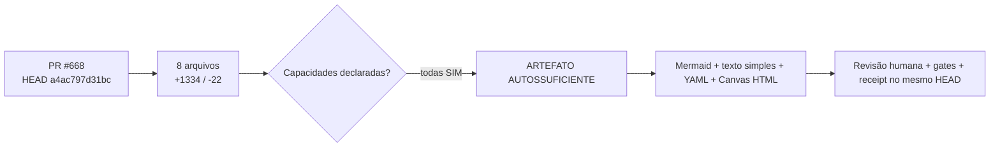

# COMANDO - PR-668-LEARNING-ARTIFACT-FINAL_2.md
**Origem:** E:\CentralDark\_MAPA_CASA\PASTA DO CHEFE JOGA ARQUIOVOS QUAIS QUUER SER GARIMPO DO CHEFE\PACOTE-SESSAO-INTEIRA-CENTRALDARK-20260806\01-ARQUIVOS-DA-CONVERSA\PR-668-LEARNING-ARTIFACT-FINAL_2.md
**SHA:** 1c149db4fabedb1f
**Timestamp:** 2026-08-26T19:10:22.620424
**Portoes:** {"ocorrencias": true, "ganho": true, "contraprova": true, "sha": true}

## Ouro Extraido

### Gaps
- missing: []

### Ouro Bruto (primeiros 5000 chars)
```
<!-- centraldark-pr-learning-artifact -->
# 🧠 Artefato automático de aprendizado do PR

**PR:** #668 · **HEAD:** `a4ac797d31bc122672c118b6a8a13b8e892549f4` · **Estado:** `READY`

**Título:** feat\(pr\): artefato automático de aprendizado e suporte por capacidade

## Mapa visual (Mermaid)



## Fallback universal em texto simples

PR #668 no HEAD a4ac797d31bc122672c118b6a8a13b8e892549f4. 8 arquivos alterados; +1334 e -22. Todas as capacidades foram declaradas como suportadas, sem verificação independente. Fonte das capacidades: DECLARED_UNVERIFIED. O artefato não aprova o PR: ele organiza contexto; testes, revisão e gates continuam obrigatórios.

## Cartão estruturado para IAs

```yaml
artifact_type: pr_learning_card
artifact_schema: 1
repository: "ServerVpss/CentralDark"
pr_number: 668
head_sha: "a4ac797d31bc122672c118b6a8a13b8e892549f4"
base_sha: "f692e3118304724c0c860b56bb00a33e18edeac5"
title: "feat(pr): artefato automático de aprendizado e suporte por capacidade"
author: "segredounlock"
status: READY
capability_source: DECLARED_UNVERIFIED
blocked: NAO
capabilities:
  mermaid: SIM
  canvas_html: SIM
  structured_yaml: SIM
support:
  required: NAO
  missing: []
  labels: ["🤖 AUTO"]
change_summary:
  files: 8
  additions: 1334
  deletions: 22
  workflows: 3
  docs: 3
  tests: 1
  code: 1
  sensitive_paths: 0
artifact_digest: ff96d47b229cc9e2b43d9f58ab9634b940104a670aca7727c3c3e19d0bae0c58
```

## 🟢 Capacidades declaradas

A autoria declarou suporte aos três formatos. Essa declaração ainda não é prova independente da capacidade.

## Receipt

```text
ARTIFACT_STATUS=READY
CAPABILITY_SOURCE=DECLARED_UNVERIFIED
BLOCKED=NAO
HEAD_SHA=a4ac797d31bc122672c118b6a8a13b8e892549f4
FILES=8
SUPPORT_REQUIRED=NAO
MISSING_CAPABILITIES=NENHUMA
SENSITIVE_PATHS=0
ARTIFACT_DIGEST=ff96d47b229cc9e2b43d9f58ab9634b940104a670aca7727c3c3e19d0bae0c58
PR_APPROVED=NAO
MERGE_AUTHORIZED=NAO
```

> Este comentário é idempotente e deve ser atualizado no mesmo marcador. É contexto verificável, não prova de funcionamento do código.
```