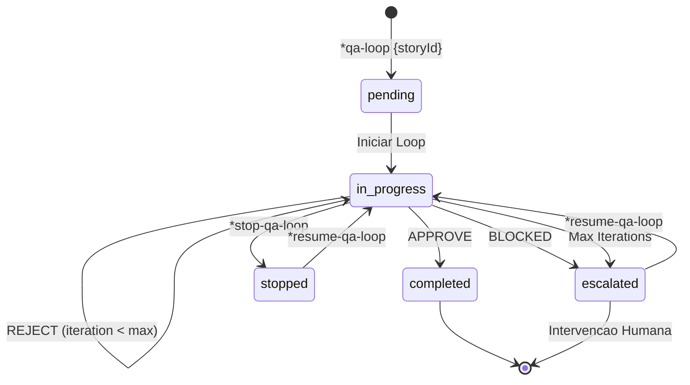
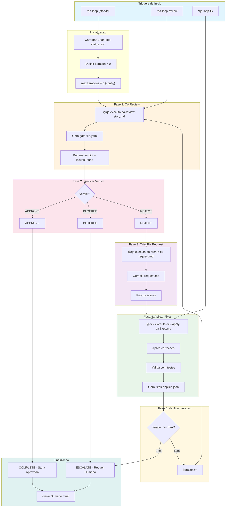

# COMANDO - qa-loop-workflow.md
**Origem:** E:\CentralDark\_MAPA_CASA\PASTA DO CHEFE JOGA ARQUIOVOS QUAIS QUUER SER GARIMPO DO CHEFE\aiox-core\docs\aios-workflows\qa-loop-workflow.md
**SHA:** 0c3a0c9dcc168fde
**Timestamp:** 2026-08-28T02:02:32.663249
**Portoes:** {"ocorrencias": true, "ganho": true, "contraprova": true, "sha": true}

## Ouro Extraido

### Decisoes
- **Lógica de Decisão:**

### Padroes
- Este workflow executa ate um maximo de iterações configuravel (padrao: 5), rastreando os resultados de cada iteracao. Quando o limite maximo e atingido ou uma parada manual e solicitada, o workflow es

### Contratos
- **Critérios de Gate:**

### Ouro Bruto (primeiros 5000 chars)
```
# QA Loop Workflow - Documentação Completa

**Versão:** 1.0
**Última Atualização:** 2026-02-04
**Epic:** 6 - QA Evolution: Autonomous Development Engine (ADE)
**Story:** 6.5
**Autor:** @architect (Aria)

---

## Índice

1. [Visao Geral](#visao-geral)
2. [Diagrama do Workflow](#diagrama-do-workflow)
3. [Steps Detalhados](#steps-detalhados)
4. [Agentes Participantes](#agentes-participantes)
5. [Tasks Executadas](#tasks-executadas)
6. [Pré-requisitos](#pre-requisitos)
7. [Entradas e Saidas](#entradas-e-saidas)
8. [Pontos de Decisão](#pontos-de-decisão)
9. [Configuração](#configuracao)
10. [Controle de Execução](#controle-de-execucao)
11. [Escalação](#escalacao)
12. [Integração com Dashboard](#integracao-com-dashboard)
13. [Tratamento de Erros](#tratamento-de-erros)
14. [Troubleshooting](#troubleshooting)
15. [Referências](#referencias)

---

## Visão Geral

O **QA Loop Orchestrator** e um workflow automatizado que orquestra o ciclo completo de:

```
Review -> Fix -> Re-review
```

Este workflow executa ate um maximo de iterações configuravel (padrao: 5), rastreando os resultados de cada iteracao. Quando o limite maximo e atingido ou uma parada manual e solicitada, o workflow escala para intervenção humana.

### Propósito

- Automatizar o ciclo de revisao de qualidade
- Reduzir tempo entre feedback e correção
- Garantir rastreabilidade completa do processo de QA
- Escalar automaticamente quando necessario

### Tipos de Projeto Suportados

- `aios-development`
- `autonomous-development`
- `qa-automation`

---

## Diagrama do Workflow

### Fluxo Principal


### Diagrama de Estados



### Sequencia de Comunicação entre Agentes

```mermaid
sequenceDiagram
    participant U as Usuario
    participant S as System
    participant QA as @qa (Quinn)
    participant DEV as @dev (Dex)

    U->>S: *qa-loop STORY-42
    S->>S: Inicializar loop-status.json

    loop Ate max iterações ou APPROVE
        S->>QA: Executar qa-review-story.md
        QA->>QA: CodeRabbit Self-Healing
        QA->>QA: Análise Completa
        QA-->>S: verdict, issuesFound, gate-file

        alt verdict == APPROVE
            S-->>U: Story APROVADA
        else verdict == BLOCKED
            S-->>U: ESCALATE - Requer Humano
        else verdict == REJECT
            S->>QA: Executar qa-create-fix-request.md
            QA-->>S: fix-request.md, prioritizedIssues

            S->>DEV: Executar dev-apply-qa-fixes.md
            DEV->>DEV: Aplicar Fixes
            DEV->>DEV: Rodar Testes
            DEV-->>S: fixes-applied.json, issuesFixed

            S
```

---

# COMANDO - QA-LOOP-WORKFLOW.md
**Origem:** E:\CentralDark\_MAPA_CASA\PASTA DO CHEFE JOGA ARQUIOVOS QUAIS QUUER SER GARIMPO DO CHEFE\aiox-core\docs\guides\workflows\QA-LOOP-WORKFLOW.md
**SHA:** 1111ebe445427f7a
**Timestamp:** 2026-08-28T02:02:37.533105
**Portoes:** {"ocorrencias": true, "ganho": true, "contraprova": true, "sha": true}

## Ouro Extraido

### Decisoes
- **Logica de Decisao:**

### Padroes
- Este workflow executa ate um maximo de iteracoes configuravel (padrao: 5), rastreando os resultados de cada iteracao. Quando o limite maximo e atingido ou uma parada manual e solicitada, o workflow es

### Contratos
- **Criterios de Gate:**

### Ouro Bruto (primeiros 5000 chars)
```
# QA Loop Workflow - Documentacao Completa

**Versao:** 1.0
**Ultima Atualizacao:** 2026-02-04
**Epic:** 6 - QA Evolution: Autonomous Development Engine (ADE)
**Story:** 6.5
**Autor:** @architect (Aria)

---

## Indice

1. [Visao Geral](#visao-geral)
2. [Diagrama do Workflow](#diagrama-do-workflow)
3. [Steps Detalhados](#steps-detalhados)
4. [Agentes Participantes](#agentes-participantes)
5. [Tasks Executadas](#tasks-executadas)
6. [Pre-requisitos](#pre-requisitos)
7. [Entradas e Saidas](#entradas-e-saidas)
8. [Pontos de Decisao](#pontos-de-decisao)
9. [Configuracao](#configuracao)
10. [Controle de Execucao](#controle-de-execucao)
11. [Escalacao](#escalacao)
12. [Integracao com Dashboard](#integracao-com-dashboard)
13. [Tratamento de Erros](#tratamento-de-erros)
14. [Troubleshooting](#troubleshooting)
15. [Referencias](#referencias)

---

## Visao Geral

O **QA Loop Orchestrator** e um workflow automatizado que orquestra o ciclo completo de:

```
Review -> Fix -> Re-review
```

Este workflow executa ate um maximo de iteracoes configuravel (padrao: 5), rastreando os resultados de cada iteracao. Quando o limite maximo e atingido ou uma parada manual e solicitada, o workflow escala para intervencao humana.

### Proposito

- Automatizar o ciclo de revisao de qualidade
- Reduzir tempo entre feedback e correcao
- Garantir rastreabilidade completa do processo de QA
- Escalar automaticamente quando necessario

### Tipos de Projeto Suportados

- `aios-development`
- `autonomous-development`
- `qa-automation`

---

## Diagrama do Workflow

### Fluxo Principal



### Diagrama de Estados


### Sequencia de Comunicacao entre Agentes

```mermaid
sequenceDiagram
    participant U as Usuario
    participant S as System
    participant QA as @qa (Quinn)
    participant DEV as @dev (Dex)

    U->>S: *qa-loop STORY-42
    S->>S: Inicializar loop-status.json

    loop Ate max iteracoes ou APPROVE
        S->>QA: Executar qa-review-story.md
        QA->>QA: CodeRabbit Self-Healing
        QA->>QA: Analise Completa
        QA-->>S: verdict, issuesFound, gate-file

        alt verdict == APPROVE
            S-->>U: Story APROVADA
        else verdict == BLOCKED
            S-->>U: ESCALATE - Requer Humano
        else verdict == REJECT
            S->>QA: Executar qa-create-fix-request.md
            QA-->>S: fix-request.md, prioritizedIssues

            S->>DEV: Executar dev-apply-qa-fixes.md
            DEV->>DEV: Aplicar Fixes
            DEV->>DEV: Rodar Testes
            DEV-->>S: fixes-applied.json, issuesFixed

            S
```