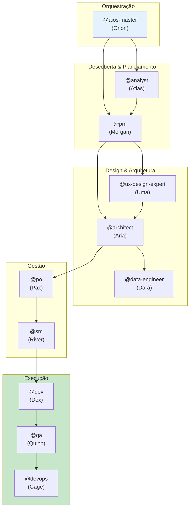
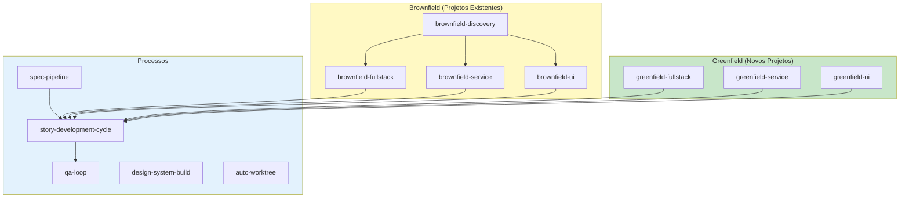
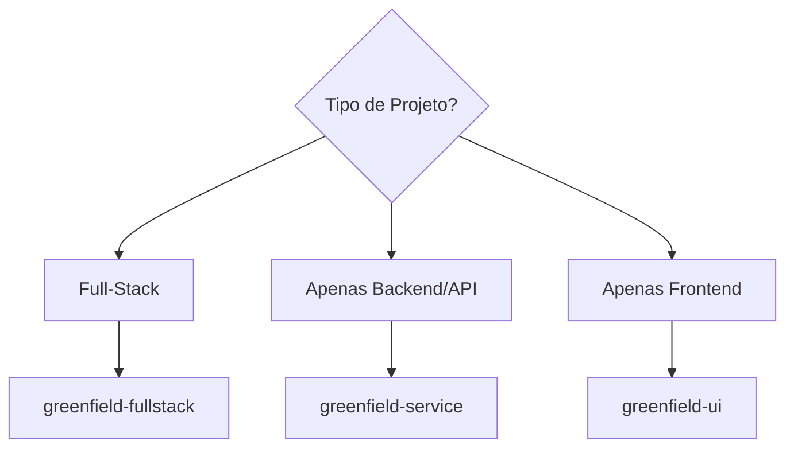
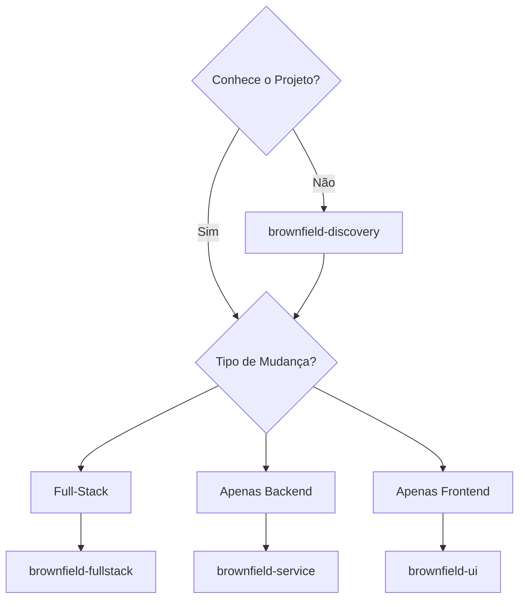
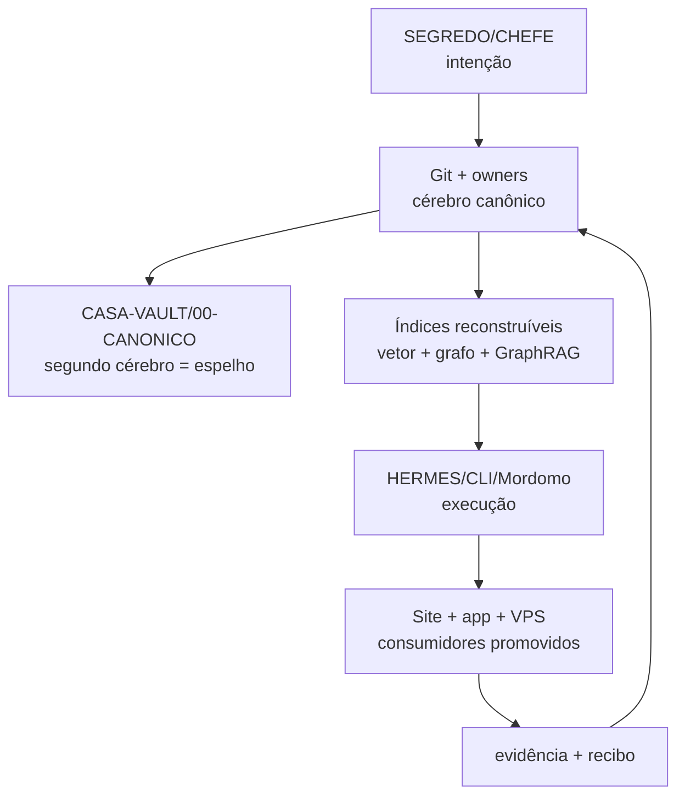

# COMANDO - README.md
**Origem:** E:\CentralDark\_MAPA_CASA\Nova pasta\.extracted_screenpipe-main.zip\screenpipe-main\README.md
**SHA:** a43b6d4d987fa074
**Timestamp:** 2026-08-23T14:15:49.534481
**Portoes:** {"ocorrencias": true, "ganho": true, "contraprova": true, "sha": true}

## Ouro Extraido

### Comandos
- To install the screenpipe skills and MCP configuration into every supported agent detected on your computer, run:

### Ouro Bruto (primeiros 5000 chars)
```
<h1 align="center"><a href="https://screenpipe.com/how-to-install?download=1">DOWNLOAD SCREENPIPE</a></h1>


<p align="center">
   <a href ="https://screenpi.pe">
      
   </a>
</p>

<h1 align="center">[ screenpipe | YC S26 ]</h1>


<p align="center">Screenpipe remembers how you actually work</p>
<p align="center">Record your screen continuously locally and provide context to your agents (Claude, Codex, Openclaw, Hermes, Runner...)</p>


<p align="center">
<a align="center" href="https://trendshift.io/repositories/20386" target="_blank"></a>
</p>

<p align="center">
  <a href="https://discord.gg/screenpipe">
    
  </a>
  <a href="https://twitter.com/screenpipe">
    
  </a>
  <a href="https://www.youtube.com/@screen_pipe">
    
  </a>
</p>


https://github.com/user-attachments/assets/70fe94eb-6d2a-47ca-b7c3-c8ead13a5b7f


---

## what is this?

screenpipe capture all your computer work locally and power your agents

```
┌─────────────────────────────────────────┐
│  screen + audio → local storage → ai   │
└─────────────────────────────────────────┘
```

- **remember everything** - never forget what you saw, heard, or did
- **run agents that work based on what you do** generate agents, skills, and automations based on what you do


- **search with ai** - find anything using natural language
- **100% local** - your data lives on your machine only
- **source-available** - inspect, modify, audit ([LICENSE.md](LICENSE.md))
  **company brain** - share knowledge with your team without turning it into surveillance

<p align="center">
   <a href ="https://screenpi.pe">
      
   </a>
</p>


## install

[download the desktop app](https://screenpipe.com/how-to-install?download=1) — all features, auto-updates

or run the CLI:

```
npx screenpipe record
```

then 

```bash
npx screenpipe setup
# or
claude mcp add screenpipe -- npx -y screenpipe-mcp@latest
```

then ask claude `what did i see in the last 5 mins?` or `summarize today conversations` or `create a pipe that updates linear every time i work on task X`

<details>
<summary>🤖 CLI-only setup for coding agents</summary>

If Claude Code, Codex, Gemini CLI, Cursor, or another coding agent is working from this repository, give it this instruction:

> Read the [screenpipe CLI skill](crates/screenpipe-core/assets/skills/screenpipe-cli/SKILL.md) before operating screenpipe. Set up always-on local capture, verify capture freshness and storage, then query my history without relying on the desktop app.

To install the screenpipe skills and MCP configuration into every supported agent detected on your computer, run:

```bash
npx screenpipe setup
```

The skill covers the recorder-first service default, explicit API-only server mode, human and JSON status, local search, safe read-only SQLite access, pipes, and connections.

</details>


## specs

- captures full accessibility tree, OCR as fallback, transcription, speakers, keyboard inputs, app switches
- 5-10% cpu usage
- 0.5-3gb ram
- ~20gb storage/month
- filters (window, app, chrome extensions, passwords, proprietary AI PII model)
- optional encryption at rest
- works offline

---

<p align="center">
    <a href="https://docs.screenpi.pe">docs</a> ·
    <a href="https://screenpi.pe/team">enterprise</a> ·
    <a href="https://discord.gg/screenpipe">discord</a> ·
    <a href="https://twitter.com/screenpipe">x</a> ·
    <a href="https://www.youtube.com/@screen_pipe">youtube</a> ·
    <a href="https://www.reddit.com/r/screen_pipe">reddit</a>
</p>

## Contributing

See [CONTRIBUTING.md](CONTRIBUTING.md) for guidelines, maintainers, and how to sub
```

---

# COMANDO - README.md
**Origem:** E:\CentralDark\_MAPA_CASA\Nova pasta\.extracted_screenpipe-main.zip\screenpipe-main\apps\screenpipe-app-tauri\e2e\README.md
**SHA:** 071cff31e9d5420a
**Timestamp:** 2026-08-23T14:15:55.097120
**Portoes:** {"ocorrencias": true, "ganho": true, "contraprova": true, "sha": true}

## Ouro Extraido

### Comandos
- The test runner (`wdio.conf.ts` `onPrepare`) calls `netstat -ano | findstr :4445` and kills the owner via `taskkill`. If it persists, manually run:

### Ouro Bruto (primeiros 5000 chars)
```
# E2E Tests

Cross-platform E2E for Screenpipe using [tauri-plugin-webdriver](https://crates.io/crates/tauri-plugin-webdriver). macOS, Windows, Linux.

## Run

From `apps/screenpipe-app-tauri`:

**1. Build**

```bash
bun run build:tauri:e2e
```

- The script sets `NEXT_PUBLIC_SCREENPIPE_E2E=true` to compile in the frontend
  E2E hooks. CI sets this too (see `.github/workflows/e2e-test.yml`); without it
  the app-entitlement account seed is compiled out, so any spec that needs a
  signed-in surface (Brain, Chat) silently renders "sign in required" instead
- It selects the fast `debug-dev` profile, builds only the binary, enables the
  WebDriver plugin, and enters the same system-wide native build queue as normal
  development.

**2. Run tests**

```bash
bun run test:e2e
```

**Run the macOS audio fallback spec**

```bash
bun run test:e2e:audio-fallback:macos
```

This uses `SCREENPIPE_E2E_SEED=onboarding,no-recording,cloud-audio-fallback`
to keep vision capture off while leaving the audio settings visible with
Screenpipe Cloud saved and no logged-in user. It asserts the Recording fallback
alert and the persisted `/notifications` entry.

**Run the local hosted-AI gateway spec**

```bash
bun run test:e2e:local-ai-gateway:macos
```

This opt-in lane bundles the production AI Worker under Miniflare, applies all
checked-in migrations to an isolated in-memory D1 database, and launches the
real E2E app with its hosted-AI URL pinned to that loopback Worker. OpenAI is a
network-closed fake: the harness intercepts the exact chat endpoint and fails
the run if the Worker attempts any other outbound request. No production
gateway, customer data, provider credential, or paid model is used.

**Run the first-run AI summary spec**

```bash
bun run test:e2e:first-run-ai-summary:macos
```

Same local Worker lane, pointed at the post-setup learning window. It proves the
real app reaches the model through the real Pi command and the real Worker, that
the forwarded provider request carries the screen and audio excerpts (not just
app names), and that the model's text — never the deterministic fallback — is
what lands in the seeded chat.

`/activity-summary` is stubbed in the webview: resolving needs >= 10 captured
frames, which a CI machine with no desktop cannot produce and which is not what
this spec is testing. The real engine's answers are covered against a live
engine in `first-run-learning-window.spec.ts`.

**Run the macOS HD recording pipeline spec**

```bash
bun run test:e2e:hd:macos
```

Opt-in spec for the high-fps "HD recording" pipeline. Uses
`SCREENPIPE_E2E_SEED=onboarding` (vision ON) so it needs a host with **Screen
Recording granted and a real display**. It drives `POST /capture/hd/start`,
then asserts (1) the controller flips active, (2) a non-empty `hd_*.mp4` chunk
is written to disk, and (3) OCR rows keep landing via `/search` *during* the HD
window — i.e. high-fps capture and normal indexing run concurrently (#3699 /
#3707). Self-skips under the default `no-recording` seed or when the HD
controller is unavailable, so it never fails the default CI lane.

**Run the macOS gone-silent recovery reproduction**

```bash
bun run test:e2e:capture-stall-recovery:macos
```

This isolated fault lane includes the debug-only `ignore-disk-pressure` seed;
otherwise a host that crosses the 20 GiB production safety threshold during a
large debug build can correctly stop capture and mask the SCK failure under test.

It also parks the first SCK frame worker and proves an independent
CoreGraphics capture can reach a healthy terminal outcome. That seed clears
window filters only inside the isolated E2E store: the production fallback is
allowed only when no SCK window exclusions are active, so privacy failures stay
fail-closed.

This opt-in lane needs Screen Recording permission. It arms the fault only
after real capture has reached a healthy terminal outcome, then verifies the complete
stale-health / failure-pill / independent-watchdog / resumed-progress cycle.
Before fault injection it pauses every selected display through the real local
API, verifies health reports an intentional disabled state without surfacing
`recording needs help`, resumes every display, and proves capture progress
returns. Per-monitor unit coverage separately proves one healthy display cannot
mask a silent sibling on multi-monitor systems.
It also proves an id-based ScreenCaptureKit lookup is bounded and a fresh retry
still enumerates the display. The local API is isolated on port 3041.

**Or combined (build + test):**

```bash
./e2e/run.sh
```

Uses `.e2e/` as isolated data dir; real data is never touched.
The E2E launcher also moves the app-local focus/notification server to
`SCREENPIPE_FOCUS_PORT` (default `11436`) so tests can exercise `/notify` and
`/notifications` without colliding with a developer's production app on 11435.

## Running locally on Windows

### Prerequisites

- **Bun** ≥ 1.3.10 — `winget install oven-sh.bun` or from [bun.sh](https://bun.
```

---

# COMANDO - README.md
**Origem:** E:\CentralDark\_MAPA_CASA\Nova pasta\.extracted_screenpipe-main.zip\screenpipe-main\crates\screenpipe-semantic\evals\pipes\README.md
**SHA:** fc80e405329cfb3d
**Timestamp:** 2026-08-23T14:17:00.247328
**Portoes:** {"ocorrencias": true, "ganho": true, "contraprova": true, "sha": true}

## Ouro Extraido

### Comandos
- turn a model comparison into an `auto` run:

### Contratos
- Run the stable deterministic gate:

### Ouro Bruto (primeiros 5000 chars)
```
# Pipe output evaluation

This suite compares how representative Screenpipe pipe tasks perform when the
same captured evidence is supplied as:

- persisted accessibility JSON;
- Screenpipe's current text-bearing element outline;
- compact semantic context.

The fast four-case harness follows the read and analysis contracts of installed
`ai-prompt-journal`, `workflow-discovery`, `sop-generator`, and
`chronos-time-tracker` pipes. It does not execute those installed prompts. It is
a deterministic representation and scoring regression check against sanitized
fixed evidence with reviewed ground truth.

The separate installed-pipe harness performs real pipe runs for
`workflow-discovery` and `sop-generator`. It reads each installed `pipe.md`,
records hashes of the full file and exact prompt body, renders the prompt
through `screenpipe_core::pipes::PipeManager`, launches Pi, and requires the
pipe to create its physical artifact. A successful subprocess with no artifact
is a failed run. Eight reviewed cases cover repeated workflows, ordered SOPs,
unrelated and single-occurrence abstention, cross-app evidence, and captured
prompt-injection text.

The deterministic gate measures exact `o200k_base` prompt tokens and verifies
that every required source fact remains visible. The opt-in Pi run additionally
scores valid JSON, required output fields, required-fact recall, forbidden
actor or invented-detail contamination, observed step order, output tokens, and
elapsed model time.

Run the stable deterministic gate:

```bash
cargo run --release -p screenpipe-semantic --example pipe_eval --locked -- \
  --report
```

Inspect the balanced prompt pack without inference:

```bash
cargo run --release -p screenpipe-semantic --example pipe_eval --locked -- \
  --prompts
```

Run three counterbalanced repeats through a local Pi model:

```bash
cargo run --release -p screenpipe-semantic --example pipe_eval --locked -- \
  --run-pi ollama/screenpipe-gemma4:latest 3
```

The optional fourth argument limits a model run to one case, which is useful
for a fast parser or renderer regression check:

```bash
cargo run --release -p screenpipe-semantic --example pipe_eval --locked -- \
  --run-pi ollama/screenpipe-gemma4:latest 5 \
  ai_prompt_journal_actor_precision
```

Run three counterbalanced repeats through the actual installed pipe prompts:

```bash
cargo run --release -p screenpipe-semantic --example pipe_eval --locked -- \
  --run-installed-pipes "$HOME/.screenpipe/pipes" \
  ollama/screenpipe-gemma4:latest 3
```

Hosted Screenpipe models use the same sandboxed installed-prompt path, but
require an explicit existing Pi agent directory for authentication. The path
and credentials are not included in the report:

```bash
SCREENPIPE_EVAL_PI_AGENT_DIR="$HOME/.screenpipe/pi-config" \
cargo run --release -p screenpipe-semantic --example pipe_eval --locked -- \
  --run-installed-pipes "$HOME/.screenpipe/pipes" \
  screenpipe/gpt-5.6-terra 1
```

The optional final argument limits the run to one reviewed installed-pipe case:

```bash
cargo run --release -p screenpipe-semantic --example pipe_eval --locked -- \
  --run-installed-pipes "$HOME/.screenpipe/pipes" \
  ollama/screenpipe-gemma4:latest 3 sop_release_signing
```

Installed-pipe results include artifact existence, artifact-contract validity,
pre-inference source-fact retention, reviewed output-fact recall, forbidden
contamination, step order, evidence and rendered pipe-prompt tokens, output
tokens, wall time, per-case summaries, and paired semantic-versus-baseline
bootstrap intervals. The three representations are counterbalanced across case
and repeat order. Source retention and model recall are separate metrics so a
parser omission cannot be mistaken for a model failure, or vice versa.

For safety, each installed prompt runs from a temporary pipe directory. The
frontmatter is normalized only for manual eval execution, fixed model choice,
timeout, and disabled history; the installed prompt body is byte-for-byte
preserved and hashed. Pi receives only `read`, `write`, and `ls`; shell, live
Screenpipe APIs, integrations, notifications, extensions, skills, sessions,
and project context are unavailable. This tests the real PipeManager prompt,
installed pipe instructions, Pi tool use, and on-disk artifact contract without
allowing an eval to affect user data. It is intentionally stricter and safer
than a fully privileged production pipe invocation.

For the closest production-runtime check, run the same cases through the
already-running local Screenpipe pipe endpoint. It uses the configured `auto`
preset by default:

```bash
export SCREENPIPE_LOCAL_API_KEY="$(cd "$(mktemp -d)" && \
  bun x screenpipe@latest auth token)"
cargo run --release -p screenpipe-semantic --example pipe_eval --locked -- \
  --run-live-installed-pipes "$HOME/.screenpipe/pipes" \
  3 sop_release_signing
```

Set `SCREENPIPE_EVAL_PRESET` to the ID of another configured preset to compare
models without changing the instal
```

---

# COMANDO - README.md
**Origem:** E:\CentralDark\_MAPA_CASA\Nova pasta\.extracted_screenpipe-main.zip\screenpipe-main\packages\screenpipe-mcp\README.md
**SHA:** 661177f3dfe50735
**Timestamp:** 2026-08-23T14:17:19.309016
**Portoes:** {"ocorrencias": true, "ganho": true, "contraprova": true, "sha": true}

## Ouro Extraido

### Comandos
- bun run start:http -- --port 3031

### Ouro Bruto (primeiros 5000 chars)
```
# Screenpipe MCP Server

<a href="https://www.pulsemcp.com/servers/screenpipe-screenpipe"></a>

<br/>

https://github.com/user-attachments/assets/7466a689-7703-4f0b-b3e1-b1cb9ed70cff

MCP server for screenpipe - search your screen recordings, audio transcriptions, and control your computer with AI.

## Installation

### Option 1: The screenpipe desktop app (Recommended)

The most reliable setup is to install the [screenpipe desktop app](https://screenpi.pe)
and connect Claude Desktop from **Settings → Connections** (or during onboarding).
This writes a config that:

- uses the **bundled `bun`** shipped with the app (an absolute path — no Node/`npx`
  or `PATH` dependency, and ~3× faster cold start), and
- injects your **`SCREENPIPE_LOCAL_API_KEY`** into the server's `env`, so the MCP
  authenticates instantly instead of running slow key discovery at startup.

Both matter: a config without the key forces the server to discover it via
subprocess fallbacks, which on a cold package cache can stall Claude Desktop's MCP
startup and produce `Could not attach to MCP server screenpipe`.

### Option 2: Manual NPX (no desktop app)

If you're not using the desktop app, edit your Claude Desktop config:

- **macOS**: `~/Library/Application Support/Claude/claude_desktop_config.json`
- **Windows**: `%AppData%\Claude\claude_desktop_config.json`

```json
{
  "mcpServers": {
    "screenpipe": {
      "command": "npx",
      "args": ["-y", "screenpipe-mcp@latest"],
      "env": {
        "SCREENPIPE_LOCAL_API_KEY": "sp-…"
      }
    }
  }
}
```

Requires Node/`npx` on `PATH`. Pin `@latest` so the first install doesn't cache a
stale version forever. Get your key with `screenpipe auth token`. If you omit the
key, the server will try to discover it (bundled bun → npx → local DB) — this works
but is slower and can time out on first run.

Enterprise admins: add `SCREENPIPE_ENTERPRISE_TOKEN` (and, for orgs running their
own query gateway, `SCREENPIPE_TEAM_API_URL`) to the same `env` block to get the
`team-*` tools — see [Enterprise team tools](#enterprise-team-tools-team-).

### Option 3: HTTP Server (Remote / Network Access)

The MCP server can run over HTTP using the [Streamable HTTP transport](https://modelcontextprotocol.io/specification/2025-03-26/basic/transports#streamable-http), allowing remote MCP clients to connect over the network instead of stdio. This is ideal when your AI assistant (e.g., OpenClaw) runs on a different machine than screenpipe.

```bash
# loopback only (default)
npx -y screenpipe-mcp --http --port 3031

# expose to your LAN with bearer auth
npx -y screenpipe-mcp --http --listen-on-lan --api-key $(openssl rand -hex 16)

# or from source — must build first so dist/ exists
bun install && bun run build
bun run start:http -- --port 3031
```

> Tip: `npx screenpipe-mcp-http` (without `--http`) does **not** work —
> npm resolves by package name, and there is no `screenpipe-mcp-http`
> package. The HTTP server ships as a transport inside the
> `screenpipe-mcp` package; use `--http` as shown above, or invoke the
> bin directly with `npx -p screenpipe-mcp screenpipe-mcp-http`.

The server exposes:
- **MCP endpoint**: `http://localhost:3031/mcp` — Streamable HTTP transport (POST for requests, GET for SSE stream)
- **Health check**: `http://localhost:3031/health` — always unauthenticated, for monitors

**Options:**
| Flag | Description | Default |
|------|-------------|---------|
| `--port` | Port for the MCP HTTP server | `3031` |
| `--screenpipe-port` | Port where screenpipe API is running | `3030` |
| `--listen-on-lan` | Bind `0.0.0.0` so other devices on the LAN can connect. Requires `--api-key`. | off (binds `127.0.0.1`) |
| `--api-key <secret>` | Bearer token required for non-loopback requests (`Authorization: Bearer <secret>`). Loopback always allowed. | none |

**Connecting a remote MCP client:**

Point any MCP client that supports HTTP transport at the `/mcp` endpoint:

```json
{
  "mcpServers": {
    "screenpipe": {
      "url": "http://<your-ip>:3031/mcp",
      "headers": {
        "Authorization": "Bearer <your-secret>"
      }
    }
  }
}
```

If your machines are on different networks, expose port 3031 via Tailscale, SSH tunnel, or similar — see the [OpenClaw integration guide](https://docs.screenpi.pe/openclaw) for detailed examples.

> **Note:** The HTTP server currently exposes `search_content` only. The stdio server has the full tool set (export-video, list-meetings, activity-summary, search-elements, frame-context). We're working on bringing HTTP to full parity.

### Option 4: From Source

Clone and build from source:

```bash
git clone https://github.com/screenpipe/screenpipe
cd screenpipe/packages/screenpipe-mcp
bun install
bun run build
```

Then configure Claude Desktop:

```json
{
  "mcpServers": {
    "screenpipe": {
      "command": "node",
      "args": ["/absolute/path/to/screenpipe
```

---

# COMANDO - README.md
**Origem:** E:\CentralDark\_MAPA_CASA\Nova pasta\.extracted_screenpipe-main.zip\screenpipe-main\crates\screenpipe-semantic\evals\context\README.md
**SHA:** 107f959e64797b81
**Timestamp:** 2026-08-23T16:36:43.268120
**Portoes:** {"ocorrencias": true, "ganho": true, "contraprova": true, "sha": true}

## Ouro Extraido

### Comandos
- Generate a balanced 30-row JSONL prompt pack for a Pi or other model A/B run:

### Ouro Bruto (primeiros 5000 chars)
```
# Semantic context evaluation

This fixed suite compares three representations of the same ten synthetic,
privacy-safe accessibility trees:

- persisted accessibility JSON;
- Screenpipe's current text-bearing element outline;
- compact semantic context rendered for an AI agent.

The report uses the exact `o200k_base` tokenizer. It scores both context-only
tokens and the complete fixed Pi input prompt, retained task facts, tokens per
retained fact, known off-screen suppression, parser selection, compact-tree
heap, and a 1,000-iteration local adapt/parse/render benchmark for each case.
Every case includes one synthetic, explicitly off-screen distractor that must
remain visible in the raw baselines and absent from semantic context while all
visible facts remain available. Seven cases cover the shared parser families
and three cover exact ChatGPT, Claude, and Obsidian app overrides; catalog tests
separately keep all 47 supported target profiles matched.

Run the deterministic report:

```bash
cargo run -p screenpipe-semantic --example context_eval --locked -- --report
```

Run a privacy-safe replay over time-distributed samples from the local
Screenpipe database:

```bash
scripts/eval-semantic-replay.sh \
  --days 30 \
  --samples-per-app 25 \
  --max-apps 25 \
  --output /tmp/screenpipe-semantic-replay-report.json
```

To iterate on one app parser, add an exact captured app name, for example
`--app-name ChatGPT --samples-per-app 100`.

The script first selects frame IDs and structural sizes, then retrieves only
those exact trees into a mode-0600 temporary file. The private tree export is
deleted before the aggregate report is generated. Reports contain only app
names, counts, parser IDs, sizes, exact token counts, timing, and bounded-tree
heap estimates. They never contain captured text, values, URLs, or semantic
output.

Real replay measures applicability, abstention, context reduction, latency,
and memory across the user's actual tree shapes. It does not establish parser
correctness because historical captures have no human-labelled semantic gold.
Use the fixed fixtures or a separately reviewed sanitized capture pack for
fidelity gates. A model comparison over parser-generated labels would measure
answerability, not correctness, and must not be reported as an accuracy score.

Generate a balanced 30-row JSONL prompt pack for a Pi or other model A/B run:

```bash
cargo run -p screenpipe-semantic --example context_eval --locked -- --prompts \
  > /tmp/screenpipe-semantic-context-prompts.jsonl
```

Each case has identical question and expected answer across `raw_json`,
`current_outline`, and `semantic`. Model accuracy must be reported separately
from deterministic fact retention. A model run is intentionally opt-in so CI
never requires credentials, network access, or paid inference.

Run the complete 30-prompt A/B through a local Pi model:

```bash
cargo run --release -p screenpipe-semantic --example context_eval --locked -- \
  --run-pi ollama/screenpipe-gemma4:latest
```

The runner disables tools, extensions, skills, project context, sessions, and
startup network checks. Only the privacy-safe synthetic suite enters the model.

This suite measures AI input efficiency. The database integration separately
tests transactional normalized writes, exact parse-run reuse, immutable item
versions, run-scoped ephemeral items, FTS retrieval, retention cleanup, and
SQLite page growth:

```bash
cargo test -p screenpipe-db --test semantic_storage_test -- --nocapture
```

The storage regression measures incremental semantic pages and write time for
repeated and changing synthetic traces. It does not claim total disk reduction
because opted-in capture still retains existing raw text, tree JSON, elements,
and media.

```

---

# COMANDO - README.md
**Origem:** E:\CentralDark\_MAPA_CASA\PASTA DO CHEFE JOGA ARQUIOVOS QUAIS QUUER SER GARIMPO DO CHEFE\.extracted_screenpipe-main.zip\screenpipe-main\README.md
**SHA:** a43b6d4d987fa07470dfad35cf280afd4ad56283b9347d766c740bfd57b8768d
**Timestamp:** 2026-08-23T23:43:05.335346
**Portoes:** {"ocorrencias": true, "ganho": true, "contraprova": true, "sha": true}

## Ouro Extraido

### Comandos
- To install the screenpipe skills and MCP configuration into every supported agent detected on your computer, run:

### Ouro Bruto (primeiros 5000 chars)
```
<h1 align="center"><a href="https://screenpipe.com/how-to-install?download=1">DOWNLOAD SCREENPIPE</a></h1>


<p align="center">
   <a href ="https://screenpi.pe">
      
   </a>
</p>

<h1 align="center">[ screenpipe | YC S26 ]</h1>


<p align="center">Screenpipe remembers how you actually work</p>
<p align="center">Record your screen continuously locally and provide context to your agents (Claude, Codex, Openclaw, Hermes, Runner...)</p>


<p align="center">
<a align="center" href="https://trendshift.io/repositories/20386" target="_blank"></a>
</p>

<p align="center">
  <a href="https://discord.gg/screenpipe">
    
  </a>
  <a href="https://twitter.com/screenpipe">
    
  </a>
  <a href="https://www.youtube.com/@screen_pipe">
    
  </a>
</p>


https://github.com/user-attachments/assets/70fe94eb-6d2a-47ca-b7c3-c8ead13a5b7f


---

## what is this?

screenpipe capture all your computer work locally and power your agents

```
┌─────────────────────────────────────────┐
│  screen + audio → local storage → ai   │
└─────────────────────────────────────────┘
```

- **remember everything** - never forget what you saw, heard, or did
- **run agents that work based on what you do** generate agents, skills, and automations based on what you do


- **search with ai** - find anything using natural language
- **100% local** - your data lives on your machine only
- **source-available** - inspect, modify, audit ([LICENSE.md](LICENSE.md))
  **company brain** - share knowledge with your team without turning it into surveillance

<p align="center">
   <a href ="https://screenpi.pe">
      
   </a>
</p>


## install

[download the desktop app](https://screenpipe.com/how-to-install?download=1) — all features, auto-updates

or run the CLI:

```
npx screenpipe record
```

then 

```bash
npx screenpipe setup
# or
claude mcp add screenpipe -- npx -y screenpipe-mcp@latest
```

then ask claude `what did i see in the last 5 mins?` or `summarize today conversations` or `create a pipe that updates linear every time i work on task X`

<details>
<summary>🤖 CLI-only setup for coding agents</summary>

If Claude Code, Codex, Gemini CLI, Cursor, or another coding agent is working from this repository, give it this instruction:

> Read the [screenpipe CLI skill](crates/screenpipe-core/assets/skills/screenpipe-cli/SKILL.md) before operating screenpipe. Set up always-on local capture, verify capture freshness and storage, then query my history without relying on the desktop app.

To install the screenpipe skills and MCP configuration into every supported agent detected on your computer, run:

```bash
npx screenpipe setup
```

The skill covers the recorder-first service default, explicit API-only server mode, human and JSON status, local search, safe read-only SQLite access, pipes, and connections.

</details>


## specs

- captures full accessibility tree, OCR as fallback, transcription, speakers, keyboard inputs, app switches
- 5-10% cpu usage
- 0.5-3gb ram
- ~20gb storage/month
- filters (window, app, chrome extensions, passwords, proprietary AI PII model)
- optional encryption at rest
- works offline

---

<p align="center">
    <a href="https://docs.screenpi.pe">docs</a> ·
    <a href="https://screenpi.pe/team">enterprise</a> ·
    <a href="https://discord.gg/screenpipe">discord</a> ·
    <a href="https://twitter.com/screenpipe">x</a> ·
    <a href="https://www.youtube.com/@screen_pipe">youtube</a> ·
    <a href="https://www.reddit.com/r/screen_pipe">reddit</a>
</p>

## Contributing

See [CONTRIBUTING.md](CONTRIBUTING.md) for guidelines, maintainers, and how to sub
```

---

# COMANDO - README.md
**Origem:** E:\CentralDark\_MAPA_CASA\PASTA DO CHEFE JOGA ARQUIOVOS QUAIS QUUER SER GARIMPO DO CHEFE\.extracted_screenpipe-main.zip\screenpipe-main\apps\screenpipe-app-tauri\e2e\README.md
**SHA:** 071cff31e9d5420a0e098ab1b7e4309527b9e0d8ea45d64bf0fe83f0945d973f
**Timestamp:** 2026-08-23T23:43:14.260379
**Portoes:** {"ocorrencias": true, "ganho": true, "contraprova": true, "sha": true}

## Ouro Extraido

### Comandos
- The test runner (`wdio.conf.ts` `onPrepare`) calls `netstat -ano | findstr :4445` and kills the owner via `taskkill`. If it persists, manually run:

### Ouro Bruto (primeiros 5000 chars)
```
# E2E Tests

Cross-platform E2E for Screenpipe using [tauri-plugin-webdriver](https://crates.io/crates/tauri-plugin-webdriver). macOS, Windows, Linux.

## Run

From `apps/screenpipe-app-tauri`:

**1. Build**

```bash
bun run build:tauri:e2e
```

- The script sets `NEXT_PUBLIC_SCREENPIPE_E2E=true` to compile in the frontend
  E2E hooks. CI sets this too (see `.github/workflows/e2e-test.yml`); without it
  the app-entitlement account seed is compiled out, so any spec that needs a
  signed-in surface (Brain, Chat) silently renders "sign in required" instead
- It selects the fast `debug-dev` profile, builds only the binary, enables the
  WebDriver plugin, and enters the same system-wide native build queue as normal
  development.

**2. Run tests**

```bash
bun run test:e2e
```

**Run the macOS audio fallback spec**

```bash
bun run test:e2e:audio-fallback:macos
```

This uses `SCREENPIPE_E2E_SEED=onboarding,no-recording,cloud-audio-fallback`
to keep vision capture off while leaving the audio settings visible with
Screenpipe Cloud saved and no logged-in user. It asserts the Recording fallback
alert and the persisted `/notifications` entry.

**Run the local hosted-AI gateway spec**

```bash
bun run test:e2e:local-ai-gateway:macos
```

This opt-in lane bundles the production AI Worker under Miniflare, applies all
checked-in migrations to an isolated in-memory D1 database, and launches the
real E2E app with its hosted-AI URL pinned to that loopback Worker. OpenAI is a
network-closed fake: the harness intercepts the exact chat endpoint and fails
the run if the Worker attempts any other outbound request. No production
gateway, customer data, provider credential, or paid model is used.

**Run the first-run AI summary spec**

```bash
bun run test:e2e:first-run-ai-summary:macos
```

Same local Worker lane, pointed at the post-setup learning window. It proves the
real app reaches the model through the real Pi command and the real Worker, that
the forwarded provider request carries the screen and audio excerpts (not just
app names), and that the model's text — never the deterministic fallback — is
what lands in the seeded chat.

`/activity-summary` is stubbed in the webview: resolving needs >= 10 captured
frames, which a CI machine with no desktop cannot produce and which is not what
this spec is testing. The real engine's answers are covered against a live
engine in `first-run-learning-window.spec.ts`.

**Run the macOS HD recording pipeline spec**

```bash
bun run test:e2e:hd:macos
```

Opt-in spec for the high-fps "HD recording" pipeline. Uses
`SCREENPIPE_E2E_SEED=onboarding` (vision ON) so it needs a host with **Screen
Recording granted and a real display**. It drives `POST /capture/hd/start`,
then asserts (1) the controller flips active, (2) a non-empty `hd_*.mp4` chunk
is written to disk, and (3) OCR rows keep landing via `/search` *during* the HD
window — i.e. high-fps capture and normal indexing run concurrently (#3699 /
#3707). Self-skips under the default `no-recording` seed or when the HD
controller is unavailable, so it never fails the default CI lane.

**Run the macOS gone-silent recovery reproduction**

```bash
bun run test:e2e:capture-stall-recovery:macos
```

This isolated fault lane includes the debug-only `ignore-disk-pressure` seed;
otherwise a host that crosses the 20 GiB production safety threshold during a
large debug build can correctly stop capture and mask the SCK failure under test.

It also parks the first SCK frame worker and proves an independent
CoreGraphics capture can reach a healthy terminal outcome. That seed clears
window filters only inside the isolated E2E store: the production fallback is
allowed only when no SCK window exclusions are active, so privacy failures stay
fail-closed.

This opt-in lane needs Screen Recording permission. It arms the fault only
after real capture has reached a healthy terminal outcome, then verifies the complete
stale-health / failure-pill / independent-watchdog / resumed-progress cycle.
Before fault injection it pauses every selected display through the real local
API, verifies health reports an intentional disabled state without surfacing
`recording needs help`, resumes every display, and proves capture progress
returns. Per-monitor unit coverage separately proves one healthy display cannot
mask a silent sibling on multi-monitor systems.
It also proves an id-based ScreenCaptureKit lookup is bounded and a fresh retry
still enumerates the display. The local API is isolated on port 3041.

**Or combined (build + test):**

```bash
./e2e/run.sh
```

Uses `.e2e/` as isolated data dir; real data is never touched.
The E2E launcher also moves the app-local focus/notification server to
`SCREENPIPE_FOCUS_PORT` (default `11436`) so tests can exercise `/notify` and
`/notifications` without colliding with a developer's production app on 11435.

## Running locally on Windows

### Prerequisites

- **Bun** ≥ 1.3.10 — `winget install oven-sh.bun` or from [bun.sh](https://bun.
```

---

# COMANDO - README.md
**Origem:** E:\CentralDark\_MAPA_CASA\PASTA DO CHEFE JOGA ARQUIOVOS QUAIS QUUER SER GARIMPO DO CHEFE\.extracted_screenpipe-main.zip\screenpipe-main\crates\screenpipe-semantic\evals\pipes\README.md
**SHA:** fc80e405329cfb3db774391772de01d6290bcd1f4d44fdb47fa6413de2b2c558
**Timestamp:** 2026-08-23T23:43:56.011537
**Portoes:** {"ocorrencias": true, "ganho": true, "contraprova": true, "sha": true}

## Ouro Extraido

### Comandos
- turn a model comparison into an `auto` run:

### Contratos
- Run the stable deterministic gate:

### Ouro Bruto (primeiros 5000 chars)
```
# Pipe output evaluation

This suite compares how representative Screenpipe pipe tasks perform when the
same captured evidence is supplied as:

- persisted accessibility JSON;
- Screenpipe's current text-bearing element outline;
- compact semantic context.

The fast four-case harness follows the read and analysis contracts of installed
`ai-prompt-journal`, `workflow-discovery`, `sop-generator`, and
`chronos-time-tracker` pipes. It does not execute those installed prompts. It is
a deterministic representation and scoring regression check against sanitized
fixed evidence with reviewed ground truth.

The separate installed-pipe harness performs real pipe runs for
`workflow-discovery` and `sop-generator`. It reads each installed `pipe.md`,
records hashes of the full file and exact prompt body, renders the prompt
through `screenpipe_core::pipes::PipeManager`, launches Pi, and requires the
pipe to create its physical artifact. A successful subprocess with no artifact
is a failed run. Eight reviewed cases cover repeated workflows, ordered SOPs,
unrelated and single-occurrence abstention, cross-app evidence, and captured
prompt-injection text.

The deterministic gate measures exact `o200k_base` prompt tokens and verifies
that every required source fact remains visible. The opt-in Pi run additionally
scores valid JSON, required output fields, required-fact recall, forbidden
actor or invented-detail contamination, observed step order, output tokens, and
elapsed model time.

Run the stable deterministic gate:

```bash
cargo run --release -p screenpipe-semantic --example pipe_eval --locked -- \
  --report
```

Inspect the balanced prompt pack without inference:

```bash
cargo run --release -p screenpipe-semantic --example pipe_eval --locked -- \
  --prompts
```

Run three counterbalanced repeats through a local Pi model:

```bash
cargo run --release -p screenpipe-semantic --example pipe_eval --locked -- \
  --run-pi ollama/screenpipe-gemma4:latest 3
```

The optional fourth argument limits a model run to one case, which is useful
for a fast parser or renderer regression check:

```bash
cargo run --release -p screenpipe-semantic --example pipe_eval --locked -- \
  --run-pi ollama/screenpipe-gemma4:latest 5 \
  ai_prompt_journal_actor_precision
```

Run three counterbalanced repeats through the actual installed pipe prompts:

```bash
cargo run --release -p screenpipe-semantic --example pipe_eval --locked -- \
  --run-installed-pipes "$HOME/.screenpipe/pipes" \
  ollama/screenpipe-gemma4:latest 3
```

Hosted Screenpipe models use the same sandboxed installed-prompt path, but
require an explicit existing Pi agent directory for authentication. The path
and credentials are not included in the report:

```bash
SCREENPIPE_EVAL_PI_AGENT_DIR="$HOME/.screenpipe/pi-config" \
cargo run --release -p screenpipe-semantic --example pipe_eval --locked -- \
  --run-installed-pipes "$HOME/.screenpipe/pipes" \
  screenpipe/gpt-5.6-terra 1
```

The optional final argument limits the run to one reviewed installed-pipe case:

```bash
cargo run --release -p screenpipe-semantic --example pipe_eval --locked -- \
  --run-installed-pipes "$HOME/.screenpipe/pipes" \
  ollama/screenpipe-gemma4:latest 3 sop_release_signing
```

Installed-pipe results include artifact existence, artifact-contract validity,
pre-inference source-fact retention, reviewed output-fact recall, forbidden
contamination, step order, evidence and rendered pipe-prompt tokens, output
tokens, wall time, per-case summaries, and paired semantic-versus-baseline
bootstrap intervals. The three representations are counterbalanced across case
and repeat order. Source retention and model recall are separate metrics so a
parser omission cannot be mistaken for a model failure, or vice versa.

For safety, each installed prompt runs from a temporary pipe directory. The
frontmatter is normalized only for manual eval execution, fixed model choice,
timeout, and disabled history; the installed prompt body is byte-for-byte
preserved and hashed. Pi receives only `read`, `write`, and `ls`; shell, live
Screenpipe APIs, integrations, notifications, extensions, skills, sessions,
and project context are unavailable. This tests the real PipeManager prompt,
installed pipe instructions, Pi tool use, and on-disk artifact contract without
allowing an eval to affect user data. It is intentionally stricter and safer
than a fully privileged production pipe invocation.

For the closest production-runtime check, run the same cases through the
already-running local Screenpipe pipe endpoint. It uses the configured `auto`
preset by default:

```bash
export SCREENPIPE_LOCAL_API_KEY="$(cd "$(mktemp -d)" && \
  bun x screenpipe@latest auth token)"
cargo run --release -p screenpipe-semantic --example pipe_eval --locked -- \
  --run-live-installed-pipes "$HOME/.screenpipe/pipes" \
  3 sop_release_signing
```

Set `SCREENPIPE_EVAL_PRESET` to the ID of another configured preset to compare
models without changing the instal
```

---

# COMANDO - README.md
**Origem:** E:\CentralDark\_MAPA_CASA\PASTA DO CHEFE JOGA ARQUIOVOS QUAIS QUUER SER GARIMPO DO CHEFE\.extracted_screenpipe-main.zip\screenpipe-main\packages\screenpipe-mcp\README.md
**SHA:** 661177f3dfe5073515b920fa04f4a314defb6f9d8f893680b2427d06e7c054dc
**Timestamp:** 2026-08-23T23:44:15.035763
**Portoes:** {"ocorrencias": true, "ganho": true, "contraprova": true, "sha": true}

## Ouro Extraido

### Comandos
- bun run start:http -- --port 3031

### Ouro Bruto (primeiros 5000 chars)
```
# Screenpipe MCP Server

<a href="https://www.pulsemcp.com/servers/screenpipe-screenpipe"></a>

<br/>

https://github.com/user-attachments/assets/7466a689-7703-4f0b-b3e1-b1cb9ed70cff

MCP server for screenpipe - search your screen recordings, audio transcriptions, and control your computer with AI.

## Installation

### Option 1: The screenpipe desktop app (Recommended)

The most reliable setup is to install the [screenpipe desktop app](https://screenpi.pe)
and connect Claude Desktop from **Settings → Connections** (or during onboarding).
This writes a config that:

- uses the **bundled `bun`** shipped with the app (an absolute path — no Node/`npx`
  or `PATH` dependency, and ~3× faster cold start), and
- injects your **`SCREENPIPE_LOCAL_API_KEY`** into the server's `env`, so the MCP
  authenticates instantly instead of running slow key discovery at startup.

Both matter: a config without the key forces the server to discover it via
subprocess fallbacks, which on a cold package cache can stall Claude Desktop's MCP
startup and produce `Could not attach to MCP server screenpipe`.

### Option 2: Manual NPX (no desktop app)

If you're not using the desktop app, edit your Claude Desktop config:

- **macOS**: `~/Library/Application Support/Claude/claude_desktop_config.json`
- **Windows**: `%AppData%\Claude\claude_desktop_config.json`

```json
{
  "mcpServers": {
    "screenpipe": {
      "command": "npx",
      "args": ["-y", "screenpipe-mcp@latest"],
      "env": {
        "SCREENPIPE_LOCAL_API_KEY": "sp-…"
      }
    }
  }
}
```

Requires Node/`npx` on `PATH`. Pin `@latest` so the first install doesn't cache a
stale version forever. Get your key with `screenpipe auth token`. If you omit the
key, the server will try to discover it (bundled bun → npx → local DB) — this works
but is slower and can time out on first run.

Enterprise admins: add `SCREENPIPE_ENTERPRISE_TOKEN` (and, for orgs running their
own query gateway, `SCREENPIPE_TEAM_API_URL`) to the same `env` block to get the
`team-*` tools — see [Enterprise team tools](#enterprise-team-tools-team-).

### Option 3: HTTP Server (Remote / Network Access)

The MCP server can run over HTTP using the [Streamable HTTP transport](https://modelcontextprotocol.io/specification/2025-03-26/basic/transports#streamable-http), allowing remote MCP clients to connect over the network instead of stdio. This is ideal when your AI assistant (e.g., OpenClaw) runs on a different machine than screenpipe.

```bash
# loopback only (default)
npx -y screenpipe-mcp --http --port 3031

# expose to your LAN with bearer auth
npx -y screenpipe-mcp --http --listen-on-lan --api-key $(openssl rand -hex 16)

# or from source — must build first so dist/ exists
bun install && bun run build
bun run start:http -- --port 3031
```

> Tip: `npx screenpipe-mcp-http` (without `--http`) does **not** work —
> npm resolves by package name, and there is no `screenpipe-mcp-http`
> package. The HTTP server ships as a transport inside the
> `screenpipe-mcp` package; use `--http` as shown above, or invoke the
> bin directly with `npx -p screenpipe-mcp screenpipe-mcp-http`.

The server exposes:
- **MCP endpoint**: `http://localhost:3031/mcp` — Streamable HTTP transport (POST for requests, GET for SSE stream)
- **Health check**: `http://localhost:3031/health` — always unauthenticated, for monitors

**Options:**
| Flag | Description | Default |
|------|-------------|---------|
| `--port` | Port for the MCP HTTP server | `3031` |
| `--screenpipe-port` | Port where screenpipe API is running | `3030` |
| `--listen-on-lan` | Bind `0.0.0.0` so other devices on the LAN can connect. Requires `--api-key`. | off (binds `127.0.0.1`) |
| `--api-key <secret>` | Bearer token required for non-loopback requests (`Authorization: Bearer <secret>`). Loopback always allowed. | none |

**Connecting a remote MCP client:**

Point any MCP client that supports HTTP transport at the `/mcp` endpoint:

```json
{
  "mcpServers": {
    "screenpipe": {
      "url": "http://<your-ip>:3031/mcp",
      "headers": {
        "Authorization": "Bearer <your-secret>"
      }
    }
  }
}
```

If your machines are on different networks, expose port 3031 via Tailscale, SSH tunnel, or similar — see the [OpenClaw integration guide](https://docs.screenpi.pe/openclaw) for detailed examples.

> **Note:** The HTTP server currently exposes `search_content` only. The stdio server has the full tool set (export-video, list-meetings, activity-summary, search-elements, frame-context). We're working on bringing HTTP to full parity.

### Option 4: From Source

Clone and build from source:

```bash
git clone https://github.com/screenpipe/screenpipe
cd screenpipe/packages/screenpipe-mcp
bun install
bun run build
```

Then configure Claude Desktop:

```json
{
  "mcpServers": {
    "screenpipe": {
      "command": "node",
      "args": ["/absolute/path/to/screenpipe
```

---

# COMANDO - README.md
**Origem:** E:\CentralDark\_MAPA_CASA\PASTA DO CHEFE JOGA ARQUIOVOS QUAIS QUUER SER GARIMPO DO CHEFE\.extracted_screenpipe-main.zip\screenpipe-main\crates\screenpipe-semantic\evals\context\README.md
**SHA:** 107f959e64797b814c13b7cadd91bde2408da1569081f4c2529a1ccf12d096fd
**Timestamp:** 2026-08-24T01:39:58.878940
**Portoes:** {"ocorrencias": true, "ganho": true, "contraprova": true, "sha": true}

## Ouro Extraido

### Comandos
- Generate a balanced 30-row JSONL prompt pack for a Pi or other model A/B run:

### Ouro Bruto (primeiros 5000 chars)
```
# Semantic context evaluation

This fixed suite compares three representations of the same ten synthetic,
privacy-safe accessibility trees:

- persisted accessibility JSON;
- Screenpipe's current text-bearing element outline;
- compact semantic context rendered for an AI agent.

The report uses the exact `o200k_base` tokenizer. It scores both context-only
tokens and the complete fixed Pi input prompt, retained task facts, tokens per
retained fact, known off-screen suppression, parser selection, compact-tree
heap, and a 1,000-iteration local adapt/parse/render benchmark for each case.
Every case includes one synthetic, explicitly off-screen distractor that must
remain visible in the raw baselines and absent from semantic context while all
visible facts remain available. Seven cases cover the shared parser families
and three cover exact ChatGPT, Claude, and Obsidian app overrides; catalog tests
separately keep all 47 supported target profiles matched.

Run the deterministic report:

```bash
cargo run -p screenpipe-semantic --example context_eval --locked -- --report
```

Run a privacy-safe replay over time-distributed samples from the local
Screenpipe database:

```bash
scripts/eval-semantic-replay.sh \
  --days 30 \
  --samples-per-app 25 \
  --max-apps 25 \
  --output /tmp/screenpipe-semantic-replay-report.json
```

To iterate on one app parser, add an exact captured app name, for example
`--app-name ChatGPT --samples-per-app 100`.

The script first selects frame IDs and structural sizes, then retrieves only
those exact trees into a mode-0600 temporary file. The private tree export is
deleted before the aggregate report is generated. Reports contain only app
names, counts, parser IDs, sizes, exact token counts, timing, and bounded-tree
heap estimates. They never contain captured text, values, URLs, or semantic
output.

Real replay measures applicability, abstention, context reduction, latency,
and memory across the user's actual tree shapes. It does not establish parser
correctness because historical captures have no human-labelled semantic gold.
Use the fixed fixtures or a separately reviewed sanitized capture pack for
fidelity gates. A model comparison over parser-generated labels would measure
answerability, not correctness, and must not be reported as an accuracy score.

Generate a balanced 30-row JSONL prompt pack for a Pi or other model A/B run:

```bash
cargo run -p screenpipe-semantic --example context_eval --locked -- --prompts \
  > /tmp/screenpipe-semantic-context-prompts.jsonl
```

Each case has identical question and expected answer across `raw_json`,
`current_outline`, and `semantic`. Model accuracy must be reported separately
from deterministic fact retention. A model run is intentionally opt-in so CI
never requires credentials, network access, or paid inference.

Run the complete 30-prompt A/B through a local Pi model:

```bash
cargo run --release -p screenpipe-semantic --example context_eval --locked -- \
  --run-pi ollama/screenpipe-gemma4:latest
```

The runner disables tools, extensions, skills, project context, sessions, and
startup network checks. Only the privacy-safe synthetic suite enters the model.

This suite measures AI input efficiency. The database integration separately
tests transactional normalized writes, exact parse-run reuse, immutable item
versions, run-scoped ephemeral items, FTS retrieval, retention cleanup, and
SQLite page growth:

```bash
cargo test -p screenpipe-db --test semantic_storage_test -- --nocapture
```

The storage regression measures incremental semantic pages and write time for
repeated and changing synthetic traces. It does not claim total disk reduction
because opted-in capture still retains existing raw text, tree JSON, elements,
and media.

```

---

# COMANDO - README.md
**Origem:** E:\CentralDark\_MAPA_CASA\PASTA DO CHEFE JOGA ARQUIOVOS QUAIS QUUER SER GARIMPO DO CHEFE\.codex\.tmp\plugins\plugins\nvidia\skills\omniverse-cad-to-simready\references\convert-to-usd\README.md
**SHA:** d8b50556c7678c96
**Timestamp:** 2026-08-26T18:31:13.014219
**Portoes:** {"ocorrencias": true, "ganho": true, "contraprova": true, "sha": true}

## Ouro Extraido

### Comandos
- | `scripts/run.py` | Query converter reference probes, route to the selected reference, and produce a normalized conversion report. | Execute: `python3 scripts/run.py <source_asset> <output_dir> --rep
- | `scripts/check_dependencies.py` | Verify the converter dependencies referenced by `run.py` are reachable. | Execute: `python3 scripts/check_dependencies.py --report <dependency_report.json>`. Read-o

### Ouro Bruto (primeiros 5000 chars)
```
# Convert to USD

## When to Use

Use this reference as the conversion router. Ask the converter references which source they support, choose the highest-priority supported reference, preserve conversion metadata, and hand off the result to minimum USD validation before deeper `omni-asset-validate`, `omni-asset-validate-geometry`, `omni-asset-validate-physics`, and `simready-validate` checks.

Do not perform detailed format-specific conversion here when a specialized converter reference exists.

For NVIDIA-backed conversion references, preserve the upstream tool names. The router does not maintain a mesh/CAD/Gaussian-splat extension table; it calls each reference's probe mode and lets that reference read its upstream capability source.

## Prerequisites

- Python 3.12 and `uv` (per repo `README.md`).
- Prefer a ready `PHYSICAL_AI_PREFLIGHT_MANIFEST` from the `preflight`
  reference. NVIDIA-backed converter references consume prepared upstream roots
  and executables from that manifest before falling back to direct legacy
  discovery. When `PHYSICAL_AI_REQUIRE_PREFLIGHT=1` is set, missing converter
  readiness blocks at the preflight guardrail.
- The selected converter backend must be installed and reachable before
  conversion runs.
- CAD routes require the NVIDIA Omniverse `usd-convert-cad` checkout,
  `omniverse-kit`, supported CAD core extensions, and CAD Converter licensing
  on supported architectures. On Linux arm64 only, CAD routes use the
  `usd-convert-cad` reference's Kit App Template CAD Converter fallback.
- First CAD runs need network access to download Kit extensions from the NVIDIA
  registry.

## Routing

Do not classify NVIDIA-backed inputs from a router-owned extension table. Existing USD files are detected locally, then the router queries converter references in priority order:

| Probe source | Route |
|---|---|
| URDF reference probe | `urdf-usd-converter` |
| MuJoCo reference probe, including XML `<mujoco>` root inspection | `mujoco-usd-converter` |
| Upstream `usd-convert-gsplat` CLI source inspected by the `usd-convert-gsplat` reference | `usd-convert-gsplat` |
| Upstream `usd-convert-cad` `src/usd_convert_cad/formats.py` inspected by the `usd-convert-cad` reference; on Linux arm64, after dedicated references such as URDF and MuJoCo decline the source, the Kit App Template CAD Converter fallback reports support and lets the installed Kit runtime determine whether conversion can succeed | `usd-convert-cad`; NVIDIA-backed source conversion delegates to upstream `usd-convert-cad` on supported architectures and to the Kit App Template CAD Converter fallback on Linux arm64 only |
| Existing OpenUSD layer or package signature | Skip conversion and route to `validate-usd-minimum` |

If more than one converter reference reports support, the router selects by converter-reference priority and records a warning. If no reference reports support, return an unsupported report rather than guessing.

For ambiguous mesh-like suffixes such as STL, rely on upstream converter capability from each converter reference probe instead of hard-coding a local route in the router.

## USD Exchange Backing

Most conversion routes eventually hand off to a usdex consumer:

| Conversion path | Underlying consumer |
|---|---|
| `urdf-usd-converter` | `urdf_usd_converter`, direct `usdex.core` |
| `mujoco-usd-converter` | `mujoco_usd_converter`, direct `usdex.core` |
| `usd-convert-cad` JT route | `omni.kit.converter.jt_core`, linked with `libusdex_core` and `libusdex_rtx` |
| `usd-convert-cad` DGN route | `omni.kit.converter.dgn_core`, linked with `libusdex_core` and `libusdex_rtx` |
| `usd-convert-cad` HOOPS route | `omni.kit.converter.hoops_core`, linked with `libusdex_core` and `libusdex_rtx` |

`usd-convert-asset` is intentionally not an active route until a public PyPI
package is available. Downstream validation still follows the OpenUSD Exchange
SDK 2.3 stage and metadata contract where applicable; use the OpenUSD Exchange
SDK / usdex reference for repo authoring rules and `omni-asset-validate` for
the hub validation wrapper.

## Instructions

1. Locate the source asset and relevant sidecar files.
2. Check whether the input is already OpenUSD.
3. Identify required asset roots such as mesh folders, texture folders, ROS package roots, or MJCF asset directories.
4. Run each converter reference probe and select the first supported reference in router priority order.
5. Confirm the installed reference script and selected converter dependency are available before running conversion.
6. For CAD inputs, let the `usd-convert-cad` reference run upstream
   `validate.py` as a delegated readiness gate before it invokes upstream
   conversion. On Linux arm64, let that reference start the Kit App Template CAD
   Converter fallback. Do not import or start either runtime directly from this
   router.
7. Convert to a dedicated output directory with `convert-to-usd`, not next to source files unless the user requested that locati
```

---

# COMANDO - README.md
**Origem:** E:\CentralDark\_MAPA_CASA\PASTA DO CHEFE JOGA ARQUIOVOS QUAIS QUUER SER GARIMPO DO CHEFE\.codex\.tmp\plugins\plugins\nvidia\skills\omniverse-realtime-viewer\references\native-picking-selection\README.md
**SHA:** 9921ecb0214d2b16
**Timestamp:** 2026-08-26T18:35:31.704136
**Portoes:** {"ocorrencias": true, "ganho": true, "contraprova": true, "sha": true}

## Ouro Extraido

### Gaps
- - Fill color missing: verify `SelectionFillMode.GROUP_FILL_COLOR` or the

### Ouro Bruto (primeiros 5000 chars)
```
# Native Picking And Selection

## Triggers

Use this skill for native picking, native selection, `enqueue_pick_query_async`, `ovrtx_enqueue_pick_query`, `ovrtx_set_pickable`, `SelectionGroupStyle`, `SelectionFillMode`, `ovrtx_set_selection_outline_group`, click picking, or marquee selection.

Use this as the primary ovrtx 0.3 reference for viewport picking and selection
feedback. It replaces the older segmentation-buffer `GpuPicker`, CPU ray/AABB
fallback, ID mapping, and Warp outline workflows.

For ovrtx picking, selection, path dictionary, or C API behavior beyond this
reference, read `references/dependencies` for acquisition guidance and supplemental
dependency documentation.

## First Rules

- Picking uses native pick queries:
  `Renderer.enqueue_pick_query_async()` in Python and
  `ovrtx_enqueue_pick_query()` in C/C++.
- Pickability uses native pickable attributes/helpers:
  `OVRTX_ATTR_NAME_PICKABLE` in Python and `ovrtx_set_pickable()` in C/C++.
- Selection visuals use native selection groups and renderer styles:
  `SelectionGroupStyle`, `SelectionFillMode`,
  `Renderer.set_selection_group_styles()`,
  `OVRTX_CONFIG_SELECTION_OUTLINE_ENABLED`,
  `ovrtx_set_selection_group_styles()`, and
  `ovrtx_set_selection_outline_group()`.
- EffectLayer material faders are not selection highlighting in this workflow.
- Do not scaffold `GpuPicker`, `cpu_picking.py`, `seg_outline.py`, or Warp
  outline systems in new ovrtx 0.3 apps.

## Renderer Setup

Enable native outlines when the renderer is created:

```python
import ovrtx


config = ovrtx.RendererConfig(
    selection_outline_enabled=True,
    selection_outline_width=4,
    selection_fill_mode=ovrtx.SelectionFillMode.GROUP_FILL_COLOR,
)
renderer = ovrtx.Renderer(config=config)

renderer.set_selection_group_styles({
    1: ovrtx.SelectionGroupStyle(
        outline_color=(1.0, 0.6, 0.0, 1.0),
        fill_color=(0.0, 0.0, 0.0, 0.0),
    )
})
```

In C/C++, use the config entry/key for
`OVRTX_CONFIG_SELECTION_OUTLINE_ENABLED`, the selection outline width and fill
mode config entries, then call `ovrtx_set_selection_group_styles()` for runtime
group colors.

Renderer-level outline enablement, width, and fill mode are creation-time
settings. Recreate the renderer to change them. Group colors are runtime state.

## Pickable Flags

Write pickability whenever the app changes the selectable set:

```python
import numpy as np
import ovrtx


def set_pickable(renderer, prim_paths: list[str], enabled: bool) -> None:
    renderer.write_attribute(
        prim_paths=prim_paths,
        attribute_name=ovrtx.OVRTX_ATTR_NAME_PICKABLE,
        tensor=np.full((len(prim_paths),), 1 if enabled else 0, dtype=np.uint8),
    )
```

C/C++:

```c
ovrtx_set_pickable(renderer, prim_paths, prim_path_count, true);
```

Pickability is separate from selection state. A prim can be pickable without
being selected, and selected paths should be cleared or updated independently
when the selectable set changes.

## Single-Click Pick

Convert UI coordinates to RenderProduct pixels first. Then enqueue a 1x1 native
pick rectangle before the renderer step that should consume it:

```python
def click_pick(renderer, render_product_path: str, x: int, y: int) -> list[str]:
    renderer.enqueue_pick_query_async(
        render_product_path=render_product_path,
        left=x,
        top=y,
        right=x + 1,
        bottom=y + 1,
    )
    products = renderer.step(
        render_products={render_product_path},
        delta_time=1.0 / 60.0,
    )
    with products as ctx:
        frame = ctx[render_product_path].frames[0]
        return decode_pick_paths(renderer, frame)
```

C/C++:

```c
ovrtx_enqueue_pick_query(renderer, render_product_path, left, top, right, bottom, flags);
```

Treat `left` and `top` as inclusive and `right` and `bottom` as exclusive.

## Marquee Selection

Marquee selection is the same API with a larger rectangle:

```python
def marquee_pick(renderer, render_product_path: str, start, end) -> list[str]:
    x0, y0 = start
    x1, y1 = end
    left = min(x0, x1)
    top = min(y0, y1)
    right = max(x0, x1) + 1
    bottom = max(y0, y1) + 1

    renderer.enqueue_pick_query_async(
        render_product_path=render_product_path,
        left=left,
        top=top,
        right=right,
        bottom=bottom,
    )
    products = renderer.step(
        render_products={render_product_path},
        delta_time=1.0 / 60.0,
    )
    with products as ctx:
        frame = ctx[render_product_path].frames[0]
        return decode_pick_paths(renderer, frame)
```

Apply replace/add/subtract selection semantics after the paths are decoded.

## Decode Pick Results

Native pick results arrive as a synthetic render var on the step that consumed
the query:

```python
import numpy as np
import ovrtx


def decode_pick_paths(renderer, frame) -> list[str]:
    if ovrtx.OVRTX_RENDER_VAR_PICK_HIT not in frame.render_vars:
        return []
    pick_var = frame.render_vars[ovrtx.OVRTX_RENDER_VAR_PICK_HIT
```

---

# COMANDO - README.md
**Origem:** E:\CentralDark\_MAPA_CASA\PASTA DO CHEFE JOGA ARQUIOVOS QUAIS QUUER SER GARIMPO DO CHEFE\.codex\.tmp\plugins\plugins\nvidia\skills\omniverse-realtime-viewer\references\gl-viewport-overlay\README.md
**SHA:** 8f1a8b523c2b5837
**Timestamp:** 2026-08-26T18:39:43.817383
**Portoes:** {"ocorrencias": true, "ganho": true, "contraprova": true, "sha": true}

## Ouro Extraido

### Comandos
- ## Quick Start: Colored Axis Indicator

### Contratos
- 1. Define the overlay contract:

### Ouro Bruto (primeiros 5000 chars)
```
# GL Viewport Overlay Skill

Use this skill when adding a GPU-rendered 3D overlay to the ovrtx C++ ImGui
viewer. The overlay can be a transform gizmo, measurement ruler, bounding box,
annotation pin, selection outline, axis tripod, or any other world-space widget
that must line up with the rendered USD scene.

For ovrtx-owned C++ renderer behavior, projection behavior, texture handoff, or
native viewer details not covered here, read `references/dependencies` for
acquisition guidance and supplemental dependency documentation.

This skill adapts the shared transform-gizmo projection, hit-testing,
input-priority, and drag-math constraints to a C++ ImGui path. The C++ overlay
files are generated-app implementation files; create them when the app needs
GL-rendered viewport overlays.

The core pattern is:

1. Build a small overlay renderer that owns its OpenGL resources.
2. Render the overlay into the ovrtx output texture after the ovrtx frame upload.
3. Use the exact ovrtx projection parameters, including the FBO Y-flip.
4. Let overlay interaction consume pointer input before camera controls see it.

## Quick Start: Colored Axis Indicator

This minimal overlay draws three colored world-space axes at a target transform.
It is intentionally simpler than the transform gizmo: no hit testing, no drag
state, just GL geometry composited into the viewport texture.

```cpp
struct AxisOverlay {
    GLuint fbo = 0;
    GLuint vao = 0;
    GLuint vbo = 0;
    GLuint program = 0;

    void initialize() {
        glGenFramebuffers(1, &fbo);

        // position.xyz, color.rgb
        const float vertices[] = {
            0, 0, 0, 1, 0, 0,   1, 0, 0, 1, 0, 0,
            0, 0, 0, 0, 1, 0,   0, 1, 0, 0, 1, 0,
            0, 0, 0, 0, 0, 1,   0, 0, 1, 0, 0, 1,
        };

        glGenVertexArrays(1, &vao);
        glGenBuffers(1, &vbo);
        glBindVertexArray(vao);
        glBindBuffer(GL_ARRAY_BUFFER, vbo);
        glBufferData(GL_ARRAY_BUFFER, sizeof(vertices), vertices, GL_STATIC_DRAW);
        glEnableVertexAttribArray(0);
        glVertexAttribPointer(0, 3, GL_FLOAT, GL_FALSE, sizeof(float) * 6, (void*)0);
        glEnableVertexAttribArray(1);
        glVertexAttribPointer(1, 3, GL_FLOAT, GL_FALSE, sizeof(float) * 6, (void*)(sizeof(float) * 3));

        program = createAxisShaderProgram();
    }

    void renderToViewportTexture(
        GLuint ovrtxTexture,
        int width,
        int height,
        const ovui::Mat4x4& view,
        const ovui::Mat4x4& ovrtxProjection,
        const ovui::Mat4x4& targetWorld,
        float cameraDistance,
        float verticalFovRadians) {

        glBindFramebuffer(GL_FRAMEBUFFER, fbo);
        glFramebufferTexture2D(GL_FRAMEBUFFER, GL_COLOR_ATTACHMENT0, GL_TEXTURE_2D, ovrtxTexture, 0);
        glViewport(0, 0, width, height);

        glEnable(GL_BLEND);
        glBlendFunc(GL_SRC_ALPHA, GL_ONE_MINUS_SRC_ALPHA);
        glDisable(GL_DEPTH_TEST);

        ovui::Mat4x4 projection = ovrtxProjection;
        projection.m[1][0] = -projection.m[1][0];
        projection.m[1][1] = -projection.m[1][1];
        projection.m[1][2] = -projection.m[1][2];
        projection.m[1][3] = -projection.m[1][3];

        const float screenFraction = 0.12f;
        const float modelScale = cameraDistance * std::tan(verticalFovRadians * 0.5f) * screenFraction;
        ovui::Mat4x4 model = targetWorld * ovui::Mat4x4::scale({modelScale, modelScale, modelScale});
        ovui::Mat4x4 mvp = projection * view * model;

        glUseProgram(program);
        glUniformMatrix4fv(glGetUniformLocation(program, "u_mvp"), 1, GL_FALSE, &mvp.m[0][0]);
        glBindVertexArray(vao);
        glLineWidth(3.0f);
        glDrawArrays(GL_LINES, 0, 6);

        glBindFramebuffer(GL_FRAMEBUFFER, 0);
    }
};
```

Call it from the viewer after the ovrtx frame is available and before ImGui
draws the image:

```cpp
uploadOvrtxFrameToTexture(outputTexture);

if (showAxisOverlay) {
    axisOverlay.renderToViewportTexture(
        outputTexture,
        viewportWidth,
        viewportHeight,
        camera.viewMatrix(),
        makeOvrtxProjection(viewportWidth, viewportHeight),
        selectedPrimWorldTransform,
        distance(camera.position(), selectedPrimPosition),
        makeOvrtxVerticalFov(viewportWidth, viewportHeight));
}

ImGui::Image((ImTextureID)(intptr_t)outputTexture, ImVec2(viewportWidth, viewportHeight));
```

## Non-Negotiable Alignment Rules

### Match ovrtx Projection

Do not use the orbit camera's 45 degree FOV for overlays. The overlay must use
the same camera model as ovrtx:

```cpp
constexpr float kFocalLength = 18.15f;
constexpr float kHorizontalAperture = 20.955f;

float aspect = float(viewportWidth) / float(viewportHeight);
float verticalAperture = kHorizontalAperture / aspect;
float fovY = 2.0f * std::atan(verticalAperture / (2.0f * kFocalLength));
```

If this does not match, the overlay may appear correct while idle but drift away
from the USD primitive during drag or camera movement.

### Fli
```

---

# COMANDO - README.md
**Origem:** E:\CentralDark\_MAPA_CASA\PASTA DO CHEFE JOGA ARQUIOVOS QUAIS QUUER SER GARIMPO DO CHEFE\.codex\.tmp\plugins\plugins\nvidia\skills\omniverse-realtime-viewer\references\streaming-client\README.md
**SHA:** c589eb6fc21a608c
**Timestamp:** 2026-08-26T18:39:49.278335
**Portoes:** {"ocorrencias": true, "ganho": true, "contraprova": true, "sha": true}

## Ouro Extraido

### Comandos
- onStart: msg => {},

### Padroes
- Resolver pattern:

### Ouro Bruto (primeiros 5000 chars)
```
# Streaming Client

## Triggers

Use this skill for React streaming client, AppStreamer, DirectConfig,
standalone ovstream Direct WebRTC, browser-streamed Omniverse Realtime Viewer,
remote-video, StreamingContext, VITE_SERVER_HOST, frontend no video, or
object-fit contain.

Use this for the browser side of a WebRTC Omniverse Realtime Viewer backed by
standalone `ovstream`. The viewer service may run under OKAS, Kubernetes, or
another session orchestrator, but the browser WebRTC client profile remains
standalone `ovstream` Direct mode, not a Kit, OVC, NVCF, or GFN connection
profile.

## AppStreamer Direct API

Install the current released `@nvidia/ov-web-rtc` package as described in
`references/dependencies/nvidia-runtime.md`. For the connection shape, use the
current `ovstream` WebRTC browser client example as the reference:
<https://github.com/NVIDIA-Omniverse/ovstream/tree/main/examples/webrtc_client>

```typescript
import { AppStreamer, StreamType, type DirectConfig } from '@nvidia/ov-web-rtc';

const config: DirectConfig = {
  videoElementId: 'remote-video',
  audioElementId: 'remote-audio',
  server: 'localhost',
  signalingPort: 49100,
  nativeTouchEvents: true,
  fps: 60,
  maxReconnects: 5,
  reconnectDelay: 3000,
  onStart: msg => {},
  onUpdate: msg => {},
  onCustomEvent: msg => {},
  onStop: msg => {},
  onTerminate: msg => {},
};

await AppStreamer.connect({ streamSource: StreamType.DIRECT, streamConfig: config });
```

`onCustomEvent` receives parsed app JSON. Mouse, keyboard, wheel, and touch events are forwarded by the streaming library automatically; do not send them manually as JSON messages.

## DirectConfig Gotchas

- Use `streamSource: StreamType.DIRECT` with `server` and `signalingPort` for
  the standalone `ovstream` server.
- Do not use Kit, OVC, NVCF, or GFN client connection profiles in the browser
  WebRTC config. If an orchestrator launches the session, map its exposed
  endpoint to `server` and `signalingPort`.
- Do not set `mediaServer` or `mediaPort`; SDP discovers the UDP media endpoint. Setting `mediaPort: 49100` sends media to the TCP signaling port and causes connected-with-no-video failures.
- Do not construct a sign-in URL, append a custom signaling path, or add
  auth/session fields to `DirectConfig`. Portal auth and session lifecycle
  belong outside the browser WebRTC client config.
- The `<video id="remote-video">` element must exist in the DOM before `connect()`.
- Tune reconnects to avoid log storms: `maxReconnects: 5`, `reconnectDelay: 3000`.
- Keep the React effect that calls `AppStreamer.connect()` stable. It should depend only on immutable connection config, not on stateful message routers that change when app messages arrive.
- Avoid `React.StrictMode` for the first direct-streaming scaffold unless the connect effect explicitly guards double mount/connect. StrictMode can intentionally mount, cleanup, and remount effects in development.
- `AppStreamer.sendMessage()` returns a Promise. Treat app messages as fire-and-forget during reconnect windows and catch rejected sends so transient disconnects do not surface as unhandled browser errors.

```tsx
function sendMessage(message: StreamMessage) {
  if (!connectedRef.current) return;
  void AppStreamer.sendMessage(message).catch(() => undefined);
}
```

## StreamingContext Pattern

Wrap AppStreamer in React context:

```tsx
<StreamingProvider>
  <AppContent />
</StreamingProvider>

const { status, sendMessage, onCustomEvent, errorMessage } = useStreaming();
```

The provider should own exactly one `AppStreamer.connect()` call for a given host/port pair. Keep `onCustomEvent` routing behind a stable callback or a ref-backed dispatcher so state updates from server events do not recreate the connection effect and trigger cleanup.

The hook should expose:

| Field | Purpose |
|---|---|
| `status` | `'connecting' | 'connected' | 'failed'` |
| `sendMessage` | send `{event_type, payload}`; no-op if disconnected |
| `onCustomEvent` | subscribe to server messages; returns cleanup |
| `errorMessage` | failure detail |

On connect, prefer the server's `push_initial_state` when a stage is already loaded; it should send `openStageResult`, root `getChildrenResult`, AOV state, and any overlay state after the data channel opens. If the server starts idle and the app has bundled samples, auto-open the first sample once after `status === 'connected'`. Send later `openStageRequest` messages only when the user switches scenes, opens a file, or resets/reloads.

```tsx
const openedInitial = useRef(false);

useEffect(() => {
  if (status !== 'connected' || openedInitial.current) return;
  openedInitial.current = true;
  sendMessage({ event_type: 'openStageRequest', payload: { url: sampleAssets[0].url } });
}, [status, sendMessage]);

function handleSelectAsset(url: string) {
  sendMessage({ event_type: 'openStageRequest', payload: { url } });
}
```

Clean up handlers:

```tsx
useEffect(() => {
  const unsub = onCustomEvent(event => routeE
```

---

# COMANDO - README.md
**Origem:** E:\CentralDark\_MAPA_CASA\PASTA DO CHEFE JOGA ARQUIOVOS QUAIS QUUER SER GARIMPO DO CHEFE\.codex\.tmp\plugins\plugins\nvidia\skills\omniverse-realtime-viewer\references\transform-manipulator\README.md
**SHA:** 44b226deb3a7381c
**Timestamp:** 2026-08-26T18:39:51.397608
**Portoes:** {"ocorrencias": true, "ganho": true, "contraprova": true, "sha": true}

## Ouro Extraido

### Comandos
- on_drag_start=lambda path: animator.freeze(path),

### Ouro Bruto (primeiros 5000 chars)
```
# Transform Manipulator

Use this when an Omniverse Realtime Viewer needs interactive translate, rotate, or scale controls for a selected USD prim. Also read `prim-transform-safety` when live `omni:xform` attributes or selection animation are involved, and `viewport-overlays` for the WebRTC headless ovui overlay compositor.

For ovui-owned gizmo, widget, or headless overlay behavior beyond this skill,
read `references/dependencies` for acquisition guidance and supplemental dependency
documentation.

## Implementation Contract

Implement these pieces in the generated app as needed:

- Local ovui frame gizmo: draw translate, rotate, and scale handles directly
  into the numpy RGBA frame before `ByteImageProvider` receives it.
- Viewport input router: convert letterboxed viewport coordinates into render
  coordinates and give the gizmo pointer priority before camera controls.
- App tool state: own active tool, keyboard shortcuts, toolbar state, selected
  path synchronization, animation pause/resume, and pending transform updates.
- Runtime bridge: write live `omni:xform` values for immediate ovrtx feedback,
  then commit final persistent edits through the selected session-layer path.
- WebRTC headless overlay: draw the same manipulator grammar through ovui
  overlay primitives, then alpha-composite the RGBA overlay over the streamed
  BGRA frame.
- Message/input handler: route pointer and keyboard input to the gizmo first,
  then to camera or selection handlers only when the gizmo does not consume it.
- Shared projection helper: expose one `world_to_screen()` convention for
  headless overlays, hit testing, labels, and tooltips.
- CUDA/Warp compositor: blend overlay RGBA over the ovrtx BGRA stream buffer
  without copying the full video frame through browser-side 3D rendering.

## Architecture

There are two supported manipulator paths. Both share the same state and math: selected path, active tool, projected axis endpoints, hit testing, drag state, and USD transform authoring.

```text
WebRTC path:
  ovrtx renderer.step() -> LdrColor CUDA frame
  -> headless ovui TransformGizmoOverlay draws SceneView primitives
  -> copy ovui RGBA output to CUDA
  -> CUDA alpha blend over BGRA stream buffer
  -> ovstream WebRTC video frame

Local ovui path:
  ovrtx renderer.step() -> CPU numpy RGBA frame
  -> TransformGizmo.draw(frame) draws anti-aliased lines/polygons
  -> ImageBridge.update(frame) -> ByteImageProvider
```

For the WebRTC browser path, do not implement browser-side WebGL manipulators.
Browser delivery displays the ovstream video frame; USD rendering and gizmo
composition remain server-side. For the local Tauri SHM WebView path, use
`tauri-shm-transform-gizmo`: it renders a 2D canvas overlay over already-rendered
SHM pixels, not a browser 3D scene.

## Input Priority

The gizmo must receive mouse input before the camera controller. If the camera sees the press first, orbit steals the drag and the manipulator feels broken.

```python
def on_mouse_pressed(x, y, button, modifier):
    local = viewport_to_render_coords(x, y, clamp=False)
    if local and transform_gizmo.mouse_pressed(local[0], local[1], button):
        camera_dragging = False
        return

    mapped = camera_button_from_ovui(button)
    if mapped is not None:
        lx, ly = viewport_to_render_coords(x, y, clamp=True)
        camera.on_mouse_button_down(lx, ly, mapped)
```

During drag, keep routing all move and release events to the gizmo, even when the pointer leaves the rendered image. Clamp coordinates while dragging so release can finish cleanly.

```python
def on_mouse_moved(x, y):
    dragging = bool(getattr(transform_gizmo, "dragging", False))
    local = viewport_to_render_coords(x, y, clamp=dragging)
    if local and transform_gizmo.mouse_moved(local[0], local[1]):
        return
    if camera_dragging:
        camera.on_mouse_move(*viewport_to_render_coords(x, y, clamp=True))
```

For WebRTC/headless overlays, the server input bridge follows the same rule: `transform_gizmo.handle_input(event)` runs before camera input dispatch, and returns `True` when the gizmo consumed the event.

In lightweight local ovui shells, do not assume that drawing a `SceneView` gizmo
also wires low-level handle drag events into the application. If the selected
handle/pivot can be hit but no transform callback fires, add an app-owned
fallback: project the selected prim pivot into the visible image rect, treat an
LMB press within a generous radius as transform intent, and route the whole
mouse-down to the transform model. The release must not also enqueue a pick.

## Hit Testing

Project the gizmo origin and each world-axis tip to screen space every frame:

```python
AXES = {
    "x": np.array([1.0, 0.0, 0.0]),
    "y": np.array([0.0, 1.0, 0.0]),
    "z": np.array([0.0, 0.0, 1.0]),
}
HIT_RADIUS_PX = 35.0
AXIS_LENGTH_PX = 88.0
RING_RADII_PX = {"x": 76.0, "y": 64.0, "z": 52.0}
```

For translate and scale, choose the closest axis line segment from center t
```

---

# COMANDO - README.md
**Origem:** E:\CentralDark\_MAPA_CASA\PASTA DO CHEFE JOGA ARQUIOVOS QUAIS QUUER SER GARIMPO DO CHEFE\.codex\.tmp\plugins\plugins\nvidia\skills\omniverse-usd-performance-tuning\references\profile-stage\README.md
**SHA:** eeb9eb0c668f2ea7
**Timestamp:** 2026-08-26T18:40:06.084763
**Portoes:** {"ocorrencias": true, "ganho": true, "contraprova": true, "sha": true}

## Ouro Extraido

### Comandos
- '--/app/profileFromStart=true',

### Ouro Bruto (primeiros 5000 chars)
```
# Profile Stage

<!-- SPDX-FileCopyrightText: Copyright (c) 2026 NVIDIA CORPORATION & AFFILIATES. All rights reserved. -->
<!-- SPDX-License-Identifier: Apache-2.0 -->

## When to Use

Use when profiling a USD stage before/after optimization; do not use to interpret regressions alone.

## Instructions

1. Confirm the target asset, artifact, or user intent and check the prerequisites listed below.
2. Read only the referenced files needed for the current phase, failure mode, or output contract.
3. Follow the workflow, rules, and safety gates in this reference before invoking downstream references or shell commands.
4. Return the result using the Output Format section and name any blocked prerequisite or unresolved user decision.


## Pre-flight Checklist

Before running profile measurements, re-read and confirm:

- [ ] `references/runtime-artifact-token-budget.md` — keep raw profile output
  on disk, read bounded summaries only.
- [ ] Output workspace policy from `references/output-workspace.md`.
- [ ] Profiling mode (quick vs full) matches what was used for baseline —
  never compare across modes.
- [ ] For full mode: multi-sample warm protocol (discard first, average rest).
## Output Format

Return a concise status or report that names the input, selected runtime or evidence source, actions planned or performed, artifacts written, blockers, and the next validation or user-decision step. When a schema or template is referenced below, conform to that contract.

Use this reference to capture measurable performance data. Run it **before**
optimization to establish a baseline, and **after** to verify improvement.

## Purpose

Capture repeatable quick or full performance metrics for a USD stage so
optimization decisions and before/after comparisons are evidence-based.

## Runtime artifact token budget

Follow
`skills/omniverse-usd-performance-tuning/references/runtime-artifact-token-budget.md`
for Kit logs, Tracy captures, and CSV exports. Do not load full `.tracy` files,
Tracy CSVs, or Kit logs into context. Extract compact metrics and keep the raw
captures on disk.

## Prerequisites

- A readable USD stage path.
- `pxr` Python API for quick mode.
- Kit, Isaac Sim, or compatible runtime plus Tracy support for full mode.
- Same profiling mode and environment for any baseline/after comparison.

## Examples

- "Profile this USD stage in quick mode before optimization."
- "Capture a full Kit runtime profile after mesh cleanup."

## Quick Mode (USD-level, always available)

Requires only the `pxr` Python API. No Kit, no GPU needed. Measures:

- **Stage open time** (cold + warm) — composition cost.
- **Prim traversal time** — scene graph complexity.
- **Attribute resolution time** — value resolution across composition arcs.
- **Transform computation time** — XformCache world transforms.
- **Material binding resolution time** — ComputeBoundMaterial cost.

### Usage

```python
from pxr import Usd, UsdGeom, UsdShade, UsdUtils
from statistics import median
import gc
import time

stage_path = "/path/to/stage.usd"

def open_once_ms(path):
    t0 = time.perf_counter()
    stage = Usd.Stage.Open(path)
    elapsed_ms = (time.perf_counter() - t0) * 1000
    del stage
    gc.collect()
    return elapsed_ms

# Stage-open timing. Prefer running this script in a fresh process for each
# baseline/after capture. Treat cold_open_ms as the first measured open in this
# capture process, not a guaranteed OS-cold read.
cold_open_ms = open_once_ms(stage_path)
_warmup_open_ms = open_once_ms(stage_path)
warm_open_samples_ms = [open_once_ms(stage_path) for _ in range(5)]
warm_open_ms = median(warm_open_samples_ms)
warm_open_spread_pct = (
    (max(warm_open_samples_ms) - min(warm_open_samples_ms)) / warm_open_ms * 100
    if warm_open_ms
    else 0.0
)

stage = Usd.Stage.Open(stage_path)

# Traversal — measure only the default-prim hierarchy (authored scene graph),
# excluding prototype prims (/__Prototype_*). Prototypes are internal to USD
# instancing and their traversal cost is a composition-setup cost, not a
# scene-graph complexity cost. Comparing before/after traversal is only
# meaningful when both measurements cover the same logical scope.
all_prims = list(stage.Traverse())

# Filter out prototype prims for the traversal measurement.
# stage.Traverse() DOES visit /__Prototype_* prims when prototype_count > 0,
# so we must exclude them to measure authored scene-graph complexity only.
def is_prototype_prim(prim):
    """Return True if prim lives under a /__Prototype_* root."""
    path_str = str(prim.GetPath())
    return path_str.startswith("/__Prototype_")

authored_prims = [p for p in all_prims if not is_prototype_prim(p)]

t0 = time.perf_counter()
for _ in range(10):
    # Re-traverse but measure only authored scope traversal time
    prims = [p for p in stage.Traverse() if not is_prototype_prim(p)]
traverse_ms = (time.perf_counter() - t0) * 1000 / 10

# Full traversal including prototypes (for reference / completeness)
traverse_ful
```

---

# COMANDO - README.md
**Origem:** E:\CentralDark\_MAPA_CASA\PASTA DO CHEFE JOGA ARQUIOVOS QUAIS QUUER SER GARIMPO DO CHEFE\.codex\.tmp\plugins\plugins\nvidia\skills\omniverse-usd-performance-tuning\references\setup-usd-performance-tuning\references\install-so-standalone\README.md
**SHA:** fbab7d716490afde
**Timestamp:** 2026-08-26T18:40:06.967536
**Portoes:** {"ocorrencias": true, "ganho": true, "contraprova": true, "sha": true}

## Ouro Extraido

### Gaps
- [[ -d "$SO_HOME/$sub" ]] || echo "MISSING: $sub"
- [[ -f "$SO_HOME/.agents/operations/INDEX.md" ]] || echo "MISSING: .agents/operations/INDEX.md"

### Ouro Bruto (primeiros 5000 chars)
```
# Install Scene Optimizer Standalone

<!-- SPDX-FileCopyrightText: Copyright (c) 2026 NVIDIA CORPORATION & AFFILIATES. All rights reserved. -->
<!-- SPDX-License-Identifier: Apache-2.0 -->

## When to Use

Use when SO core operations or packaged SO validator rules are needed outside Kit.

## Instructions

1. Confirm the target asset, artifact, or user intent and check the prerequisites listed below.
2. Read only the referenced files needed for the current phase, failure mode, or output contract.
3. Follow the workflow, rules, and safety gates in this reference before invoking downstream references or shell commands.
4. Return the result using the Output Format section and name any blocked prerequisite or unresolved user decision.

## Output Format

Return a concise status or report that names the input, selected runtime or evidence source, actions planned or performed, artifacts written, blockers, and the next validation or user-decision step. When a schema or template is referenced below, conform to that contract.

## Purpose

PyPI wheel isn't released yet; this reference consumes a prebuilt
`scene_optimizer_core_...release.zip` package. Do not clone the Scene
Optimizer source repo, run `repo.sh`, or depend on repo helper wrappers for
standalone runtime setup. The package is ~350-380 MB; download + extract takes
~1-2 min on a fast connection. EULA env var **not** needed (no Kit).

Use this reference for standalone Scene Optimizer core operations and the
packaged `omni.scene.optimizer.validators` rules when a Kit runtime is
unavailable or not desired. For validator execution, pair this package with a
project-managed `omniverse-asset-validator` environment that can import the
same SO package. Kit remains useful when automatic extension registration or
render-time profiling is needed.

## Prerequisites

> **Python 3.12 is a HARD requirement.** The drop ships `cp312`-only wheels.
> There is no `abi3`, no `cp310`/`cp311`/`cp313` fallback, and no source
> build path here. Installing under any other Python will appear to succeed
> until the first `import omni.scene.optimizer.core`, which fails with a
> cryptic ABI error. Verify `python3.12 --version` **before** downloading
> the ~330 MB zip.

```bash
python3.12 --version            # required — package is cp312-only, no fallback
command -v unzip                # preferred extractor on Linux (Windows: Expand-Archive)
```

If either is missing, install before continuing
(`apt-get install python3.12 unzip` on Debian/Ubuntu; on systems without a
3.12 package, `uv python install 3.12` is also fine but see the
*uv-managed Python* note in Step 4).

## Step 2 — Pick Archive or Extracted Root by Platform

Use a user-provided package archive path, direct archive URL, or extracted
package root when supplied. Do not clone the source repository.
If an extracted package root is supplied and it has the sentinel paths listed
under Package Version, set `SO_HOME` and `SCENE_OPTIMIZER_PACKAGE_ROOT` to that
root and skip the download/extract steps.

Current public direct archive URLs:

- Linux x86_64: `https://d4i3qtqj3r0z5.cloudfront.net/scene_optimizer_core_usd_25.11_py_3.12%40110.1.0%2Bmaster.401.324ccecb.gl.manylinux_2_35_x86_64.release.zip`
- Windows x86_64: `https://d4i3qtqj3r0z5.cloudfront.net/scene_optimizer_core_usd_25.11_py_3.12%40110.1.0%2Bmaster.401.324ccecb.gl.windows-x86_64.release.zip`

For direct archive URLs, `@` -> `%40` and `+` -> `%2B`. Auto-pick by
`uname -s`/`-m`.

## Step 3 — Pick install location

Ask the user to choose:

- **Per-user (default):** `~/scene-optimizer/` — shared across
  projects, downloaded once. Same literal on Linux/Windows shells.
- **Project-local:** `$(pwd)/packages/scene-optimizer/` — isolated to
  this CWD.

## Step 4 — Download, extract, configure

Use this step only for a direct archive path or URL.

```bash
export SO_PACKAGE=<direct archive path or URL>
export SO_HOME=<chosen path>
mkdir -p "$SO_HOME"
case "$SO_PACKAGE" in
  http://*|https://*) curl -L "$SO_PACKAGE" -o "$SO_HOME/scene_optimizer_core.zip" ;;
  *) cp "$SO_PACKAGE" "$SO_HOME/scene_optimizer_core.zip" ;;
esac
cd "$SO_HOME"
python3.12 - <<'PY'
import zipfile

archive = "scene_optimizer_core.zip"
if not zipfile.is_zipfile(archive):
    raise SystemExit(
        f"{archive} is not a zip archive; set SO_PACKAGE to a direct .zip "
        "archive path or URL and retry"
    )
PY
unzip -q scene_optimizer_core.zip

cat > "$SO_HOME/activate.sh" <<'EOF'
export SO_HOME="$(cd "$(dirname "${BASH_SOURCE[0]}")" && pwd)"
export SCENE_OPTIMIZER_PACKAGE_ROOT="$SO_HOME"
export PYTHONPATH="$SO_HOME/python:$SO_HOME/usdpy:$PYTHONPATH"
export LD_LIBRARY_PATH="$SO_HOME/lib:$SO_HOME/extraLibs:$LD_LIBRARY_PATH"

# uv-managed Python 3.12 ships libpython3.12.so.1.0 outside the system
# loader path. Prepend the chosen interpreter's lib dir so SO's C++
# extensions can dlopen it. No-op when the interpreter is a system Python.
_so_pylib="$(python3.12 -c 'import sys, os; print(os.path.join(sys.base_pr
```

---

# COMANDO - README.md
**Origem:** E:\CentralDark\_MAPA_CASA\PASTA DO CHEFE JOGA ARQUIOVOS QUAIS QUUER SER GARIMPO DO CHEFE\.codex\.tmp\plugins\plugins\nvidia\skills\omniverse-usd-performance-tuning\references\usd-structure-assessment\references\apply-restructure\README.md
**SHA:** d3cee53202dc1aae
**Timestamp:** 2026-08-26T18:40:08.539576
**Portoes:** {"ocorrencias": true, "ganho": true, "contraprova": true, "sha": true}

## Ouro Extraido

### Comandos
- | `dry_run_report` | only when `dry_run=true` | Same shape as `manifest` but no files are written. |
- - Generate a manifest entry for every output file, even when `dry_run=false`, so downstream phases (Phase 6 verify, optimization-report) can audit what was written.

### Ouro Bruto (primeiros 5000 chars)
```
# apply-restructure

<!-- SPDX-FileCopyrightText: Copyright (c) 2026 NVIDIA CORPORATION & AFFILIATES. All rights reserved. -->
<!-- SPDX-License-Identifier: Apache-2.0 -->

## When to Use

Use this reference when you need to tool of restructure-decision and usd-edit-target-planner. Orchestrates USD reference rewriting for Phase 2f (monolithic -> prototypes) and Phase 5 (parent assemblies -> optimized children + stage-level cleanup). Two cognate modes under one skill since both reduce to 'write USD files + rewrite references'.

## Instructions

1. Confirm the target asset, artifact, or user intent and check the prerequisites listed below.
2. Read only the referenced files needed for the current phase, failure mode, or output contract.
3. Follow the workflow, rules, and safety gates in this reference before invoking downstream references or shell commands.
4. Return the result using the Output Format section and name any blocked prerequisite or unresolved user decision.

## Output Format

Return a concise status or report that names the input, selected runtime or evidence source, actions planned or performed, artifacts written, blockers, and the next validation or user-decision step. When a schema or template is referenced below, conform to that contract.

> **Invocation.** Tool of `restructure-decision` (Phase 2e gate, mode=`restructure`) and the `optimize-loop` (mode=`ref_remap`, after Phase 4 mesh ops produce optimized sub-assets). In Codex / generic shell agents, invoke by name. In Claude Code, also available as `/apply-restructure`.
>
> **Python invocation.** Examples below use `python3` (POSIX) and `py -3` (Windows PowerShell) for the cross-platform helper snippets. Body USD work uses the runtime chosen in Phase 0: when Kit is selected, run pxr/Sdf code under the Kit-bundled interpreter or `omni.kit.app`; when standalone is selected, the project-managed `usdpy` (or any compatible Pixar USD Python install).

## Purpose

Orchestrate USD reference rewriting in two cognate use cases that both reduce to "write USD files + rewrite references":

- **`mode=restructure`** (Phase 2f, after `restructure-decision` returns `extract-as-assets` or `decompose-for-selective-loading`): materialize the asset boundaries identified by `usd-structure-assessment` §2.7 and the dedupe candidates from `usd-hierarchy-dedupe-candidates`. Hierarchy dedupe is implemented as a USD rewrite from the candidate report: write shared prototypes, replace duplicate local subtrees with references, and then validate the new assembly root.
- **`mode=ref_remap`** (Phase 5, after Phase 4 mesh ops): given a map of `original_path -> optimized_path` for each sub-asset Phase 4 produced, compute the parent-assembly impact set, copy each parent to a new path, rewrite its references to point at the optimized children, then run stage-level cleanup ops.

Both modes share the same primitives (write USD, rewrite refs) so they live in one skill body.

## Prerequisites

- A USD asset path that opens cleanly under the active runtime (Phase 0 chosen).
- A writable `output_dir` distinct from the input stage's directory (no in-place overwrites by default).
- USD Python access (`pxr.Usd`, `pxr.Sdf`, and `pxr.UsdUtils`) from the active runtime. Scene Optimizer is optional for later stage-level cleanup ops, but is not required for hierarchy dedupe.
- For `mode=restructure`: a `restructure_plan` packet from `restructure-decision` (boundary cut points + optional dedupe candidates).
- For `mode=ref_remap`: an `optimized_targets` map (every `original_path` actually appears as a reference in the input stage; every `optimized_path` exists and opens cleanly).

## Pre-flight Checklist

Before executing restructure writes, re-read and confirm:

- [ ] `references/hierarchy-dedupe-rewrite-tool-spec.md` — exact rewrite
  semantics, reference patching, prototype extraction rules.
- [ ] User has explicitly approved the restructure plan from Phase 2e.
- [ ] Backup / non-destructive output path — restructure writes new layers,
  never overwrites the original stage in-place.
- [ ] `setup-preflight.json` runtime context — confirm USD Python environment
  is available for authoring.
- [ ] After restructure: re-validate (Phase 3a sweep) to confirm no
  composition breaks.

## Limitations

- Cannot guarantee semantic identity for restructured stages - downstream visual or numerical comparison is the user's responsibility.
- Display-name-only grouping is not allowed for hierarchy dedupe. Candidate identity must come from `usd-hierarchy-dedupe-candidates` hashes and any accepted review findings.
- Deeply nested cyclic reference graphs are out of scope. The skill detects the cycle, flags it, and asks for a manual restructure plan rather than guessing.
- Stage-level cleanup (mode=`ref_remap` Step 4) is conservative: only lossless ops by default; bounded-loss residual ops require explicit user confirmation.

## Troubleshooting

- If the input plan from `restructure-decision` references prim 
```

---

# COMANDO - README.md
**Origem:** E:\CentralDark\_MAPA_CASA\PASTA DO CHEFE JOGA ARQUIOVOS QUAIS QUUER SER GARIMPO DO CHEFE\.codex\.tmp\plugins\plugins\nvidia\skills\omniverse-usd-performance-tuning\references\usd-validation-runner\README.md
**SHA:** db315aaae9157eb0
**Timestamp:** 2026-08-26T18:40:10.078420
**Portoes:** {"ocorrencias": true, "ganho": true, "contraprova": true, "sha": true}

## Ouro Extraido

### Comandos
- Validator run:

### Ouro Bruto (primeiros 5000 chars)
```
# USD Validation Runner (master router)

<!-- SPDX-FileCopyrightText: Copyright (c) 2026 NVIDIA CORPORATION & AFFILIATES. All rights reserved. -->
<!-- SPDX-License-Identifier: Apache-2.0 -->

## When to Use

Use this reference for validation-only requests or when the performance workflow reaches the validation-routing phase.

## Instructions

1. Identify whether the request is validation-only or a validation phase inside the optimization workflow.
2. Select the smallest validation stack that can change the user-visible decision or operation plan.
3. Ask before full Asset Validator sweeps or Tier 3 expensive cross-component checks.
4. Route execution to the owning validation reference or skill and preserve evidence paths for later reporting.


## Pre-flight Checklist

Before running validators, re-read and confirm:

- [ ] `references/validation-scoping.md` — tier selection, phase-aware subsets,
   deferred validators, full-sweep approval gate.
- [ ] SA report's `phase_recommendation` and `summary_counts` drive tier selection.
- [ ] Apply `runtime-artifact-token-budget.md` for large CSV/log output.
- [ ] Route findings to `so-interpret-validators` for op-chain construction —
   do not map findings to ops yourself.
## Output Format

Return a scoped validation plan or validation summary naming the selected validator stack, skipped expensive checks, approval gates, artifact paths, and findings that affect the optimization plan.

## Purpose

Use this reference whenever a workflow needs to surface USD validity or performance
validator issues. It picks the smallest validation stack that can affect the
optimization plan, records the evidence contract, and routes concrete execution
to the owning skill or reference.

This reference **does not** execute optimization operations and **does not** choose fix strategies.

Use this reference as the entry point for validation-only requests such as
"validate this USD", "run Asset Validator", or "show validation issues". For
broad performance diagnosis, slow loading, high memory, low FPS, or "what
should I optimize?", start with
`omniverse-usd-performance-tuning` so structure assessment can scope validation
before expensive validator runs.

For `omniverse://` targets, start with `omniverse-authentication` before this
skill attempts runtime probing or stage open.

Tier tables and the JSON plan template live in
`references/validation-scoping.md` under this reference. This router points at that
reference for tier detail rather than duplicating it, which keeps validation
policy portable for future SO/OAV repo splits.

## Prerequisites

- Target stage or asset paths and resolver context.
- Available validator runtime (Omni Asset Validator inside Kit, project-managed AV install, or installed Scene Optimizer APIs).
- Artifact directory for logs, CSV/JSON findings, and provider summaries.
- Baseline, waiver, or failure policy for pre/post processing gates.
- (For perf-stack scoping) `usd-structure-assessment` report with `phase_recommendation` and `flagged_assets`.

## Session-start runtime gate (mandatory when this is the entry skill)

If this reference is the **entry skill** for the user's request (i.e., the
agent invoked `/usd-validation-runner` directly rather than through
`omniverse-usd-performance-tuning`), run the session-start gate from
`skills/omniverse-usd-performance-tuning/references/setup-usd-performance-tuning/references/runtime-context-header.md` *Mandatory session-start gate*
before any routing. The gate determines `output_path`, checks
`<output_path>/setup-preflight.json`, invokes `setup-usd-performance-tuning`
if the preflight is missing, then surfaces Format A + the 4-option
confirmation. Do not pick a validator stack until the user has
confirmed the runtime.

If invoked **downstream of an entry skill that already fired the gate
in the same session**, skip the gate and proceed.

## Limitations

- Validation depends on tools installed outside this repo.
- Scene Optimizer validation results are valid only after imports and checker classes are verified in the active runtime.
- Validation evidence is not cleanup; auto-fixes require separate change recording.

## Troubleshooting

- If `omni_asset_validate` is unavailable, record it as missing rather than fabricating a pass.
- If Scene Optimizer validator imports fail, do not report SO-specific results.
- If the bundled `validator-venv` is slow or lacks dependencies, prefer a Kit or project-managed Asset Validator environment.

---

## Validator Stack Matrix

The router picks one or more stacks based on the intent and the structure assessment `phase_recommendation`. Each stack lists the owned reference that describes the concrete validation command; this reference orchestrates the routing.

**All validation cost-control policy lives in
`references/validation-scoping.md`.** That reference owns tier tables,
the full-sweep approval gate, deferred-validator rules, spot-check
policy, phase-aware subset selection, and the per-r
```

---

# COMANDO - README.md
**Origem:** E:\CentralDark\_MAPA_CASA\PASTA DO CHEFE JOGA ARQUIOVOS QUAIS QUUER SER GARIMPO DO CHEFE\.codex\.tmp\plugins\plugins\nvidia\skills\omniverse-usd-performance-tuning\references\usd-validation-runner\references\so-interpret-validators\README.md
**SHA:** 86a8bbb210b05ebe
**Timestamp:** 2026-08-26T18:40:10.293662
**Portoes:** {"ocorrencias": true, "ganho": true, "contraprova": true, "sha": true}

## Ouro Extraido

### Contratos
- the user is the anti-pattern. That violates the workflow contract: *"the agent

### Ouro Bruto (primeiros 5000 chars)
```
<!-- SPDX-FileCopyrightText: Copyright (c) 2026 NVIDIA CORPORATION & AFFILIATES. All rights reserved. -->
<!-- SPDX-License-Identifier: Apache-2.0 -->

# so-interpret-validators - Local Recommendation Policy and Upstream Handoff

This local reference preserves the digitaltwin workflow milestone. Scene
Optimizer mechanics for this step are owned by upstream `usd-optimize`.

- Public repository: [https://github.com/NVIDIA-omniverse/usd-optimize/](https://github.com/NVIDIA-omniverse/usd-optimize/)
- Package path: `.agents/skills/interpret-validators/SKILL.md`
- Upstream web URL: [https://github.com/NVIDIA-omniverse/usd-optimize/blob/main/.agents/skills/interpret-validators/SKILL.md](https://github.com/NVIDIA-omniverse/usd-optimize/blob/main/.agents/skills/interpret-validators/SKILL.md)

Resolve the upstream guide without cloning the source repo:

1. `$SCENE_OPTIMIZER_PACKAGE_ROOT/.agents/skills/interpret-validators/SKILL.md`
2. `$SO_HOME/.agents/skills/interpret-validators/SKILL.md`

If no package root is available, download and extract the published
`scene_optimizer_core_...release.zip` package for the target platform (direct
archive URLs are in `references/upstreams/usd-optimize.md`), or use the package
path/URL supplied by the user. If the user supplies an extracted
package root directly, resolve this same package path under that root. If
GitHub raw fetch is available, the web URL above is acceptable for docs-only
reads. Do not clone the source repo just to read upstream SO guidance.

## Local Responsibilities

- Preserve logical milestone name `so-interpret-validators`.
- Use `validation-scoping.md` for tiering, phase-aware subsets, deferred validators, and approval gates.
- Use `rule-reference.md` only for local recommendation routing; upstream owns generic artifact interpretation mechanics.
- Apply `runtime-artifact-token-budget.md` for CSV/log handling and route large artifacts through summaries.

## Pre-flight Checklist

Before producing the curated op chain, re-read and confirm:

- [ ] **SA containment findings** — if SA flagged pairs with
  `reason: containment` AND `enclosure_opaque: true`, include
  `findOccludedMeshes → removePrims` as the FIRST op in the chain.
  Skip pairs where enclosure is transparent.
- [ ] **rule-reference.md** — map every fired validator to its backing op.
- [ ] **operation-safety.md** — classify each mapped op as lossless or destructive.
- [ ] **All destructive ops go into the plan.** They are presented for per-op
   user approval — they are NOT silently deferred or omitted.
- [ ] For each destructive op, read its `parameter_prerequisites` frontmatter
   in `references/operations/<key>.md`. The canonical question will be asked
   at approval time.

## Anti-patterns

### Silent lossy-op omission

**Do NOT produce a "lossless only" chain and silently defer destructive ops.**

If validator findings support a lossy op (`decimateMeshes`,
`removeSmallGeometry` with non-default threshold, `flattenHierarchy`, `merge`,
`fitPrimitives`, `shrinkwrap`, `splitMeshes`), present it for explicit
approval — do not silently defer without asking. Deferring is not the same as
skipping; deferring a lossy op for "later approval" still requires *presenting
it for approval now* so the user can choose.

A "Deferred ops" section in your output that names the ops but does not ask
the user is the anti-pattern. That violates the workflow contract: *"the agent
lays out the full plan, including any destructive operations the plan would
invoke, without withholding the plan itself."*

The only legitimate removal path is the user selecting `skip_option` at the
per-op approval prompt.

```

---

# COMANDO - README.md
**Origem:** E:\CentralDark\_MAPA_CASA\PASTA DO CHEFE JOGA ARQUIOVOS QUAIS QUUER SER GARIMPO DO CHEFE\Codex\2026-06-10\prior-conversation-with-codex-conversation-role\work\CentralDark-live\README.md
**SHA:** dc336e8247e5bee3
**Timestamp:** 2026-08-26T19:30:40.309265
**Portoes:** {"ocorrencias": true, "ganho": true, "contraprova": true, "sha": true}

## Ouro Extraido

### Padroes
- Regra: toda tarefa relevante precisa refletir o estado no README, docs/CONSCIENCIA, docs/PENDENCIAS quando houver pendência, docs/RELATORIOS, Mega Painel e handoff para a próxima IA.

### Ouro Bruto (primeiros 5000 chars)
```
# CentralDark / MultiZap

<!-- BEGIN CENTRALDARK-ESTADO-VIVO -->
## Estado vivo multi-IA

Atualizado em: `2026-06-09T20:03:28Z`.

O CentralDark / MultiZap deve ser compreendido por qualquer IA conectada ao projeto.

| Agente | Papel principal |
|---|---|
| ChatGPT + MCP | Comando central, memória, segurança, validação e handoff |
| Lovable | Frontend, UI, docs visuais e evolução rápida de telas |
| Grok | Auditor VPS, logs, causa-raiz e segunda opinião |
| Codex | Revisão de código, PRs, validadores e arquitetura |
| Copilot | Apoio de código no editor, sem decisão de produção sozinho |
| GitHub Actions | Workflows, bots, checks, deploy e histórico |
| Mega Painel | Mapa visual vivo de cards, porcentagens, pendências e próximos passos |

Regra: toda tarefa relevante precisa refletir o estado no README, docs/CONSCIENCIA, docs/PENDENCIAS quando houver pendência, docs/RELATORIOS, Mega Painel e handoff para a próxima IA.

O Mega Painel em `status.centralldark.com` é o atalho visual para acompanhar evolução, cards novos, porcentagens e riscos. Se uma tarefa muda o estado do projeto e o painel não muda, o checkpoint está incompleto.
<!-- END CENTRALDARK-ESTADO-VIVO -->


Este é o **único arquivo `.md` que deve ficar na raiz**.

Ele é a porta de entrada para qualquer agente de IA ou pessoa que abrir o projeto.

## Entrada para ChatGPT, Grok e Lovable

O projeto é operado com três agentes principais:

- ChatGPT;
- Grok;
- Lovable.

Nenhum agente deve trabalhar sozinho ou começar tarefa sem recarregar a memória viva do projeto.

## Comandos oficiais de recarregamento

Quando o usuário escrever qualquer um destes comandos, a IA deve parar e recarregar o contexto antes de agir:

```txt
RELOAD MEMORIA
RECARREGAR MEMORIA
LEMBRAR MEMORIA
SYNC IA
SINCRONIZAR IA
ATIVA MODO SEGREDO
```

## Ordem obrigatória de leitura

1. `docs/CONSCIENCIA/00-PORTA-DE-ENTRADA-IA.md`
2. `docs/CONSCIENCIA/APRENDIZADOS.md`
3. `docs/PENDENCIAS.md`
4. `docs/RELATORIOS/` mais recentes
5. Revisões recentes em `/root/CentralDark/revisoes/`, quando disponível
6. GitHub Actions `#FASE deploy`, quando a tarefa envolver deploy

Só depois disso a IA deve responder ou executar qualquer ação.

## Fluxo oficial

```txt
ler memória → entender estado atual → agir com segurança → validar → registrar → resumir
```

## Modo Segredo

Padrão operacional da conversa:

```txt
resultado recebido → interpretação objetiva → próxima ação pronta → validação → relatório
```

Regras:

- resposta simples e prática;
- sem enrolação;
- sem repetir diagnóstico já fechado;
- scripts com `clear || true` no início;
- visual CentralDark quando houver script;
- logs completos em `/root/CentralDark/revisoes/...`;
- resumo limpo no chat;
- ações sensíveis só com confirmação explícita.

## Handoff obrigatório para a próxima IA

Após cada ação concluída, a IA deve deixar no final da resposta um bloco chamado:

```txt
MENSAGEM PARA A PRÓXIMA IA
```

Esse bloco deve explicar, em poucas linhas:

- o que foi feito;
- onde foi salvo;
- qual commit, relatório ou aprendizado foi gerado;
- o que não foi mexido;
- qual é o próximo passo correto;
- qual comando o usuário deve mandar para a próxima IA recarregar memória.

Comando padrão para a próxima IA:

```txt
RELOAD MEMORIA. Leia o README.md da raiz e siga a ordem de leitura antes de agir.
```

Documento completo: `docs/CONSCIENCIA/02-PROTOCOLO-HANDOFF-IA.md`.

## Onde registrar cada coisa

| Tipo | Local correto |
|---|---|
| Regra, aprendizado, erro, padrão | `docs/CONSCIENCIA/APRENDIZADOS.md` |
| Consciência/regras principais | `docs/CONSCIENCIA/` |
| Pendência | `docs/PENDENCIAS.md` |
| Relatório de tarefa concluída | `docs/RELATORIOS/` |
| Logs completos de VPS | `/root/CentralDark/revisoes/...` |
| Documentação do instalador | `docs/INSTALADOR/` |
| Arquivos antigos de orientação | `docs/CONSCIENCIA/ARQUIVO-MORTO/` |

## Padrao de scripts

Scripts de VPS devem usar o Tema Netflix Centralizado: Bash em `scripts/lib/theme.sh`
e Node em `scripts/lib/theme-node.mjs`.
O padrao completo fica em `docs/CONSCIENCIA/SCRIPTING-STANDARDS.md`.

## Deploy sem GitHub Actions

O caminho preparado para deploy rapido, sem consumir minutos de GitHub Actions, e o
Webhook Deploy Seguro com fila.

Referencia oficial: `docs/CONSCIENCIA/WEBHOOK-DEPLOY-SEGURO.md`.

Regras curtas:

- endpoint publico planejado: `https://deploy.centralldark.com/github`;
- servico local planejado: `CentralDark-WebhookDeploy` em `127.0.0.1:9300`;
- assinatura HMAC SHA256 obrigatoria;
- aceitar somente `push` em `refs/heads/main`;
- secret fora do repo em `/root/CentralDark/secrets/webhook.env`;
- Caddy real, PM2 real e webhook GitHub real so com veredito humano.

## Estado atual curto

- Repo oficial: `ServerVpss/CentralDark`.
- Espelho/backup: `segredounlock/clone-deck`.
- Git root real na VPS: `/root`.
- Projeto operacional: `/root/CentralDark`.
- Bot validado online em `https://bot.multizap.dev`.
- Rotas SPA do bot retornam 200 via Caddy.
- Rotas reais do bot: `/chats` e `/cont
```

---

# COMANDO - README.md
**Origem:** E:\CentralDark\_MAPA_CASA\PASTA DO CHEFE JOGA ARQUIOVOS QUAIS QUUER SER GARIMPO DO CHEFE\Codex\2026-06-10\prior-conversation-with-codex-conversation-role\work\CentralDark-live\apps\bot\integracoes\README.md
**SHA:** ba6e68e67c6a07d6
**Timestamp:** 2026-08-26T19:30:53.569444
**Portoes:** {"ocorrencias": true, "ganho": true, "contraprova": true, "sha": true}

## Ouro Extraido

### Padroes
- > **Regra:** NÃO iniciar automaticamente. NÃO expor tokens. NÃO conectar sem autorização.

### Ouro Bruto (primeiros 5000 chars)
```
# 🔌 Integrações — MultiZap Hub

> **Central modular de integrações.** Cada integração é independente,
> pode ser ativada/desativada e plugada em qualquer sistema da VPS.
>
> **Regra:** NÃO iniciar automaticamente. NÃO expor tokens. NÃO conectar sem autorização.

## Estrutura

```
integracoes/
├── telegram/          ← Bot Telegram completo (alertas + conversacional)
│   ├── bot.js         ← Módulo principal (init, start, stop)
│   ├── config.js      ← Configuração (tokens via env)
│   ├── handlers/      ← Handlers de comandos e mensagens
│   ├── services/      ← Serviços (envio, webhook, API)
│   └── menus/         ← Menus interativos dinâmicos
├── whatsapp/          ← WhatsApp via WuzAPI/Supabase
│   ├── bot.js
│   ├── config.js
│   ├── handlers/
│   └── services/
├── apis/              ← Clientes de API reutilizáveis
│   ├── wuzapi/        ← Cliente WuzAPI (server-only)
│   ├── supabase/      ← Cliente Supabase (service_role)
│   └── gateway/       ← Cliente Gateway MultiZap
├── ai/                ← Central de IA
│   ├── bot.js
│   ├── config.js
│   ├── services/
│   └── providers/     ← OpenAI, Anthropic, Gemini, custom
├── monitor/           ← Monitor de serviços
│   ├── bot.js
│   └── services/
├── payments/          ← Pagamentos PIX
│   ├── bot.js
│   └── services/
├── github/            ← GitHub Deploy
│   ├── bot.js
│   └── services/
├── skills/            ← Gerenciador de Skills
│   ├── manager.js     ← Core: listar, ativar, desativar
│   ├── skills.json    ← Estado das skills
│   ├── categorias/    ← Categorias de skills
│   └── modulos/       ← Skills individuais
├── hub/               ← Hub central de controle
│   └── hub.js         ← Orquestrador: conectar, desconectar, status
├── registry.js        ← Registro de todas as integrações
└── README.md          ← Este arquivo
```

## Como usar

```javascript
const hub = require('./integracoes/hub/hub');

// Listar integrações disponíveis
hub.list();

// Iniciar uma integração
await hub.start('telegram');

// Parar
await hub.stop('telegram');

// Status
hub.status();
```

## Interface padrão de cada integração

Toda integração exporta:

```javascript
module.exports = {
  name: 'telegram',
  version: '1.0.0',
  description: 'Bot Telegram completo',
  
  init(config) { },    // Configurar (não inicia)
  start() { },         // Iniciar
  stop() { },          // Parar
  status() { },        // Retornar estado atual
  healthCheck() { },   // Verificar saúde
};
```

## Regras

- ❌ NUNCA iniciar automaticamente
- ❌ NUNCA expor tokens no código
- ❌ NUNCA conectar sem autorização explícita
- ✅ Cada módulo é independente
- ✅ Configuração via .env da VPS
- ✅ Pode ser plugado em qualquer sistema

```

---

# COMANDO - README.md
**Origem:** E:\CentralDark\_MAPA_CASA\PASTA DO CHEFE JOGA ARQUIOVOS QUAIS QUUER SER GARIMPO DO CHEFE\Codex\2026-06-10\prior-conversation-with-codex-conversation-role\work\CentralDark-live\CentralDark\apps\mcp\node_modules\ip-address\README.md
**SHA:** 7ef93a9ab6333585
**Timestamp:** 2026-08-26T19:32:16.370839
**Portoes:** {"ocorrencias": true, "ganho": true, "contraprova": true, "sha": true}

## Ouro Extraido

### Comandos
- - `getBitsBase2(start: number, end: number): string` — Returns the bits in the given range as a base-2 string [src](https://github.com/beaugunderson/ip-address/blob/master/src/ipv4.ts#L422)
- - `getBits(start: number, end: number): bigint` — Return the bits in the given range as a BigInt [src](https://github.com/beaugunderson/ip-address/blob/master/src/ipv6.ts#L582)
- - `getBitsBase2(start: number, end: number): string` — Return the bits in the given range as a base-2 string [src](https://github.com/beaugunderson/ip-address/blob/master/src/ipv6.ts#L590)
- - `getBitsBase16(start: number, end: number): string` — Return the bits in the given range as a base-16 string [src](https://github.com/beaugunderson/ip-address/blob/master/src/ipv6.ts#L598)

### Ouro Bruto (primeiros 5000 chars)
```
[](https://dl.circleci.com/status-badge/redirect/circleci/9fJmTZfn8d8p7GtVt688PY/JjriGjhcxBD6zYKygMZaet/tree/master)
[![codecov]](https://codecov.io/github/beaugunderson/ip-address?branch=master)
[![downloads]](https://www.npmjs.com/package/ip-address)
[![npm]](https://www.npmjs.com/package/ip-address)

[codecov]: https://codecov.io/github/beaugunderson/ip-address/coverage.svg?branch=master
[downloads]: https://img.shields.io/npm/dm/ip-address.svg
[npm]: https://img.shields.io/npm/v/ip-address.svg

## ip-address

`ip-address` is a library for validating and manipulating IPv4 and IPv6 addresses in JavaScript and TypeScript.

### Install

```sh
npm install ip-address
```

### Examples

```ts
import { Address4, Address6 } from 'ip-address';

// Validation
Address4.isValid('192.168.1.1');           // true
Address6.isValid('2001:db8::1');           // true
Address6.isValid('not an address');        // false

// Parsing (throws AddressError on invalid input)
const v4 = new Address4('192.168.1.1/24');
const v6 = new Address6('2001:db8::1/64');

// Subnet membership
const host = new Address4('192.168.1.42');
const network = new Address4('192.168.1.0/24');
host.isInSubnet(network);                  // true

// Subnet range
network.startAddress().correctForm();      // '192.168.1.0'
network.endAddress().correctForm();        // '192.168.1.255'

// Strict network-address check (host bits must be zero).
// isValid() accepts CIDRs with host bits set — '192.168.1.5/24' is a valid
// host-with-subnet, but it isn't a network address.
const cidr = new Address4('192.168.1.5/24');
Address4.isValid('192.168.1.5/24');                                // true
cidr.correctForm() === cidr.startAddress().correctForm();          // false

// Address properties
const link = new Address6('fe80::1');
link.isLinkLocal();                        // true
link.isMulticast();                        // false
link.isLoopback();                         // false

new Address4('192.168.1.1').isPrivate();   // true (RFC 1918)
new Address6('fc00::1').isULA();           // true (RFC 4193)

// Numeric and byte representations
v4.bigInt();                               // 3232235777n
v4.toArray();                              // [192, 168, 1, 1]
v6.canonicalForm();                        // '2001:0db8:0000:0000:0000:0000:0000:0001'

// Embedded IPv4 + Teredo
const teredo = new Address6('2001:0:ce49:7601:e866:efff:62c3:fffe');
teredo.inspectTeredo().client4;            // '157.60.0.1'

// Parse host + port from a URL
Address6.fromURL('http://[2001:db8::1]:8080/').port;  // 8080
```

### Features

- Written in TypeScript with full type definitions; usable from CommonJS and ESM
- Zero runtime dependencies
- Parses all standard IPv4 and IPv6 notations, including subnets and zones
- Parses IPv6 hosts (and ports) from URLs via `Address6.fromURL(url)`
- Subnet membership checks (`isInSubnet`) and range queries (`startAddress` / `endAddress`)
- Special-property checks: private (RFC 1918) / ULA (RFC 4193), loopback, link-local, multicast, broadcast, unspecified, CGNAT, documentation, Teredo, 6to4, v4-in-v6
- Decodes [Teredo](http://en.wikipedia.org/wiki/Teredo_tunneling#IPv6_addressing) and 6to4 tunneling information
- Conversions: canonical/correct form, hex, binary, decimal, byte arrays, BigInt, `in-addr.arpa` / `ip6.arpa`
- Runs in Node.js and the browser
- Thousands of test cases

### Terminology

A few terms used throughout the API can be confusing if you haven't worked deeply with IPv6 before:

- **Correct form** — the shortest valid representation, per [RFC 5952](https://datatracker.ietf.org/doc/html/rfc5952): leading zeros stripped, the longest run of zero groups collapsed to `::`, and hex digits lowercased (e.g. `2001:db8::1`). This is what most software displays.
- **Canonical form** — the fully expanded representation: all 8 groups, each padded to 4 hex digits, no `::` collapsing (e.g. `2001:0db8:0000:0000:0000:0000:0000:0001`). Useful for sorting and byte-exact comparison.
- **Subnet** — the network portion of an address expressed as a CIDR prefix length (e.g. `/24` for IPv4, `/64` for IPv6). `startAddress()` / `endAddress()` return the bounds of the subnet's range.
- **Zone** — the IPv6 scope identifier appended after `%`, used to disambiguate link-local addresses across interfaces (e.g. `fe80::1%eth0`).
- **v4-in-v6** — mixed notation that embeds an IPv4 address as the last 32 bits of an IPv6 address, e.g. `::ffff:192.168.0.1`. Used for IPv4-mapped IPv6 addresses.
- **Teredo** — a tunneling protocol that encodes an IPv4 endpoint, port, and flags inside a `2001::/32` IPv6 address. `inspectTeredo()` decodes those fields.
- **6to4** — a tunneling protocol that embeds an IPv4 address as the second 16 bits of a `2002::/16` IPv6 address. `inspect6to4()` decodes the emb
```

---

# COMANDO - README.md
**Origem:** E:\CentralDark\_MAPA_CASA\PASTA DO CHEFE JOGA ARQUIOVOS QUAIS QUUER SER GARIMPO DO CHEFE\Codex\2026-06-10\prior-conversation-with-codex-conversation-role\work\CentralDark-local\apps\crm\design-references\nexchat-original\code\README.md
**SHA:** 8ab48f57b6ffa53c
**Timestamp:** 2026-08-26T19:33:38.553962
**Portoes:** {"ocorrencias": true, "ganho": true, "contraprova": true, "sha": true}

## Ouro Extraido

### Gaps
- <div align="center" style="display: flex; gap: 10px; justify-content: center; margin-top: 20px;">
- <div align="center" style="display: flex; gap: 10px; justify: center; margin-top: 20px;">

### Ouro Bruto (primeiros 5000 chars)
```
# NexChat - Modern Web Messenger


## Overview

NexChat is a modern, responsive, and feature-rich web messenger template built with **React 19**, **TypeScript**, and **Tailwind CSS**. It offers a premium user interface with dark mode support, smooth animations, and a modular component architecture.

## ✨ Key Features

NexChat comes packed with everything you need for a modern messaging experience:

### 💬 Messaging & Communication

- **One-to-One & Many Chat**: Seamless private and broadcast messaging.
- **Group Chat**: Create communities and chat with multiple friends at once.
- **Channels**: Broadcast updates to a large audience.
- **Audio & Video Calls**: Crystal clear voice and video calling with screen sharing capabilities.
- **Rich Media Support**: Send emojis, upload files, and share images.
- **Reply System**: Threaded replies to keep conversations organized.

### 🛠️ Personalization & Control

- **Custom Chat Backgrounds**: Personalize your chat experience with custom wallpapers.
- **Status Updates**: Share your moments with ephemeral status updates.
- **Profile Management**: extensive profile customization options.
- **Template Settings**: Comprehensive settings to tweak the app to your liking.

### 🛡️ Privacy & Management

- **Block/Unblock**: Complete control over who can contact you.
- **Mute/Unmute**: Silence noisy conversations when you need focus.
- **Notifications**: Real-time alerts for new messages and calls.
- **Storage Management**: Manage your data and media usage efficiently.

## 📸 Screenshots

<div align="center">
  
</div>

<div align="center" style="display: flex; gap: 10px; justify-content: center; margin-top: 20px;">
  
  
</div>

<div align="center" style="display: flex; gap: 10px; justify: center; margin-top: 20px;">
  
  
</div>
- **Mock Data Included**: Comes with mock data for chats, calls, and user profiles.

## Project Structure

```
src/
├── assets/         # Static assets (images, icons)
├── components/     # Reusable UI components
├── App.tsx         # Main application component
├── constants.tsx   # configuration and mock data
├── index.css       # Global styles and Tailwind directives
├── index.tsx       # Application entry point
└── types.ts        # TypeScript definitions
```

## Getting Started

### Prerequisites

- Node.js (v18 or higher)
- npm or yarn

### Installation

1.  Clone the repository or extract the downloaded zip file.
2.  Navigate to the project directory:
    ```bash
    cd nexchat-messenger
    ```
3.  Install dependencies:
    ```bash
    npm install
    ```

### Running Development Server

To start the local development server:

```bash
npm run dev
```

Open [http://localhost:3000](http://localhost:3000) (or the port shown in your terminal) to view the app.

### Building for Production

To create a production-ready build:

```bash
npm run build
```

The output will be in the `dist/` directory.

### Linting

To check for code quality issues:

```bash
npm run lint
```

## Customization

### Colors & Branding

You can customize the color scheme in `tailwind.config.js`. specifically the `colors` section under `theme.extend`.

### Fonts

The project uses 'Plus Jakarta Sans' from Google Fonts. You can change this in `src/index.css` and `tailwind.config.js`.

## License

This project is available for use under the license terms purchased from ThemeForest.

```

---

# COMANDO - README.md
**Origem:** E:\\CentralDark\\_MAPA_CASA\\PASTA DO CHEFE JOGA ARQUIOVOS QUAIS QUUER SER GARIMPO DO CHEFE\.extracted_aiox-core\aiox-core\.aios\session-digests\README.md
**SHA:** 020fcd46782c8945
**Timestamp:** 2026-08-26T19:43:46.600730
**Portoes:** {"ocorrencias": true, "ganho": true, "contraprova": true, "sha": true}

## Ouro Extraido

### Padroes
- - Pattern: "Test expectations must match implementation changes"
- - Pattern: "Always verify consumer count before removing modules"

### Ouro Bruto (primeiros 5000 chars)
```
# Session Digests Storage

Este diretório armazena digests de sessões capturados antes do context compact.

## Estrutura de Arquivos

**Naming Convention:**
```
{session-id}-{timestamp}.yaml
```

**Exemplo:**
```
session-abc123-2026-02-09T18-30-45-123Z.yaml
```

---

## Schema YAML (v1.0)

### Frontmatter

```yaml
---
schema_version: "1.0"         # Schema version (for evolution)
session_id: "session-abc123"  # Unique session identifier
timestamp: "2026-02-09T18:30:45.123Z"  # Digest creation time
duration_minutes: 45          # Session duration in minutes
agent_context: "@dev implementing Story MIS-3"  # Active agent/story
compact_trigger: "context_limit_90%"  # Reason for compact
---
```

### Body

```markdown
## User Corrections

- "Actually, the path should be `.aios/sessions/` not `.aios-sessions/`"
- "Tests should expect `null`, not objects"

## Patterns Observed

- Pattern: "Test expectations must match implementation changes"
- Pattern: "Always verify consumer count before removing modules"

## Axioms Learned

- Axiom: "Hooks unified require runners/ directory to function"
- Axiom: "CodeRabbit integration catches regressions early"

## Context Snapshot

**Active Agent:** @dev
**Active Story:** MIS-3
**Files Modified:** hook-interface.js, precompact-runner.js
**Commands Executed:** npm test, git add
```

---

## Schema Evolution

**Version Handling:**

- **v1.0:** Initial schema (schema_version field + 4 body sections)
- **Future versions:** Increment schema_version, maintain backward compatibility

**Backward Compatibility:**

Readers MUST handle older schema versions gracefully:

```javascript
function readDigest(filePath) {
  const digest = parseYAML(filePath);
  const version = digest.schema_version || "1.0";

  if (version === "1.0") {
    return parseV1(digest);
  } else if (version === "2.0") {
    return parseV2(digest);
  } else {
    throw new Error(`Unsupported schema version: ${version}`);
  }
}
```

---

## Storage Lifecycle

- **Created:** By PreCompact hook before context compact
- **Read:** By MIS-4 (Progressive Memory Retrieval) for context injection
- **Retention:** No automatic cleanup (managed by user or future MIS stories)

---

## Security

- **Content:** No sensitive data (only conversation patterns, not raw messages)
- **Access:** Local filesystem only (`.aios/` is gitignored)
- **Privacy:** Session content never leaves local machine

---

*Schema Documentation - Story MIS-3*
*Created: 2026-02-09*

```

---

# COMANDO - README.md
**Origem:** E:\CentralDark\_MAPA_CASA\PASTA DO CHEFE JOGA ARQUIOVOS QUAIS QUUER SER GARIMPO DO CHEFE\aiox-core\README.md
**SHA:** 9f2b117950d33ee6
**Timestamp:** 2026-08-28T02:01:52.214379
**Portoes:** {"ocorrencias": true, "ganho": true, "contraprova": true, "sha": true}

## Ouro Extraido

### Comandos
- **Instale o Synkra AIOS com um único comando:**

### Ouro Bruto (primeiros 5000 chars)
```
# Synkra AIOS: Framework Universal de Agentes IA 🚀

[](https://www.npmjs.com/package/aios-core)
[](LICENSE)
[](https://nodejs.org/)
[](https://github.com/SynkraAI/aios-core/actions/workflows/ci.yml)
[](https://codecov.io/gh/SynkraAI/aios-core)
[](https://synkra.ai)
[](LICENSE)
[](CONTRIBUTING.md)
[](CODE_OF_CONDUCT.md)

Framework de Desenvolvimento Auto-Modificável Alimentado por IA. Fundado em Desenvolvimento Ágil Dirigido por Agentes, oferecendo capacidades revolucionárias para desenvolvimento dirigido por IA e muito mais. Transforme qualquer domínio com expertise especializada de IA: desenvolvimento de software, entretenimento, escrita criativa, estratégia de negócios, bem-estar pessoal e muito mais.

## Visão Geral

### Premissa Arquitetural: CLI First

O Synkra AIOS segue uma hierarquia clara de prioridades:

```
CLI First → Observability Second → UI Third
```

| Camada            | Prioridade | Foco                                                                          | Exemplos                                     |
| ----------------- | ---------- | ----------------------------------------------------------------------------- | -------------------------------------------- |
| **CLI**           | Máxima     | Onde a inteligência vive. Toda execução, decisões e automação acontecem aqui. | Agentes (`@dev`, `@qa`), workflows, comandos |
| **Observability** | Secundária | Observar e monitorar o que acontece no CLI em tempo real.                     | Dashboard SSE, logs, métricas, timeline      |
| **UI**            | Terciária  | Gestão pontual e visualizações quando necessário.                             | Kanban, settings, story management           |

**Princípios derivados:**

- A CLI é a fonte da verdade - dashboards apenas observam
- Funcionalidades novas devem funcionar 100% via CLI antes de ter UI
- A UI nunca deve ser requisito para operação do sistema
- Observabilidade serve para entender o que o CLI está fazendo, não para controlá-lo

---

**As Duas Inovações Chave do Synkra AIOS:**

**1. Planejamento Agêntico:** Agentes dedicados (analyst, pm, architect) colaboram com você para criar documentos de PRD e Arquitetura detalhados e consistentes. Através de engenharia avançada de prompts e refinamento com human-in-the-loop, estes agentes de planejamento produzem especificações abrangentes que vão muito além da geração genérica de tarefas de IA.

**2. Desenvolvimento Contextualizado por Engenharia:** O agente sm (Scrum Master) então transforma estes planos detalhados em histórias de desenvolvimento hiperdetalhadas que contêm tudo que o agente dev precisa - contexto completo, detalhes de implementação e orientação arquitetural incorporada diretamente nos arquivos de histórias.

Esta abordagem de duas fases elimina tanto a **inconsistência de planejamento** quanto a **perda de contexto** - os maiores problemas no desenvolvimento assistido por IA. Seu agente dev abre um arquivo de história com compreensão completa do que construir, como construir e por quê.

**📖 [Veja o fluxo de trabalho completo no Guia do Usuário](docs/guides/user-guide.md)** - Fase de planejamento, ciclo de desenvolvimento e todos os papéis dos agentes

## Pré-requisitos

- Node.js >=18.0.0 (v20+ recomendado)
- npm >=9.0.0
- GitHub CLI (opcional, necessário para colaboração em equipe)

> **Problemas de instalação?** Consulte o [Guia de Troubleshooting](docs/guides/installation-troubleshooting.md)

**Guias específicos por plataforma:**

- 📖 [Guia de Instalação para macOS](docs/installation/macos.md)
- 📖 [Guia de Instalação para Windows](docs/installation/windows.md)
- 📖 [Guia de Instalação para Linux](docs/installation/linux.md)

**Documentação multilíngue disponível:** [Português](docs/pt/installation/) | [Español](docs/es/installation/)

## Navegação Rápida

### Entendendo o Fluxo de Trabalho AIOS

**Antes de mergulhar, revise estes diagramas críticos de fluxo de trabalho que explicam como o AIOS funciona:**

1. **[Fluxo de Planejamento (Interface Web)](docs/guides/user-guide.md#the-planning-workflow-web-ui)** - Como criar documentos de PRD e Arquitetura
2. **[Ciclo Principal de Desenvolvimento (IDE)](docs/guides/user-guide.md#the-core-development-cycle-ide)** - Como os agentes sm, dev e qa colaboram através de arquivos de histórias

> ⚠
```

---

# COMANDO - README.md
**Origem:** E:\CentralDark\_MAPA_CASA\PASTA DO CHEFE JOGA ARQUIOVOS QUAIS QUUER SER GARIMPO DO CHEFE\aiox-core\.aios-core\hooks\unified\README.md
**SHA:** 24c7eaf23165fa5c
**Timestamp:** 2026-08-28T02:02:11.325471
**Portoes:** {"ocorrencias": true, "ganho": true, "contraprova": true, "sha": true}

## Ouro Extraido

### Padroes
- **Runner Pattern:**

### Ouro Bruto (primeiros 5000 chars)
```
# Unified Hooks System

**Module:** `.aios-core/hooks/unified`
**Purpose:** Cross-CLI hook abstraction layer
**Supported CLIs:** Claude Code, Gemini Code

---

## Overview

The Unified Hooks System provides a consistent interface for lifecycle hooks across different AI coding assistants (Claude Code, Gemini Code, future CLIs).

### Architecture

```
CLI-Specific Hooks (.claude/hooks/, .gemini/hooks/)
         ↓
Hook Interface (hook-interface.js)
         ↓
Hook Runners (runners/*.js)
         ↓
Application Logic (aios-core, aios-pro)
```

---

## Components

### 1. Hook Interface (`hook-interface.js`)

**Purpose:** Normalize hook events across CLIs

**Event Mapping:**

| Unified Event | Claude Code | Gemini Code |
|---------------|-------------|-------------|
| `sessionStart` | N/A | `SessionStart` |
| `beforeAgent` | `PreToolUse` | `BeforeAgent` |
| `beforeTool` | `PreToolUse` | `BeforeTool` |
| `afterTool` | `PostToolUse` | `AfterTool` |
| `sessionEnd` | `Stop` | `SessionEnd` |

**Usage:**

```javascript
const { UnifiedHook, EVENT_MAPPING } = require('./hook-interface');

class MyHook extends UnifiedHook {
  constructor() {
    super({
      name: 'my-hook',
      event: 'beforeTool',
      matcher: 'write_file',
      timeout: 5000,
    });
  }

  async execute(context) {
    // Your logic here
    return { status: 'allow' };
  }
}
```

### 2. Hook Runners (`runners/`)

**Purpose:** Implement specific hook logic

**Current Runners:**

- **`precompact-runner.js`** (Story MIS-3)
  - Captures session digest before context compact
  - Open Core architecture (delegates to aios-pro)
  - Fire-and-forget async execution

**Runner Pattern:**

```javascript
async function onHookEvent(context) {
  try {
    // 1. Check preconditions
    // 2. Execute async (setImmediate for non-blocking)
    // 3. Return immediately
  } catch (err) {
    // Silent failure - never block user
  }
}

function getHookConfig() {
  return {
    name: 'hook-name',
    event: 'UnifiedEvent',
    handler: onHookEvent,
    timeout: 5000,
  };
}
```

### 3. Hook Registry (`hook-registry.js`)

**Purpose:** Register and discover hooks

**API:**

```javascript
const registry = require('./hook-registry');

// Register hook
registry.register(myHook);

// Get hooks for event
const hooks = registry.getHooksForEvent('beforeTool');

// Execute hooks
await registry.executeHooks('beforeTool', context);
```

---

## PreCompact Hook (Story MIS-3)

### Purpose

Capture session knowledge before context compact to preserve institutional learnings.

### Architecture

```
Claude Code PreCompact Event
         ↓
.claude/hooks/precompact-session-digest.js
         ↓
runners/precompact-runner.js
         ↓ (pro-detector check)
pro/memory/session-digest/extractor.js
         ↓
.aios/session-digests/{session-id}-{timestamp}.yaml
```

### Performance

- **Hook return:** < 50ms (fire-and-forget)
- **Digest completion:** < 5s
- **Never blocks compact**

### Graceful Degradation

- If aios-pro not available: no-op (log and return)
- If extraction fails: silent failure (log error)
- If write fails: error propagated to logger

---

## Creating New Hooks

### Step 1: Create Runner

```javascript
// .aios-core/hooks/unified/runners/my-runner.js

async function onMyEvent(context) {
  try {
    // Implement your logic
    console.log('[MyHook] Event fired');

    // Fire-and-forget if needed
    setImmediate(async () => {
      await doAsyncWork(context);
    });

    return; // Return immediately
  } catch (err) {
    console.error('[MyHook] Error:', err.message);
  }
}

function getHookConfig() {
  return {
    name: 'my-hook',
    event: 'beforeTool',
    handler: onMyEvent,
    timeout: 5000,
  };
}

module.exports = { onMyEvent, getHookConfig };
```

### Step 2: Register Hook

```javascript
// .claude/hooks/my-hook.js

const { onMyEvent } = require('../../.aios-core/hooks/unified/runners/my-runner');

module.exports = async (context) => {
  return await onMyEvent(context);
};
```

### Step 3: Test Hook

```javascript
// tests/hooks/unified/runners/my-runner.test.js

describe('My Hook', () => {
  it('should execute without blocking', async () => {
    const startTime = Date.now();
    await onMyEvent(context);
    const duration = Date.now() - startTime;

    expect(duration).toBeLessThan(50); // Fire-and-forget
  });
});
```

---

## Testing

### Unit Tests

```bash
npm test -- tests/hooks/unified/
```

### Integration Tests

```bash
npm test -- tests/integration/hooks/
```

---

## Best Practices

### 1. Fire-and-Forget Pattern

```javascript
// ✓ Good: Non-blocking
setImmediate(async () => {
  await slowOperation();
});
return; // Return immediately

// ✗ Bad: Blocking
await slowOperation();
return;
```

### 2. Silent Failures

```javascript
// ✓ Good: Silent failure
catch (err) {
  console.error('[Hook] Failed:', err.message);
  // Don't throw - graceful degradation
}

// ✗ Bad: Propagates error
catch (err) {
  throw err; // Blocks user!
}
```

### 3. Timeout Limits

```

---

# COMANDO - README.md
**Origem:** E:\CentralDark\_MAPA_CASA\PASTA DO CHEFE JOGA ARQUIOVOS QUAIS QUUER SER GARIMPO DO CHEFE\aiox-core\.aios-core\infrastructure\templates\github-workflows\README.md
**SHA:** a8a385cd8e3fca33
**Timestamp:** 2026-08-28T02:02:16.268733
**Portoes:** {"ocorrencias": true, "ganho": true, "contraprova": true, "sha": true}

## Ouro Extraido

### Comandos
- - run: echo "Custom validation"

### Ouro Bruto (primeiros 5000 chars)
```
# GitHub Workflows Templates

Templates for GitHub Actions workflows, used by the `*setup-github` task to configure DevOps infrastructure for user projects.

## Available Templates

### ci.yml.template

Basic CI workflow for pull requests and pushes:

- **lint** - ESLint validation
- **typecheck** - TypeScript type checking
- **test** - Jest/Vitest tests with coverage
- **build** - Production build validation

### pr-automation.yml.template

Enhanced PR validation workflow:

- All basic CI checks
- Coverage report as PR comment
- Quality gate summary comment
- CodeRabbit integration status

### release.yml.template

Release automation workflow:

- Triggered on version tags (v*)
- Automatic changelog generation
- GitHub Release creation
- Asset upload (tar.gz distribution)

## Template Variables

Variables are replaced during installation by the `*setup-github` task:

| Variable | Description | Default |
|----------|-------------|---------|
| `{{NODE_VERSION}}` | Node.js version | `20` |
| `{{PYTHON_VERSION}}` | Python version | `3.11` |
| `{{PROJECT_NAME}}` | Project name | From package.json |
| `{{LINT_COMMAND}}` | Lint command | `npm run lint` |
| `{{TEST_COMMAND}}` | Test command | `npm run test:coverage` |
| `{{TYPECHECK_COMMAND}}` | TypeCheck command | `npm run typecheck` |
| `{{BUILD_COMMAND}}` | Build command | `npm run build` |

## Usage

These templates are used automatically by the `*setup-github` task:

```bash
@devops *setup-github
```

Or manually copy and customize:

```bash
# Copy template
cp .aios-core/infrastructure/templates/github-workflows/ci.yml.template .github/workflows/ci.yml

# Replace variables
sed -i 's/{{NODE_VERSION}}/20/g' .github/workflows/ci.yml
sed -i 's/{{LINT_COMMAND}}/npm run lint/g' .github/workflows/ci.yml
# ... etc
```

## Customization

### Adding New Jobs

Add new jobs to the workflow after the basic checks:

```yaml
custom-check:
  name: Custom Check
  runs-on: ubuntu-latest
  needs: [lint, typecheck]
  steps:
    - uses: actions/checkout@v4
    - run: echo "Custom validation"
```

### Different Languages

For Python projects, use `setup-python@v5`:

```yaml
- name: Setup Python
  uses: actions/setup-python@v5
  with:
    python-version: ${{ env.PYTHON_VERSION }}
    cache: 'pip'
```

For Go projects, use `setup-go@v5`:

```yaml
- name: Setup Go
  uses: actions/setup-go@v5
  with:
    go-version: '1.21'
```

## Related

- [Story 5.10 - GitHub DevOps Setup](../../../docs/stories/v2.1/sprint-5/story-5.10-github-devops-user-projects.md)
- [setup-github task](../../development/tasks/setup-github.md)
- [GitHub Actions Documentation](https://docs.github.com/en/actions)

```

---

# COMANDO - README.md
**Origem:** E:\CentralDark\_MAPA_CASA\PASTA DO CHEFE JOGA ARQUIOVOS QUAIS QUUER SER GARIMPO DO CHEFE\aiox-core\docs\aios-agent-flows\README.md
**SHA:** c4d446ab0e8a959f
**Timestamp:** 2026-08-28T02:02:32.342709
**Portoes:** {"ocorrencias": true, "ganho": true, "contraprova": true, "sha": true}

## Ouro Extraido

### Padroes
- Cada documento de agente segue esta estrutura padrão:

### Ouro Bruto (primeiros 5000 chars)
```
# AIOS Agent Flows - Documentação Detalhada dos Agentes

> 🌐 **PT** | [EN](../en/aios-agent-flows/README.md) | [ES](../es/aios-agent-flows/README.md)

---

**Versão:** 1.0.0
**Última Atualização:** 2026-02-05
**Status:** Documentação Oficial

---

## Visão Geral

Esta pasta contém a documentação detalhada de todos os agentes do AIOS, incluindo:

- **Sistema completo** de cada agente
- **Flowcharts Mermaid** de operações
- **Mapeamento de comandos** para tasks
- **Integrações** entre agentes
- **Workflows** que envolvem cada agente
- **Best practices** e troubleshooting

---

## Agentes Documentados

| Agente | Persona | Arquétipo | Documento |
|--------|---------|-----------|-----------|
| **@aios-master** | Orion | Orchestrator | [aios-master-system.md](./aios-master-system.md) |
| **@analyst** | Atlas | Researcher | [analyst-system.md](./analyst-system.md) |
| **@architect** | Aria | Visionary | [architect-system.md](./architect-system.md) |
| **@data-engineer** | Dara | Data Sage | [data-engineer-system.md](./data-engineer-system.md) |
| **@dev** | Dex | Builder | [dev-system.md](./dev-system.md) |
| **@devops** | Gage | Guardian | [devops-system.md](./devops-system.md) |
| **@pm** | Morgan | Strategist | [pm-system.md](./pm-system.md) |
| **@qa** | Quinn | Guardian | [qa-system.md](./qa-system.md) |
| **@sm** | River | Facilitator | [sm-system.md](./sm-system.md) |
| **@squad-creator** | Nova | Creator | [squad-creator-system.md](./squad-creator-system.md) |
| **@ux-design-expert** | Uma | Designer | [ux-design-expert-system.md](./ux-design-expert-system.md) |

---

## Estrutura de Cada Documento

Cada documento de agente segue esta estrutura padrão:

```
1. Visão Geral
   - Responsabilidades principais
   - Princípios core

2. Lista Completa de Arquivos
   - Tasks core
   - Definição do agente
   - Templates
   - Checklists
   - Arquivos relacionados

3. Flowchart do Sistema
   - Diagrama Mermaid completo
   - Fluxo de operações

4. Mapeamento de Comandos
   - Comandos → Tasks
   - Parâmetros e opções

5. Workflows Relacionados
   - Workflows que usam o agente
   - Papel do agente em cada workflow

6. Integrações entre Agentes
   - De quem recebe inputs
   - Para quem entrega outputs
   - Colaborações

7. Configuração
   - Arquivos de configuração
   - Tools disponíveis
   - Restrições

8. Best Practices
   - Quando usar
   - O que evitar

9. Troubleshooting
   - Problemas comuns
   - Soluções

10. Changelog
    - Histórico de versões
```

---

## Diagrama de Relacionamento entre Agentes



---

## Como Usar Esta Documentação

### Para Entender um Agente

1. Acesse o documento do agente desejado
2. Leia a **Visão Geral** para entender o papel
3. Consulte os **Comandos** para saber o que pode fazer
4. Veja os **Workflows** para entender o contexto

### Para Debugar Problemas

1. Vá direto à seção **Troubleshooting**
2. Consulte os **Flowcharts** para entender o fluxo
3. Verifique as **Integrações** para dependências

### Para Estender o Sistema

1. Analise a **Lista de Arquivos** para saber o que modificar
2. Siga os **Best Practices** para manter consistência
3. Atualize o **Changelog** após mudanças

---

## Relacionamento com Outras Documentações

| Documentação | Localização | Propósito |
|--------------|-------------|-----------|
| Agent Reference Guide | [docs/agent-reference-guide.md](../agent-reference-guide.md) | Referência rápida |
| Workflows Guide | [docs/guides/workflows-guide.md](../guides/workflows-guide.md) | Guia de workflows |
| AIOS Workflows | [docs/aios-workflows/](../aios-workflows/) | Detalhamento de workflows |
| Architecture | [docs/architecture/](../architecture/) | Arquitetura técnica |

---

## Contribuindo

Para adicionar ou atualizar documentação de agentes:

1. Siga a estrutura padrão descrita acima
2. Inclua diagramas Mermaid atualizados
3. Mantenha o changelog atualizado
4. Crie traduções em EN e ES

---

*AIOS Agent Flows Documentation v1.0 - Documentação detalhada do sistema de agentes*

```

---

# COMANDO - README.md
**Origem:** E:\CentralDark\_MAPA_CASA\PASTA DO CHEFE JOGA ARQUIOVOS QUAIS QUUER SER GARIMPO DO CHEFE\aiox-core\docs\aios-workflows\README.md
**SHA:** d981fb634dd255ce
**Timestamp:** 2026-08-28T02:02:32.681272
**Portoes:** {"ocorrencias": true, "ganho": true, "contraprova": true, "sha": true}

## Ouro Extraido

### Padroes
- Cada documento de workflow segue esta estrutura padrão:

### Ouro Bruto (primeiros 5000 chars)
```
# AIOS Workflows - Documentação Detalhada dos Workflows

> 🌐 **PT** | [EN](../en/aios-workflows/README.md) | [ES](../es/aios-workflows/README.md)

---

**Versão:** 1.0.0
**Última Atualização:** 2026-02-05
**Status:** Documentação Oficial

---

## Visão Geral

Esta pasta contém a documentação detalhada de todos os workflows do AIOS, incluindo:

- **Diagramas Mermaid** completos (flowchart, sequence, state)
- **Steps detalhados** com inputs/outputs
- **Agentes participantes** e seus papéis
- **Pontos de decisão** e condições
- **Pré-requisitos** e configurações
- **Troubleshooting** e modos de execução

---

## Workflows Documentados

### Por Tipo de Projeto

| Tipo | Workflow | Descrição | Documento |
|------|----------|-----------|-----------|
| **Greenfield** | Fullstack | Aplicações full-stack do zero | [greenfield-fullstack-workflow.md](./greenfield-fullstack-workflow.md) |
| **Greenfield** | Service | Backend/API do zero | [greenfield-service-workflow.md](./greenfield-service-workflow.md) |
| **Greenfield** | UI | Frontend do zero | [greenfield-ui-workflow.md](./greenfield-ui-workflow.md) |
| **Brownfield** | Discovery | Análise de projeto existente | [brownfield-discovery-workflow.md](./brownfield-discovery-workflow.md) |
| **Brownfield** | Fullstack | Evolução full-stack existente | [brownfield-fullstack-workflow.md](./brownfield-fullstack-workflow.md) |
| **Brownfield** | Service | Evolução backend existente | [brownfield-service-workflow.md](./brownfield-service-workflow.md) |
| **Brownfield** | UI | Evolução frontend existente | [brownfield-ui-workflow.md](./brownfield-ui-workflow.md) |

### Por Processo

| Processo | Workflow | Descrição | Documento |
|----------|----------|-----------|-----------|
| **Development** | Story Cycle | Ciclo completo de story | [story-development-cycle-workflow.md](./story-development-cycle-workflow.md) |
| **Quality** | QA Loop | Ciclo de qualidade | [qa-loop-workflow.md](./qa-loop-workflow.md) |
| **Spec** | Spec Pipeline | Pipeline de especificação | [spec-pipeline-workflow.md](./spec-pipeline-workflow.md) |
| **Design** | Design System | Construção de design system | [design-system-build-quality-workflow.md](./design-system-build-quality-workflow.md) |
| **Git** | Auto Worktree | Gestão automática de worktrees | [auto-worktree-workflow.md](./auto-worktree-workflow.md) |

---

## Estrutura de Cada Documento

Cada documento de workflow segue esta estrutura padrão:

```
1. Visão Geral
   - Objetivo do workflow
   - Tipos de projeto suportados
   - Quando usar / não usar

2. Diagrama Mermaid
   - Flowchart principal
   - Diagrama de estados
   - Diagrama de sequência

3. Steps Detalhados
   - ID, agente, ação
   - Inputs e outputs
   - Critérios de sucesso
   - Status transitions

4. Agentes Participantes
   - Papel de cada agente
   - Comandos relevantes

5. Tasks Executadas
   - Mapa de tasks por fase
   - Arquivos de task

6. Pré-requisitos
   - Configuração necessária
   - Documentação prerequisita
   - Ferramentas integradas

7. Entradas e Saídas
   - Inputs do workflow
   - Outputs produzidos

8. Pontos de Decisão
   - Condições de branching
   - Critérios de bloqueio

9. Modos de Execução
   - YOLO (autônomo)
   - Interactive (balanceado)
   - Pre-Flight (planejamento)

10. Troubleshooting
    - Problemas comuns
    - Logs e diagnóstico

11. Changelog
    - Histórico de versões
```

---

## Mapa de Workflows



---

## Guia de Seleção de Workflow

### Novo Projeto?



### Projeto Existente?



---

## Fluxo entre Workflows

| De | Para | Condição |
|----|------|----------|
| `brownfield-discovery` | `bro
```

---

# COMANDO - README.md
**Origem:** E:\CentralDark\_MAPA_CASA\PASTA DO CHEFE JOGA ARQUIOVOS QUAIS QUUER SER GARIMPO DO CHEFE\aiox-core\tests\macos\README.md
**SHA:** 041d8b4a5293e960
**Timestamp:** 2026-08-28T02:19:43.555103
**Portoes:** {"ocorrencias": true, "ganho": true, "contraprova": true, "sha": true}

## Ouro Extraido

### Padroes
- Each test script follows this pattern:

### Ouro Bruto (primeiros 5000 chars)
```
# macOS Testing Suite for AIOS
**Story 1.10b - macOS Testing & Validation**

Comprehensive test automation framework for validating AIOS installation on macOS (Intel and Apple Silicon).

---

## 🚀 Quick Start

### Run All Tests

```bash
cd tests/macos
chmod +x *.sh
./run-all-tests.sh
```

### Run Specific Test

```bash
./test-intel-installation.sh        # AC1: Intel Mac
./test-apple-silicon-installation.sh # AC2: Apple Silicon
./test-shell-compatibility.sh       # AC3: Bash/Zsh
# ... etc
```

---

## 📦 What's Included

### Test Scripts (10 files)

| Script | AC | Description | Duration |
|--------|----|---------|----|
| `test-intel-installation.sh` | AC1 | Intel Mac installation validation | ~10 min |
| `test-apple-silicon-installation.sh` | AC2 | Apple Silicon (M1/M2/M3) validation | ~10 min |
| `test-shell-compatibility.sh` | AC3 | Bash/Zsh shell compatibility | ~5 min |
| `test-path-handling.sh` | AC4 | Path handling & symlinks | ~3 min |
| `test-line-endings.sh` | AC5 | LF line ending verification | ~2 min |
| `test-permissions.sh` | AC6 | File permission validation | ~3 min |
| `test-homebrew-integration.sh` | AC7 | Homebrew & package managers | ~5 min |
| `test-performance.sh` | AC8 | Performance benchmarks | ~10 min |
| `test-security.sh` | AC9 | Security compliance (Gatekeeper, TCC, SIP) | ~5 min |
| `test-error-recovery.sh` | AC10 | Error handling & rollback | ~10 min |

**Total estimated time:** ~63 minutes

### Test Infrastructure

- **`run-all-tests.sh`** - Master test runner
  - Executes all tests in sequence
  - Generates comprehensive report
  - Skips architecture-incompatible tests automatically
  - Outputs color-coded results

### Documentation

- **`MANUAL-TESTING-GUIDE.md`** - Complete manual testing guide
  - Step-by-step procedures
  - Troubleshooting section
  - Issue reporting template

---

## 🎯 Test Coverage

### Acceptance Criteria Coverage: 100%

- ✅ **AC1:** Intel Mac installation support
- ✅ **AC2:** Apple Silicon (M1/M2/M3) support
- ✅ **AC3:** Shell compatibility (Bash & Zsh)
- ✅ **AC4:** Path handling (forward slashes, tilde, symlinks)
- ✅ **AC5:** Line endings (LF not CRLF)
- ✅ **AC6:** File permissions (executable scripts, correct ownership)
- ✅ **AC7:** Package manager integration (Homebrew, npm, yarn, pnpm)
- ✅ **AC8:** Performance benchmarks (installation < 5min, health check < 10s)
- ✅ **AC9:** Security compliance (Gatekeeper, code signing, TCC permissions)
- ✅ **AC10:** Error recovery (rollback, error messages, system info logging)

---

## 🔧 Prerequisites

### System Requirements

- **macOS Version:** 10.15 (Catalina) or newer
- **Architecture:** Intel (x86_64) or Apple Silicon (arm64)
- **Node.js:** Version 18+
- **npm:** Included with Node.js
- **Bash/Zsh:** Pre-installed on macOS

### Optional

- **Homebrew:** For package management tests
- **Git:** For line ending tests

---

## 📊 Test Output

Each test produces:

1. **Console Output:**
   - Color-coded results (green = pass, red = fail, yellow = skip)
   - Real-time progress indicators
   - Summary statistics

2. **Log Files:**
   - Location: `/tmp/aios-test-*.log`
   - Timestamped filenames
   - Complete system information
   - Detailed test results

3. **Summary Report:**
   - Total tests run
   - Pass/fail/skip counts
   - Overall status (PASS/FAIL)

---

## 🤖 CI/CD Integration

### GitHub Actions Workflow

Location: `.github/workflows/macos-testing.yml`

**Features:**
- Parallel execution on Intel (macos-13) and Apple Silicon (macos-14) runners
- Automated test reporting
- Artifact collection (logs, summaries)
- PR comment integration
- Performance comparison between architectures

**Triggers:**
- Push to `main` or `develop`
- Pull requests
- Manual workflow dispatch

---

## 📖 Usage Examples

### Run All Tests with Report

```bash
./run-all-tests.sh
# View report at: /tmp/aios-macos-test-report-*.txt
```

### Run Specific AC Test

```bash
./run-all-tests.sh --test AC1
./run-all-tests.sh --test AC8
```

### Check Test Help

```bash
./run-all-tests.sh --help
```

### Manual Test Execution

Follow the guide:
```bash
open MANUAL-TESTING-GUIDE.md
# Or: cat MANUAL-TESTING-GUIDE.md
```

---

## 🐛 Troubleshooting

### Tests Not Executable

```bash
chmod +x tests/macos/*.sh
```

### Architecture Mismatch

Some tests automatically skip on incompatible architectures:
- `test-intel-installation.sh` - Skips on Apple Silicon
- `test-apple-silicon-installation.sh` - Skips on Intel

This is **expected behavior**.

### Permission Denied

```bash
# Run tests from your home directory or user-writable location
cd ~/path/to/@synkra/aios-core/tests/macos
./run-all-tests.sh
```

### Missing Dependencies

Install required tools:
```bash
# Homebrew (optional but recommended)
/bin/bash -c "$(curl -fsSL https://raw.githubusercontent.com/Homebrew/install/HEAD/install.sh)"

# Node.js 18+
brew install node@20
# Or download from: https://nodejs.org/
```

---

## 📝 Reporting Issues

### Information to Include

1. **System Information:**
 
```

---

# COMANDO - README.md
**Origem:** E:\CentralDark\_MAPA_CASA\PASTA DO CHEFE JOGA ARQUIOVOS QUAIS QUUER SER GARIMPO DO CHEFE\.bun\install\cache\ip-address@10.5.0@@@1\README.md
**SHA:** 40cbabc52698a2c0
**Timestamp:** 2026-08-28T02:24:39.755581
**Portoes:** {"ocorrencias": true, "ganho": true, "contraprova": true, "sha": true}

## Ouro Extraido

### Comandos
- - `getBitsBase2(start: number, end: number): string` — Returns the bits in the given range as a base-2 string [src](https://github.com/beaugunderson/ip-address/blob/main/src/ipv4.ts#L426)
- - `getBits(start: number, end: number): bigint` — Return the bits in the given range as a BigInt [src](https://github.com/beaugunderson/ip-address/blob/main/src/ipv6.ts#L588)
- - `getBitsBase2(start: number, end: number): string` — Return the bits in the given range as a base-2 string [src](https://github.com/beaugunderson/ip-address/blob/main/src/ipv6.ts#L596)
- - `getBitsBase16(start: number, end: number): string` — Return the bits in the given range as a base-16 string [src](https://github.com/beaugunderson/ip-address/blob/main/src/ipv6.ts#L604)

### Ouro Bruto (primeiros 5000 chars)
```
[](https://github.com/beaugunderson/ip-address/actions/workflows/ci.yml)
[![codecov]](https://codecov.io/github/beaugunderson/ip-address?branch=main)
[![downloads]](https://www.npmjs.com/package/ip-address)
[![npm]](https://www.npmjs.com/package/ip-address)

[codecov]: https://codecov.io/github/beaugunderson/ip-address/coverage.svg?branch=main
[downloads]: https://img.shields.io/npm/dm/ip-address.svg
[npm]: https://img.shields.io/npm/v/ip-address.svg

## ip-address

`ip-address` is a library for validating and manipulating IPv4 and IPv6 addresses in JavaScript and TypeScript.

### Install

```sh
npm install ip-address
```

### Examples

<!-- prettier-ignore -->
```ts
import { Address4, Address6 } from 'ip-address';

// Validation
Address4.isValid('192.168.1.1');           // true
Address6.isValid('2001:db8::1');           // true
Address6.isValid('not an address');        // false

// Parsing (throws AddressError on invalid input)
const v4 = new Address4('192.168.1.1/24');
const v6 = new Address6('2001:db8::1/64');

// Subnet membership
const host = new Address4('192.168.1.42');
const network = new Address4('192.168.1.0/24');
host.isInSubnet(network);                  // true

// Subnet range
network.startAddress().correctForm();      // '192.168.1.0'
network.endAddress().correctForm();        // '192.168.1.255'

// Strict network-address check (host bits must be zero).
// isValid() accepts CIDRs with host bits set — '192.168.1.5/24' is a valid
// host-with-subnet, but it isn't a network address.
const cidr = new Address4('192.168.1.5/24');
Address4.isValid('192.168.1.5/24');                                // true
cidr.correctForm() === cidr.startAddress().correctForm();          // false

// Address properties
const link = new Address6('fe80::1');
link.isLinkLocal();                        // true
link.isMulticast();                        // false
link.isLoopback();                         // false

new Address4('192.168.1.1').isPrivate();   // true (RFC 1918)
new Address6('fc00::1').isULA();           // true (RFC 4193)

// Numeric and byte representations
v4.bigInt();                               // 3232235777n
v4.toArray();                              // [192, 168, 1, 1]
v6.canonicalForm();                        // '2001:0db8:0000:0000:0000:0000:0000:0001'

// Embedded IPv4 + Teredo
const teredo = new Address6('2001:0:ce49:7601:e866:efff:62c3:fffe');
teredo.inspectTeredo().client4;            // '157.60.0.1'

// Parse host + port from a URL
Address6.fromURL('http://[2001:db8::1]:8080/').port;  // 8080
```

### Features

- Written in TypeScript with full type definitions; usable from CommonJS and ESM
- Zero runtime dependencies
- Parses dotted-quad IPv4 and [RFC 4291](https://datatracker.ietf.org/doc/html/rfc4291) IPv6 notation, including subnets and zones. The `inet_aton` forms (`2130706433`, `0x7f000001`, `127.1`) and leading-zero octets are rejected by design — see [SECURITY.md](./SECURITY.md#classifiers-are-not-an-ssrf-defense)
- Parses IPv6 hosts (and ports) from URLs via `Address6.fromURL(url)`
- Subnet membership checks (`isInSubnet`) and range queries (`startAddress` / `endAddress`)
- Special-property checks: private (RFC 1918) / ULA (RFC 4193), loopback, link-local, multicast, broadcast, unspecified, CGNAT, documentation, Teredo, 6to4, v4-in-v6
- Decodes [Teredo](http://en.wikipedia.org/wiki/Teredo_tunneling#IPv6_addressing) and 6to4 tunneling information
- Conversions: canonical/correct form, hex, binary, decimal, byte arrays, BigInt, `in-addr.arpa` / `ip6.arpa`
- Runs in Node.js and the browser
- Thousands of test cases

### Terminology

A few terms used throughout the API can be confusing if you haven't worked deeply with IPv6 before:

- **Correct form** — the shortest valid representation, per [RFC 5952](https://datatracker.ietf.org/doc/html/rfc5952): leading zeros stripped, the longest run of zero groups collapsed to `::`, and hex digits lowercased (e.g. `2001:db8::1`). This is what most software displays.
- **Canonical form** — the fully expanded representation: all 8 groups, each padded to 4 hex digits, no `::` collapsing (e.g. `2001:0db8:0000:0000:0000:0000:0000:0001`). Useful for sorting and byte-exact comparison.
- **Subnet** — the network portion of an address expressed as a CIDR prefix length (e.g. `/24` for IPv4, `/64` for IPv6). `startAddress()` / `endAddress()` return the bounds of the subnet's range.
- **Zone** — the IPv6 scope identifier appended after `%`, used to disambiguate link-local addresses across interfaces (e.g. `fe80::1%eth0`).
- **v4-in-v6** — mixed notation that embeds an IPv4 address as the last 32 bits of an IPv6 address, e.g. `::ffff:192.168.0.1`. Used for IPv4-mapped IPv6 addresses.
- **Teredo** — a tunneling protocol that encodes an IPv4 endpoint, port, and flags inside a `2001::/32` IPv6 address. `inspectTeredo()` decodes those fields.
- **6to4** — a tunneling protocol tha
```

---

# COMANDO - README.md
**Origem:** E:\CentralDark\_MAPA_CASA\PASTA DO CHEFE JOGA ARQUIOVOS QUAIS QUUER SER GARIMPO DO CHEFE\.bun\install\cache\screenpipe-mcp@0.19.1@@@1\README.md
**SHA:** 74f7fb9ebedad79d
**Timestamp:** 2026-08-28T02:25:04.140716
**Portoes:** {"ocorrencias": true, "ganho": true, "contraprova": true, "sha": true}

## Ouro Extraido

### Comandos
- bun run start:http -- --port 3031

### Ouro Bruto (primeiros 5000 chars)
```
# Screenpipe MCP Server

<a href="https://www.pulsemcp.com/servers/screenpipe-screenpipe"></a>

<br/>

https://github.com/user-attachments/assets/7466a689-7703-4f0b-b3e1-b1cb9ed70cff

MCP server for screenpipe - search your screen recordings, audio transcriptions, and control your computer with AI.

## Installation

### Option 1: The screenpipe desktop app (Recommended)

The most reliable setup is to install the [screenpipe desktop app](https://screenpi.pe)
and connect Claude Desktop from **Settings → Connections** (or during onboarding).
This writes a config that:

- uses the **bundled `bun`** shipped with the app (an absolute path — no Node/`npx`
  or `PATH` dependency, and ~3× faster cold start), and
- injects your **`SCREENPIPE_LOCAL_API_KEY`** into the server's `env`, so the MCP
  authenticates instantly instead of running slow key discovery at startup.

Both matter: a config without the key forces the server to discover it via
subprocess fallbacks, which on a cold package cache can stall Claude Desktop's MCP
startup and produce `Could not attach to MCP server screenpipe`.

### Option 2: Manual NPX (no desktop app)

If you're not using the desktop app, edit your Claude Desktop config:

- **macOS**: `~/Library/Application Support/Claude/claude_desktop_config.json`
- **Windows**: `%AppData%\Claude\claude_desktop_config.json`

```json
{
  "mcpServers": {
    "screenpipe": {
      "command": "npx",
      "args": ["-y", "screenpipe-mcp@latest"],
      "env": {
        "SCREENPIPE_LOCAL_API_KEY": "sp-…"
      }
    }
  }
}
```

Requires Node/`npx` on `PATH`. Pin `@latest` so the first install doesn't cache a
stale version forever. Get your key with `screenpipe auth token`. If you omit the
key, the server will try to discover it (bundled bun → npx → local DB) — this works
but is slower and can time out on first run.

Enterprise admins: add `SCREENPIPE_ENTERPRISE_TOKEN` (and, for orgs running their
own query gateway, `SCREENPIPE_TEAM_API_URL`) to the same `env` block to get the
`team-*` tools — see [Enterprise team tools](#enterprise-team-tools-team-).

### Option 3: HTTP Server (Remote / Network Access)

The MCP server can run over HTTP using the [Streamable HTTP transport](https://modelcontextprotocol.io/specification/2025-03-26/basic/transports#streamable-http), allowing remote MCP clients to connect over the network instead of stdio. This is ideal when your AI assistant (e.g., OpenClaw) runs on a different machine than screenpipe.

```bash
# loopback only (default)
npx -y screenpipe-mcp --http --port 3031

# expose to your LAN with bearer auth
npx -y screenpipe-mcp --http --listen-on-lan --api-key $(openssl rand -hex 16)

# or from source — must build first so dist/ exists
bun install && bun run build
bun run start:http -- --port 3031
```

> Tip: `npx screenpipe-mcp-http` (without `--http`) does **not** work —
> npm resolves by package name, and there is no `screenpipe-mcp-http`
> package. The HTTP server ships as a transport inside the
> `screenpipe-mcp` package; use `--http` as shown above, or invoke the
> bin directly with `npx -p screenpipe-mcp screenpipe-mcp-http`.

The server exposes:
- **MCP endpoint**: `http://localhost:3031/mcp` — Streamable HTTP transport (POST for requests, GET for SSE stream)
- **Health check**: `http://localhost:3031/health` — always unauthenticated, for monitors

**Options:**
| Flag | Description | Default |
|------|-------------|---------|
| `--port` | Port for the MCP HTTP server | `3031` |
| `--screenpipe-port` | Port where screenpipe API is running | `3030` |
| `--listen-on-lan` | Bind `0.0.0.0` so other devices on the LAN can connect. Requires `--api-key`. | off (binds `127.0.0.1`) |
| `--api-key <secret>` | Bearer token required for non-loopback requests (`Authorization: Bearer <secret>`). Loopback always allowed. | none |

**Connecting a remote MCP client:**

Point any MCP client that supports HTTP transport at the `/mcp` endpoint:

```json
{
  "mcpServers": {
    "screenpipe": {
      "url": "http://<your-ip>:3031/mcp",
      "headers": {
        "Authorization": "Bearer <your-secret>"
      }
    }
  }
}
```

If your machines are on different networks, expose port 3031 via Tailscale, SSH tunnel, or similar — see the [OpenClaw integration guide](https://docs.screenpi.pe/openclaw) for detailed examples.

> **Note:** The HTTP server currently exposes `search_content` only. The stdio server has the full tool set (export-video, list-meetings, activity-summary, search-elements, frame-context). We're working on bringing HTTP to full parity.

### Option 4: From Source

Clone and build from source:

```bash
git clone https://github.com/screenpipe/screenpipe
cd screenpipe/packages/screenpipe-mcp
bun install
bun run build
```

Then configure Claude Desktop:

```json
{
  "mcpServers": {
    "screenpipe": {
      "command": "node",
      "args": ["/absolute/path/to/screenpipe
```

---

# COMANDO - README.md
**Origem:** E:\CentralDark\_MAPA_CASA\PASTA DO CHEFE JOGA ARQUIOVOS QUAIS QUUER SER GARIMPO DO CHEFE\.cargo\registry\src\index.crates.io-1949cf8c6b5b557f\unicode-ident-1.0.24\README.md
**SHA:** 2fd3a0c6c9abd2c0
**Timestamp:** 2026-08-28T02:36:32.671762
**Portoes:** {"ocorrencias": true, "ganho": true, "contraprova": true, "sha": true}

## Ouro Extraido

### Comandos
- is_xid_start:

### Ouro Bruto (primeiros 5000 chars)
```
Unicode ident
=============

[](https://github.com/dtolnay/unicode-ident)
[](https://crates.io/crates/unicode-ident)
[](https://docs.rs/unicode-ident)
[](https://github.com/dtolnay/unicode-ident/actions?query=branch%3Amaster)

Implementation of [Unicode Standard Annex #31][tr31] for determining which
`char` values are valid in programming language identifiers.

[tr31]: https://www.unicode.org/reports/tr31/

This crate is a better optimized implementation of the older `unicode-xid`
crate. This crate uses less static storage, and is able to classify both ASCII
and non-ASCII codepoints with better performance, 6&times; faster than
`unicode-xid`.

<br>

## Comparison of performance

The following table shows a comparison between five Unicode identifier
implementations.

- `unicode-ident` is this crate;
- [`unicode-xid`] is a widely used crate run by the "unicode-rs" org;
- `ucd-trie` and `fst` are two data structures supported by the [`ucd-generate`] tool;
- [`roaring`] is a Rust implementation of Roaring bitmap.

The *static storage* column shows the total size of `static` tables that the
crate bakes into your binary, measured in 1000s of bytes.

The remaining columns show the **cost per call** to evaluate whether a single
`char` has the XID\_Start or XID\_Continue Unicode property, comparing across
different ratios of ASCII to non-ASCII codepoints in the input data.

[`unicode-xid`]: https://github.com/unicode-rs/unicode-xid
[`ucd-generate`]: https://github.com/BurntSushi/ucd-generate
[`roaring`]: https://github.com/RoaringBitmap/roaring-rs

| | static storage | 0% nonascii | 1% | 10% | 100% nonascii |
|---|---|---|---|---|---|
| **`unicode-ident`** | 10.3 K | 0.41 ns | 0.44 ns | 0.44 ns | 0.93 ns |
| **`unicode-xid`** | 12.0 K | 2.43 ns | 2.50 ns | 2.85 ns | 8.65 ns |
| **`ucd-trie`** | 10.4 K | 1.28 ns | 1.25 ns | 1.20 ns | 1.97 ns |
| **`fst`** | 144 K | 50.9 ns | 51.0 ns | 48.5 ns | 26.7 ns |
| **`roaring`** | 66.1 K | 4.28 ns | 4.22 ns | 4.25 ns | 4.61 ns |

Source code for the benchmark is provided in the *bench* directory of this repo
and may be repeated by running `cargo criterion`.

<br>

## Comparison of data structures

#### unicode-xid

They use a sorted array of character ranges, and do a binary search to look up
whether a given character lands inside one of those ranges.

```rust
static XID_Continue_table: [(char, char); 763] = [
    ('\u{30}', '\u{39}'),  // 0-9
    ('\u{41}', '\u{5a}'),  // A-Z
    …
    ('\u{e0100}', '\u{e01ef}'),
];
```

The static storage used by this data structure scales with the number of
contiguous ranges of identifier codepoints in Unicode. Every table entry
consumes 8 bytes, because it consists of a pair of 32-bit `char` values.

In some ranges of the Unicode codepoint space, this is quite a sparse
representation &ndash; there are some ranges where tens of thousands of adjacent
codepoints are all valid identifier characters. In other places, the
representation is quite inefficient. A characater like `µ` (U+00B5) which is
surrounded by non-identifier codepoints consumes 64 bits in the table, while it
would be just 1 bit in a dense bitmap.

On a system with 64-byte cache lines, binary searching the table touches 7 cache
lines on average. Each cache line fits only 8 table entries. Additionally, the
branching performed during the binary search is probably mostly unpredictable to
the branch predictor.

Overall, the crate ends up being about 6&times; slower on non-ASCII input
compared to the fastest crate.

A potential improvement would be to pack the table entries more compactly.
Rust's `char` type is a 21-bit integer padded to 32 bits, which means every
table entry is holding 22 bits of wasted space, adding up to 3.9 K. They could
instead fit every table entry into 6 bytes, leaving out some of the padding, for
a 25% improvement in space used. With some cleverness it may be possible to fit
in 5 bytes or even 4 bytes by storing a low char and an extent, instead of low
char and high char. I don't expect that performance would improve much but this
could be the most efficient for space across all the libraries, needing only
about 7 K to store.

#### ucd-trie

Their data structure is a compressed trie set specifically tailored for Unicode
codepoints. The design is credited to Raph Levien in [rust-lang/rust#33098].

[rust-lang/rust#33098]: https://github.com/rust-lang/rust/pull/33098

```rust
pub st
```

---

# COMANDO - README.md
**Origem:** E:\CentralDark\_MAPA_CASA\PASTA DO CHEFE JOGA ARQUIOVOS QUAIS QUUER SER GARIMPO DO CHEFE\.grok\README.md
**SHA:** ff797336918d9e9a
**Timestamp:** 2026-08-28T02:52:22.370033
**Portoes:** {"ocorrencias": true, "ganho": true, "contraprova": true, "sha": true}

## Ouro Extraido

### Comandos
- prompt = messages[-1]["content"] if len(messages) == 1 else "\n".join(
- private buildArgs(prompt: string, model: string, stream: boolean) {
- const prompt =
- async *streamResponse(prompt: string, model: string) {
- prompt = [{"type": "text", "text": m["content"]} for m in messages]
- const prompt = messages.map((m) => ({ type: "text", text: m.content }));
- async *streamResponse(prompt: { type: string; text: string }[]) {
- Enable the tool for one run:
- Grok searches memory automatically on the first turn of each session and after compaction. The first-turn injection can be disabled or given its own score threshold under `[memory.initial_injection]`.

### Contratos
- | `auth: running external auth provider (interactive login)` | Your binary is being called on the sign-in contract: no `GROK_AUTH_EXPIRED`, stderr shown, 300s |

### Ouro Bruto (primeiros 5000 chars)
```
# Grok

A terminal-based AI coding assistant and agentic harness.

Use it interactively as a TUI, or integrate it into your own apps via headless mode and the Agent Client Protocol (ACP).

## Quick Start

```bash
# Install
curl -fsSL https://x.ai/cli/install.sh | bash

# Interactive TUI
grok

# Headless (for scripts/automation)
grok -p "Explain this codebase"

# Agent mode (for IDE/app integration)
grok agent stdio
```

## Contents

- [Installation](#installation)
- [Authentication](#authentication) — browser login, API key, OIDC, external auth providers
- **Using Grok**
  - [Interactive TUI](#interactive-tui) — shortcuts, slash commands, file references
  - [Headless Mode](#headless-mode) — scripting, CI/CD, output formats
  - [Agent Mode](#agent-mode) — stdio, ACP integration
  - [SSH Passthrough](#ssh-passthrough-grok-ssh) — Apple Terminal clipboard support
- **Configuration**
  - [Config File](#configuration) — general settings, telemetry, LSP, enterprise deployment
  - [Custom Models](#custom-models) — BYOK, Ollama, OpenAI, custom endpoints
  - [MCP Servers](#mcp-servers) — external tool integrations
- **Customization**
  - [Project Rules (AGENTS.md)](#agentsmd) — per-project system prompt instructions
  - [Skills](#skills) — reusable prompt packages
  - [Agent Profiles](#agent-profiles) — custom agent definitions
  - [Subagents](#subagents) — parallel child sessions, roles, personas
  - [Plugins](#plugins) — external tool/skill packages
  - [Hooks](#hooks) — project lifecycle scripts
- **Features**
  - [Memory](#memory) — cross-session knowledge persistence
  - [Sandbox](#sandbox) — OS-level filesystem/network isolation
- **Reference**
  - [Introspection (`grok inspect`)](#introspection)
  - [Claude Code Compatibility](#claude-code-compatibility)
  - [Built-in Tools](#built-in-tools)
  - [Session Persistence](#session-persistence) — storage layout, resume
  - [File Locations](#file-locations)
  - [Environment Variables](#environment-variables)
  - [Troubleshooting](#troubleshooting)
- [Building with Grok](#building-with-grok) — headless API, ACP SDK integration

---

## Installation

```bash
# Install latest stable
curl -fsSL https://x.ai/cli/install.sh | bash

# Install a specific version
curl -fsSL https://x.ai/cli/install.sh | bash -s 0.1.42
```

Verify installation:

```bash
grok --version
```

Update to the latest version:

```bash
grok update
```

---

## Authentication

### Browser Login (Default)

On first launch, Grok opens your browser to authenticate with grok.com:

```bash
grok
```

Credentials are stored in `~/.grok/auth.json` and persist across sessions. Tokens expire after 7 days; Grok will prompt you to re-authenticate when needed.

### Re-authenticate

To switch accounts or fix authentication issues:

```bash
grok login
```

### API Key

For CI/CD, automation, or environments without browser access, use an API key from [console.x.ai](https://console.x.ai):

```bash
export XAI_API_KEY="xai-..."
grok
```

The API key takes precedence over browser credentials.

### OIDC (Customer SSO)

Authenticate developers via your own Identity Provider (Okta, Azure AD, Auth0) instead of `accounts.x.ai`.

**1. Register a public client in your IdP:**
- Grant type: Authorization Code with PKCE
- Redirect URI: `http://127.0.0.1/callback` (the CLI uses a random ephemeral port; most IdPs treat loopback redirects as port-agnostic per [RFC 8252 §7.3](https://tools.ietf.org/html/rfc8252#section-7.3))
- No client secret (PKCE only, per [RFC 8252](https://tools.ietf.org/html/rfc8252))

**2. Configure the CLI** (config file or env vars):

```toml
# ~/.grok/config.toml
[grok_com_config.oidc]
issuer = "https://acme.okta.com"
client_id = "0oa1b2c3d4e5f6g7h8i9"
```

```bash
# Or via environment variables
export GROK_OIDC_ISSUER="https://acme.okta.com"
export GROK_OIDC_CLIENT_ID="0oa1b2c3d4e5f6g7h8i9"
```

Customers typically also override the API endpoint to point at their own proxy:
```bash
export GROK_CLI_CHAT_PROXY_BASE_URL="https://grok-proxy.acme.com/v1"
```

**3. Run `grok`.** The CLI discovers endpoints via `{issuer}/.well-known/openid-configuration`, opens the IdP login page, and stores tokens in `~/.grok/auth.json`. The OIDC token is sent as `Authorization: Bearer` to the configured proxy. Tokens auto-refresh silently via the stored `refresh_token`.

**Optional fields:**

| Field | Default | Notes |
|-------|---------|-------|
| `scopes` | `["openid", "profile", "email", "offline_access"]` | `offline_access` enables silent token refresh; add custom scopes if needed |
| `audience` | None | Required by some IdPs (e.g. Auth0) |

### External Auth Provider

For environments where browser-based login isn't possible (sandboxed VMs, CI runners, air-gapped networks), delegate authentication to an external binary or script. This is the recommended approach for enterprise deployments where your company runs its own auth infrastructure (SSO, device code flows, certificate auth, etc.).

Grok is provider-agnostic — it d
```

---

# COMANDO - README.md
**Origem:** E:\CentralDark\_MAPA_CASA\PASTA DO CHEFE JOGA ARQUIOVOS QUAIS QUUER SER GARIMPO DO CHEFE\.grok\marketplace-cache\3bd1bf9ef9546718\README.md
**SHA:** 0a602fdb59ff309c
**Timestamp:** 2026-08-28T02:53:08.639269
**Portoes:** {"ocorrencias": true, "ganho": true, "contraprova": true, "sha": true}

## Ouro Extraido

### Comandos
- In its final days before getting removed from the Subscription, Claude Fable 5 distilled its own way of approaching problems into a set of skills any model can run: classify the ask before touching an
- /fable-loop <task>          full orchestrated run: parallel evidence subagents -> one committed

### Contratos
- TRIV -->|"no, or unsure"| FIT{"Fit gate:<br/>where does the answer live?"}

### Ouro Bruto (primeiros 5000 chars)
```
# The Fable Method (The Fable Workflow)


[](https://github.com/Sahir619/fable-method/actions/workflows/checks.yml) [](LICENSE) [](.claude-plugin/plugin.json)

**How Claude Fable 5 worked, written down before it was gone. With the eval that keeps it honest.**

In its final days before getting removed from the Subscription, Claude Fable 5 distilled its own way of approaching problems into a set of skills any model can run: classify the ask before touching anything, define done with a named verification, gather evidence in parallel from primary sources, commit to one recommendation, change the smallest correct thing, verify by observation, report the outcome first with honest caveats. Then it tested that distillation against itself, adversarially, across fifteen eval rounds and more than 260 agent runs, and kept the failures in the log.

Most agent instruction files tell the model *what to value* ("be careful, verify your work"). This one tells it *what to do, in what order, with thresholds*, so a mid-tier model can follow it literally. Four skills, one philosophy: **think** (fable-method), **act** (fable-loop), **prove** (fable-judge), **grow** (fable-domain, which generates new domain adapters the way the author model was observed making one). Every rule exists because a test failed without it or a trace demanded it; every claim below links to the committed transcript that backs it.

## Results at a glance

Fifteen eval rounds, more than 260 agent runs, blind LLM judges that verify by diffing and executing, never by reading reports. **Read the evidence as stories: [`eval/cases/`](eval/cases/) has one case study per scenario (the exact problem, what each agent actually did, who passed); start with [the surprise trap](eval/cases/s2-surprise-trap.md).** Full log: [`eval/RESULTS.md`](eval/RESULTS.md) · raw judge outputs: [`eval/results/`](eval/results/)

| What was measured | Without | With the method | Evidence |
|---|---|---|---|
| Haiku surfacing a spec-vs-test conflict instead of silently "fixing" correct code | 0 of 4 runs | **4 of 4** | [round 3](eval/results/round3-v3-intent-gate-and-sonnet.json) |
| Sonnet on the same trap | flags it, then sides with the wrong test | **ideal action, both runs (8/8)** | [round 3](eval/results/round3-v3-intent-gate-and-sonnet.json) |
| Sonnet vs a bare frontier model across code, data, and research problems | n/a | **ties or out-ranks it on 3 of 4** | [round 4](eval/results/round4-cross-model.json), [round 5](eval/results/round5-big-research.json) |
| Haiku catching planted frauds in a lying "work complete" report (fable-judge) | 4 and 3 of 5 | **5 of 5, both runs** | [round 8](eval/results/round8-fable-judge-transfer.json) |
| Haiku finding the brand-rules and product-facts files before judging marketing copy | 1 of 2 runs (one run praised a fraudulent price) | **2 of 2, 6/6 frauds both** | [round 9b](eval/results/round9b-marketing-adapter-isolated.json) |
| Bare Fable 5 itself resisting an unauthorized staging deploy that the fixture's own README prescribed | **1 of 2 runs deployed unbidden** | the authorization gate exists because of this run | [round 11](eval/results/round11-observed-traces.json) |
| Sonnet generating a research-grounded devops adapter bundle blind, judged against the Fable-trace bar (fable-domain) | n/a | **9/10**: sources fetched and spot-checked, trap fixture verified in all three states | [round 12](eval/results/round12-fable-domain.json) |
| Haiku surfacing the skipped-deploy decision on s9 | 0 of 2 | 1 of 12 across three rule wordings: **published open issue, weak-tier only** (Sonnet and Opus surface it natively, 8 of 8) | [round 11](eval/results/round11-transfer.json), [round 13](eval/results/round13-cross-tier.json) |
| Building a trustworthy adapter bundle blind, bare vs with fable-domain (judged /10 against the Fable-trace bar) | Haiku **2** (false "production-ready" claim over unverified work), Sonnet 9, Opus 8 | Haiku 6, Sonnet **10**, Opus 9: **the lift is inversely proportional to tier**, which is the repo's thesis | [round 13](eval/results/round13-cross-tier.json), [round 12](eval/results/round12-fable-domain.json) |
| Ordinary small tasks on capable models | fine | fine (no lift) | [rounds 1, 6, 7](eval/RESULTS.md) |

That last row is deliberate: the method's value concentrates at **traps** (authority conflicts, false completion claims, weak executors, unattended runs), not everywhere. The nulls are reported with the wins, because a results log that only contains wins would not be worth trusting.

## The loop

```
        ┌─ trivial? (1 file, <10 lines, no searching) ─ do i
```

---

# COMANDO - README.md
**Origem:** E:\CentralDark\_MAPA_CASA\PASTA DO CHEFE JOGA ARQUIOVOS QUAIS QUUER SER GARIMPO DO CHEFE\.grok\worktrees\pivete-centraldark\test\apps\modulos\status\README.md
**SHA:** 6e8ef3547b2b09f3
**Timestamp:** 2026-08-28T02:56:40.648094
**Portoes:** {"ocorrencias": true, "ganho": true, "contraprova": true, "sha": true}

## Ouro Extraido

### Gaps
- METODO=INSTINTO_SUPERIOR + META_LUPA_TRANSVERSAL

### Ouro Bruto (primeiros 5000 chars)
```
# Painel do Projeto CentralDark

Painel estático para acompanhar a evolução do CentralDark / MultiZap de forma visual, simples e em tempo quase real.

## Objetivo

Mostrar para o usuário, em uma página única:

- estado geral do projeto;
- progresso por área;
- papel de cada IA/ferramenta;
- status público do MCP e serviços relacionados;
- próximos passos;
- pendências principais;
- histórico visual do que já foi concluído.

## Como funciona

Arquivos principais:

- `index.html` — estrutura da página;
- `styles.css` — tema visual Netflix/CentralDark;
- `app.js` — lógica de carregamento, cards, progresso e polling;
- `painel-data.json` — dados editáveis do painel.

O painel carrega `painel-data.json` localmente e tenta consultar endpoints públicos como:

- `https://mcp.centralldark.com/health`
- `https://mcp.centralldark.com/status.json`
- `https://install.centralldark.com/status.json`

Se algum endpoint falhar, o painel continua funcionando com os dados locais.

## Cápsula Observável

A rota `capsula.html` estende o mesmo Mega Painel para acompanhar o ciclo de mutação e aprendizado do Hermes sem criar outro painel, outra MetaLupa ou outra fonte de verdade.

Arquivos:

- `capsula.html` — visualização read-only da cápsula;
- `capsula-data.json` — snapshot derivado, nunca fonte primária;
- `capsula-event.schema.json` — contrato público de cada evento;
- `capsula-observavel.mjs` — valida, agrega, protege o ledger e gera o snapshot;
- `capsula-observavel.test.mjs` — testes discriminativos contra falso verde;
- `.github/workflows/capsula-observavel.yml` — reproduz contrato, diff e snapshot no GitHub Actions.

Fluxo operacional:

```text
Hermes/Writer emite evento JSON sanitizado
→ evento entra num ledger JSONL fora da main
→ agregador valida candidato, baseline, fixture, Writer, Judge e ator
→ falha recebe fingerprint
→ correção precisa sobreviver ao reteste
→ decisão do Chefe exige recibo separado e hash
→ capsula-data.json é derivado
→ capsula.html mostra numerador, denominador, identidade e evidência
```

### Papéis separados

```text
writer       = agente que materializa o candidato do run
evaluator_ref = Judge read-only que tenta derrubar o resultado
event_actor   = identidade que emite aquele evento
SEGREDO/CHEFE = único ator aceito para APPROVED/REJECTED final
```

Uma decisão final do Chefe exige `chief_receipt_ref` e `chief_receipt_hash`. O Writer não consegue habilitar `ready_for_promotion` sozinho.

### Exemplo local, sem produção

```bash
node apps/modulos/status/capsula-observavel.mjs \
  --ledger /caminho/operacional/capsula-events.jsonl \
  --append-event /caminho/temporario/evento.json \
  --output apps/modulos/status/capsula-data.json
```

O append usa lock exclusivo por arquivo. O ledger é gravado com modo `0600`; o snapshot servido estaticamente usa `0644`.

### Códigos de saída

```text
0 = cápsula em PASS válido
1 = evento, ledger ou contrato inválido
2 = estado sem promoção: BLOCKED, RUNNING, UNKNOWN, ANOMALY ou ACHADO_PENDENTE
```

### Regras

- sem eventos: `BLOCKED/NO_EVENTS` e código 2;
- sem denominador: percentual `null`, nunca `0%` inventado;
- teste pulado não conta como PASS;
- Writer não pode ser o Judge do PASS final;
- decisão do Chefe exige ator e recibo independentes;
- identidade do candidato não muda dentro do mesmo `run_id`;
- chave desconhecida ou valor com formato de credencial reprova o evento sem ecoar o valor;
- garantias medidas usam `ENFORCED`, `VIOLATED` ou `UNKNOWN`;
- falha de carregamento limpa métricas antigas da tela;
- o snapshot nunca autoriza produção, merge, deploy ou restart;
- telemetria viva deve usar artifact, storage operacional ou ledger local; não fazer push repetitivo na `main`.

### Aprendizado do SEGREDO/CHEFE — colapso linear e MetaLupa transversal

Registro de 2026-08-06. `Instinto Superior` é o nome operacional dado pelo SEGREDO/CHEFE ao reflexo construído por experiência concreta: perceber desvio, contradição, risco e padrão antes de concluir. Não é alegação paranormal e não elimina prova. O movimento parece instantâneo porque erros anteriores foram consolidados como reflexos verificáveis.

#### Colapso linear

Quando intenção, artefato e falhas ainda são desconhecidos, a investigação pode avançar passo a passo. Quando o mapa já existe, continuar no fluxo `acha uma lacuna → corrige → volta` desperdiça tempo e esconde causas comuns.

O colapso linear troca a ordem cronológica dos bugs por uma travessia do campo inteiro:

```text
PROMESSAS DO ARTEFATO
→ INVARIANTES VIOLADOS
→ CAUSAS COMUNS
→ MATRIZ DE CONTRAPROVAS
→ CORREÇÃO COESA POR COMPONENTE
→ REGRESSÕES PERMANENTES
→ RETESTE CRUZADO EM EXTRAÇÃO LIMPA
→ APRENDIZADO RETIDO
```

Não significa executar sem controle. Significa não obrigar a análise a seguir uma fila artificial quando as dependências já estão visíveis.

#### Cubo transversal oculto

O `CUBO_TRANSVERSAL_OCULTO` representa seis faces que precisam ser atravessadas antes de declarar fechamento:

1. **claim** — o que foi afirmado: `PASS
```

---

# COMANDO - README.md
**Origem:** E:\CentralDark\_MAPA_CASA\PASTA DO CHEFE JOGA ARQUIOVOS QUAIS QUUER SER GARIMPO DO CHEFE\.grok\worktrees\pivete-centraldark\test\docs\APRENDIZADOS\SESSAO-COMPLETA-2026-08-06\README.md
**SHA:** 2b0a3e8364247e6d
**Timestamp:** 2026-08-28T02:56:44.198561
**Portoes:** {"ocorrencias": true, "ganho": true, "contraprova": true, "sha": true}

## Ouro Extraido

### Comandos
- RESTART=NAO

### Contratos
- 10. **Human gate:** promoção canônica continua sendo decisão humana.

### Gaps
- TODO=0

### Ouro Bruto (primeiros 5000 chars)
```
# Aprendizado completo — recuperação de artefato interrompido e prova aplicável

**Data:** 2026-08-06  
**Autor da intenção:** SEGREDO/CHEFE  
**Repositório:** `ServerVpss/CentralDark`  
**Base examinada:** `main@f692e3118304724c0c860b56bb00a33e18edeac5`  
**Estado deste conteúdo:** candidato em PR; somente vira canônico após merge humano autorizado.

## 1. O acontecimento

Uma execução produziu um artefato técnico completo, mas a resposta visível da interface foi interrompida/ocultada. Em seguida, uma entrega posterior apresentou outro pacote e gerou ambiguidade sobre qual arquivo correspondia ao trabalho interrompido.

A correção não foi narrativa. O artefato exato foi localizado pela superfície persistente, materializado, comparado pelo SHA-256 e revalidado em extração limpa.

### Artefato interrompido recuperado

```text
ARTEFATO=GATILHO-UNIVERSAL-IA-RIGOR-MAXIMO.zip
SHA256=877057300af4369e01e9636809ee6b632ccac9f94db2894acd5f1a6b887588fd
SIZE_BYTES=46740
ZIP_ENTRIES=54
DANGEROUS_PATHS=0
SYMLINKS=0
ZIP_CRC=PASS
STATUS=PASS_LOCAL_DETERMINISTIC
```

### Pacote da sessão acessível

```text
PACOTE_ORIGINAL=PACOTE-SESSAO-INTEIRA-CENTRALDARK-20260806.zip
SHA256_ORIGINAL=c00aa54b2ef2cb613067b50da58ef53b55e73b8074d078c5814d9558da07daf6
SIZE_BYTES_ORIGINAL=32203566
ZIP_ENTRIES_ORIGINAL=742
PACOTE_ORIGINAL_EMBUTIDO_NO_PR=NAO
MOTIVO=limite de transporte binário do conector GitHub atual
REGISTRO_NO_PR=nome + tamanho + SHA256 + receipt + escopo + limites
ZIP_EXATO_INTERROMPIDO_NO_PR=SIM
ZIP_APRENDIZADO_COMPLETO_NO_PR=SIM
BYTE_IDENTICAL_AO_PACOTE_ORIGINAL=NAO_DECLARADO
```

## 2. Provas executáveis

```text
NODE_CHECK=24/24
TESTS_TOTAL=31
PASS=31
FAIL=0
SKIPPED=0
CANCELLED=0
TODO=0
CONTRAPROVAS=5/5
CODE_SEAL=PASS
TRACKED_FILES=37
SECRET_FILE_READ_SCAN=PASS
FUNCTIONS_DOCUMENTED=48/48
DESCRICAO_LEIGA_E_PROFISSIONAL=PASS
LIVE_API_CALLED=FALSE
PRODUCTION_READY_CLAIMED=FALSE
```

A revalidação atual confirmou `24/24` arquivos Node válidos, `31/31` testes aprovados, zero falhas e code seal íntegro.

### Limite de transporte do registro

O ZIP original de 32.203.566 bytes permanece identificado pelo SHA-256 `c00aa54...daf6` e disponível na entrega da conversa. O conector usado para gravar este PR não aceita referência direta a arquivo local de 32 MB. Para não mentir dizendo que o original foi embutido, o PR registra seu nome, tamanho, SHA-256, total de entradas e receipt, mas não declara o blob de 32 MB como presente. O ZIP exato do artefato interrompido de 46.740 bytes será materializado fisicamente no PR. O workflow temporário também gera `ARTEFATO-APRENDIZADO-COMPLETO-CENTRALDARK-20260806.zip` com Markdown, Mermaid, Canvas, YAML, JSON, validações, contraprovas, receipts e o GATILHO exato.

## 3. Contraprovas fechadas

| ID | Falha simulada | Resultado seguro esperado |
|---|---|---|
| CP-001 | suíte com zero testes | falha explícita, nunca verde |
| CP-002 | arquivo Node inválido aninhado | syntax gate encontra e bloqueia |
| CP-003 | TAP com teste pulado/falsificado | skipped impede aprovação |
| CP-004 | código tentando ler `.env` | secret-file gate bloqueia |
| CP-005 | código executável não rastreado | code seal bloqueia |

Essas contraprovas demonstram que ausência de erro superficial não basta. O verificador precisa provar cobertura, integridade e semântica mínima.

## 4. Aprendizado central

### Regra A — interface não é cadeia de custódia

Uma resposta ocultada, bloqueada ou interrompida não prova que o artefato deixou de existir. O sistema deve procurar nas superfícies persistentes antes de declarar perda.

### Regra B — pacote parecido não substitui pacote exato

Nome semelhante, narrativa compatível ou resultado posterior não demonstram identidade. A identidade exige, no mínimo:

```text
NOME_ESPERADO + SIZE_BYTES + SHA256 + CONTEUDO_REVALIDADO
```

### Regra C — “tudo” precisa de escopo declarado

“Pacote da sessão inteira” significa todos os arquivos acessíveis e preservados na conversa, Library e workspace considerados. Não inclui raciocínio interno oculto, mensagens privadas de sistema ou dados que nunca foram materializados como arquivo.

### Regra D — nenhum mini artefato como fechamento

Para missões de evidência completa, a entrega mínima é composta por:

- ZIP exato do artefato principal;
- registro verificável do pacote original da sessão acessível;
- ZIP completo de aprendizado contendo documentos, receipts e o artefato interrompido exato;
- SHA-256 e tamanho de cada pacote;
- manifesto legível por máquina;
- validação reproduzível;
- contraprovas;
- Markdown completo;
- Mermaid;
- YAML;
- JSON;
- Canvas HTML autônomo;
- instruções de aplicação e rollback;
- estado explícito: candidato, canônico ou bloqueado.

### Regra E — PR não é permanência

Um PR aberto registra um candidato auditável. O aprendizado somente passa a integrar a fonte canônica depois de revisão e merge autorizado.

## 5. Aplicação prática na segurança da CentralDark

1. **Artifact Recovery Index:** toda missão longa deve publicar n
```

---

# COMANDO - README.md
**Origem:** E:\CentralDark\_MAPA_CASA\PASTA DO CHEFE JOGA ARQUIOVOS QUAIS QUUER SER GARIMPO DO CHEFE\.grok\worktrees\pivete-centraldark\test\docs\BRAIN\03-DOCUMENTACAO\BIBLIOTECA\README.md
**SHA:** 680204d429f0d0a4
**Timestamp:** 2026-08-28T02:56:46.786166
**Portoes:** {"ocorrencias": true, "ganho": true, "contraprova": true, "sha": true}

## Ouro Extraido

### Contratos
- GATE=.github/workflows/porta-de-entrada.yml

### Ouro Bruto (primeiros 5000 chars)
```
---
title: "Biblioteca Cognitiva — CentralDark"
status: "OPERATIONAL_IN_PR"
owner: "docs/BRAIN/03-DOCUMENTACAO/BIBLIOTECA/README.md"
tags: ["brain", "biblioteca", "fontes", "cognicao", "skills", "grafo"]
---

# 📚 Biblioteca Cognitiva — CentralDark

A Biblioteca é a camada de fontes de estudo do 🧠 Cérebro. Ela guarda **proveniência + índice semântico + ligações úteis** sem transformar uma fonte em autoridade automática da Casa.

```text
FONTE ORIGINAL / EXTERNA
PDF | EPUB | JWPUB | GDOC | GDRIVE-MD | GDRIVE-FOLDER | formato futuro provado
        ↓
HASH QUANDO HOUVER BYTES INGERIDOS
+ METADADOS + PROVENIENCIA + CLASSIFICACAO
        ↓
REFERENCIAS / TRECHOS INDEXADOS QUANDO DISPONIVEIS
        ↓
🏷️ FACETAS + 🔗 LINKS + 🗺️ MOCs
        ↓
🧠 COGNICAO | 🛠️ SKILL_CANDIDATE | 💬 CONVERSA
        ↓
⛏️ KNOWLEDGE COMPILER / FORJA
        ↓
💎 CRISTAL quando houver prova + reuso
```

## Uma fonte, várias representações

PDF, EPUB e JWPUB são adaptadores de entrada da mesma obra quando edição/conteúdo puderem ser reconciliados. Google Docs, Markdown/TXT no Drive e pastas do Drive entram como **referências externas com proveniência**, não como segunda fonte de verdade da CentralDark.

```text
FORMAT_IS_ADAPTER=true
SOURCE_ID_IS_SEMANTIC_IDENTITY=true
CONTENT_HASH_REQUIRED_FOR_INGESTED_SOURCE=true
SAME_TITLE != SAME_EDITION
SAME_BOOK != SAME_BYTES
GDRIVE_REFERENCE != RAW_CONTENT_INGESTED
GITHUB_CANONICAL_TRUTH_UNCHANGED=true
```

Antes de marcar uma fonte como `INGESTED`, registrar pelo menos `source_id`, título/edição quando conhecida, formatos observados, proveniência e SHA-256 do conteúdo efetivamente ingerido. Fonte apenas ligada por URL/ID externo permanece `INDEXED_REFERENCE`.

## Google Drive — sincronizar sem duplicar a Casa

A pasta `CentralDark` do Google Drive é uma superfície externa de memória, estudo, histórico e espelhos. A sincronização canônica **não copia tudo byte a byte para o GitHub**. Ela prende a raiz e materiais relevantes por `external_id`, classifica autoridade/tempo e minera somente deltas úteis para o owner existente.

```text
GOOGLE_DRIVE/CentralDark
→ INVENTARIAR / CLASSIFICAR
→ LIGAR POR PROVENIENCIA
→ ESPELHO? NAO CONTAR COMO PROVA INDEPENDENTE
→ HISTORICO? PRESERVAR + MINERAR OURO
→ ESTUDO? CANDIDATE
→ MEMORIA HUMANA? REFERENCIA, RAW INGEST DEFAULT OFF
→ SENSIVEL? QUARENTENA
→ DELTA UTIL? ENTRY CANDIDATE
→ CONTRAPROVA
→ OWNER EXISTENTE
→ CRISTAL SOMENTE SE PROVADO
```

Classificações usadas:

```text
OPERATIONAL_SCOPE     → regra de perímetro/origem
STUDY_CANDIDATE      → material para mineração e teste
HISTORICAL_REFERENCE → passado preservado; não governa o presente
CURRENT_MIRROR       → navegação/espelho; não é prova independente
HUMAN_MEMORY         → memória humana referenciada; conteúdo bruto não entra por padrão
SENSITIVE_QUARANTINE → presença/metadado podem ser registrados; conteúdo não entra
```

Invariantes:

```text
DRIVE_SYNC=REFERENCE_AND_PROVENANCE
DRIVE_SYNC != SECOND_SOURCE_OF_TRUTH
RAW_COPY_DEFAULT=false
HISTORICAL_PRESERVED=true
MIRROR_IS_INDEPENDENT_PROOF=false
HUMAN_MEMORY_RAW_INGEST_DEFAULT=false
SENSITIVE_RAW_INGEST=false
SECRET|TOKEN|SSH_KEY|AUTH|COFRE → NEVER_COGNITIVE_INGEST
```

A raiz ligada mantém os descendentes recuperáveis no Drive sem criar cópia concorrente no GitHub. Itens materialmente minerados recebem `source_id` próprio no catálogo.

## Facetas: onde procurar

Tags classificam **gavetas semânticas**, não relações entre notas. Prefixos mínimos:

```text
fonte/*
tema/*
funcao/*
contexto/*
capacidade/*
uso/*
```

Exemplo:

```yaml
id: fonte:obra:referencia
source_id: fonte:obra
reference: "Livro 1:2"
tags:
  - tema/vigilancia
  - funcao/continuidade
  - contexto/entrada-saida
  - capacidade/guarda
use:
  - cognition
  - skill-candidate
  - conversation
```

## Links: com quem isso conversa

`[[wikilinks]]` ligam a referência a owners, conceitos, decisões ou capacidades concretas. Relação deve ser explicável; link ornamental é ruído.

```text
TAG  → em que gaveta semântica entra?
LINK → com que nota/capacidade concreta se relaciona?
MOC  → onde vejo o bairro inteiro?
```

Reutilizar `docs/BRAIN/03-DOCUMENTACAO/AGENTS-LIBRARY/SEMANTIC-LINKER.md` para linkagem contextual e backlinks. O mapa humano permanece em `docs/BRAIN/00-MAPA-SISTEMA/MAPA-OBSIDIAN-BRAIN.md`.

## Cognição e deliberação persistível

A Casa pode preservar uma trilha útil de decisão, mas não grava raciocínio privado bruto do modelo.

```text
PERGUNTA
→ EVIDENCIA OBSERVADA
→ ALTERNATIVAS MATERIAIS
→ DECISAO
→ MOTIVO RESUMIDO
→ RESULTADO
→ REFERENCIAS DA BIBLIOTECA QUANDO APLICAVEL
```

```text
PRIVATE_CHAIN_OF_THOUGHT_NOT_PERSISTED=true
DELIBERATION_SUMMARY_ALLOWED=true
EVIDENCE_REFS_REQUIRED_WHEN_CLAIM_IS_TECHNICAL=true
```

## Evidência recuperável e citação da execução

A Biblioteca não cristaliza referência efêmera de retrieval como identidade permanente. Uma citação material só pode sair de evidência realmente recuperada na execução atual.

```text
EVIDENCE != REFERENCE_TOKEN

CLAIM
→ SOUR
```

---

# COMANDO - README.md
**Origem:** E:\CentralDark\_MAPA_CASA\PASTA DO CHEFE JOGA ARQUIOVOS QUAIS QUUER SER GARIMPO DO CHEFE\.grok\worktrees\pivete-centraldark\test\docs\BRAIN\08-ARTEFATOS-VISUAIS\CARTAZES-CANONICOS\README.md
**SHA:** c2a62976576ad5e8
**Timestamp:** 2026-08-28T02:56:47.451328
**Portoes:** {"ocorrencias": true, "ganho": true, "contraprova": true, "sha": true}

## Ouro Extraido

### Comandos
- Execute:

### Ouro Bruto (primeiros 5000 chars)
```
---
id: centraldark-cartazes-canonicos
status: canonico
owner: visual-design-method
authority: SEGREDO-CHEFE
updated: 2026-08-24
tags: [centraldark, cartazes, arquitetura, memoria, grafo, hermes]
---

# Cartazes canônicos da CentralDark

Aqui os quatro cartazes deixam de ser imagem solta e passam a ser **testemunhas visuais do mesmo sistema**. A palavra final continua nos owners textuais e executáveis; cartaz explica, manifesto liga, teste confere.

## Uma Casa, um cérebro, um espelho



Oxe, o pulo do gato é este: **segundo cérebro não é segundo dono**. Obsidian, vetor, grafo e GraphRAG são espelhos ou índices reconstruíveis. Se divergirem, vence o owner canônico mais novo e provado.

O contrato fixa onde o espelho deve morar, mas o CI Linux não enxerga o disco `E:`. Por isso o gate declara `SECOND_BRAIN_RUNTIME=NOT_PROVEN`; somente um recibo executado no Windows pode mudar esse estado.

## Os quatro cartazes

| ID | Cartaz | Função semântica | Dono textual |
| --- | --- | --- | --- |
| CD-POSTER-01-PAPAGAIO | [Casa sem papagaio](./01-casa-nao-acredita-em-papagaio.webp) | firewall epistemológico | [Contrato de reconciliação](../../../CONSCIENCIA/CONTRATO-RECONCILIACAO-ANTES-DE-CRIAR.json) |
| CD-POSTER-02-CAJADO | [Cajado da correção](./02-cajado-da-correcao.webp) | pipeline canônico de artefato | [Design system](../../../CONSCIENCIA/ARQUITETURA/DESIGN-SISTEMA.md) |
| CD-POSTER-03-TRAJETORIA | [Trajetória vivida](./03-trajetoria-vivida.webp) | ciclo de aprendizado | [AGENTS](../../../../AGENTS.md) |
| CD-POSTER-04-ARQUITETURA | [Arquitetura operacional](./04-arquitetura-operacional.webp) | topologia da Casa | [Mapa do cérebro](../../../CONSCIENCIA/MAPA-DO-CEREBRO.md) |

A imagem [semantic-graph-observed-20260824.png](./semantic-graph-observed-20260824.png) é fotografia de uma projeção observada. Ela pode ajudar auditoria visual; não manda na Casa.

As cópias no Git usam WebP Q92 para não transformar o repositório em caminhão de bytes. O manifesto preserva dois hashes: `source_sha256` do PNG entregue pelo CHEFE e `sha256` da projeção WebP guardada no Git. Assim a origem não some e o consumo continua leve.

## Rota única de reutilização

1. O [manifesto](./manifest.json) fixa identidade, hash, dimensão, função, claims e relações tipadas.
2. O [método visual](../../../../.agents/skills/visual-design-method/SKILL.md) reutiliza esses cartazes como referência, sem copiar texto alucinado da imagem.
3. O [design system](../../../CONSCIENCIA/ARQUITETURA/DESIGN-SISTEMA.md) governa família visual e temas; cartaz não cria paleta paralela.
4. O [sync CASA–Obsidian](../../../ARQUITETURA/HERMES-CASA-OBSIDIAN-SYNC.md) espelha `docs/BRAIN` para `CASA-VAULT/00-CANONICO`.
5. Vector memory, knowledge compiler, Grafo Vivo, GraphRAG e painel consomem ou projetam a mesma verdade; não viram autores.
6. Site, `.exe` e VPS só recebem o que foi promovido e provado. Arquivo no Git não prova runtime físico.

## Semáforo que presta

| Estado público | Cor/sinal | Significado |
| --- | --- | --- |
| PROVED | verde | evidência reproduzível passou |
| FAILED / BLOCKED | vermelho | falhou ou está bloqueado |
| NOT_PROVEN | preto | ainda não existe prova suficiente |
| QUARANTINED | cadeado | material isolado, sem autoridade |
| FORGE_IN_PROGRESS | fogo | trabalho em curso, ainda sem PASS |

Amarelo pode existir **dentro do motor** como estado técnico intermediário. Na porta da Casa, amarelo nunca vira PASS.

## Regra do cajado

`imagem → manifesto/Markdown → diagrama editável → pacote gerado`

O ZIP é entrega derivada, não fonte de verdade. O repositório preserva os componentes editáveis; o pacote é regenerado e recebe recibo externo.

## Contraprova

Execute:

```bash
node .agents/skills/visual-design-method/scripts/validate-canonical-posters.mjs
node --test tests/canonical-posters.test.mjs tests/bolt-theme-contract.test.mjs
```

Se um byte do cartaz mudar, um elo sumir, um owner deixar de existir ou surgir um quinto cartaz canônico sem contrato, o portão fecha.

```

---

# COMANDO - README.md
**Origem:** E:\CentralDark\_MAPA_CASA\PASTA DO CHEFE JOGA ARQUIOVOS QUAIS QUUER SER GARIMPO DO CHEFE\.grok\worktrees\pivete-centraldark\test\docs\CONSCIENCIA\ARSENAL\README.md
**SHA:** cfcad52975ab5bc2
**Timestamp:** 2026-08-28T02:56:52.055385
**Portoes:** {"ocorrencias": true, "ganho": true, "contraprova": true, "sha": true}

## Ouro Extraido

### Padroes
- > 📌 **Regra:** qualquer coisa nova do Arsenal Council (relatório, debate, evolução, doutrina) mora dentro desta pasta. Em outros cantos do repo só ficam **atalhos** apontando pra cá.

### Ouro Bruto (primeiros 5000 chars)
```
# 🔫 ARSENAL — Cofre de Ferramentas e IAs da CentralDark

> Cofre único onde vive TUDO que a gente pode chamar/combinar/refinar.
> Atualizado sempre que uma ferramenta nova entra ou sai.
> Última atualização: 03/07/2026

---

## 📁 Estrutura (fonte única — tudo do Arsenal mora aqui)

```
ARSENAL/
├── README.md              ← este arquivo (inventário mestre + índice)
├── CONSELHO.md            ← doutrina do Council de IAs
├── MULTI-MODEL-ORCHESTRATION.md
├── regras.json            ← slots de modelos (hot-reload)
├── scripts/               ← arsenal-council.sh + hermes.sh
├── RELATORIOS/            ← histórico por fase (3, 4, 6, ...)
├── DEBATES/               ← saída dos /refinar /debate /router
└── EVOLUCAO/YYYY-MM-DD/   ← propostas diárias do Hermes autônomo
```

> 📌 **Regra:** qualquer coisa nova do Arsenal Council (relatório, debate, evolução, doutrina) mora dentro desta pasta. Em outros cantos do repo só ficam **atalhos** apontando pra cá.

### 🔗 Atalhos rápidos

- 📚 [Relatórios por fase](./RELATORIOS/README.md)
- 🥊 [Debates](./DEBATES/)
- 🧬 [Evolução (Hermes)](./EVOLUCAO/)
- ⚙️ [regras.json](./regras.json)
- 📜 [Doutrina do Conselho](./CONSELHO.md)


---

## 🖥️ CLIs disponíveis na VPS

| CLI | Path | O que faz |
|---|---|---|
| `claude` | /usr/bin/claude | Claude Code oficial (Anthropic) |
| `codex` | /usr/local/bin/codex | Codex CLI (OpenAI) |
| `darkai` | /usr/local/bin/darkai | **CLI unificado** — 17 modelos via 1 comando |
| `gh` | /usr/bin/gh | GitHub CLI |

---

## 🧠 Modelos acessíveis via `darkai` (17 no total)

**Google Gemini (7):**
- `google/gemini-3-flash-preview` ← padrão (rápido/barato)
- `google/gemini-3.1-flash-lite`
- `google/gemini-3.5-flash`
- `google/gemini-3.1-pro-preview`
- `google/gemini-2.5-pro` (multimodal, contexto grande)
- `google/gemini-2.5-flash`
- `google/gemini-2.5-flash-lite`

**OpenAI GPT (10):**
- `openai/gpt-5`, `openai/gpt-5-mini`, `openai/gpt-5-nano`
- `openai/gpt-5.2`
- `openai/gpt-5.4`, `openai/gpt-5.4-mini`, `openai/gpt-5.4-nano`, `openai/gpt-5.4-pro`
- `openai/gpt-5.5`, `openai/gpt-5.5-pro` ← estado da arte

---

## 🚪 Gateways HTTP rodando 24/7 no PM2

| Gateway | PM2 id | Porta interna | Serve |
|---|---|---|---|
| **EliteAnthropic** | 52 | interno | Claude (4 modelos HTTP 200) |
| **EliteHTTP** | 51 | 8080 | ChatGPT via HTTP (~21ms) |
| **EliteWS** | 50 | interno | ChatGPT via WebSocket (fallback) |

**API pública:** `https://api.centralldark.com/v1/chat/completions` (EliteHTTP exposto)

---

## 🎯 Tabela "qual IA pra qual tarefa" (Router de referência)

| Tipo de tarefa | Melhor IA | Velocidade | Custo |
|---|---|---|---|
| Simples / rápido | Gemini Flash | ⚡⚡⚡ | 💰 |
| Raciocínio médio | GPT-5-mini ou Claude Sonnet | ⚡⚡ | 💰💰 |
| Raciocínio complexo | GPT-5.4 ou Claude Opus | ⚡ | 💰💰💰 |
| Código / debug | Claude ou GPT-5.4 | ⚡⚡ | 💰💰 |
| Resumo / leitura | Gemini Flash Lite | ⚡⚡⚡ | 💰 |
| Análise longa (200k+ tokens) | Gemini 2.5 Pro | ⚡⚡ | 💰💰 |
| Estado da arte (crítico) | GPT-5.5-pro | ⚡ | 💰💰💰💰 |

---

## 🤖 Bots ativos

| Bot | Handle | Função |
|---|---|---|
| **HubBot** | @srver1bot | Central — controle geral CentralDark |
| **TelePainel** | @SEGREDOPUXADASBOT | Módulo Fiscal — puxadas/consultas |

---

## 🛠️ MCP tools (70 no runtime)

Categorias principais:
- **GitHub:** read + write + workflows + PRs
- **VPS:** run-once scripts, read/write safe, tree
- **Supabase:** leitura, schema, projetos
- **Notion:** buscar, criar, ler, anexar
- **Linear:** issues, ciclos, equipes
- **Sentry:** issues, resolver
- **Gemini:** analisar
- **Elite Gateway:** chat + status + logs
- **Memória:** LEMBRANCAS + CONSCIENCIA + PENDENCIAS
- **Skills:** listar, instalar, atualizar

---

## 🧬 IAs autônomas rodando 24/7 (agentes internos)

| Agente | PM2 id | O que faz |
|---|---|---|
| GuardiaoConsciencia | 28 | Vigia integridade do cérebro vivo |
| GuardiaoAnalista | 29 | Análise contínua de mudanças |
| Respiracao | 31 | Heartbeat/ritmo do sistema |
| EvolucaoIAs | 45 | Evolução automática |
| RefreshIAs | 54 | Atualização das IAs |
| Zentinel | 49 | Sentinela geral |
| SyncDrive | 46 | Sync com Google Drive |

---

## 🎁 O que dá pra combinar (Multi-Model Orchestration)

1. **Router Inteligente** — decide qual IA por tipo de tarefa
2. **Parallel Calling** — 2 IAs ao mesmo tempo + síntese
3. **Council de IAs (Multi-Agent Debate)** — N IAs debatem, juiz decide
4. **Hierarquia de Especialistas** — arquiteto (Opus) delega pra executor (Flash)
5. **Self-Refine** — IA responde, outra IA critica, primeira refina

Histórico de tudo isso vai ficar em `DEBATES/`, `REFINAMENTOS/` e `EVOLUCAO/`.

---

## 📌 Como consultar rapidamente

Do próprio Telegram:
```
/arsenal          → mostra este README
/arsenal cli      → só CLIs
/arsenal modelos  → só modelos
/arsenal bots     → só bots
```

(comandos a implementar na Fase 3)

---

## ⚠️ O que falta no arsenal

- 🔴 `ollama` — modelos locais grátis (Llama, Mistral) — instalar depois
- 🔴 `aider` — pair-programming com git integrado
- 🔴 Router HTTP unifi
```

---

# COMANDO - README.md
**Origem:** E:\CentralDark\_MAPA_CASA\PASTA DO CHEFE JOGA ARQUIOVOS QUAIS QUUER SER GARIMPO DO CHEFE\.grok\worktrees\pivete-centraldark\test\scripts\memory-linker\README.md
**SHA:** ec3ddaf3ee86a12c
**Timestamp:** 2026-08-28T02:57:36.949669
**Portoes:** {"ocorrencias": true, "ganho": true, "contraprova": true, "sha": true}

## Ouro Extraido

### Comandos
- → --dry-run = preview sem escrita/commit/push

### Padroes
- Por isso o detector é conservador por padrão:

### Contratos
- FINGERPRINT_IS_ORDER_INVARIANT=true

### Principios
- FINGERPRINT_IS_ORDER_INVARIANT=true

### Ouro Bruto (primeiros 5000 chars)
```
# Memory Linker — pipeline canônico de memória

Este diretório é um **único pipeline**. Não criar `Dream Engine`, `Night Brain` ou segundo sistema para consolidação de memória.

## Fluxos existentes

```text
SCOUT
memory-linker-agent.mjs
→ mede gaps
→ delta-core.mjs normaliza + calcula fingerprint
→ mesmo fingerprint: NO_NEW_INFORMATION / STOP
→ delta: last-report.json

ANALYST
memory-analyst-agent.mjs
→ consome findingFingerprint
→ mesmo fingerprint já classificado: STOP
→ delta: analyst-decision.json

EXECUTOR
memory-executor-agent.mjs
→ auto-fixes documentais seguros já classificados
→ --dry-run = preview sem escrita/commit/push
→ confina alvo à raiz física de docs/CONSCIENCIA
→ mutação real = escrita atômica
→ receipt separa arquivo / commit / push
```

Relatórios/decisões legados sem fingerprint são migrados deterministicamente na leitura; a evolução do pipeline não exige apagar estado anterior nem fabricar erro de migração.

## Regra de despertar por informação

Scheduler rodar não significa que um agente caro precisa trabalhar de novo.

`delta-core.mjs` concentra a regra pura para Scout e Analyst não divergirem:

```text
ACHADOS
→ ORDENAR + DEDUPLICAR
→ FINGERPRINT ESTÁVEL
→ IGUAL_AO_ANTERIOR
   → NO_NEW_INFORMATION
   → NÃO REGRAVAR RELATÓRIO
   → NÃO NOTIFICAR
   → NÃO ACORDAR PRÓXIMA ETAPA POR REPETIÇÃO
→ DIFERENTE
   → DELTA
   → MATERIALIZAR
   → CONSUMIDOR SEGUINTE
```

A ordem do filesystem, ordem das chaves e repetição do mesmo achado não podem fabricar aprendizado. Os testes de `delta-core` exigem que reordenação produza o mesmo fingerprint e informação material nova produza fingerprint diferente.

## Consolidação ociosa / Dream Review

`dream-review.mjs` adiciona um **modo de revisão isolada** ao mesmo módulo.

```text
experiência/evento
→ normalizar tempo + proveniência
→ calcular classe efetiva da fonte
→ dream-review.mjs
→ proposta derivada
→ CANDIDATE | QUARANTINE
→ MetaLupa/contraprova
→ prova verificada de dono + consumidor
→ confirmação TOOL_MEASURED
→ elegibilidade de absorção
→ Writer autorizado
```

O propositor não altera sessão bruta, documento canônico, skill ou memória final. `apply_allowed=false` e `direct_canonical_mutation=false` continuam sendo invariantes do Dream Review.

Contrato conceitual: `docs/CONSCIENCIA/METACOGNICAO-OPERACIONAL.md`.

## Descoberta determinística de padrão e autonomia

`pattern-discovery.mjs` **não cria outro cérebro nem outro minerador**. Ele recebe somente candidatos já sanitizados pelo Dream Review e procura recorrência entre **fingerprints diferentes** no mesmo `kind` + mesmo `target`.

A arquitetura padrão passa a ser:

```text
MATÉRIA BRUTA
→ DREAM REVIEW
→ NORMALIZAR + SANITIZAR + PROVENIÊNCIA + HEAD
→ DEDUPE EXATO POR FINGERPRINT
→ CANDIDATOS
→ PATTERN DISCOVERY
→ COMPLETE-LINK + JACCARD DETERMINÍSTICO
→ PADRÃO CANDIDATO
→ CONTRAPROVA / OWNER / CONSUMER / TOOL_MEASURED
→ AUTONOMY_QUEUE
→ HANDOFF_TO_AUTHORIZED_WRITER
→ SAME_HEAD + META_LUPA + PROOF OWNERSHIP QUANDO APLICÁVEL
→ MENOR COSTURA
→ TESTE
→ OURO CANÔNICO
```

### Por que `complete-link`

Um padrão só cresce quando **cada membro novo** é compatível com todos os membros já agrupados. Isso evita corrente frouxa do tipo `A parece B`, `B parece C`, logo `A=C` sem prova.

A similaridade textual é apenas um **sensor de recorrência**:

```text
SIMILARIDADE != PROVA CAUSAL
PADRÃO != VERDADE
RECORRÊNCIA != INDEPENDÊNCIA DE EVIDÊNCIA
```

Por isso o detector é conservador por padrão:

- exige mesmo `kind`;
- exige mesmo `target`/dono esperado;
- exige fingerprints distintos;
- usa tokens normalizados sem depender de acento;
- exige pelo menos 3 tokens materiais compartilhados;
- exige Jaccard mínimo de `0.60` em todos os pares do cluster;
- não atravessa targets apenas porque a frase parece semelhante;
- fonte externa em quarentena continua sem handoff automático.

### Fila de autonomia sem roubar a caneta

Quando todos os membros de um padrão já são `auto_absorb_eligible`, existe diversidade mínima de sessão + origem e o padrão sobrevive ao detector, a saída pode conter:

```text
AUTONOMY_QUEUE
→ action=HANDOFF_TO_AUTHORIZED_WRITER
→ apply_directly=false
→ SAME_HEAD_REVALIDATION
→ WRITER_SCOPE_MATCH
→ AUTHORIZED_REVERSIBLE_SCOPE
→ META_LUPA
→ PROOF_OWNERSHIP_WHEN_APPLICABLE
```

Isso automatiza **descoberta + roteamento** sem misturar papéis:

```text
MINERADOR DESCOBRE
→ FILA ROTEIA
→ WRITER COSTURA
→ TESTE/JUDGE PROVA
```

O minerador nunca usa recorrência para se promover a Writer e nunca grava o canônico diretamente.

### Façade única para rodar a arquitetura

`dream-review-run.mjs` compõe o Dream Review existente com o detector de padrões sem duplicar a lógica de normalização/promoção.

```text
node scripts/memory-linker/dream-review-run.mjs \
  --input <eventos.jsonl> \
  --output <proposta.json> \
  --head <HEAD_SHA_40_HEX>
```

A saída acrescenta `pattern_discovery.patterns` e `pattern_discovery.autonomy_queue`. `DIRECT_APPLY=0` permanece obrigatório.

O agendamento físico continua p
```