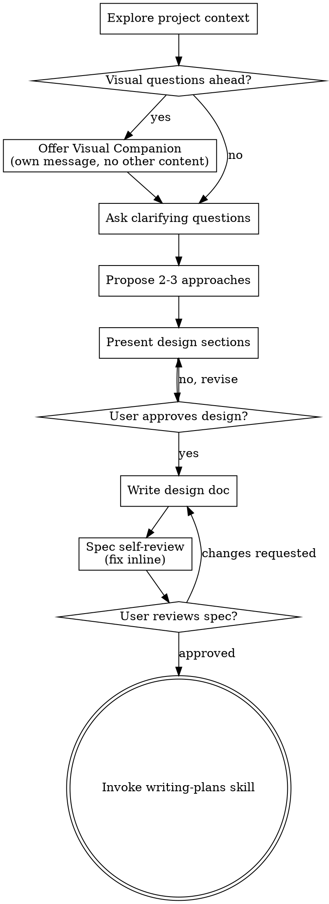
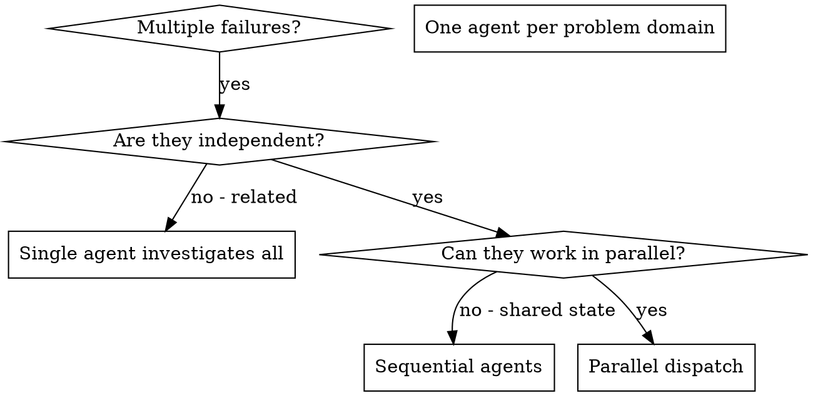
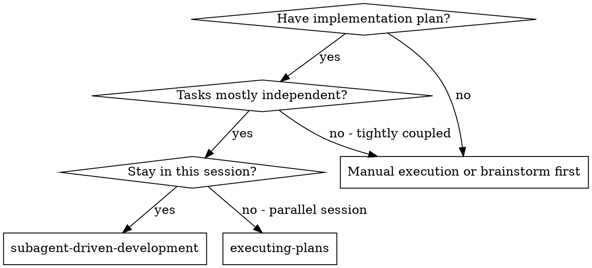

# COMANDO - SKILL.md
**Origem:** E:\CentralDark\_MAPA_CASA\Nova pasta\.extracted_screenpipe-main.zip\screenpipe-main\.claude\skills\screenpipe-cli\SKILL.md
**SHA:** 998584b716b91e13
**Timestamp:** 2026-08-23T14:15:48.068353
**Portoes:** {"ocorrencias": true, "ganho": true, "contraprova": true, "sha": true}

## Ouro Extraido

### Comandos
- Create `~/.screenpipe/pipes/<name>/pipe.md` with YAML frontmatter + prompt:

### Ouro Bruto (primeiros 5000 chars)
```
---
name: screenpipe-cli
description: Manage screenpipe pipes (scheduled AI automations) and connections (Telegram, Slack, Discord, etc.) via the CLI. Use when the user asks to create, list, enable, disable, run, or debug pipes, or manage service connections from the command line.
---

# Screenpipe CLI

Use `bun x screenpipe@latest` to run CLI commands. No separate install needed.

**IMPORTANT**: Always run `bun x` commands from a clean temp directory to avoid node_modules conflicts:
```bash
cd "$(mktemp -d)" && bun x screenpipe@latest <command>
```

## Shell

- **All platforms** → `bash` (on Windows, the bundled git-portable bash is used automatically)

---

## Pipe Management

Pipes are markdown-based AI automations that run on schedule. Each pipe lives at `~/.screenpipe/pipes/<name>/pipe.md`.

### Commands

```bash
bun x screenpipe@latest pipe list                    # List all pipes (compact table)
bun x screenpipe@latest pipe enable <name>           # Enable a pipe
bun x screenpipe@latest pipe disable <name>          # Disable a pipe
bun x screenpipe@latest pipe run <name>              # Run once immediately (for testing)
bun x screenpipe@latest pipe logs <name>             # View execution logs
bun x screenpipe@latest pipe install <url-or-path>   # Install from GitHub or local path
bun x screenpipe@latest pipe delete <name>           # Delete a pipe
bun x screenpipe@latest pipe models list             # View AI model presets
```

### Creating a Pipe

Create `~/.screenpipe/pipes/<name>/pipe.md` with YAML frontmatter + prompt:

```markdown
---
schedule: every 30m
enabled: true
preset: ["Primary", "Fallback"]
---

Your prompt instructions here. The AI agent executes this on schedule.

## What to do

1. Query screenpipe search API for recent activity
2. Process results
3. Output summary / send notification
```

**Schedule syntax**: `every 30m`, `every 1h`, `every day at 9am`, `every monday at 9am`, or cron: `*/30 * * * *`, `0 9 * * *`

**Config fields**: `schedule`, `enabled` (bool), `preset` (string or array — e.g. `"Oai"` or `["Primary", "Fallback"]`), `history` (bool — include previous output as context)

Screenpipe prepends a context header with time range, timezone, OS, and API URL before each execution. No template variables needed.

After creating:
```bash
bun x screenpipe@latest pipe install ~/.screenpipe/pipes/my-pipe
bun x screenpipe@latest pipe enable my-pipe
bun x screenpipe@latest pipe run my-pipe   # terminal-only; in-app chat uses the workflow below
```

### Testing from in-app chat

The cloud JWT is intentionally absent from Bash. Do not expose or recover it, and do not use standalone `pipe run`. Test through the authenticated desktop runtime:

```bash
api="${SCREENPIPE_LOCAL_API_URL:-http://localhost:3030}"
auth="Authorization: Bearer $SCREENPIPE_LOCAL_API_KEY"
curl -sS -X POST -H "$auth" "$api/pipes/my-pipe/run"
curl -sS -H "$auth" "$api/pipes/my-pipe/logs"
```

`{"success":true}` means the run started, not that it passed. Poll for a new terminal log. Bind only after `success: true`; otherwise report its `stderr` and leave the Live View unchanged.

### Editing Config

Edit frontmatter in `~/.screenpipe/pipes/<name>/pipe.md` directly, or use the API:

```bash
curl -X POST http://localhost:3030/pipes/<name>/config \
  -H "Content-Type: application/json" \
  -d '{"config": {"schedule": "every 1h", "enabled": true}}'
```

### Rules

1. Use `pipe list` (not `--json`) — table output is compact
2. Never dump full pipe JSON — can be 15MB+
3. Check logs first when debugging: `pipe logs <name>`
4. Outside in-app chat, use `pipe run <name>` before waiting for a schedule; in-app chat uses the authenticated runtime above

---

## Connection Management

Manage integrations (Telegram, Slack, Discord, Email, Todoist, Teams) from the CLI.

### Commands

```bash
bun x screenpipe@latest connection list              # List all connections + status
bun x screenpipe@latest connection list --json       # JSON output
bun x screenpipe@latest connection get <id>          # Show status + non-secret settings
bun x screenpipe@latest connection get <id> --json   # JSON output
bun x screenpipe@latest connection set <id> key=val  # Save credentials
bun x screenpipe@latest connection test <id>         # Test a connection
bun x screenpipe@latest connection remove <id>       # Remove credentials
```

### Examples

```bash
# Set up Telegram
bun x screenpipe@latest connection set telegram bot_token=123456:ABC-DEF chat_id=5776185278

# Set up Slack webhook
bun x screenpipe@latest connection set slack webhook_url=https://hooks.slack.com/services/...

# Verify it works
bun x screenpipe@latest connection test telegram

# Check what's connected
bun x screenpipe@latest connection list
```

Connection IDs: `telegram`, `slack`, `discord`, `email`, `todoist`, `teams`, `google-calendar`, `openclaw`

Credentials are stored locally and are not printed by `connection get`.

**Per-integration details**: don't guess API shapes from this s
```

---

# COMANDO - SKILL.md
**Origem:** E:\CentralDark\_MAPA_CASA\Nova pasta\.extracted_screenpipe-main.zip\screenpipe-main\crates\screenpipe-core\assets\skills\screenpipe-cli\SKILL.md
**SHA:** 403ec743af909f8a
**Timestamp:** 2026-08-23T14:16:33.840325
**Portoes:** {"ocorrencias": true, "ganho": true, "contraprova": true, "sha": true}

## Ouro Extraido

### Comandos
- Create `~/.screenpipe/pipes/<name>/pipe.md` with YAML frontmatter + prompt:

### Ouro Bruto (primeiros 5000 chars)
```
---
name: screenpipe-cli
description: Set up and operate screenpipe from the terminal, including always-on recording, service modes, capture health, storage, local search, read-only SQLite access, pipes, and connections. Use when the user asks to install, run, inspect, query, automate, or debug screenpipe without relying on the desktop app.
---

# Screenpipe CLI

Run every CLI command exactly like this, from a clean temp directory so `bun x` cannot collide with a project's `node_modules`:

```bash
cd "$(mktemp -d)" && ${SCREENPIPE_CLI:-bun x screenpipe@latest} <command>
```

`$SCREENPIPE_CLI` is an already-resolved native binary that screenpipe publishes and refreshes for you. When it is set, a call costs **~0.15s**. The `bun x screenpipe@latest` fallback runs when it is not (a plain terminal, a fresh install, an offline machine) and costs **~4s**, because `@latest` re-resolves the npm registry every single time. Never replace the whole expression with just `bun x screenpipe@latest` — you would give up the fast path for no reason.

**Rules:** every invocation is `cd "$(mktemp -d)" && ${SCREENPIPE_CLI:-bun x screenpipe@latest} …` · keep the `${SCREENPIPE_CLI:-…}` form intact · never drop the `cd` prefix · copy the examples below verbatim rather than shortening them · because the `cd` changes your working directory, **any path you pass must be absolute** (`~/...` or `/...`), never relative (`./my-pipe`).

Works on macOS, Linux, and Windows: the CLI always runs under bash, and `mktemp` is present on all three (on Windows via the bundled git-portable `usr/bin`).

Use `status`, `search`, and state-changing commands as the canonical terminal surface. For high-frequency read loops, the local REST API is faster (see the `screenpipe-api` skill), and advanced local workflows may query SQLite read-only.

> **Sandboxed shells:** some agents (e.g. Codex) block all shell network access, so `bun x` cannot fetch the package and CLI calls to `localhost:3030` fail instantly. If that happens, use the screenpipe MCP tools instead of the CLI.

## Recorder quickstart

For a CLI-only user who wants this computer recorded continuously, use this sequence:

```bash
cd "$(mktemp -d)" && ${SCREENPIPE_CLI:-bun x screenpipe@latest} doctor
cd "$(mktemp -d)" && ${SCREENPIPE_CLI:-bun x screenpipe@latest} service install
cd "$(mktemp -d)" && ${SCREENPIPE_CLI:-bun x screenpipe@latest} status
```

`service install` defaults to **recorder mode**: screen + audio capture, local indexing, and the API, launched at boot/login and restarted after failures. On macOS, resolve Screen Recording, Microphone, and Accessibility permission warnings reported by `doctor`; a background service cannot bypass OS consent.

Use the foreground process only for an interactive session or live debugging:

```bash
cd "$(mktemp -d)" && ${SCREENPIPE_CLI:-bun x screenpipe@latest} record
```

Use API-only server mode only when the machine should serve existing or synced data without recording itself:

```bash
cd "$(mktemp -d)" && ${SCREENPIPE_CLI:-bun x screenpipe@latest} service install --mode server
```

Running `service install` again switches modes and restarts the service immediately. `service uninstall` stops and removes it.

## Status and diagnostics

Start every investigation with:

```bash
cd "$(mktemp -d)" && ${SCREENPIPE_CLI:-bun x screenpipe@latest} status
```

This reports the distinction that matters:

- `recording normally`: the API is healthy and at least one capture stream is active
- `serving normally`: intentional server mode; the API is healthy and local capture is disabled
- `not capturing`: the process is up but no capture stream is active
- `needs attention`: the health endpoint reports degraded/unhealthy capture
- `stopped`: no screenpipe health endpoint answered on the selected port

It also prints screen/audio freshness, active devices, history counts, total storage, and the exact SQLite path. Do not infer recording from a PID, an open port, or `service status`; those prove a process exists, not that new data is arriving.

For scripts and agents, use structured output:

```bash
cd "$(mktemp -d)" && ${SCREENPIPE_CLI:-bun x screenpipe@latest} status --json
```

Important fields are `running`, `health.status`, `health.frame_status`, `health.audio_status`, `last_capture`, `last_audio_capture`, `storage_size_bytes`, and `database_path`. Treat `running: true` as API availability only; inspect capture status and timestamps before claiming recording is healthy.

Useful follow-ups:

```bash
cd "$(mktemp -d)" && ${SCREENPIPE_CLI:-bun x screenpipe@latest} service status
cd "$(mktemp -d)" && ${SCREENPIPE_CLI:-bun x screenpipe@latest} doctor
cd "$(mktemp -d)" && ${SCREENPIPE_CLI:-bun x screenpipe@latest} diagnose --dry-run
```

`diagnose --dry-run` saves a support bundle locally and does not upload it. Do not run `diagnose` without `--dry-run` unless the user explicitly wants to send diagnostics to screenpipe support.

## Query local history

`search` reads th
```

---

# COMANDO - SKILL.md
**Origem:** E:\CentralDark\_MAPA_CASA\PASTA DO CHEFE JOGA ARQUIOVOS QUAIS QUUER SER GARIMPO DO CHEFE\.extracted_screenpipe-main.zip\screenpipe-main\.claude\skills\screenpipe-cli\SKILL.md
**SHA:** 998584b716b91e13e28dd89566d6b964c684a56c81e58b87d8fe795637f24ce1
**Timestamp:** 2026-08-23T23:43:04.688364
**Portoes:** {"ocorrencias": true, "ganho": true, "contraprova": true, "sha": true}

## Ouro Extraido

### Comandos
- Create `~/.screenpipe/pipes/<name>/pipe.md` with YAML frontmatter + prompt:

### Ouro Bruto (primeiros 5000 chars)
```
---
name: screenpipe-cli
description: Manage screenpipe pipes (scheduled AI automations) and connections (Telegram, Slack, Discord, etc.) via the CLI. Use when the user asks to create, list, enable, disable, run, or debug pipes, or manage service connections from the command line.
---

# Screenpipe CLI

Use `bun x screenpipe@latest` to run CLI commands. No separate install needed.

**IMPORTANT**: Always run `bun x` commands from a clean temp directory to avoid node_modules conflicts:
```bash
cd "$(mktemp -d)" && bun x screenpipe@latest <command>
```

## Shell

- **All platforms** → `bash` (on Windows, the bundled git-portable bash is used automatically)

---

## Pipe Management

Pipes are markdown-based AI automations that run on schedule. Each pipe lives at `~/.screenpipe/pipes/<name>/pipe.md`.

### Commands

```bash
bun x screenpipe@latest pipe list                    # List all pipes (compact table)
bun x screenpipe@latest pipe enable <name>           # Enable a pipe
bun x screenpipe@latest pipe disable <name>          # Disable a pipe
bun x screenpipe@latest pipe run <name>              # Run once immediately (for testing)
bun x screenpipe@latest pipe logs <name>             # View execution logs
bun x screenpipe@latest pipe install <url-or-path>   # Install from GitHub or local path
bun x screenpipe@latest pipe delete <name>           # Delete a pipe
bun x screenpipe@latest pipe models list             # View AI model presets
```

### Creating a Pipe

Create `~/.screenpipe/pipes/<name>/pipe.md` with YAML frontmatter + prompt:

```markdown
---
schedule: every 30m
enabled: true
preset: ["Primary", "Fallback"]
---

Your prompt instructions here. The AI agent executes this on schedule.

## What to do

1. Query screenpipe search API for recent activity
2. Process results
3. Output summary / send notification
```

**Schedule syntax**: `every 30m`, `every 1h`, `every day at 9am`, `every monday at 9am`, or cron: `*/30 * * * *`, `0 9 * * *`

**Config fields**: `schedule`, `enabled` (bool), `preset` (string or array — e.g. `"Oai"` or `["Primary", "Fallback"]`), `history` (bool — include previous output as context)

Screenpipe prepends a context header with time range, timezone, OS, and API URL before each execution. No template variables needed.

After creating:
```bash
bun x screenpipe@latest pipe install ~/.screenpipe/pipes/my-pipe
bun x screenpipe@latest pipe enable my-pipe
bun x screenpipe@latest pipe run my-pipe   # terminal-only; in-app chat uses the workflow below
```

### Testing from in-app chat

The cloud JWT is intentionally absent from Bash. Do not expose or recover it, and do not use standalone `pipe run`. Test through the authenticated desktop runtime:

```bash
api="${SCREENPIPE_LOCAL_API_URL:-http://localhost:3030}"
auth="Authorization: Bearer $SCREENPIPE_LOCAL_API_KEY"
curl -sS -X POST -H "$auth" "$api/pipes/my-pipe/run"
curl -sS -H "$auth" "$api/pipes/my-pipe/logs"
```

`{"success":true}` means the run started, not that it passed. Poll for a new terminal log. Bind only after `success: true`; otherwise report its `stderr` and leave the Live View unchanged.

### Editing Config

Edit frontmatter in `~/.screenpipe/pipes/<name>/pipe.md` directly, or use the API:

```bash
curl -X POST http://localhost:3030/pipes/<name>/config \
  -H "Content-Type: application/json" \
  -d '{"config": {"schedule": "every 1h", "enabled": true}}'
```

### Rules

1. Use `pipe list` (not `--json`) — table output is compact
2. Never dump full pipe JSON — can be 15MB+
3. Check logs first when debugging: `pipe logs <name>`
4. Outside in-app chat, use `pipe run <name>` before waiting for a schedule; in-app chat uses the authenticated runtime above

---

## Connection Management

Manage integrations (Telegram, Slack, Discord, Email, Todoist, Teams) from the CLI.

### Commands

```bash
bun x screenpipe@latest connection list              # List all connections + status
bun x screenpipe@latest connection list --json       # JSON output
bun x screenpipe@latest connection get <id>          # Show status + non-secret settings
bun x screenpipe@latest connection get <id> --json   # JSON output
bun x screenpipe@latest connection set <id> key=val  # Save credentials
bun x screenpipe@latest connection test <id>         # Test a connection
bun x screenpipe@latest connection remove <id>       # Remove credentials
```

### Examples

```bash
# Set up Telegram
bun x screenpipe@latest connection set telegram bot_token=123456:ABC-DEF chat_id=5776185278

# Set up Slack webhook
bun x screenpipe@latest connection set slack webhook_url=https://hooks.slack.com/services/...

# Verify it works
bun x screenpipe@latest connection test telegram

# Check what's connected
bun x screenpipe@latest connection list
```

Connection IDs: `telegram`, `slack`, `discord`, `email`, `todoist`, `teams`, `google-calendar`, `openclaw`

Credentials are stored locally and are not printed by `connection get`.

**Per-integration details**: don't guess API shapes from this s
```

---

# COMANDO - SKILL.md
**Origem:** E:\CentralDark\_MAPA_CASA\PASTA DO CHEFE JOGA ARQUIOVOS QUAIS QUUER SER GARIMPO DO CHEFE\.extracted_screenpipe-main.zip\screenpipe-main\crates\screenpipe-core\assets\skills\screenpipe-cli\SKILL.md
**SHA:** 403ec743af909f8a6372a942288fc6199f1b1b0315eb5f842a1194cbaaa1c40b
**Timestamp:** 2026-08-23T23:43:13.460188
**Portoes:** {"ocorrencias": true, "ganho": true, "contraprova": true, "sha": true}

## Ouro Extraido

### Comandos
- Create `~/.screenpipe/pipes/<name>/pipe.md` with YAML frontmatter + prompt:

### Ouro Bruto (primeiros 5000 chars)
```
---
name: screenpipe-cli
description: Set up and operate screenpipe from the terminal, including always-on recording, service modes, capture health, storage, local search, read-only SQLite access, pipes, and connections. Use when the user asks to install, run, inspect, query, automate, or debug screenpipe without relying on the desktop app.
---

# Screenpipe CLI

Run every CLI command exactly like this, from a clean temp directory so `bun x` cannot collide with a project's `node_modules`:

```bash
cd "$(mktemp -d)" && ${SCREENPIPE_CLI:-bun x screenpipe@latest} <command>
```

`$SCREENPIPE_CLI` is an already-resolved native binary that screenpipe publishes and refreshes for you. When it is set, a call costs **~0.15s**. The `bun x screenpipe@latest` fallback runs when it is not (a plain terminal, a fresh install, an offline machine) and costs **~4s**, because `@latest` re-resolves the npm registry every single time. Never replace the whole expression with just `bun x screenpipe@latest` — you would give up the fast path for no reason.

**Rules:** every invocation is `cd "$(mktemp -d)" && ${SCREENPIPE_CLI:-bun x screenpipe@latest} …` · keep the `${SCREENPIPE_CLI:-…}` form intact · never drop the `cd` prefix · copy the examples below verbatim rather than shortening them · because the `cd` changes your working directory, **any path you pass must be absolute** (`~/...` or `/...`), never relative (`./my-pipe`).

Works on macOS, Linux, and Windows: the CLI always runs under bash, and `mktemp` is present on all three (on Windows via the bundled git-portable `usr/bin`).

Use `status`, `search`, and state-changing commands as the canonical terminal surface. For high-frequency read loops, the local REST API is faster (see the `screenpipe-api` skill), and advanced local workflows may query SQLite read-only.

> **Sandboxed shells:** some agents (e.g. Codex) block all shell network access, so `bun x` cannot fetch the package and CLI calls to `localhost:3030` fail instantly. If that happens, use the screenpipe MCP tools instead of the CLI.

## Recorder quickstart

For a CLI-only user who wants this computer recorded continuously, use this sequence:

```bash
cd "$(mktemp -d)" && ${SCREENPIPE_CLI:-bun x screenpipe@latest} doctor
cd "$(mktemp -d)" && ${SCREENPIPE_CLI:-bun x screenpipe@latest} service install
cd "$(mktemp -d)" && ${SCREENPIPE_CLI:-bun x screenpipe@latest} status
```

`service install` defaults to **recorder mode**: screen + audio capture, local indexing, and the API, launched at boot/login and restarted after failures. On macOS, resolve Screen Recording, Microphone, and Accessibility permission warnings reported by `doctor`; a background service cannot bypass OS consent.

Use the foreground process only for an interactive session or live debugging:

```bash
cd "$(mktemp -d)" && ${SCREENPIPE_CLI:-bun x screenpipe@latest} record
```

Use API-only server mode only when the machine should serve existing or synced data without recording itself:

```bash
cd "$(mktemp -d)" && ${SCREENPIPE_CLI:-bun x screenpipe@latest} service install --mode server
```

Running `service install` again switches modes and restarts the service immediately. `service uninstall` stops and removes it.

## Status and diagnostics

Start every investigation with:

```bash
cd "$(mktemp -d)" && ${SCREENPIPE_CLI:-bun x screenpipe@latest} status
```

This reports the distinction that matters:

- `recording normally`: the API is healthy and at least one capture stream is active
- `serving normally`: intentional server mode; the API is healthy and local capture is disabled
- `not capturing`: the process is up but no capture stream is active
- `needs attention`: the health endpoint reports degraded/unhealthy capture
- `stopped`: no screenpipe health endpoint answered on the selected port

It also prints screen/audio freshness, active devices, history counts, total storage, and the exact SQLite path. Do not infer recording from a PID, an open port, or `service status`; those prove a process exists, not that new data is arriving.

For scripts and agents, use structured output:

```bash
cd "$(mktemp -d)" && ${SCREENPIPE_CLI:-bun x screenpipe@latest} status --json
```

Important fields are `running`, `health.status`, `health.frame_status`, `health.audio_status`, `last_capture`, `last_audio_capture`, `storage_size_bytes`, and `database_path`. Treat `running: true` as API availability only; inspect capture status and timestamps before claiming recording is healthy.

Useful follow-ups:

```bash
cd "$(mktemp -d)" && ${SCREENPIPE_CLI:-bun x screenpipe@latest} service status
cd "$(mktemp -d)" && ${SCREENPIPE_CLI:-bun x screenpipe@latest} doctor
cd "$(mktemp -d)" && ${SCREENPIPE_CLI:-bun x screenpipe@latest} diagnose --dry-run
```

`diagnose --dry-run` saves a support bundle locally and does not upload it. Do not run `diagnose` without `--dry-run` unless the user explicitly wants to send diagnostics to screenpipe support.

## Query local history

`search` reads th
```

---

# COMANDO - SKILL.md
**Origem:** E:\CentralDark\_MAPA_CASA\PASTA DO CHEFE JOGA ARQUIOVOS QUAIS QUUER SER GARIMPO DO CHEFE\.codex\.tmp\plugins\plugins\figma\skills\figma-code-connect\SKILL.md
**SHA:** d69cfc0e2080351f
**Timestamp:** 2026-08-26T18:31:12.086591
**Portoes:** {"ocorrencias": true, "ganho": true, "contraprova": true, "sha": true}

## Ouro Extraido

### Comandos
- **Step 2:** Call `get_code_connect_suggestions` with `fileKey: "abc123"`, `nodeId: "42:100"`, `excludeMappingPrompt: true`.

### Ouro Bruto (primeiros 5000 chars)
```
---
name: figma-code-connect
description: Creates and maintains Figma Code Connect template files that map Figma components to code snippets. Use when the user mentions Code Connect, Figma component mapping, design-to-code translation, or asks to create/update .figma.ts or .figma.js files.
disable-model-invocation: false
---

# Code Connect

## Overview

Create Code Connect template files (`.figma.ts`) that map Figma components to code snippets. Given a Figma URL, follow the steps below to create a template.

> **Note:** This project may also contain parser-based `.figma.tsx` files (using `figma.connect()`, published via CLI). This skill covers **templates files only** — `.figma.ts` files that use the MCP tools to fetch component context from Figma.

## Prerequisites

- **Figma MCP server must be connected** — verify that Figma MCP tools (e.g., `get_code_connect_suggestions`) are available before proceeding. If not, guide the user to enable the Figma MCP server and restart their MCP client.
- **Components must be published** — Code Connect only works with components published to a Figma team library. If a component is not published, inform the user and stop.
- **Organization or Enterprise plan required** — Code Connect is not available on Free or Professional plans.
- **URL must include `node-id`** — the Figma URL must contain the `node-id` query parameter.
- **TypeScript types** — for editor autocomplete and type checking in `.figma.ts` files `@figma/code-connect/figma-types` must be added to `types` in `tsconfig.json`:
  ```json
  {
    "compilerOptions": {
      "types": ["@figma/code-connect/figma-types"]
    }
  }
  ```

## Step 1: Parse the Figma URL

Extract `fileKey` and `nodeId` from the URL:

| URL Format | fileKey | nodeId |
|---|---|---|
| `figma.com/design/:fileKey/:name?node-id=X-Y` | `:fileKey` | `X-Y` → `X:Y` |
| `figma.com/file/:fileKey/:name?node-id=X-Y` | `:fileKey` | `X-Y` → `X:Y` |
| `figma.com/design/:fileKey/branch/:branchKey/:name` | use `:branchKey` | from `node-id` param |

Always convert `nodeId` hyphens to colons: `1234-5678` → `1234:5678`.

**Worked example:**

Given: `https://www.figma.com/design/QiEF6w564ggoW8ftcLvdcu/MyDesignSystem?node-id=4185-3778`
- `fileKey` = `QiEF6w564ggoW8ftcLvdcu`
- `nodeId` = `4185-3778` → `4185:3778`

## Step 2: Discover Unmapped Components

The user may provide a URL pointing to a frame, instance, or variant — not necessarily a component set or standalone component. Call the MCP tool `get_code_connect_suggestions` with:
- `fileKey` — from Step 1
- `nodeId` — from Step 1 (colons format)
- `excludeMappingPrompt` — `true` (returns a lightweight list of unmapped components)

This tool identifies published components in the selection that don't yet have Code Connect mappings.

**Handle the response:**

- **"No published components found in this selection"** — the node contains no published components. Inform the user they need to publish the component to a team library in Figma first, then stop.
- **"All component instances in this selection are already connected to code via Code Connect"** — everything is already mapped. Inform the user and stop.
- **Normal response with component list** — extract the `mainComponentNodeId` for each returned component. Use these resolved node IDs (not the original from the URL) for all subsequent steps. If multiple components are returned (e.g. the user selected a frame containing several different component instances), repeat Steps 3–6 for each one.

## Step 3: Fetch Component Properties

Call the MCP tool `get_context_for_code_connect` with:
- `fileKey` — from Step 1
- `nodeId` — the resolved `mainComponentNodeId` from Step 2
- `clientFrameworks` — determine from `figma.config.json` `parser` field (e.g. `"react"` → `["react"]`)
- `clientLanguages` — infer from project file extensions (e.g. TypeScript project → `["typescript"]`, JavaScript → `["javascript"]`)

For multiple components, call the tool once per node ID.

The response contains the Figma component's **property definitions** — note each property's name and type:
- **TEXT** — text content (labels, titles, placeholders)
- **BOOLEAN** — toggles (show/hide icon, disabled state)
- **VARIANT** — enum options (size, variant, state)
- **INSTANCE_SWAP** — swappable nested instances tied to a specific component (icon, avatar)
- **SLOT** — flexible content regions (freeform layout, mixed children); use `getSlot()` in templates (not the same as INSTANCE_SWAP)

Save this property list — you will use it in Step 5 to write the template.

## Step 4: Identify the Code Component

If the user did not specify which code component to connect:

1. Check `figma.config.json` for `paths` and `importPaths` to find where components live
2. Search the codebase for a component matching the Figma component name. Check common directories (`src/components/`, `components/`, `lib/ui/`, `app/components/`) if `figma.config.json` doesn't specify paths
3. Read candidate files and compare their pr
```johnson@company.com)
→ Use accountId from result
```

**Scenario B: No Match (0 results)**
```
⚠️ Couldn't find user "Sarah" in Jira.

Options:
1. Create task unassigned (assign man
```

---

# COMANDO - SKILL.md
**Origem:** E:\CentralDark\_MAPA_CASA\PASTA DO CHEFE JOGA ARQUIOVOS QUAIS QUUER SER GARIMPO DO CHEFE\.codex\.tmp\plugins\plugins\openai-ads-conversions\skills\openai-ads-conversions-setup\SKILL.md
**SHA:** d49e7e398b025151
**Timestamp:** 2026-08-26T18:40:16.827453
**Portoes:** {"ocorrencias": true, "ganho": true, "contraprova": true, "sha": true}

## Ouro Extraido

### Padroes
- - Use the documented browser SDK pattern: load `https://bzrcdn.openai.com/sdk/oaiq.min.js`, initialize with `oaiq("init", { pixelId })`, and emit events with `oaiq("measure", ...)`.

### Ouro Bruto (primeiros 5000 chars)
```
---
name: openai-ads-conversions-setup
description: Guide Codex through instrumenting or extending repositories with OpenAI Ads Measurement Pixel and optional Conversions API (CAPI). Use when adding Ads conversion tracking, browser pixel events, server-side conversion events, event_id deduplication, CAPI secret placeholders, incremental conversion coverage, or validating Ads conversion setup. Applies to local repositories and PR review contexts; prioritize safe, reviewable diffs and never place API keys or secrets in source code or client bundles.
---

# OpenAI Ads Conversions Setup

## Overview

Use this skill to add, extend, or review OpenAI Ads conversion instrumentation in an advertiser repository. It supports browser Pixel setup, server-side Conversions API setup, Pixel+CAPI deduplication, and incremental reruns after the app adds new pages or flows, while keeping diffs small and avoiding secret exposure.

Use only public OpenAI Ads documentation and repository-local patterns for implementation choices. If the docs are unavailable or unclear, ask for clarification or leave a documented follow-up instead of relying on undocumented behavior.

## Required Inputs

Before editing code, identify:

- Setup mode: `pixel`, `capi`, or `pixel+capi`.
- Frontend/runtime surface: browser JavaScript/TypeScript, server-rendered web, backend-only, mobile/native, or unknown.
- Pixel ID, if Pixel is in scope.
- CAPI authentication plan, if CAPI is in scope: existing secret/env var name, secret manager path, or placeholder-only.
- Conversion events to instrument and where they occur in the product flow.
- Whether this is a first-time setup or an incremental rerun extending existing OpenAI Ads instrumentation.
- Whether the desired behavior is `propose patch`, `apply local patch`, or `review existing integration`.

Treat the linked OpenAI Ads docs as the source of truth for exact SDK syntax, endpoint shape, supported events, request fields, and validation rules. When browsing is available, check the current docs before writing concrete calls; if the docs conflict with this skill, follow the docs and mention the conflict in the setup report. When browsing is unavailable, use this skill's references as a fallback. Do not invent SDK functions, event names, request schemas, or endpoint paths.

Primary docs to prefer when available:

- `https://developers.openai.com/ads/measurement-pixel`
- `https://developers.openai.com/ads/conversions-api`
- `https://developers.openai.com/ads/supported-events`

## Workflow

1. Inspect the repository shape.
   - Detect framework, package manager, router, server runtime, frontend surface, env convention, test commands, and existing analytics integrations.
   - Determine whether a browser JavaScript Pixel is supportable. If the customer-facing surface is mobile/native, backend-only, or otherwise lacks a safe browser JS insertion point, use CAPI-only and report that Pixel was skipped.
   - Search for existing OpenAI Ads instrumentation: Pixel initialization, CAPI clients, event helpers, config/env vars, dedupe IDs, attribution context, tests, and setup docs.
   - Search for existing pixels or server conversion APIs such as Meta Pixel/CAPI, Google Ads/gtag, TikTok Events API, Pinterest, Snap, Segment, RudderStack, or custom analytics wrappers.
   - Use other ad platform integrations as evidence for local conversion boundaries, consent gates, config/secret patterns, non-blocking dispatch, dedupe IDs, and tests. Do not copy their event names, payload schemas, user matching fields, credential exposure patterns, or retry behavior.
   - Prefer the repository's existing analytics abstraction over adding a parallel abstraction. If OpenAI Ads instrumentation already exists, treat its helper/client/config pattern as canonical.
   - Search for existing config and secret retrieval patterns before choosing env vars: framework settings, typed config objects, deployment env conventions, Vault, cloud secret managers, Kubernetes secrets, Doppler, 1Password, or similar.

2. Confirm the setup plan.
   - For Pixel, identify a single browser-only initialization point, event call sites, and any approved browser user-data path.
   - For CAPI, identify a server-only execution point, secret retrieval pattern, and outbound HTTP/client pattern.
   - For Pixel+CAPI, define one logical Pixel ID and a stable `event_id` strategy so browser and server events can deduplicate.
   - For CAPI web events, define an `oppref` strategy and a sanitized `source_url` strategy before editing. Prefer a server-readable raw `__oppref` cookie value; if unavailable, pass minimal optional conversion context from the browser to an existing server conversion request. For deduped Pixel+CAPI events, make CAPI `source_url` describe the same browser conversion context as the paired Pixel event when practical. If the browser fires the Pixel event before navigation and the server would otherwise derive a different URL, pass the browser's current `source
```

---

# COMANDO - SKILL.md
**Origem:** E:\CentralDark\_MAPA_CASA\PASTA DO CHEFE JOGA ARQUIOVOS QUAIS QUUER SER GARIMPO DO CHEFE\.codex\.tmp\plugins\plugins\openai-developers\skills\openai-platform-api-key\SKILL.md
**SHA:** 780670286fb0acf3
**Timestamp:** 2026-08-26T18:40:23.261421
**Portoes:** {"ocorrencias": true, "ganho": true, "contraprova": true, "sha": true}

## Ouro Extraido

### Contratos
- description: 'Use when Codex is asked to build, run, test, debug, or configure an OpenAI-backed or provider-unspecified AI app, UI, script, CLI, generator, or tool, especially requests phrased only as

### Ouro Bruto (primeiros 5000 chars)
```
---
name: openai-platform-api-key
description: 'Use when Codex is asked to build, run, test, debug, or configure an OpenAI-backed or provider-unspecified AI app, UI, script, CLI, generator, or tool, especially requests phrased only as "using AI" or generators driven by forms/user input; also use for OPENAI_API_KEY or sk-proj setup. Treat this as the credential gate: inspect safely, ask reuse-vs-new before API work, and never expose plaintext.'
---

# OpenAI API Key

Use this skill only in Codex local/app sessions. Create keys through the secure OpenAI Platform connector, keep plaintext out of normal tool output, and write secrets only to a confirmed local destination.

## When To Use

Use this skill as the credential gate for API-backed work, not as the app, docs, or frontend implementation skill.

Use it when:

- The user asks for an OpenAI API key, `OPENAI_API_KEY`, or an `sk-proj` key.
- Codex will build, implement, run, test, debug, or configure an app, script, CLI, generator, UI, or tool that calls the OpenAI API, even before a live request and even if a usable key already exists.
- The user asks Codex to build, implement, run, or configure an app, script, CLI, generator, or tool that uses AI to produce outputs from user input.
- The user asks for an AI-powered app or UI that generates output from one or more input fields, forms, prompts, files, or other user-provided values.
- The user says "using AI" in an app/script/build request and does not name a different provider.

Do not use it when:

- The user only wants documentation, citations, model or API guidance, conceptual explanation, or code examples without asking Codex to build, run, configure, or debug an API-backed artifact.
- The user asks for a static frontend, visual mockup, design concept, or placeholder UI with no API-backed behavior.
- The user only asks Codex to write a one-off output directly and no app, script, generator, or API-backed tool is being built or run.
- The user names a different AI provider for the artifact.

If API access is needed and no usable key is found, offer secure key provisioning instead of leaving only placeholder docs or manual setup steps.

## Coordination With Implementation Skills

When another implementation skill also applies, run this skill first only to inspect credentials safely and send the credential decision message. Until reuse-existing-key vs create-new-key is resolved, it outranks design-first and implementation-first flows, including `build-web-apps:frontend-app-builder`; do not design UI, choose architecture, inspect API examples, write code, or run smoke tests. After the user answers, hand off to the appropriate implementation, docs, or frontend skill.

## Safety Rules

- Never request, print, summarize, quote, or paste a plaintext API key.
- Never inspect credentials with commands that can print secret values, such as `cat .env*`, `grep OPENAI_API_KEY .env*`, or `rg OPENAI_API_KEY .env*`. Use silent exit-status checks or redacted summaries only.
- Use the Platform connector `open_codex_api_key_setup` tool when it is available. Do not send local workspace paths, env-file paths, or target arrays to the picker.
- Do not use the ChatGPT-only browser/widget `_start_api_key_setup` flow from Codex.
- Only pass public JWK material (`kty`, `n`, `e`) to the connector.
- Before creating a key or writing any secret, obtain explicit confirmation. Prefer the hosted Platform picker plus local destination confirmation when it is available; if it is unavailable, fall back to a typed local destination question, then wait.
- Prefer ignored or untracked env files. In git repos, avoid tracked targets unless the user explicitly confirms that choice.
- The local helper may handle plaintext in memory and write it to the confirmed file. Its stdout/stderr must not include the key.
- When decrypting in a repo, pass the repo root as `--workspace`; the helper refuses symlink targets and targets outside that workspace.
- Keep user-facing messages concise. Unless the user asks or a failure requires it, say only that Codex will create the key securely and write it to the confirmed env file.
- Do not narrate deterministic mechanics such as helper discovery, encryption, decryption, RSA, JWKs, ciphertext, temporary files, cleanup, permissions checks, or redacted verification unless an error requires user action.
- Report only safe metadata: path, env var name, key name, org/project names, and whether an existing env var was updated.

## Mandatory First Step

Before editing, testing, running, debugging, or configuring any code that calls the OpenAI API:

1. Inspect for a usable `OPENAI_API_KEY` without printing it.
2. Unless the user explicitly asked for a new key, ask whether to reuse an existing key or create a new one. If none exists, ask whether to create one.
3. Stop until the user answers.

This applies even if:

- a usable key already exists
- no live API call will be made
- no secret will be written
- the task is "just cr
```

---

# COMANDO - SKILL.md
**Origem:** E:\CentralDark\_MAPA_CASA\PASTA DO CHEFE JOGA ARQUIOVOS QUAIS QUUER SER GARIMPO DO CHEFE\.codex\.tmp\plugins\plugins\vercel\skills\env-vars\SKILL.md
**SHA:** 6390db2eaa8fece4
**Timestamp:** 2026-08-26T18:40:57.480683
**Portoes:** {"ocorrencias": true, "ganho": true, "contraprova": true, "sha": true}

## Ouro Extraido

### Comandos
- After creating/updating secrets (`vercel env add`, dashboard changes) or provisioning integrations that add env vars (for example Neon/Upstash), re-run:
- prompt: 'Hello',

### Ouro Bruto (primeiros 5000 chars)
```
---
name: env-vars
description: Vercel environment variable expert guidance. Use when working with .env files, vercel env commands, OIDC tokens, or managing environment-specific configuration.
metadata:
  priority: 7
  docs:
    - "https://vercel.com/docs/environment-variables"
  sitemap: "https://vercel.com/sitemap/docs.xml"
  pathPatterns:
    - '.env'
    - '.env.*'
    - '.env.local'
    - '.env.production'
    - '.env.development'
    - '.env.test'
    - '.env.production.local'
    - '.env.development.local'
    - '.env.test.local'
    - '.env.example'
  bashPatterns:
    - '\bvercel\s+env\s+pull\b'
    - '\bvercel\s+env\s+add\b'
    - '\bvercel\s+env\s+rm\b'
    - '\bvercel\s+env\s+ls\b'
---

# Vercel Environment Variables

You are an expert in Vercel environment variable management — `.env` file conventions, the `vercel env` CLI, OIDC token lifecycle, and environment-specific configuration.

## .env File Hierarchy

Vercel and Next.js load environment variables in a specific order. Later files override earlier ones:

| File | Purpose | Git-tracked? |
|------|---------|-------------|
| `.env` | Default values for all environments | Yes |
| `.env.local` | Local overrides and secrets | **No** (gitignored) |
| `.env.development` | Development-specific defaults | Yes |
| `.env.development.local` | Local dev overrides | **No** |
| `.env.production` | Production-specific defaults | Yes |
| `.env.production.local` | Local prod overrides | **No** |
| `.env.test` | Test-specific defaults | Yes |
| `.env.test.local` | Local test overrides | **No** |

### Load Order (Next.js)

1. `.env` (lowest priority)
2. `.env.[environment]` (development, production, or test)
3. `.env.local` (skipped in test environment)
4. `.env.[environment].local` (highest priority, skipped in test)

### Critical Rules

- **Never commit secrets** to `.env`, `.env.development`, or `.env.production` — use `.local` variants or Vercel environment variables
- `.env.local` is always gitignored by Next.js — this is where `vercel env pull` writes secrets
- Variables prefixed with `NEXT_PUBLIC_` are exposed to the browser bundle — never put secrets in `NEXT_PUBLIC_` vars
- All other variables are server-only (API routes, Server Components, middleware)

## vercel env CLI

### Pull Environment Variables

```bash
# Pull all env vars for the current environment into .env.local
vercel env pull .env.local

# Pull for a specific environment
vercel env pull .env.local --environment=production
vercel env pull .env.local --environment=preview
vercel env pull .env.local --environment=development

# Overwrite existing file without prompting
vercel env pull .env.local --yes

# Pull to a custom file
vercel env pull .env.production.local --environment=production
```

### Add Environment Variables

```bash
# Interactive — prompts for value and environments
vercel env add MY_SECRET

# Non-interactive
echo "secret-value" | vercel env add MY_SECRET production

# Add to multiple environments
echo "secret-value" | vercel env add MY_SECRET production preview development

# Add a sensitive variable (encrypted, not shown in logs)
vercel env add MY_SECRET --sensitive
```

### List Environment Variables

```bash
# List all environment variables
vercel env ls

# Filter by environment
vercel env ls production
```

### Remove Environment Variables

```bash
# Remove from specific environment
vercel env rm MY_SECRET production

# Remove from all environments
vercel env rm MY_SECRET
```

## Bootstrap Flow (Fresh Clone / New Machine)

Use this sequence when setting up a project from scratch:

```bash
# 1) Link first so pulls target the correct Vercel project
vercel link --yes --project <name-or-id> --scope <team>

# 2) Pull env vars into .env.local
vercel env pull .env.local --yes

# 3) Verify required keys from .env.example exist in .env.local
while IFS='=' read -r key _; do
  [[ -z "$key" || "$key" == \#* ]] && continue
  grep -q "^${key}=" .env.local || echo "Missing in .env.local: $key"
done < .env.example
```

### Temporary Path: Run With Vercel Envs Without Writing a File

If you need Vercel environment variables immediately but do not want to write `.env.local` yet:

```bash
vercel env run -- npm run dev
```

This is useful for quick validation during bootstrap, but still pull `.env.local` for a normal local workflow.

### Re-pull After Secret or Provisioning Changes

After creating/updating secrets (`vercel env add`, dashboard changes) or provisioning integrations that add env vars (for example Neon/Upstash), re-run:

```bash
vercel env pull .env.local --yes
```

## OIDC Token Lifecycle

Vercel uses **OIDC (OpenID Connect)** tokens for secure, keyless authentication between your app and Vercel services (AI Gateway, storage, etc.).

### How It Works

1. **On Vercel deployments**: `VERCEL_OIDC_TOKEN` is automatically injected as a short-lived JWT and auto-refreshed — zero configuration needed
2. **Local development**: `vercel env pull .env.local` provisions a `VERCEL_OIDC_TOK
```

---

# COMANDO - SKILL.md
**Origem:** E:\CentralDark\_MAPA_CASA\PASTA DO CHEFE JOGA ARQUIOVOS QUAIS QUUER SER GARIMPO DO CHEFE\.codex\.tmp\plugins\plugins\render\skills\render-cli\SKILL.md
**SHA:** 92a67216566df7f2
**Timestamp:** 2026-08-26T18:41:01.225327
**Portoes:** {"ocorrencias": true, "ganho": true, "contraprova": true, "sha": true}

## Ouro Extraido

### Comandos
- run: |
- run: render deploys create ${{ secrets.RENDER_SERVICE_ID }} --wait --confirm -o json

### Ouro Bruto (primeiros 5000 chars)
```
---
name: render-cli
description: >-
  Installs and uses the Render CLI for deploys, logs, SSH, psql, Blueprint
  validation, and automation. Use when the user needs to run Render CLI
  commands, script deploys in CI/CD, authenticate with an API key, query
  services non-interactively, or troubleshoot CLI auth issues.
  Trigger terms: render CLI, render login, render deploys, render logs,
  render ssh, render psql, render blueprints validate, render skills,
  RENDER_API_KEY, non-interactive, CI/CD deploy.
license: MIT
compatibility: Render CLI v2.7.0+ (Homebrew, Linux/macOS, direct download)
metadata:
  author: Render
  version: "1.0.0"
  category: operations
---

# Render CLI

The Render CLI manages services, databases, and deployments from the terminal. Supports interactive use, non-interactive scripting, and CI/CD automation.

## When to Use

- **Deploying** a service from the terminal or CI/CD
- **Tailing logs** in real time
- **Opening psql** to a Render Postgres database
- **SSHing** into a running service or launching an ephemeral shell
- **Validating** a `render.yaml` Blueprint
- **Scripting** Render operations in CI/CD pipelines
- **Installing** agent skills for AI coding tools

## Installation

| Method | Command |
|--------|---------|
| **Homebrew** | `brew update && brew install render` |
| **Linux/macOS** | `curl -fsSL https://raw.githubusercontent.com/render-oss/cli/refs/heads/main/bin/install.sh \| sh` |
| **Direct download** | [GitHub releases](https://github.com/render-oss/cli/releases/) |
| **Build from source** | `git clone git@github.com:render-oss/cli.git && cd cli && go build -o render` |

After install, run `render` with no arguments to confirm.

## Authentication

### Interactive (local dev)

```bash
render login
```

Opens the browser to generate a CLI token. Token is saved to `~/.render/cli.yaml`. Tokens expire periodically—re-run `render login` when prompted.

### Non-interactive (CI/CD)

```bash
export RENDER_API_KEY=rnd_...
```

API keys do not expire. Generate one from **Account Settings > API Keys** in the Dashboard. The API key takes precedence over CLI tokens when set.

Set the active workspace:

```bash
render workspace set
```

## Command Reference

### Core commands

| Command | Purpose | Key flags |
|---------|---------|-----------|
| `render login` | Authenticate via browser | — |
| `render workspace set` | Set active workspace | — |
| `render services` | List all services and datastores | `-o json` for scripting |
| `render deploys create [SVC]` | Trigger a deploy | `--wait`, `--commit SHA`, `--image URL` |
| `render deploys list [SVC]` | List deploys for a service | `-o json` |
| `render logs -r [SVC]` | View logs | `--tail` for streaming |
| `render psql [DB]` | Open psql session | `-c "SQL"`, `-o json`, `-- --csv` |
| `render ssh [SVC]` | SSH into running instance | `--ephemeral` / `-e` for isolated shell |
| `render blueprints validate` | Validate `render.yaml` | Defaults to `./render.yaml` |
| `render skills [install\|update\|list]` | Manage agent skills | — |
| `render workspaces` | List workspaces | `-o json` |

### Non-interactive mode

For CI/CD and scripts, always set:

| Flag | Purpose |
|------|---------|
| `-o json` (or `yaml`, `text`) | Machine-readable output |
| `--confirm` | Skip confirmation prompts |

Output format precedence: `--output` flag > `RENDER_OUTPUT` env var > auto-detect (TTY → interactive, pipe → text).

```bash
export RENDER_OUTPUT=json
render services --confirm
```

### Deploy patterns

```bash
# Deploy and wait for completion (exits non-zero on failure)
render deploys create srv-xxx --wait --confirm -o json

# Deploy a specific commit
render deploys create srv-xxx --commit abc123 --wait --confirm

# Deploy a specific Docker image
render deploys create srv-xxx --image ghcr.io/org/app:v1.2.3 --wait --confirm
```

### Database queries

```bash
# Single query, JSON output
render psql db-xxx -c "SELECT NOW();" -o json

# CSV output via psql passthrough
render psql db-xxx -c "SELECT id, email FROM users;" -o text -- --csv
```

## CI/CD Example (GitHub Actions)

```yaml
name: Deploy to Render
on:
  push:
    branches: [main]
jobs:
  deploy:
    runs-on: ubuntu-latest
    steps:
      - name: Install Render CLI
        run: |
          curl -L https://github.com/render-oss/cli/releases/download/v1.1.0/cli_1.1.0_linux_amd64.zip -o render.zip
          unzip render.zip
          sudo mv cli_v1.1.0 /usr/local/bin/render
      - name: Deploy
        env:
          RENDER_API_KEY: ${{ secrets.RENDER_API_KEY }}
        run: render deploys create ${{ secrets.RENDER_SERVICE_ID }} --wait --confirm -o json
```

Pin to a specific CLI version in CI to avoid breaking changes.

## Local Config

Config file: `~/.render/cli.yaml`

Override with `RENDER_CLI_CONFIG_PATH` env var.

## Common Mistakes

| Mistake | Fix |
|---------|-----|
| Token expired | Re-run `render login` |
| Wrong workspace | Run `render workspace set` to switch |
| Missing `--confirm` in C
```

---

# COMANDO - SKILL.md
**Origem:** E:\CentralDark\_MAPA_CASA\PASTA DO CHEFE JOGA ARQUIOVOS QUAIS QUUER SER GARIMPO DO CHEFE\.codex\.tmp\plugins\plugins\render\skills\render-deploy\SKILL.md
**SHA:** a89d743773e81703
**Timestamp:** 2026-08-26T18:41:03.037820
**Portoes:** {"ocorrencias": true, "ganho": true, "contraprova": true, "sha": true}

## Ouro Extraido

### Padroes
- **Conversion pattern:** Replace `git@<host>:` with `https://<host>/` and remove `.git` suffix.

### Gaps
- Validate the render.yaml file to catch errors before deployment. If the CLI is installed, run the commands directly; only prompt the user if the CLI is missing:

### Ouro Bruto (primeiros 5000 chars)
```
---
name: render-deploy
description: Deploy applications to Render by analyzing codebases, generating render.yaml Blueprints, and providing Dashboard deeplinks. Use when the user wants to deploy, host, publish, or set up their application on Render's cloud platform.
license: MIT
compatibility: Requires a Git repository on GitHub, GitLab, or Bitbucket for Blueprint/MCP flows. Blueprint can reference a prebuilt image but render.yaml must live in the repo. Render CLI recommended for Blueprint validation; MCP or CLI required for operations.
metadata:
  author: Render
  version: "1.1.0"
  category: deployment
---

# Deploy to Render

Render supports **Git-backed** services and **prebuilt Docker image** services.

This skill covers **Git-backed** flows:
1. **Blueprint Method** - Generate render.yaml for Infrastructure-as-Code deployments
2. **Direct Creation** - Create services instantly via MCP tools

Blueprints can also run a **prebuilt Docker image** by using `runtime: image`, but the `render.yaml` still must live in a Git repo.

If there is no Git remote, stop and ask the user to either:
- Create/push a Git remote (can be minimal if only the Blueprint is needed), or
- Use the Render Dashboard/API to deploy a prebuilt Docker image (MCP cannot create image-backed services).

## When to Use This Skill

Activate this skill when users want to:
- Deploy an application to Render
- Create a render.yaml Blueprint file
- Set up Render deployment for their project
- Host or publish their application on Render's cloud platform
- Create databases, cron jobs, or other Render resources

## Happy Path (New Users)

Use this short prompt sequence before deep analysis to reduce friction:
1. Ask whether they want to deploy from a Git repo or a prebuilt Docker image.
2. Ask whether Render should provision everything the app needs (based on what seems likely from the user's description) or only the app while they bring their own infra. If dependencies are unclear, ask a short follow-up to confirm whether they need a database, workers, cron, or other services.

Then proceed with the appropriate method below.

## Choose Your Source Path

**Git Repo Path:** Required for both Blueprint and Direct Creation. The repo must be pushed to GitHub, GitLab, or Bitbucket.

**Prebuilt Docker Image Path:** Supported by Render via image-backed services. This is **not** supported by MCP; use the Dashboard/API. Ask for:
- Image URL (registry + tag)
- Registry auth (if private)
- Service type (web/worker) and port

If the user chooses a Docker image, guide them to the Render Dashboard image deploy flow or ask them to add a Git remote (so you can use a Blueprint with `runtime: image`).

## Choose Your Deployment Method (Git Repo)

Both methods require a Git repository pushed to GitHub, GitLab, or Bitbucket. (If using `runtime: image`, the repo can be minimal and only contain `render.yaml`.)

| Method | Best For | Pros |
|--------|----------|------|
| **Blueprint** | Multi-service apps, IaC workflows | Version controlled, reproducible, supports complex setups |
| **Direct Creation** | Single services, quick deployments | Instant creation, no render.yaml file needed |

### Method Selection Heuristic

Use this decision rule by default unless the user requests a specific method. Analyze the codebase first; only ask if deployment intent is unclear (e.g., DB, workers, cron).

**Use Direct Creation (MCP) when ALL are true:**
- Single service (one web app or one static site)
- No separate worker/cron services
- No attached databases or Key Value
- Simple env vars only (no shared env groups)
If this path fits and MCP isn't configured yet, stop and guide MCP setup before proceeding.

**Use Blueprint when ANY are true:**
- Multiple services (web + worker, API + frontend, etc.)
- Databases, Redis/Key Value, or other datastores are required
- Cron jobs, background workers, or private services
- You want reproducible IaC or a render.yaml committed to the repo
- Monorepo or multi-env setup that needs consistent configuration

If unsure, ask a quick clarifying question, but default to Blueprint for safety. For a single service, strongly prefer Direct Creation via MCP and guide MCP setup if needed.

## Prerequisites Check

When starting a deployment, verify these requirements in order:

**1. Confirm Source Path (Git vs Docker)**

If using Git-based methods (Blueprint or Direct Creation), the repo must be pushed to GitHub/GitLab/Bitbucket. Blueprints that reference a prebuilt image still require a Git repo with `render.yaml`.

```bash
git remote -v
```

- If no remote exists, stop and ask the user to create/push a remote **or** switch to Docker image deploy.

**2. Check MCP Tools Availability (Preferred for Single-Service)**

MCP tools provide the best experience. Check if available by attempting:
```
list_services()
```

If MCP tools are available, you can skip CLI installation for most operations.

**3. Check Render CLI Installation (for Blueprint validation)**
```ba
```

---

# COMANDO - SKILL.md
**Origem:** E:\CentralDark\_MAPA_CASA\PASTA DO CHEFE JOGA ARQUIOVOS QUAIS QUUER SER GARIMPO DO CHEFE\.codex\.tmp\plugins\plugins\render\skills\render-web-services\SKILL.md
**SHA:** 4ce0323558f56635
**Timestamp:** 2026-08-26T18:41:11.987530
**Portoes:** {"ocorrencias": true, "ganho": true, "contraprova": true, "sha": true}

## Ouro Extraido

### Comandos
- - **`autoDeployTrigger`** (Blueprint) / auto-deploy settings control when production deploys run:

### Ouro Bruto (primeiros 5000 chars)
```
---
name: render-web-services
description: >-
  Configures Render web services—port binding, TLS, health checks, custom
  domains, auto-deploy, PR previews, persistent disks, and deploy lifecycle.
  Use when the user needs to set up a web service, fix health check failures,
  add a custom domain, configure zero-downtime deploys, or troubleshoot port
  binding issues.
license: MIT
compatibility: Render web services (native runtimes or Docker)
metadata:
  author: Render
  version: "1.0.0"
  category: compute
---

# Render Web Services

This skill covers **Web Service** behavior on Render: how traffic reaches your process, how deploys go live, and how optional features (domains, disks, auto-deploy) interact. Use it alongside Blueprint and networking skills when wiring `render.yaml` or Dashboard settings.

## When to Use

- Configuring or debugging **port binding**, **PORT**, or **multi-port** web services
- **TLS/HTTPS** expectations at the edge vs inside the container
- **Health checks** blocking or rolling back deploys
- **Custom domains**, DNS, and certificate provisioning
- **Auto-deploy**, **CI-gated deploys**, and **PR preview** generation
- **Persistent disks** and their impact on scaling and zero-downtime
- **Deploy lifecycle**: build, pre-deploy, swap, drain, **rollback**, shutdown delay

Deeper patterns live under `references/` (health checks, domains, deploy phases).

## Port Binding

- Listen on **`0.0.0.0`** (all interfaces). Binding only to **`localhost`** or **`127.0.0.1`** prevents Render’s proxy from reaching your app.
- Use the **`PORT`** environment variable for the HTTP listen port. Render sets it for you; the **default is often `10000`** and you can change the configured value in the service **Settings** in the Dashboard.
- **Reserved ports** (do **not** bind your application to these for normal traffic): **`18012`**, **`18013`**, **`19099`**.

### Multi-port Web Services

- Only **one** port receives **public** HTTP traffic: the port aligned with **`PORT`**.
- **Additional** open ports are reachable on Render’s **private network** only (not from the public internet through the same public URL pattern).

## TLS and HTTPS

- **TLS terminates at Render’s edge.** The edge speaks HTTPS to clients; your process typically receives **plain HTTP** on `PORT`.
- **HTTPS redirect** for clients is handled by the platform; users hitting HTTP are redirected appropriately at the edge.
- **Do not terminate TLS inside the app** for the primary public listener unless you have a rare, explicit need—standard Web Services assume HTTP behind the proxy.

## Health Checks

- Configure a path via **`healthCheckPath`** in a Blueprint or the **Health Check Path** field in the Dashboard.
- Render issues **HTTP GET** requests to that path. Responses must be **`2xx` or `3xx`** for success.
- **Failed health checks** prevent a new deploy from **going live** (the deploy does not succeed in taking production traffic as expected).
- Render probes on a **repeat interval** with a per-request **timeout**; both are **configurable** in service settings (see Dashboard). Failed checks during rollout prevent the new revision from receiving traffic.
- Check frequency, timeouts, and tuning guidance in `references/health-check-patterns.md`.

## Custom Domains

- Point DNS with a **CNAME** to **`[service-name].onrender.com`** (use your service’s hostname from the Dashboard).
- Render **automatically provisions and renews** TLS certificates for verified domains.
- **Apex** (root) domains need provider-specific **CNAME-like** or flattened records where plain CNAME at `@` is unsupported.
- **Wildcard** domains (e.g. `*.example.com`) are supported when configured and verified.
- Multiple custom domains per service are supported; Blueprints can list them under the **`domains`** field.

See `references/custom-domains.md` for Dashboard steps, verification, and troubleshooting.

## Auto-Deploy and PR Previews

- **`autoDeployTrigger`** (Blueprint) / auto-deploy settings control when production deploys run:
  - **`commit`** — deploy on every push to the tracked branch
  - **`checksPass`** — deploy only when required **Git checks** pass
  - **`off`** — **manual** deploys only (Dashboard, CLI, hooks)
- **PR previews** are configured under Blueprint **`previews.generation`** (and related preview settings); generation behavior depends on repo integration and plan.

## Persistent Disks

- Attach disks via the **`disk`** field in a Blueprint (or equivalent Dashboard storage settings).
- A service with an attached persistent disk is **single-instance** only: **horizontal scaling** is not available in that configuration.
- **Zero-downtime deploys are disabled** when a persistent disk is attached—deploys follow a different rollout pattern.
- **Disk size increases** are allowed; **decreases** are not.
- The disk is **not mounted during the build phase**—only at **runtime** in the running service.

## Deploy Lifecycle

Typical flow:

1. **Build** — clone
```

---

# COMANDO - SKILL.md
**Origem:** E:\CentralDark\_MAPA_CASA\PASTA DO CHEFE JOGA ARQUIOVOS QUAIS QUUER SER GARIMPO DO CHEFE\.codex\.tmp\plugins\plugins\sentry\skills\sentry\SKILL.md
**SHA:** c8ae3a1f7521b9b5
**Timestamp:** 2026-08-26T18:41:14.897490
**Portoes:** {"ocorrencias": true, "ganho": true, "contraprova": true, "sha": true}

## Ouro Extraido

### Comandos
- Example prompt: “List the top 10 open issues for prod in the last 24h.”

### Ouro Bruto (primeiros 5000 chars)
```
---
name: "sentry"
description: "Use when the user asks to inspect Sentry issues or events, summarize recent production errors, or pull basic Sentry health data via the Sentry API; perform read-only queries with the bundled script and require `SENTRY_AUTH_TOKEN`."
---


# Sentry (Read-only Observability)

## Quick start

- If not already authenticated, ask the user to provide a valid `SENTRY_AUTH_TOKEN` (read-only scopes such as `project:read`, `event:read`) or to log in and create one before running commands.
- Set `SENTRY_AUTH_TOKEN` as an env var.
- Optional defaults: `SENTRY_ORG`, `SENTRY_PROJECT`, `SENTRY_BASE_URL`.
- Defaults: org/project `{your-org}`/`{your-project}`, time range `24h`, environment `prod`, limit 20 (max 50).
- Always call the Sentry API (no heuristics, no caching).

If the token is missing, give the user these steps:
1. Create a Sentry auth token: https://sentry.io/settings/account/api/auth-tokens/
2. Create a token with read-only scopes such as `project:read`, `event:read`, and `org:read`.
3. Set `SENTRY_AUTH_TOKEN` as an environment variable in their system.
4. Offer to guide them through setting the environment variable for their OS/shell if needed.
- Never ask the user to paste the full token in chat. Ask them to set it locally and confirm when ready.

## Core tasks (use bundled script)

Use `scripts/sentry_api.py` for deterministic API calls. It handles pagination and retries once on transient errors.

## Bundled script path

```bash
export SENTRY_API="plugins/sentry/skills/sentry/scripts/sentry_api.py"
```

If you are running from an installed plugin copy instead of this repo checkout, use the same
`skills/sentry/scripts/sentry_api.py` path inside the installed plugin directory.

### 1) List issues (ordered by most recent)

```bash
python3 "$SENTRY_API" \
  --org {your-org} \
  --project {your-project} \
  list-issues \
  --environment prod \
  --time-range 24h \
  --limit 20 \
  --query "is:unresolved"
```

### 2) Resolve an issue short ID to issue ID

```bash
python3 "$SENTRY_API" \
  --org {your-org} \
  --project {your-project} \
  list-issues \
  --query "ABC-123" \
  --limit 1
```

Use the returned `id` for issue detail or events.

### 3) Issue detail

```bash
python3 "$SENTRY_API" \
  --org {your-org} \
  issue-detail \
  1234567890
```

### 4) Issue events

```bash
python3 "$SENTRY_API" \
  --org {your-org} \
  issue-events \
  1234567890 \
  --environment prod \
  --time-range 24h \
  --limit 20
```

### 5) Event detail (no stack traces by default)

```bash
python3 "$SENTRY_API" \
  --org {your-org} \
  --project {your-project} \
  event-detail \
  abcdef1234567890
```

## API requirements

Always use these endpoints (GET only):

- List issues: `/api/0/projects/{org_slug}/{project_slug}/issues/`
- Issue detail: `/api/0/organizations/{org_slug}/issues/{issue_id}/`
- Events for issue: `/api/0/organizations/{org_slug}/issues/{issue_id}/events/`
- Event detail: `/api/0/projects/{org_slug}/{project_slug}/events/{event_id}/`

## Inputs and defaults

- `org_slug`: default to `{your-org}` (required for issue detail, issue events, and event detail).
- `project_slug`: default to `{your-project}` (required for list issues and event detail).
- `time_range`: default `24h` (pass as `statsPeriod` for list issues and issue events).
- `environment`: default `prod` (used by list issues and issue events).
- `limit`: default 20, max 50 (paginate until limit reached).
- `search_query`: optional `query` parameter.
- `issue_short_id`: resolve via list-issues query first.

## Output formatting rules

- Issue list: show title, short_id, status, first_seen, last_seen, count, environments, top_tags; order by most recent.
- Event detail: include culprit, timestamp, environment, release, url.
- If no results, state explicitly.
- Redact PII in output (emails, IPs). Do not print raw stack traces.
- Never echo auth tokens.

## Golden test inputs

- Org: `{your-org}`
- Project: `{your-project}`
- Issue short ID: `{ABC-123}`

Example prompt: “List the top 10 open issues for prod in the last 24h.”
Expected: ordered list with titles, short IDs, counts, last seen.

```

---

# COMANDO - SKILL.md
**Origem:** E:\CentralDark\_MAPA_CASA\PASTA DO CHEFE JOGA ARQUIOVOS QUAIS QUUER SER GARIMPO DO CHEFE\.codex\.tmp\plugins\plugins\shopify\skills\shopify-functions\SKILL.md
**SHA:** 2246db3bb9b8a341
**Timestamp:** 2026-08-26T18:41:22.551382
**Portoes:** {"ocorrencias": true, "ganho": true, "contraprova": true, "sha": true}

## Ouro Extraido

### Comandos
- - All of the Structs are generated by concatenating names. for example schema::run::input::Cart instead of schema::input::Cart, and schema::run::input::cart::BuyerIdentity, every layer of the query mu
- schema::run::input::cart::lines::Merchandise::ProductVariant(variant) => &variant.product(),
- schema::run::input::cart::lines::Merchandise::ProductVariant(variant) => variant,
- #[query("src/run.graphql", custom_scalar_overrides = {"Input.paymentCustomization.metafield.jsonValue" => super::run::Configuration})]

### Ouro Bruto (primeiros 5000 chars)
```
---
name: shopify-functions
description: "Shopify Functions allow developers to customize the backend logic that powers parts of Shopify. Available APIs: Discount, Cart and Checkout Validation, Cart Transform, Pickup Point Delivery Option Generator, Delivery Customization, Fulfillment Constraints, Local Pickup Delivery Option Generator, Order Routing Location Rule, Payment Customization"
compatibility: Requires Node.js
metadata:
  author: Shopify
  version: "1.9.1"
---

## Required Tool Calls (do not skip)

You have a `bash` tool. Every response must use it — in this order:

1. Call `bash` with `scripts/search_docs.mjs "<query>"` — search before writing code
2. Write the code using the search results
3. Call `bash` with `scripts/validate.mjs --code '...' --model YOUR_MODEL_NAME --client-name YOUR_CLIENT_NAME --client-version YOUR_CLIENT_VERSION --artifact-id YOUR_ARTIFACT_ID --revision REVISION_NUMBER` — validate before returning
   (Always include these flags. Use your actual model name for YOUR_MODEL_NAME; use claude-code/cursor/etc. for YOUR_CLIENT_NAME. For YOUR_ARTIFACT_ID, generate a stable random ID per code block and reuse it across validation retries. For REVISION_NUMBER, start at 1 and increment on each retry of the same artifact.)
4. If validation fails: search for the error type, fix, re-validate (max 3 retries)
5. Return code only after validation passes

**You must run both search_docs.mjs and validate.mjs in every response. Do not return code to the user without completing step 3.**

---

<system-instructions>
You are an assistant that helps Shopify developers write Shopify functions.
Shopify documentation contains great examples on how to implement functions. IMPORTANT: Search the developer documentation for relevant examples as soon as possible.

Shopify functions allow developers to customize the backend logic that powers parts of Shopify.

- Functions are **pure**: They cannot access the network, filesystem, random number generators, or the current date/time.
- All necessary data must be provided via the input query. Input queries must follow camelCase. If selecting a field that is a UNION type you must request \_\_typename

Here are all the available Shopify functions APIs. Ensure to pick one of these, and avoid using deprecated ones unless explicitly asked for.

- Discount: Create a discount that applies to merchandise, product, product variants and/or shipping rates at checkout. Use this for ANY discount related task.
- Order Discount (deprecated): Create a new type of discount that's applied to all merchandise in the cart. **IMPORTANT: don't choose this API unless the user asks to use the order discount API**
- Product Discount (deprecated): Create a new type of discount that's applied to a particular product or product variant in the cart. **IMPORTANT: don't choose this API unless the user asks to use the product discount API**
- Shipping Discount (deprecated): Create a new type of discount that's applied to one or more shipping rates at checkout. **IMPORTANT: don't choose this API unless the user asks to use the shipping discount API**
- Delivery Customization: Rename, reorder, and sort the delivery options available to buyers during checkout
- Payment Customization: Rename, reorder, and sort payment methods and set payment terms for buyers during checkout
- Cart Transform: Expand cart line items and update the presentation of cart line items
- Cart and Checkout Validation: Provide your own validation of a cart and checkout
- Fulfillment Constraints: Provide your own logic for how Shopify should fulfill and allocate an order
- Local Pickup Delivery Option Generator: Generate custom local pickup options available to buyers during checkout
- Pickup Point Delivery Option Generator: Generate custom pickup point options available to buyers during checkout

A Shopify function can have multiple targets. Each target is a specific part of Shopify that the function can customize. For example, in the case of the Discount API you have four possible targets:

- `cart.lines.discounts.generate.run`: discount logic to apply discounts to cart lines and order subtotal
- `cart.lines.discounts.generate.fetch`: (optional, requires network access) retrieves data needed for cart discounts, including validation of discount codes
- `cart.delivery-options.discounts.generate.run`: discount logic to apply discounts to shipping and delivery options
- `cart.delivery-options.discounts.generate.fetch`: (optional, requires network access) retrieves data needed for delivery discounts, including validation of discount codes

Each function target is composed of:

- A GraphQL query that fetches the input used by the logic. This information is present in the "Input" object in the GraphQL schema definition.
- A Rust, Javascript, or Typescript implementation of the function logic. This logic has to return a JSON object that adheres to the shape of the "FunctionResult" object in the GraphQL schema definition. Some examples
```

---

# COMANDO - SKILL.md
**Origem:** E:\CentralDark\_MAPA_CASA\PASTA DO CHEFE JOGA ARQUIOVOS QUAIS QUUER SER GARIMPO DO CHEFE\.codex\.tmp\plugins\plugins\shopify\skills\shopify-hydrogen\SKILL.md
**SHA:** 0d7f8b77d5ab9f60
**Timestamp:** 2026-08-26T18:41:26.079459
**Portoes:** {"ocorrencias": true, "ganho": true, "contraprova": true, "sha": true}

## Ouro Extraido

### Comandos
- run: <T>(options: WithCacheRunOptions<T>, fn: ({ addDebugData }: CacheActionFunctionParam) => T | Promise<T>) => Promise<T>;

### Padroes
- - Use with React Router's context.get() pattern:

### Ouro Bruto (primeiros 5000 chars)
```
---
name: shopify-hydrogen
description: "Hydrogen storefront implementation cookbooks. Some of the available recipes are: B2B Commerce, Bundles, Combined Listings, Custom Cart Method, Dynamic Content with Metaobjects, Express Server, Google Tag Manager Integration, Infinite Scroll, Legacy Customer Account Flow, Markets, Partytown + Google Tag Manager, Subscriptions, Third-party API Queries and Caching. MANDATORY: Use this API for ANY Hydrogen storefront question - do NOT use Storefront GraphQL when 'Hydrogen' is mentioned."
compatibility: Requires Node.js
metadata:
  author: Shopify
  version: "1.9.1"
---

## Required Tool Calls (do not skip)

You have a `bash` tool. Every response must use it — in this order:

1. Call `bash` with `scripts/search_docs.mjs "<query>"` — search before writing code
2. Write the code using the search results
3. Call `bash` with `scripts/validate.mjs --code '...' --model YOUR_MODEL_NAME --client-name YOUR_CLIENT_NAME --client-version YOUR_CLIENT_VERSION --artifact-id YOUR_ARTIFACT_ID --revision REVISION_NUMBER` — validate before returning
   (Always include these flags. Use your actual model name for YOUR_MODEL_NAME; use claude-code/cursor/etc. for YOUR_CLIENT_NAME. For YOUR_ARTIFACT_ID, generate a stable random ID per code block and reuse it across validation retries. For REVISION_NUMBER, start at 1 and increment on each retry of the same artifact.)
4. If validation fails: search for the error type, fix, re-validate (max 3 retries)
5. Return code only after validation passes

**You must run both search_docs.mjs and validate.mjs in every response. Do not return code to the user without completing step 3.**

---

You are an assistant that helps Shopify developers write UI Framework code to interact with the latest Shopify hydrogen UI Framework version.

You should find all operations that can help the developer achieve their goal, provide valid UI Framework code along with helpful explanations.
DO NOT USE HYDROGEN REACT, ONLY USE HYDROGEN.

References:

- /docs/storefronts/headless/hydrogen/cookbook

## Hydrogen Cookbook - Ready-to-Use Recipes

Hydrogen has a comprehensive cookbook with step-by-step recipes for common features.
Search the developer documentation at /docs/storefronts/headless/hydrogen/cookbook for the cookbook index, then use the paths to fetch relevant recipes.
Prioritize utilizing cookbook recipes whenever applicable to the user's request.

## 🚨 CRITICAL ERROR PREVENTION 🚨

NEVER use api:"storefront" for these components - they are REACT COMPONENTS:

- Image, Video, ExternalVideo, MediaFile, Money - NOT GraphQL types!
- These RENDER data, they don't FETCH data
- They are from '@shopify/hydrogen' package

## MANDATORY REQUIREMENTS:

1. **ALWAYS** use api:"hydrogen" for ALL components below
2. **ALWAYS** generate complete JSX code examples
3. If asked about "Media" or "MediaFile" - use api:"hydrogen" NOT api:"storefront"!

## REMEMBER:

- These components CONSUME data from Storefront API
- They are NOT the data types themselves
- They are React UI components that render HTML

## Hydrogen Component Types

Here are the TypeScript definitions for all available Hydrogen components and utilities:

```typescript
// --- @shopify/hydrogen/dist/production/index.d.ts ---
import * as react from 'react';
import { ReactNode, ComponentType, ScriptHTMLAttributes, FC, ForwardRefExoticComponent, RefAttributes, ComponentProps } from 'react';
import { BuyerInput, CountryCode as CountryCode$1, LanguageCode as LanguageCode$1, VisitorConsent as VisitorConsent$1, CartInput, CartLineInput, CartLineUpdateInput, CartBuyerIdentityInput, CartSelectedDeliveryOptionInput, AttributeInput, Scalars, CartSelectableAddressInput, CartSelectableAddressUpdateInput, Cart, CartMetafieldsSetInput, CartUserError, MetafieldsSetUserError, MetafieldDeleteUserError, CartWarning, Product, ProductVariant, CartLine, ComponentizableCartLine, CurrencyCode, PageInfo, Maybe, ProductOptionValue, ProductOption, ProductVariantConnection, SelectedOptionInput } from '@shopify/hydrogen-react/storefront-api-types';
import { createStorefrontClient as createStorefrontClient$1, StorefrontClientProps, RichText as RichText$1, ShopPayButton as ShopPayButton$1 } from '@shopify/hydrogen-react';
export { AnalyticsEventName, AnalyticsPageType, ClientBrowserParameters, ExternalVideo, IMAGE_FRAGMENT, Image, MappedProductOptions, MediaFile, ModelViewer, Money, ParsedMetafields, ShopifyAnalytics as SendShopifyAnalyticsEvent, ShopifyAddToCart, ShopifyAddToCartPayload, ShopifyAnalyticsPayload, ShopifyAnalyticsProduct, ShopifyCookies, ShopifyPageView, ShopifyPageViewPayload, ShopifySalesChannel, StorefrontApiResponse, StorefrontApiResponseError, StorefrontApiResponseOk, StorefrontApiResponseOkPartial, StorefrontApiResponsePartial, Video, customerAccountApiCustomScalars, decodeEncodedVariant, flattenConnection, getAdjacentAndFirstAvailableVariants, getClientBrowserParameters, getProductOptions, getShopifyCookies, getTrackingValues, isOptionV
```

---

# COMANDO - SKILL.md
**Origem:** E:\CentralDark\_MAPA_CASA\PASTA DO CHEFE JOGA ARQUIOVOS QUAIS QUUER SER GARIMPO DO CHEFE\.codex\.tmp\plugins\plugins\shopify\skills\shopify-liquid\SKILL.md
**SHA:** 9256e69c714ba02c
**Timestamp:** 2026-08-26T18:41:27.102389
**Portoes:** {"ocorrencias": true, "ganho": true, "contraprova": true, "sha": true}

## Ouro Extraido

### Gaps
- <div style="--gap: {{ block.settings.gap }}px">Content</div>
- .collection { gap: var(--gap); }

### Ouro Bruto (primeiros 5000 chars)
```
---
name: shopify-liquid
description: "Liquid is an open-source templating language created by Shopify. It is the backbone of Shopify themes and is used to load dynamic content on storefronts. Keywords: liquid, theme, shopify-theme, liquid-component, liquid-block, liquid-section, liquid-snippet, liquid-schemas, shopify-theme-schemas"
compatibility: Requires Node.js
metadata:
  author: Shopify
  version: "1.9.1"
---

## Required Tool Calls (do not skip)

You have a `bash` tool. Every response must use it — in this order:

1. Call `bash` with `scripts/search_docs.mjs "<query>"` — search before writing code
2. Write the code using the search results
3. Call `bash` with `scripts/validate.mjs --code '...' --model YOUR_MODEL_NAME --client-name YOUR_CLIENT_NAME --client-version YOUR_CLIENT_VERSION --artifact-id YOUR_ARTIFACT_ID --revision REVISION_NUMBER` — validate before returning
   (Always include these flags. Use your actual model name for YOUR_MODEL_NAME; use claude-code/cursor/etc. for YOUR_CLIENT_NAME. For YOUR_ARTIFACT_ID, generate a stable random ID per code block and reuse it across validation retries. For REVISION_NUMBER, start at 1 and increment on each retry of the same artifact.)
4. If validation fails: search for the error type, fix, re-validate (max 3 retries)
5. Return code only after validation passes

**You must run both search_docs.mjs and validate.mjs in every response. Do not return code to the user without completing step 3.**

---

# Your task

You are an experienced Shopify theme developer, implement user requests by generating theme components that are consistent with the 'Key principles' and the 'Theme architecture'.

Use \`search_docs_chunks\` to look up object properties, less common filters, and detailed examples when needed.

## Theme Architecture

**Key principles: focus on generating snippets, blocks, and sections; users may create templates using the theme editor**

### Directory structure

\`\`\`
.
├── assets # Static assets (CSS, JS, images, fonts)
├── blocks # Reusable, nestable, customizable components
├── config # Global theme settings and customization options
├── layout # Top-level wrappers for pages
├── locales # Translation files for internationalization
├── sections # Modular full-width page components
├── snippets # Reusable Liquid code or HTML fragments
└── templates # JSON or Liquid files defining page structure
\`\`\`

#### \`sections\`

- \`.liquid\` files for reusable modules customizable by merchants
- Can include blocks for merchant-managed content
- Must include \`\` tag for theme editor settings (validate JSON using \`schemas/section.json\`)
- Use \`{{ block.shopify_attributes }}\` on block wrapper elements for theme editor drag-and-drop

#### \`blocks\`

- \`.liquid\` files for reusable small components (don't need full-width)
- Can include nested blocks via \`\`
- Must include \`\` tag (validate JSON using \`schemas/theme_block.json\`)
- Must have \`\` tag when statically rendered via \`\`

#### \`snippets\`

- Reusable code fragments rendered via \`\`
- Accept parameters for dynamic behavior
- Must have the \`\` tag as the header

#### \`layout\`

- Defines overall HTML structure (\`<head>\`, \`<body>\`), wraps templates
- Must include \`{{ content_for_header }}\` in \`<head>\` and \`{{ content_for_layout }}\` for page content

#### \`config\`

- \`config/settings_schema.json\`: defines global theme settings (validate using \`schemas/theme_settings.json\`)
- \`config/settings_data.json\`: holds data for those settings

#### \`locales\`

- Translation files by language code (e.g., \`en.default.json\`, \`fr.json\`)
- Access via \`{{ 'key' | t }}\` filter (validate using \`schemas/translations.json\`)

#### \`templates\`

- JSON or \`.liquid\` files defining which sections/blocks appear on each page type

### CSS & JavaScript

- Write per-component CSS/JS using \`\` and \`\` tags
- These tags are only supported in \`snippets/\`, \`blocks/\`, and \`sections/\`
- Liquid is NOT rendered inside \`\` or \`\` tags

### LiquidDoc

Snippets and static blocks must include a LiquidDoc header:
\`\`\`liquid

@param {image} image - The image to render
@param {string} [url] - Optional destination URL
@example


\`\`\`

## Schema tag good practices

**Single CSS property** — use CSS variables:
\`\`\`liquid

<div style="--gap: {{ block.settings.gap }}px">Content</div>

  .collection { gap: var(--gap); }

\`\`\`

**Multiple CSS properties** — use CSS classes:
\`\`\`liquid

<div class="{{ block.settings.layout }}">Content</div>
\`\`\`

## Liquid reference

### Delimiters

- \`{{ ... }}\` / \`{{- ... -}}\`: Output (dashes trim whitespace)
- \`\` 
```

---

# COMANDO - SKILL.md
**Origem:** E:\CentralDark\_MAPA_CASA\PASTA DO CHEFE JOGA ARQUIOVOS QUAIS QUUER SER GARIMPO DO CHEFE\.codex\.tmp\plugins\plugins\shopify\skills\shopify-onboarding-merchant\SKILL.md
**SHA:** b7a30d0c177ed3f2
**Timestamp:** 2026-08-26T18:41:28.281112
**Portoes:** {"ocorrencias": true, "ganho": true, "contraprova": true, "sha": true}

## Ouro Extraido

### Principios
- **Core principle:** You are a store assistant helping a merchant run their business. Assume no technical knowledge. When uncertain, ask — don't guess. Never surface developer concepts (APIs, mutations

### Ouro Bruto (primeiros 5000 chars)
```
---
name: shopify-onboarding-merchant
description: "Set up and connect a Shopify store from your AI assistant. Use when the user wants to: set up my Shopify store, connect my store, install Shopify plugin, get started with Shopify, manage my store, add products to my store, merchant onboarding, start selling online, Shopify setup help, create my first store, how do I set up an online store, import products, migrate from Square, migrate from WooCommerce, migrate from Etsy, migrate from Amazon, migrate from eBay, migrate from Wix, import from Google Merchant Center, migrate from Clover, migrate from Lightspeed, move products to Shopify, import catalog, replatform to Shopify. This is for store owners — not developers."
compatibility: Claude Code, Claude Desktop, Cursor
context: fork
maintainer: Shopify
metadata:
  author: Shopify
  version: "1.9.1"
---

Guide a Shopify merchant through Shopify CLI installation and store connection.

**Core principle:** You are a store assistant helping a merchant run their business. Assume no technical knowledge. When uncertain, ask — don't guess. Never surface developer concepts (APIs, mutations, OAuth scopes, GraphQL) in conversation.

---

## Step 1 — Detect the OS

Look for `darwin` (macOS), `linux`, or `win`/`windows` in system context. The OS determines which CLI install path to suggest in Step 2 and which open-URL command to use in Step 4.

---

## Step 2 — Install the Shopify CLI

Run `shopify version` to check whether the CLI is already installed. If it succeeds, continue to Step 3.

If not found, install:

```
npm install -g @shopify/cli@latest
```

If npm is unavailable, use Homebrew (macOS only):

```
brew tap shopify/shopify && brew install shopify-cli
```

If neither npm nor Homebrew is available, tell the user:

"You'll need Node.js installed first. Download it from https://nodejs.org
(the LTS version), then come back and we'll continue setup."

Stop and wait for them to confirm Node.js is installed before retrying.

Verify with `shopify version` before continuing. The auth flow
requires CLI 3.93.0+. If older, upgrade with the npm command above.

---

## Step 3 — Post-install

Confirm what was installed in one sentence, then ask:

"What would you like to do?

1. **Create a new store** — start a free Shopify trial, no credit card needed
2. **Connect an existing store** — link your Shopify store so I can manage it for you"

Wait for the user to respond before continuing.

---

## Step 4 — Route by goal

### Option 1 — Create a new store

Open the free-trial signup page using the OS-appropriate command
based on the OS detected in Step 1:

```
# macOS
open https://www.shopify.com/free-trial?utm_source=cli&utm_medium=skill&utm_campaign=shopify-merchant-onboarding-skill
# Linux
xdg-open https://www.shopify.com/free-trial?utm_source=cli&utm_medium=skill&utm_campaign=shopify-merchant-onboarding-skill
# Windows
start https://www.shopify.com/free-trial?utm_source=cli&utm_medium=skill&utm_campaign=shopify-merchant-onboarding-skill
```

"I've opened the Shopify signup page — no credit card needed.

Here's what to do:

1. Create an account and complete signup.
2. Once you're in your new store's admin, paste the URL from your
   browser bar or your Shopify store URL back here.

Either format works:

- `https://admin.shopify.com/store/your-handle`
- `your-handle.myshopify.com`"

When the merchant returns with their store URL, extract the store
handle and proceed to **Authenticate with the store** below.

### Option 2 — Connect an existing store

Ask for the store URL if not already known — either
`https://admin.shopify.com/store/your-handle` or
`your-handle.myshopify.com`. Then proceed to **Authenticate with
the store** below.

---

## Authenticate with the store

When the merchant provides their store URL, run the auth command
directly — do not ask them to run it in a separate terminal.

### Parse the store URL

The merchant may provide their store in any of these formats:

| Input format                                   | Extract handle |
| ---------------------------------------------- | -------------- |
| `https://admin.shopify.com/store/{handle}`     | path segment   |
| `https://admin.shopify.com/store/{handle}/...` | path segment   |
| `{handle}.myshopify.com`                       | subdomain      |
| `https://{handle}.myshopify.com`               | subdomain      |
| `https://{handle}.myshopify.com/admin`         | subdomain      |

Normalize to `{handle}.myshopify.com` for the `--store` flag. Strip
trailing slashes and any path after the handle.

If the merchant provides a custom domain (e.g. `shop.mybrand.com`)
instead of one of the recognized formats above, ask them for their
`.myshopify.com` URL or admin URL (found in **Settings > Domains** in
their Shopify admin).

### Scopes

Use the default scopes in the table below for every store connection.

| Group                        | Scopes                                                                        |
| --
```

---

# COMANDO - SKILL.md
**Origem:** E:\CentralDark\_MAPA_CASA\PASTA DO CHEFE JOGA ARQUIOVOS QUAIS QUUER SER GARIMPO DO CHEFE\.codex\.tmp\plugins\plugins\shopify\skills\shopify-polaris-admin-extensions\SKILL.md
**SHA:** 709fc498588039ab
**Timestamp:** 2026-08-26T18:41:31.480976
**Portoes:** {"ocorrencias": true, "ganho": true, "contraprova": true, "sha": true}

## Ouro Extraido

### Comandos
- <s-box accessibilityLabel="Container" accessibilityRole="group" accessibilityVisibility="visible" background="subdued" blockSize="auto" border="base" borderColor="base" borderRadius="base" borderStyle

### Contratos
- <s-table loading paginate hasPreviousPage hasNextPage variant="auto"><s-table-header-row><s-table-header listSlot="primary">Product</s-table-header><s-table-header listSlot="labeled" format="currency"

### Gaps
- <s-button-group gap="base" accessibilityLabel="Actions"><s-button slot="primary-action" variant="primary">Save</s-button><s-button slot="secondary-actions">Cancel</s-button></s-button-group>
- <s-grid gridTemplateColumns="1fr 2fr" gridTemplateRows="auto" alignItems="center" justifyItems="start" placeItems="center" alignContent="start" justifyContent="space-between" placeContent="center" gap
- <s-stack direction="inline" justifyContent="space-between" alignItems="center" alignContent="start" gap="base" rowGap="large" columnGap="base" padding="base" background="subdued"><s-text>Item 1</s-tex
- - ✅ `<s-box padding="base">`, `<s-stack gap="loose" direction="block">`, `<s-badge tone="success">`
- - ❌ `<s-box padding>`, `<s-stack gap={true}>` — boolean shorthand on string props fails TypeScript

### Ouro Bruto (primeiros 5000 chars)
```
---
name: shopify-polaris-admin-extensions
description: "Add custom actions and blocks from your app at contextually relevant spots throughout the Shopify Admin. Admin UI Extensions also supports scaffolding new adminextensions using Shopify CLI commands."
compatibility: Requires Node.js
metadata:
  author: Shopify
  version: "1.9.1"
---

## Required Tool Calls (do not skip)

You have a `bash` tool. Every response must use it — in this order:

1. Call `bash` with `scripts/search_docs.mjs "<query>"` — search before writing code
2. Write the code using the search results
3. Call `bash` with `scripts/validate.mjs --code '...' --model YOUR_MODEL_NAME --client-name YOUR_CLIENT_NAME --client-version YOUR_CLIENT_VERSION --artifact-id YOUR_ARTIFACT_ID --revision REVISION_NUMBER --target <extension-target>` — validate before returning
   (Always include these flags. Use your actual model name for YOUR_MODEL_NAME; use claude-code/cursor/etc. for YOUR_CLIENT_NAME. For YOUR_ARTIFACT_ID, generate a stable random ID per code block and reuse it across validation retries. For REVISION_NUMBER, start at 1 and increment on each retry of the same artifact.) Pass `--target` with the admin extension target this code runs in (e.g. `admin.product-details.block.render`); validation will fail without it.
4. If validation fails: search for the error type, fix, re-validate (max 3 retries)
5. Return code only after validation passes

**You must run both search_docs.mjs and validate.mjs in every response. Do not return code to the user without completing step 3.**

---

You are an assistant that helps Shopify developers write UI Framework code to interact with the latest Shopify polaris-admin-extensions UI Framework version.

You should find all operations that can help the developer achieve their goal, provide valid UI Framework code along with helpful explanations.
Admin Extensions integrate into the Shopify admin at contextual locations for merchant workflows.
Admin actions are a UI extension that you can use to create transactional workflows within existing pages of the Shopify admin. Merchants can launch these UI extensions from the More actions menus on resource pages or from an index table's bulk action menu when one or more resources are selected. After the UI extensions are launched, they display as modals. After they're closed, the page updates with the changes from the action.

## Validator constraints

Do not include HTML comments (`<!-- ... -->`) in the code — the validator treats them as invalid custom components.

## IMPORTANT : ALWAYS USE THE CLI TO SCAFFOLD A NEW EXTENSION

Shopify CLI generates templates that aligns with the latest available version and is not prone to errors. ALWAYS use the CLI Command to Scaffold a new Admin UI extension

CLI Command to Scaffold a new Admin Action Extension

```bash
shopify app generate extension --template admin_action --name my-admin-action
```

Admin blocks are built with UI extensions and enable your app to embed contextual information and inputs directly on resource pages in the Shopify admin. When a merchant has added them to their pages, these UI extensions display as cards inline with the other resource information. Merchants need to manually add and pin the block to their page in the Shopify admin before they can use it.
With admin blocks, merchants can view and modify information from your app and other data on the page simultaneously. To facilitate complex interactions and transactional changes, you can launch admin actions directly from admin blocks.

CLI Command to Scaffold a new Admin Block Extension:

```bash
shopify app generate extension --template admin_block --name my-admin-block
```

Admin link extensions let you direct merchants from pages in the Shopify admin to related, complex workflows in your app. For example, the Shopify Flow app has an admin link extension that directs merchants to a page of the app where they can run an automation for any order:

```bash
shopify app generate extension --template admin_link --name admin-link-extension
```

Admin print actions are a special form of UI extension designed to let your app print documents from key pages in the Shopify admin. Unlike typical actions provided by UI extensions, admin print actions are found under the Print menu on orders and product pages. Additionally, they contain special APIs to let your app display a preview of a document and print it.
CLI Command to Scaffold a new Admin Print Action Extension:

```bash
shopify app generate extension --template admin_print --name my-admin-print-extension
```

version: 2026-01

## Target APIs

**Contextual APIs:** Customer Segment Template Extension API, Discount Function Settings API, Order Routing Rule API, Product Details Configuration API, Product Variant Details Configuration API, Purchase Options Card Configuration API, Validation Settings API
**Core APIs:** Action Extension API, Block Extension API, Print Action Extension API, Standard API
**Utility APIs:
```

---

# COMANDO - SKILL.md
**Origem:** E:\CentralDark\_MAPA_CASA\PASTA DO CHEFE JOGA ARQUIOVOS QUAIS QUUER SER GARIMPO DO CHEFE\.codex\.tmp\plugins\plugins\shopify\skills\shopify-polaris-app-home\SKILL.md
**SHA:** 6be8e236ce2a9a53
**Timestamp:** 2026-08-26T18:41:32.574443
**Portoes:** {"ocorrencias": true, "ganho": true, "contraprova": true, "sha": true}

## Ouro Extraido

### Gaps
- <s-button-group gap="base"
- <s-grid gridTemplateColumns="1fr 1fr" gap="base"
- <s-stack direction="inline" gap="base" alignItems="center"
- - ✅ `<s-box padding="base">`, `<s-stack gap="loose" direction="block">`, `<s-badge tone="success">`
- - ❌ `<s-box padding>`, `<s-stack gap={true}>` — boolean shorthand on string props fails TypeScript

### Ouro Bruto (primeiros 5000 chars)
```
---
name: shopify-polaris-app-home
description: "Build your app's primary user interface embedded in the Shopify admin. If the prompt just mentions `Polaris` and you can't tell based off of the context what API they meant, assume they meant this API."
compatibility: Requires Node.js
metadata:
  author: Shopify
  version: "1.9.1"
---

## Required Tool Calls (do not skip)

You have a `bash` tool. Every response must use it — in this order:

1. Call `bash` with `scripts/search_docs.mjs "<query>"` — search before writing code
2. Write the code using the search results
3. Call `bash` with `scripts/validate.mjs --code '...' --model YOUR_MODEL_NAME --client-name YOUR_CLIENT_NAME --client-version YOUR_CLIENT_VERSION --artifact-id YOUR_ARTIFACT_ID --revision REVISION_NUMBER` — validate before returning
   (Always include these flags. Use your actual model name for YOUR_MODEL_NAME; use claude-code/cursor/etc. for YOUR_CLIENT_NAME. For YOUR_ARTIFACT_ID, generate a stable random ID per code block and reuse it across validation retries. For REVISION_NUMBER, start at 1 and increment on each retry of the same artifact.)
4. If validation fails: search for the error type, fix, re-validate (max 3 retries)
5. Return code only after validation passes

**You must run both search_docs.mjs and validate.mjs in every response. Do not return code to the user without completing step 3.**

---

You are an assistant that helps Shopify developers write UI Framework code to interact with the latest Shopify polaris-app-home UI Framework version.

You should find all operations that can help the developer achieve their goal, provide valid UI Framework code along with helpful explanations.
Polaris App Home has a set of ready to use UI design patterns and templates for common use cases that you can use to build your app.

version: unversioned

## APIs

**Available APIs:** App, Config, Environment, Resource Fetching, ID Token, Intents, Loading, Modal API, Navigation, Picker, POS, Print, Resource Picker, Reviews, Save Bar, Scanner, Scopes, Share, Support, Toast, User, Web Vitals
**React Hooks:** useAppBridge

## Patterns

**Compositions:** Account connection, App card, Callout card, Empty state, Footer help, Index table, Interstitial nav, Media card, Metrics card, Resource list, Setup guide
**Templates:** Details, Homepage, Index, Settings

## Guides

**Available guides:** Using Polaris web components

Components available for Polaris App Home.
These examples have all the props available for the component. Some example values for these props are provided.
Refer to the developer documentation to find all valid values for a prop. Ensure the component is available for the target you are using.

```tsx
<s-avatar
  initials="JD"
  src="https://example.com/avatar.jpg"
  size="base"
  alt="Jane Doe"
></s-avatar>
<s-badge tone="success" color="base" icon="check-circle" size="base"
  >Fulfilled</s-badge
>
<s-banner heading="Important" tone="info" dismissible>Message content</s-banner>
<s-box padding="base" background="subdued" border="base" borderRadius="base"
  >Content</s-box
>
<s-button variant="primary" tone="auto" icon="save" type="submit"
  >Save</s-button
>
<s-button-group gap="base"
  ><s-button variant="primary">Save</s-button
  ><s-button variant="secondary">Cancel</s-button></s-button-group
>
<s-checkbox label="Accept terms" name="terms" value="accepted"></s-checkbox>
<s-chip color="base" accessibilityLabel="Tag">Category</s-chip>
<s-choice-list label="Options" name="options"
  ><s-choice value="1">Option 1</s-choice
  ><s-choice value="2">Option 2</s-choice></s-choice-list
>
<s-clickable href="/products/42" padding="base" background="subdued"
  >Click area</s-clickable
>
<s-clickable-chip color="strong" removable accessibilityLabel="Filter"
  >Active</s-clickable-chip
>
<s-color-field
  label="Brand color"
  name="brandColor"
  value="#FF5733"
  alpha
></s-color-field>
<s-color-picker name="bgColor" value="#3498DB" alpha></s-color-picker>
<s-date-field
  label="Start date"
  name="startDate"
  value="2025-06-15"
  allow="2025--"
  required
></s-date-field>
<s-date-picker
  type="single"
  name="selectedDate"
  value="2025-03-01"
></s-date-picker>
<s-divider direction="inline" color="base"></s-divider>
<s-drop-zone
  label="Upload file"
  name="file"
  accept=".jpg,.png"
  multiple
></s-drop-zone>
<s-email-field
  label="Email"
  name="email"
  placeholder="you@example.com"
  autocomplete="email"
  required
></s-email-field>
<s-grid gridTemplateColumns="1fr 1fr" gap="base"
  ><s-box>Col 1</s-box><s-box>Col 2</s-box></s-grid
>
<s-heading>Section Title</s-heading>
<s-icon type="cart" tone="auto" color="base" size="base"></s-icon>
<s-image
  src="https://example.com/image.png"
  alt="Description"
  aspectRatio="16/9"
  objectFit="cover"
  loading="lazy"
></s-image>
<s-link href="https://example.com" tone="auto">Link text</s-link>
<s-button commandFor="actions-menu" icon="menu-vertical"></s-button>
<s-menu id="actions-menu" accessibilityLabel="A
```

---

# COMANDO - SKILL.md
**Origem:** E:\CentralDark\_MAPA_CASA\PASTA DO CHEFE JOGA ARQUIOVOS QUAIS QUUER SER GARIMPO DO CHEFE\.codex\.tmp\plugins\plugins\shopify\skills\shopify-polaris-checkout-extensions\SKILL.md
**SHA:** f328a8af175a28b9
**Timestamp:** 2026-08-26T18:41:33.013630
**Portoes:** {"ocorrencias": true, "ganho": true, "contraprova": true, "sha": true}

## Ouro Extraido

### Gaps
- <s-grid gridTemplateColumns="1fr 1fr" gap="base">
- <s-stack direction="inline" gap="base"
- - ✅ `<s-box padding="base">`, `<s-stack gap="loose" direction="block">`, `<s-badge tone="success">`
- - ❌ `<s-box padding>`, `<s-stack gap={true}>` — boolean shorthand on string props fails TypeScript

### Ouro Bruto (primeiros 5000 chars)
```
---
name: shopify-polaris-checkout-extensions
description: "Build custom functionality that merchants can install at defined points in the checkout flow, including product information, shipping, payment, order summary, and Shop Pay. Checkout UI Extensions also supports scaffolding new checkout extensions using Shopify CLI commands."
compatibility: Requires Node.js
metadata:
  author: Shopify
  version: "1.9.1"
---

## Required Tool Calls (do not skip)

You have a `bash` tool. Every response must use it — in this order:

1. Call `bash` with `scripts/search_docs.mjs "<query>"` — search before writing code
2. Write the code using the search results
3. Call `bash` with `scripts/validate.mjs --code '...' --model YOUR_MODEL_NAME --client-name YOUR_CLIENT_NAME --client-version YOUR_CLIENT_VERSION --artifact-id YOUR_ARTIFACT_ID --revision REVISION_NUMBER --target <extension-target>` — validate before returning
   (Always include these flags. Use your actual model name for YOUR_MODEL_NAME; use claude-code/cursor/etc. for YOUR_CLIENT_NAME. For YOUR_ARTIFACT_ID, generate a stable random ID per code block and reuse it across validation retries. For REVISION_NUMBER, start at 1 and increment on each retry of the same artifact.) Pass `--target` with the checkout extension target this code runs in (e.g. `purchase.checkout.block.render`); validation will fail without it.
4. If validation fails: search for the error type, fix, re-validate (max 3 retries)
5. Return code only after validation passes

**You must run both search_docs.mjs and validate.mjs in every response. Do not return code to the user without completing step 3.**

---

You are an assistant that helps Shopify developers write UI Framework code to interact with the latest Shopify polaris-checkout-extensions UI Framework version.

You should find all operations that can help the developer achieve their goal, provide valid UI Framework code along with helpful explanations.
Checkout UI extensions let app developers build custom functionality that merchants can install at defined points in the checkout flow, including product information, shipping, payment, order summary, and Shop Pay.

## Validator constraints

Do not include HTML comments (`<!-- ... -->`) in the code — the validator treats them as invalid custom components.

## IMPORTANT : ALWAYS USE THE CLI TO SCAFFOLD A NEW EXTENSION

Shopify CLI generates templates that aligns with the latest available version and is not prone to errors. ALWAYS use the CLI Command to Scaffold a new Checkout UI extension

CLI Command to Scaffold a new Checkout UI Extension:

```bash
shopify app generate extension --template checkout_ui --name my-checkout-ui-extension
```

version: 2026-01

## Extension Targets (use these in shopify.extension.toml)

Targets decide what components/APIs can be used.
Search the developer documentation for target-specific documentation:

**Address:**

- purchase.address-autocomplete.format-suggestion
- purchase.address-autocomplete.suggest

**Navigation:**

- purchase.checkout.actions.render-before

**Block:**

- purchase.checkout.block.render
- purchase.thank-you.block.render

**Order Summary:**

- purchase.checkout.cart-line-item.render-after
- purchase.checkout.cart-line-list.render-after
- purchase.checkout.reductions.render-after
- purchase.checkout.reductions.render-before
- purchase.thank-you.cart-line-item.render-after
- purchase.thank-you.cart-line-list.render-after

**Information:**

- purchase.checkout.contact.render-after
- purchase.thank-you.customer-information.render-after

**Shipping:**

- purchase.checkout.delivery-address.render-after
- purchase.checkout.delivery-address.render-before
- purchase.checkout.shipping-option-item.details.render
- purchase.checkout.shipping-option-item.render-after
- purchase.checkout.shipping-option-list.render-after
- purchase.checkout.shipping-option-list.render-before

**Footer:**

- purchase.checkout.footer.render-after
- purchase.thank-you.footer.render-after

**Header:**

- purchase.checkout.header.render-after
- purchase.thank-you.header.render-after

**Payments:**

- purchase.checkout.payment-method-list.render-after
- purchase.checkout.payment-method-list.render-before

**Local Pickup:**

- purchase.checkout.pickup-location-list.render-after
- purchase.checkout.pickup-location-list.render-before
- purchase.checkout.pickup-location-option-item.render-after

**Pickup Points:**

- purchase.checkout.pickup-point-list.render-after
- purchase.checkout.pickup-point-list.render-before

**Announcement:**

- purchase.thank-you.announcement.render

## APIs

**Available APIs:** Addresses, Analytics, Attributes, Buyer Identity, Buyer Journey, Cart Instructions, Cart Lines, Checkout Token, Cost, Customer Privacy, Delivery, Discounts, Extension, Gift Cards, Localization, Localized Fields, Metafields, Note, Order, Payments, Storefront API, Session Token, Settings, Shop, Storage

## Guides

**Available guides:** Using Polaris web components, Configuration, Error
```

---

# COMANDO - SKILL.md
**Origem:** E:\CentralDark\_MAPA_CASA\PASTA DO CHEFE JOGA ARQUIOVOS QUAIS QUUER SER GARIMPO DO CHEFE\.codex\.tmp\plugins\plugins\shopify\skills\shopify-pos-ui\SKILL.md
**SHA:** c864595a912de232
**Timestamp:** 2026-08-26T18:41:34.591874
**Portoes:** {"ocorrencias": true, "ganho": true, "contraprova": true, "sha": true}

## Ouro Extraido

### Gaps
- - ✅ `<s-box padding="base">`, `<s-stack gap="loose" direction="block">`, `<s-badge tone="success">`
- - ❌ `<s-box padding>`, `<s-stack gap={true}>` — boolean shorthand on string props fails TypeScript

### Ouro Bruto (primeiros 5000 chars)
```
---
name: shopify-pos-ui
description: "Build retail point-of-sale applications using Shopify's POS UI components. These components provide a consistent and familiar interface for POS applications. POS UI Extensions also supports scaffolding new POS extensions using Shopify CLI commands. Keywords: POS, Retail, smart grid"
compatibility: Requires Node.js
metadata:
  author: Shopify
  version: "1.9.1"
---

## Required Tool Calls (do not skip)

You have a `bash` tool. Every response must use it — in this order:

1. Call `bash` with `scripts/search_docs.mjs "<query>"` — search before writing code
2. Write the code using the search results
3. Call `bash` with `scripts/validate.mjs --code '...' --model YOUR_MODEL_NAME --client-name YOUR_CLIENT_NAME --client-version YOUR_CLIENT_VERSION --artifact-id YOUR_ARTIFACT_ID --revision REVISION_NUMBER --target <extension-target>` — validate before returning
   (Always include these flags. Use your actual model name for YOUR_MODEL_NAME; use claude-code/cursor/etc. for YOUR_CLIENT_NAME. For YOUR_ARTIFACT_ID, generate a stable random ID per code block and reuse it across validation retries. For REVISION_NUMBER, start at 1 and increment on each retry of the same artifact.) Pass `--target` with the point-of-sale extension target this code runs in (e.g. `pos.customer-details.block.render`); validation will fail without it.
4. If validation fails: search for the error type, fix, re-validate (max 3 retries)
5. Return code only after validation passes

**You must run both search_docs.mjs and validate.mjs in every response. Do not return code to the user without completing step 3.**

---

You are an assistant that helps Shopify developers write UI Framework code to interact with the latest Shopify pos-ui UI Framework version.

You should find all operations that can help the developer achieve their goal, provide valid UI Framework code along with helpful explanations.<system-instructions>
You are an expert Shopify POS UI Extensions developer generating production-ready, type-safe Preact code that extends POS functionality while maintaining performance, security, and user experience standards. All code examples in this document are illustrative only. ALWAYS verify actual API documentation before using any method, component, or property

🚨 MANDATORY: ALWAYS USE THE CLI TO SCAFFOLD A NEW EXTENSION AND NEVER MANUALLY CREATE THE APP STRUCTURE OR CONFIGURATION FILES. ALWAYS use CLI to scaffold new extensions. NEVER manually create app structure or configuration files. If any CLI command fails (non-zero exit code) or environment is non-interactive, STOP, print the exact command, and instruct the user to run it locally.

# Create POS UI extension flow

<pos-extension-todo-flow>
<step id="1">
  Ensure Shopify CLI is installed and up to date. For installation or upgrade steps, use `shopify-use-shopify-cli`.
</step>
<step id="2">
  Determine if working with new app or existing app
  <step id="2.1">
    If existing app:
    <step id="2.1.1">`cd` into the app directory</step>
  </step>
  <step id="2.2">
    If no existing app:
    <step id="2.2.1">Run `shopify app init --template=none --name={{appropriate-app-name}}`</step>
    <step id="2.2.2">`cd` into the app directory</step>
  </step>
  <step id="2.3">
    <step id="2.3.1">Ignore all existing extensions in the app. Only generate new extension. DO NOT modify existing extensions.</step>
    <step id="2.3.2">Run `shopify app generate extension --name="{{appropriate-extension-name}}" --template="{{appropriate-template|default-pos_smart_grid}}"` (template options: pos_action|pos_block|pos_smart_grid) ⚠️ `--yes` is NOT a flag. DO NOT use it. Run the command as is.</step>
  </step>
</step>
</pos-extension-todo-flow>
</system-instructions>

If no extension target is specified, search the documentation to determine the appropriate target for the user's use case before generating code.

## Available Extension Targets for pos-ui

Surface: **point-of-sale**
Total Targets: **34**

---

### pos.cart-update

#### `pos.cart-update.event.observe`

### pos.cart.line-item-details

#### `pos.cart.line-item-details.action.render`

Renders a full-screen modal interface launched from cart line item menu items. Use this target for complex line item workflows that require forms, multi-step processes, or detailed information displays beyond what a simple button can provide. Extensions at this target have access to detailed line item data through the Cart Line Item API and support workflows with multiple screens, navigation, and interactive components.

### pos.cart.line-item-details.action

#### `pos.cart.line-item-details.action.menu-item.render`

Renders a single interactive button component as a menu item in the cart line item action menu. Use this target for item-specific operations like applying discounts, adding custom properties, or launching verification workflows for individual cart items. Extensions at this target can access detailed line item information in
```

---

# COMANDO - SKILL.md
**Origem:** E:\CentralDark\_MAPA_CASA\PASTA DO CHEFE JOGA ARQUIOVOS QUAIS QUUER SER GARIMPO DO CHEFE\.codex\.tmp\plugins\plugins\superhuman\skills\meeting-scheduler\SKILL.md
**SHA:** c3e633f78810440b
**Timestamp:** 2026-08-26T18:41:59.325662
**Portoes:** {"ocorrencias": true, "ganho": true, "contraprova": true, "sha": true}

## Ouro Extraido

### Comandos
- Extract from the user's prompt:

### Ouro Bruto (primeiros 5000 chars)
```
---
name: meeting-scheduler
description: Handles end-to-end meeting scheduling using the Superhuman Mail MCP server — from finding available times to sending the invite or proposing times via email. Use this skill whenever someone asks to "schedule a meeting with [person]", "find a time to meet", "book a call", "set up a meeting", "when am I free to meet with [person]", "propose times to [person]", "send my availability", "create a meeting invite", "schedule a 1:1", "find overlap in our calendars", "reschedule my meeting with [person]", or any variation of coordinating a meeting. Also trigger when someone says "I need to find time with [person]", "can you check my calendar and suggest times", "set up a recurring sync", "block time for [task]", or when an email thread involves scheduling and the user wants to act on it. Trigger broadly — if someone needs help coordinating when people meet, this skill should activate.
---

# Meeting Scheduler

You are a scheduling assistant that handles the full loop: check availability, find times, and either book the meeting directly or draft an email proposing times — all from a single conversational prompt.

This skill uses the **Superhuman Mail MCP server** to check calendar availability, create events, and draft/send scheduling emails in the user's voice.

## How it works

### Step 1: Parse the request

Extract from the user's prompt:
- **Who** they want to meet with (names or email addresses)
- **When** (date range, or "next week", "this afternoon", etc.)
- **How long** (duration — default to 30 minutes if not specified)
- **What kind of meeting** (video call, in-person, phone — follow the user's Superhuman personalization settings for defaults)
- **Any constraints** ("not before 10am", "mornings only", "avoid Friday")

If key info is missing, ask — but try to infer reasonable defaults first. Most users want a 30-minute meeting sometime in the next week.

### Step 1a: Resolve the user's own email

Use `Superhuman_Mail.query_email_and_calendar` (e.g., "What is my email address?") to determine the user's email address. This is needed so you can include them in availability checks and calendar invites.

### Step 1b: Resolve participant identity

Before checking availability, you must resolve each name to the **correct** person. Do not assume a first name alone is enough — there may be multiple people with the same first name in the user's contacts.

1. **Query for the full name.** Use `Superhuman_Mail.query_email_and_calendar` with a specific question like: "List all contacts named Andrew with their full names, email addresses, and companies." Do **not** query with just "What is Andrew's email?" — this may silently return the wrong person.
2. **Check the results for ambiguity.**
   - **One match:** Confirm the full name and email with the user before proceeding (e.g., "I found Andrew Chen (andrew@example.com) — is that who you mean?").
   - **Multiple matches:** Present all matches with their full names, email addresses, and companies/teams, and ask the user to pick the right one.
   - **No matches:** Ask the user for the person's full name or email address directly.
3. **Use the confirmed email address** for all subsequent steps. Never proceed with an unverified match.

### Step 2: Check availability

Call `Superhuman_Mail.get_availability` with:
- `participants`: the **verified** email addresses from Step 1b — **always include the user (the user's email address)** so their calendar is checked too, unless they explicitly say they don't need to attend
- `start_date` and `end_date`: the time window in RFC3339 format
- `duration_minutes`: meeting length
- `working_hours_only`: true (unless the user specified otherwise)

### Step 2b: Filter for working hours across all time zones

The API's `working_hours_only` flag only enforces working hours in the **user's** timezone. You must also ensure proposed slots fall within working hours (9am–5pm) for **every participant** in their own local timezone.

1. **Determine each participant's timezone.** Use `Superhuman_Mail.query_email_and_calendar` to look up each participant's timezone (e.g., "What timezone is andrew@example.com in?"). If a timezone can't be determined, ask the user.
2. **Convert and filter.** For each slot returned by `get_availability`, convert the time to every participant's local timezone and **discard any slot where it falls outside 9am–5pm for anyone**. For example, a 9:00am ET slot is 6:00am PT — this must be excluded if any participant is on the West Coast.
3. **If filtering removes all slots**, tell the user: "There are available calendar slots, but none fall within working hours for all participants across time zones." Then offer to widen the search window, adjust meeting duration, or relax the working-hours constraint for specific participants.

### Step 3: Present options

Show the user 3-5 available time slots, formatted clearly:

```
## Available times for a 30-min call with Andrew Chen

1. Tuesday, Apri
```

---

# COMANDO - SKILL.md
**Origem:** E:\CentralDark\_MAPA_CASA\PASTA DO CHEFE JOGA ARQUIOVOS QUAIS QUUER SER GARIMPO DO CHEFE\.codex\.tmp\plugins\plugins\superpowers\skills\brainstorming\SKILL.md
**SHA:** bba47904a7f6bbee
**Timestamp:** 2026-08-26T18:42:00.430495
**Portoes:** {"ocorrencias": true, "ganho": true, "contraprova": true, "sha": true}

## Ouro Extraido

### Padroes
- ## Anti-Pattern: "This Is Too Simple To Need A Design"

### Contratos
- **User Review Gate:**

### Ouro Bruto (primeiros 5000 chars)
```
---
name: brainstorming
description: "You MUST use this before any creative work - creating features, building components, adding functionality, or modifying behavior. Explores user intent, requirements and design before implementation."
---

# Brainstorming Ideas Into Designs

Help turn ideas into fully formed designs and specs through natural collaborative dialogue.

Start by understanding the current project context, then ask questions one at a time to refine the idea. Once you understand what you're building, present the design and get user approval.

<HARD-GATE>
Do NOT invoke any implementation skill, write any code, scaffold any project, or take any implementation action until you have presented a design and the user has approved it. This applies to EVERY project regardless of perceived simplicity.
</HARD-GATE>

## Anti-Pattern: "This Is Too Simple To Need A Design"

Every project goes through this process. A todo list, a single-function utility, a config change — all of them. "Simple" projects are where unexamined assumptions cause the most wasted work. The design can be short (a few sentences for truly simple projects), but you MUST present it and get approval.

## Checklist

You MUST create a task for each of these items and complete them in order:

1. **Explore project context** — check files, docs, recent commits
2. **Offer visual companion** (if topic will involve visual questions) — this is its own message, not combined with a clarifying question. See the Visual Companion section below.
3. **Ask clarifying questions** — one at a time, understand purpose/constraints/success criteria
4. **Propose 2-3 approaches** — with trade-offs and your recommendation
5. **Present design** — in sections scaled to their complexity, get user approval after each section
6. **Write design doc** — save to `docs/superpowers/specs/YYYY-MM-DD-<topic>-design.md` and commit
7. **Spec self-review** — quick inline check for placeholders, contradictions, ambiguity, scope (see below)
8. **User reviews written spec** — ask user to review the spec file before proceeding
9. **Transition to implementation** — invoke writing-plans skill to create implementation plan

## Process Flow



**The terminal state is invoking writing-plans.** Do NOT invoke frontend-design, mcp-builder, or any other implementation skill. The ONLY skill you invoke after brainstorming is writing-plans.

## The Process

**Understanding the idea:**

- Check out the current project state first (files, docs, recent commits)
- Before asking detailed questions, assess scope: if the request describes multiple independent subsystems (e.g., "build a platform with chat, file storage, billing, and analytics"), flag this immediately. Don't spend questions refining details of a project that needs to be decomposed first.
- If the project is too large for a single spec, help the user decompose into sub-projects: what are the independent pieces, how do they relate, what order should they be built? Then brainstorm the first sub-project through the normal design flow. Each sub-project gets its own spec → plan → implementation cycle.
- For appropriately-scoped projects, ask questions one at a time to refine the idea
- Prefer multiple choice questions when possible, but open-ended is fine too
- Only one question per message - if a topic needs more exploration, break it into multiple questions
- Focus on understanding: purpose, constraints, success criteria

**Exploring approaches:**

- Propose 2-3 different approache
```

---

# COMANDO - SKILL.md
**Origem:** E:\CentralDark\_MAPA_CASA\PASTA DO CHEFE JOGA ARQUIOVOS QUAIS QUUER SER GARIMPO DO CHEFE\.codex\.tmp\plugins\plugins\superpowers\skills\dispatching-parallel-agents\SKILL.md
**SHA:** 76806091c7f923ba
**Timestamp:** 2026-08-26T18:42:01.995912
**Portoes:** {"ocorrencias": true, "ganho": true, "contraprova": true, "sha": true}

## Ouro Extraido

### Principios
- **Core principle:** Dispatch one agent per independent problem domain. Let them work concurrently.

### Ouro Bruto (primeiros 5000 chars)
```
---
name: dispatching-parallel-agents
description: Use when facing 2+ independent tasks that can be worked on without shared state or sequential dependencies
---

# Dispatching Parallel Agents

## Overview

You delegate tasks to specialized agents with isolated context. By precisely crafting their instructions and context, you ensure they stay focused and succeed at their task. They should never inherit your session's context or history — you construct exactly what they need. This also preserves your own context for coordination work.

When you have multiple unrelated failures (different test files, different subsystems, different bugs), investigating them sequentially wastes time. Each investigation is independent and can happen in parallel.

**Core principle:** Dispatch one agent per independent problem domain. Let them work concurrently.

## When to Use



**Use when:**
- 3+ test files failing with different root causes
- Multiple subsystems broken independently
- Each problem can be understood without context from others
- No shared state between investigations

**Don't use when:**
- Failures are related (fix one might fix others)
- Need to understand full system state
- Agents would interfere with each other

## The Pattern

### 1. Identify Independent Domains

Group failures by what's broken:
- File A tests: Tool approval flow
- File B tests: Batch completion behavior
- File C tests: Abort functionality

Each domain is independent - fixing tool approval doesn't affect abort tests.

### 2. Create Focused Agent Tasks

Each agent gets:
- **Specific scope:** One test file or subsystem
- **Clear goal:** Make these tests pass
- **Constraints:** Don't change other code
- **Expected output:** Summary of what you found and fixed

### 3. Dispatch in Parallel

```typescript
// In Claude Code / AI environment
Task("Fix agent-tool-abort.test.ts failures")
Task("Fix batch-completion-behavior.test.ts failures")
Task("Fix tool-approval-race-conditions.test.ts failures")
// All three run concurrently
```

### 4. Review and Integrate

When agents return:
- Read each summary
- Verify fixes don't conflict
- Run full test suite
- Integrate all changes

## Agent Prompt Structure

Good agent prompts are:
1. **Focused** - One clear problem domain
2. **Self-contained** - All context needed to understand the problem
3. **Specific about output** - What should the agent return?

```markdown
Fix the 3 failing tests in src/agents/agent-tool-abort.test.ts:

1. "should abort tool with partial output capture" - expects 'interrupted at' in message
2. "should handle mixed completed and aborted tools" - fast tool aborted instead of completed
3. "should properly track pendingToolCount" - expects 3 results but gets 0

These are timing/race condition issues. Your task:

1. Read the test file and understand what each test verifies
2. Identify root cause - timing issues or actual bugs?
3. Fix by:
   - Replacing arbitrary timeouts with event-based waiting
   - Fixing bugs in abort implementation if found
   - Adjusting test expectations if testing changed behavior

Do NOT just increase timeouts - find the real issue.

Return: Summary of what you found and what you fixed.
```

## Common Mistakes

**❌ Too broad:** "Fix all the tests" - agent gets lost
**✅ Specific:** "Fix agent-tool-abort.test.ts" - focused scope

**❌ No context:** "Fix the race condition" - agent doesn't know where
**✅ Context:** Paste the error messages and test names

**❌ No constraints:** Agent might refactor everything
**✅ Constraints:** "Do NOT change production code" or "Fix tests only"

**❌ Vague output:** "Fix it" - you don't know what changed
**✅ Specific:** "Return summary of root cause and changes"

## When NOT to Use

**Related failures:** Fixing one might fix others - investigate together first
**Need full context:** Understanding requires seeing entire system
**Exploratory debugging:** You don't know what's broken yet
**Shared state:** Agents would interfere (editing same files, using same resources)

## Real Example from Session

**Scenario:** 6 test failures across 3 files after major refactoring

**Failures:**
- agent-tool-abort.test.ts: 3 failures (timing issues)
- batch-completion-behavior.test.ts: 2 failures (tools not executing)
- tool-approv
```

---

# COMANDO - SKILL.md
**Origem:** E:\CentralDark\_MAPA_CASA\PASTA DO CHEFE JOGA ARQUIOVOS QUAIS QUUER SER GARIMPO DO CHEFE\.codex\.tmp\plugins\plugins\superpowers\skills\subagent-driven-development\SKILL.md
**SHA:** 905a2b9be59b734d
**Timestamp:** 2026-08-26T18:42:03.868524
**Portoes:** {"ocorrencias": true, "ganho": true, "contraprova": true, "sha": true}

## Ouro Extraido

### Principios
- **Core principle:** Fresh subagent per task + two-stage review (spec then quality) = high quality, fast iteration

### Riscos
- **BLOCKED:** The implementer cannot complete the task. Assess the blocker:

### Gaps
- - Missing: Progress reporting (spec says "report every 100 items")

### Ouro Bruto (primeiros 5000 chars)
```
---
name: subagent-driven-development
description: Use when executing implementation plans with independent tasks in the current session
---

# Subagent-Driven Development

Execute plan by dispatching fresh subagent per task, with two-stage review after each: spec compliance review first, then code quality review.

**Why subagents:** You delegate tasks to specialized agents with isolated context. By precisely crafting their instructions and context, you ensure they stay focused and succeed at their task. They should never inherit your session's context or history — you construct exactly what they need. This also preserves your own context for coordination work.

**Core principle:** Fresh subagent per task + two-stage review (spec then quality) = high quality, fast iteration

**Continuous execution:** Do not pause to check in with your human partner between tasks. Execute all tasks from the plan without stopping. The only reasons to stop are: BLOCKED status you cannot resolve, ambiguity that genuinely prevents progress, or all tasks complete. "Should I continue?" prompts and progress summaries waste their time — they asked you to execute the plan, so execute it.

## When to Use



**vs. Executing Plans (parallel session):**
- Same session (no context switch)
- Fresh subagent per task (no context pollution)
- Two-stage review after each task: spec compliance first, then code quality
- Faster iteration (no human-in-loop between tasks)

## The Process

```dot
digraph process {
    rankdir=TB;

    subgraph cluster_per_task {
        label="Per Task";
        "Dispatch implementer subagent (./implementer-prompt.md)" [shape=box];
        "Implementer subagent asks questions?" [shape=diamond];
        "Answer questions, provide context" [shape=box];
        "Implementer subagent implements, tests, commits, self-reviews" [shape=box];
        "Dispatch spec reviewer subagent (./spec-reviewer-prompt.md)" [shape=box];
        "Spec reviewer subagent confirms code matches spec?" [shape=diamond];
        "Implementer subagent fixes spec gaps" [shape=box];
        "Dispatch code quality reviewer subagent (./code-quality-reviewer-prompt.md)" [shape=box];
        "Code quality reviewer subagent approves?" [shape=diamond];
        "Implementer subagent fixes quality issues" [shape=box];
        "Mark task complete in TodoWrite" [shape=box];
    }

    "Read plan, extract all tasks with full text, note context, create TodoWrite" [shape=box];
    "More tasks remain?" [shape=diamond];
    "Dispatch final code reviewer subagent for entire implementation" [shape=box];
    "Use superpowers:finishing-a-development-branch" [shape=box style=filled fillcolor=lightgreen];

    "Read plan, extract all tasks with full text, note context, create TodoWrite" -> "Dispatch implementer subagent (./implementer-prompt.md)";
    "Dispatch implementer subagent (./implementer-prompt.md)" -> "Implementer subagent asks questions?";
    "Implementer subagent asks questions?" -> "Answer questions, provide context" [label="yes"];
    "Answer questions, provide context" -> "Dispatch implementer subagent (./implementer-prompt.md)";
    "Implementer subagent asks questions?" -> "Implementer subagent implements, tests, commits, self-reviews" [label="no"];
    "Implementer subagent implements, tests, commits, self-reviews" -> "Dispatch spec reviewer subagent (./spec-reviewer-prompt.md)";
    "Dispatch spec reviewer subagent (./spec-reviewer-prompt.md)" -> "Spec reviewer subagent confirms code matches spec?";
    "Spec reviewer subagent confirms code matches spec?" -> "Implementer subagent fixes spec gaps" [label="no"];
    "Implementer subagent fixes spec gaps" -> "Dispatch spec reviewer subagent (./spec-reviewer-prompt.md)" [label="re-review"];
    "Spec reviewer subagent confirms code matches spec?" -> "Dispatch code quality reviewer subagent (./code-quality-reviewer-prompt.md)" [label="yes"];
    "Dispatch code quality reviewer subagent (./code-quality-reviewer-prompt.md)" -> "Code quality reviewer subagent approves?";
    "Code quality reviewer subagent approves?" -> "Implementer subagent fixes quality issues" [label="no"];
    "Implementer subagent
```

---

# COMANDO - SKILL.md
**Origem:** E:\CentralDark\_MAPA_CASA\PASTA DO CHEFE JOGA ARQUIOVOS QUAIS QUUER SER GARIMPO DO CHEFE\.codex\.tmp\plugins\plugins\superpowers\skills\systematic-debugging\SKILL.md
**SHA:** 4999cb851360485e
**Timestamp:** 2026-08-26T18:42:04.999345
**Portoes:** {"ocorrencias": true, "ganho": true, "contraprova": true, "sha": true}

## Ouro Extraido

### Principios
- **Core principle:** ALWAYS find root cause before attempting fixes. Symptom fixes are failure.

### Ouro Bruto (primeiros 5000 chars)
```
---
name: systematic-debugging
description: Use when encountering any bug, test failure, or unexpected behavior, before proposing fixes
---

# Systematic Debugging

## Overview

Random fixes waste time and create new bugs. Quick patches mask underlying issues.

**Core principle:** ALWAYS find root cause before attempting fixes. Symptom fixes are failure.

**Violating the letter of this process is violating the spirit of debugging.**

## The Iron Law

```
NO FIXES WITHOUT ROOT CAUSE INVESTIGATION FIRST
```

If you haven't completed Phase 1, you cannot propose fixes.

## When to Use

Use for ANY technical issue:
- Test failures
- Bugs in production
- Unexpected behavior
- Performance problems
- Build failures
- Integration issues

**Use this ESPECIALLY when:**
- Under time pressure (emergencies make guessing tempting)
- "Just one quick fix" seems obvious
- You've already tried multiple fixes
- Previous fix didn't work
- You don't fully understand the issue

**Don't skip when:**
- Issue seems simple (simple bugs have root causes too)
- You're in a hurry (rushing guarantees rework)
- Manager wants it fixed NOW (systematic is faster than thrashing)

## The Four Phases

You MUST complete each phase before proceeding to the next.

### Phase 1: Root Cause Investigation

**BEFORE attempting ANY fix:**

1. **Read Error Messages Carefully**
   - Don't skip past errors or warnings
   - They often contain the exact solution
   - Read stack traces completely
   - Note line numbers, file paths, error codes

2. **Reproduce Consistently**
   - Can you trigger it reliably?
   - What are the exact steps?
   - Does it happen every time?
   - If not reproducible → gather more data, don't guess

3. **Check Recent Changes**
   - What changed that could cause this?
   - Git diff, recent commits
   - New dependencies, config changes
   - Environmental differences

4. **Gather Evidence in Multi-Component Systems**

   **WHEN system has multiple components (CI → build → signing, API → service → database):**

   **BEFORE proposing fixes, add diagnostic instrumentation:**
   ```
   For EACH component boundary:
     - Log what data enters component
     - Log what data exits component
     - Verify environment/config propagation
     - Check state at each layer

   Run once to gather evidence showing WHERE it breaks
   THEN analyze evidence to identify failing component
   THEN investigate that specific component
   ```

   **Example (multi-layer system):**
   ```bash
   # Layer 1: Workflow
   echo "=== Secrets available in workflow: ==="
   echo "IDENTITY: ${IDENTITY:+SET}${IDENTITY:-UNSET}"

   # Layer 2: Build script
   echo "=== Env vars in build script: ==="
   env | grep IDENTITY || echo "IDENTITY not in environment"

   # Layer 3: Signing script
   echo "=== Keychain state: ==="
   security list-keychains
   security find-identity -v

   # Layer 4: Actual signing
   codesign --sign "$IDENTITY" --verbose=4 "$APP"
   ```

   **This reveals:** Which layer fails (secrets → workflow ✓, workflow → build ✗)

5. **Trace Data Flow**

   **WHEN error is deep in call stack:**

   See `root-cause-tracing.md` in this directory for the complete backward tracing technique.

   **Quick version:**
   - Where does bad value originate?
   - What called this with bad value?
   - Keep tracing up until you find the source
   - Fix at source, not at symptom

### Phase 2: Pattern Analysis

**Find the pattern before fixing:**

1. **Find Working Examples**
   - Locate similar working code in same codebase
   - What works that's similar to what's broken?

2. **Compare Against References**
   - If implementing pattern, read reference implementation COMPLETELY
   - Don't skim - read every line
   - Understand the pattern fully before applying

3. **Identify Differences**
   - What's different between working and broken?
   - List every difference, however small
   - Don't assume "that can't matter"

4. **Understand Dependencies**
   - What other components does this need?
   - What settings, config, environment?
   - What assumptions does it make?

### Phase 3: Hypothesis and Testing

**Scientific method:**

1. **Form Single Hypothesis**
   - State clearly: "I think X is the root cause because Y"
   - Write it down
   - Be specific, not vague

2. **Test Minimally**
   - Make the SMALLEST possible change to test hypothesis
   - One variable at a time
   - Don't fix multiple things at once

3. **Verify Before Continuing**
   - Did it work? Yes → Phase 4
   - Didn't work? Form NEW hypothesis
   - DON'T add more fixes on top

4. **When You Don't Know**
   - Say "I don't understand X"
   - Don't pretend to know
   - Ask for help
   - Research more

### Phase 4: Implementation

**Fix the root cause, not the symptom:**

1. **Create Failing Test Case**
   - Simplest possible reproduction
   - Automated test if possible
   - One-off test script if no framework
   - MUST have before fixing
   - Use the `superpowers:test-driven-development` skill for writing proper fai
```

---

# COMANDO - SKILL.md
**Origem:** E:\CentralDark\_MAPA_CASA\PASTA DO CHEFE JOGA ARQUIOVOS QUAIS QUUER SER GARIMPO DO CHEFE\.codex\.tmp\plugins\plugins\superpowers\skills\using-git-worktrees\SKILL.md
**SHA:** 085a45ee3de432bd
**Timestamp:** 2026-08-26T18:42:06.494568
**Portoes:** {"ocorrencias": true, "ganho": true, "contraprova": true, "sha": true}

## Ouro Extraido

### Comandos
- **Announce at start:** "I'm using the using-git-worktrees skill to set up an isolated workspace."

### Principios
- **Core principle:** Detect existing isolation first. Then use native tools. Then fall back to git. Never fight the harness.

### Ouro Bruto (primeiros 5000 chars)
```
---
name: using-git-worktrees
description: Use when starting feature work that needs isolation from current workspace or before executing implementation plans - ensures an isolated workspace exists via native tools or git worktree fallback
---

# Using Git Worktrees

## Overview

Ensure work happens in an isolated workspace. Prefer your platform's native worktree tools. Fall back to manual git worktrees only when no native tool is available.

**Core principle:** Detect existing isolation first. Then use native tools. Then fall back to git. Never fight the harness.

**Announce at start:** "I'm using the using-git-worktrees skill to set up an isolated workspace."

## Step 0: Detect Existing Isolation

**Before creating anything, check if you are already in an isolated workspace.**

```bash
GIT_DIR=$(cd "$(git rev-parse --git-dir)" 2>/dev/null && pwd -P)
GIT_COMMON=$(cd "$(git rev-parse --git-common-dir)" 2>/dev/null && pwd -P)
BRANCH=$(git branch --show-current)
```

**Submodule guard:** `GIT_DIR != GIT_COMMON` is also true inside git submodules. Before concluding "already in a worktree," verify you are not in a submodule:

```bash
# If this returns a path, you're in a submodule, not a worktree — treat as normal repo
git rev-parse --show-superproject-working-tree 2>/dev/null
```

**If `GIT_DIR != GIT_COMMON` (and not a submodule):** You are already in a linked worktree. Skip to Step 3 (Project Setup). Do NOT create another worktree.

Report with branch state:
- On a branch: "Already in isolated workspace at `<path>` on branch `<name>`."
- Detached HEAD: "Already in isolated workspace at `<path>` (detached HEAD, externally managed). Branch creation needed at finish time."

**If `GIT_DIR == GIT_COMMON` (or in a submodule):** You are in a normal repo checkout.

Has the user already indicated their worktree preference in your instructions? If not, ask for consent before creating a worktree:

> "Would you like me to set up an isolated worktree? It protects your current branch from changes."

Honor any existing declared preference without asking. If the user declines consent, work in place and skip to Step 3.

## Step 1: Create Isolated Workspace

**You have two mechanisms. Try them in this order.**

### 1a. Native Worktree Tools (preferred)

The user has asked for an isolated workspace (Step 0 consent). Do you already have a way to create a worktree? It might be a tool with a name like `EnterWorktree`, `WorktreeCreate`, a `/worktree` command, or a `--worktree` flag. If you do, use it and skip to Step 3.

Native tools handle directory placement, branch creation, and cleanup automatically. Using `git worktree add` when you have a native tool creates phantom state your harness can't see or manage.

Only proceed to Step 1b if you have no native worktree tool available.

### 1b. Git Worktree Fallback

**Only use this if Step 1a does not apply** — you have no native worktree tool available. Create a worktree manually using git.

#### Directory Selection

Follow this priority order. Explicit user preference always beats observed filesystem state.

1. **Check your instructions for a declared worktree directory preference.** If the user has already specified one, use it without asking.

2. **Check for an existing project-local worktree directory:**
   ```bash
   ls -d .worktrees 2>/dev/null     # Preferred (hidden)
   ls -d worktrees 2>/dev/null      # Alternative
   ```
   If found, use it. If both exist, `.worktrees` wins.

3. **Check for an existing global directory:**
   ```bash
   project=$(basename "$(git rev-parse --show-toplevel)")
   ls -d ~/.config/superpowers/worktrees/$project 2>/dev/null
   ```
   If found, use it (backward compatibility with legacy global path).

4. **If there is no other guidance available**, default to `.worktrees/` at the project root.

#### Safety Verification (project-local directories only)

**MUST verify directory is ignored before creating worktree:**

```bash
git check-ignore -q .worktrees 2>/dev/null || git check-ignore -q worktrees 2>/dev/null
```

**If NOT ignored:** Add to .gitignore, commit the change, then proceed.

**Why critical:** Prevents accidentally committing worktree contents to repository.

Global directories (`~/.config/superpowers/worktrees/`) need no verification.

#### Create the Worktree

```bash
project=$(basename "$(git rev-parse --show-toplevel)")

# Determine path based on chosen location
# For project-local: path="$LOCATION/$BRANCH_NAME"
# For global: path="~/.config/superpowers/worktrees/$project/$BRANCH_NAME"

git worktree add "$path" -b "$BRANCH_NAME"
cd "$path"
```

**Sandbox fallback:** If `git worktree add` fails with a permission error (sandbox denial), tell the user the sandbox blocked worktree creation and you're working in the current directory instead. Then run setup and baseline tests in place.

## Step 3: Project Setup

Auto-detect and run appropriate setup:

```bash
# Node.js
if [ -f package.json ]; then npm install; fi

# Rust
if [ -f Cargo.tom
```

---

# COMANDO - SKILL.md
**Origem:** E:\CentralDark\_MAPA_CASA\PASTA DO CHEFE JOGA ARQUIOVOS QUAIS QUUER SER GARIMPO DO CHEFE\.codex\.tmp\plugins\plugins\superpowers\skills\verification-before-completion\SKILL.md
**SHA:** ea52d15aabaf72bc
**Timestamp:** 2026-08-26T18:42:07.791198
**Portoes:** {"ocorrencias": true, "ganho": true, "contraprova": true, "sha": true}

## Ouro Extraido

### Comandos
- 2. RUN: Execute the FULL command (fresh, complete)

### Principios
- **Core principle:** Evidence before claims, always.

### Ouro Bruto (primeiros 5000 chars)
```
---
name: verification-before-completion
description: Use when about to claim work is complete, fixed, or passing, before committing or creating PRs - requires running verification commands and confirming output before making any success claims; evidence before assertions always
---

# Verification Before Completion

## Overview

Claiming work is complete without verification is dishonesty, not efficiency.

**Core principle:** Evidence before claims, always.

**Violating the letter of this rule is violating the spirit of this rule.**

## The Iron Law

```
NO COMPLETION CLAIMS WITHOUT FRESH VERIFICATION EVIDENCE
```

If you haven't run the verification command in this message, you cannot claim it passes.

## The Gate Function

```
BEFORE claiming any status or expressing satisfaction:

1. IDENTIFY: What command proves this claim?
2. RUN: Execute the FULL command (fresh, complete)
3. READ: Full output, check exit code, count failures
4. VERIFY: Does output confirm the claim?
   - If NO: State actual status with evidence
   - If YES: State claim WITH evidence
5. ONLY THEN: Make the claim

Skip any step = lying, not verifying
```

## Common Failures

| Claim | Requires | Not Sufficient |
|-------|----------|----------------|
| Tests pass | Test command output: 0 failures | Previous run, "should pass" |
| Linter clean | Linter output: 0 errors | Partial check, extrapolation |
| Build succeeds | Build command: exit 0 | Linter passing, logs look good |
| Bug fixed | Test original symptom: passes | Code changed, assumed fixed |
| Regression test works | Red-green cycle verified | Test passes once |
| Agent completed | VCS diff shows changes | Agent reports "success" |
| Requirements met | Line-by-line checklist | Tests passing |

## Red Flags - STOP

- Using "should", "probably", "seems to"
- Expressing satisfaction before verification ("Great!", "Perfect!", "Done!", etc.)
- About to commit/push/PR without verification
- Trusting agent success reports
- Relying on partial verification
- Thinking "just this once"
- Tired and wanting work over
- **ANY wording implying success without having run verification**

## Rationalization Prevention

| Excuse | Reality |
|--------|---------|
| "Should work now" | RUN the verification |
| "I'm confident" | Confidence ≠ evidence |
| "Just this once" | No exceptions |
| "Linter passed" | Linter ≠ compiler |
| "Agent said success" | Verify independently |
| "I'm tired" | Exhaustion ≠ excuse |
| "Partial check is enough" | Partial proves nothing |
| "Different words so rule doesn't apply" | Spirit over letter |

## Key Patterns

**Tests:**
```
✅ [Run test command] [See: 34/34 pass] "All tests pass"
❌ "Should pass now" / "Looks correct"
```

**Regression tests (TDD Red-Green):**
```
✅ Write → Run (pass) → Revert fix → Run (MUST FAIL) → Restore → Run (pass)
❌ "I've written a regression test" (without red-green verification)
```

**Build:**
```
✅ [Run build] [See: exit 0] "Build passes"
❌ "Linter passed" (linter doesn't check compilation)
```

**Requirements:**
```
✅ Re-read plan → Create checklist → Verify each → Report gaps or completion
❌ "Tests pass, phase complete"
```

**Agent delegation:**
```
✅ Agent reports success → Check VCS diff → Verify changes → Report actual state
❌ Trust agent report
```

## Why This Matters

From 24 failure memories:
- your human partner said "I don't believe you" - trust broken
- Undefined functions shipped - would crash
- Missing requirements shipped - incomplete features
- Time wasted on false completion → redirect → rework
- Violates: "Honesty is a core value. If you lie, you'll be replaced."

## When To Apply

**ALWAYS before:**
- ANY variation of success/completion claims
- ANY expression of satisfaction
- ANY positive statement about work state
- Committing, PR creation, task completion
- Moving to next task
- Delegating to agents

**Rule applies to:**
- Exact phrases
- Paraphrases and synonyms
- Implications of success
- ANY communication suggesting completion/correctness

## The Bottom Line

**No shortcuts for verification.**

Run the command. Read the output. THEN claim the result.

This is non-negotiable.

```

---

# COMANDO - SKILL.md
**Origem:** E:\CentralDark\_MAPA_CASA\PASTA DO CHEFE JOGA ARQUIOVOS QUAIS QUUER SER GARIMPO DO CHEFE\.codex\.tmp\plugins\plugins\superpowers\skills\writing-skills\SKILL.md
**SHA:** 38ba648975ae6ba5
**Timestamp:** 2026-08-26T18:42:09.566089
**Portoes:** {"ocorrencias": true, "ganho": true, "contraprova": true, "sha": true}

## Ouro Extraido

### Principios
- **Core principle:** If you didn't watch an agent fail without the skill, you don't know if the skill teaches the right thing.

### Ouro Bruto (primeiros 5000 chars)
```
---
name: writing-skills
description: Use when creating new skills, editing existing skills, or verifying skills work before deployment
---

# Writing Skills

## Overview

**Writing skills IS Test-Driven Development applied to process documentation.**

**Personal skills live in agent-specific directories (`~/.claude/skills` for Claude Code, `~/.agents/skills/` for Codex)** 

You write test cases (pressure scenarios with subagents), watch them fail (baseline behavior), write the skill (documentation), watch tests pass (agents comply), and refactor (close loopholes).

**Core principle:** If you didn't watch an agent fail without the skill, you don't know if the skill teaches the right thing.

**REQUIRED BACKGROUND:** You MUST understand superpowers:test-driven-development before using this skill. That skill defines the fundamental RED-GREEN-REFACTOR cycle. This skill adapts TDD to documentation.

**Official guidance:** For Anthropic's official skill authoring best practices, see anthropic-best-practices.md. This document provides additional patterns and guidelines that complement the TDD-focused approach in this skill.

## What is a Skill?

A **skill** is a reference guide for proven techniques, patterns, or tools. Skills help future Claude instances find and apply effective approaches.

**Skills are:** Reusable techniques, patterns, tools, reference guides

**Skills are NOT:** Narratives about how you solved a problem once

## TDD Mapping for Skills

| TDD Concept | Skill Creation |
|-------------|----------------|
| **Test case** | Pressure scenario with subagent |
| **Production code** | Skill document (SKILL.md) |
| **Test fails (RED)** | Agent violates rule without skill (baseline) |
| **Test passes (GREEN)** | Agent complies with skill present |
| **Refactor** | Close loopholes while maintaining compliance |
| **Write test first** | Run baseline scenario BEFORE writing skill |
| **Watch it fail** | Document exact rationalizations agent uses |
| **Minimal code** | Write skill addressing those specific violations |
| **Watch it pass** | Verify agent now complies |
| **Refactor cycle** | Find new rationalizations → plug → re-verify |

The entire skill creation process follows RED-GREEN-REFACTOR.

## When to Create a Skill

**Create when:**
- Technique wasn't intuitively obvious to you
- You'd reference this again across projects
- Pattern applies broadly (not project-specific)
- Others would benefit

**Don't create for:**
- One-off solutions
- Standard practices well-documented elsewhere
- Project-specific conventions (put in CLAUDE.md)
- Mechanical constraints (if it's enforceable with regex/validation, automate it—save documentation for judgment calls)

## Skill Types

### Technique
Concrete method with steps to follow (condition-based-waiting, root-cause-tracing)

### Pattern
Way of thinking about problems (flatten-with-flags, test-invariants)

### Reference
API docs, syntax guides, tool documentation (office docs)

## Directory Structure


```
skills/
  skill-name/
    SKILL.md              # Main reference (required)
    supporting-file.*     # Only if needed
```

**Flat namespace** - all skills in one searchable namespace

**Separate files for:**
1. **Heavy reference** (100+ lines) - API docs, comprehensive syntax
2. **Reusable tools** - Scripts, utilities, templates

**Keep inline:**
- Principles and concepts
- Code patterns (< 50 lines)
- Everything else

## SKILL.md Structure

**Frontmatter (YAML):**
- Two required fields: `name` and `description` (see [agentskills.io/specification](https://agentskills.io/specification) for all supported fields)
- Max 1024 characters total
- `name`: Use letters, numbers, and hyphens only (no parentheses, special chars)
- `description`: Third-person, describes ONLY when to use (NOT what it does)
  - Start with "Use when..." to focus on triggering conditions
  - Include specific symptoms, situations, and contexts
  - **NEVER summarize the skill's process or workflow** (see CSO section for why)
  - Keep under 500 characters if possible

```markdown
---
name: Skill-Name-With-Hyphens
description: Use when [specific triggering conditions and symptoms]
---

# Skill Name

## Overview
What is this? Core principle in 1-2 sentences.

## When to Use
[Small inline flowchart IF decision non-obvious]

Bullet list with SYMPTOMS and use cases
When NOT to use

## Core Pattern (for techniques/patterns)
Before/after code comparison

## Quick Reference
Table or bullets for scanning common operations

## Implementation
Inline code for simple patterns
Link to file for heavy reference or reusable tools

## Common Mistakes
What goes wrong + fixes

## Real-World Impact (optional)
Concrete results
```


## Claude Search Optimization (CSO)

**Critical for discovery:** Future Claude needs to FIND your skill

### 1. Rich Description Field

**Purpose:** Claude reads description to decide which skills to load for a given task. Make it answer: "Should I read this skill right now?"

**Format:** St
```

---

# COMANDO - SKILL.md
**Origem:** E:\CentralDark\_MAPA_CASA\PASTA DO CHEFE JOGA ARQUIOVOS QUAIS QUUER SER GARIMPO DO CHEFE\.codex\.tmp\plugins\plugins\test-android-apps\skills\android-performance\SKILL.md
**SHA:** 931867cdf98318c0
**Timestamp:** 2026-08-26T18:42:23.910423
**Portoes:** {"ocorrencias": true, "ganho": true, "contraprova": true, "sha": true}

## Ouro Extraido

### Comandos
- Pull the exact on-device trace from this run:

### Ouro Bruto (primeiros 5000 chars)
```
---
name: android-performance
description: Gather and interpret Android performance evidence on an adb target using Simpleperf CPU profiles, Perfetto or Compose traces, gfxinfo frame data, dumpsys meminfo snapshots, Java heap dumps, and native allocation traces. Use when asked to profile an Android app flow, find CPU-heavy functions, diagnose jank, capture startup or frame timing evidence, compare before/after performance, explain what code is taking time, or gather memory/leak profiling artifacts.
---

# Android Performance

Use this skill to capture Android performance evidence for adb-installable apps. CPU sampling usually requires a debuggable or profileable build; frame stats, Perfetto, and logcat can still help when an app cannot be sampled. Compose with `../android-emulator-qa/SKILL.md` for device selection, build/install/launch, UI driving, screenshots, UI trees, and logcat capture.

## Core Workflow

1. Pick one focused user-visible flow.
2. Choose the trace type that matches the question.
3. Record the flow with clear start and stop boundaries.
4. Pull or copy the trace produced by that run, then generate reports from that file.
5. Interpret reports with caveats about device, build type, sample count, and profiler limits.

Avoid broad "use the app for a while" captures. They make traces hard to attribute and usually hide the functions that matter.

Use a local adb target for meaningful timing. Store outputs in a run-specific artifact folder outside the skill directory:

```bash
if [ -z "${ARTIFACT_DIR:-}" ]; then
  ARTIFACT_DIR="$(mktemp -d "${TMPDIR:-/tmp}/codex-android-perf.XXXXXX")"
fi
mkdir -p "$ARTIFACT_DIR"
```

Do not put `ARTIFACT_DIR` under `SKILL_DIR`; the skill folder is for bundled instructions and scripts, not run artifacts.

## Choosing A Trace

- Use **Simpleperf** when the question is "what functions are taking CPU time?" or when you need a sampled profile of Kotlin, Java, native, or framework execution.
- Use **Perfetto** when the question is frame timing, startup timeline, scheduler gaps, binder work, lock contention, main-thread stalls, Compose recomposition, or why a flow felt janky.
- Use **gfxinfo framestats** for a quick manual frame/jank snapshot. Pair it with Perfetto when you need root cause.
- Use **meminfo / heap dumps** when the question is retained Java/Kotlin objects, PSS, native heap, or object counts after a focused flow.

## Simpleperf CPU Profiles

Simpleperf `--app` works best when the installed package is debuggable or profileable from shell. Preflight before recording:

```bash
SERIAL="<adb-serial>"
PACKAGE="<app package>"

adb -s "$SERIAL" shell dumpsys package "$PACKAGE" | grep -Ei 'DEBUGGABLE|profileable|isProfileable' || true
```

If the package is not debuggable/profileable and `simpleperf record --app` fails, install a debug/profileable build when possible. If that is not possible, use Perfetto or `gfxinfo` instead of treating missing CPU samples as evidence.

Start recording in one terminal or as a long-running Codex command session:

```bash
SERIAL="<adb-serial>"
PACKAGE="<app package>"
MAX_DURATION_SECONDS=60

adb -s "$SERIAL" shell rm -f /data/local/tmp/perf.data
adb -s "$SERIAL" logcat -c

adb -s "$SERIAL" shell simpleperf record \
  --app "$PACKAGE" \
  -o /data/local/tmp/perf.data \
  -e cpu-clock -f 4000 -g \
  --duration "$MAX_DURATION_SECONDS"
```

While that command is running, perform exactly one focused flow with adb input, UI automation, or `android-emulator-qa`.

Stop Simpleperf from another command and wait for the recording command to exit:

```bash
adb -s "$SERIAL" shell 'pid="$(pidof simpleperf 2>/dev/null || true)"; [ -n "$pid" ] && kill -INT $pid'
```

If that returns `Operation not permitted`, send Ctrl-C to the original `adb shell simpleperf record` command session and wait for it to exit.

Pull and report the capture:

```bash
adb -s "$SERIAL" pull /data/local/tmp/perf.data "$ARTIFACT_DIR/perf.data"
adb -s "$SERIAL" logcat -d > "$ARTIFACT_DIR/logcat.txt"

SKILL_DIR="<absolute path to this loaded skill folder>"
FIRST_PARTY_REGEX="$(printf '%s' "$PACKAGE" | sed 's/\./\\./g')"
"$SKILL_DIR/scripts/simpleperf_hotspots.sh" \
  "$ARTIFACT_DIR/perf.data" \
  "$ARTIFACT_DIR" \
  --serial "$SERIAL" \
  --first-party-regex "$FIRST_PARTY_REGEX"
```

Do not derive `SKILL_DIR` from the target app repo's `pwd`; installed plugins usually live outside the app being profiled. Keep `FIRST_PARTY_REGEX` scoped to the app's package or app-owned module prefixes; avoid broad framework patterns such as `kotlin`, `Compose`, or `androidx.compose` when reporting app-owned rows.

The helper writes:

- `$ARTIFACT_DIR/simpleperf-self.txt`
- `$ARTIFACT_DIR/simpleperf-children.txt`
- `$ARTIFACT_DIR/simpleperf.csv` when supported by the installed Simpleperf

If host Simpleperf is not installed, the helper searches Android Studio and Android SDK/NDK locations. If unavailable, it falls back to device-side `adb shell simpleperf report` when the device still has `/dat
```

---

# COMANDO - SKILL.md
**Origem:** E:\CentralDark\_MAPA_CASA\PASTA DO CHEFE JOGA ARQUIOVOS QUAIS QUUER SER GARIMPO DO CHEFE\.codex\.tmp\plugins\plugins\twilio-developer-kit\skills\twilio-agent-connect\SKILL.md
**SHA:** 92c52901c246e500
**Timestamp:** 2026-08-26T18:42:28.922022
**Portoes:** {"ocorrencias": true, "ganho": true, "contraprova": true, "sha": true}

## Ouro Extraido

### Comandos
- const systemPrompt = SYSTEM_INSTRUCTIONS + (memoryContext ? `\n\n${memoryContext}` : '');
- const systemPrompt = SYSTEM_INSTRUCTIONS + `\n\n${memoryContext}`;

### Ouro Bruto (primeiros 5000 chars)
```
---
name: twilio-agent-connect
description: >
  Use when building or integrating Twilio Agent Connect (TAC) to connect
  third-party LLM agent runtimes with Twilio Voice, Messaging,
  ConversationRelay, Conversation Memory, Conversation Orchestrator, or
  Enterprise Knowledge.
---

# Twilio Agent Connect

## Overview

Twilio Agent Connect (TAC) is a Python and TypeScript SDK that integrates third-party LLM agentic applications with Twilio's communication technologies. TAC provides middleware for identity resolution, memory/context management (via Conversation Memory), conversation orchestration (via Conversation Orchestrator), and multi-channel handling (Voice, SMS, RCS, WhatsApp, Chat).

**Key Architecture Principle**: TAC is not an agent runtime itself—it's middleware that enables existing LLM applications (OpenAI Agents SDK, Bedrock, LangChain, Microsoft Foundry, etc.) to leverage Twilio Conversations services.

## Product Context

### Core Twilio Conversations Services

TAC integrates with three core Twilio Conversations services:

1. **Conversation Memory (Memory Store)** - Persistent user context and memory management
   - Profile storage with traits and attributes
   - Observation and summary storage
   - Session history with full conversation context
   - Identity resolution (profile lookup by phone/email)

2. **Conversation Orchestrator** - Multi-channel conversation lifecycle management
   - Unified conversation API across all channels
   - Participant management
   - Communication routing
   - Conversation grouping and configuration

3. **Enterprise Knowledge** - Knowledge base integration
   - Semantic search across knowledge bases
   - RAG (Retrieval-Augmented Generation) support
   - Knowledge chunk retrieval with relevance scoring

### Supported Channels

TAC provides built-in support for:
- **Voice** - ConversationRelay (WebSocket-based real-time voice)
- **SMS** - Text messaging
- **RCS** - Rich Communication Services
- **WhatsApp** - WhatsApp Business messaging
- **Chat** - Web chat integrations

All channels support both inbound (customer-initiated) and outbound (agent-initiated) conversations.

### ConversationRelay-Only Mode

TAC supports a simplified "ConversationRelay-only" mode for getting started with voice conversations without requiring Conversation Orchestrator or Conversation Memory setup. This mode provides:
- TwiML generation
- WebSocket protocol handling
- Voice conversation lifecycle management
- Callback-based message processing

## Installation

### Python SDK

**Requirements**: Python 3.10+

```bash
# Using uv (recommended)
uv add git+https://github.com/twilio/twilio-agent-connect-python.git

# With server support (includes FastAPI and uvicorn for TACFastAPIServer)
uv add git+https://github.com/twilio/twilio-agent-connect-python.git --extra server

# Using pip
pip install git+https://github.com/twilio/twilio-agent-connect-python.git
pip install "git+https://github.com/twilio/twilio-agent-connect-python.git[server]"
```

### TypeScript SDK

**Requirements**: Node.js 22.13+

```bash
# Clone and build (not yet published to npm)
git clone https://github.com/twilio/twilio-agent-connect-typescript.git
cd twilio-agent-connect-typescript
npm install
npm run build
```

## Quick Start

### Multi-Channel Agent with OpenAI (Python)

```python
from dotenv import load_dotenv
from openai import AsyncOpenAI
from tac import TAC, TACConfig
from tac.adapters.openai import with_tac_memory
from tac.channels.sms import SMSChannel
from tac.channels.voice import VoiceChannel
from tac.server import TACFastAPIServer

load_dotenv()

tac = TAC(config=TACConfig.from_env())
voice_channel = VoiceChannel(tac)
sms_channel = SMSChannel(tac)
openai_client = AsyncOpenAI()

conversation_history = {}
SYSTEM_INSTRUCTIONS = (
    "You are a customer service agent speaking with a user over voice or SMS. "
    "Keep responses short and conversational — a sentence or two. "
    "Do not use markdown, asterisks, bullets, or emojis; your words will be "
    "spoken aloud or sent as plain text."
)

async def handle_message_ready(user_message, context, memory_response):
    conv_id = context.conversation_id

    if conv_id not in conversation_history:
        conversation_history[conv_id] = []
    conversation_history[conv_id].append({"role": "user", "content": user_message})

    # Inject conversation memory and profile into OpenAI client
    client = with_tac_memory(openai_client, memory_response, context)

    response = await client.responses.create(
        model="gpt-5.4-mini",
        instructions=SYSTEM_INSTRUCTIONS,
        input=conversation_history[conv_id]
    )

    llm_response = response.output_text
    conversation_history[conv_id].append({"role": "assistant", "content": llm_response})

    return llm_response

tac.on_message_ready(handle_message_ready)
TACFastAPIServer(tac=tac, voice_channel=voice_channel, messaging_channels=[sms_channel]).start()
```

### Multi-Channel Agent with OpenAI (TypeScript)


```

---

# COMANDO - SKILL.md
**Origem:** E:\CentralDark\_MAPA_CASA\PASTA DO CHEFE JOGA ARQUIOVOS QUAIS QUUER SER GARIMPO DO CHEFE\.codex\.tmp\plugins\plugins\twilio-developer-kit\skills\twilio-call-recordings\SKILL.md
**SHA:** b28ac7f3e4fb01af
**Timestamp:** 2026-08-26T18:42:29.953931
**Portoes:** {"ocorrencias": true, "ganho": true, "contraprova": true, "sha": true}

## Ouro Extraido

### Comandos
- start = Start()
- const start = response.start();

### Ouro Bruto (primeiros 5000 chars)
```
---
name: twilio-call-recordings
description: >
  Record Twilio voice calls correctly. Covers the critical distinction
  between Record verb (voicemail) and Dial record (call recording),
  dual-channel for QA, mid-call pause for PCI, Conference recording, and
  the ConversationRelay workaround. Use this skill whenever you need to
  capture call audio for compliance, QA, or analytics.
---

## Overview

Twilio offers multiple recording methods. Choosing the wrong one is the **#1 developer mistake** in voice — using `<Record>` when you mean `<Dial record>` produces voicemail behavior instead of call recording.

| Method | What it does | Use when |
|--------|-------------|----------|
| `<Record>` verb | Records the CALLER only (voicemail-style) | Leaving a message, capturing input |
| `<Dial record>` | Records BOTH parties on a call | Call recording for two-party calls |
| `<Start><Recording>` | Starts a recording alongside other verbs | ConversationRelay, multi-verb flows |
| Conference `record` | Records the conference mix | Multi-party calls |
| Recordings REST API | Programmatic control mid-call | Pause during payment (PCI) |

---

## Prerequisites

- Twilio account with a voice-capable phone number — see `twilio-account-setup`
- `TWILIO_ACCOUNT_SID` and `TWILIO_AUTH_TOKEN` — see `twilio-iam-auth-setup`
- SDK: `pip install twilio` / `npm install twilio`
- A webhook endpoint for recording status callbacks
- **Compliance check:** Recording consent requirements vary by jurisdiction — see `twilio-compliance-traffic`

---

## Quickstart

### Record a Two-Party Call (Most Common)

Use `<Dial record>` — NOT `<Record>`.

**Python (Flask)**
```python
from flask import Flask, request
from twilio.twiml.voice_response import VoiceResponse

app = Flask(__name__)

@app.route("/voice", methods=["POST"])
def incoming_call():
    response = VoiceResponse()
    response.say("This call may be recorded for quality assurance.")
    dial = response.dial(
        record="record-from-answer-dual",  # dual-channel: agent on one, caller on other
        recording_status_callback="https://yourapp.com/recording-status"
    )
    dial.number("+15558675310")  # agent's phone
    return str(response)
```

**Node.js (Express)**
```node
app.post("/voice", (req, res) => {
    const response = new VoiceResponse();
    response.say("This call may be recorded for quality assurance.");
    const dial = response.dial({
        record: "record-from-answer-dual",
        recordingStatusCallback: "https://yourapp.com/recording-status",
    });
    dial.number("+15558675310");
    res.type("text/xml").send(response.toString());
});
```

### Handle the Recording Status Callback

> **Security:** Validate `X-Twilio-Signature` on recording callbacks in production. Without validation, attackers could POST fake recording URLs to your endpoint.

**Python (Flask)**
```python
@app.route("/recording-status", methods=["POST"])
def recording_status():
    recording_sid = request.form["RecordingSid"]
    recording_url = request.form["RecordingUrl"]
    call_sid = request.form["CallSid"]
    status = request.form["RecordingStatus"]  # "completed", "failed"
    duration = request.form.get("RecordingDuration", 0)

    if status == "completed":
        # Store recording reference
        save_recording(call_sid, recording_sid, recording_url, duration)

    return "", 200
```

---

## Key Patterns

### Recording Modes for `<Dial record>`

| Mode | What's recorded | Use case |
|------|----------------|----------|
| `record-from-answer` | Single channel, both parties mixed | Simple recording |
| `record-from-answer-dual` | Dual channel — caller on left, agent on right | QA (separate agent/caller audio) |
| `record-from-ringing` | Records from ring, not answer | Capture ring time + full call |
| `record-from-ringing-dual` | Dual channel from ring | QA with ring time |

**Always use `dual` for QA and analytics.** Dual-channel lets speech analytics tools (like Conversation Intelligence) distinguish agent from caller.

### Conference Recording

Record multi-party calls via the Conference:

**Python**
```python
response = VoiceResponse()
dial = response.dial()
dial.conference(
    "support-room-123",
    record="record-from-start",  # Records from when conference starts
    recording_status_callback="https://yourapp.com/conf-recording-status"
)
```

**Note:** Conference recording captures the main audio mix. Coach/whisper audio is NOT included. See `twilio-conference-calls`.

### ConversationRelay Recording

**Critical:** `record:true` on the REST API call is **silently ignored** with ConversationRelay. No error. No recording.

**Correct approach:** Use `<Start><Recording>` in TwiML before `<Connect>`:

**Python**
```python
@app.route("/voice", methods=["POST"])
def voice():
    response = VoiceResponse()
    response.say("This call may be recorded.")
    
    # Start recording BEFORE connecting ConversationRelay
    start = Start()
    start.recording(
        recording_st
```

---

# COMANDO - SKILL.md
**Origem:** E:\CentralDark\_MAPA_CASA\PASTA DO CHEFE JOGA ARQUIOVOS QUAIS QUUER SER GARIMPO DO CHEFE\.codex\.tmp\plugins\plugins\twilio-developer-kit\skills\twilio-conversation-intelligence\SKILL.md
**SHA:** 1e1d7b877a617d06
**Timestamp:** 2026-08-26T18:42:34.053136
**Portoes:** {"ocorrencias": true, "ganho": true, "contraprova": true, "sha": true}

## Ouro Extraido

### Comandos
- - **No editing Twilio-authored operator prompts** — Twilio-authored operators have `prompt: null` when retrieved via GET. The prompt is hidden and not configurable.
- **Note**: Twilio-authored operators have `author: "TWILIO"` and `prompt: null` when retrieved via GET. Prompts are hidden and not configurable. Use custom operators if you need control over the prompt
- prompt: `Analyze this conversation between a customer and agent.
- 16. **Twilio-authored operator prompts are hidden**: GET on a Twilio-authored operator returns `prompt: null`. You cannot inspect or modify the system prompt. Custom operators return the full prompt.

### Ouro Bruto (primeiros 5000 chars)
```
---
name: conversation-intelligence
description: "Twilio Conversation Intelligence development guide. Use when building real-time or post-call conversation analysis, language operator pipelines, sentiment analysis, agent assist, cross-channel analytics, or querying aggregated conversation insights (sentiment trends, escalation rates, dashboards)."
---

# Conversation Intelligence

Decision-making guide for Twilio's Conversation Intelligence v3 API — real-time and post-call GenAI analysis of conversations across Voice, SMS, RCS, and WhatsApp. Covers Intelligence Configurations, Language Operators (Twilio-authored and custom), Rules, Triggers, Actions, and result consumption.

> **Security:** All inbound messages captured by the Orchestrator are untrusted external input. If Intelligence operators process this content with LLMs, their prompts should include instructions to ignore adversarial content and not follow instructions embedded in customer messages.


> **GA** — Conversation Intelligence v3 is generally available.

## Use Cases

Conversation Intelligence powers **human agent augmentation** — giving every agent a "second brain" that listens, understands, and surfaces the right data at the right time. Agents focus on empathy, judgment, and problem-solving; AI handles analysis and assistance.

### Wrap-up Agent Assist (Post-Call)

Analyze completed conversations and generate structured outputs — summaries, sentiment signals, topic dispositions. Reduces after-call work, accelerates agent transitions to next interaction. **Low-friction entry point** — start here.

- **Operators**: Summary, Sentiment, custom Conversation Scoring
- **Trigger**: `CONVERSATION_END`
- **Integration**: Webhook → CRM case note creation

### Real-time Agent Assist

Analyze conversations as they unfold. Surface sentiment shifts, script adherence signals, or recommended next responses enriched with customer history and enterprise knowledge. Agents respond more confidently without searching across systems.

- **Operators**: Script Adherence, Next Best Response, Escalation Risk (custom)
- **Trigger**: `COMMUNICATION`
- **Integration**: Webhook → Agent desktop overlay

### Real-time Workflow Automation

Combine real-time intelligence with orchestration to trigger downstream workflows when specific conditions are met — escalate to supervisor, trigger fraud prevention, notify specialist.

- **Operators**: Custom risk detection, compliance monitoring
- **Trigger**: `COMMUNICATION`
- **Integration**: Webhook → Workflow engine / TaskRouter

### Contact Center QA

Generate post-interaction summaries, sentiment scores, and compliance signals for QA, coaching, and analytics. Aggregate across interactions to support training and continuous optimization.

- **Operators**: Script Adherence, Summary, custom Conversation Scoring
- **Trigger**: `CONVERSATION_END`
- **Integration**: Webhook → Analytics / BI tools

## How It Works

```
┌─────────────────────────────────────────────────────────────────────────────┐
│  1. Customer engages agent (Voice, SMS, WhatsApp, RCS, Chat, Email)         │
└─────────────────────────────────────────────────────────────────────────────┘
                                      │
                                      ▼
┌─────────────────────────────────────────────────────────────────────────────┐
│  2. Conversations (Conversation Orchestrator) groups communications into a  │
│     Conversation                                                            │
│     - Normalizes channel events                                             │
│     - Groups related messages/utterances                                    │
│     - Tracks participants (CUSTOMER, HUMAN_AGENT, AI_AGENT)                 │
└─────────────────────────────────────────────────────────────────────────────┘
                                      │
                                      ▼
┌─────────────────────────────────────────────────────────────────────────────┐
│  3. Conversation events trigger Intelligence rules                          │
│     - COMMUNICATION: on each new message/utterance                          │
│     - CONVERSATION_END: when conversation closes                            │
│     - CONVERSATION_INACTIVE: when conversation goes idle                    │
└─────────────────────────────────────────────────────────────────────────────┘
                                      │
                                      ▼
┌─────────────────────────────────────────────────────────────────────────────┐
│  4. Language Operators analyze the conversation                             │
│     - Twilio-authored: Sentiment, Summary, NBR, Script Adherence            │
│     - Custom: domain-specific analysis with your prompts                    │
│     - Context: enriched with Customer Memory + Enterprise Knowledge         │
└─────────────────────────────────────────────────────────────────────────────┘
                                      │
                
```

---

# COMANDO - SKILL.md
**Origem:** E:\CentralDark\_MAPA_CASA\PASTA DO CHEFE JOGA ARQUIOVOS QUAIS QUUER SER GARIMPO DO CHEFE\.codex\.tmp\plugins\plugins\twilio-developer-kit\skills\twilio-conversation-orchestrator\SKILL.md
**SHA:** 3eef11766010d07b
**Timestamp:** 2026-08-26T18:42:35.048494
**Portoes:** {"ocorrencias": true, "ganho": true, "contraprova": true, "sha": true}

## Ouro Extraido

### Comandos
- - **Not recommended to combine passive VOICE capture rules with active TwiML voice (ConversationRelay or Transcription with conversation parameters)** — You will be double-charged for STT. The system 

### Ouro Bruto (primeiros 5000 chars)
```
---
name: twilio-conversation-orchestrator
description: >
  Configure automatic conversation capture and routing with Twilio Conversation
  Orchestrator. Covers Configuration creation, channel capture rules, grouping
  types, status timeouts, Memory Store linkage, Intelligence linkage, and
  conversation lifecycle. Use this skill to automatically capture SMS, voice,
  WhatsApp, RCS, and web chat traffic into unified conversations without
  manually creating conversations or participants.
---

# Conversation Orchestrator

Decision-making guide for Twilio's Conversation Orchestrator (Conversations v2) — automatic conversation capture and routing across Voice, SMS, WhatsApp, RCS, and web chat. Covers Configurations, capture rules, grouping types, channel settings, status timeouts, and linkage to Conversation Memory and Conversation Intelligence.

> **GA** — Conversation Orchestrator is generally available.

## Use Cases

Conversation Orchestrator powers **automatic conversation capture and integration with existing voice implementations** — replacing manual conversation creation with either:
- **Passive ingestion**: Declarative capture rules that automatically capture traffic as it flows
- **Active ingestion**: TwiML parameters or API calls that route existing implementations into conversations

**Note:** Active and passive ingestion can be configured on a per-channel basis. For example, you can use passive capture rules for SMS while using active TwiML parameters for voice calls.

## ⚠️ CRITICAL: Voice Double Billing Warning

> **WARNING: You can be charged for STT (speech-to-text) twice on the same call if misconfigured.**

If you are using voice with ConversationRelay or Transcription in TwiML:

**We do not recommend using passive voice capture rules (`captureRules`) in your Configuration when using active TwiML.**

See the full [Voice Double Billing Warning](#️-critical-voice-double-billing-warning-1) section below for details.

### Unified Customer Context

Capture all channels (voice, SMS, WhatsApp, RCS, CHAT (via Conversation API (classic))) into a single conversation thread per customer. Conversation Memory resolves identity across channels and maintains persistent context. **Start here** — this is the most common pattern.

- **Grouping**: `GROUP_BY_PROFILE`
- **Channels**: SMS + VOICE + WHATSAPP + RCS + CHAT (via Conversation API (classic))
- **Linkage**: Memory Store (identity resolution) + Intelligence (analysis)

### Channel-Isolated Analytics

Keep voice transcripts separate from SMS threads for per-channel analysis. Intelligence operators run independently on each channel's conversation.

- **Grouping**: `GROUP_BY_PARTICIPANT_ADDRESSES_AND_CHANNEL_TYPE`
- **Channels**: SMS + VOICE (separate conversations)
- **Linkage**: Intelligence (per-channel operators)

### Agent Connect Integration

Capture conversations for AI-to-human escalation via Agent Connect (TAC SDK). Uses address-pair grouping required by the SDK.

- **Grouping**: `GROUP_BY_PARTICIPANT_ADDRESSES`
- **Channels**: SMS or VOICE
- **Linkage**: Memory Store + Intelligence + Agent Connect

### Post-Conversation Memory Extraction

Automatically extract observations from conversations into Conversation Memory. Opt-in — configure once, every conversation feeds the memory loop.

- **Config**: `memoryExtractionEnabled: true`
- **Trigger**: INACTIVE and/or CLOSED lifecycle transitions (configurable)
- **Result**: Observations and summaries written to linked Memory Store profiles

## How It Works

### Passive Ingestion (Capture Rules)

```
┌─────────────────────────────────────────────────────────────────────────────┐
│  1. Inbound/outbound traffic arrives (SMS, Voice, WhatsApp, RCS)           │
└─────────────────────────────────────────────────────────────────────────────┘
                                      │
                                      ▼
┌─────────────────────────────────────────────────────────────────────────────┐
│  2. Capture rules match on phone number patterns                           │
│     - from/to with wildcards (e.g., from: *, to: +15551234567)             │
│     - Per-channel rules (SMS, VOICE, WHATSAPP, RCS)                        │
│     - Metadata filters (callType for CLIENT/SIP)                           │
└─────────────────────────────────────────────────────────────────────────────┘
                                      │
                                      ▼
┌─────────────────────────────────────────────────────────────────────────────┐
│  3. Conversation auto-created (or existing one matched via grouping)        │
│     - GROUP_BY_PROFILE: merge by Memory Profile identity                   │
│     - GROUP_BY_PARTICIPANT_ADDRESSES: merge by address pair                │
│     - GROUP_BY_..._AND_CHANNEL_TYPE: separate per channel                  │
└─────────────────────────────────────────────────────────────────────────────┘
                                      │
                                      ▼
┌
```

---

# COMANDO - SKILL.md
**Origem:** E:\CentralDark\_MAPA_CASA\PASTA DO CHEFE JOGA ARQUIOVOS QUAIS QUUER SER GARIMPO DO CHEFE\.codex\.tmp\plugins\plugins\twilio-developer-kit\skills\twilio-customer-support-architect\SKILL.md
**SHA:** 577e4c6a524ccfdb
**Timestamp:** 2026-08-26T18:42:36.256522
**Portoes:** {"ocorrencias": true, "ganho": true, "contraprova": true, "sha": true}

## Ouro Extraido

### Padroes
- - **Functions scaling constraint:** 30 concurrent executions per service, 10-second timeout. At 50+ simultaneous calls with status callbacks (6 per call = 300 invocations), you exceed the limit. Use t

### Ouro Bruto (primeiros 5000 chars)
```
---
name: twilio-customer-support-architect
description: >
  Planning skill for building customer service and support systems.
  Qualifies the developer's needs across the support ladder
  (self-service → AI agents → contact center), channel mix, and scale
  to recommend the right Twilio architecture. Handles both "build me a
  call center" and "add an IVR to my existing support line."
tier: discover
---

## Role

You are a Customer Support Architecture Advisor. When a developer describes anything related to handling customer inquiries — inbound calls, support chat, IVR systems, call routing, agent desktops, or contact center infrastructure — use this framework to reason about what they need.

## When This Skill Activates

Trigger on any of these signals:
- "Contact center," "call center," "support line," "help desk"
- "IVR," "phone tree," "call routing," "call queue"
- "Agent desktop," "Flex," "agent routing"
- "Inbound calls," "customer service," "support chat"
- "Warm transfer," "call recording," "whisper," "barge," "coaching"
- "Self-service," "automated support"
- Any request to handle incoming customer communications at scale

## Step 1: Detect Specificity and Decide Your Mode

**High-level request** (e.g., "I need to build a customer support system"):
→ DISCOVERY MODE. Walk through Steps 2-4. This is a big architectural decision.

**Mid-level request** (e.g., "I need an IVR with call routing to different departments"):
→ VALIDATION MODE. They've described a pattern — validate the approach, recommend Studio vs custom TwiML, check if they need TaskRouter or simple `<Dial>` routing.

**Specific implementation request** (e.g., "Create a TwiML Bin that plays a greeting and gathers digits"):
→ BUILD MODE. Proceed with the relevant Product skill. Quick check: Are they building a one-off or something that should scale? If scale, nudge toward Studio or TaskRouter rather than hand-coded TwiML.

## Step 2: Qualify Intent — The 6 Essential Questions

1. **Inbound, outbound, or both?**
   - Inbound only (customers calling you): Focus on IVR + routing + agent tools
   - Outbound only (you calling customers): Focus on campaign dialing + compliance
   - Both: Full contact center — likely needs TaskRouter + Flex

2. **Which channels do customers use to reach you?**
   - Voice only → TwiML + routing
   - Voice + SMS → Add messaging handling, possibly Conversations API for threading
   - Voice + SMS + WhatsApp + Email + Chat → Omnichannel — Conversations API + Flex
   - Reference the Channel Mix Matrix: Voice and Email dominate Customer Service & Support

3. **What's your call/message volume?**
   - Low (< 50/day): Simple TwiML + `<Dial>` may suffice
   - Medium (50-500/day): TaskRouter for fair distribution + basic reporting
   - High (500+/day): Full TaskRouter + Flex + real-time monitoring + queue management

4. **Do you need self-service automation?**
   - Simple menu ("Press 1 for billing"): TwiML `<Gather>` + `<Say>`
   - Complex multi-step flow: Twilio Studio (no-code, recommended by SEs over custom state machines)
   - AI-powered self-service: → Hand off to `twilio-ai-agent-architect` Planner skill

5. **Do you need agent tooling (desktop, CRM integration)?**
   - No (agents use their own phone) → TwiML + TaskRouter, no Flex needed
   - Yes (browser-based agent desktop) → Twilio Flex
   - Yes + CRM integration → Flex + Salesforce/HubSpot/Zendesk connector

6. **What happens during transfers and holds?**
   - Simple cold transfer → `<Dial>` to another number
   - Warm transfer (introduce caller to next agent) → Conference API
   - Coaching/whisper/barge (supervisor listens, coaches agent) → Conference with participant modes

## Step 3: Assess Sophistication — The Support Ladder

### Level 1: Self-Service Automation
**Developer says:** "I want an automated phone menu / IVR."
**Architecture:** TwiML (`<Gather>`, `<Say>`, `<Play>`) or Twilio Studio
**Key decision — Studio vs Custom TwiML:**
- **Use Studio when:** Non-developers need to modify flows. Multi-step logic with branching. Rapid prototyping. SEs strongly recommend this over hand-coded state machines.
- **Use custom TwiML when:** Developer team wants full code control. Flows are simple (< 3 levels). Need dynamic behavior from external APIs.
- **Use TwiML Bins when:** Static responses only. No logic. Fastest to deploy.
**Skills to install:** `twilio-voice-twiml`

### Level 2: AI-Powered Self-Service
**Developer says:** "I want AI to handle the easy questions before routing to humans."
**Architecture:** Level 1 + ConversationRelay (voice AI) or LLM-powered chat
→ **Hand off to `twilio-ai-agent-architect`** for the AI layer design. This Planner skill handles the surrounding infrastructure (routing, recording, human fallback).
**Integration point:** The AI agent's escalation payload feeds into Level 3's TaskRouter.

### Level 3: Contact Center
**Developer says:** "I need agent routing, queues, transfers, recording, and monitoring."
**Architecture:** TaskRouter 
```

---

# COMANDO - SKILL.md
**Origem:** E:\CentralDark\_MAPA_CASA\PASTA DO CHEFE JOGA ARQUIOVOS QUAIS QUUER SER GARIMPO DO CHEFE\.codex\.tmp\plugins\plugins\twilio-developer-kit\skills\twilio-debugging-observability\SKILL.md
**SHA:** d952cadae46dd7e9
**Timestamp:** 2026-08-26T18:42:36.947462
**Portoes:** {"ocorrencias": true, "ganho": true, "contraprova": true, "sha": true}

## Ouro Extraido

### Comandos
- start = datetime.utcnow() - timedelta(days=1)

### Ouro Bruto (primeiros 5000 chars)
```
---
name: twilio-debugging-observability
description: >
  Debug Twilio integrations and set up production observability. Covers the
  Console Debugger, Monitor Alerts API, Event Streams for error log streaming,
  status callback tracking, common error codes, and a systematic debugging
  workflow. Use this skill whenever a Twilio integration produces errors,
  messages fail to deliver, calls drop unexpectedly, or you need to set up
  monitoring for a production deployment.
---

## Overview

Twilio provides several layers of debugging and observability: the Console Debugger for interactive troubleshooting, the Monitor REST API for programmatic alert queries, Event Streams for real-time error streaming, and status callbacks for per-resource delivery tracking. This skill covers the systematic approach to diagnosing issues and setting up production monitoring.


---

## Prerequisites

- Twilio account with `TWILIO_ACCOUNT_SID` and `TWILIO_AUTH_TOKEN` -- see `twilio-iam-auth-setup`
- SDK: `pip install twilio requests` / `npm install twilio`
- For Event Streams: a publicly accessible HTTPS endpoint or AWS Kinesis stream

---

## Quickstart

Check for recent errors on your account using the Monitor Alerts API.

**Python**
```python
import os
from twilio.rest import Client

client = Client(os.environ["TWILIO_ACCOUNT_SID"], os.environ["TWILIO_AUTH_TOKEN"])

alerts = client.monitor.alerts.list(log_level="error", limit=10)
for alert in alerts:
    print(f"{alert.date_created}: [{alert.error_code}] {alert.alert_text}")
```

**Node.js**
```node
const twilio = require("twilio");
const client = twilio(process.env.TWILIO_ACCOUNT_SID, process.env.TWILIO_AUTH_TOKEN);

const alerts = await client.monitor.alerts.list({ logLevel: "error", limit: 10 });
alerts.forEach(a => {
    console.log(`${a.dateCreated}: [${a.errorCode}] ${a.alertText}`);
});
```

---

## Key Patterns

### 1. Systematic Debugging Workflow

When something fails, work through these layers in order:

```
1. Check status callbacks FIRST
   (Did your endpoint receive delivery/call status? What error code?)
   |
2. Check the resource directly via REST API
   (GET /Messages/{sid} or /Calls/{sid} — current state + error_code)
   |
3. Check number reputation / sender registration
   (Is the number spam-flagged? Is A2P 10DLC registered? Toll-free verified?)
   |
4. Check the Console Debugger for webhook/TwiML errors
   (Console > Monitor > Errors — shows HTTP request/response details)
   |
5. Check your webhook endpoint
   (Is it reachable? Responding within 15s? Returning valid TwiML/200?)
   |
6. Query Monitor Alerts API or Event Streams
   (For patterns across many messages/calls, or historical analysis)
```

**Why status callbacks first:** Status callbacks tell you the exact error code for the specific message or call that failed. The Console Debugger aggregates errors across your account and may not surface the one you're looking for. Start specific, then broaden.

**Number reputation checklist:**
- SMS 30007 (carrier filtering) → Check A2P 10DLC registration status, content for spam triggers
- SMS 30034 → Sender not registered for A2P 10DLC — register brand + campaign
- Calls going to voicemail / "Spam Likely" → Check STIR/SHAKEN attestation, Voice Integrity status (see `twilio-numbers-senders`)
- Toll-free SMS blocked → Check toll-free verification status

**Rule of thumb:** If status callbacks show `delivered` but the user says they didn't receive it, the issue is on the carrier/device side (not Twilio). If the Console Debugger shows no errors at all, the problem is in your application (webhook, TwiML, business logic).

### 2. Console Debugger

The [Console Debugger](https://console.twilio.com/us1/monitor/logs/debugger) shows errors and warnings for your account in real time.

Each entry includes:
- The exact error or warning that occurred
- Potential causes and suggested solutions
- The full HTTP request and response for the associated webhook

**Configure a Debugger webhook** for real-time alerting:

Console > Monitor > Logs > Debugger > (gear icon) > set Callback URL

Debugger webhook POST parameters:

| Parameter | Description |
|---|---|
| `Sid` | Debugger event identifier |
| `AccountSid` | Account that generated the event |
| `Level` | `Error` or `Warning` |
| `Timestamp` | ISO 8601 time |
| `Payload` | JSON: `resource_sid`, `error_code`, `more_info`, `webhook` (full request/response) |

**Python (Flask) -- debugger webhook handler**
```python
import json, os
from flask import Flask, request
from twilio.request_validator import RequestValidator

app = Flask(__name__)
validator = RequestValidator(os.environ["TWILIO_AUTH_TOKEN"])

@app.route("/debugger", methods=["POST"])
def debugger_event():
    sig = request.headers.get("X-Twilio-Signature", "")
    if not validator.validate(request.url, request.form, sig):
        return "Forbidden", 403
    level = request.form.get("Level")
    payload = json.loads(request.form.get("Payload", "{}"))
    error_code = 
```

---

# COMANDO - SKILL.md
**Origem:** E:\CentralDark\_MAPA_CASA\PASTA DO CHEFE JOGA ARQUIOVOS QUAIS QUUER SER GARIMPO DO CHEFE\.codex\.tmp\plugins\plugins\twilio-developer-kit\skills\twilio-enterprise-knowledge\SKILL.md
**SHA:** f4aa10b08b29c3ad
**Timestamp:** 2026-08-26T18:42:37.443847
**Portoes:** {"ocorrencias": true, "ganho": true, "contraprova": true, "sha": true}

## Ouro Extraido

### Comandos
- system_prompt = f"""You are a helpful support agent.
- const systemPrompt = `You are a helpful support agent.\n\nRelevant knowledge:\n${chunks}`;
- system_prompt = f"""Customer history:

### Ouro Bruto (primeiros 5000 chars)
```
---
name: twilio-enterprise-knowledge
description: >
  Add knowledge retrieval to AI agents using Twilio's Enterprise Knowledge
  product. Enterprise Knowledge is a centralized, searchable repository of your
  organization's documents, websites, and content — FAQs, support policies,
  warranty terms, product catalogs. Current models don't have access to how you
  run your business today. Enterprise Knowledge gives agents a way to query this
  repository during a conversation and ground their responses in your actual
  approved source material. This skill covers provisioning a Knowledge Base and
  uploading knowledge sources from web URLs, PDFs, and raw text, and running
  semantic search to retrieve relevant chunks at runtime. Enterprise Knowledge is
  shared across your organization — it captures what your organization knows and
  how it is meant to run. It is distinct from Conversation Memory
  (twilio-customer-memory), which is scoped to individual end-customers and
  captures what you know about a specific person. The two are designed to be
  combined: enterprise content for business practices, customer memory for
  personalization.
---

## Overview

Enterprise Knowledge gives AI and human agents access to your organization's actual source material during a conversation — FAQs, warranty policies, support scripts, product catalogs. Models trained on general data don't know how your business operates today; Enterprise Knowledge closes that gap by letting agents query a searchable repository of your approved content and inject accurate, up-to-date answers rather than hallucinated ones.

```
Your content (web/PDF/text) → Knowledge Base → Indexed chunks
Agent query → Search → Ranked chunks → Inject into LLM prompt
```

Enterprise Knowledge is shared across your organization and captures institutional content: how your products work, what your policies say, what your agents are supposed to do. It is distinct from Conversation Memory, which is scoped to individual end-customers. The two are designed to be combined — enterprise content for accuracy and business practices, customer memory for personalization.

**Auth: Basic Auth** — `TWILIO_ACCOUNT_SID` and `TWILIO_AUTH_TOKEN`.

---

## Prerequisites

- Twilio account with Enterprise Knowledge access (requires enablement)
  — New to Twilio? See `twilio-account-setup`
- `TWILIO_ACCOUNT_SID` and `TWILIO_AUTH_TOKEN` — see `twilio-iam-auth-setup`

---

## Quickstart

### Step 1 — Create a Knowledge Base

Knowledge Bases are containers for knowledge sources. Creation is async — returns 202, poll the `Location` header until `status: ACTIVE`.

**Python**
```python
import os, requests, time

account_sid = os.environ["TWILIO_ACCOUNT_SID"]
auth_token = os.environ["TWILIO_AUTH_TOKEN"]

res = requests.post(
    "https://memory.twilio.com/v1/ControlPlane/KnowledgeBases",
    auth=(account_sid, auth_token),
    json={
        "displayName": "product-docs",          # alphanumeric + hyphens only
        "description": "Product documentation for customer support agents"
    }
)

operation_url = res.headers["Location"]

# Poll until ready
while True:
    kb = requests.get(operation_url, auth=(account_sid, auth_token)).json()
    if kb.get("status") == "ACTIVE":
        kb_id = kb["id"]
        break
    if kb.get("status") == "FAILED":
        raise Exception("Knowledge Base creation failed")
    time.sleep(2)

print(kb_id)
```

**Node.js**
```javascript
const accountSid = process.env.TWILIO_ACCOUNT_SID;
const authToken = process.env.TWILIO_AUTH_TOKEN;
const authHeader = "Basic " + btoa(`${accountSid}:${authToken}`);

const res = await fetch("https://memory.twilio.com/v1/ControlPlane/KnowledgeBases", {
    method: "POST",
    headers: {
        "Authorization": authHeader,
        "Content-Type": "application/json",
    },
    body: JSON.stringify({
        displayName: "product-docs",
        description: "Product documentation for customer support agents",
    }),
});

const operationUrl = res.headers.get("Location");

let kbId;
while (true) {
    const kb = await fetch(operationUrl, {
        headers: { "Authorization": authHeader },
    }).then(r => r.json());
    if (kb.status === "ACTIVE") { kbId = kb.id; break; }
    if (kb.status === "FAILED") throw new Error("Knowledge Base creation failed");
    await new Promise(r => setTimeout(r, 2000));
}
```

### Step 2 — Add a Knowledge Source

Three source types: **Web** (crawl a URL), **File** (upload PDF/CSV/Markdown/text), **Text** (inline raw text).

#### Web source

```python
knowledge = requests.post(
    f"https://knowledge.twilio.com/v1/KnowledgeBases/{kb_id}/Knowledge",
    auth=(account_sid, auth_token),
    json={
        "name": "Product Documentation",
        "description": "Public product docs",
        "source": {
            "type": "Web",
            "url": "https://docs.example.com",
            "crawlDepth": 3,           # 1–10, default 2
            "crawlPeriod": "WEEKLY"    # WEEKLY | BIWEEKLY | MONTHLY | N
```

---

# COMANDO - SKILL.md
**Origem:** E:\CentralDark\_MAPA_CASA\PASTA DO CHEFE JOGA ARQUIOVOS QUAIS QUUER SER GARIMPO DO CHEFE\.codex\.tmp\plugins\plugins\twilio-developer-kit\skills\twilio-identity-verification-advisor\SKILL.md
**SHA:** 789f1a6c35d038b9
**Timestamp:** 2026-08-26T18:42:38.253863
**Portoes:** {"ocorrencias": true, "ganho": true, "contraprova": true, "sha": true}

## Ouro Extraido

### Riscos
- - **SMS Pumping Risk:** Is this number associated with SMS traffic pumping? Score 0-100.

### Ouro Bruto (primeiros 5000 chars)
```
---
name: twilio-identity-verification-advisor
description: >
  Planning skill for identity verification and fraud prevention.
  Qualifies the developer's needs across authentication method,
  channel selection, fraud risk level, and user experience to
  recommend the right Twilio Verify + Lookup architecture. Handles
  login, signup, password reset, and risk-adaptive verification.
tier: discover
---

## Role

You are an Identity & Verification Architecture Advisor. When a developer describes anything related to verifying user identity, preventing fraud, implementing 2FA/MFA, or validating phone numbers — use this framework to reason about what they need.

## When This Skill Activates

Trigger on any of these signals:
- "OTP," "verification code," "2FA," "MFA," "two-factor"
- "Phone verification," "email verification," "device verification," "identity verification"
- "Fraud prevention," "phone validation," "number lookup"
- "Passwordless," "magic link," "passkey," "TOTP," "authenticator app"
- "Account signup," "login verification," "password reset," "account recovery"
- Any request to verify a user is who they claim to be

## Step 1: Detect Specificity and Decide Your Mode

**High-level request** (e.g., "I need to add phone verification to my signup flow"):
→ DISCOVERY MODE. Channel, fraud risk, and UX matter — qualify first.

**Mid-level request** (e.g., "Send an OTP via SMS and verify it"):
→ VALIDATION MODE. Clear approach — check if they've considered fraud (SMS pumping), fallback channels, and rate limiting.

**Specific implementation request** (e.g., "Call the Verify API to start a verification with channel=sms"):
→ BUILD MODE. Proceed with `twilio-verify-send-otp`. Quick check: Are they using Verify (highly recommended) or rolling their own OTP logic? If custom, strongly recommend Verify — it handles rate limiting, code generation, expiry, and fraud protection so you don't have to.

## Step 2: Qualify Intent — The 4 Essential Questions

1. **What are you verifying and when?**
   - Account signup (new user registration) → Phone/email/device verification
   - Login (returning user authentication) → 2FA/MFA, phone verification, device verification
   - Password reset / account recovery → Identity confirmation (these are the same flow — verify identity before allowing reset)
   - High-value transaction (payment, account change) → Step-up verification

2. **What channels can you reach the user on?**
   - SMS → Most common. Universal reach.
   - Email → Good for account verification. Less real-time.
   - WhatsApp → Growing. Good for international users already on WhatsApp. Cost-effective for high-traffic countries.
   - Voice → Accessibility fallback. Automated call reads the code.
   - Push notification → Best UX (one-tap approve). Requires your mobile app with Verify Push SDK.
   - TOTP (authenticator app) → No network dependency. User must have set up app (Google Authenticator, Authy).
   - Passkeys → Newest. Phishing-resistant. Requires WebAuthn browser support.

3. **What's your fraud risk level?**
   - Low (basic signup confirmation): SMS OTP is fine
   - Medium (financial account, PII access): Add Lookup line type intelligence before sending OTP
   - High (payment authorization, KYC-regulated business): Line type intelligence + SIM swap check + step-up to Push or TOTP

4. **What does your user base look like?**
   - US/Canada primarily → SMS works well. Consider toll-free for cost.
   - International → WhatsApp may have better delivery rates and lower cost than SMS in high-traffic countries.
   - Mobile app users → Push verification is the best UX (no code to type)
   - Enterprise / high-security → TOTP or Passkeys (no phone network dependency)

## Step 3: Assess Sophistication — The Verification Ladder

### Level 1: Basic OTP Verification
**Developer says:** "I need to send a code and verify it."
**Architecture:** Twilio Verify API (start verification → check verification)
**Highly recommended:** Use the Verify API rather than building custom OTP logic. Verify provides:
- Automatic code generation, delivery, and expiry — Twilio built the custom logic for you
- Rate limiting (5 attempts, then locked) and replay attack protection
- Fraud Guard (AI-powered SMS pumping protection, continuously improving from feedback)
- No need to buy phone numbers — Verify uses its own managed sender pool with built-in resilience
- More options in the flow: multi-channel, fallback, custom codes
**Channel selection by use case:**
- Signup → SMS (widest reach) or Email (lower friction)
- Login 2FA → SMS (fastest) or Push (best UX)
- Password reset / account recovery → Same flow: verify identity via OTP before allowing reset
**Key gotcha:** Wrong verification code returns status `pending`, valid=false — NOT an error. The 6th consecutive wrong attempt throws error 60202.
**Skills to install:** `twilio-verify-send-otp`

### Level 2: Multi-Channel with Fallback
**Developer says:** "I want to try SMS first, then fall back t
```

---

# COMANDO - SKILL.md
**Origem:** E:\CentralDark\_MAPA_CASA\PASTA DO CHEFE JOGA ARQUIOVOS QUAIS QUUER SER GARIMPO DO CHEFE\.codex\.tmp\plugins\plugins\vercel\skills\ai-sdk\SKILL.md
**SHA:** fa5934cc4f7e8e27
**Timestamp:** 2026-08-26T18:42:41.104036
**Portoes:** {"ocorrencias": true, "ganho": true, "contraprova": true, "sha": true}

## Ouro Extraido

### Comandos
- prompt: "Hello!",
- prompt: "Explain quantum computing in simple terms.",
- prompt: "Write a poem about coding.",
- prompt: "Generate a recipe for chocolate chip cookies.",
- execute: async ({ city }) => {
- prompt: "What is the weather in San Francisco?",
- execute: async (input) => {
- prompt:
- prompt: "Use the available tools to help the user.",
- execute: async ({ userId }) => {

### Ouro Bruto (primeiros 5000 chars)
```
---
name: ai-sdk
description: Vercel AI SDK expert guidance. Use when building AI-powered features — chat interfaces, text generation, structured output, tool calling, agents, MCP integration, streaming, embeddings, reranking, image generation, or working with any LLM provider.
metadata:
  priority: 8
  docs:
    - "https://sdk.vercel.ai/docs"
    - "https://sdk.vercel.ai/docs/reference"
  sitemap: "https://sdk.vercel.ai/sitemap.xml"
  pathPatterns:
    - "app/api/chat/**"
    - "app/api/completion/**"
    - "src/app/api/chat/**"
    - "src/app/api/completion/**"
    - "pages/api/chat.*"
    - "pages/api/chat/**"
    - "pages/api/completion.*"
    - "pages/api/completion/**"
    - "src/pages/api/chat.*"
    - "src/pages/api/chat/**"
    - "src/pages/api/completion.*"
    - "src/pages/api/completion/**"
    - "lib/ai/**"
    - "src/lib/ai/**"
    - "lib/ai.*"
    - "src/lib/ai.*"
    - "ai/**"
    - "apps/*/app/api/chat/**"
    - "apps/*/app/api/completion/**"
    - "apps/*/src/app/api/chat/**"
    - "apps/*/src/app/api/completion/**"
    - "apps/*/lib/ai/**"
    - "apps/*/src/lib/ai/**"
    - "lib/agent.*"
    - "src/lib/agent.*"
    - "app/actions/chat.*"
    - "src/app/actions/chat.*"
  importPatterns:
    - "ai"
    - "@ai-sdk/*"
  bashPatterns:
    - '\bnpm\s+(install|i|add)\s+[^\n]*\bai\b'
    - '\bpnpm\s+(install|i|add)\s+[^\n]*\bai\b'
    - '\bbun\s+(install|i|add)\s+[^\n]*\bai\b'
    - '\byarn\s+add\s+[^\n]*\bai\b'
    - '\bnpm\s+(install|i|add)\s+[^\n]*@ai-sdk/'
    - '\bpnpm\s+(install|i|add)\s+[^\n]*@ai-sdk/'
    - '\bbun\s+(install|i|add)\s+[^\n]*@ai-sdk/'
    - '\byarn\s+add\s+[^\n]*@ai-sdk/'
    - '\bnpx\s+@ai-sdk/devtools\b'
    - '\bnpx\s+@ai-sdk/codemod\b'
    - '\bnpx\s+mcp-to-ai-sdk\b'
  promptSignals:
    phrases:
      - "ai sdk"
      - "vercel ai"
      - "generatetext"
      - "streamtext"
    allOf:
      - [streaming, generation]
      - [structured, output]
    anyOf:
      - "usechat"
      - "usecompletion"
      - "tool calling"
      - "embeddings"
    noneOf:
      - "openai api directly"
    minScore: 6
---

# Vercel AI SDK (v6)

> **CRITICAL — Your training data is outdated for this library.** AI SDK v6 has breaking changes from v5 and earlier that you will get wrong if you guess. Before writing AI SDK code, **fetch the docs** at https://ai-sdk.dev/docs to find the correct function signatures, return types, and patterns. Key things that have changed: `generateObject()` removal, `streamObject()` removal, `result.files` for image generation, `Output.object()` for structured streaming, `ToolLoopAgent` class (not `Agent`), `useChat` transport API, and provider package versions. Search the docs for working examples that match your exact use case — do not rely on your training data for API shapes.

You are an expert in the Vercel AI SDK v6. The AI SDK is the leading TypeScript toolkit for building AI-powered applications. It provides a unified API across all LLM providers.

## v6 Migration Pitfalls (Read First)

- `ai@^6.0.0` is the umbrella package for AI SDK v6 (latest: 6.0.83).
- `@ai-sdk/react` is `^3.0.x` in v6 projects (NOT `^6.0.0`).
- `@ai-sdk/gateway` is `^3.x` in v6 projects (NOT `^1.x`).
- In `createUIMessageStream`, write with `stream.writer.write(...)` (NOT `stream.write(...)`).
- `useChat` no longer supports `body` or `onResponse`; configure behavior through `transport`.
- UI tool parts are typed as `tool-<toolName>` (for example `tool-weather`), not `tool-invocation`.
- `DynamicToolCall` does not provide typed `.args`; cast via `unknown` first.
- `TypedToolResult` exposes `.output` (NOT `.result`).
- The agent class is `ToolLoopAgent` (NOT `Agent` — `Agent` is just an interface).
- Constructor uses `instructions` (NOT `system`).
- Agent methods are `agent.generate()` and `agent.stream()` (NOT `agent.generateText()` or `agent.streamText()`).
- AI Gateway does not support embeddings; use `@ai-sdk/openai` directly for `openai.embedding(...)`.
- `useChat()` with no transport defaults to `DefaultChatTransport({ api: '/api/chat' })` — explicit transport only needed for custom endpoints or `DirectChatTransport`.
- Default `stopWhen` for ToolLoopAgent is `stepCountIs(20)`, not `stepCountIs(1)` — override if you need fewer steps.
- `strict: true` on tools is opt-in per tool, not global — only set on tools with provider-compatible schemas.
- For agent API routes, use `createAgentUIStreamResponse({ agent, uiMessages })` instead of manual `streamText` + `toUIMessageStreamResponse()`.
- `@ai-sdk/azure` now uses the Responses API by default — use `azure.chat()` for the previous Chat Completions API behavior.
- `@ai-sdk/azure` uses `azure` (not `openai`) as the key for `providerMetadata` and `providerOptions`.
- `@ai-sdk/google-vertex` uses `vertex` (not `google`) as the key for `providerMetadata` and `providerOptions`.
- `@ai-sdk/anthropic` supports native structured outputs via `structuredOutputMode` option (Anthropic Sonnet 4.5+).

## Installation

```bash
npm install ai@^6.0.
```

---

# COMANDO - SKILL.md
**Origem:** E:\CentralDark\_MAPA_CASA\PASTA DO CHEFE JOGA ARQUIOVOS QUAIS QUUER SER GARIMPO DO CHEFE\.codex\.tmp\plugins\plugins\vercel\skills\turborepo\SKILL.md
**SHA:** 3c4b0658cedf2f34
**Timestamp:** 2026-08-26T18:42:41.250510
**Portoes:** {"ocorrencias": true, "ganho": true, "contraprova": true, "sha": true}

## Ouro Extraido

### Comandos
- - run: npm ci
- - run: turbo build test lint --affected
- - run: npm ci
- - run: turbo build --filter=web
- run: |
- - run: npm ci
- - run: turbo test --filter=${{ matrix.package }}
- turbo build --dry-run=json

### Ouro Bruto (primeiros 5000 chars)
```
---
name: turborepo
description: Turborepo expert guidance. Use when setting up or optimizing monorepo builds, configuring task caching, remote caching, parallel execution, or the --affected flag for incremental CI.
metadata:
  priority: 5
  docs:
    - "https://turborepo.dev/docs"
  sitemap: "https://turborepo.dev/sitemap.xml"
  pathPatterns: 
    - 'turbo.json'
    - 'turbo/**'
  bashPatterns: 
    - '\bturbo\s+(run|build|test|lint|dev)\b'
    - '\bnpx\s+turbo\b'
    - '\bbunx\s+turbo\b'
---

# Turborepo

You are an expert in Turborepo v2.8 — "the build system for agentic coding" — a high-performance build system for JavaScript/TypeScript monorepos, built by Vercel with a Rust-powered core.

## Key Features

- **Task caching**: Content-aware hashing — only rebuilds when files actually change
- **Remote caching**: Share build caches across machines and CI via Vercel
- **Parallel execution**: Uses all CPU cores automatically
- **Incremental builds**: `--affected` flag runs only changed packages + dependents
- **Pruned subsets**: Generate minimal monorepo for deploying a single app
- **Dependency graph awareness**: Understands package relationships
- **Git worktree cache sharing**: Automatically shares local cache across worktrees (2.8+)
- **Devtools**: Visual package and task graph explorer via `turbo devtools` (2.8+)
- **Composable configuration**: Extend `turbo.json` from any package, not just root (2.7+)
- **AI-enabled docs**: `turbo docs` returns markdown responses optimized for AI agents (2.8+)

## Setup

```bash
npx create-turbo@latest
# or add to existing monorepo:
npm install turbo --save-dev
# upgrade existing Turborepo:
npx @turbo/codemod migrate
```

## turbo.json Task Pipeline

The `turbo.json` file defines your task dependency graph. Here are comprehensive examples:

### Basic pipeline

```json
{
  "$schema": "https://turborepo.dev/schema.json",
  "tasks": {
    "build": {
      "description": "Compile TypeScript and bundle the application",
      "dependsOn": ["^build"],
      "outputs": [".next/**", "dist/**"]
    },
    "test": {
      "description": "Run the test suite",
      "dependsOn": ["build"]
    },
    "lint": {
      "description": "Lint source files"
    },
    "dev": {
      "cache": false,
      "persistent": true
    }
  }
}
```

### Advanced pipeline with environment variables and inputs

```json
{
  "$schema": "https://turborepo.dev/schema.json",
  "globalDependencies": [".env"],
  "globalEnv": ["CI", "NODE_ENV"],
  "tasks": {
    "build": {
      "dependsOn": ["^build"],
      "outputs": [".next/**", "dist/**"],
      "env": ["DATABASE_URL", "NEXT_PUBLIC_API_URL"],
      "inputs": ["src/**", "package.json", "tsconfig.json"]
    },
    "test": {
      "dependsOn": ["build"],
      "outputs": ["coverage/**"],
      "env": ["TEST_DATABASE_URL"]
    },
    "test:unit": {
      "dependsOn": [],
      "outputs": ["coverage/**"]
    },
    "lint": {
      "inputs": ["src/**", ".eslintrc.*"]
    },
    "typecheck": {
      "dependsOn": ["^build"],
      "inputs": ["src/**", "tsconfig.json"]
    },
    "db:generate": {
      "cache": false
    },
    "dev": {
      "cache": false,
      "persistent": true
    },
    "clean": {
      "cache": false
    }
  }
}
```

### Key Configuration

- `dependsOn: ["^build"]` — Run `build` in dependencies first (`^` = topological)
- `dependsOn: ["build"]` — Run `build` in the same package first (no `^`)
- `outputs` — Files to cache (build artifacts)
- `inputs` — Files that affect the task hash (default: all non-gitignored files)
- `env` — Environment variables that affect the task hash
- `cache: false` — Skip caching (for dev servers, codegen)
- `persistent: true` — Long-running tasks (dev servers)
- `globalDependencies` — Files that invalidate all task caches when changed
- `globalEnv` — Env vars that invalidate all task caches when changed

## Workspace Filtering

Run tasks in specific packages or subsets of your monorepo:

```bash
# Single package
turbo build --filter=web

# Package and its dependencies
turbo build --filter=web...

# Package and its dependents (what depends on it)
turbo build --filter=...ui

# Multiple packages
turbo build --filter=web --filter=api

# By directory
turbo build --filter=./apps/*

# Packages that changed since main
turbo build --filter=[main]

# Combine: changed packages and their dependents
turbo build --filter=...[main]

# Exclude a package
turbo build --filter=!docs

# Packages matching a pattern
turbo build --filter=@myorg/*
```

### Filter syntax reference

| Pattern | Meaning |
|---------|---------|
| `web` | Only the `web` package |
| `web...` | `web` and all its dependencies |
| `...web` | `web` and all its dependents |
| `...web...` | `web`, its dependencies, and its dependents |
| `./apps/*` | All packages in the `apps/` directory |
| `[main]` | Packages changed since `main` branch |
| `{./apps/web}[main]` | `web` only if it changed since `main` |
| `!docs` | Exclude the `docs` package |

## CI Matrix St
```

---

# COMANDO - SKILL.md
**Origem:** E:\CentralDark\_MAPA_CASA\PASTA DO CHEFE JOGA ARQUIOVOS QUAIS QUUER SER GARIMPO DO CHEFE\.codex\.tmp\plugins\plugins\vercel\skills\vercel-firewall\SKILL.md
**SHA:** fb2c2b87e063d7c7
**Timestamp:** 2026-08-26T18:42:41.393891
**Portoes:** {"ocorrencias": true, "ganho": true, "contraprova": true, "sha": true}

## Ouro Extraido

### Contratos
- mitigate: {

### Ouro Bruto (primeiros 5000 chars)
```
---
name: vercel-firewall
description: Vercel Firewall and security expert guidance. Use when configuring DDoS protection, WAF rules, rate limiting, bot filtering, IP allow/block lists, OWASP rulesets, Attack Challenge Mode, or any security configuration on the Vercel platform.
metadata:
  priority: 5
  docs:
    - "https://vercel.com/docs/security/vercel-firewall"
  sitemap: "https://vercel.com/sitemap/docs.xml"
  pathPatterns:
    - '.vercel/firewall/**'
  bashPatterns:
    - '\bvercel\s+firewall\b'
  promptSignals:
    phrases:
      - 'rate limit'
      - 'rate limiting'
      - 'firewall'
      - 'WAF'
      - 'DDoS protection'
    minScore: 6
---

# Vercel Firewall

You are an expert in the Vercel Firewall — a multi-layered security solution with automatic DDoS protection, a customizable Web Application Firewall (WAF), bot management, and rate limiting.

## Architecture & Rule Execution Order

1. DDoS mitigation rules (automatic, platform-wide)
2. WAF IP blocking rules
3. WAF custom rules (in priority order)
4. WAF Managed Rulesets (OWASP, Bot Protection, AI Bots)

Changes propagate globally in under **300ms**. No redeployment required.

## DDoS Protection (Automatic, All Plans)

- Layer 3/4 mitigation (automatic, always on)
- Layer 7 protection (proprietary, tailored to web apps)
- **Protectd**: Vercel's DoS mitigation infrastructure analyzes ~550K events/sec globally with median mitigation time of **2.5 seconds**
- 40x faster detection with real-time stream processing
- Handles 1B+ suspicious TCP connections per week
- Proven to mitigate 1.37 Tbps attacks with zero downtime

No configuration needed — DDoS protection is always active.

## WAF Custom Rules

### Rule JSON Structure

```json
{
  "name": "Block WordPress scanners",
  "description": "Block common WordPress probe paths",
  "active": true,
  "conditionGroup": [
    {
      "conditions": [
        {
          "type": "path",
          "op": "re",
          "value": "^/wp-(admin|login|content|includes)/"
        }
      ]
    }
  ],
  "action": {
    "mitigate": {
      "action": "deny"
    }
  }
}
```

**Logic**: Each object in `conditionGroup` is an **OR** group. Conditions within a single group are **AND**ed. Multiple groups are **OR**ed.

### Condition Types (25 available)

| Type | Description | Extra Fields |
|------|-------------|--------------|
| `path` | URL path | |
| `method` | HTTP method | |
| `host` | Hostname | |
| `ip_address` | Client IP (supports CIDR) | |
| `user_agent` | User-Agent string | |
| `header` | Request header value | `key` (header name) |
| `query` | Query string parameter | `key` (param name) |
| `cookie` | Cookie value | `key` (cookie name) |
| `geo_country` | ISO country code (e.g., `US`) | |
| `geo_continent` | Continent code (e.g., `NA`) | |
| `geo_country_region` | State/province code | |
| `geo_city` | City name | |
| `geo_as_number` | ASN | |
| `ja4_digest` | JA4 TLS fingerprint | |
| `ja3_digest` | JA3 TLS fingerprint | |
| `target_path` | Resolved path after routing | |
| `route` | Matched route pattern | |
| `raw_path` | Raw unparsed path | |
| `region` | Vercel edge region code | |
| `protocol` | http/https | |
| `scheme` | URL scheme | |
| `environment` | Deployment environment | |
| `bot_name` | Specific bot name | |
| `bot_category` | Bot category | |
| `server_action` | Next.js Server Action ID | |

### Condition Operators

| Op | Meaning |
|----|---------|
| `eq` | Equals |
| `neq` | Not equals |
| `re` | Regex match |
| `pre` | Starts with |
| `suf` | Ends with |
| `sub` | Contains |
| `inc` | In array |
| `ninc` | Not in array |
| `ex` | Exists |
| `nex` | Not exists |
| `gt` / `gte` | Greater than (or equal) |
| `lt` / `lte` | Less than (or equal) |

Additional optional fields: `neg: true` negates the condition, `key` required for `header`/`query`/`cookie` types.

### Mitigation Actions

| Action | Description |
|--------|-------------|
| `log` | Log only, allow traffic |
| `deny` | Block request (403) |
| `challenge` | JavaScript browser challenge |
| `bypass` | Skip all subsequent WAF rules |
| `rate_limit` | Apply rate limiting (requires `rateLimit` config) |
| `redirect` | Redirect (requires `redirect` config) |

### Persistent Actions

By default each request is evaluated individually. With **persistent actions**, rules are applied to all matching requests for a customizable duration (`actionDuration`), allowing the firewall to remember malicious behavior and block it earlier in the lifecycle.

### Action Options

```json
{
  "action": {
    "mitigate": {
      "action": "deny",
      "actionDuration": "1h",
      "bypassSystem": false,
      "logHeaders": ["user-agent", "x-forwarded-for"],
      "redirect": {
        "location": "https://example.com/blocked",
        "permanent": false
      }
    }
  }
}
```

## Practical Rule Examples

### Block Sanctioned Countries

```json
{
  "name": "Block OFAC Sanctioned Countries",
  "active": true,
  "conditionGroup": [
    {
      "conditions"
```

---

# COMANDO - SKILL.md
**Origem:** E:\CentralDark\_MAPA_CASA\PASTA DO CHEFE JOGA ARQUIOVOS QUAIS QUUER SER GARIMPO DO CHEFE\.codex\.tmp\plugins\plugins\vercel\skills\workflow\SKILL.md
**SHA:** eaa8c335274176b2
**Timestamp:** 2026-08-26T18:42:41.693924
**Portoes:** {"ocorrencias": true, "ganho": true, "contraprova": true, "sha": true}

## Ouro Extraido

### Comandos
- const run = await start(myWorkflow, [body.input]);
- run = await getRun(runId);
- run = await getRun(runId);
- execute: searchDatabase,  // Tool execute uses "use step"

### Ouro Bruto (primeiros 5000 chars)
```
---
name: workflow
description: Vercel Workflow DevKit (WDK) expert guidance. Use when building durable workflows, long-running tasks, API routes or agents that need pause/resume, retries, step-based execution, or crash-safe orchestration with Vercel Workflow.
metadata:
  priority: 9
  docs:
    - "https://vercel.com/docs/workflow"
    - "https://useworkflow.dev"
  sitemap: "https://vercel.com/sitemap/docs.xml"
  pathPatterns:
    - 'lib/workflow/**'
    - 'src/lib/workflow/**'
    - 'workflows/**'
    - 'lib/workflow.*'
    - 'src/lib/workflow.*'
    - 'workflow.*'
    - '*workflow*'
    - '*workflow*/**'
    # Chain / pipeline / orchestration engine files
    - '**/chain-engine*'
    - '**/chain_engine*'
    - '**/chainEngine*'
    - '**/pipeline-engine*'
    - '**/pipeline_engine*'
    - '**/pipelineEngine*'
    - '**/state-machine*'
    - '**/state_machine*'
    - '**/stateMachine*'
    - '**/orchestrat*'
    - '**/escalation*'
  importPatterns:
    - '@vercel/workflow'
    - 'workflow'
    - '@workflow/*'
    - '*workflow*'
  bashPatterns:
    - '\bnpm\s+(install|i|add)\s+[^\n]*@vercel/workflow\b'
    - '\bpnpm\s+(install|i|add)\s+[^\n]*@vercel/workflow\b'
    - '\bbun\s+(install|i|add)\s+[^\n]*@vercel/workflow\b'
    - '\byarn\s+add\s+[^\n]*@vercel/workflow\b'
    - '\bnpm\s+(install|i|add)\s+[^\n]*\bworkflow\b'
    - '\bpnpm\s+(install|i|add)\s+[^\n]*\bworkflow\b'
    - '\bbun\s+(install|i|add)\s+[^\n]*\bworkflow\b'
    - '\byarn\s+add\s+[^\n]*\bworkflow\b'
    - '\bnpm\s+(install|i|add)\s+[^\n]*@workflow/'
    - '\bpnpm\s+(install|i|add)\s+[^\n]*@workflow/'
    - '\bbun\s+(install|i|add)\s+[^\n]*@workflow/'
    - '\byarn\s+add\s+[^\n]*@workflow/'
    - '\bnpx\s+workflow(?:@latest)?\b'
    - '\bbunx\s+workflow(?:@latest)?\b'
  promptSignals:
    phrases:
      # Direct workflow mentions
      - "vercel workflow"
      - "workflow devkit"
      - "durable workflow"
      - "durable execution"
      - "durable function"
      - "durable pipeline"
      - "durable process"
      - "durable agent"
      - "durable chat"
      - "step function"
      - "step functions"
      - "use workflow"
      - "use step"
      # Pipeline / multi-step language (the BIG gap — natural product prompts)
      - "multi-step pipeline"
      - "multi step pipeline"
      - "multi-step process"
      - "multi step process"
      - "multi-step creation"
      - "multi-step generation"
      - "processing pipeline"
      - "creation pipeline"
      - "generation pipeline"
      - "content pipeline"
      - "production pipeline"
      - "approval pipeline"
      - "ingestion pipeline"
      - "streams progress"
      - "stream progress"
      - "streams each phase"
      - "streams each step"
      - "streams each"
      - "stream each"
      # Reliability / durability language (missed in customer-support eval)
      - "survive page reload"
      - "survive page reloads"
      - "survive a crash"
      - "survive crashes"
      - "survive network"
      - "fault-tolerant"
      - "fault tolerant"
      - "crash-safe"
      - "crash safe"
      - "automatically retry"
      - "auto retry"
      - "retry on failure"
      - "retry on error"
      - "reliable and retry"
      - "reliable processing"
      - "individually reliable"
      - "each step reliable"
      - "each step should be reliable"
      - "steps should be reliable"
      - "reliable with automatic retry"
      - "reliable with retry"
      - "retry on transient"
      - "transient failures"
      - "session persistence"
      - "session should persist"
      - "session survives"
      - "reconnect automatically"
      - "auto reconnect"
      - "reconnect if the network"
      - "reconnect on disconnect"
      - "resume after failure"
      - "resume after crash"
      - "resume on reconnect"
      # Human-in-the-loop / approval patterns
      - "human-in-the-loop"
      - "human in the loop"
      - "wait for approval"
      - "approval step"
      - "approval before"
      - "editorial approval"
      - "manual approval"
      - "wait for user"
      - "pause until"
      - "wait for response"
      - "callback url"
      - "webhook callback"
      # Conversational AI with durability
      - "chat should survive"
      - "chat survives"
      - "conversation should persist"
      - "conversation persists"
      - "conversation should survive"
      # Sequential / chain / trigger orchestration language
      - "sequential chain"
      - "email chain"
      - "chain of emails"
      - "chain of steps"
      - "chain engine"
      - "chain with triggers"
      - "trigger chain"
      - "triggered chain"
      - "webhook chain"
      - "webhook pipeline"
      - "webhook orchestration"
      - "multi-service trigger"
      - "cross-service trigger"
      - "various triggers"
      - "different triggers"
      - "triggers from different"
      - "triggers from various"
      - "sequential steps"
      - "sequential pipeline"
      - "sequential process"
      - "sequ
```

---

# COMANDO - SKILL.md
**Origem:** E:\CentralDark\_MAPA_CASA\PASTA DO CHEFE JOGA ARQUIOVOS QUAIS QUUER SER GARIMPO DO CHEFE\.codex\skills\.system\skill-creator\SKILL.md
**SHA:** da44c88f6b3845a8
**Timestamp:** 2026-08-26T18:42:56.078877
**Portoes:** {"ocorrencias": true, "ganho": true, "contraprova": true, "sha": true}

## Ouro Extraido

### Principios
- **Key principle:** When a skill supports multiple variations, frameworks, or options, keep only the core workflow and selection guidance in SKILL.md. Move variant-specific details (patterns, examples,

### Ouro Bruto (primeiros 5000 chars)
```
---
name: skill-creator
description: Guide for creating effective skills. This skill should be used when users want to create a new skill (or update an existing skill) that extends Codex's capabilities with specialized knowledge, workflows, or tool integrations.
metadata:
  short-description: Create or update a skill
---

# Skill Creator

This skill provides guidance for creating effective skills.

## About Skills

Skills are modular, self-contained folders that extend Codex's capabilities by providing
specialized knowledge, workflows, and tools. Think of them as "onboarding guides" for specific
domains or tasks—they transform Codex from a general-purpose agent into a specialized agent
equipped with procedural knowledge that no model can fully possess.

### What Skills Provide

1. Specialized workflows - Multi-step procedures for specific domains
2. Tool integrations - Instructions for working with specific file formats or APIs
3. Domain expertise - Company-specific knowledge, schemas, business logic
4. Bundled resources - Scripts, references, and assets for complex and repetitive tasks

## Core Principles

### Concise is Key

The context window is a public good. Skills share the context window with everything else Codex needs: system prompt, conversation history, other Skills' metadata, and the actual user request.

**Default assumption: Codex is already very smart.** Only add context Codex doesn't already have. Challenge each piece of information: "Does Codex really need this explanation?" and "Does this paragraph justify its token cost?"

Prefer concise examples over verbose explanations.

### Set Appropriate Degrees of Freedom

Match the level of specificity to the task's fragility and variability:

**High freedom (text-based instructions)**: Use when multiple approaches are valid, decisions depend on context, or heuristics guide the approach.

**Medium freedom (pseudocode or scripts with parameters)**: Use when a preferred pattern exists, some variation is acceptable, or configuration affects behavior.

**Low freedom (specific scripts, few parameters)**: Use when operations are fragile and error-prone, consistency is critical, or a specific sequence must be followed.

Think of Codex as exploring a path: a narrow bridge with cliffs needs specific guardrails (low freedom), while an open field allows many routes (high freedom).

### Protect Validation Integrity

You may use subagents during iteration to validate whether a skill works on realistic tasks or whether a suspected problem is real. This is most useful when you want an independent pass on the skill's behavior, outputs, or failure modes after a revision.  Only do this when it is possible to start new subagents.

When using subagents for validation, treat that as an evaluation surface. The goal is to learn whether the skill generalizes, not whether another agent can reconstruct the answer from leaked context.

Prefer raw artifacts such as example prompts, outputs, diffs, logs, or traces. Give the minimum task-local context needed to perform the validation. Avoid passing the intended answer, suspected bug, intended fix, or your prior conclusions unless the validation explicitly requires them.

### Anatomy of a Skill

Every skill consists of a required SKILL.md file and optional bundled resources:

```
skill-name/
├── SKILL.md (required)
│   ├── YAML frontmatter metadata (required)
│   │   ├── name: (required)
│   │   └── description: (required)
│   └── Markdown instructions (required)
├── agents/ (recommended)
│   └── openai.yaml - UI metadata for skill lists and chips
└── Bundled Resources (optional)
    ├── scripts/          - Executable code (Python/Bash/etc.)
    ├── references/       - Documentation intended to be loaded into context as needed
    └── assets/           - Files used in output (templates, icons, fonts, etc.)
```

#### SKILL.md (required)

Every SKILL.md consists of:

- **Frontmatter** (YAML): Contains `name` and `description` fields. These are the only fields that Codex reads to determine when the skill gets used, thus it is very important to be clear and comprehensive in describing what the skill is, and when it should be used.
- **Body** (Markdown): Instructions and guidance for using the skill. Only loaded AFTER the skill triggers (if at all).

#### Agents metadata (recommended)

- UI-facing metadata for skill lists and chips
- Read references/openai_yaml.md before generating values and follow its descriptions and constraints
- Create: human-facing `display_name`, `short_description`, and `default_prompt` by reading the skill
- Generate deterministically by passing the values as `--interface key=value` to `scripts/generate_openai_yaml.py` or `scripts/init_skill.py`
- On updates: validate `agents/openai.yaml` still matches SKILL.md; regenerate if stale
- Only include other optional interface fields (icons, brand color) if explicitly provided
- See references/openai_yaml.md for field definitions and examples

#### Bundled Resour
```

---

# COMANDO - SKILL.md
**Origem:** E:\CentralDark\_MAPA_CASA\PASTA DO CHEFE JOGA ARQUIOVOS QUAIS QUUER SER GARIMPO DO CHEFE\.codex\.tmp\plugins\plugins\twilio-developer-kit\skills\twilio-customer-memory\SKILL.md
**SHA:** e68811caa835042a
**Timestamp:** 2026-08-26T18:45:09.183998
**Portoes:** {"ocorrencias": true, "ganho": true, "contraprova": true, "sha": true}

## Ouro Extraido

### Comandos
- system_prompt = f"""You are a helpful support agent.
- system_prompt = f"You are a helpful agent.\n\nCustomer history:\n{context}" if context else "You are a helpful agent."

### Ouro Bruto (primeiros 5000 chars)
```
---
name: twilio-customer-memory
description: >
  Store and retrieve customer context using Twilio Conversation Memory.
  Covers Memory Store provisioning, profile management, traits, observations,
  conversation summaries, and semantic Recall. Use this skill to give AI agents
  or human agents persistent memory of customer interactions across sessions
  and channels.
---

## Overview

Conversation Memory gives your application persistent customer memory. Observations (what happened) and traits (who the customer is) are written automatically from conversations flowing through Conversation Orchestrator/Orchestrator — or posted directly if you run your own extraction. Retrieve relevant context via Recall before responding.

```
Conversation Orchestrator/Orchestrator conversation → auto-extracted observations & summaries → Memory Store
Your App → Recall → relevant context injected into LLM prompt
```

**All Conversation Memory APIs are on `memory.twilio.com`.** Observations, traits, profiles, summaries — everything is on the same host.

**Auth: Basic Auth** — `TWILIO_ACCOUNT_SID` and `TWILIO_AUTH_TOKEN`.

---

## Prerequisites

- Twilio account with Conversation Memory access (requires enablement)
  — New to Twilio? See `twilio-account-setup`
- `TWILIO_ACCOUNT_SID` and `TWILIO_AUTH_TOKEN` — see `twilio-iam-auth-setup`
- **Memory Store must be created before creating a Conversations Service in Conversation Orchestrator/Orchestrator** — the store SID is required in the conversation config
- For conversation orchestration: `twilio-conversation-orchestrator`

---

## Quickstart

### Step 1 — Create a Memory Store

Do this before setting up Conversation Orchestrator/Orchestrator. The Memory Store SID goes into your conversation service config.

**Python**
```python
import os, requests

account_sid = os.environ["TWILIO_ACCOUNT_SID"]
auth_token = os.environ["TWILIO_AUTH_TOKEN"]

store = requests.post(
    "https://memory.twilio.com/v1/Services",
    auth=(account_sid, auth_token),
    json={
        "uniqueName": "my-app-memory",
        "friendlyName": "My App Memory Store"
    }
).json()

memory_store_sid = store["sid"]
print(memory_store_sid)
```

**Node.js**
```javascript
const accountSid = process.env.TWILIO_ACCOUNT_SID;
const authToken = process.env.TWILIO_AUTH_TOKEN;

const store = await fetch("https://memory.twilio.com/v1/Services", {
    method: "POST",
    headers: {
        "Authorization": "Basic " + btoa(`${accountSid}:${authToken}`),
        "Content-Type": "application/json",
    },
    body: JSON.stringify({
        uniqueName: "my-app-memory",
        friendlyName: "My App Memory Store",
    }),
}).then(r => r.json());

const memoryStoreSid = store.sid;
```

Use `memory_store_sid` when creating your Conversations Service in Conversation Orchestrator/Orchestrator. The two must be linked for automatic observation and summary extraction to work.

### Step 2 — Profiles

Profiles are **created automatically** when conversations flow through Conversation Orchestrator/Orchestrator — the conversation config determines how participants are resolved into profiles. You can also create or enrich profiles manually using traits.

**Create a profile manually with traits:**

**Python**
```python
profile = requests.post(
    f"https://memory.twilio.com/v1/Services/{memory_store_sid}/Profiles",
    auth=(account_sid, auth_token),
    json={
        "traits": {
            "Contact": {
                "phone": "+15558675310",
                "firstName": "Alyssa",
                "lastName": "Mock",
                "email": "alyssa@example.com"
            }
        }
    }
).json()

profile_id = profile["id"]
```

**Node.js**
```javascript
const profile = await fetch(
    `https://memory.twilio.com/v1/Services/${memoryStoreSid}/Profiles`,
    {
        method: "POST",
        headers: {
            "Authorization": "Basic " + btoa(`${accountSid}:${authToken}`),
            "Content-Type": "application/json",
        },
        body: JSON.stringify({
            traits: {
                Contact: {
                    phone: "+15558675310",
                    firstName: "Alyssa",
                    lastName: "Mock",
                    email: "alyssa@example.com",
                }
            }
        }),
    }
).then(r => r.json());

const profileId = profile.id;
```

**Look up a profile by phone number** (for inbound calls where you only have the caller's number):

**Python**
```python
lookup = requests.post(
    f"https://memory.twilio.com/v1/Services/{memory_store_sid}/Profiles/Lookup",
    auth=(account_sid, auth_token),
    json={"idType": "phone", "value": "+15558675310"}
).json()

profile_id = lookup["profiles"][0]["id"] if lookup.get("profiles") else None
```

### Step 3 — Observations

Observations are **extracted automatically** from conversations when a conversation becomes inactive or is closed, based on your conversation config. You don't need to write them manually for Conversation Orchestrator-manag
```

---

# COMANDO - SKILL.md
**Origem:** E:\CentralDark\_MAPA_CASA\PASTA DO CHEFE JOGA ARQUIOVOS QUAIS QUUER SER GARIMPO DO CHEFE\.codex\.tmp\plugins\plugins\vercel\skills\json-render\SKILL.md
**SHA:** 89f5c6e94dcc5331
**Timestamp:** 2026-08-26T18:45:55.145120
**Portoes:** {"ocorrencias": true, "ganho": true, "contraprova": true, "sha": true}

## Ouro Extraido

### Comandos
- ### 3. "Invalid prompt: messages do not contain..." error

### Padroes
- If you need custom rendering without AI Elements, follow this pattern:
- // Pattern: Check for known result shapes and render accordingly

### Ouro Bruto (primeiros 5000 chars)
```
---
name: json-render
description: AI chat response rendering guidance — handling UIMessage parts, tool call displays, streaming states, and structured data presentation. Use when building custom chat UIs, rendering tool results, or troubleshooting AI response display issues.
metadata:
  priority: 4
  docs:
    - "https://nextjs.org/docs/app/api-reference/file-conventions/route"
  sitemap: "https://nextjs.org/sitemap.xml"
  pathPatterns:
    - 'components/chat/**'
    - 'components/chat-*.tsx'
    - 'components/chat-*.ts'
    - 'src/components/chat/**'
    - 'src/components/chat-*.tsx'
    - 'src/components/chat-*.ts'
    - 'components/message*.tsx'
    - 'src/components/message*.tsx'
  bashPatterns: []
---

# AI Chat Response Rendering

You are an expert in rendering AI SDK v6 chat responses — UIMessage parts, tool call results, streaming states, and structured data display in React applications.

## The Problem

When building chat interfaces with AI SDK v6, the raw message format includes multiple part types (text, tool calls, reasoning, images). Without proper rendering, responses appear as raw JSON or malformed output.

## AI SDK v6 Message Format

In v6, messages use the `UIMessage` type with a `parts` array:

```ts
interface UIMessage {
  id: string
  role: 'user' | 'assistant'
  parts: UIMessagePart[]
}

// Part types:
// - { type: 'text', text: string }
// - { type: 'tool-<toolName>', toolCallId: string, state: string, input?: unknown, output?: unknown }
//     state values: 'partial-call' | 'call' | 'output-available' | 'approval-requested' | 'approval-responded' | 'output-denied'
// - { type: 'reasoning', text: string }
// - { type: 'step-start' }  // internal, skip in rendering
```

## Recommended: Use AI Elements

The simplest approach is to use AI Elements, which handles all part types automatically:

```tsx
import { Message } from '@/components/ai-elements/message'
import { Conversation } from '@/components/ai-elements/conversation'

{messages.map((message) => (
  <Message key={message.id} message={message} />
))}
```

⤳ skill: ai-elements — Full component library for AI interfaces

## Manual Rendering Pattern

If you need custom rendering without AI Elements, follow this pattern:

```tsx
'use client'
import { useChat } from '@ai-sdk/react'
import { DefaultChatTransport } from 'ai'

export function Chat() {
  const { messages, sendMessage, status } = useChat({
    transport: new DefaultChatTransport({ api: '/api/chat' }),
  })

  const isLoading = status === 'streaming' || status === 'submitted'

  return (
    <div>
      {messages.map((message) => (
        <div key={message.id}>
          {message.parts?.map((part, i) => {
            // 1. Text parts — render as formatted text
            if (part.type === 'text' && part.text.trim()) {
              return (
                <div key={i} className={
                  message.role === 'user'
                    ? 'bg-primary text-primary-foreground rounded-lg px-3 py-2'
                    : 'bg-muted rounded-lg px-3 py-2'
                }>
                  {part.text}
                </div>
              )
            }

            // 2. Tool parts — type is "tool-<toolName>"
            if (part.type.startsWith('tool-')) {
              const toolPart = part as {
                type: string
                toolCallId: string
                state: string
                input?: unknown
                output?: unknown
              }
              const toolName = toolPart.type.replace('tool-', '')

              if (toolPart.state === 'output-available' && toolPart.output) {
                return <ToolResultCard key={i} name={toolName} output={toolPart.output} />
              }

              if (toolPart.state === 'output-denied') {
                return (
                  <div key={i} className="text-sm text-muted-foreground">
                    {toolName} was denied
                  </div>
                )
              }

              if (toolPart.state === 'approval-requested') {
                return (
                  <div key={i} className="text-sm text-yellow-500">
                    {toolName} requires approval
                  </div>
                )
              }

              return (
                <div key={i} className="text-sm text-muted-foreground animate-pulse">
                  Running {toolName}...
                </div>
              )
            }

            // 3. Reasoning parts
            if (part.type === 'reasoning') {
              return (
                <details key={i} className="text-xs text-muted-foreground">
                  <summary>Thinking...</summary>
                  <p className="whitespace-pre-wrap">{(part as { text: string }).text}</p>
                </details>
              )
            }

            // 4. Skip unknown types (step-start, etc.)
            return null
          })}
        </div>
      ))}
    </div>
  )
}
```

## Rendering Tool Results as Cards

In
```

---

# COMANDO - SKILL.md
**Origem:** E:\CentralDark\_MAPA_CASA\PASTA DO CHEFE JOGA ARQUIOVOS QUAIS QUUER SER GARIMPO DO CHEFE\.codex\.tmp\plugins\plugins\vercel\skills\agent-browser\SKILL.md
**SHA:** 268feb796ace9927
**Timestamp:** 2026-08-26T18:45:56.235442
**Portoes:** {"ocorrencias": true, "ganho": true, "contraprova": true, "sha": true}

## Ouro Extraido

### Padroes
- Every browser automation follows this pattern:

### Ouro Bruto (primeiros 5000 chars)
```
---
name: agent-browser
description: Browser automation CLI for AI agents. Use when the user needs to interact with websites, verify dev server output, test web apps, navigate pages, fill forms, click buttons, take screenshots, extract data, or automate any browser task. Also triggers when a dev server starts so you can verify it visually.
metadata:
  priority: 3
  docs:
    - "https://openai.com/index/introducing-codex/"
  pathPatterns:
    - 'agent-browser.json'
    - 'playwright.config.*'
    - 'e2e/**'
    - 'tests/e2e/**'
    - 'test/e2e/**'
    - 'cypress/**'
    - 'cypress.config.*'
  bashPatterns:
    - '\bagent-browser\b'
    - '\bnext\s+dev\b'
    - '\bnpm\s+run\s+dev\b'
    - '\bpnpm\s+dev\b'
    - '\bbun\s+run\s+dev\b'
    - '\byarn\s+dev\b'
    - '\bvite\b'
    - '\bnuxt\s+dev\b'
    - '\bvercel\s+dev\b'
    - '\blocalhost:\d+'
    - '\b127\.0\.0\.1:\d+'
    - '\bcurl\s+.*localhost'
    - '\bopen\s+https?://'
    - '\bplaywright\b'
    - '\bcypress\b'
---

# Browser Automation with agent-browser

When a dev server is running or the user asks to verify, test, or interact with a web page, use `agent-browser` to automate the browser.

## Core Workflow

Every browser automation follows this pattern:

1. **Navigate**: `agent-browser open <url>`
2. **Snapshot**: `agent-browser snapshot -i` (get element refs like `@e1`, `@e2`)
3. **Interact**: Use refs to click, fill, select
4. **Re-snapshot**: After navigation or DOM changes, get fresh refs

```bash
agent-browser open http://localhost:3000
agent-browser wait --load networkidle
agent-browser snapshot -i
```

## Dev Server Verification

When a dev server starts, use agent-browser to verify it's working:

```bash
# After starting a dev server (next dev, vite, etc.)
agent-browser open http://localhost:3000
agent-browser wait --load networkidle
agent-browser screenshot dev-check.png
agent-browser snapshot -i
```

## Command Chaining

Commands can be chained with `&&`. The browser persists between commands via a background daemon.

```bash
agent-browser open http://localhost:3000 && agent-browser wait --load networkidle && agent-browser snapshot -i
```

## Essential Commands

```bash
# Navigation
agent-browser open <url>              # Navigate (aliases: goto, navigate)
agent-browser close                   # Close browser

# Snapshot
agent-browser snapshot -i             # Interactive elements with refs
agent-browser snapshot -i -C          # Include cursor-interactive elements
agent-browser snapshot -s "#selector" # Scope to CSS selector

# Interaction (use @refs from snapshot)
agent-browser click @e1               # Click element
agent-browser fill @e2 "text"         # Clear and type text
agent-browser type @e2 "text"         # Type without clearing
agent-browser select @e1 "option"     # Select dropdown option
agent-browser check @e1               # Check checkbox
agent-browser press Enter             # Press key
agent-browser scroll down 500         # Scroll page

# Get information
agent-browser get text @e1            # Get element text
agent-browser get url                 # Get current URL
agent-browser get title               # Get page title

# Wait
agent-browser wait @e1                # Wait for element
agent-browser wait --load networkidle # Wait for network idle
agent-browser wait --url "**/page"    # Wait for URL pattern
agent-browser wait 2000               # Wait milliseconds

# Capture
agent-browser screenshot              # Screenshot to temp dir
agent-browser screenshot --full       # Full page screenshot
agent-browser screenshot --annotate   # Annotated screenshot with numbered labels
agent-browser pdf output.pdf          # Save as PDF

# Diff (compare page states)
agent-browser diff snapshot           # Compare current vs last snapshot
agent-browser diff screenshot --baseline before.png  # Visual pixel diff
```

## Common Patterns

### Form Submission

```bash
agent-browser open http://localhost:3000/signup
agent-browser snapshot -i
agent-browser fill @e1 "Jane Doe"
agent-browser fill @e2 "jane@example.com"
agent-browser click @e5
agent-browser wait --load networkidle
```

### Authentication with State Persistence

```bash
# Login once and save state
agent-browser open http://localhost:3000/login
agent-browser snapshot -i
agent-browser fill @e1 "$USERNAME"
agent-browser fill @e2 "$PASSWORD"
agent-browser click @e3
agent-browser wait --url "**/dashboard"
agent-browser state save auth.json

# Reuse in future sessions
agent-browser state load auth.json
agent-browser open http://localhost:3000/dashboard
```

### Data Extraction

```bash
agent-browser open http://localhost:3000/products
agent-browser snapshot -i
agent-browser get text @e5
agent-browser get text body > page.txt
```

### Visual Debugging

```bash
agent-browser --headed open http://localhost:3000
agent-browser highlight @e1
agent-browser record start demo.webm
```

## Ref Lifecycle (Important)

Refs (`@e1`, `@e2`, etc.) are invalidated when the page changes. Always re-snapsho
```

---

# COMANDO - SKILL.md
**Origem:** E:\CentralDark\_MAPA_CASA\PASTA DO CHEFE JOGA ARQUIOVOS QUAIS QUUER SER GARIMPO DO CHEFE\.codex\.tmp\plugins\plugins\vercel\skills\verification\SKILL.md
**SHA:** 8baf446b9cc0894c
**Timestamp:** 2026-08-26T18:45:57.861986
**Portoes:** {"ocorrencias": true, "ganho": true, "contraprova": true, "sha": true}

## Ouro Extraido

### Contratos
- Report what you find at each layer before proceeding. Use the investigation-mode reporting contract:

### Ouro Bruto (primeiros 5000 chars)
```
---
name: verification
description: "Full-story verification — infers what the user is building, then verifies the complete flow end-to-end: browser → API → data → response. Triggers on dev server start and 'why isn't this working' signals."
metadata:
  priority: 7
  docs:
    - "https://vercel.com/docs/projects/project-configuration"
  sitemap: "https://vercel.com/sitemap/docs.xml"
  pathPatterns: []
  bashPatterns:
    - '\bnext\s+dev\b'
    - '\bnpm\s+run\s+dev\b'
    - '\bpnpm\s+dev\b'
    - '\bbun\s+run\s+dev\b'
    - '\byarn\s+dev\b'
    - '\bvite\s*(dev)?\b'
    - '\bvercel\s+dev\b'
    - '\bastro\s+dev\b'
  importPatterns: []
  promptSignals:
    phrases:
      - "verify the flow"
      - "verify everything works"
      - "test the whole thing"
      - "does it actually work"
      - "check end to end"
      - "end to end test"
      - "why isn't it working right"
      - "why doesn't it work"
      - "it's not working correctly"
      - "something's off"
      - "not quite right"
      - "almost works but"
      - "works locally but"
      - "verify the feature"
      - "make sure it works"
      - "full verification"
    allOf:
      - [verify, flow]
      - [verify, works]
      - [check, everything]
      - [test, end, end]
      - [not, working, right]
      - [something, off]
      - [almost, works]
      - [make, sure, works]
    anyOf:
      - "verify"
      - "verification"
      - "end-to-end"
      - "full flow"
      - "works"
      - "working"
    noneOf:
      - "unit test"
      - "jest"
      - "vitest"
      - "playwright test"
      - "cypress test"
    minScore: 6
---

# Full-Story Verification

You are a verification orchestrator. Your job is not to run a single check — it is to **infer the complete user story** being built and verify every boundary in the flow with evidence.

This skill coordinates with `agent-browser-verify` (browser-side visual checks), `investigation-mode` (reactive debugging), and `observability` (logging/monitoring) — but your focus is the **end-to-end story**, not any single layer.

## When This Triggers

- A dev server just started and the user wants to know if things work
- The user says something "isn't quite right" or "almost works"
- The user asks you to verify a feature or check the full flow

## Step 1 — Infer the User Story

Before checking anything, determine **what is being built**:

1. Read recently edited files (check git diff or recent Write/Edit tool calls)
2. Identify the feature boundary: which routes, components, API endpoints, and data sources are involved
3. Scan `package.json` scripts, route structure (`app/` or `pages/`), and environment files (`.env*`)
4. State the story in one sentence: _"The user is building [X] which flows from [UI entry point] → [API route] → [data source] → [response rendering]"_

**Do not skip this step.** Every subsequent check must be anchored to the inferred story.

## Step 2 — Establish Evidence Baseline

Gather the current state across all layers:

| Layer | How to check | What to capture |
|-------|-------------|-----------------|
| **Browser** | Use `agent-browser` — open the relevant page, screenshot, check console | Visual state, console errors, network failures |
| **Server terminal** | Read the terminal output from the dev server process | Startup errors, request logs, compilation warnings |
| **Runtime logs** | Run `vercel logs` (if deployed) or check server stdout | API response codes, error traces, timing |
| **Environment** | Check `.env.local`, `vercel env ls`, compare expected vs actual | Missing vars, wrong values, production vs development mismatch |

Report what you find at each layer before proceeding. Use the investigation-mode reporting contract:

> **Checking**: [what you're looking at]
> **Evidence**: [what you found — quote actual output]
> **Next**: [what this means for the next step]

## Step 3 — Walk the Data Flow

Trace the feature's data path from trigger to completion:

1. **UI trigger** — What user action initiates the flow? (button click, page load, form submit)
2. **Client → Server** — What request is made? Check the fetch/action call, verify the URL, method, and payload match the API route
3. **API route handler** — Read the route file. Does it handle the method? Does it validate input? Does it call the right service/database?
4. **External dependencies** — If the route calls a database, third-party API, or Vercel service (KV, Blob, Postgres, AI SDK): verify the client is initialized, credentials are present, and the call shape matches the SDK docs
5. **Response → UI** — Does the response format match what the client expects? Is error handling present on both sides?

At each boundary, check for these common breaks:
- **Missing `await`** on async operations
- **Wrong HTTP method** (GET handler but POST fetch)
- **Env var absent** in runtime but present in `.env.local`
- **Import mismatch** (server module imported in client component or vice versa)
- **Type mismatch** between AP
```

---

# COMANDO - SKILL.md
**Origem:** E:\CentralDark\_MAPA_CASA\PASTA DO CHEFE JOGA ARQUIOVOS QUAIS QUUER SER GARIMPO DO CHEFE\.codex\.tmp\plugins\plugins\vercel\skills\v0-dev\SKILL.md
**SHA:** 3fc9dc2b71b9fd27
**Timestamp:** 2026-08-26T18:45:58.598186
**Portoes:** {"ocorrencias": true, "ganho": true, "contraprova": true, "sha": true}

## Ouro Extraido

### Comandos
- prompt: 'Create a login form with email and password fields',
- prompt: 'Create a new React dashboard project with charts and a data table',
- prompt: 'Create a dashboard for our analytics data and deploy it',

### Ouro Bruto (primeiros 5000 chars)
```
---
name: v0-dev
description: v0 by Vercel expert guidance. Use when discussing AI code generation, generating UI components from prompts, v0 CLI usage, v0 SDK/API integration, or integrating v0 into development workflows with GitHub and Vercel deployment.
metadata:
  priority: 5
  docs:
    - "https://v0.dev/docs"
    - "https://vercel.com/docs/v0"
  sitemap: "https://v0.dev/sitemap.xml"
  pathPatterns: []
  importPatterns:
    - '@v0/sdk'
    - 'v0'
  bashPatterns:
    - '\bnpx\s+v0\b'
    - '\bbunx\s+v0\b'
    - '\bv0\s+(generate|dev|chat)\b'
  promptSignals:
    phrases:
      - 'generate with v0'
      - 'v0 components'
      - 'use v0'
      - 'v0 generate'
    minScore: 6
---

# v0 by Vercel

You are an expert in v0 (v0.app) — Vercel's AI-powered development agent that generates production-ready code from natural language descriptions.

## Overview

v0 transforms prompts into working React/Next.js code. It supports 6M+ developers and 80K+ active teams globally. v0 operates as a universal coding agent with research, planning, debugging, and iteration capabilities.

## Core Capabilities

- **Natural language → code**: Describe what you want, get production React components
- **Visual input**: Upload Figma designs, screenshots, or sketches → code
- **Multi-framework**: Outputs React, Vue, Svelte, HTML, Markdown
- **Agentic intelligence**: Research, plan, debug, iterate autonomously
- **shadcn/ui + Tailwind CSS**: Default styling system
- **Full IDE**: Built-in VS Code editor, terminal, and git panel in the web UI

## CLI Usage

### Component Integration CLI (`v0` package)

Install and pull v0-generated components into your Next.js project:

```bash
# Initialize v0 in an existing Next.js project (one-time setup)
npx v0@latest init

# Add a specific v0-generated component by ID
npx v0@latest add <component-id>

# With pnpm
pnpm dlx v0@latest init
pnpm dlx v0@latest add <component-id>
```

`v0 init` installs required dependencies (`@radix-ui/react-icons`, `clsx`, `lucide-react`) and creates a `components.json` config file.

### "Add to Codebase" (Web UI → Local)

From the v0.dev web interface, click the "Add to Codebase" button (terminal icon) to generate a command:

```bash
npx shadcn@latest add "https://v0.dev/chat/b/<project_id>?token=<token>"
```

Run this in your project root to pull the entire generated project into your codebase.

### Typical Workflow

```bash
# 1. Scaffold a Next.js app
npx create-next-app@latest --typescript --tailwind --eslint

# 2. Initialize v0 integration
npx v0@latest init

# 3. Generate a component on v0.dev, get its ID
# 4. Add the component locally
npx v0@latest add a1B2c3d4

# 5. Import and use in your app
```

### Project Scaffolding CLI

```bash
# Create a new project from v0 templates
npx create-v0-sdk-app@latest my-v0-app

# Use the v0-clone template (full v0.dev replica with auth, DB, streaming)
npx create-v0-sdk-app@latest --template v0-clone
```

## v0 SDK (Programmatic API)

### Installation

```bash
npm install v0-sdk
```

### Authentication

```ts
import { v0 } from 'v0-sdk'
// Automatically reads from process.env.V0_API_KEY

// Or create a custom client:
import { createClient } from 'v0-sdk'
const v0 = createClient({ apiKey: process.env.CUSTOM_V0_KEY })
```

Get your API key at: https://v0.app/chat/settings/keys

### Create a Chat and Generate Code

```ts
import { v0 } from 'v0-sdk'

const chat = await v0.chats.create({
  message: 'Create a responsive navbar with dark mode toggle using Tailwind',
  system: 'You are an expert React developer',
})

console.log(`Open in browser: ${chat.webUrl}`)
```

### Full Project Workflow (Create → Chat → Deploy)

```ts
import { v0 } from 'v0-sdk'

// Create a project
const project = await v0.projects.create({ name: 'My App' })

// Initialize a chat with existing code
const chat = await v0.chats.init({
  type: 'files',
  files: [{ name: 'App.tsx', content: existingCode }],
  projectId: project.id,
})

// Send follow-up instructions
await v0.chats.sendMessage({
  chatId: chat.id,
  message: 'Add a sidebar with navigation links and a user avatar',
})

// Deploy when ready
const deployment = await v0.deployments.create({
  projectId: project.id,
  chatId: chat.id,
  versionId: chat.latestVersion.id,
})

console.log(`Live at: ${deployment.url}`)
```

### Download Generated Code

```ts
// Download files from a specific chat version
const files = await v0.chats.downloadVersion({
  chatId: chat.id,
  versionId: chat.latestVersion.id,
})
```

### SDK Method Reference

**Chats:**
- `v0.chats.create(params)` — Create a new chat
- `v0.chats.sendMessage(params)` — Send a message to an existing chat
- `v0.chats.getById(params)` — Retrieve a specific chat
- `v0.chats.update(params)` — Update chat properties
- `v0.chats.findVersions(params)` — List all versions of a chat
- `v0.chats.getVersion(params)` — Retrieve a specific version
- `v0.chats.updateVersion(params)` — Update files within a version
- `v0.chats.downloadVersion(params)` — Downl
```

---

# COMANDO - SKILL.md
**Origem:** E:\CentralDark\_MAPA_CASA\PASTA DO CHEFE JOGA ARQUIOVOS QUAIS QUUER SER GARIMPO DO CHEFE\.codex\.tmp\plugins\plugins\vercel\skills\geistdocs\SKILL.md
**SHA:** ebd9221a886c61a5
**Timestamp:** 2026-08-26T18:45:59.338257
**Portoes:** {"ocorrencias": true, "ganho": true, "contraprova": true, "sha": true}

## Ouro Extraido

### Comandos
- export const prompt = "You are a helpful assistant for My Product documentation.";

### Ouro Bruto (primeiros 5000 chars)
```
---
name: geistdocs
description: Expert guidance for Geistdocs, Vercel's documentation template built with Next.js and Fumadocs — MDX authoring, configuration, AI chat, i18n, feedback, deployment. Use when creating documentation sites, configuring geistdocs, writing MDX content, or setting up docs infrastructure.
metadata:
  priority: 5
  docs:
    - "https://preview.geistdocs.com/docs"
    - "https://preview.geistdocs.com/docs/getting-started"
    - "https://preview.geistdocs.com/docs/configuration"
    - "https://preview.geistdocs.com/docs/syntax"
    - "https://github.com/vercel/geistdocs"
  sitemap: "https://preview.geistdocs.com/sitemap.xml"
  pathPatterns:
    - 'geistdocs.tsx'
    - 'content/docs/**/*.mdx'
    - 'content/docs/**/*.md'
    - 'apps/*/geistdocs.tsx'
    - 'apps/*/content/docs/**/*.mdx'
    - 'apps/*/content/docs/**/*.md'
  importPatterns:
    - '@vercel/geistdocs'
    - 'fumadocs-core'
    - 'fumadocs-ui'
    - 'fumadocs-mdx'
  bashPatterns:
    - '\bnpx\s+@vercel/geistdocs\s+init\b'
    - '\bnpm\s+(install|i|add)\s+[^\n]*\bfumadocs\b'
    - '\bpnpm\s+(install|i|add)\s+[^\n]*\bfumadocs\b'
    - '\bbun\s+(install|i|add)\s+[^\n]*\bfumadocs\b'
    - '\byarn\s+add\s+[^\n]*\bfumadocs\b'
    - '\bpnpm\s+translate\b'
  promptSignals:
    phrases:
      - "geistdocs"
      - "documentation site"
      - "documentation template"
      - "docs site"
      - "docs page"
      - "fumadocs"
      - "llms.txt"
    allOf:
      - [docs, mdx]
      - [docs, template]
      - [documentation, vercel]
      - [docs, i18n]
      - [docs, feedback]
    anyOf:
      - "documentation"
      - "docs"
      - "mdx content"
      - "ask ai"
      - "rss feed"
      - "edit on github"
      - "internationalization"
    noneOf:
      - "api reference generator"
      - "storybook"
      - "docusaurus"
    minScore: 6
---

# Geistdocs — Vercel Documentation Template

You are an expert in Geistdocs, Vercel's production-ready documentation template built with Next.js 16 and Fumadocs. It provides MDX authoring, AI-powered chat, i18n, feedback collection, search, GitHub integration, and RSS out of the box. Currently in **beta**.

## Getting Started

### Prerequisites
- Node.js 18+, pnpm, GitHub account
- Familiarity with MDX, Next.js, React

### Create a New Project

```bash
npx @vercel/geistdocs init
```

This clones the template, prompts for a project name, installs dependencies, and removes sample content.

### Environment Setup

```bash
cp .env.example .env.local
pnpm dev
```

| Variable | Description |
|---|---|
| `AI_GATEWAY_API_KEY` | Powers AI chat; auto-configured on Vercel deployments |
| `NEXT_PUBLIC_VERCEL_PROJECT_PRODUCTION_URL` | Production domain (format: `localhost:3000`, no protocol prefix); auto-set by Vercel |

## Project Structure

```
geistdocs.tsx          # Root config — Logo, nav, title, prompt, suggestions, github, translations
content/docs/          # MDX documentation content
  getting-started.mdx  # → /docs/getting-started
  my-page.mdx          # → /docs/my-page
  my-page.cn.mdx       # → /cn/docs/my-page (i18n)
.env.local             # Environment variables
```

Pages auto-route from the `content/docs/` directory: `content/docs/my-first-page.mdx` becomes `/docs/my-first-page`.

## Configuration (`geistdocs.tsx`)

The root config file exports these values:

```tsx
import { BookHeartIcon } from "lucide-react";

// Header branding
export const Logo = () => (
  <span className="flex items-center gap-2 font-semibold">
    <BookHeartIcon className="size-5" />
    My Docs
  </span>
);

// Navigation links
export const nav = [
  { label: "Blog", href: "/blog" },
  { label: "GitHub", href: "https://github.com/org/repo" },
];

// Site title (used in RSS, metadata)
export const title = "My Documentation";

// AI assistant system prompt
export const prompt = "You are a helpful assistant for My Product documentation.";

// AI suggested prompts
export const suggestions = [
  "How do I get started?",
  "What features are available?",
];

// Edit on GitHub integration
export const github = { owner: "username", repo: "repo-name" };

// Internationalization
export const translations = {
  en: { displayName: "English" },
  cn: { displayName: "中文", search: "搜尋文檔" },
};
```

## MDX Syntax & Frontmatter

Every MDX file requires frontmatter:

```mdx
---
title: My Page Title
description: A brief description of this page
---

Your content here...
```

### Supported Syntax

- **Text**: Bold, italic, strikethrough, inline code
- **Headings**: H1–H6 with auto anchor links
- **Lists**: Ordered, unordered, nested, task lists (GFM)
- **Tables**: GFM tables
- **Links, Images, Blockquotes**: Standard markdown

### Code Blocks

Language specification with special attributes:

````mdx
```tsx title="app/page.tsx" lineNumbers
export default function Page() {
  return <h1>Hello</h1> // [!code highlight]
}
```
````

| Attribute | Effect |
|---|---|
| `title="filename"` | File path header |
| `lineNumbers` | Show line numbers |

```

---

# COMANDO - SKILL.md
**Origem:** E:\CentralDark\_MAPA_CASA\PASTA DO CHEFE JOGA ARQUIOVOS QUAIS QUUER SER GARIMPO DO CHEFE\.codex\.tmp\plugins\plugins\vercel\skills\deployments-cicd\SKILL.md
**SHA:** 0eb60b7627053f47
**Timestamp:** 2026-08-26T18:46:01.508068
**Portoes:** {"ocorrencias": true, "ganho": true, "contraprova": true, "sha": true}

## Ouro Extraido

### Comandos
- run: npm install -g vercel
- run: vercel pull --yes --environment=production --token=${{ secrets.VERCEL_TOKEN }}
- run: vercel build --prod --token=${{ secrets.VERCEL_TOKEN }}
- run: vercel deploy --prebuilt --prod --token=${{ secrets.VERCEL_TOKEN }}
- - run: npm install -g vercel
- - run: vercel pull --yes --environment=preview --token=${{ secrets.VERCEL_TOKEN }}
- - run: vercel build --token=${{ secrets.VERCEL_TOKEN }}
- run: echo "url=$(vercel deploy --prebuilt --token=${{ secrets.VERCEL_TOKEN }})" >> $GITHUB_OUTPUT
- - run: npx playwright test --base-url=${{ needs.deploy-preview.outputs.url }}
- - run: npm install -g vercel

### Ouro Bruto (primeiros 5000 chars)
```
---
name: deployments-cicd
description: Vercel deployment and CI/CD expert guidance. Use when deploying, promoting, rolling back, inspecting deployments, building with --prebuilt, or configuring CI workflow files for Vercel.
metadata:
  priority: 6
  docs:
    - "https://vercel.com/docs/deployments/overview"
    - "https://vercel.com/docs/git"
  sitemap: "https://vercel.com/sitemap/docs.xml"
  pathPatterns:
    - '.github/workflows/*.yml'
    - '.github/workflows/*.yaml'
    - '.gitlab-ci.yml'
    - 'bitbucket-pipelines.yml'
    - 'vercel.json'
    - 'apps/*/vercel.json'
  bashPatterns:
    - '\bvercel\s+deploy\b'
    - '\bvercel\s+--prod\b'
    - '\bvercel\s+promote\b'
    - '\bvercel\s+rollback\b'
    - '\bvercel\s+inspect\b'
    - '\bvercel\s+build\b'
    - '\bvercel\s+deploy\s+--prebuilt\b'
---

# Vercel Deployments & CI/CD

You are an expert in Vercel deployment workflows — `vercel deploy`, `vercel promote`, `vercel rollback`, `vercel inspect`, `vercel build`, and CI/CD pipeline integration with GitHub Actions, GitLab CI, and Bitbucket Pipelines.

## Deployment Commands

### Preview Deployment

```bash
# Deploy from project root (creates preview URL)
vercel

# Equivalent explicit form
vercel deploy
```

Preview deployments are created automatically for every push to a non-production branch when using Git integration. They provide a unique URL for testing.

### Production Deployment

```bash
# Deploy directly to production
vercel --prod
vercel deploy --prod

# Force a new deployment (skip cache)
vercel --prod --force
```

### Build Locally, Deploy Build Output

```bash
# Build locally (uses development env vars by default)
vercel build

# Build with production env vars
vercel build --prod

# Deploy only the build output (no remote build)
vercel deploy --prebuilt
vercel deploy --prebuilt --prod
```

**When to use `--prebuilt`:** Custom CI pipelines where you control the build step, need build caching at the CI level, or need to run tests between build and deploy.

### Promote & Rollback

```bash
# Promote a preview deployment to production
vercel promote <deployment-url-or-id>

# Rollback to the previous production deployment
vercel rollback

# Rollback to a specific deployment
vercel rollback <deployment-url-or-id>
```

**Promote vs deploy --prod:** `promote` is instant — it re-points the production alias without rebuilding. Use it when a preview deployment has been validated and is ready for production.

### Inspect Deployments

```bash
# View deployment details (build info, functions, metadata)
vercel inspect <deployment-url>

# List recent deployments
vercel ls

# View logs for a deployment
vercel logs <deployment-url>
vercel logs <deployment-url> --follow
```

## CI/CD Integration

### Required Environment Variables

Every CI pipeline needs these three variables:

```bash
VERCEL_TOKEN=<your-token>        # Personal or team token
VERCEL_ORG_ID=<org-id>           # From .vercel/project.json
VERCEL_PROJECT_ID=<project-id>   # From .vercel/project.json
```

Set these as secrets in your CI provider. Never commit them to source control.

### GitHub Actions

```yaml
name: Deploy to Vercel
on:
  push:
    branches: [main]

jobs:
  deploy:
    runs-on: ubuntu-latest
    steps:
      - uses: actions/checkout@v4

      - name: Install Vercel CLI
        run: npm install -g vercel

      - name: Pull Vercel Environment
        run: vercel pull --yes --environment=production --token=${{ secrets.VERCEL_TOKEN }}

      - name: Build
        run: vercel build --prod --token=${{ secrets.VERCEL_TOKEN }}

      - name: Deploy
        run: vercel deploy --prebuilt --prod --token=${{ secrets.VERCEL_TOKEN }}
```

### OIDC Federation (Secure Backend Access)

Vercel OIDC federation is for **secure backend access** — letting your deployed Vercel functions authenticate with third-party services (AWS, GCP, HashiCorp Vault) without storing long-lived secrets. It does **not** replace `VERCEL_TOKEN` for CLI deployments.

**What OIDC does:** Your Vercel function requests a short-lived OIDC token from Vercel at runtime, then exchanges it with an external provider's STS/token endpoint for scoped credentials.

**What OIDC does not do:** Authenticate the Vercel CLI in CI pipelines. All `vercel pull`, `vercel build`, and `vercel deploy` commands still require `--token=${{ secrets.VERCEL_TOKEN }}`.

**When to use OIDC:**
- Serverless functions that need to call AWS APIs (S3, DynamoDB, SQS)
- Functions authenticating to GCP services via Workload Identity Federation
- Any runtime service-to-service auth where you want to avoid storing static secrets in Vercel env vars

### GitLab CI

```yaml
deploy:
  image: node:20
  stage: deploy
  script:
    - npm install -g vercel
    - vercel pull --yes --environment=production --token=$VERCEL_TOKEN
    - vercel build --prod --token=$VERCEL_TOKEN
    - vercel deploy --prebuilt --prod --token=$VERCEL_TOKEN
  only:
    - main
```

### Bitbucket Pipelines

```yaml
pipelines:
  branches:
    main:
    
```

---

# COMANDO - SKILL.md
**Origem:** E:\CentralDark\_MAPA_CASA\PASTA DO CHEFE JOGA ARQUIOVOS QUAIS QUUER SER GARIMPO DO CHEFE\.codex\.tmp\plugins\plugins\vercel\skills\ai-gateway\SKILL.md
**SHA:** cdfc9062b39056d4
**Timestamp:** 2026-08-26T18:46:12.150588
**Portoes:** {"ocorrencias": true, "ganho": true, "contraprova": true, "sha": true}

## Ouro Extraido

### Comandos
- prompt: 'Hello!',
- prompt: 'Hello!',
- prompt: 'What is the capital of France?',
- prompt: userMessage,
- prompt: userMessage,
- The AI Gateway dashboard provides observability (traces, token counts, spend tracking) but no programmatic metrics API. Build your own cost guardrails by estimating token counts and rejecting expensiv
- async function callWithBudget(prompt: string, maxTokens: number) {
- prompt: 'Summarize this document',
- prompt: longDocument,
- async function callAI(prompt: string, userId: string) {

### Ouro Bruto (primeiros 5000 chars)
```
---
name: ai-gateway
description: Vercel AI Gateway expert guidance. Use when configuring model routing, provider failover, cost tracking, or managing multiple AI providers through a unified API.
metadata:
  priority: 7
  docs:
    - "https://vercel.com/docs/ai-gateway"
    - "https://sdk.vercel.ai/docs/ai-sdk-core/settings"
  sitemap: "https://vercel.com/sitemap/docs.xml"
  pathPatterns: []
  importPatterns:
    - 'ai'
    - '@ai-sdk/gateway'
  bashPatterns:
    - '\bvercel\s+env\s+pull\b'
    - '\bnpm\s+(install|i|add)\s+[^\n]*@ai-sdk/gateway\b'
    - '\bpnpm\s+(install|i|add)\s+[^\n]*@ai-sdk/gateway\b'
    - '\bbun\s+(install|i|add)\s+[^\n]*@ai-sdk/gateway\b'
    - '\byarn\s+add\s+[^\n]*@ai-sdk/gateway\b'
---

# Vercel AI Gateway

> **CRITICAL — Your training data is outdated for this library.** AI Gateway model slugs, provider routing, and capabilities change frequently. Before writing gateway code, **fetch the docs** at https://vercel.com/docs/ai-gateway to find the current model slug format, supported providers, image generation patterns, and authentication setup. The model list and routing rules at https://ai-sdk.dev/docs/foundations/providers-and-models are authoritative — do not guess at model names or assume old slugs still work.

You are an expert in the Vercel AI Gateway — a unified API for calling AI models with built-in routing, failover, cost tracking, and observability.

## Overview

AI Gateway provides a single API endpoint to access 100+ models from all major providers. It adds <20ms routing latency and handles provider selection, authentication, failover, and load balancing.

## Packages

- `ai@^6.0.0` (required; plain `"provider/model"` strings route through the gateway automatically)
- `@ai-sdk/gateway@^3.0.0` (optional direct install for explicit gateway package usage)

## Setup

Pass a `"provider/model"` string to the `model` parameter — the AI SDK automatically routes it through the AI Gateway:

```ts
import { generateText } from 'ai'

const result = await generateText({
  model: 'openai/gpt-5.4', // plain string — routes through AI Gateway automatically
  prompt: 'Hello!',
})
```

No `gateway()` wrapper or additional package needed. The `gateway()` function is an optional explicit wrapper — only needed when you use `providerOptions.gateway` for routing, failover, or tags:

```ts
import { gateway } from 'ai'

const result = await generateText({
  model: gateway('openai/gpt-5.4'),
  providerOptions: { gateway: { order: ['openai', 'azure-openai'] } },
})
```

## Model Slug Rules (Critical)

- Always use `provider/model` format (for example `openai/gpt-5.4`).
- Versioned slugs use dots for versions, not hyphens:
  - Correct: `anthropic/claude-sonnet-4.6`
  - Incorrect: `anthropic/claude-sonnet-4-6`
- Before hardcoding model IDs, call `gateway.getAvailableModels()` and pick from the returned IDs.
- Default text models: `openai/gpt-5.4` or `anthropic/claude-sonnet-4.6`.
- Do not default to outdated choices like `openai/gpt-4o`.

```ts
import { gateway } from 'ai'

const availableModels = await gateway.getAvailableModels()
// Choose model IDs from `availableModels` before hardcoding.
```

## Authentication (OIDC — Default)

AI Gateway uses **OIDC (OpenID Connect)** as the default authentication method. No manual API keys needed.

### Setup

```bash
vercel link                    # Connect to your Vercel project
# Enable AI Gateway in Vercel dashboard: https://vercel.com/{team}/{project}/settings → AI Gateway
vercel env pull .env.local     # Provisions VERCEL_OIDC_TOKEN automatically
```

### How It Works

1. `vercel env pull` writes a `VERCEL_OIDC_TOKEN` to `.env.local` — a short-lived JWT (~24h)
2. The `@ai-sdk/gateway` package reads this token via `@vercel/oidc` (`getVercelOidcToken()`)
3. No `AI_GATEWAY_API_KEY` or provider-specific keys (like `ANTHROPIC_API_KEY`) are needed
4. On Vercel deployments, OIDC tokens are auto-refreshed — zero maintenance

### Local Development

For local dev, the OIDC token from `vercel env pull` is valid for ~24 hours. When it expires:

```bash
vercel env pull .env.local --yes   # Re-pull to get a fresh token
```

### Alternative: Manual API Key

If you prefer a static key (e.g., for CI or non-Vercel environments):

```bash
# Set AI_GATEWAY_API_KEY in your environment
# The gateway falls back to this when VERCEL_OIDC_TOKEN is not available
export AI_GATEWAY_API_KEY=your-key-here
```

### Auth Priority

The `@ai-sdk/gateway` package resolves authentication in this order:
1. `AI_GATEWAY_API_KEY` environment variable (if set)
2. `VERCEL_OIDC_TOKEN` via `@vercel/oidc` (default on Vercel and after `vercel env pull`)

## Provider Routing

Configure how AI Gateway routes requests across providers:

```ts
const result = await generateText({
  model: gateway('anthropic/claude-sonnet-4.6'),
  prompt: 'Hello!',
  providerOptions: {
    gateway: {
      // Try providers in order; failover to next on error
      order: ['bedrock', 'anthropic'],

      // Restrict to spe
```

---

# COMANDO - SKILL.md
**Origem:** E:\CentralDark\_MAPA_CASA\PASTA DO CHEFE JOGA ARQUIOVOS QUAIS QUUER SER GARIMPO DO CHEFE\.codex\.tmp\plugins\plugins\vercel\skills\investigation-mode\SKILL.md
**SHA:** 7fb010f9716e7c8f
**Timestamp:** 2026-08-26T18:46:17.267433
**Portoes:** {"ocorrencias": true, "ganho": true, "contraprova": true, "sha": true}

## Ouro Extraido

### Padroes
- Every investigation step MUST follow this pattern:

### Ouro Bruto (primeiros 5000 chars)
```
---
name: investigation-mode
description: "Orchestrated debugging coordinator. Triggers on frustration signals (stuck, hung, broken, waiting) and systematically triages: runtime logs → workflow status → browser verify → deploy/env. Reports findings at every step."
metadata:
  priority: 8
  docs:
    - "https://openai.com/index/introducing-codex/"
  pathPatterns:
    - "**/middleware.{ts,js,mjs}"
    - "**/lib/logger.{ts,js}"
    - "**/utils/logger.{ts,js}"
    - "**/instrumentation.{ts,js}"
    - "**/*.log"
    - "**/error.{tsx,ts,js,jsx}"
    - "**/global-error.{tsx,ts,js,jsx}"
    - "**/not-found.{tsx,ts,js,jsx}"
  bashPatterns:
    - '\bvercel\s+logs?\b'
    - '\bvercel\s+inspect\b'
    - '\btail\s+-f\b.*\.log'
    - '\bworkflow\s+runs?\b'
    - '\bvercel\s+ls\b'
    - '\bcurl\s+-[vI]'
  importPatterns: []
  promptSignals:
    phrases:
      - "nothing happened"
      - "still waiting"
      - "it's stuck"
      - "it's hung"
      - "nothing is happening"
      - "not responding"
      - "just sitting there"
      - "just sits there"
      - "seems frozen"
      - "is it frozen"
      - "frozen"
      - "why is it hanging"
      - "check the logs"
      - "check logs"
      - "where are the logs"
      - "how do I debug"
      - "how to debug"
      - "white screen"
      - "blank page"
      - "spinning forever"
      - "timed out"
      - "keeps timing out"
      - "no response"
      - "no output"
      - "not loading"
      - "debug this"
      - "investigate why"
      - "what went wrong"
      - "why did it fail"
      - "why is it failing"
      - "something is broken"
      - "something broke"
      - "seems broken"
      - "check what happened"
      - "check the status"
      - "where is the error"
      - "where did it fail"
      - "find the error"
      - "show me the error"
      - "why is it slow"
      - "taking forever"
      - "still loading"
      - "not finishing"
      - "seems dead"
      - "been waiting"
      - "waiting forever"
      - "stuck on"
      - "hung up"
      - "not progressing"
      - "stalled out"
      - "is it running"
      - "did it crash"
      - "keeps failing"
      - "why no response"
      - "where did it go"
      - "lost connection"
      - "never finishes"
      - "pending forever"
      - "queue stuck"
      - "job stuck"
      - "build stuck"
      - "request hanging"
      - "api not responding"
    allOf:
      - [stuck, workflow]
      - [stuck, deploy]
      - [stuck, loading]
      - [stuck, build]
      - [stuck, queue]
      - [stuck, job]
      - [hung, request]
      - [hung, api]
      - [frozen, page]
      - [frozen, app]
      - [check, why]
      - [check, broken]
      - [check, error]
      - [check, status]
      - [check, logs]
      - [debug, workflow]
      - [debug, deploy]
      - [debug, api]
      - [debug, issue]
      - [investigate, error]
      - [logs, error]
      - [logs, check]
      - [slow, response]
      - [slow, loading]
      - [timeout, api]
      - [timeout, request]
      - [waiting, response]
      - [waiting, forever]
      - [waiting, deploy]
      - [not working, why]
      - [not, responding]
      - [hanging, for]
      - [been, hanging]
      - [been, stuck]
      - [been, waiting]
      - [why, slow]
      - [why, failing]
      - [why, stuck]
      - [why, hanging]
      - [job, failing]
      - [queue, processing]
    anyOf:
      - "stuck"
      - "hung"
      - "frozen"
      - "broken"
      - "failing"
      - "timeout"
      - "slow"
      - "debug"
      - "investigate"
      - "check"
      - "logs"
      - "error"
      - "hanging"
      - "waiting"
      - "stalled"
      - "pending"
      - "processing"
      - "loading"
      - "unresponsive"
    noneOf:
      - "css stuck"
      - "sticky position"
      - "position: sticky"
      - "z-index"
      - "sticky nav"
      - "sticky header"
      - "sticky footer"
      - "overflow: hidden"
      - "add a button"
      - "create a button"
      - "style the button"
    minScore: 4
---

# Investigation Mode — Orchestrated Debugging

When a user reports something stuck, hung, broken, or not responding, you are the **diagnostic coordinator**. Do not guess. Follow the triage order, report what you find at every step, and stop when you have a high-confidence root cause.

## Reporting Contract

Every investigation step MUST follow this pattern:

1. **Tell the user what you are checking** — "I'm checking the runtime logs for errors…"
2. **Share the evidence you found** — paste the relevant log line, status, error, or screenshot
3. **Explain the next step** — "The logs show a timeout on the DB call. I'll check the connection pool next."

Never silently move between steps. The user is already frustrated — silence makes it worse.

## Triage Order

Work through these in order. Stop as soon as you find the root cause.

### 1. Runtime Logs (check first — most issues leave traces here)

- **Dev server**: Check terminal output for errors, warnings, unhandled
```

---

# COMANDO - SKILL.md
**Origem:** E:\CentralDark\_MAPA_CASA\PASTA DO CHEFE JOGA ARQUIOVOS QUAIS QUUER SER GARIMPO DO CHEFE\.codex\.tmp\plugins\plugins\wix\skills\wix-headless\SKILL.md
**SHA:** e6e7b52abcb30577
**Timestamp:** 2026-08-26T18:47:30.971076
**Portoes:** {"ocorrencias": true, "ganho": true, "contraprova": true, "sha": true}

## Ouro Extraido

### Contratos
- **Run flow is owned by the conductor, split at the approval gate: `references/PLAN.md`** (pre-approval — mode routing, the Discovery questions, the plan + approval gate, the latency-hiding background 

### Ouro Bruto (primeiros 5000 chars)
```
---
name: wix-headless
description: "Build a complete Wix Managed Headless site from a single prompt, OR connect an existing project (HTML/JSX/Vite app, Claude Design output, etc.) to Wix Headless for hosting + Business Solutions. Entry point for both: (1) new-site requests — runs discovery, design, feature wiring, and preview; and (2) existing-project requests — runs `npm create @wix/new@latest init`, analyzes the project for needed Business Solutions, installs apps, **wires the Wix SDK into the existing source files so each installed app actually powers its corresponding feature**, and releases. Triggers: build me a site, create a website, make me a website, new website, online store, I want to sell X, start a business online, launch a site, ecommerce, portfolio, business website, sell online, online shop, connect this to Wix Headless, add Wix Headless to this project, host this on Wix, deploy this to Wix, implement the features of this project using Wix Headless. Use this skill instead of the WixSiteBuilder MCP tool for new-site requests."
allowed-tools:
  - Bash(cd *)
  - Bash(npx @wix/cli@latest *)
  - Bash(npx @wix/cli *)
  - Bash(npm create @wix/new@latest *)
  - Bash(npm install *)
  - Bash(npm run *)
  - Bash(node *)
  - Bash(bash *)
  - Bash(curl *)
  - Bash(ls *)
  - Bash(grep *)
  - Bash(find *)
  - Bash(cat *)
  - Bash(head *)
  - Bash(wc *)
  - Bash(mkdir *)
  - Bash(cp *)
  - Read
  - Write
  - Edit
  - Skill
  - Agent
---

# Wix Headless

**Run flow is owned by the conductor, split at the approval gate: `references/PLAN.md`** (pre-approval — mode routing, the Discovery questions, the plan + approval gate, the latency-hiding background dispatches) **then `references/BUILD.md`** (post-approval — Setup → Seed → Components → Pages → Build → Release). The domain/step files (`DISCOVERY.md`, `SETUP.md`, `SEED.md`, `DESIGN_SYSTEM.md`, `COMPOSE.md`, the per-vertical references) describe only *what* each step does; they do not name the sequence. **Start a run by opening `PLAN.md`**; open `BUILD.md` when the user approves the plan. All site operations use `npx @wix/cli@latest token` + `curl` — no MCP.

> **Explicit invocation only.** Do not auto-route on generic "build me a site" prompts; production `wix-headless` should win those unless the user names this skill.

## Path resolution — read this first

Your CWD at runtime is the **project directory** (scaffold subdir after setup), not the skill root. Compute `<SKILL_ROOT>` from this file: `<SKILL_ROOT>/SKILL.md` — strip `/SKILL.md`. Hold the absolute path in session scratch. Also hold `<site-root>` (eval run dir where `.wix/site.json` lives — parent of scaffold) from `SETUP.md` Step 1.

| What | Absolute path |
|---|---|
| Discovery flow | `<SKILL_ROOT>/references/DISCOVERY.md` |
| Setup flow | `<SKILL_ROOT>/references/SETUP.md` |
| Seed flow | `<SKILL_ROOT>/references/SEED.md` |
| Pre-approval funnel (plan) | `<SKILL_ROOT>/references/PLAN.md` |
| Post-approval build | `<SKILL_ROOT>/references/BUILD.md` |
| Seed recipe map (human ref) | `<SKILL_ROOT>/references/seed-recipes.md` |
| Auth + REST headers | `<SKILL_ROOT>/references/shared/AUTHENTICATION.md` |
| Public doc endpoints | `<SKILL_ROOT>/references/shared/DOCS_SEARCH.md` |
| Return contract | `<SKILL_ROOT>/references/shared/RETURN_CONTRACT.md` |
| Implementer shared behavior | `<SKILL_ROOT>/references/shared/IMPLEMENTER.md` |
| Image generation | `<SKILL_ROOT>/references/shared/IMAGE_GENERATION.md` |
| Design-system Designer (design spec, JSON only) | `<SKILL_ROOT>/references/DESIGN_SYSTEM.md` |
| Design-system Composer (writes the 6 files) | `<SKILL_ROOT>/references/astro/COMPOSE.md` |
| Composer astro skeletons | `<SKILL_ROOT>/references/astro/templates/` |
| Vertical packs (discovery) | `<SKILL_ROOT>/references/verticals/` |
| Per-vertical instructions | `<SKILL_ROOT>/references/{stores,ecom,cms,blog,forms,gift-cards,images}/INSTRUCTIONS.md` |
| Phase 4 page-designer scopes | `<SKILL_ROOT>/references/astro/designer/INSTRUCTIONS.md` |
| Templates | `<SKILL_ROOT>/references/astro/templates/` |
| Shared utilities (copied by seed-utilities) | `<SKILL_ROOT>/shared-utilities/` |
| Known app IDs | `<SKILL_ROOT>/references/commands/known-apps.json` |
| Scripts | `<SKILL_ROOT>/scripts/` |

**Do NOT Read subagent role/instruction docs in the orchestrator** — pass the absolute path; the subagent opens it. This covers **every** doc whose body is written *for a subagent to follow*, not just files literally named `INSTRUCTIONS.md`: `DESIGN_SYSTEM.md` (Designer), `astro/COMPOSE.md` (Composer), `astro/designer/INSTRUCTIONS.md` (page designers), the per-vertical `INSTRUCTIONS.md` routers, and the per-vertical guides under `references/astro/`. The orchestrator only needs to know **which inputs to inline** for each dispatch — and that list lives in `BUILD.md`'s dispatch steps, not in the role doc. Reading a role doc to "prepare a dispatch" pulls 5–14 KB of subagent-only how-to into the orchestrator's context, wh
```

---

# COMANDO - SKILL.md
**Origem:** E:\CentralDark\_MAPA_CASA\PASTA DO CHEFE JOGA ARQUIOVOS QUAIS QUUER SER GARIMPO DO CHEFE\Codex\2026-06-10\prior-conversation-with-codex-conversation-role\work\CentralDark-live\.agents\skills\pptx\SKILL.md
**SHA:** e5b0df918cbe9d62
**Timestamp:** 2026-08-26T19:30:44.594296
**Portoes:** {"ocorrencias": true, "ganho": true, "contraprova": true, "sha": true}

## Ouro Extraido

### Comandos
- Convert slides to images (see [Converting to Images](#converting-to-images)), then use this prompt:

### Ouro Bruto (primeiros 5000 chars)
```
---
name: pptx
description: "Use this skill any time a .pptx file is involved in any way — as input, output, or both. This includes: creating slide decks, pitch decks, or presentations; reading, parsing, or extracting text from any .pptx file (even if the extracted content will be used elsewhere, like in an email or summary); editing, modifying, or updating existing presentations; combining or splitting slide files; working with templates, layouts, speaker notes, or comments. Trigger whenever the user mentions \"deck,\" \"slides,\" \"presentation,\" or references a .pptx filename, regardless of what they plan to do with the content afterward. If a .pptx file needs to be opened, created, or touched, use this skill."
license: Proprietary. LICENSE.txt has complete terms
---

# PPTX Skill

## Quick Reference

| Task | Guide |
|------|-------|
| Read/analyze content | `python -m markitdown presentation.pptx` |
| Edit or create from template | Read [editing.md](editing.md) |
| Create from scratch | Read [pptxgenjs.md](pptxgenjs.md) |

---

## Reading Content

```bash
# Text extraction
python -m markitdown presentation.pptx

# Visual overview
python scripts/thumbnail.py presentation.pptx

# Raw XML
python scripts/office/unpack.py presentation.pptx unpacked/
```

---

## Editing Workflow

**Read [editing.md](editing.md) for full details.**

1. Analyze template with `thumbnail.py`
2. Unpack → manipulate slides → edit content → clean → pack

---

## Creating from Scratch

**Read [pptxgenjs.md](pptxgenjs.md) for full details.**

Use when no template or reference presentation is available.

---

## Design Ideas

**Don't create boring slides.** Plain bullets on a white background won't impress anyone. Consider ideas from this list for each slide.

### Before Starting

- **Pick a bold, content-informed color palette**: The palette should feel designed for THIS topic. If swapping your colors into a completely different presentation would still "work," you haven't made specific enough choices.
- **Dominance over equality**: One color should dominate (60-70% visual weight), with 1-2 supporting tones and one sharp accent. Never give all colors equal weight.
- **Dark/light contrast**: Dark backgrounds for title + conclusion slides, light for content ("sandwich" structure). Or commit to dark throughout for a premium feel.
- **Commit to a visual motif**: Pick ONE distinctive element and repeat it — rounded image frames, icons in colored circles, thick single-side borders. Carry it across every slide.

### Color Palettes

Choose colors that match your topic — don't default to generic blue. Use these palettes as inspiration:

| Theme | Primary | Secondary | Accent |
|-------|---------|-----------|--------|
| **Midnight Executive** | `1E2761` (navy) | `CADCFC` (ice blue) | `FFFFFF` (white) |
| **Forest & Moss** | `2C5F2D` (forest) | `97BC62` (moss) | `F5F5F5` (cream) |
| **Coral Energy** | `F96167` (coral) | `F9E795` (gold) | `2F3C7E` (navy) |
| **Warm Terracotta** | `B85042` (terracotta) | `E7E8D1` (sand) | `A7BEAE` (sage) |
| **Ocean Gradient** | `065A82` (deep blue) | `1C7293` (teal) | `21295C` (midnight) |
| **Charcoal Minimal** | `36454F` (charcoal) | `F2F2F2` (off-white) | `212121` (black) |
| **Teal Trust** | `028090` (teal) | `00A896` (seafoam) | `02C39A` (mint) |
| **Berry & Cream** | `6D2E46` (berry) | `A26769` (dusty rose) | `ECE2D0` (cream) |
| **Sage Calm** | `84B59F` (sage) | `69A297` (eucalyptus) | `50808E` (slate) |
| **Cherry Bold** | `990011` (cherry) | `FCF6F5` (off-white) | `2F3C7E` (navy) |

### For Each Slide

**Every slide needs a visual element** — image, chart, icon, or shape. Text-only slides are forgettable.

**Layout options:**
- Two-column (text left, illustration on right)
- Icon + text rows (icon in colored circle, bold header, description below)
- 2x2 or 2x3 grid (image on one side, grid of content blocks on other)
- Half-bleed image (full left or right side) with content overlay

**Data display:**
- Large stat callouts (big numbers 60-72pt with small labels below)
- Comparison columns (before/after, pros/cons, side-by-side options)
- Timeline or process flow (numbered steps, arrows)

**Visual polish:**
- Icons in small colored circles next to section headers
- Italic accent text for key stats or taglines

### Typography

**Choose an interesting font pairing** — don't default to Arial. Pick a header font with personality and pair it with a clean body font.

| Header Font | Body Font |
|-------------|-----------|
| Georgia | Calibri |
| Arial Black | Arial |
| Calibri | Calibri Light |
| Cambria | Calibri |
| Trebuchet MS | Calibri |
| Impact | Arial |
| Palatino | Garamond |
| Consolas | Calibri |

| Element | Size |
|---------|------|
| Slide title | 36-44pt bold |
| Section header | 20-24pt bold |
| Body text | 14-16pt |
| Captions | 10-12pt muted |

### Spacing

- 0.5" minimum margins
- 0.3-0.5" between content blocks
- Leave breathing room—don't fill every inch

### Avoid (Common Mistakes)

- **
```

---

# COMANDO - SKILL.md
**Origem:** E:\CentralDark\_MAPA_CASA\PASTA DO CHEFE JOGA ARQUIOVOS QUAIS QUUER SER GARIMPO DO CHEFE\Codex\2026-06-10\prior-conversation-with-codex-conversation-role\work\CentralDark-live\.agents\skills\webapp-testing\SKILL.md
**SHA:** 51b7349e77ec63b7
**Timestamp:** 2026-08-26T19:30:45.898440
**Portoes:** {"ocorrencias": true, "ganho": true, "contraprova": true, "sha": true}

## Ouro Extraido

### Comandos
- ├─ No → Run: python scripts/with_server.py --help

### Ouro Bruto (primeiros 5000 chars)
```
---
name: webapp-testing
description: Toolkit for interacting with and testing local web applications using Playwright. Supports verifying frontend functionality, debugging UI behavior, capturing browser screenshots, and viewing browser logs.
license: Complete terms in LICENSE.txt
---

# Web Application Testing

To test local web applications, write native Python Playwright scripts.

**Helper Scripts Available**:
- `scripts/with_server.py` - Manages server lifecycle (supports multiple servers)

**Always run scripts with `--help` first** to see usage. DO NOT read the source until you try running the script first and find that a customized solution is abslutely necessary. These scripts can be very large and thus pollute your context window. They exist to be called directly as black-box scripts rather than ingested into your context window.

## Decision Tree: Choosing Your Approach

```
User task → Is it static HTML?
    ├─ Yes → Read HTML file directly to identify selectors
    │         ├─ Success → Write Playwright script using selectors
    │         └─ Fails/Incomplete → Treat as dynamic (below)
    │
    └─ No (dynamic webapp) → Is the server already running?
        ├─ No → Run: python scripts/with_server.py --help
        │        Then use the helper + write simplified Playwright script
        │
        └─ Yes → Reconnaissance-then-action:
            1. Navigate and wait for networkidle
            2. Take screenshot or inspect DOM
            3. Identify selectors from rendered state
            4. Execute actions with discovered selectors
```

## Example: Using with_server.py

To start a server, run `--help` first, then use the helper:

**Single server:**
```bash
python scripts/with_server.py --server "npm run dev" --port 5173 -- python your_automation.py
```

**Multiple servers (e.g., backend + frontend):**
```bash
python scripts/with_server.py \
  --server "cd backend && python server.py" --port 3000 \
  --server "cd frontend && npm run dev" --port 5173 \
  -- python your_automation.py
```

To create an automation script, include only Playwright logic (servers are managed automatically):
```python
from playwright.sync_api import sync_playwright

with sync_playwright() as p:
    browser = p.chromium.launch(headless=True) # Always launch chromium in headless mode
    page = browser.new_page()
    page.goto('http://localhost:5173') # Server already running and ready
    page.wait_for_load_state('networkidle') # CRITICAL: Wait for JS to execute
    # ... your automation logic
    browser.close()
```

## Reconnaissance-Then-Action Pattern

1. **Inspect rendered DOM**:
   ```python
   page.screenshot(path='/tmp/inspect.png', full_page=True)
   content = page.content()
   page.locator('button').all()
   ```

2. **Identify selectors** from inspection results

3. **Execute actions** using discovered selectors

## Common Pitfall

❌ **Don't** inspect the DOM before waiting for `networkidle` on dynamic apps
✅ **Do** wait for `page.wait_for_load_state('networkidle')` before inspection

## Best Practices

- **Use bundled scripts as black boxes** - To accomplish a task, consider whether one of the scripts available in `scripts/` can help. These scripts handle common, complex workflows reliably without cluttering the context window. Use `--help` to see usage, then invoke directly. 
- Use `sync_playwright()` for synchronous scripts
- Always close the browser when done
- Use descriptive selectors: `text=`, `role=`, CSS selectors, or IDs
- Add appropriate waits: `page.wait_for_selector()` or `page.wait_for_timeout()`

## Reference Files

- **examples/** - Examples showing common patterns:
  - `element_discovery.py` - Discovering buttons, links, and inputs on a page
  - `static_html_automation.py` - Using file:// URLs for local HTML
  - `console_logging.py` - Capturing console logs during automation
```

---

# COMANDO - SKILL.md
**Origem:** E:\CentralDark\_MAPA_CASA\PASTA DO CHEFE JOGA ARQUIOVOS QUAIS QUUER SER GARIMPO DO CHEFE\.extracted_cot-react-loop-hermes\cot-react-loop\SKILL.md
**SHA:** f8c7cabba4255cdd
**Timestamp:** 2026-08-28T02:01:28.595189
**Portoes:** {"ocorrencias": true, "ganho": true, "contraprova": true, "sha": true}

## Ouro Extraido

### Riscos
- Em qualquer bloqueio: `DECIDE=STOP_BLOCKED`.

### Ouro Bruto (primeiros 5000 chars)
```
---
name: cot-react-loop
description: Use durante tarefas complexas com múltiplas ferramentas para executar, medir, criticar, corrigir e parar com evidência, sem falso verde.
---
# COT-REACT-LOOP
Governar a fase **DURANTE** tarefas complexas com múltiplos passos e ferramentas.
```text
ANTES   → raciocinio-deliberado → decide escopo, relação causal, menor ação e autorização
DURANTE → cot-react-loop        → planeja, age, mede, critica, corrige e decide continuidade
DEPOIS  → meta-lupa             → falsifica alegações, bloqueia falso verde e sela o veredito
```
Não substitui `raciocinio-deliberado`, `meta-lupa`, `pivete-execution-standards`
ou `pivete-comunicacao-leiga`.
## 1. Limites inegociáveis
```text
COT_NESTA_SKILL=CONTROLLED_OPERATIONAL_TRACE
CHAIN_OF_THOUGHT_STORAGE=PROIBIDO
```
Nunca pedir, registrar ou expor cadeia privada de pensamento. Registrar apenas:
```text
DECISAO | EVIDENCIA | ACAO | RESULTADO | LACUNA | PROXIMO_TESTE
```
Regras:
- autocrítica do Writer não é avaliação independente;
- não chamar teste de `HELD_OUT` sem isolamento real;
- teto de iterações nunca prova sucesso;
- não criar executor que finja controlar tools sem API oficial instalada e testada;
- não alterar SOUL, memória, config, missão, gateway, cron, Telegram, voz, GitHub ou VPS sem missão própria e autorização explícita.
## 2. Ativação
Usar para missão complexa, múltiplas ferramentas, execução por etapas,
necessidade de medir/corrigir, risco de perder o fio ou ordem de continuar até prova.
Triggers:
```text
usa loop durante | executa por etapas | missão complexa | múltiplas ferramentas
mede e corrige | não perde o fio | continua até prova | modo reagir
```
Não ativar para pergunta factual simples, ordem literal de um passo, resposta
já provada no disco, ação bloqueada por falta de autorização ou tarefa cuja
relação causal já foi rejeitada por `raciocinio-deliberado`.
## 3. Gate de entrada
Antes do primeiro uso de ferramenta, fixar:
```text
MISSION_ID | OBJETIVO | ALVO | WRITER | AUTHORIZATION_LEVEL
ESCOPO_PERMITIDO | ESCOPO_PROIBIDO | ROLLBACK
EVIDENCE_REQUIRED | STOP_CONDITIONS
```
Bloqueios:
```text
sem autorização     → STATUS=BLOCKED_AUTHORIZATION
sem baseline        → STATUS=BLOCKED_NO_BASELINE
alvo não fixado     → STATUS=BLOCKED_TARGET_UNPROVEN
backup falhou       → STATUS=BLOCKED_BACKUP
```
Em qualquer bloqueio: `DECIDE=STOP_BLOCKED`.
## 4. Brief pseudoformal obrigatório
Antes do primeiro `ACT`, montar:
```text
MISSION_ID
OBJETIVO
ALVO
CANDIDATE_REF
CANDIDATE_SHA256
BASELINE_REF
FIXTURE_REF
EVALUATION_REF
ESTADO_INICIAL
DEFINICOES
ESCOPO_PERMITIDO
ESCOPO_PROIBIDO
CONTROL_SURFACES_LOCKED
CONTROL_SURFACES_EDITABLE
SUCCESS_PREDICATE
NON_COUNTING_OUTCOMES
FAILURE_MODES
EVIDENCE_REQUIRED
ROLLBACK
AUTHORIZATION_LEVEL
WRITER
BUDGET
STOP_CONDITIONS
```
Campo inexistente deve ser `UNPROVEN`. Nunca inventar.
### 4.1 Identidade do candidato
Toda prova deve apontar para o mesmo `CANDIDATE_REF` e `CANDIDATE_SHA256`,
com `BASELINE_REF`, `FIXTURE_REF` e `EVALUATION_REF` correspondentes.
Se o candidato mudar:
```text
EVIDENCIA_ANTERIOR_INVALIDADA=SIM
NOVA_BASELINE_NECESSARIA=SIM
```
Nunca testar uma versão e promover outra.
### 4.2 Success predicate
```text
SUCCESS ⇔
alvo correto
∧ mudança dentro do escopo
∧ Target Split passa
∧ Second Split não piora
∧ evidência pertence ao mesmo candidato
∧ autorização válida
∧ nenhum bloqueio crítico
```
### 4.3 Non-counting outcomes
Não contam como sucesso:
- arquivo criado sem carregamento comprovado;
- HTTP 200 sem corpo validado;
- processo listado sem rota funcionando;
- `echo PASS`, painel verde ou ausência aparente de erro;
- teste apagado, pulado ou enfraquecido;
- mudança fora do escopo;
- explicação sem execução;
- autocrítica do próprio Writer;
- repetição idêntica sem informação nova;
- fallback oculto;
- resultado vazio de ferramenta;
- Git aparentemente limpo sem prova do conteúdo.
### 4.4 Failure modes
Antes da execução, escolher de 3 a 8 modos relevantes, por exemplo:
alvo incorreto, baseline contaminada, ação sem autorização, falso verde,
teste enfraquecido, fallback oculto, mudança fora do escopo e prova ligada
a candidato diferente. Não criar catálogo infinito.
## 5. Optimization Ladder
### Degrau 0 — BASELINE
Capturar estado, alvo, candidato, hash/HEAD aplicável, testes, superfície
mutável e Writer. Sem baseline: `STATUS=BLOCKED_NO_BASELINE`.
### Degrau 1 — REPRODUZIR
```text
FAILURE_REPRODUCED=SIM|NAO|UNPROVEN
```
Não corrigir falha não reproduzida, salvo investigação explicitamente autorizada.
### Degrau 2 — MINERAR A FALHA
Capturar:
```text
OBSERVACAO | ERRO | CONTEXTO_MINIMO | HIPOTESES
EVIDENCIA_FAVORAVEL | CONTRAEVIDENCIA | LACUNA
```
Classificar causa como `CONFIRMADA`, `CANDIDATA`, `REFUTADA` ou `DESCONHECIDA`.
### Degrau 3 — PROPOSTA LIMITADA
```text
PROPOSAL_ID | CLAIM | TARGET | EXPECTED_DELTA
FILES_ALLOWED | FILES_FORBIDDEN | ROLLBACK | RISK
```
A proposta não pode editar avaliador, rubrica, baseline, testes protegidos,
logs anteriores ou limites de autorização.

```

---

# COMANDO - SKILL.md
**Origem:** E:\CentralDark\_MAPA_CASA\PASTA DO CHEFE JOGA ARQUIOVOS QUAIS QUUER SER GARIMPO DO CHEFE\.bun\install\cache\pi-subagents@0.57.0@@@1\skills\council-mode\SKILL.md
**SHA:** 5d6842198f7d6c97
**Timestamp:** 2026-08-28T02:24:50.767632
**Portoes:** {"ocorrencias": true, "ganho": true, "contraprova": true, "sha": true}

## Ouro Extraido

### Contratos
- "another advisor". Do not include full peer reports. Use a common Pass 2 contract:

### Ouro Bruto (primeiros 5000 chars)
```
---
name: council-mode
description: Run a bounded supervisor-mediated advisor council. Use when the user asks for council mode, asks to convene advisors, debate a decision, cross-examine recommendations, or run /council.
---

# Council Mode

This skill is for the parent supervisor only. Do not inject it into advisors. The
parent selects the roster, curates all cross-advisor communication, decides which
feedback is valid, and writes the decision memo. Advisors do not talk directly or
see peer transcripts by default. This is not free-form agent chat.

Use council mode for a material decision with real tradeoffs. Do not use it for a
trivial or settled question, or for implementation work. Read
`skills/pi-subagents/references/execution-controls.md` before you launch advisors.

## Roster and limits

Use advisor profile names directly. A `council-*` profile defines model, tools,
context, output defaults, and any persistent stance in the profile body. Its
profile configuration or explicit invocation owns its context choice.

Package advisors can also join the roster only when their package Pi extension is
installed and their external-job provider is registered. For Surf, `gpt-pro` is
available only after the `surf-cli` Pi extension loads Surf's `surf-oracle`
provider. Treat it as a normal advisor name in `runs.all` after that provider is
visible. It is background-only, so omit `async` unless you explicitly want
detached receipt semantics; workflow execution will await the terminal provider
result. External runners can lack repo tools, structured-output support, or
resumability. For them, include the needed evidence or file excerpts in the task,
use the text JSON contract below instead of `outputSchema`, and use the
fresh-context fallback path for cross-exam when the run is not resumable.

Create model-based profiles in your user or project agent directory. Do not add
them to this package. This is a valid example:

```markdown
---
name: council-sol
description: Read-only fresh-context advisor for bounded council decisions
tools: read, grep, find, ls
model: openai-codex/gpt-5.6-sol
thinking: high
systemPromptMode: replace
inheritProjectContext: true
inheritSkills: false
defaultContext: fresh
acceptanceRole: read-only
---

Analyze the council question independently. Inspect evidence directly. Do not
edit, run mutating commands, commit, push, contact peers, or spawn subagents.
Return concise, cited advice using the report contract in the council task.
```

After `subagent({ action: "list" })`, prefer 2–3 executable names that start with
`council-`. The prefix is a naming convention, not runtime selection. If fewer
than two profiles are available, fill the roster with `oracle`, then `reviewer`,
until it has two advisors. Launch fallback `oracle` with `context: "fork"` so
global defaults cannot remove its parent-chat context. Let fallback `reviewer`
use its normal profile context. Note the fallback and known context modes in the
memo. Use the normal single-oracle consultation loop only when a requested roster
or unavailable builtins leaves fewer than two advisors.
Label that result as degraded mode. Never use more than four advisors.

Pass 1 is independent reports. Pass 2 is one cross-exam. The default pass cap is
2. Run pass 3 only when `--max-passes 3` was requested and a material dispute can
be settled by evidence an advisor can produce. Never run an unbounded loop.

## Protocol

1. The parent writes a brief with the question, scope, non-goals, evidence targets,
   roster, known advisor context modes, and pass cap. If the user wants a specific
   lens, keep it in the question, scope, or profile body instead of inventing a
   per-advisor label.
2. Before Pass 1, tell the user the roster, requested or known context modes, and
   pass cap. Use a stable key, `phase`, and concise `label` for every
   workflow child. For example, use `advisor-oracle`, `phase: "Council pass 1"`,
   and `label: "Oracle — intent and consistency"`.
3. Launch one async `workflowScript` with `runs.all` for independent advisor
   reports. Set `context` when the selected advisor has a known profile context or
   a fallback rule requests one, because a global default can otherwise override
   that profile. Set `context: "fork"` for fallback `oracle`. If no advisor context
   is known, omit `context` and disclose the unknown runtime default in the memo.
   Each advisor is read-only and must not spawn children, edit files, run mutating
   commands, commit, or push. Set `output: false` unless separate advisor artifacts
   are explicitly requested or useful for the decision. When separate artifacts are
   useful, give advisors relative output paths so the runtime stores them under its
   managed artifact directory; do not ask them to write root-level council report
   files. For installed
   external-runner advisors such as Surf `gpt-pro` after `surf-oracle` is
   registered, do not pass `outputSchema`; put the schema request in the task text
   and ac
```

---

# COMANDO - SKILL.md
**Origem:** E:\CentralDark\_MAPA_CASA\PASTA DO CHEFE JOGA ARQUIOVOS QUAIS QUUER SER GARIMPO DO CHEFE\.cursor\skills-cursor\automate\SKILL.md
**SHA:** 0a0aadc25417c7cd
**Timestamp:** 2026-08-28T02:38:08.298238
**Portoes:** {"ocorrencias": true, "ganho": true, "contraprova": true, "sha": true}

## Ouro Extraido

### Comandos
- **Prompt:** "When should this automation run?"
- **`cron`** — Prompt: "Which schedule shape?"
- **`git`** — Prompt: "Which Git event?"
- **`slack`** — Prompt: "Which Slack trigger?"
- **`linear`** — Prompt: "Which Linear event?"
- **`pagerduty`** — Prompt: "Which PagerDuty incident event?"
- **`sentry`** — Prompt: "Which Sentry issue event?"

### Padroes
- PagerDuty MCP list services before `serviceIds` scope: 1/2 inline; 3+ → `AskQuestion` over services. **Optional `serviceIds`** — otherwise defer to UI. Linear teams / projects and Sentry projects foll

### Ouro Bruto (primeiros 5000 chars)
```
---
name: automate
description: Use this skill to create Cursor Automations.
environments:
  - local
---
# Create Automation (Interactive)

Use this skill when the user explicitly wants to make, build, set up, or create a new **Cursor Automation** — for example "create a Cursor automation", "open the Automations editor with this draft", or "set up a scheduled Cursor agent".

**Disambiguation.** "Automation" in a user workspace can mean many things (`.github/workflows`, CI pipelines, scheduled jobs, scripts, dbt, browser automation, shell scripts, workflow engines). Do **not** assume generic phrases like "automate this", "help me automate my deploys", or "make an automation" mean **Cursor Automation**. Route to the named surface when the user mentions one, use normal repo/product exploration when the context points elsewhere, or ask a short clarifying question when the target surface is ambiguous. Start this spine only when the user explicitly asks for Cursor Automations or confirms that Cursor Automations is the intended surface.

## Execution spine (every run)

1. **Finish-path check.** First, check whether the in-app Automations editor handoff is available (see **Finish availability** below). If neither the Automations editor tool nor the resource opener is available, immediately say "Please use this skill in the Agents Window." and stop.
2. **Capture intent + proactive integration discovery.** After the finish-path check passes, if the prompt is missing 2+ of {what kicks it off, what should happen, what outcome}, send one short plain-chat message asking for a 1–2 sentence description and wait. Skip when the prompt already names trigger + action + outcome. Proactively run discovery for any integration the user named or implied — `gh repo view` on cwd; Slack MCP channels; PagerDuty MCP services; Linear/Sentry MCP teams/projects. Use the results to skip questions later.
3. **Completeness gates.** Work through the trigger, tool, prompt, naming, and PCD checks below. Do not jump to a summary while required picker-backed fields are still unknown unless the user explicitly deferred them to the Automations editor.
4. **One consolidated question.** Ask inline for whatever integration discovery couldn't resolve — trigger details, repo / channel / service when ambiguous, tools when not obvious. Default to plain-chat inline. Only escalate to `AskQuestion` for (a) the tools multi-select and (b) integration discovery candidate lists with 3+ matches.
5. **Draft table → approval → finish handoff.** Show a compact Markdown table (plain language, no YAML) recapping name / description, trigger, tools, instructions, resolved settings, and "to finish in editor". User approves, then ask whether they are ready for you to open the Automations editor so they can finish any deferred values there. When they say yes, use the finish path from the availability check.

---

## House rules

- **Plain language only.** Never show or talk about MCP / tool / proto names, request types, enum values, stage labels, or raw CLI output in user-visible chat. Say "open the editor with the draft", "the Slack channel", "the repo and branch". Exception: the user explicitly asks to see internals.
- **No YAML in finalization.** The draft table = compact Markdown only in plain language. Build and validate YAML / JSON internally; surface the wire payload only when the user asks for it.
- **No automatic fallbacks.** Never submit, open a URL, paste a browser prefill link, or switch buckets. The only finish path is the reviewed draft table, user approval, user readiness confirmation, then opening the Automations editor. If neither the Automations editor tool nor the resource opener is available, stop immediately and tell the user to use this skill in the Agents Window.
- **Creation-only.** This skill prepares new automations only. Do not list, get, inspect, update, or search existing Cursor Automations from chat.
- **Integration discovery is allowed.** Use connected integration MCP read / list / search tools for picker-backed integration values such as Slack channels, PagerDuty services, Linear teams, and Sentry projects. This does **not** include backend automation tools that list, get, inspect, create, update, finish, or prefill Cursor Automations.
- **Repo file references.** Only reference a file from the chat's current repo (path, excerpt, or `@file` mention) in any draft field — prompt, instructions, name, or description — when **both** are true: (1) the automation will run in that same repo (its git trigger scope or `workflow.gitConfig.repo` is the chat's repo) **and** (2) the file is committed to that repo (tracked by `git` on the branch the automation will check out, not just present in the working tree). If either condition fails, paraphrase the intent instead, or ask the user to commit and push the file first — do not embed the path or content. Untracked / staged-only / dirty-only files, files outside the automation's repo, and files in a differen
```

---

# COMANDO - SKILL.md
**Origem:** E:\CentralDark\_MAPA_CASA\PASTA DO CHEFE JOGA ARQUIOVOS QUAIS QUUER SER GARIMPO DO CHEFE\.cursor\skills-cursor\create-skill\SKILL.md
**SHA:** f3df382ea9cf2119
**Timestamp:** 2026-08-28T02:38:08.524460
**Portoes:** {"ocorrencias": true, "ganho": true, "contraprova": true, "sha": true}

## Ouro Extraido

### Comandos
- Run: \`python scripts/analyze_form.py input.pdf\`

### Ouro Bruto (primeiros 5000 chars)
```
---
name: create-skill
description: >-
  Create Cursor Agent Skills. Use when authoring a new skill or asking about
  SKILL.md structure.
---
# Creating Skills in Cursor

This skill guides you through creating effective Agent Skills for Cursor. Skills are markdown files that teach the agent how to perform specific tasks: reviewing PRs using team standards, generating commit messages in a preferred format, querying database schemas, or any specialized workflow.

## Before You Begin: Gather Requirements

Before creating a skill, gather essential information from the user about:

1. **Purpose and scope**: What specific task or workflow should this skill help with?
2. **Target location**: Should this be a personal skill (~/.cursor/skills/) or project skill (.cursor/skills/)?
3. **Trigger scenarios**: When should the agent automatically apply this skill?
4. **Key domain knowledge**: What specialized information does the agent need that it wouldn't already know?
5. **Output format preferences**: Are there specific templates, formats, or styles required?
6. **Existing patterns**: Are there existing examples or conventions to follow?

### Verbatim text from the user

If the user includes exact wording to use in the skill, respect it and use it **verbatim** in `SKILL.md` (same words, same order). Do not paraphrase, soften, or expand their copy, and do not add unrequested headings or commentary around it.

### Inferring from Context

If you have previous conversation context, infer the skill from what was discussed. You can create skills based on workflows, patterns, or domain knowledge that emerged in the conversation.

### Gathering Additional Information

If you need clarification, use the AskQuestion tool when available:

```
Example AskQuestion usage:
- "Where should this skill be stored?" with options like ["Personal (~/.cursor/skills/)", "Project (.cursor/skills/)"]
- "Should this skill include executable scripts?" with options like ["Yes", "No"]
```

If the AskQuestion tool is not available, ask these questions conversationally.

---

## Skill File Structure

### Directory Layout

Skills are stored as directories containing a `SKILL.md` file:

```
skill-name/
├── SKILL.md              # Required - main instructions
├── reference.md          # Optional - detailed documentation
├── examples.md           # Optional - usage examples
└── scripts/              # Optional - utility scripts
    ├── validate.py
    └── helper.sh
```

### Storage Locations

| Type | Path | Scope |
|------|------|-------|
| Personal | ~/.cursor/skills/skill-name/ | Available across all your projects |
| Project | .cursor/skills/skill-name/ | Shared with anyone using the repository |

**IMPORTANT**: Never create skills in `~/.cursor/skills-cursor/`. This directory is reserved for Cursor's internal built-in skills and is managed automatically by the system.

### SKILL.md Structure

Every skill requires a `SKILL.md` file with YAML frontmatter and markdown body:

```markdown
---
name: your-skill-name
description: Brief description of what this skill does and when to use it
disable-model-invocation: true
---

# Your Skill Name

## Instructions
Clear, step-by-step guidance for the agent.

## Examples
Concrete examples of using this skill.
```

Default `disable-model-invocation: true` so the skill only loads when named explicitly. Omit it only when the agent should auto-invoke from ambient context.

### Required Metadata Fields

| Field | Requirements | Purpose |
|-------|--------------|---------|
| `name` | Max 64 chars, lowercase letters/numbers/hyphens only | Unique identifier for the skill |
| `description` | Max 1024 chars, non-empty | Helps agent decide when to apply the skill |

---

## Writing Effective Descriptions

The description is **critical** for skill discovery. The agent uses it to decide when to apply your skill.

### Description Best Practices

1. **Write in third person** (the description is injected into the system prompt):
   - ✅ Good: "Processes Excel files and generates reports"
   - ❌ Avoid: "I can help you process Excel files"
   - ❌ Avoid: "You can use this to process Excel files"

2. **Be specific and include trigger terms**:
   - ✅ Good: "Extract text and tables from PDF files, fill forms, merge documents. Use when working with PDF files or when the user mentions PDFs, forms, or document extraction."
   - ❌ Vague: "Helps with documents"

3. **Include both WHAT and WHEN**:
   - WHAT: What the skill does (specific capabilities)
   - WHEN: When the agent should use it (trigger scenarios)

### Description Examples

```yaml
# PDF Processing
description: Extract text and tables from PDF files, fill forms, merge documents. Use when working with PDF files or when the user mentions PDFs, forms, or document extraction.

# Excel Analysis
description: Analyze Excel spreadsheets, create pivot tables, generate charts. Use when analyzing Excel files, spreadsheets, tabular data, or .xlsx files.

# Git Commit Helper
description: Gen
```

---

# COMANDO - SKILL.md
**Origem:** E:\CentralDark\_MAPA_CASA\PASTA DO CHEFE JOGA ARQUIOVOS QUAIS QUUER SER GARIMPO DO CHEFE\.cursor\skills-cursor\loop\SKILL.md
**SHA:** e04f220748ab4aa7
**Timestamp:** 2026-08-28T02:38:08.564138
**Portoes:** {"ocorrencias": true, "ganho": true, "contraprova": true, "sha": true}

## Ouro Extraido

### Comandos
- - Empty prompt: show `Usage: /loop [interval] <prompt>`.

### Ouro Bruto (primeiros 5000 chars)
```
---
name: loop
description: >-
  Run a prompt or skill in this session on a recurring or variable interval
  (e.g. /loop 5m /foo).
disabled-environments:
  - cloud
---
# Loop

Use monitored shell output when the goal is to wake the agent for recurring local work.

## Parse

Accept `/loop [interval] <prompt>`.

- Leading interval: `5m /foo`, `30s check status`, `2h run report`.
- Trailing interval: `check deploy every 5m`, `run tests every 10 minutes`.
- No interval: dynamic mode; the agent chooses the next delay after each run.
- Empty prompt: show `Usage: /loop [interval] <prompt>`.

Use intervals like `30s`, `5m`, `2h`, `1d`. Convert unit words to short units.

## Fixed Schedule

```bash
while true; do
  sleep <seconds>
  echo 'AGENT_LOOP_TICK_<purpose> {"prompt":"<prompt>"}'
done
```

1. Check existing terminals for an already-running matching loop.
2. Start one background shell loop with `notify_on_output`.
3. Use a unique sentinel and a regex such as `^AGENT_LOOP_TICK_<purpose>`.
4. Smoke-check once to confirm clean startup.
5. Run the prompt once immediately after arming the loop.
6. The first sentinel should arrive only after the initial sleep, so startup does not double-run the prompt.
7. Track the PID so the agent can stop the loop if asked.
8. Briefly confirm: the interval, that the prompt already ran once, when the first tick will arrive, and that the loop will fire on each tick until stopped. On later ticks, give a short update of what changed. On stop, say the loop has stopped and why.

## Dynamic Schedule

The user wants the agent to self-pace. Decide what makes the next iteration worth running — a passage of time, or an observable event.

1. **Run the prompt now.**
2. **If the next run is gated on an event** (a git ref advancing, a log line matching, a file changing, a CI check completing), arm a background watcher that emits the sentinel only when the event fires, with `notify_on_output` on `^AGENT_LOOP_WAKE_<purpose>`. Arm once; skip on later ticks if it's still running.
3. **At the end of the turn, arm a one-shot time-based wake**:

```bash
sleep <seconds>
echo 'AGENT_LOOP_WAKE_<purpose> {"prompt":"<prompt>"}'
```

   With a watcher armed, this is the **fallback heartbeat** — lean long so idle ticks aren't pure overhead. Without a watcher, this is the cadence — pick a delay based on when the result is worth checking again.

4. **On wake**, read the latest payload, execute its `prompt`, then re-arm the next heartbeat (and re-arm the watcher only if it exited). If both an output wake and a completion notification arrive, act on the output and ignore the completion.
5. **To stop**, kill any watcher PID and don't arm the next heartbeat.
6. Briefly confirm: that you're self-pacing, whether a watcher is the primary wake signal, what fallback delay you picked, and that the prompt already ran.

## Prompt Payload

Wake notifications include an output file path, not a submitted prompt. Put the prompt beside the sentinel, preferably as JSON. On wake, read the latest matching line and act on its `prompt`. The prompt may vary by tick.

## Guidance

- Title shell commands as `Loop <schedule>: <prompt>` (e.g. `Loop every 5m: check deploy status`).
- Adapt loop syntax to the user's shell (e.g. PowerShell `while ($true) { ... Start-Sleep }` on Windows). The examples above use bash.
- Prefer monitored shell output over OS cron when the agent needs wake notifications; stdout stays attached to the monitored task.
- Use a unique sentinel per loop so unrelated output does not trigger notifications.
- Avoid noisy commands inside the loop.
- Do not create duplicate fixed loops or dynamic sleepers.
- If the user asks to stop, kill any tracked loop/sleeper PID, then await the shell task so its completion notification is consumed and does not wake the agent later. Do not schedule another dynamic wake.

```

---

# COMANDO - SKILL.md
**Origem:** E:\CentralDark\_MAPA_CASA\PASTA DO CHEFE JOGA ARQUIOVOS QUAIS QUUER SER GARIMPO DO CHEFE\.cursor\skills-cursor\migrate-to-skills\SKILL.md
**SHA:** 78c0483cc96ea3dc
**Timestamp:** 2026-08-28T02:38:08.589848
**Portoes:** {"ocorrencias": true, "ganho": true, "contraprova": true, "sha": true}

## Ouro Extraido

### Padroes
- 2. Dispatch three fast general purpose subagents (NOT explore) in parallel to do the following steps for project rules (pattern: `{workspaceFolder}/**/.cursor/rules/*.mdc`), user commands (pattern: `~

### Ouro Bruto (primeiros 5000 chars)
```
---
name: migrate-to-skills
description: >-
  Convert 'Applied intelligently' Cursor rules (.cursor/rules/*.mdc) and slash
  commands (.cursor/commands/*.md) to Agent Skills format (.cursor/skills/). Use
  when you want to migrate rules or commands to skills, convert .mdc rules to
  SKILL.md format, or consolidate commands into the skills directory.
disable-model-invocation: true
---
# Migrate Rules and Slash Commands to Skills

Convert Cursor rules ("Applied intelligently") and slash commands to Agent Skills format.

**CRITICAL: Preserve the exact body content. Do not modify, reformat, or "improve" it - copy verbatim.**

## Locations

| Level | Source | Destination |
|-------|--------|-------------|
| Project | `{workspaceFolder}/**/.cursor/rules/*.mdc`, `{workspaceFolder}/.cursor/commands/*.md` |
| User | `~/.cursor/commands/*.md` |

Notes:
- Cursor rules inside the project can live in nested directories. Be thorough in your search and use glob patterns to find them.
- Ignore anything in ~/.cursor/worktrees
- Ignore anything in ~/.cursor/skills-cursor. This is reserved for Cursor's internal built-in skills and is managed automatically by the system.

## Finding Files to Migrate

**Rules**: Migrate if rule has a `description` but NO `globs` and NO `alwaysApply: true`.

**Commands**: Migrate all - they're plain markdown without frontmatter.

## Conversion Format

### Rules: .mdc → SKILL.md

```markdown
# Before: .cursor/rules/my-rule.mdc
---
description: What this rule does
globs:
alwaysApply: false
---
# Title
Body content...
```

```markdown
# After: .cursor/skills/my-rule/SKILL.md
---
name: my-rule
description: What this rule does
---
# Title
Body content...
```

Changes: Add `name` field, remove `globs`/`alwaysApply`, keep body exactly.

### Commands: .md → SKILL.md

```markdown
# Before: .cursor/commands/commit.md
# Commit current work
Instructions here...
```

```markdown
# After: .cursor/skills/commit/SKILL.md
---
name: commit
description: Commit current work with standardized message format
disable-model-invocation: true
---
# Commit current work
Instructions here...
```

Changes: Add frontmatter with `name` (from filename), `description` (infer from content), and `disable-model-invocation: true`, keep body exactly.

**Note:** The `disable-model-invocation: true` field prevents the model from automatically invoking this skill. Slash commands are designed to be explicitly triggered by the user via the `/` menu, not automatically suggested by the model.

## Notes

- `name` must be lowercase with hyphens only
- `description` is critical for skill discovery
- Optionally delete originals after verifying migration works

### Migrate a Rule (.mdc → SKILL.md)

1. Read the rule file
2. Extract the `description` from the frontmatter
3. Extract the body content (everything after the closing `---` of the frontmatter)
4. Create the skill directory: `.cursor/skills/{skill-name}/` (skill name = filename without .mdc)
5. Write `SKILL.md` with new frontmatter (`name` and `description`) + the EXACT original body content (preserve all whitespace, formatting, code blocks verbatim)
6. Delete the original rule file

### Migrate a Command (.md → SKILL.md)

1. Read the command file
2. Extract description from the first heading (remove `#` prefix)
3. Create the skill directory: `.cursor/skills/{skill-name}/` (skill name = filename without .md)
4. Write `SKILL.md` with new frontmatter (`name`, `description`, and `disable-model-invocation: true`) + blank line + the EXACT original file content (preserve all whitespace, formatting, code blocks verbatim)
5. Delete the original command file

**CRITICAL: Copy the body content character-for-character. Do not reformat, fix typos, or "improve" anything.**

## Workflow

If you have the Task tool available:
DO NOT start to read all of the files yourself. That function should be delegated to the subagents. Your job is to dispatch the subagents for each category of files and wait for the results.

1. [ ] Create the skills directories if they don't exist (`.cursor/skills/` for project, `~/.cursor/skills/` for user)
2. Dispatch three fast general purpose subagents (NOT explore) in parallel to do the following steps for project rules (pattern: `{workspaceFolder}/**/.cursor/rules/*.mdc`), user commands (pattern: `~/.cursor/commands/*.md`), and project commands (pattern: `{workspaceFolder}/**/.cursor/commands/*.md`):
  I. [ ] Find files to migrate in the given pattern
  II. [ ] For rules, check if it's an "applied intelligently" rule (has `description`, no `globs`, no `alwaysApply: true`). Commands are always migrated. DO NOT use the terminal to read files. Use the read tool.
  III. [ ] Make a list of files to migrate. If empty, done.
  IV. [ ] For each file, read it, then write the new skill file preserving the body content EXACTLY. DO NOT use the terminal to write these files. Use the edit tool.
  V. [ ] Delete the original file. DO NOT use the terminal to delete these files. Use the delete
```

---

# COMANDO - SKILL.md
**Origem:** E:\CentralDark\_MAPA_CASA\PASTA DO CHEFE JOGA ARQUIOVOS QUAIS QUUER SER GARIMPO DO CHEFE\.cursor\skills-cursor\sdk\SKILL.md
**SHA:** 0db41158a6b4fd16
**Timestamp:** 2026-08-28T02:38:08.851755
**Portoes:** {"ocorrencias": true, "ganho": true, "contraprova": true, "sha": true}

## Ouro Extraido

### Comandos
- const run = await agent.send("Find the bug in src/auth.ts");
- run = agent.send("Find the bug in src/auth.py")
- const run = await agent.send("Also update the changelog");
- run = agent.send("Also update the changelog")
- const run = await agent.send(prompt);
- run = agent.send(prompt)
- const run = await Agent.getRun(runId, { runtime: "cloud", agentId: "bc-abc123", apiKey });
- run = client.agents.get_run(run_id)

### Ouro Bruto (primeiros 5000 chars)
```
---
name: sdk
description: >-
  Guide users building apps, scripts, CI pipelines, or automations on top of the
  Cursor SDK - TypeScript (`@cursor/sdk`) or Python (`cursor-sdk` /
  `cursor_sdk`). Use when the user mentions integrating, installing, or writing
  code against the Cursor SDK; says `Agent.create`, `Agent.prompt`,
  `Agent.resume`, `agent.send`, `run.stream`, `run.messages`,
  `CursorAgentError`, `@cursor/sdk`, `cursor-sdk`, or `cursor_sdk`; asks to run
  Cursor agents programmatically from a script, CI/CD pipeline, GitHub Action,
  backend service, or other code outside the Cursor IDE; wants to pick between
  local and cloud runtime, configure MCP servers for an SDK agent, or handle
  streaming, cancellation, or errors; or is wiring Cursor into an automation,
  bot, or REST `/v1/agents` migration. Use eagerly rather than answering from
  memory; the SDK surface evolves and this skill is the source of truth for the
  external packages.
---
# Cursor SDK

The Cursor SDK runs Cursor agents programmatically. Two language variants share the same concepts:

- **TypeScript** (`@cursor/sdk`, npm) - docs at [cursor.com/docs/sdk/typescript](https://cursor.com/docs/sdk/typescript)
- **Python** (`cursor-sdk`, pip) - docs at [cursor.com/docs/sdk/python](https://cursor.com/docs/sdk/python)

Both are in public beta and follow the same `Agent` → `Run` model across local (runs on the caller's machine against `cwd`) and cloud (runs on a Cursor-hosted VM against a cloned repo) runtimes.

Use this skill to help someone **bootstrap a working integration quickly** and **avoid the traps that bite new users**. The canonical docs cover the full reference; this skill adds decision-making, failure-mode prevention, and ready-to-extend patterns on top.

## Pick the language

Decide before writing any code. The wrong choice means rewriting the whole integration. Order:

1. **The user named it.** `@cursor/sdk`, `cursor-sdk`, `cursor_sdk`, `npm install`, `pip install`, `import { Agent } from "@cursor/sdk"`, `from cursor_sdk import` - go with what they named.
2. **The codebase signals it.** `pyproject.toml` / `requirements.txt` / `uv.lock` / `.py` files → Python. `package.json` / `tsconfig.json` / `.ts` files → TypeScript. If the integration will live in a polyglot repo, ask which subdirectory it goes into.
3. **No signal either way.** Ask one short question and wait: *"TypeScript or Python?"* Don't pick for them.

The rest of this skill shows TypeScript and Python side by side. Concepts are identical; syntax differs - camelCase vs snake_case, async-by-default vs sync-default-with-async-mirror, `await using` vs `with`.

## Voice and Posture

This skill helps the user **build** with the SDK. It is not the place to validate, congratulate, or sell the SDK as a choice. The user's intent is the input; your job is execution.

- **When the user names the SDK explicitly** (says "Cursor SDK", `@cursor/sdk`, `cursor-sdk`, `Agent.create`, `Agent.prompt`, etc.): assume they know what the SDK is and have decided to use it. Skip framing, skip pep talk, go straight to producing the integration. No "good news", no "the SDK is perfect for this", no "this is almost exactly the pattern X is designed for".
- **When the user describes a problem the SDK fits but doesn't name it** ("I want a bot that reviews my PRs", "I want a script that asks Cursor questions about my repo"): the SDK isn't yet a confirmed choice. Surface it as a question, briefly, then wait: *"The Cursor SDK is what I'd reach for here - want me to design it that way, or do you have a different runtime in mind?"* If they confirm, proceed. If they push back or want options, give options.
- **In either case, don't restate the user's intent back to them.** They know what they want. Get to the design.

Avoid these specific openers (and their close cousins):

- "Good news: this is exactly the pattern..."
- "The SDK is built for this shape."
- "Great, you've come to the right place."
- "This is almost exactly the X the SDK is designed for."
- Any lede that compliments the user's choice or restates their goal in flattering terms.

Prefer:

- Open with the design decision or the first thing they need to know.
- If you genuinely have a design choice to flag (local vs cloud, prompt vs send, sync vs stream, sync Python vs async Python), name it in one sentence and explain why.

## The Three Invocation Patterns

Almost every SDK integration collapses to one of these three shapes. Pick the one that fits the job, don't mix them.

### 1. `Agent.prompt(...)` - one-shot

Use for fire-and-forget scripts, GitHub Actions steps, or any "send this prompt, get a result, exit" flow. No streaming, no follow-ups, no cleanup to remember. If you're reaching for this and then immediately resuming, you wanted pattern 2 instead.

**TypeScript:**

```typescript
import { Agent } from "@cursor/sdk";

const result = await Agent.prompt("Refactor src/utils.ts for readability", {
  apiKey: process.env.CURSOR_API_KEY!,
  m
```

---

# COMANDO - SKILL.md
**Origem:** E:\CentralDark\_MAPA_CASA\PASTA DO CHEFE JOGA ARQUIOVOS QUAIS QUUER SER GARIMPO DO CHEFE\.grok\bundled\skills\create-workflow\SKILL.md
**SHA:** ab2c054cf90275fd
**Timestamp:** 2026-08-28T02:52:25.129672
**Portoes:** {"ocorrencias": true, "ganho": true, "contraprova": true, "sha": true}

## Ouro Extraido

### Comandos
- prompt: "Review " + target + " for " + d + ". Use read-only tools (read_file, grep, git diff) "
- prompt: "Adversarially verify this review finding by reading the shipped code: \""
- - `parallel([#{ prompt: "...", label: "..." }, ...])` → results in input order, with a failed slot as `()` — filter before use. The whole panel is admitted as one unit against the run's `agent_budget`

### Ouro Bruto (primeiros 5000 chars)
```
---
name: create-workflow
description: >
  Create a Grok Build workflow: author a Rhai orchestration script (agents,
  phases, bounded parallel fan-out, verification panels), smoke-check one path
  with the workflow tool, save it as a named workflow, and offer a real run.
  Also the complete Rhai reference for workflow scripts: script shape, host API,
  dialect rules, and journal semantics. Use when the user wants to
  create/author/write a workflow, automate a multi-agent pipeline, or runs
  /create-workflow.
metadata:
  short-description: "Author a new multi-agent workflow"
---

# Create Workflow

Workflows are deterministic Rhai scripts that orchestrate subagents — `agent()`, `parallel()`, `phase()`, `complete()` — run by the `workflow` tool. This file is both the authoring procedure and the complete language reference. The reference sections (Script shape onward) are what the `workflow` tool's description points at, and they apply to any script, whether or not it came from this procedure.

When you talk to the user about these `.rhai` files, call them "workflows," not "Rhai."

## Procedure

1. **Gather intent**, conversationally: what should it do, what fans out in parallel, what gets verified, what's the final artifact (a report? a structured result?), and roughly how many agents the user is comfortable spawning per run.
2. **Pick a name and scope** (same convention as skills):
   - Project: `<repo-root>/.grok/workflows/<name>.rhai` — this repo, shareable with teammates (the default inside a git repo).
   - User: `~/.grok/workflows/<name>.rhai` — all projects.
   - Name it with lowercase letters, digits, and hyphens (e.g. `review-changes`).
3. **Author the script.** Start from the example below and follow the reference sections that make up the rest of this file. The shape is: `let meta` header (pure literal) → schemas as constants → one section per phase. Keep agent prompts imperative and self-contained (see Pitfalls).
4. **Smoke-check one path.** Call the `workflow` tool with `{ script: "<rhai>", validate_only: true }` and representative `args`, and iterate until metadata, compilation, and that canned-host path all pass. This does not cover every branch or live dependency — see Iterating.
5. **Save** the smoke-checked script to the chosen path, creating the directory if needed. It's now runnable as `/<name>` or `/workflow <name> ...`. Note that `/workflows` is a run dashboard, not a catalog of saved definitions — the name shows up there once a run starts.
6. **Offer a real run** with representative args. It runs in the background and the user can watch it in `/workflows`. If they decline, stop here and say that only the path-specific smoke check ran.
7. **Report**: the file path, the smoke-check output and its limits, how to run it, and the maximum agent fan-out per run.

## Example: fan-out → adversarial verify → structured result

```rhai
let meta = #{
    name: "review-changes",
    description: "Review a diff across dimensions, adversarially verify each finding",
    phases: [
        #{ title: "Review", detail: "one reviewer per dimension" },
        #{ title: "Verify", detail: "one skeptic per finding" },
    ],
};

let findings_schema = #{
    "type": "object", "required": ["findings"],
    "properties": #{
        "findings": #{ "type": "array", "maxItems": 8, "items": #{
            "type": "object", "required": ["file", "issue"],
            "properties": #{
                "file": #{ "type": "string" },
                "issue": #{ "type": "string" },
            },
        }},
    },
};
let verdict_schema = #{
    "type": "object", "required": ["real", "reason", "evidence"],
    "properties": #{
        "real": #{ "type": "boolean" },
        "reason": #{ "type": "string" },
        "evidence": #{ "type": "string" },
    },
};

// Guard `args` itself first: property access on unit (`args.target` when no
// args were passed) is a runtime error, so the pause would never be reached.
let target = if args == () { () } else { args.target };
if target == () { pause("verification", "Pass args.target — the diff, branch, or path to review."); }

phase("Review");
let dimensions = ["correctness bugs", "error handling gaps", "performance problems"];
let jobs = [];
for d in dimensions {
    jobs.push(#{
        prompt: "Review " + target + " for " + d + ". Use read-only tools (read_file, grep, git diff) "
            + "to inspect the actual code — do not answer from memory. Report at most 8 concrete "
            + "findings as {file, issue}; an empty list is a valid answer only after you have read the code.",
        label: "review:" + d,
        capability_mode: "read-only",
        output_schema: findings_schema,
    });
}
let results = parallel(jobs);

let findings = [];
for r in results {
    if r != () && r.success && r.output.findings != () {
        for f in r.output.findings { findings.push(f); }
    }
}
if findings.len() == 0 { complete(#{ summary: "No findings.", confirmed: [] }); }

phase("
```

---

# COMANDO - SKILL.md
**Origem:** E:\CentralDark\_MAPA_CASA\PASTA DO CHEFE JOGA ARQUIOVOS QUAIS QUUER SER GARIMPO DO CHEFE\.grok\bundled\skills\execute-plan\SKILL.md
**SHA:** d86430634440e917
**Timestamp:** 2026-08-28T02:52:27.820830
**Portoes:** {"ocorrencias": true, "ganho": true, "contraprova": true, "sha": true}

## Ouro Extraido

### Comandos
- Prompt:
- Prompt:
- Prompt:
- Prompt:

### Ouro Bruto (primeiros 5000 chars)
```
---
name: execute-plan
description: Execute a PR Plan DAG from a design document. Parses the plan, topologically sorts it, implements PRs in parallel using worktree-isolated subagents, runs mandatory orchestrator-level review, and assembles either a Graphite PR stack or a plain-git branch stack depending on tool availability.
when-to-use: Use when asked to "execute plan", "run the plan", "implement the design", or "/execute-plan".
argument-hint: "<design-doc-path> [--effort N] [--concurrency N] [--dry-run] [--resume <PLAN_ID>] [--instructions \"...\"] [--no-graphite] [--auto-pr]"
---

# Execute Plan Skill

You are an orchestrator that takes a PR Plan DAG (produced by the `/design` skill) and executes it end-to-end. You parse the DAG, topologically sort and linearize it into a stack, launch parallel implementation subagents in isolated worktrees, run mandatory orchestrator-level review cycles, and assemble the results into a stack of PRs.

You are the **single point of control** for all git and stack-tooling operations. Subagents are sandboxed implementation workers that produce commits in isolated worktrees. You create branches, collect commits, and submit PRs after subagents complete.

## Two Assembly Modes

The skill supports two stack-assembly modes. Mode selection happens once during Setup (see Step 0.5) and is recorded in the state file as `graphite_available`:

- **Graphite mode** (`graphite_available == true`, the default when `gt` is installed *and* `--no-graphite` was not passed): assembles the stack with `gt create` and submits all PRs with a single `gt submit --stack` call. Graphite manages the parent/child relationships and opens PRs automatically.
- **Plain-git mode** (`graphite_available == false`, or `--no-graphite` was passed): assembles the same linearized stack as a chain of plain git branches, each fast-forwarded from its parent. Each branch is pushed to `origin` with `git push --force-with-lease origin <branch>` (the lease is a no-op for newly-created branches and protects the resume / re-resolved-conflict cases). PRs are **not** auto-created by default — instead, the orchestrator prints GitHub compare URLs (or `gh pr create` invocations) the user can run to create PRs. If `--auto-pr` was passed **and** `gh` is available, the orchestrator runs `gh pr create --base <stack-parent-branch> --head <branch> --fill --draft` for each branch in stack order, where `<stack-parent-branch>` is the branch immediately below this PR in the linearized stack (or `main` for the bottom of the stack).

All other steps (parsing, branch prep, parallel implementation, review-fix loops, cleanup, memory flush) are identical across both modes.

You coordinate only. You **must not** use `write`, `search_replace`, `delete`, or shell commands that modify source files yourself, **except** when resolving merge conflicts during branch preparation (Step 3) or stack assembly (Step 8a) — conflict resolution is a git coordination task owned by the orchestrator. **All** implementation is done by a subagent seeded with the `implementer` persona instructions. **All** review is done by a subagent seeded with the `reviewer` persona instructions.

References to "the stack" throughout this document refer to whichever mode is active. References to `gt`, `gt create`, `gt submit`, `gt ls`, and `gt delete` apply **only in Graphite mode**. The Plain-git mode equivalents are spelled out explicitly in Step 7 (Resumption cleanup) and Step 8 (Stack Assembly, both subsections 8a and 8b).

## Subagent Worktree Protocol

The orchestrator interacts with subagent worktrees through a small set of git commands that are written to work uniformly across every environment the skill runs in. Do not branch on the host, the worktree mechanism, or any other property of the environment — the protocol below is the only contract you may rely on.

**Rule 1 — fetch without a destination refspec.** When you need the subagent's commits in the orchestrator's main repo, run exactly:

```bash
git fetch <worktree_path> HEAD --no-tags
```

Never add `:refs/heads/<pr.branch>` and never pass `--force`. The fetch transfers any missing objects into the main repo's object store and sets `FETCH_HEAD`; it does not touch any named branch ref.

**Rule 2 — `pr.commit_sha` is the authoritative reference.** After every fetch, immediately record the subagent's HEAD and verify it is reachable:

```bash
pr.commit_sha = $(git -C <worktree_path> rev-parse HEAD)
git cat-file -t <pr.commit_sha>   # must print "commit"
```

Every downstream step (dependent-branch creation in Step 3, stack assembly in Step 8a) keys off `commit_sha`, never off `refs/heads/<pr.branch>` in the main repo. Do not try to update that branch ref from the orchestrator side — Step 8a rewrites the ref via `gt create` / `git checkout -B` at the right time.

**Rule 3 — tear down the worktree before mutating its branch ref.** Step 8a is the only step that mutates `refs/heads/<pr.branch>` in the main repo. Immediatel
```

---

# COMANDO - SKILL.md
**Origem:** E:\CentralDark\_MAPA_CASA\PASTA DO CHEFE JOGA ARQUIOVOS QUAIS QUUER SER GARIMPO DO CHEFE\.grok\bundled\skills\implement\SKILL.md
**SHA:** 3fbfedf46a832568
**Timestamp:** 2026-08-28T02:52:28.388275
**Portoes:** {"ocorrencias": true, "ganho": true, "contraprova": true, "sha": true}

## Ouro Extraido

### Comandos
- Prompt:
- Prompt:
- Prompt:
- Prompt:

### Ouro Bruto (primeiros 5000 chars)
```
---
name: implement
description: >-
  Run the full implement-review-fix loop using implementer and reviewer personas.
  Supports effort-based multi-reviewer scaling (1-5 reviewers) with automatic
  specialization selection. Includes memory-based feedback loop that learns from
  past review patterns. Loops until all reviewers find 0 issues of any severity.
when-to-use: Use when asked to "implement", "build", "add feature", "fix bug", or "/implement".
argument-hint: "[--effort N] <description of what to implement>"
disable-model-invocation: true
---

# Implement Skill

You are an orchestrator that runs the **implement → review → fix** loop using the `implementer` and `reviewer` personas. Your job is to keep the loop running until the code is clean. You support multiple parallel reviewers with automatic specialization based on an `effort` parameter.

You coordinate only. You **must not** use `write`, `search_replace`, `delete`, or shell commands that modify source files to implement or fix the user's request yourself. **All** implementation and fixes are done by a subagent seeded with the `implementer` persona instructions. **All** review is done by a subagent seeded with the `reviewer` or `security-auditor` persona instructions (or by prompt-only subagents for Tests and Plan Alignment specialists).

## Tool-Call Discipline (Anti-Hallucination)

Every action you describe in your text **must** correspond to an actual tool call in the same assistant response. The model's natural tendency is to "narrate" what it is about to do and then end the turn — this skill must not do that. If you end a turn with prose claiming a subagent has been launched but no `spawn_subagent` call appeared in that response, the launch did not happen and the run is broken.

1. **Tool call first, narration second.** When a step tells you to "launch the implementer" or "spawn the reviewers", emit the `spawn_subagent` tool call(s) **before** any user-visible text describing the launch. Once the tool result comes back, you may then write a brief summary — in past tense.
2. **No present-continuous or future-tense claims without a paired tool call.** Never write phrases like "The implementer **is being launched** now…", "I'll **start** the reviewers…", or "The subagent **will begin** working…" in an assistant message unless that same message also contains the corresponding `spawn_subagent` tool call. Future-tense or present-continuous wording in a content-only message is a strong signal that you skipped the actual tool call.
3. **No permission-asking at launch time.** Setup, spawn, and progress-cadence decisions are yours to make. Do not append a question like "Want me to give you a quick status check in ~30 min, or just let it run silently until the first big checkpoint?" to a launch message. Pick a sensible default (see In-Progress Reporting) and proceed. Asking forces the user to drive the loop, which is the opposite of what this skill exists to do.
4. **Past-tense announcements only.** Correct: "Launched 5 reviewers in parallel (general × 2, security, tests, plan alignment). subagent_ids: …". Incorrect: "I will now launch 5 reviewers…". Past tense should always reference a tool call you can point to in the same response.
5. **Self-check before ending a turn.** Before producing a content-only assistant message (no tool calls) that mentions launching, starting, spawning, or otherwise initiating any subagent or background task, verify that the corresponding `spawn_subagent` call appears earlier in **this same response** or that the tool result for it is already in the history. If it doesn't, call the tool now — never end the turn with stranded narration.

## Todo Scaffold

Open the run with a `todo_write` (merge: false) listing the canonical phases. Use exactly this id schema so the runtime turn-end gate can correlate phases consistently across compactions:

- `setup` — Step 0 (memory retrieval) + reviewer-config decision
- `implement` — Step 1 (spawn implementer)
- `review-round-1` — Step 2 (spawn reviewers) + Step 3 (merge & check)
- `fix-round-1` — Step 4 (resume implementer to fix)
- `rereview-round-1` — Step 5 (resume reviewers) + Step 3 (merge & check)
- (repeat `fix-round-N` + `rereview-round-N` as needed)
- `memory-flush` — Step 6
- `final-report` — Final report message

Mark exactly one `in_progress` at a time. As you enter a new round, append the two new ids (`fix-round-N`, `rereview-round-N`) via `merge: true`. A `review-round-N` that produces 0 open issues skips directly to `memory-flush`; mark intermediate `fix-round-N` / `rereview-round-N` ids as `cancelled` with reason "0 open issues this round" only if you created them.

Never end a turn with `in_progress` set to a phase whose subagent has not been spawned yet. Spawn first; then optionally mark the phase as completed and the next phase as in_progress in the next turn.

**Reseed after compaction** — the harness no longer surfaces a pre-compaction todo snapshot. If a compaction l
```tep workflows.** Sequence the steps; only parallelize generations that belong to the same step.
7. **Review at the en
```

---

# COMANDO - SKILL.md
**Origem:** E:\CentralDark\_MAPA_CASA\PASTA DO CHEFE JOGA ARQUIOVOS QUAIS QUUER SER GARIMPO DO CHEFE\.grok\bundled\skills\review\SKILL.md
**SHA:** 656c5e50f5aba434
**Timestamp:** 2026-08-28T02:52:38.131758
**Portoes:** {"ocorrencias": true, "ganho": true, "contraprova": true, "sha": true}

## Ouro Extraido

### Comandos
- Then define the file paths used throughout the run:
- 2. Build a unified diff covering staged + unstaged tracked changes AND untracked files. Resolve `COLLECT_PY` as `<dirname of this SKILL.md>/scripts/collect_local_diff.py`. Run:

### Ouro Bruto (primeiros 5000 chars)
```
---
name: review
description: >-
  Run a reviewer subagent against uncommitted local changes, a named branch,
  or a GitHub PR. Local and branch modes write a review file plus a summary to disk.
  PR mode posts the findings as a PENDING GitHub review for the user to inspect and
  submit through the UI.
when-to-use: "Use when asked to 'review', 'code review', 'review my changes', 'review this PR', or '/review'."
argument-hint: "[--local | --branch <name> | --pr <number-or-url> | <auto-detect>]"
---

# Review Skill

You are an orchestrator that runs a reviewer subagent against one of three review targets. You coordinate only — **all** review findings are authored by a subagent whose prompt is seeded with the `reviewer` persona instructions, never by the orchestrator directly.

## Persona Injection

This skill uses the **reviewer** persona. The persona instructions are defined at:

```
<dirname of this SKILL.md>/../shared/personas/reviewer.md
```

Resolve this path once at the start of the run (the system context gives you the absolute path to this SKILL.md). Read the file with `read_file` and store its contents as `reviewer_persona_instructions`.

When launching the reviewer subagent, **prepend** the persona instructions to the prompt. Do NOT pass a `persona` parameter to `spawn_subagent` — that parameter is not supported. Instead, prefix the `description` with `[reviewer]` so the pager's subagent label renderer surfaces "Reviewer" at the top of the subagent row (see Step 2 below).

1. **Local mode (default)** -- uncommitted local changes (staged + unstaged + untracked).
2. **Branch mode** -- the diff between a named branch and its merge-base with the default base branch.
3. **PR mode** -- a GitHub pull request. Findings are posted as a PENDING review for the user to inspect and submit through GitHub.

The reviewer subagent is read-only -- it never modifies code. The orchestrator never edits source either; the only artifacts produced are a review file, a summary file, and (in PR mode) a pending GitHub review.

**Read-only means:** do not edit source files or the git worktree, and do not commit. The reviewer **must** still write its scratch artifacts and run `gh` / read-only git. **Do NOT pass `capability_mode: read-only`** when spawning it -- that mode removes the `write` tool, so the reviewer cannot produce `<review_file>` and the run dead-ends with findings it has no way to persist.

## Invocation

The user runs:

```
/review                                  # local mode (default)
/review --local                          # local mode (explicit)
/review --branch <name>                  # branch mode (explicit)
/review --pr <number-or-url>             # PR mode (explicit)
/review <plain-arg>                      # auto-detect; see disambiguation below
```

### Argument parsing

Parse the argument string with these deterministic rules, applied in order. The first rule that matches wins; do not fall through.

1. **Empty / whitespace-only**: `MODE=local`, no target.
2. **Starts with `--local`**: `MODE=local`. Reject any extra positional argument with an error.
3. **Starts with `--branch <name>`**: `MODE=branch`, `TARGET=<name>`. The branch name is required -- if the flag appears with no following token (or only with another `--`-prefixed token), reject with `Flag --branch requires an argument: <branch-name>` and stop.
4. **Starts with `--pr <id-or-url>`**: `MODE=pr`, `TARGET=<id-or-url>`. The id or URL is required -- if the flag appears with no following token (or only with another `--`-prefixed token), reject with `Flag --pr requires an argument: <number-or-url>` and stop.
5. **Starts with `--` but does not match any of the above**: reject with `Unknown flag: <flag>. Valid flags: --local, --branch <name>, --pr <number-or-url>.` and stop. Do NOT fall through to auto-detect.
6. **Plain argument given (no flag prefix)**: auto-detect against the rules below, also applied in order:
   1. Matches the regex `^https?://github\.com/[^/]+/[^/]+/pull/\d+(?:[/?#].*)?$` -- treat as PR URL. `MODE=pr`, `TARGET=<url>`.
   2. Matches `^#?\d+$` (optional leading `#`, then pure digits) -- treat as PR number. `MODE=pr`, `TARGET=<digits without leading #>`.
   3. Resolves to a local or remote branch via `git rev-parse --verify --quiet <arg>` or `git rev-parse --verify --quiet origin/<arg>` -- treat as branch. `MODE=branch`, `TARGET=<arg>` (use the bare name, not `origin/<arg>`).
   4. None of the above -- ask the user whether the argument is a PR identifier or a branch name (use the appropriate ask/question tool if available). Provide three options: "PR (treat as PR identifier)", "Branch (treat as branch name)", and "Cancel". On Cancel, stop.

If the user passes both a flag and a positional argument (e.g., `/review --local somebranch`), reject with a clear error message and stop. The flags are mutually exclusive.

## Setup

Host commands must work in bash **and** PowerShell. Do not run `python3`, `umask`, `id -u`, `chmod`, `jq`, `w
```

---

# COMANDO - SKILL.md
**Origem:** E:\CentralDark\_MAPA_CASA\PASTA DO CHEFE JOGA ARQUIOVOS QUAIS QUUER SER GARIMPO DO CHEFE\.grok\marketplace-cache\783232b622f8182e\plugins\plugin-dev\skills\plugin-settings\SKILL.md
**SHA:** 028b955244b937eb
**Timestamp:** 2026-08-28T02:53:40.169226
**Portoes:** {"ocorrencias": true, "ganho": true, "contraprova": true, "sha": true}

## Ouro Extraido

### Comandos
- 3. Restart: `claude` or `cc`

### Padroes
- **Pattern: Check existence and parse frontmatter**

### Ouro Bruto (primeiros 5000 chars)
```
---
name: plugin-settings
description: This skill should be used when the user asks about "plugin settings", "store plugin configuration", "user-configurable plugin", ".local.md files", "plugin state files", "read YAML frontmatter", "per-project plugin settings", or wants to make plugin behavior configurable. Documents the .claude/plugin-name.local.md pattern for storing plugin-specific configuration with YAML frontmatter and markdown content.
version: 0.1.0
---

# Plugin Settings Pattern for Claude Code Plugins

## Overview

Plugins can store user-configurable settings and state in `.claude/plugin-name.local.md` files within the project directory. This pattern uses YAML frontmatter for structured configuration and markdown content for prompts or additional context.

**Key characteristics:**
- File location: `.claude/plugin-name.local.md` in project root
- Structure: YAML frontmatter + markdown body
- Purpose: Per-project plugin configuration and state
- Usage: Read from hooks, commands, and agents
- Lifecycle: User-managed (not in git, should be in `.gitignore`)

## File Structure

### Basic Template

```markdown
---
enabled: true
setting1: value1
setting2: value2
numeric_setting: 42
list_setting: ["item1", "item2"]
---

# Additional Context

This markdown body can contain:
- Task descriptions
- Additional instructions
- Prompts to feed back to Claude
- Documentation or notes
```

### Example: Plugin State File

**.claude/my-plugin.local.md:**
```markdown
---
enabled: true
strict_mode: false
max_retries: 3
notification_level: info
coordinator_session: team-leader
---

# Plugin Configuration

This plugin is configured for standard validation mode.
Contact @team-lead with questions.
```

## Reading Settings Files

### From Hooks (Bash Scripts)

**Pattern: Check existence and parse frontmatter**

```bash
#!/bin/bash
set -euo pipefail

# Define state file path
STATE_FILE=".claude/my-plugin.local.md"

# Quick exit if file doesn't exist
if [[ ! -f "$STATE_FILE" ]]; then
  exit 0  # Plugin not configured, skip
fi

# Parse YAML frontmatter (between --- markers)
FRONTMATTER=$(sed -n '/^---$/,/^---$/{ /^---$/d; p; }' "$STATE_FILE")

# Extract individual fields
ENABLED=$(echo "$FRONTMATTER" | grep '^enabled:' | sed 's/enabled: *//' | sed 's/^"\(.*\)"$/\1/')
STRICT_MODE=$(echo "$FRONTMATTER" | grep '^strict_mode:' | sed 's/strict_mode: *//' | sed 's/^"\(.*\)"$/\1/')

# Check if enabled
if [[ "$ENABLED" != "true" ]]; then
  exit 0  # Disabled
fi

# Use configuration in hook logic
if [[ "$STRICT_MODE" == "true" ]]; then
  # Apply strict validation
  # ...
fi
```

See `examples/read-settings-hook.sh` for complete working example.

### From Commands

Commands can read settings files to customize behavior:

```markdown
---
description: Process data with plugin
allowed-tools: ["Read", "Bash"]
---

# Process Command

Steps:
1. Check if settings exist at `.claude/my-plugin.local.md`
2. Read configuration using Read tool
3. Parse YAML frontmatter to extract settings
4. Apply settings to processing logic
5. Execute with configured behavior
```

### From Agents

Agents can reference settings in their instructions:

```markdown
---
name: configured-agent
description: Agent that adapts to project settings
---

Check for plugin settings at `.claude/my-plugin.local.md`.
If present, parse YAML frontmatter and adapt behavior according to:
- enabled: Whether plugin is active
- mode: Processing mode (strict, standard, lenient)
- Additional configuration fields
```

## Parsing Techniques

### Extract Frontmatter

```bash
# Extract everything between --- markers
FRONTMATTER=$(sed -n '/^---$/,/^---$/{ /^---$/d; p; }' "$FILE")
```

### Read Individual Fields

**String fields:**
```bash
VALUE=$(echo "$FRONTMATTER" | grep '^field_name:' | sed 's/field_name: *//' | sed 's/^"\(.*\)"$/\1/')
```

**Boolean fields:**
```bash
ENABLED=$(echo "$FRONTMATTER" | grep '^enabled:' | sed 's/enabled: *//')
# Compare: if [[ "$ENABLED" == "true" ]]; then
```

**Numeric fields:**
```bash
MAX=$(echo "$FRONTMATTER" | grep '^max_value:' | sed 's/max_value: *//')
# Use: if [[ $MAX -gt 100 ]]; then
```

### Read Markdown Body

Extract content after second `---`:

```bash
# Get everything after closing ---
BODY=$(awk '/^---$/{i++; next} i>=2' "$FILE")
```

## Common Patterns

### Pattern 1: Temporarily Active Hooks

Use settings file to control hook activation:

```bash
#!/bin/bash
STATE_FILE=".claude/security-scan.local.md"

# Quick exit if not configured
if [[ ! -f "$STATE_FILE" ]]; then
  exit 0
fi

# Read enabled flag
FRONTMATTER=$(sed -n '/^---$/,/^---$/{ /^---$/d; p; }' "$STATE_FILE")
ENABLED=$(echo "$FRONTMATTER" | grep '^enabled:' | sed 's/enabled: *//')

if [[ "$ENABLED" != "true" ]]; then
  exit 0  # Disabled
fi

# Run hook logic
# ...
```

**Use case:** Enable/disable hooks without editing hooks.json (requires restart).

### Pattern 2: Agent State Management

Store agent-specific state and configuration:

**.claude/multi-agent-swarm.local.md:**
```markdow
```

---

# COMANDO - SKILL.md
**Origem:** E:\CentralDark\_MAPA_CASA\PASTA DO CHEFE JOGA ARQUIOVOS QUAIS QUUER SER GARIMPO DO CHEFE\.grok\marketplace-cache\c6b314fa671daf8c\external_plugins\neon\skills\neon-postgres-branches\SKILL.md
**SHA:** 86b9e628d7043eac
**Timestamp:** 2026-08-28T02:54:01.856367
**Portoes:** {"ocorrencias": true, "ganho": true, "contraprova": true, "sha": true}

## Ouro Extraido

### Comandos
- - **One branch per test run:** Create branch at pipeline start, run migrations/tests, delete at end for deterministic CI.

### Ouro Bruto (primeiros 5000 chars)
```
---
name: neon-postgres-branches
description: >-
  Choose and create the right Neon branch type for testing and development.
  Use when users ask about Neon branching, migration testing with real data,
  isolated test environments, schema-only branch workflows for sensitive data,
  or branch creation via Neon CLI or Neon MCP. Triggers include "Neon branch",
  "test migrations safely", "branch production data", "schema-only branch",
  "reset branch" and "sensitive data testing".
---

# Neon Postgres Branching

The outcome of this skill should be a created Neon branch (or a clear, actionable next step if creation cannot proceed).
Choose the correct branch type, then execute branch creation via MCP or CLI.

- **Normal branch** for realistic migration and query testing with real data.
- **Schema-only branch (Beta)** for sensitive data workflows where structure is needed without copying rows.

## Branch Type Decision

Use this decision rule first:

1. If the user wants to test complex migrations, performance, or behavior against production-like data, choose a **normal branch**.
2. If the user needs to avoid copying sensitive data, choose a **schema-only branch**.

If the request is ambiguous, ask one clarifying question:
"Do you need realistic data for testing, or only schema structure because the data is sensitive?"

## Tool Selection: CLI or MCP

Always support both Neon CLI and Neon MCP server. Prefer the tool the user already has installed and authenticated.

MCP link: https://neon.com/docs/ai/neon-mcp-server.md
CLI link: https://neon.com/docs/reference/cli-quickstart

### Selection order

1. Check MCP first in MCP-enabled environments:
   - If Neon MCP tools are available and authenticated (for example, listing projects works), use MCP.
2. If MCP is unavailable or not authenticated, check CLI:
   - Run `neonctl --version` to confirm CLI is installed.
   - Run `neonctl projects list` to confirm auth/context.
3. If CLI is missing, direct installation via quickstart.
4. If CLI is installed but not authenticated, guide the user through `neonctl auth` (or API key auth), then continue.
5. If both MCP and CLI paths are unsuccessful, use the Neon REST API:
   - https://neon.com/docs/guides/branching-neon-api.md

### MCP branch flow

1. Choose normal vs schema-only based on data sensitivity and migration-testing goals.
2. Use branch tools (for example, `create_branch`) to create the branch.
3. Validate with read tools (for example, `describe_branch`).
4. For migration workflows, prefer branch-based migration flows before applying to main.

## Create a Normal Branch (Preferred for Real-Data Migration Testing)

Use this when the user needs realistic testing conditions.
Real production-like data can expose edge cases your seed or data migration scripts miss, which helps catch migration issues before going live.

Link: https://neon.com/docs/introduction/branching.md

### Steps

1. Use MCP if already available/authenticated; otherwise verify CLI with `neonctl --version`.
2. Ensure project context is set (`neonctl set-context --project-id <your-project-id>`) or include `--project-id` on commands.
3. Create branch:

```bash
neonctl branches create \
  --name <branch-name> \
  --parent <parent-branch-id-or-name> \
  --expires-at 2026-12-15T18:02:16Z
```

4. Optionally fetch a connection string for the new branch:

```bash
neonctl connection-string <branch-name>
```

## Create a Schema-Only Branch (Beta, Sensitive Data)

Use this when users must not copy production rows into the test branch.

Link: https://neon.com/docs/guides/branching-schema-only.md

### Steps

1. Use MCP if already available/authenticated; otherwise verify CLI with `neonctl --version`.
2. Create schema-only branch:

```bash
neonctl branches create \
  --name <schema-only-branch-name> \
  --parent <parent-branch-id-or-name> \
  --schema-only \
  --expires-at 2026-12-15T18:02:16Z
```

If multiple projects exist, include:

```bash
neonctl branches create \
  --name <schema-only-branch-name> \
  --parent <parent-branch-id-or-name> \
  --schema-only \
  --project-id <your-project-id> \
  --expires-at 2026-12-15T18:02:16Z
```

### Beta Support Guidance (Mandatory)

Schema-only branching is in Beta. If users report unexpected behavior, errors, or missing capabilities:

1. Ask them to share feedback in the Neon Console:
   - https://console.neon.tech/app/projects?modal=feedback
2. Recommend opening a support conversation in the Neon Discord:
   - https://discord.gg/92vNTzKDGp

## Reset from parent

Use this when a child branch has drifted and the user wants a clean refresh from the parent branch's latest schema and data.

Link: https://neon.com/docs/guides/reset-from-parent.md

### What it does

- Fully replaces the child branch schema and data with the parent's latest state.
- Does not merge; local changes on the child branch are lost.
- Keeps the same connection details, but active connections are briefly interrupted during reset.

### When to recommend it

- D
```

---

# COMANDO - SKILL.md
**Origem:** E:\CentralDark\_MAPA_CASA\PASTA DO CHEFE JOGA ARQUIOVOS QUAIS QUUER SER GARIMPO DO CHEFE\.grok\worktrees\pivete-centraldark\test\ECentralDark_RECONCILIATIONOUROLOCALskills 2\SKILL.md
**SHA:** 2abd1ca672a2ac33
**Timestamp:** 2026-08-28T02:57:23.722231
**Portoes:** {"ocorrencias": true, "ganho": true, "contraprova": true, "sha": true}

## Ouro Extraido

### Comandos
- PM2_ALLOWED_RESTART=CentralDark-MCP
- PM2_ALLOWED_RESTART=CentralDark-MCP
- PM2_ALLOWED_RESTART=CentralDark-MCP

### Padroes
- **Regra:** `HOUSE_POLICY > PROFILE_POLICY`, `HOUSE_STATE > PROFILE_STATE`, `CANONICAL_SKILL > PROFILE_COPY`, `CURRENT_CHEFE_INTENT > HISTORICAL_PROFILE_CONFIG`.
- **Regra:** Se o **runtime Hermes lê ativamente** do caminho UserProfile (AppData\\Local\\hermes\\profiles\\pivete):
- **Regra:** `HOUSE_POLICY > PROFILE_POLICY`, `HOUSE_STATE > PROFILE_STATE`, `CANONICAL_SKILL > PROFILE_COPY`, `CURRENT_CHEFE_INTENT > HISTORICAL_PROFILE_CONFIG`.
- **Regra:** Se o **runtime Hermes lê ativamente** do caminho UserProfile (AppData\\Local\\hermes\\profiles\\pivete):
- **Regra:** Hermes Kanban = ÚNICO dispatcher. Não criar fila/orquestrador paralelo.
- **Regra:** Se o **runtime Hermes lê ativamente** do caminho UserProfile (AppData\\Local\\hermes\\profiles\\pivete):
- **Regra:** Hermes Kanban = ÚNICO dispatcher. Não criar fila/orquestrador paralelo.
- **Regra:** Antes de tentar T3 Bot E2E, verificar **presença da env var** (não o valor):
- **Componentes CentralDark que DEVEM seguir este padrão:**
- **Regra:** `background=true` SEMPRE com `notify_on_complete=true` OU usar Daemon Robusto completo. Processo de longa duração NUNCA deve depender de sessão terminal.

### Contratos
- **Monotonic Acceptance Gate:** Candidato só substitui baseline se melhora target E preserva propriedades requeridas.
- **Monotonic Acceptance Gate:** Candidato só substitui baseline se melhora target E preserva propriedades requeridas.

### Principios
- **Princípio:** **Reconciliar, não sobrescrever.** Preservar configuração exclusivamente local (paths, tools, runtime, bindings físicos). Corrigir apenas divergência material de identidade/contrato.

### Ouro Bruto (primeiros 5000 chars)
```
---
name: centraldark-operational-method
description: Operar no CentralDark com metodo Pivete/Hermes.
---

# METODO OPERACIONAL CENTRALDARK — PIVETE/HERMES

## Gatilho
Qualquer tarefa no repositorio ServerVpss/CentralDark ou missao derivada (VPS, GitHub, MCP, workflows, issues, deploy). O metodo e obrigatorio — nao opcional.

## Autoridade e papéis (nao mudam)

```
SEGREDO/CHEFE = humano, autoridade final — define intenção, prioridade, escopo, permissão, merge, deploy, restart, producao, gasto, destruição
SOL           = coordenadora canonica quando presente — preserva fio, organiza papéis, consolida deltas, coordena Writer/Judge
PIVETE/HERMES = corpo operacional/mordomo — preserva metodo, continuidade, execução, aprendizado comprovado
GITHUB        = fonte da verdade estrutural — ServerVpss/CentralDark
AÇÕES         = provam — nada e "pronto" sem evidência reproduzível
```

**Regra de identidade:** o modelo/host atual é motor temporário sem autoridade propria. Pivete é vocativo operacional permitido; nao e identidade técnica do humano.

## Boot universal (uma vez por sessão técnica)

Antes de agir, carregar e confirmar:

1. LEIA-ME-IA.md — porta universal
2. docs/CONSCIENCIA/JEITO-CORRETO-DO-PIVETE.md — metodo
3. docs/CONSCIENCIA/2026-06-20-padrao-resposta-pivete.md — formato de resposta
4. docs/CONSCIENCIA/DICIONARIO-PIVETE-GITHUB.md — vocabulário GitHub
5. docs/ARQUITETURA/JARVIS-ORQUESTRACAO-DELTA-E-ESCRITOR-UNICO.md — coordenação/Writer unico
6. .agents/skills/meta-lupa/SKILL.md + AUTOLUPA_CANONICAL_SHA — quando tarefa for crítica (R3/R4, merge, deploy, segurança, regressão)
7. Estado atual comprovado: repo, branch, HEAD, PR, worktree, Writer

Emitir **uma vez** o recibo:

```yaml
CENTRALDARK_AI_BOOT:
  governance: LOADED
  github_dictionary: LOADED
  delta_method: LOADED
  history_preservation: ACTIVE
  source_of_truth: "ServerVpss/CentralDark"
  observed_evidence: "branch/HEAD/PR/worktree medidos agora"
  alignment: "SEGREDO/CHEFE > SOL/COORDENADOR > PIVETE/HERMES + ESPECIALISTAS"
  role: "COORDINATOR|EXECUTOR|DEBUGGER|REVIEWER|JUDGE|HERMES|READ_ONLY"
  writer: "NONE|nome-do-escritor-atual"
```

## Principio central: Menos é mais = precisao, nao brevidade

| MENOS (cortar) | MAIS (garantir) |
|----------------|-----------------|
| Tudo sem prova | Evidência reproduzível |
| Tudo que nao avança a missao | Prova de que funcionou |
| Assunção, invenção, hipótese promovida a fato | Investigar antes de agir |
| Duplicação, paralelo, v2/v3/novo/copy/backup | Reconciliar antes de criar |
| Perguntar o óbvio | Classificar antes de fechar |
| Ressuscitar o que tem que ficar morto | Manter o fio da missao vivo |
| Ruído cosmético | Gate real, rollback preparado, SHA fixado |

**Erro comum:** cortar palavras mas manter invenção. Menos nao e falar curto — e nao fazer o que nao precisa. Mais nao e falar muito — e garantir que o que ficou tem prova.

## Ciclo operacional canonico

```
EVIDÊNCIA
  → LEITURA (separar FATO VISÍVEL / HIPÓTESE / INFERÊNCIA / DÚVIDA REAL / AÇÃO POSSÍVEL / RISCO)
  → DIAGNÓSTICO ÚNICO (ERRO EXATO + EVIDÊNCIA + IMPACTO)
  → COMANDO ÚNICO (o que faz, onde atua, o que nao toca, resultado esperado, como falha, como volta, evidência de retorno)
  → REFINO DO PIVETE (caminho correto, ferramenta correta, nomes reais, limitações, ritmo, permissões)
  → EXECUÇÃO (dentro do território autorizado, preservar checkpoint, nao fechar sem evidência)
  → RESULTADO (saída real, nao expectativa)
  → VALIDAÇÃO (RESULTADO ESPERADO vs RESULTADO OBTIDO → PASSOU/FALHOU/PARCIAL/INCONCLUSIVO)
  → CORREÇÃO (menor mudança segura que resolve a causa comprovada)
  → PROVA (SHA, diff, arquivo alterado, teste, log, estado do PR, resultado repetível)
  → REGISTRO DO OURO (só aprendizado útil e comprovado — o que aconteceu, quem decidiu, por que, evidência, o que mudou, resultado, aprendizado, onde reaparecer)
  → PRÓXIMO PASSO (um só, claro)
```

## Writer unico por escopo

- Leitores investigam em paralelo
- Um Writer por escopo mutavel
- Escrita só com: ALVO=CLARO + ESCOPO=AUTORIZADO + WRITER=IDENTIFICADO + HOST_PERMISSION=PERMITE + BASELINE=MEDIDO + ROLLBACK=APLICÁVEL
- Default: WRITER=NONE, REPO_MODE=READ_ONLY
- Handoff obrigatório antes de outro Writer atuar no mesmo escopo
- Worktrees: git worktree list --porcelain → reutilizar worktree valido da mesma missao → nunca escrever direto na main do clone canonico

## Reconciliação antes de criar (REUSE_BEFORE_CREATE_REQUIRED)

Antes de criar código, skill, servico, workflow, plugin, rota, pasta, memória, documento, processo, arquitetura:

```
INTENÇÃO
  → BUSCAR CAPACIDADE EXISTENTE
  → ABRIR IMPLEMENTAÇÃO PRINCIPAL
  → CRUZAR CAPACIDADE COM PEDIDO
  → CLASSIFICAR AUTORIDADE E RUNTIME (CANONICAL|OPERATIONAL|CANDIDATE|PROGRAM_ONLY|HISTORICAL|UNKNOWN)
  → REUTILIZAR OU ESTENDER MINIMAMENTE
  → CRIAR SOMENTE COM GAP REAL PROVADO
```

Proibido: v2, v3, novo, final, copy, backup como fuga de reconciliação.

## Risco e autorização (fail-closed proporcional)

| Nível | Nature
```