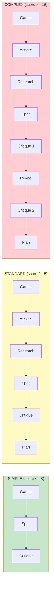
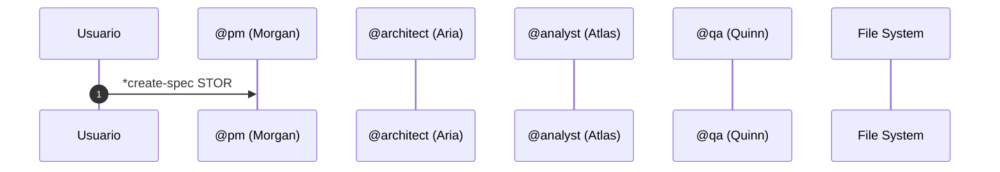

```mermaid
flowchart TB
    subgraph TRIGGER["Gatilhos"]
        T1["*create-spec STORY-ID"]
        T2["story_created<br/>(autoSpec.enabled)"]
    end

    subgraph PREFLIGHT["Pre-Flight Checks"]
        PF1["story_exists<br/>Verificar/criar diretorio"]
        PF2["no_existing_spec<br/>Evitar sobrescrita"]
        PF3["agents_available<br/>Verificar configuracao"]
    end

    subgraph PHASE1["Fase 1: Gather Requirements"]
        direction TB
        G1["@pm (Morgan)"]
        G2["Elicitação Interativa<br/>9 categorias de perguntas"]
        G3["requirements.json"]
        G1 --> G2 --> G3
    end

    subgraph PHASE2["Fase 2: Assess Complexity"]
        direction TB
        A1["@architect (Aria)"]
        A2["Avaliar 5 dimensoes:<br/>Scope, Integration, Infra,<br/>Knowledge, Risk"]
        A3["complexity.json<br/>SIMPLE | STANDARD | COMPLEX"]
        A1 --> A2 --> A3
    end

    subgraph PHASE3["Fase 3: Research Dependencies"]
        direction TB
        R1["@analyst (Atlas)"]
        R2["Context7 + EXA<br/>Validar dependencias"]
        R3["research.json"]
        R1 --> R2 --> R3
    end

    subgraph PHASE4["Fase 4: Write Specification"]
        direction TB
        W1["@pm (Morgan)"]
        W2["Gerar spec.md<br/>Sem invencao"]
        W3["spec.md"]
        W1 --> W2 --> W3
    end

    subgraph PHASE5["Fase 5: Critique Specification"]
        direction TB
        C1["@qa (Quinn)"]
        C2["Avaliar 5 dimensoes:<br/>Accuracy, Completeness,<br/>Consistency, Feasibility,<br/>Alignment"]
        C3{"Verdict"}
        C4["APPROVED"]
        C5["NEEDS_REVISION"]
        C6["BLOCKED"]
        C1 --> C2 --> C3
        C3 --> C4
        C3 --> C5
        C3 --> C6
    end

    subgraph PHASE5B["Fase 5b: Revise (COMPLEX)"]
        REV1["@pm (Morgan)"]
        REV2["Aplicar feedback<br/>e auto-fixes"]
    end

    subgraph PHASE6["Fase 6: Create Plan"]
        direction TB
        P1["@architect (Aria)"]
        P2["Gerar implementation.yaml<br/>Subtasks atomicas"]
        P3["plan.json"]
        P1 --> P2 --> P3
    end

    subgraph COMPLETION["Conclusão"]
        DONE["Pipeline Complete"]
        ARTIFACTS["Artefatos Gerados"]
    end

    T1 --> PREFLIGHT
    T2 --> PREFLIGHT
    PREFLIGHT --> PHASE1
    PHASE1 --> PHASE2
    PHASE2 --> PHASE3
    PHASE3 --> PHASE4
    PHASE4 --> PHASE5
    C4 --> PHASE6
    C5 --> PHASE5B
    PHASE5B --> PHASE5
    C6 -.-> |"Escalar para @architect"| HALT["HALT"]
    PHASE6 --> COMPLETION

    style TRIGGER fill:#e1f5fe
    style PREFLIGHT fill:#fff3e0
    style PHASE1 fill:#e8f5e9
    style PHASE2 fill:#fce4ec
    style PHASE3 fill:#f3e5f5
    style PHASE4 fill:#e8f5e9
    style PHASE5 fill:#fff8e1
    style PHASE5B fill:#ffebee
    style PHASE6 fill:#e0f2f1
    style COMPLETION fill:#c8e6c9
```

# COMANDO - spec-pipeline-workflow.md
**Origem:** E:\CentralDark\_MAPA_CASA\PASTA DO CHEFE JOGA ARQUIOVOS QUAIS QUUER SER GARIMPO DO CHEFE\aiox-core\docs\aios-workflows\spec-pipeline-workflow.md
**SHA:** 9ead00fa25b65a77
**Timestamp:** 2026-08-28T02:02:32.678270
**Portoes:** {"ocorrencias": true, "ganho": true, "contraprova": true, "sha": true}

## Ouro Extraido

### Decisoes
- ### 8.1 Decisão: Pular Assess?
- ### 8.2 Decisão: Pular Research?
- ### 8.3 Decisão: Verdict da Critique
- ### 8.4 Decisão: Executar Revise?
- ### 8.5 Decisão: Segunda Critique?

### Contratos
- #### Constitutional Gate: No Invention
- strictGate: true        # BLOCKED halts pipeline

### Ouro Bruto (primeiros 5000 chars)
```
# Spec Pipeline Workflow - Documentação Completa

> **Versão:** 1.0
> **Criado:** 2026-01-28
> **Autor:** @architect (Aria)
> **Epic:** Epic 3 - Spec Pipeline
> **Status:** Ativo

---

## 1. Visão Geral

O **Spec Pipeline** e um workflow orquestrado que transforma requisitos informais em especificações executaveis. Ele e parte da infraestrutura **Auto-Claude ADE** (Autonomous Development Engine) e implementa um fluxo de 5 fases principais que se adaptam dinamicamente baseado na complexidade do requisito.

### 1.1 Propósito

- Transformar descricoes informais de usuarios em especificações formais e estruturadas
- Garantir qualidade e consistencia atraves de gates de validação
- Adaptar o nivel de profundidade baseado na complexidade detectada
- Produzir artefatos rastreavies desde requisitos ate implementação

### 1.2 Principios Fundamentais

| Principio | Descrição |
|-----------|-----------|
| **No Invention** | Nenhuma informação inventada - apenas derivação dos inputs |
| **Traceability** | Todo statement deve rastrear para um requisito ou pesquisa |
| **Adaptive Phases** | Fases ajustadas automaticamente pela complexidade |
| **Quality Gates** | Validacao obrigatoria antes de avancar |

---

## 2. Diagrama do Workflow

### 2.1 Fluxo Principal



### 2.2 Fluxo por Complexidade



### 2.3 Diagrama de Sequência



---

# COMANDO - SPEC-PIPELINE-WORKFLOW.md
**Origem:** E:\CentralDark\_MAPA_CASA\PASTA DO CHEFE JOGA ARQUIOVOS QUAIS QUUER SER GARIMPO DO CHEFE\aiox-core\docs\guides\workflows\SPEC-PIPELINE-WORKFLOW.md
**SHA:** 96623c217a4453df
**Timestamp:** 2026-08-28T02:02:37.546742
**Portoes:** {"ocorrencias": true, "ganho": true, "contraprova": true, "sha": true}

## Ouro Extraido

### Decisoes
- ### 8.1 Decisao: Pular Assess?
- ### 8.2 Decisao: Pular Research?
- ### 8.3 Decisao: Verdict da Critique
- ### 8.4 Decisao: Executar Revise?
- ### 8.5 Decisao: Segunda Critique?

### Contratos
- #### Constitutional Gate: No Invention
- strictGate: true        # BLOCKED halts pipeline

### Ouro Bruto (primeiros 5000 chars)
```
# Spec Pipeline Workflow - Documentacao Completa

> **Versao:** 1.0
> **Criado:** 2026-01-28
> **Autor:** @architect (Aria)
> **Epic:** Epic 3 - Spec Pipeline
> **Status:** Ativo

---

## 1. Visao Geral

O **Spec Pipeline** e um workflow orquestrado que transforma requisitos informais em especificacoes executaveis. Ele e parte da infraestrutura **Auto-Claude ADE** (Autonomous Development Engine) e implementa um fluxo de 5 fases principais que se adaptam dinamicamente baseado na complexidade do requisito.

### 1.1 Proposito

- Transformar descricoes informais de usuarios em especificacoes formais e estruturadas
- Garantir qualidade e consistencia atraves de gates de validacao
- Adaptar o nivel de profundidade baseado na complexidade detectada
- Produzir artefatos rastreavies desde requisitos ate implementacao

### 1.2 Principios Fundamentais

| Principio | Descricao |
|-----------|-----------|
| **No Invention** | Nenhuma informacao inventada - apenas derivacao dos inputs |
| **Traceability** | Todo statement deve rastrear para um requisito ou pesquisa |
| **Adaptive Phases** | Fases ajustadas automaticamente pela complexidade |
| **Quality Gates** | Validacao obrigatoria antes de avancar |

---

## 2. Diagrama do Workflow

### 2.1 Fluxo Principal


### 2.2 Fluxo por Complexidade


### 2.3 Diagrama de Sequencia

