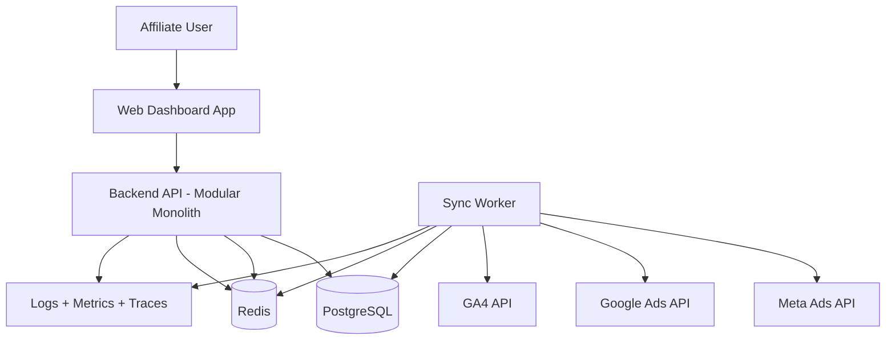

# COMANDO - architecture.md
**Origem:** E:\CentralDark\_MAPA_CASA\PASTA DO CHEFE JOGA ARQUIOVOS QUAIS QUUER SER GARIMPO DO CHEFE\.codex\.tmp\plugins\plugins\figma\skills\figma-generate-diagram\references\architecture.md
**SHA:** a7c26be020e5736a
**Timestamp:** 2026-08-26T18:31:10.862887
**Portoes:** {"ocorrencias": true, "ganho": true, "contraprova": true, "sha": true}

## Ouro Extraido

### Padroes
- Canonical pattern: `service -.->|"Produce"| queue` and `queue -.->|"Consume"| service`

### Ouro Bruto (primeiros 5000 chars)
```
# Architecture Diagrams

Use this reference when the user asks for a **software architecture diagram** — a view showing services, datastores, message queues, external integrations, and how they connect. These are flowcharts rendered by a bespoke grid-based layout (not ELK), controlled by the `useArchitectureLayoutCode` parameter on `generate_diagram`.

For generic flowcharts (decision trees, process flows, dependency graphs), use [flowchart.md](./flowchart.md) instead.

## Contents

1. [Before you start](#before-you-start)
2. [Rules](#rules)
   - [Hard rules (MUST)](#hard-rules-must)
   - [Correctness rules](#correctness-rules)
   - [Allowed edges](#allowed-edges)
   - [Known gotchas](#known-gotchas)
3. [Subgraph categories](#subgraph-categories)
   - [Common ambiguities](#common-ambiguities)
4. [Async subgraph](#async-subgraph)
5. [Node granularity](#node-granularity)
6. [Edge types](#edge-types)
7. [Validation checklist](#validation-checklist)
8. [Mermaid syntax rules](#mermaid-syntax-rules)
9. [Complete example](#complete-example)
10. [Calling generate_diagram](#calling-generate_diagram)

---

## Before you start

**Don't hallucinate labels or edges.** If the user describes their architecture in vague terms ("we have a few microservices"), ask one or two focused questions before generating instead of inventing services or connections that don't exist. A diagram of a real, partial system is more useful than a polished diagram of an imagined one.

When the source of truth is code or docs (a repo, a runbook, a Datadog dashboard), read it before drawing. Walking real routes, handlers, and consumers beats recreating from memory.

---

## Rules

**Read these before writing Mermaid.** After writing, re-check the [Validation checklist](#validation-checklist) before calling the tool — that section is the post-write pass and it's tighter than this list.

This section uses **two severity tiers**. Both are real rules — the difference is what happens if you violate them.

- **MUST / MUST NOT** — the tool errors, the renderer crashes, or the diagram silently comes out wrong in a way the agent can't detect.
- **Never / Always** — the diagram renders, but it's structurally wrong or misleading.

### Hard rules (MUST)

1. **`flowchart LR` only.** The bespoke layout is designed for left-to-right; `TD` / `TB` are not supported.
2. **Every node MUST be inside a subgraph.** Nodes outside a subgraph have no layer assignment and the layout cannot place them. Colors and shapes are auto-assigned from subgraph membership — you don't need `classDef`, `class`, or `style` statements.
3. **Subgraph IDs MUST be exactly one of:** `client`, `gateway`, `service`, `datastore`, `external`, `async`. The layout uses these IDs to position lanes; unknown IDs break placement. Use display labels for human-readable titles: `subgraph service ["Core Services"]`.
   - **WRONG:** `subgraph Services`
   - **RIGHT:** `subgraph service ["Core Services"]`
4. **Forward and bidirectional edges MUST form a DAG** across `client -> gateway -> service -> datastore`. Cycles among these will cause the tool to error. Any backward-flowing relationship must use a backward edge (rule 8) instead.
5. **All edges touching an async or external node MUST use dotted syntax (`-.->`)**, in either direction. The renderer uses the dotted style as a signal to route async/external paths differently from the core flow.

### Correctness rules

These won't crash the renderer, but they produce structurally wrong or misleading diagrams.

6. **One node = one independently deployable unit.** Don't decompose a service into internal modules. See [Node granularity](#node-granularity) for the test.
7. **Bidirectional edges write source -> target in the forward direction.** `client <-->|"WS"| gateway`, not `gateway <-->|"WS"| client`. The layout uses the source position to anchor the edge.
8. **Backward edges use `<---` and write the left node first.** The arrow points left. Example: `orderService <---|"Refund"| paymentService` — the refund flows from `paymentService` back to `orderService`.
9. **Never connect edges to subgraph IDs.** Subgraphs are containers, not anchorable nodes; the layout cannot route an edge from a subgraph ID. Connect to a specific node inside the subgraph instead.
10. **Never create two edges between the same pair of nodes.** The renderer may overlap or drop duplicates. Combine into one edge with a merged label.
11. **Bidirectional intent = one `<-->` edge.** Don't split into separate `-->` and `-.->`.

### Allowed edges

The diagram is valid only if every edge fits one of the source -> target pairs in this table. Anything not in the table is wrong by construction — a `service` must mediate.

| From          | To                       | Edge syntax | Use for                                                                |
| ------------- | ------------------------ | ----------- | ---------------------------------------------------------------------- |
| `client`     
```

---

# COMANDO - architecture.md
**Origem:** E:\CentralDark\_MAPA_CASA\PASTA DO CHEFE JOGA ARQUIOVOS QUAIS QUUER SER GARIMPO DO CHEFE\aiox-core\docs\architecture.md
**SHA:** 4d10c7c28986c4f2
**Timestamp:** 2026-08-28T02:02:30.661011
**Portoes:** {"ocorrencias": true, "ganho": true, "contraprova": true, "sha": true}

## Ouro Extraido

### Padroes
- - **Repository Pattern:** Data access abstraction by domain module. _Rationale:_ testability and controlled persistence evolution.
- - **Worker + Queue Pattern:** Background sync decoupled from request path. _Rationale:_ avoids blocking user flows on external API latency.

### Ouro Bruto (primeiros 5000 chars)
```
# Painel 747 Architecture Document

## Introduction
This document defines the architecture for Painel 747 with an MVP-first strategy. It is aligned to `docs/prd.md` and specifically to the Hard MVP + Expansion Gate model.

### Starter Template or Existing Project
N/A. Greenfield product architecture from scratch, using a monorepo and modular backend pattern.

### Change Log
| Date | Version | Description | Author |
|------|---------|-------------|--------|
| 2026-03-01 | 0.1 | Initial architecture draft from PRD v1.3 | Architect (Draft by PM handoff) |

## High Level Architecture

### Technical Summary
Painel 747 uses a modular monolith backend plus a web dashboard frontend in a monorepo. The backend exposes a REST API for auth, product context, dashboard queries, and integrations, while a background worker performs API sync and normalization. A relational database stores users, products, connectors, metric definitions, snapshots, and alert events. The architecture is optimized for Hard MVP delivery with one priority source first, then controlled expansion through the Expansion Gate. This design supports fast user insight, clear data freshness signals, and resilient partial-failure behavior.

### High Level Overview
- Architectural style: Modular Monolith + Async Worker
- Repository structure: Monorepo
- Service architecture: One deployable API service + one worker process
- Interaction flow:
  1. User authenticates and selects active product
  2. Dashboard API queries normalized snapshots
  3. Worker syncs source APIs on schedule and updates snapshots/status
  4. UI renders Top 6 metrics, comparison, and critical alerts
- Key decision: keep complexity low in MVP while preserving extension points for additional sources and metrics.

### High Level Project Diagram


### Architectural and Design Patterns
- **Modular Monolith:** Single codebase/deployable unit with strong internal boundaries. _Rationale:_ fastest MVP delivery with manageable operational complexity.
- **Repository Pattern:** Data access abstraction by domain module. _Rationale:_ testability and controlled persistence evolution.
- **Worker + Queue Pattern:** Background sync decoupled from request path. _Rationale:_ avoids blocking user flows on external API latency.
- **Source-of-Truth Metric Registry:** Central metric dictionary and formula ownership. _Rationale:_ consistency across dashboard, deep dive, and alerts.
- **Fail-Soft Read Model:** Partial data can still render cockpit with explicit status. _Rationale:_ operational continuity during source outages.

## Tech Stack

### Cloud Infrastructure
- **Provider:** AWS
- **Key Services:** ECS Fargate (API/Worker), RDS PostgreSQL, ElastiCache Redis, S3 (optional snapshots), CloudWatch
- **Deployment Regions:** us-east-1 (primary)

### Technology Stack Table
| Category | Technology | Version | Purpose | Rationale |
|----------|------------|---------|---------|-----------|
| Language | TypeScript | 5.9.3 | Backend/frontend language | Type safety and consistent dev experience |
| Runtime | Node.js | 20.19.0 | API and worker runtime | Stable LTS runtime |
| Frontend Framework | Next.js | 16.0.0 | Dashboard web app | App routing, strong ecosystem |
| UI Library | React | 19.0.0 | UI composition | Mature component model |
| Backend Framework | NestJS | 11.0.0 | Modular API architecture | Clear module boundaries, DI, testing support |
| API Style | REST | v1 | Client-server contract | Simple MVP integration and observability |
| Database | PostgreSQL | 16.4 | Transactional core data store | Strong relational modeling |
| ORM | Prisma | 6.7.0 | Data access and migrations | Type-safe schema and query layer |
| Cache/Queue | Redis | 7.4 | Caching, queue state, idempotency keys | Low latency and broad tooling |
| Job Queue | BullMQ | 5.40.0 | Sync orchestration and retries | Reliable background jobs with backoff |
| Auth | JWT + Refresh Tokens | n/a | Session/security | Stateless API auth for MVP |
| Validation | Zod | 3.24.0 | Request/contract validation | Runtime validation with TS alignment |
| Testing | Jest | 30.2.0 | Unit/integration tests | Existing project alignment |
| API Docs | OpenAPI | 3.1 | Endpoint documentation | Contract clarity for team and QA |
| Observability | OpenTelemetry SDK | 1.30.0 | Traces/metrics/log context | Faster incident diagnosis |
| CI/CD | GitHub Actions | n/a | Build/test/deploy automation | Standard and maintainable pipeline |

## Data Models

### User
**Purpose:** Authenticated account owner for products and integrations.

**Key Attributes:**
- `id`: uuid - primary key
- `email`: string - unique login identity
- 
```