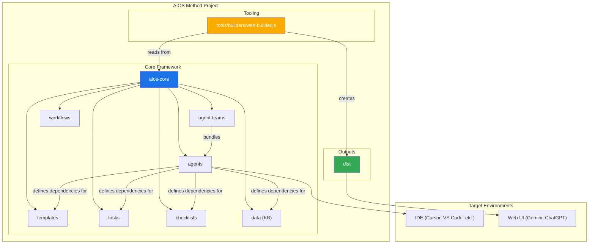

# COMANDO - core-architecture.md
**Origem:** E:\CentralDark\_MAPA_CASA\PASTA DO CHEFE JOGA ARQUIOVOS QUAIS QUUER SER GARIMPO DO CHEFE\aiox-core\docs\core-architecture.md
**SHA:** 212c33e241968d14
**Timestamp:** 2026-08-28T02:02:30.887917
**Portoes:** {"ocorrencias": true, "ganho": true, "contraprova": true, "sha": true}

## Ouro Extraido

### Comandos
- A["Start: Project Idea"] --> B{"Optional: Analyst Brainstorming"}
- A["Start: Planning Artifacts Complete"] --> B["PO: Shard Epics"]

### Ouro Bruto (primeiros 5000 chars)
```
# AIOS Method: Core Architecture

> 🌐 **EN** | [PT](./pt/core-architecture.md) | [ES](./es/core-architecture.md)

---

## 1. Overview

The AIOS Method is designed to provide agentic modes, tasks and templates to allow repeatable helpful workflows be it for agile agentic development, or expansion into vastly different domains. The core purpose of the project is to provide a structured yet flexible set of prompts, templates, and workflows that users can employ to guide AI agents (like Gemini, Claude, or ChatGPT) to perform complex tasks, guided discussions, or other meaningful domain specific flows in a predictable, high-quality manner.

The systems core module facilitates a full development lifecycle tailored to the challenges of current modern AI Agentic tooling:

1. **Ideation & Planning**: Brainstorming, market research, and creating project briefs.
2. **Architecture & Design**: Defining system architecture and UI/UX specifications.
3. **Development Execution**: A cyclical workflow where a Scrum Master (SM) agent drafts stories with extremely specific context and a Developer (Dev) agent implements them one at a time. This process works for both new (Greenfield) and existing (Brownfield) projects.

## 2. System Architecture Diagram

The entire AIOS-Method ecosystem is designed around the installed `aios-core` directory, which acts as the brain of the operation. The `tools` directory provides the means to process and package this brain for different environments.



## 3. Core Components

The `aios-core` directory contains all the definitions and resources that give the agents their capabilities.

### 3.1. Agents (`aios-core/agents/`)

- **Purpose**: These are the foundational building blocks of the system. Each markdown file (e.g., `aios-master.md`, `pm.md`, `dev.md`) defines the persona, capabilities, and dependencies of a single AI agent.
- **Structure**: An agent file contains a YAML header that specifies its role, persona, dependencies, and startup instructions. These dependencies are lists of tasks, templates, checklists, and data files that the agent is allowed to use.
- **Startup Instructions**: Agents can include startup sequences that load project-specific documentation from the `docs/` folder, such as coding standards, API specifications, or project structure documents. This provides immediate project context upon activation.
- **Document Integration**: Agents can reference and load documents from the project's `docs/` folder as part of tasks, workflows, or startup sequences. Users can also drag documents directly into chat interfaces to provide additional context.
- **Example**: The `aios-master` agent lists its dependencies, which tells the build tool which files to include in a web bundle and informs the agent of its own capabilities.

### 3.2. Agent Teams (`aios-core/agent-teams/`)

- **Purpose**: Team files (e.g., `team-all.yaml`) define collections of agents and workflows that are bundled together for a specific purpose, like "full-stack development" or "backend-only". This creates a larger, pre-packaged context for web UI environments.
- **Structure**: A team file lists the agents to include. It can use wildcards, such as `"*"` to include all agents. This allows for the creation of comprehensive bundles like `team-all`.

### 3.3. Workflows (`aios-core/workflows/`)

- **Purpose**: Workflows are YAML files (e.g., `greenfield-fullstack.yaml`) that define a prescribed sequence of steps and agent interactions for a specific project type. They act as a strategic guide for the user and the `aios-orchestrator` agent.
- **Structure**: A workflow defines sequences for both complex and simple projects, lists the agents involved at each step, the artifacts they create, and the conditions for moving from one step to the next. It often includes a Mermaid diagram for visualization.

### 3.4. Reusable Resources (`templates`, `tasks`, `checklists`, `data`)

- **Purpose**: These folders house the modula
```

---

# COMANDO - core-architecture.md
**Origem:** E:\CentralDark\_MAPA_CASA\PASTA DO CHEFE JOGA ARQUIOVOS QUAIS QUUER SER GARIMPO DO CHEFE\aiox-core\docs\es\core-architecture.md
**SHA:** ef0a557068a3dbb4
**Timestamp:** 2026-08-28T02:02:33.413957
**Portoes:** {"ocorrencias": true, "ganho": true, "contraprova": true, "sha": true}

## Ouro Extraido

### Comandos
- A["Start: Project Idea"] --> B{"Optional: Analyst Brainstorming"}
- A["Start: Planning Artifacts Complete"] --> B["PO: Shard Epics"]

### Ouro Bruto (primeiros 5000 chars)
```
<!--
  Traducción: ES
  Original: /docs/en/core-architecture.md
  Última sincronización: 2026-01-26
-->

# Método AIOS: Arquitectura Central

> 🌐 [EN](../core-architecture.md) | [PT](../pt/core-architecture.md) | **ES**

---

## 1. Descripción General

El Método AIOS está diseñado para proporcionar modos agénticos, tareas y plantillas que permiten flujos de trabajo repetibles y útiles, ya sea para desarrollo ágil con agentes o expansión hacia dominios muy diferentes. El propósito central del proyecto es proporcionar un conjunto estructurado pero flexible de prompts, plantillas y flujos de trabajo que los usuarios pueden emplear para guiar agentes de IA (como Gemini, Claude o ChatGPT) para realizar tareas complejas, discusiones guiadas u otros flujos específicos de dominio de manera predecible y de alta calidad.

El módulo central del sistema facilita un ciclo de vida de desarrollo completo adaptado a los desafíos de las herramientas modernas de IA agéntica:

1. **Ideación y Planificación**: Lluvia de ideas, investigación de mercado y creación de briefs de proyecto.
2. **Arquitectura y Diseño**: Definición de arquitectura del sistema y especificaciones de UI/UX.
3. **Ejecución del Desarrollo**: Un flujo de trabajo cíclico donde un agente Scrum Master (SM) redacta historias con contexto extremadamente específico y un agente Desarrollador (Dev) las implementa una a la vez. Este proceso funciona tanto para proyectos nuevos (Greenfield) como existentes (Brownfield).

## 2. Diagrama de Arquitectura del Sistema

Todo el ecosistema del Método AIOS está diseñado alrededor del directorio `aios-core` instalado, que actúa como el cerebro de la operación. El directorio `tools` proporciona los medios para procesar y empaquetar este cerebro para diferentes entornos.


## 3. Componentes Centrales

El directorio `aios-core` contiene todas las definiciones y recursos que dan a los agentes sus capacidades.

### 3.1. Agentes (`aios-core/agents/`)

- **Propósito**: Estos son los bloques de construcción fundamentales del sistema. Cada archivo markdown (por ejemplo, `aios-master.md`, `pm.md`, `dev.md`) define la persona, capacidades y dependencias de un único agente de IA.
- **Estructura**: Un archivo de agente contiene un encabezado YAML que especifica su rol, persona, dependencias e instrucciones de inicio. Estas dependencias son listas de tareas, plantillas, checklists y archivos de datos que el agente tiene permitido usar.
- **Instrucciones de Inicio**: Los agentes pueden incluir secuencias de inicio que cargan documentación específica del proyecto desde la carpeta `docs/`, como estándares de código, especificaciones de API o documentos de estructura del proyecto. Esto proporciona contexto inmediato del proyecto al momento de la activación.
- **Integración de Documentos**: Los agentes pueden referenciar y cargar documentos desde la carpeta `docs/` del proyecto como parte de tareas, flujos de trabajo o secuencias de inicio. Los usuarios también pueden arrastrar documentos directamente a las interfaces de chat para proporcionar contexto adicional.
- **Ejemplo**: El agente `aios-master` lista sus dependencias, lo que indica a la herramienta de construcción qué archivos incluir en un paquete web e informa al agente de sus propias capacidades.

### 3.2. Equipos de Agentes (`aios-core/agent-teams/`)

- **Propósito**: Los archivos de equipo (por ejemplo, `team-all.yaml`) definen colecciones de agentes y flujos de trabajo que se empaquetan juntos para un propósito específico, como "desarrollo full-stack" o "solo backend". Esto crea un contexto pre-empaquetado más grande para entornos de UI web.
- **Estructura**: Un archivo de equipo lista los agentes a incluir. Puede usar comodines, como `"*"` para incluir todos los agentes. Esto permite la creación de paquetes completos como `team-all`.

### 3.3. Flujos de Trabajo (`aios-core/workflows/`)

- **Propósito**: Los flujos de trabajo son archivos YAML (por ejemplo, `greenfield-fullst
```