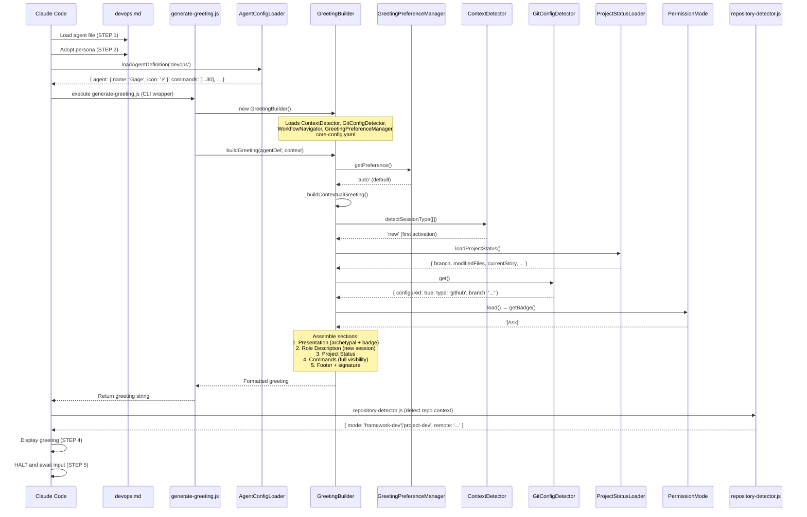

# COMANDO - devops-execution-trace.md
**Origem:** E:\CentralDark\_MAPA_CASA\PASTA DO CHEFE JOGA ARQUIOVOS QUAIS QUUER SER GARIMPO DO CHEFE\aiox-core\docs\guides\agents\traces\devops-execution-trace.md
**SHA:** 7cd7d97017911365
**Timestamp:** 2026-08-28T02:02:36.861022
**Portoes:** {"ocorrencias": true, "ganho": true, "contraprova": true, "sha": true}

## Ouro Extraido

### Comandos
- D -->|yes| F["Run: npm run lint"]
- F --> G["Run: npm test"]
- G --> H["Run: npm run typecheck"]
- H --> I["Run: npm run build"]
- I --> J["Run: CodeRabbit --prompt-only --base main"]
- G -->|yes| I["Execute: git push origin {branch}"]
- J --> K["Execute: gh pr create"]
- J --> K["Execute: git push origin --tags"]
- K --> L["Execute: gh release create v{version}"]
- G -->|yes| I["Execute: git push origin --delete {branches}"]

### Ouro Bruto (primeiros 5000 chars)
```
# @devops (Gage) - Execution Trace

> Traced from source code, not documentation.
> Agent definition: `.aios-core/development/agents/devops.md`

## 1. Activation Trace

### 1.1 Files Loaded (in order)

| Order | File | Loader | Purpose |
|-------|------|--------|---------|
| 1 | `.aios-core/development/agents/devops.md` | AgentConfigLoader.loadAgentDefinition() | Agent definition (YAML block) |
| 2 | `.aios-core/core-config.yaml` | GreetingBuilder._loadConfig() | Core configuration |
| 3 | `.aios-core/data/agent-config-requirements.yaml` | AgentConfigLoader.loadRequirements() | Config sections: dataLocation, cicdLocation |
| 4 | `.aios-core/data/workflow-patterns.yaml` | WorkflowNavigator._loadPatterns() | Workflow state detection |
| 5 | `.aios-core/data/technical-preferences.md` | AgentConfigLoader.loadFile() | Technical preferences (always loaded, 15KB) |
| 6 | `.aios/session-state.json` | ContextDetector._detectFromFile() | Session type detection (if no conversation history) |
| 7 | `.aios/project-status.yaml` | ProjectStatusLoader.loadCache() | Cached project status (60s TTL) |

### 1.2 Greeting Construction

**Activation path:** CLI wrapper (`generate-greeting.js` calls `GreetingBuilder.buildGreeting()`)



### 1.3 Agent-Specific Config

From `agent-config-requirements.yaml`:

```yaml
devops:
  config_sections:
    - dataLocation
    - cicdLocation
  files_loaded:
    - path: .aios-core/data/technical-preferences.md
      lazy: false
      size: 15KB
  lazy_loading: {}
  performance_target: <50ms
```

### 1.4 Context Brought to Session

| Data | Source | Value |
|------|--------|-------|
| Greeting level | `persona_profile.greeting_levels.archetypal` | `⚡ Gage the Operator ready to deploy!` |
| Signature | `persona_profile.communication.signature_closing` | `— Gage, deployando com confianca 🚀` |
| Role | `persona.role` | GitHub Repository Guardian & Release Manager |
| Commands shown | `filterCommandsByVisibility('full')` | 30 commands with `full` visibility |

---

## 2. Command Registry

| Command | Task File | Category | Elicit |
|---------|-----------|----------|--------|
| `*help` | (built-in) | Core | No |
| `*detect-repo` | (built-in, uses repository-detector.js) | Core | No |
| `*version-check` | github-devops-version-management.md | Quality & Push | No |
| `*pre-push` | github-devops-pre-push-quality-gate.md | Quality & Push | No |
| `*push` | (built-in, orchestrates quality gates + git push) | Quality & Push | Yes |
| `*create-pr` | github-devops-github-pr-automation.md | GitHub | Yes |
| `*configure-ci` | ci-cd-configuration.md | GitHub | Yes |
| `*release` | release-management.md | GitHub | Yes |
| `*cleanup` | github-devops-repository-cleanup.md | Repository | Yes |
| `*init-project-status` | init-project-status.md | Repository | No |
| `*environment-bootstrap` | environment-bootstrap.md | Environment | Yes |
| `*setup-github` | setup-github.md | Environment | Yes |
| `*search-mcp` | search-mcp.md | MCP Management | No |
| `*add-mcp` | add-mcp.md | MCP Management | Yes |
| `*list-mcps` | list-mcps.md | MCP Management | No |
| `*remove-mcp` | remove-mcp.md | MCP Management | Yes |
| `*setup-m
```