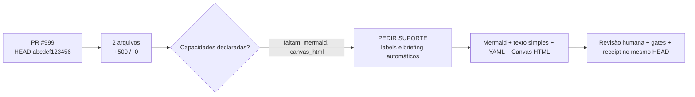

# COMANDO - out.md
**Origem:** E:\CentralDark\_MAPA_CASA\PASTA DO CHEFE JOGA ARQUIOVOS QUAIS QUUER SER GARIMPO DO CHEFE\PACOTE-SESSAO-INTEIRA-CENTRALDARK-20260806\01-ARQUIVOS-DA-CONVERSA\out.md
**SHA:** 94be5e130139a1eb
**Timestamp:** 2026-08-26T19:10:22.583764
**Portoes:** {"ocorrencias": true, "ganho": true, "contraprova": true, "sha": true}

## Ouro Extraido

### Gaps
- missing: ["mermaid", "canvas_html"]

### Ouro Bruto (primeiros 5000 chars)
```
<!-- centraldark-pr-learning-artifact -->
# 🧠 Artefato automático de aprendizado do PR

**PR:** #999 · **HEAD:** `abcdef1234567890abcdef1234567890abcdef12` · **Estado:** `SUPPORT_REQUIRED`

**Título:** feat: bot de artefato

## Mapa visual (Mermaid)



## Fallback universal em texto simples

PR #999 no HEAD abcdef1234567890abcdef1234567890abcdef12. 2 arquivos alterados; +500 e -0. Faltam capacidades declaradas: mermaid, canvas_html. O bot pede suporte sem mudar a autoria do código. O artefato não aprova o PR: ele organiza contexto; testes, revisão e gates continuam obrigatórios.

## Cartão estruturado para IAs

```yaml
artifact_type: pr_learning_card
artifact_schema: 1
repository: "ServerVpss/CentralDark"
pr_number: 999
head_sha: "abcdef1234567890abcdef1234567890abcdef12"
base_sha: "1111111111111111111111111111111111111111"
title: "feat: bot de artefato"
author: "hermes"
status: SUPPORT_REQUIRED
capabilities:
  mermaid: NAO
  canvas_html: UNKNOWN
  structured_yaml: SIM
support:
  required: SIM
  missing: ["mermaid", "canvas_html"]
  labels: ["🤖 AUTO", "🆘 AJUDA-NECESSÁRIA", "🤖 IA-DOCUMENTAR", "assign:chatgpt"]
change_summary:
  files: 2
  additions: 500
  deletions: 0
  workflows: 1
  docs: 0
  tests: 0
  code: 1
  sensitive_paths: 0
artifact_digest: 35216d5ab4cd80fc39b0c282a27b794a643f838324b2f48f44d4fb33496a2f6a
```

## 🆘 Solicitação automática de suporte

A IA/autoria deste PR não declarou suporte completo para: **mermaid, canvas_html**.

O bot aplicará labels de ajuda e pedirá a uma rota com suporte para traduzir/revisar o artefato, sem trocar o Writer do código e sem reiniciar a missão.

Labels solicitadas: `🤖 AUTO`, `🆘 AJUDA-NECESSÁRIA`, `🤖 IA-DOCUMENTAR`, `assign:chatgpt`.

## Receipt

```text
ARTIFACT_STATUS=SUPPORT_REQUIRED
HEAD_SHA=abcdef1234567890abcdef1234567890abcdef12
FILES=2
SUPPORT_REQUIRED=SIM
MISSING_CAPABILITIES=mermaid,canvas_html
SENSITIVE_PATHS=0
ARTIFACT_DIGEST=35216d5ab4cd80fc39b0c282a27b794a643f838324b2f48f44d4fb33496a2f6a
PR_APPROVED=NAO
MERGE_AUTHORIZED=NAO
```

> Este comentário é idempotente e deve ser atualizado no mesmo marcador. É contexto verificável, não prova de funcionamento do código.
```

---

# COMANDO - out.html
**Origem:** E:\\CentralDark\\_MAPA_CASA\\PASTA DO CHEFE JOGA ARQUIOVOS QUAIS QUUER SER GARIMPO DO CHEFE\PACOTE-SESSAO-INTEIRA-CENTRALDARK-20260806\01-ARQUIVOS-DA-CONVERSA\out.html
**SHA:** 8e84cfe488e645b3
**Timestamp:** 2026-08-26T19:43:16.894601
**Portoes:** {"ocorrencias": true, "ganho": true, "contraprova": true, "sha": true}

## Ouro Extraido

### Gaps
- const margin=28,gap=16,w=(canvas.width-margin*2-gap*4)/5,y=120,h=150;

### Ouro Bruto (primeiros 5000 chars)
```
<!doctype html>
<html lang="pt-BR">
<head>
<meta charset="utf-8">
<meta name="viewport" content="width=device-width,initial-scale=1">
<title>CentralDark PR #999 — aprendizado</title>
<style>
body{margin:0;background:#0b0d10;color:#f3f4f6;font-family:Arial,Helvetica,sans-serif}
main{max-width:1180px;margin:24px auto;padding:0 16px}
h1{font-size:24px;margin:0 0 8px}
p{color:#b8c0cc}
canvas{width:100%;height:auto;background:#11151a;border:1px solid #2a313b;border-radius:16px}
code{display:inline-block;background:#171b21;padding:8px 10px;border-radius:8px;overflow-wrap:anywhere}
</style>
</head>
<body>
<main>
<h1>PR #999 — aprendizado verificável</h1>
<p>HEAD <code>abcdef1234567890abcdef1234567890abcdef12</code> · estado <code>SUPPORT_REQUIRED</code></p>
<canvas id="board" width="1120" height="430" aria-label="Fluxo de aprendizado do PR"></canvas>
<p><code>ARTIFACT_DIGEST=35216d5ab4cd80fc39b0c282a27b794a643f838324b2f48f44d4fb33496a2f6a</code></p>
</main>
<script>
const states=[["PR_ABERTO","PR e HEAD identificados"],["ARTEFATO_GERADO","Mermaid, YAML, texto e Canvas"],["SUPORTE_SOLICITADO","mermaid, canvas_html"],["GATES_PENDENTES","testes e revisão ainda decidem"],["RECEIPT_EMITIDO","35216d5ab4cd80fc"]];
const canvas=document.getElementById('board');
const ctx=canvas.getContext('2d');
function box(x,y,w,h,title,sub,active){
  ctx.fillStyle=active?'#f4f4f5':'#1b222b';
  ctx.strokeStyle=active?'#f4f4f5':'#3a4654';
  ctx.lineWidth=3;ctx.beginPath();ctx.roundRect(x,y,w,h,16);ctx.fill();ctx.stroke();
  ctx.fillStyle=active?'#101317':'#f3f4f6';ctx.textAlign='center';
  ctx.font='700 17px Arial';ctx.fillText(title,x+w/2,y+46);
  ctx.font='14px Arial';ctx.fillText(sub.slice(0,28),x+w/2,y+82);
}
function arrow(x1,y1,x2,y2){
  ctx.strokeStyle='#6b7280';ctx.lineWidth=3;ctx.beginPath();ctx.moveTo(x1,y1);ctx.lineTo(x2,y2);ctx.stroke();
  ctx.beginPath();ctx.moveTo(x2-10,y2-6);ctx.lineTo(x2,y2);ctx.lineTo(x2-10,y2+6);ctx.stroke();
}
ctx.fillStyle='#11151a';ctx.fillRect(0,0,canvas.width,canvas.height);
const margin=28,gap=16,w=(canvas.width-margin*2-gap*4)/5,y=120,h=150;
states.forEach((s,i)=>{const x=margin+i*(w+gap);box(x,y,w,h,s[0],s[1],i===states.length-1);if(i<4)arrow(x+w+3,y+h/2,x+w+gap-3,y+h/2);});
ctx.textAlign='left';ctx.fillStyle='#d1d5db';ctx.font='16px monospace';
ctx.fillText('ARTEFATO ORGANIZA; TESTE E JUDGE PROVAM.',28,350);
ctx.fillText('SUPORTE NÃO TRANSFERE O WRITER DO CÓDIGO.',28,382);
</script>
</body>
</html>
```