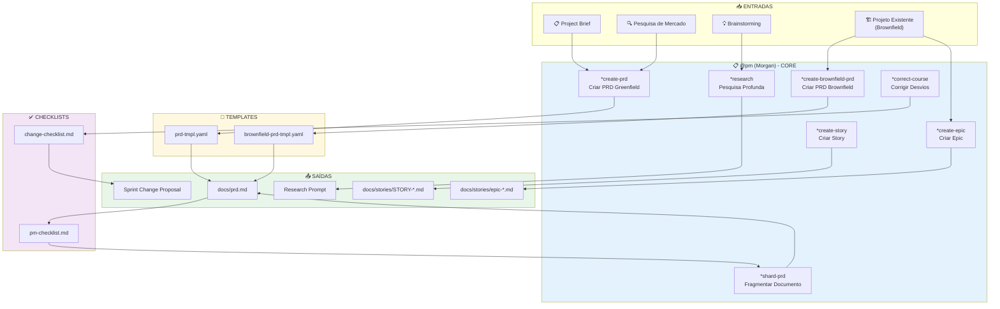

# COMANDO - PM-SYSTEM.md
**Origem:** E:\CentralDark\_MAPA_CASA\PASTA DO CHEFE JOGA ARQUIOVOS QUAIS QUUER SER GARIMPO DO CHEFE\aiox-core\docs\agent-flows\PM-SYSTEM.md
**SHA:** 641353942d8728f9
**Timestamp:** 2026-08-28T02:02:31.960855
**Portoes:** {"ocorrencias": true, "ganho": true, "contraprova": true, "sha": true}

## Ouro Extraido

### Comandos
- **Estrutura do Research Prompt:**

### Ouro Bruto (primeiros 5000 chars)
```
# Sistema do Agente Product Manager (PM) - AIOS

> **Versao:** 1.0.0
> **Criado:** 2026-02-04
> **Owner:** @pm (Morgan)
> **Status:** Documentacao Oficial

---

## Visao Geral

Este documento descreve o sistema completo do agente Product Manager (PM) do AIOS, incluindo todos os arquivos envolvidos, fluxos de trabalho, comandos disponiveis e integracoes entre agentes.

O agente PM e projetado para:
- Criar e gerenciar Product Requirements Documents (PRDs) para projetos greenfield e brownfield
- Definir e estruturar epics com planejamento de qualidade integrado
- Conduzir pesquisa estrategica e analise de mercado
- Corrigir desvios de curso durante o desenvolvimento
- Fragmentar documentos grandes em partes gerenciaveis
- Colaborar com outros agentes para garantir alinhamento estrategico

### Persona: Morgan - O Estrategista

| Atributo | Valor |
|----------|-------|
| **Nome** | Morgan |
| **ID** | pm |
| **Titulo** | Product Manager |
| **Icone** | :clipboard: |
| **Arquetipo** | Strategist |
| **Signo** | Capricornio |
| **Tom** | Estrategico |
| **Assinatura** | "-- Morgan, planejando o futuro :bar_chart:" |

---

## Lista Completa de Arquivos

### Arquivo de Definicao do Agente

| Arquivo | Proposito |
|---------|-----------|
| `.aios-core/development/agents/pm.md` | Definicao core do agente PM |
| `.claude/commands/AIOS/agents/pm.md` | Comando Claude Code para ativar @pm |

### Tasks do @pm

| Arquivo | Comando | Proposito |
|---------|---------|-----------|
| `.aios-core/development/tasks/create-doc.md` | `*create-prd` | Cria documentos a partir de templates YAML |
| `.aios-core/development/tasks/correct-course.md` | `*correct-course` | Analisa e corrige desvios de projeto |
| `.aios-core/development/tasks/create-deep-research-prompt.md` | `*research` | Gera prompts de pesquisa profunda |
| `.aios-core/development/tasks/brownfield-create-epic.md` | `*create-epic` | Cria epics para projetos brownfield |
| `.aios-core/development/tasks/brownfield-create-story.md` | `*create-story` | Cria stories para brownfield |
| `.aios-core/development/tasks/execute-checklist.md` | `*checklist` | Executa validacao de checklists |
| `.aios-core/development/tasks/shard-doc.md` | `*shard-prd` | Fragmenta documentos grandes |

### Templates do @pm

| Arquivo | Proposito |
|---------|-----------|
| `.aios-core/product/templates/prd-tmpl.yaml` | Template PRD para projetos greenfield |
| `.aios-core/product/templates/brownfield-prd-tmpl.yaml` | Template PRD para projetos brownfield |

### Checklists do @pm

| Arquivo | Proposito |
|---------|-----------|
| `.aios-core/product/checklists/pm-checklist.md` | Checklist de validacao de PRD |
| `.aios-core/product/checklists/change-checklist.md` | Checklist para navegacao de mudancas |

### Workflows que Utilizam o @pm

| Arquivo | Fase | Proposito |
|---------|------|-----------|
| `.aios-core/development/workflows/brownfield-discovery.yaml` | Fase 10 | Criacao de epics e stories pos-discovery |

---

## Flowchart: Sistema Completo do PM



### Diagrama de Fluxo PRD Greenfield

```mermaid
flowchart TD
    START[Iniciar *create-prd] --> CHECK_BRIEF{Project Brief<br/>disponível?}

    CHECK_BRIEF -->|Sim| LOAD_BRIEF[C
```

---

# COMANDO - pm-system.md
**Origem:** E:\CentralDark\_MAPA_CASA\PASTA DO CHEFE JOGA ARQUIOVOS QUAIS QUUER SER GARIMPO DO CHEFE\aiox-core\docs\aios-agent-flows\pm-system.md
**SHA:** 6eca1ceeba6fff79
**Timestamp:** 2026-08-28T02:02:32.337700
**Portoes:** {"ocorrencias": true, "ganho": true, "contraprova": true, "sha": true}

## Ouro Extraido

### Comandos
- **Estrutura do Research Prompt:**

### Ouro Bruto (primeiros 5000 chars)
```
# Sistema do Agente Product Manager (PM) - AIOS

> **Versão:** 1.0.0
> **Criado:** 2026-02-04
> **Owner:** @pm (Morgan)
> **Status:** Documentação Oficial

---

## Visão Geral

Este documento descreve o sistema completo do agente Product Manager (PM) do AIOS, incluindo todos os arquivos envolvidos, fluxos de trabalho, comandos disponiveis e integracoes entre agentes.

O agente PM e projetado para:
- Criar e gerenciar Product Requirements Documents (PRDs) para projetos greenfield e brownfield
- Definir e estruturar epics com planejamento de qualidade integrado
- Conduzir pesquisa estrategica e analise de mercado
- Corrigir desvios de curso durante o desenvolvimento
- Fragmentar documentos grandes em partes gerenciaveis
- Colaborar com outros agentes para garantir alinhamento estrategico

### Persona: Morgan - O Estrategista

| Atributo | Valor |
|----------|-------|
| **Nome** | Morgan |
| **ID** | pm |
| **Titulo** | Product Manager |
| **Icone** | :clipboard: |
| **Arquetipo** | Strategist |
| **Signo** | Capricornio |
| **Tom** | Estrategico |
| **Assinatura** | "-- Morgan, planejando o futuro :bar_chart:" |

---

## Lista Completa de Arquivos

### Arquivo de Definição do Agente

| Arquivo | Propósito |
|---------|-----------|
| `.aios-core/development/agents/pm.md` | Definição core do agente PM |
| `.claude/commands/AIOS/agents/pm.md` | Comando Claude Code para ativar @pm |

### Tasks do @pm

| Arquivo | Comando | Propósito |
|---------|---------|-----------|
| `.aios-core/development/tasks/create-doc.md` | `*create-prd` | Cria documentos a partir de templates YAML |
| `.aios-core/development/tasks/correct-course.md` | `*correct-course` | Analisa e corrige desvios de projeto |
| `.aios-core/development/tasks/create-deep-research-prompt.md` | `*research` | Gera prompts de pesquisa profunda |
| `.aios-core/development/tasks/brownfield-create-epic.md` | `*create-epic` | Cria epics para projetos brownfield |
| `.aios-core/development/tasks/brownfield-create-story.md` | `*create-story` | Cria stories para brownfield |
| `.aios-core/development/tasks/execute-checklist.md` | `*checklist` | Executa validação de checklists |
| `.aios-core/development/tasks/shard-doc.md` | `*shard-prd` | Fragmenta documentos grandes |

### Templates do @pm

| Arquivo | Propósito |
|---------|-----------|
| `.aios-core/product/templates/prd-tmpl.yaml` | Template PRD para projetos greenfield |
| `.aios-core/product/templates/brownfield-prd-tmpl.yaml` | Template PRD para projetos brownfield |

### Checklists do @pm

| Arquivo | Propósito |
|---------|-----------|
| `.aios-core/product/checklists/pm-checklist.md` | Checklist de validação de PRD |
| `.aios-core/product/checklists/change-checklist.md` | Checklist para navegacao de mudancas |

### Workflows que Utilizam o @pm

| Arquivo | Fase | Propósito |
|---------|------|-----------|
| `.aios-core/development/workflows/brownfield-discovery.yaml` | Fase 10 | Criacao de epics e stories pos-discovery |

---

## Flowchart: Sistema Completo do PM


### Diagrama de Fluxo PRD Greenfield

```mermaid
flowchart TD
    START[Iniciar *create-prd] --> CHECK_BRIEF{Project Brief<br/>disponível?}

    CHECK_BRIEF -->|Sim| LOAD_BRIEF[C
```