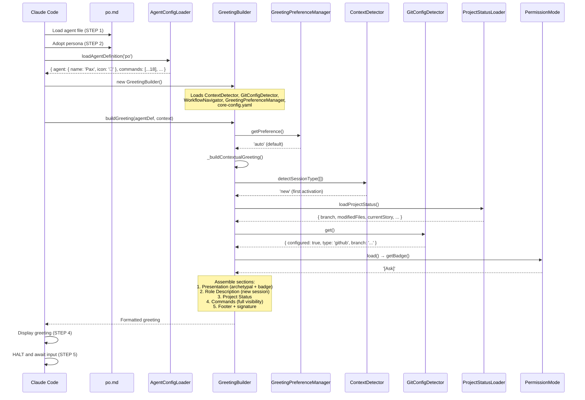

# COMANDO - po-execution-trace.md
**Origem:** E:\CentralDark\_MAPA_CASA\PASTA DO CHEFE JOGA ARQUIOVOS QUAIS QUUER SER GARIMPO DO CHEFE\aiox-core\docs\guides\agents\traces\po-execution-trace.md
**SHA:** d1c8025b02b81308
**Timestamp:** 2026-08-28T02:02:36.906021
**Portoes:** {"ocorrencias": true, "ganho": true, "contraprova": true, "sha": true}

## Ouro Extraido

### Comandos
- E -->|None configured| J[Prompt: run aios init]

### Ouro Bruto (primeiros 5000 chars)
```
# @po (Pax) - Execution Trace

> Traced from source code, not documentation.
> Agent definition: `.aios-core/development/agents/po.md`

## 1. Activation Trace

### 1.1 Files Loaded (in order)

| Order | File | Loader | Purpose |
|-------|------|--------|---------|
| 1 | `.aios-core/development/agents/po.md` | AgentConfigLoader.loadAgentDefinition() | Agent definition (YAML block) |
| 2 | `.aios-core/core-config.yaml` | GreetingBuilder._loadConfig() | Core configuration |
| 3 | `.aios-core/data/agent-config-requirements.yaml` | AgentConfigLoader.loadRequirements() | Config sections: devStoryLocation, prd, storyBacklog, templatesLocation |
| 4 | `.aios-core/data/workflow-patterns.yaml` | WorkflowNavigator._loadPatterns() | Workflow state detection |
| 5 | `.aios-core/product/data/elicitation-methods.md` | AgentConfigLoader.loadFile() | Elicitation methods (always loaded, 5KB) |
| 6 | `.aios/session-state.json` | ContextDetector._detectFromFile() | Session type detection (if no conversation history) |
| 7 | `.aios/project-status.yaml` | ProjectStatusLoader.loadCache() | Cached project status (60s TTL) |

### 1.2 Greeting Construction

**Activation path:** Direct invocation (STEP 3 calls `GreetingBuilder.buildGreeting()`)



### 1.3 Agent-Specific Config

From `agent-config-requirements.yaml`:

```yaml
po:
  config_sections:
    - devStoryLocation
    - prd
    - storyBacklog
    - templatesLocation
  files_loaded:
    - path: .aios-core/product/data/elicitation-methods.md
      lazy: false
      size: 5KB
  lazy_loading:
    story_templates: true      # Load when creating stories
    prd_templates: true        # Load when creating PRDs
  performance_target: <75ms
```

### 1.4 Context Brought to Session

| Data | Source | Value |
|------|--------|-------|
| Greeting level | `persona_profile.greeting_levels.archetypal` | `🎯 Pax the Balancer ready to balance!` |
| Signature | `persona_profile.communication.signature_closing` | `— Pax, equilibrando prioridades 🎯` |
| Role | `persona.role` | Technical Product Owner & Process Steward |
| Commands shown | `filterCommandsByVisibility('full')` | 18 commands with `full` visibility |

---

## 2. Command Registry

| Command | Task File | Visibility | Elicit |
|---------|-----------|------------|--------|
| `*help` | (built-in) | full, quick, key | No |
| `*backlog-add` | po-backlog-add.md | full, quick | Yes |
| `*backlog-review` | po-manage-story-backlog.md | full, quick | Optional |
| `*backlog-summary` | po-manage-story-backlog.md | quick, key | No |
| `*backlog-prioritize` | po-manage-story-backlog.md | full | Yes |
| `*backlog-schedule` | po-manage-story-backlog.md | full | Yes |
| `*stories-index` | po-stories-index.md | full, quick | No |
| `*validate-story-draft` | validate-next-story.md | full, quick, key | Yes |
| `*sync-story` | po-sync-story.md | full | Yes |
| `*pull-story` | po-pull-story.md | full | Yes |
| `*execute-checklist-po` | execute-checklist.md + po-master-checklist.md | quick | Optional |
| `*shard-doc` | shard-doc.md | full | Yes |
| `*doc-out` | (built-in) | full | No |
| `*session-info` | (built-in) | full | No |
| `*guide` | (built-in, rendered from agent .md) | full, quick | No |
| `*yolo` | (built-in) | full | No |
| `*exit` | (built-in) | full | No |

**NOTE:** `create-epic` and `create-story` have been REMOVED from @po. Epic creation is delegated to @pm, story creation is delegated to @sm.

---

## 3. Per-Command Execution Traces

### `*backlog-add`

**
```