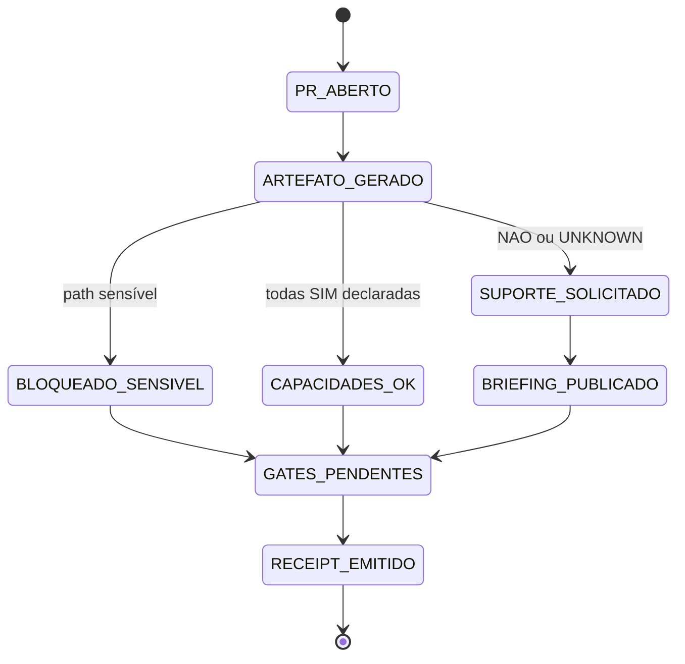

# COMANDO - PR-LEARNING-ARTIFACT.md
**Origem:** E:\CentralDark\_MAPA_CASA\PASTA DO CHEFE JOGA ARQUIOVOS QUAIS QUUER SER GARIMPO DO CHEFE\PACOTE-SESSAO-INTEIRA-CENTRALDARK-20260806\01-ARQUIVOS-DA-CONVERSA\PR-LEARNING-ARTIFACT.md
**SHA:** 8f30658b0632f301
**Timestamp:** 2026-08-26T19:10:22.709560
**Portoes:** {"ocorrencias": true, "ganho": true, "contraprova": true, "sha": true}

## Ouro Extraido

### Contratos
- SENSITIVE_PATH_GATE=PASS

### Ouro Bruto (primeiros 5000 chars)
```
---
title: "PR Learning Artifact Bot"
status: "CANDIDATO_CANONICO_ATÉ_MERGE"
scope: "Artefato automático e roteamento de suporte em Pull Requests"
source_of_truth: ".github/workflows/pr-learning-artifact.yml + scripts/lupa/pr-learning-artifact.mjs"
intent_author: "SEGREDO/CHEFE"
versioning_rule: "Evoluir estes mesmos artefatos; não criar V2/V3 ou bot concorrente"
---

# PR Learning Artifact Bot — padrão visual e legível por IA

## Intenção registrada

Ao abrir, editar ou atualizar um Pull Request, o CentralDark deve produzir automaticamente um artefato curto que permita a humanos e inteligências entenderem o mesmo estado com rapidez.

A intenção é de **SEGREDO/CHEFE**:

```text
PR ABERTO
→ ARTEFATO VISUAL + ESTRUTURADO
→ CAPACIDADES DECLARADAS
→ FALLBACK EM TEXTO
→ SUPORTE PEDIDO QUANDO NECESSÁRIO
→ TESTES E JUDGE CONTINUAM DECIDINDO
```

Nenhuma IA perde autoria porque pediu ajuda. Suporte visual ou tradução não transfere o Writer do código.

## Formatos obrigatórios

Cada execução gera no mesmo `HEAD_SHA`:

1. **Mermaid** no comentário do PR;
2. **texto simples** para qualquer agente;
3. **YAML estruturado** para leitura de máquina;
4. **Canvas HTML autocontido** salvo como artifact do workflow;
5. **receipt** com digest SHA-256;
6. **pedido automático de suporte** quando a autoria declarar `NAO` ou `UNKNOWN`;
7. **bloqueio fail-closed** quando metadados apontarem caminho sensível.

## Contrato de capacidades

A descrição do PR contém:

```yaml
AI_CAPABILITIES:
  mermaid: SIM|NAO|UNKNOWN
  canvas_html: SIM|NAO|UNKNOWN
  structured_yaml: SIM|NAO|UNKNOWN
```

Regras:

- não inventar suporte;
- a fonte da capacidade é registrada como `DECLARED_UNVERIFIED`;
- `SIM` declarado não é prova independente;
- `UNKNOWN` não vira `SIM`;
- o bot sempre oferece fallback em texto;
- falta de Mermaid ou Canvas roteia `assign:chatgpt`;
- falta de YAML estruturado roteia `assign:codex`;
- o Dispatcher publica o briefing no próprio PR;
- pedido de suporte não aprova, não mergeia e não altera código;
- as labels `assign:chatgpt` e `assign:codex` pertencem ao seed oficial para recuperação reproduzível.

As rotas são designações operacionais do repositório, não alegações universais sobre todo modelo futuro.

## Segurança

O job que comenta usa `pull_request_target`, executa somente código da base confiável e não faz checkout do código não confiável do PR.

Ele lê apenas:

- título sanitizado e codificado para Markdown inline;
- corpo sanitizado para leitura do contrato de capacidades;
- número do PR;
- base e HEAD;
- nomes, status e contagens dos arquivos.

Ele não lê patch, conteúdo de arquivo, `.env`, secrets, tokens, sessões, chaves ou certificados.

O job do evento `pull_request` possui somente `contents: read`; ele testa o gerador no HEAD candidato, compara o SHA completo do evento com `git rev-parse HEAD` e publica artifact de prova, mas não comenta nem escreve no PR.

As Actions externas usadas nos workflows modificados são fixadas em SHAs imutáveis. Comentários idempotentes só reconhecem marcador publicado pelo `github-actions[bot]`, impedindo que comentário de terceiro bloqueie ou seja sobrescrito pelo bot.

## Máquina de estados



## Invariantes

```text
ARTEFATO != APROVAÇÃO
COMMENT_CREATED != ENTREGA
ARTIFACT_UPLOADED != CÓDIGO FUNCIONANDO
SUPPORT_REQUESTED != WRITER_TRANSFERRED
CAPABILITY_DECLARED_SIM != CAPABILITY_PROVEN
SENSITIVE_PATHS_GT_0 => BLOCKED_SENSITIVE_PATH
HEAD_DECLARADO != HEAD_DO_CHECKOUT => BLOCKED
PR_NUMBER_NAO_CANONICO => BLOCKED
FILE_METADATA_INVALID => BLOCKED
MARKDOWN_NAO_CONFIAVEL => CODIFICAR_ANTES_DE_PUBLICAR
CHECKS_GREEN != PRODUÇÃO
```

O estado final continua dependendo de testes, revisão, Judge, autorização humana e critérios do PR.

## Evidência exigida

A implementação só pode ser chamada de funcional quando houver:

```text
NODE_CHECK=PASS
TESTES_DO_GERADOR=PASS
WORKFLOW_YAML=VÁLIDO
ARTIFACT_MARKDOWN=GERADO
ARTIFACT_HTML=GERADO
DIGEST_DETERMINÍSTICO=SIM
TOKEN_FINE_GRAINED_REDACTED=SIM
MARKDOWN_INLINE_INJECTION_BLOCKED=SIM
HEAD_SHA_EXACT_40_HEX=SIM
CHECKOUT_HEAD_MATCH=SIM
PR_NUMBER_CANONICAL=SIM
FILE_METADATA_VALIDATED=SIM
UNICODE_ORDER_INDEPENDENT=SIM
SENSITIVE_PATH_GATE=PASS
TEST_RECEIPT_DERIVED_FROM_TAP=SIM
ACTIONS_PINNED_BY_SHA=SIM
COMENTÁRIO_IDEMPOTENTE=PROVADO_EM_RUN
ROTEAMENTO_DE_LABEL=PROVADO_EM_RUN
DISPATCHER_NO_PR=PROVADO_EM_RUN
```

Antes do merge, os três últimos itens permanecem `PENDENTE_DE_RUNTIME`, porque `pull_request_target` usa a versão existente na branch padrão.

## Rollb
```

---

# COMANDO - pr-learning-artifact.mjs
**Origem:** E:\CentralDark\_MAPA_CASA\PASTA DO CHEFE JOGA ARQUIOVOS QUAIS QUUER SER GARIMPO DO CHEFE\PACOTE-SESSAO-INTEIRA-CENTRALDARK-20260806\02-SNAPSHOT-TRABALHO\pr_learning_impl\pr-learning-artifact.mjs
**SHA:** f179262a1bcb79b6
**Timestamp:** 2026-08-26T19:10:26.702483
**Portoes:** {"ocorrencias": true, "ganho": true, "contraprova": true, "sha": true}

## Ouro Extraido

### Gaps
- const missing = CAPABILITY_KEYS.filter((key) => capabilities[key] !== 'SIM');
- `  missing: [${missing.map((item) => JSON.stringify(item)).join(', ')}]`,
- const margin=28,gap=16,w=(canvas.width-margin*2-gap*4)/5,y=120,h=150;

### Ouro Bruto (primeiros 5000 chars)
```
#!/usr/bin/env node
import crypto from 'node:crypto';
import fs from 'node:fs';
import path from 'node:path';
import { fileURLToPath } from 'node:url';

export const MARKER = '<!-- centraldark-pr-learning-artifact -->';
export const CAPABILITY_KEYS = ['mermaid', 'canvas_html', 'structured_yaml'];

const YES = new Set(['sim', 'yes', 'true', '1', 'suportado', 'supported']);
const NO = new Set(['nao', 'não', 'no', 'false', '0', 'não_suportado', 'unsupported']);

/** Remove diacríticos para comparar estados sem alterar o texto de saída. */
function stripDiacritics(value) {
  return String(value ?? '').normalize('NFD').replace(/\p{Diacritic}/gu, '');
}

/** Normaliza uma declaração de capacidade para SIM, NAO ou UNKNOWN. */
export function normalizeTriState(value) {
  const raw = String(value ?? '').trim().toLowerCase();
  const ascii = stripDiacritics(raw);
  if (YES.has(raw) || YES.has(ascii)) return 'SIM';
  if (NO.has(raw) || NO.has(ascii)) return 'NAO';
  return 'UNKNOWN';
}

/** Sanitiza metadados não confiáveis e limita o tamanho antes da publicação. */
export function sanitizeText(value, maxLength = 12000) {
  let text = String(value ?? '').slice(0, maxLength);
  const patterns = [
    [/\bgithub_pat_[A-Za-z0-9_]{20,}\b/gi, '[REDACTED_GITHUB_TOKEN]'],
    [/\bBearer\s+[A-Za-z0-9._~+/=-]{12,}/gi, 'Bearer [REDACTED]'],
    [/\beyJ[A-Za-z0-9_-]{10,}\.[A-Za-z0-9_-]{5,}\.[A-Za-z0-9_-]{5,}\b/g, '[REDACTED_JWT]'],
    [/\bgh[pousr]_[A-Za-z0-9_]{20,}\b/g, '[REDACTED_GITHUB_TOKEN]'],
    [/\bsk-[A-Za-z0-9_-]{16,}\b/g, '[REDACTED_PROVIDER_KEY]'],
    [/\b\d{8,12}:[A-Za-z0-9_-]{30,}\b/g, '[REDACTED_BOT_TOKEN]'],
    [/(-----BEGIN [A-Z0-9 ]*PRIVATE KEY-----)[\s\S]*?(-----END [A-Z0-9 ]*PRIVATE KEY-----)/gi, '[REDACTED_PRIVATE_KEY]'],
    [/(api[_-]?key|secret|password|passwd|token)\s*[:=]\s*["']?[A-Za-z0-9._~+/=-]{16,}/gi, '$1=[REDACTED]'],
  ];
  for (const [pattern, replacement] of patterns) text = text.replace(pattern, replacement);
  // Evita menções automáticas e HTML injetável em comentário/artefato.
  return text.replaceAll('@', '@\u200b').replaceAll('<', '&lt;').replaceAll('>', '&gt;');
}

/** Codifica um valor para uma única linha segura em Markdown inline. */
export function escapeMarkdownInline(value) {
  return String(value ?? '')
    .replace(/[\r\n\t]+/g, ' ')
    .replace(/\s{2,}/g, ' ')
    .trim()
    .replace(/([\\`*_{}\[\]()#+.!|>\-])/g, '\\$1');
}

/** Normaliza um número de PR sem coerção ampla de booleanos ou notação exponencial. */
export function normalizePrNumber(value) {
  if (typeof value === 'number') {
    if (Number.isSafeInteger(value) && value > 0) return value;
    throw new TypeError('PR_NUMBER_INVALID');
  }
  if (typeof value === 'string' && /^[1-9]\d*$/.test(value)) {
    const parsed = Number(value);
    if (Number.isSafeInteger(parsed)) return parsed;
  }
  throw new TypeError('PR_NUMBER_INVALID');
}

/** Extrai o contrato AI_CAPABILITIES da descrição do Pull Request. */
export function parseCapabilities(body) {
  const result = {
    mermaid: 'UNKNOWN',
    canvas_html: 'UNKNOWN',
    structured_yaml: 'UNKNOWN',
  };
  const text = String(body ?? '');
  const lines = text.split(/\r?\n/);
  let inBlock = false;
  let remaining = 0;

  for (const line of lines) {
    if (/^\s*AI_CAPABILITIES\s*:\s*$/i.test(line)) {
      inBlock = true;
      remaining = 12;
      continue;
    }
    if (!inBlock) continue;
    if (remaining-- <= 0) break;
    if (/^\s*[A-Z0-9_ -]+\s*:\s*$/.test(line) && !/^\s*(mermaid|canvas_html|structured_yaml)\s*:/i.test(line)) break;
    const match = line.match(/^\s*(mermaid|canvas_html|structured_yaml)\s*:\s*([^\s#]+)\s*(?:#.*)?$/i);
    if (match) result[match[1].toLowerCase()] = normalizeTriState(match[2]);
  }
  return result;
}

/** Classifica somente metadados de paths, sem abrir o conteúdo dos arquivos. */
export function classifyFiles(files = []) {
  const categories = {
    workflows: 0,
    docs: 0,
    tests: 0,
    code: 0,
    sensitive_paths: 0,
  };
  const sensitive = /(^|\/)(\.env(?:\.|$)|secrets?(\/|$)|tokens?(\/|$)|sessions?(\/|$)|\.ssh(\/|$)|[^/]+\.(pem|key)$)/i;

  for (const file of files) {
    const name = String(file?.filename ?? '');
    if (sensitive.test(name)) {
      categories.sensitive_paths++;
      continue;
    }
    if (name.startsWith('.github/workflows/')) categories.workflows++;
    else if (name.startsWith('docs/') || /\.md$/i.test(name)) categories.docs++;
    else if (/(^|\/)(test|tests|__tests__)(\/|$)|\.(test|spec)\.[cm]?[jt]sx?$/i.test(name)) categories.tests++;
    else categories.code++;
  }
  return categories;
}

/** Valida o envelope mínimo necessário para gerar um artefato reproduzível. */
export function validateInput(input) {
  if (!input || typeof input !== 'object' || Array.isArray(input)) throw new TypeError('INPUT_NOT_OBJECT');
  normalizePrNumber(input.pr_number);
  if (!/^[a-f0-9]{40}$/i.test(String(input.head_sha ?? ''))) throw new TypeError('HEAD_SHA_INVALID');
  if (!Array.isArray(input.files)) t
```

---

# COMANDO - pr-learning-artifact.yml
**Origem:** E:\CentralDark\_MAPA_CASA\PASTA DO CHEFE JOGA ARQUIOVOS QUAIS QUUER SER GARIMPO DO CHEFE\PACOTE-SESSAO-INTEIRA-CENTRALDARK-20260806\02-SNAPSHOT-TRABALHO\pr_learning_impl\pr-learning-artifact.yml
**SHA:** 6dc2c42e6ea5db7f
**Timestamp:** 2026-08-26T19:10:26.732861
**Portoes:** {"ocorrencias": true, "ganho": true, "contraprova": true, "sha": true}

## Ouro Extraido

### Comandos
- run: |
- run: |
- run: |
- run: |
- run: |
- run: |
- run: |
- run: |

### Contratos
- GATE="$(value_or_unknown "$GATE_OUTCOME")"
- echo "- Outcomes: \`checkout=$CHECKOUT tests=$TESTS input=$INPUT head_identity=$VERIFIED artifact=$ARTIFACT upload=$UPLOAD sensitive_gate=$GATE\`"
- GATE="$(value_or_unknown "$GATE_OUTCOME")"
- echo "- Outcomes: \`checkout=$CHECKOUT metadata=$METADATA artifact=$ARTIFACT upload=$UPLOAD publish=$PUBLISH sensitive_gate=$GATE\`"

### Ouro Bruto (primeiros 5000 chars)
```
name: PR — artefato de aprendizado automático

on:
  pull_request:
    types: [opened, reopened, ready_for_review, synchronize, edited]
    branches: [main]
  pull_request_target:
    types: [opened, reopened, ready_for_review, synchronize, edited]
    branches: [main]

permissions:
  contents: read

concurrency:
  group: pr-learning-artifact-${{ github.event.pull_request.number }}-${{ github.event_name }}
  cancel-in-progress: true

jobs:
  contract-tests:
    name: Provar gerador no HEAD do PR
    if: github.event_name == 'pull_request' && github.repository == 'ServerVpss/CentralDark'
    runs-on: ubuntu-latest
    timeout-minutes: 8
    permissions:
      contents: read
    steps:
      - name: Checkout exato do PR sem credencial persistente
        id: checkout_pr
        uses: actions/checkout@fbc6f3992d24b796d5a048ff273f7fcc4a7b6c09 # v5
        with:
          fetch-depth: 0
          ref: ${{ github.event.pull_request.head.sha }}
          persist-credentials: false

      - name: Sintaxe e testes discriminativos
        id: tests
        run: |
          set -Eeuo pipefail
          node --check scripts/lupa/pr-learning-artifact.mjs
          node --check scripts/lupa/pr-learning-artifact.test.mjs
          node --test scripts/lupa/pr-learning-artifact.test.mjs | tee "$RUNNER_TEMP/pr-learning.tap"
          TOTAL="$(awk '/^# tests / {print $3}' "$RUNNER_TEMP/pr-learning.tap" | tail -1)"
          PASS="$(awk '/^# pass / {print $3}' "$RUNNER_TEMP/pr-learning.tap" | tail -1)"
          FAIL="$(awk '/^# fail / {print $3}' "$RUNNER_TEMP/pr-learning.tap" | tail -1)"
          SKIPPED="$(awk '/^# skipped / {print $3}' "$RUNNER_TEMP/pr-learning.tap" | tail -1)"
          if [ -z "$TOTAL" ] || [ -z "$PASS" ] || [ -z "$FAIL" ] || [ -z "$SKIPPED" ]; then
            echo "TEST_RECEIPT_INCOMPLETE" >&2
            exit 1
          fi
          if [ "$FAIL" -ne 0 ] || [ "$SKIPPED" -ne 0 ] || [ "$PASS" -ne "$TOTAL" ]; then
            echo "TESTS_BLOCKED total=$TOTAL pass=$PASS fail=$FAIL skipped=$SKIPPED" >&2
            exit 1
          fi
          {
            echo "total=$TOTAL"
            echo "pass=$PASS"
            echo "fail=$FAIL"
            echo "skipped=$SKIPPED"
          } >> "$GITHUB_OUTPUT"

      - name: Preparar entrada do próprio PR
        id: prepare_input
        env:
          REPOSITORY: ${{ github.repository }}
          PR_NUMBER: ${{ github.event.pull_request.number }}
          HEAD_SHA: ${{ github.event.pull_request.head.sha }}
          BASE_SHA: ${{ github.event.pull_request.base.sha }}
          PR_TITLE: ${{ github.event.pull_request.title }}
          PR_AUTHOR: ${{ github.event.pull_request.user.login }}
          PR_BODY: ${{ github.event.pull_request.body }}
          FILES_JSON: ${{ runner.temp }}/pr-learning-files.json
        shell: bash
        run: |
          set -Eeuo pipefail
          ACTUAL_HEAD="$(git rev-parse HEAD)"
          if [ "$ACTUAL_HEAD" != "$HEAD_SHA" ]; then
            echo "HEAD_IDENTITY_MISMATCH expected=$HEAD_SHA actual=$ACTUAL_HEAD" >&2
            exit 1
          fi
          echo "verified_head=$ACTUAL_HEAD" >> "$GITHUB_OUTPUT"
          git fetch --no-tags origin "$BASE_SHA"
          FILES_JSON="$RUNNER_TEMP/pr-learning-files.json"
          git diff --numstat "$BASE_SHA" "$HEAD_SHA" -- . |
            node -e '
              const fs=require("fs");
              const rows=fs.readFileSync(0,"utf8").trim().split(/\r?\n/).filter(Boolean);
              const files=rows.map((row)=>{
                const [a,d,...rest]=row.split("\t");
                return {
                  filename: rest.join("\t"),
                  status: "modified",
                  additions: a==="-" ? 0 : Number(a||0),
                  deletions: d==="-" ? 0 : Number(d||0)
                };
              });
              fs.writeFileSync(process.env.FILES_JSON, JSON.stringify(files));
            '
          node - <<'NODE'
          const fs = require('fs');
          const files = JSON.parse(fs.readFileSync(process.env.FILES_JSON, 'utf8'));
          const input = {
            repository: process.env.REPOSITORY,
            pr_number: Number(process.env.PR_NUMBER),
            head_sha: process.env.HEAD_SHA,
            base_sha: process.env.BASE_SHA,
            title: process.env.PR_TITLE || '',
            author: process.env.PR_AUTHOR || '',
            body: process.env.PR_BODY || '',
            files,
          };
          fs.writeFileSync(`${process.env.RUNNER_TEMP}/pr-learning-input.json`, JSON.stringify(input));
          NODE

      - name: Gerar Markdown e Canvas HTML
        id: artifact
        run: |
          set -Eeuo pipefail
          node scripts/lupa/pr-learning-artifact.mjs \
            --input "$RUNNER_TEMP/pr-learning-input.json" \
            --markdown "$RUNNER_TEMP/pr-learning-artifact.md" \
            --html "$RUNNER_TEMP/pr-learning-artifact.html" \
            --github-output "$GITHUB_OUTPUT"

      - name: Publicar artefato 
```

---

# COMANDO - pr-learning-artifact.yml
**Origem:** E:\CentralDark\_MAPA_CASA\PASTA DO CHEFE JOGA ARQUIOVOS QUAIS QUUER SER GARIMPO DO CHEFE\.grok\worktrees\pivete-centraldark\test\.github\workflows\pr-learning-artifact.yml
**SHA:** 8089441311844d6b
**Timestamp:** 2026-08-28T02:56:03.764364
**Portoes:** {"ocorrencias": true, "ganho": true, "contraprova": true, "sha": true}

## Ouro Extraido

### Comandos
- run: |
- run: |
- run: |
- run: |
- run: |
- run: |
- run: |
- run: |

### Contratos
- GATE="$(value_or_unknown "$GATE_OUTCOME")"
- echo "- Outcomes: \`checkout=$CHECKOUT tests=$TESTS input=$INPUT head_identity=$VERIFIED artifact=$ARTIFACT upload=$UPLOAD sensitive_gate=$GATE\`"
- GATE="$(value_or_unknown "$GATE_OUTCOME")"
- echo "- Outcomes: \`checkout=$CHECKOUT metadata=$METADATA artifact=$ARTIFACT upload=$UPLOAD publish=$PUBLISH sensitive_gate=$GATE\`"

### Ouro Bruto (primeiros 5000 chars)
```
name: PR — artefato de aprendizado automático

on:
  pull_request:
    types: [opened, reopened, ready_for_review, synchronize, edited]
    branches: [main]
  pull_request_target:
    types: [opened, reopened, ready_for_review, synchronize, edited]
    branches: [main]

permissions:
  contents: read

concurrency:
  group: pr-learning-artifact-${{ github.event.pull_request.number }}-${{ github.event_name }}
  cancel-in-progress: true

jobs:
  contract-tests:
    name: Provar gerador no HEAD do PR
    if: >-
      github.event_name == 'pull_request' &&
      github.repository == 'ServerVpss/CentralDark' &&
      github.event.pull_request.head.repo.full_name == github.repository
    runs-on: [self-hosted, Linux]
    timeout-minutes: 8
    permissions:
      contents: read
    steps:
      - name: Checkout exato do PR sem credencial persistente
        id: checkout_pr
        uses: actions/checkout@3d3c42e5aac5ba805825da76410c181273ba90b1 # v7.0.1
        with:
          fetch-depth: 0
          ref: ${{ github.event.pull_request.head.sha }}
          persist-credentials: false

      - name: Sintaxe e testes discriminativos
        id: tests
        run: |
          set -Eeuo pipefail
          node --check scripts/lupa/pr-learning-artifact.mjs
          node --check scripts/lupa/pr-learning-artifact.test.mjs
          node --test scripts/lupa/pr-learning-artifact.test.mjs | tee "$RUNNER_TEMP/pr-learning.tap"
          TOTAL="$(awk '/^# tests / {print $3}' "$RUNNER_TEMP/pr-learning.tap" | tail -1)"
          PASS="$(awk '/^# pass / {print $3}' "$RUNNER_TEMP/pr-learning.tap" | tail -1)"
          FAIL="$(awk '/^# fail / {print $3}' "$RUNNER_TEMP/pr-learning.tap" | tail -1)"
          SKIPPED="$(awk '/^# skipped / {print $3}' "$RUNNER_TEMP/pr-learning.tap" | tail -1)"
          if [ -z "$TOTAL" ] || [ -z "$PASS" ] || [ -z "$FAIL" ] || [ -z "$SKIPPED" ]; then
            echo "TEST_RECEIPT_INCOMPLETE" >&2
            exit 1
          fi
          if [ "$FAIL" -ne 0 ] || [ "$SKIPPED" -ne 0 ] || [ "$PASS" -ne "$TOTAL" ]; then
            echo "TESTS_BLOCKED total=$TOTAL pass=$PASS fail=$FAIL skipped=$SKIPPED" >&2
            exit 1
          fi
          {
            echo "total=$TOTAL"
            echo "pass=$PASS"
            echo "fail=$FAIL"
            echo "skipped=$SKIPPED"
          } >> "$GITHUB_OUTPUT"

      - name: Preparar entrada do próprio PR
        id: prepare_input
        env:
          REPOSITORY: ${{ github.repository }}
          PR_NUMBER: ${{ github.event.pull_request.number }}
          HEAD_SHA: ${{ github.event.pull_request.head.sha }}
          BASE_SHA: ${{ github.event.pull_request.base.sha }}
          PR_TITLE: ${{ github.event.pull_request.title }}
          PR_AUTHOR: ${{ github.event.pull_request.user.login }}
          PR_BODY: ${{ github.event.pull_request.body }}
          FILES_JSON: ${{ runner.temp }}/pr-learning-files.json
        shell: bash
        run: |
          set -Eeuo pipefail
          ACTUAL_HEAD="$(git rev-parse HEAD)"
          if [ "$ACTUAL_HEAD" != "$HEAD_SHA" ]; then
            echo "HEAD_IDENTITY_MISMATCH expected=$HEAD_SHA actual=$ACTUAL_HEAD" >&2
            exit 1
          fi
          echo "verified_head=$ACTUAL_HEAD" >> "$GITHUB_OUTPUT"
          git fetch --no-tags origin "$BASE_SHA"
          FILES_JSON="$RUNNER_TEMP/pr-learning-files.json"
          git diff --numstat "$BASE_SHA" "$HEAD_SHA" -- . |
            node -e '
              const fs=require("fs");
              const rows=fs.readFileSync(0,"utf8").trim().split(/\r?\n/).filter(Boolean);
              const files=rows.map((row)=>{
                const [a,d,...rest]=row.split("\t");
                return {
                  filename: rest.join("\t"),
                  status: "modified",
                  additions: a==="-" ? 0 : Number(a||0),
                  deletions: d==="-" ? 0 : Number(d||0)
                };
              });
              fs.writeFileSync(process.env.FILES_JSON, JSON.stringify(files));
            '
          node - <<'NODE'
          const fs = require('fs');
          const files = JSON.parse(fs.readFileSync(process.env.FILES_JSON, 'utf8'));
          const input = {
            repository: process.env.REPOSITORY,
            pr_number: Number(process.env.PR_NUMBER),
            head_sha: process.env.HEAD_SHA,
            base_sha: process.env.BASE_SHA,
            title: process.env.PR_TITLE || '',
            author: process.env.PR_AUTHOR || '',
            body: process.env.PR_BODY || '',
            files,
          };
          fs.writeFileSync(`${process.env.RUNNER_TEMP}/pr-learning-input.json`, JSON.stringify(input));
          NODE

      - name: Gerar Markdown e Canvas HTML
        id: artifact
        run: |
          set -Eeuo pipefail
          node scripts/lupa/pr-learning-artifact.mjs \
            --input "$RUNNER_TEMP/pr-learning-input.json" \
            --markdown "$RUNNER_TEMP/pr-learning-artifact.md" \
            --html "$RUNNER_TEMP/pr-le
```

---

# COMANDO - PR-LEARNING-ARTIFACT.md
**Origem:** E:\CentralDark\_MAPA_CASA\PASTA DO CHEFE JOGA ARQUIOVOS QUAIS QUUER SER GARIMPO DO CHEFE\.grok\worktrees\pivete-centraldark\test\docs\BOTS\PR-LEARNING-ARTIFACT.md
**SHA:** 283660fc6c046a48
**Timestamp:** 2026-08-28T02:56:45.255568
**Portoes:** {"ocorrencias": true, "ganho": true, "contraprova": true, "sha": true}

## Ouro Extraido

### Contratos
- SENSITIVE_PATH_GATE=PASS

### Ouro Bruto (primeiros 5000 chars)
```
---
title: "PR Learning Artifact Bot"
status: "CANDIDATO_CANONICO_ATÉ_MERGE"
scope: "Artefato automático e roteamento de suporte em Pull Requests"
source_of_truth: ".github/workflows/pr-learning-artifact.yml + scripts/lupa/pr-learning-artifact.mjs"
intent_author: "SEGREDO/CHEFE"
versioning_rule: "Evoluir estes mesmos artefatos; não criar V2/V3 ou bot concorrente"
---

# PR Learning Artifact Bot — padrão visual e legível por IA

## Intenção registrada

Ao abrir, editar ou atualizar um Pull Request, o CentralDark deve produzir automaticamente um artefato curto que permita a humanos e inteligências entenderem o mesmo estado com rapidez.

A intenção é de **SEGREDO/CHEFE**:

```text
PR ABERTO
→ ARTEFATO VISUAL + ESTRUTURADO
→ CAPACIDADES DECLARADAS
→ FALLBACK EM TEXTO
→ SUPORTE PEDIDO QUANDO NECESSÁRIO
→ TESTES E JUDGE CONTINUAM DECIDINDO
```

Nenhuma IA perde autoria porque pediu ajuda. Suporte visual ou tradução não transfere o Writer do código.

## Formatos obrigatórios

Cada execução gera no mesmo `HEAD_SHA`:

1. **Mermaid** no comentário do PR;
2. **texto simples** para qualquer agente;
3. **YAML estruturado** para leitura de máquina;
4. **Canvas HTML autocontido** salvo como artifact do workflow;
5. **receipt** com digest SHA-256;
6. **pedido automático de suporte** quando a autoria declarar `NAO` ou `UNKNOWN`;
7. **bloqueio fail-closed** quando metadados apontarem caminho sensível.

## Contrato de capacidades

A descrição do PR contém:

```yaml
AI_CAPABILITIES:
  mermaid: SIM|NAO|UNKNOWN
  canvas_html: SIM|NAO|UNKNOWN
  structured_yaml: SIM|NAO|UNKNOWN
```

Regras:

- não inventar suporte;
- a fonte da capacidade é registrada como `DECLARED_UNVERIFIED`;
- `SIM` declarado não é prova independente;
- `UNKNOWN` não vira `SIM`;
- o bot sempre oferece fallback em texto;
- falta de Mermaid ou Canvas roteia `assign:chatgpt`;
- falta de YAML estruturado roteia `assign:codex`;
- o Dispatcher publica o briefing no próprio PR;
- pedido de suporte não aprova, não mergeia e não altera código;
- as labels `assign:chatgpt` e `assign:codex` pertencem ao seed oficial para recuperação reproduzível.

As rotas são designações operacionais do repositório, não alegações universais sobre todo modelo futuro.

## Segurança

Os dois jobs usam o runner já existente `runs-on: [self-hosted, Linux]`, evitando dependência do runner hospedado pelo GitHub quando o billing externo o bloqueia.

O job que comenta usa `pull_request_target`, executa somente código da base confiável e não faz checkout do código não confiável do PR.

Ele lê apenas:

- título sanitizado e codificado para Markdown inline;
- corpo sanitizado para leitura do contrato de capacidades;
- número do PR;
- base e HEAD;
- nomes, status e contagens dos arquivos.

Ele não lê patch, conteúdo de arquivo, `.env`, secrets, tokens, sessões, chaves ou certificados.

O job do evento `pull_request` possui somente `contents: read`; ele testa o gerador no HEAD candidato, compara o SHA completo do evento com `git rev-parse HEAD` e publica artifact de prova, mas não comenta nem escreve no PR. Esse job só aceita PR cuja origem seja o próprio repositório (`head.repo.full_name == github.repository`), recusando execução de HEAD vindo de fork no runner persistente.

As Actions externas usadas nos workflows modificados são fixadas em SHAs imutáveis. Comentários idempotentes só reconhecem marcador publicado pelo `github-actions[bot]`, impedindo que comentário de terceiro bloqueie ou seja sobrescrito pelo bot.

## Máquina de estados


## Invariantes

```text
ARTEFATO != APROVAÇÃO
COMMENT_CREATED != ENTREGA
ARTIFACT_UPLOADED != CÓDIGO FUNCIONANDO
SUPPORT_REQUESTED != WRITER_TRANSFERRED
CAPABILITY_DECLARED_SIM != CAPABILITY_PROVEN
SENSITIVE_PATHS_GT_0 => BLOCKED_SENSITIVE_PATH
HEAD_DECLARADO != HEAD_DO_CHECKOUT => BLOCKED
PR_NUMBER_NAO_CANONICO => BLOCKED
FILE_METADATA_INVALID => BLOCKED
MARKDOWN_NAO_CONFIAVEL => CODIFICAR_ANTES_DE_PUBLICAR
CHECKS_GREEN != PRODUÇÃO
```

O estado final continua dependendo de testes, revisão, Judge, autorização humana e critérios do PR.

## Evidência exigida

A implementação só pode ser chamada de funcional quando houver:

```text
NODE_CHECK=PASS
TESTES_DO_GERADOR=PASS
WORKFLOW_YAML=VÁLIDO
SELF_HOSTED_RUNNER=PROVADO_EM_RUN
ARTIFACT_MARKDOWN=GERADO
ARTIFACT_HTML=GERADO
DIGEST_DETERMINÍSTICO=SIM
TOKEN_FINE_GRAINED_REDACTED=SIM
MARKDOWN_INLINE_INJECTION_BLOCKED=SIM
HEAD_SHA_EXACT_40_HEX=SIM
CHECKOUT_HEAD_MATCH=SIM
PR_NUMBER_CANONICAL=SIM
FILE_METADATA_VALIDATED=SIM
UNICODE
```

---

# COMANDO - pr-learning-artifact.mjs
**Origem:** E:\CentralDark\_MAPA_CASA\PASTA DO CHEFE JOGA ARQUIOVOS QUAIS QUUER SER GARIMPO DO CHEFE\.grok\worktrees\pivete-centraldark\test\scripts\lupa\pr-learning-artifact.mjs
**SHA:** a8150c095bb2bc9e
**Timestamp:** 2026-08-28T02:57:36.118558
**Portoes:** {"ocorrencias": true, "ganho": true, "contraprova": true, "sha": true}

## Ouro Extraido

### Gaps
- const missing = CAPABILITY_KEYS.filter((key) => capabilities[key] !== 'SIM');
- `  missing: [${missing.map((item) => JSON.stringify(item)).join(', ')}]`,
- const margin=28,gap=16,w=(canvas.width-margin*2-gap*4)/5,y=120,h=150;

### Ouro Bruto (primeiros 5000 chars)
```
#!/usr/bin/env node
import crypto from 'node:crypto';
import fs from 'node:fs';
import path from 'node:path';
import { fileURLToPath } from 'node:url';

export const MARKER = '<!-- centraldark-pr-learning-artifact -->';
export const CAPABILITY_KEYS = ['mermaid', 'canvas_html', 'structured_yaml'];

const YES = new Set(['sim', 'yes', 'true', '1', 'suportado', 'supported']);
const NO = new Set(['nao', 'não', 'no', 'false', '0', 'não_suportado', 'unsupported']);

function stripDiacritics(value) {
  return String(value ?? '').normalize('NFD').replace(/\p{Diacritic}/gu, '');
}

export function normalizeTriState(value) {
  const raw = String(value ?? '').trim().toLowerCase();
  const ascii = stripDiacritics(raw);
  if (YES.has(raw) || YES.has(ascii)) return 'SIM';
  if (NO.has(raw) || NO.has(ascii)) return 'NAO';
  return 'UNKNOWN';
}

export function sanitizeText(value, maxLength = 12000) {
  let text = String(value ?? '').slice(0, maxLength);
  const patterns = [
    [/\bgithub_pat_[A-Za-z0-9_]{20,}\b/gi, '[REDACTED_GITHUB_TOKEN]'],
    [/\bBearer\s+[A-Za-z0-9._~+/=-]{12,}/gi, 'Bearer [REDACTED]'],
    [/\beyJ[A-Za-z0-9_-]{10,}\.[A-Za-z0-9_-]{5,}\.[A-Za-z0-9_-]{5,}\b/g, '[REDACTED_JWT]'],
    [/\bgh[pousr]_[A-Za-z0-9_]{20,}\b/g, '[REDACTED_GITHUB_TOKEN]'],
    [/\bsk-[A-Za-z0-9_-]{16,}\b/g, '[REDACTED_PROVIDER_KEY]'],
    [/\b\d{8,12}:[A-Za-z0-9_-]{30,}\b/g, '[REDACTED_BOT_TOKEN]'],
    [/(-----BEGIN [A-Z0-9 ]*PRIVATE KEY-----)[\s\S]*?(-----END [A-Z0-9 ]*PRIVATE KEY-----)/gi, '[REDACTED_PRIVATE_KEY]'],
    [/(api[_-]?key|secret|password|passwd|token)\s*[:=]\s*["']?[A-Za-z0-9._~+/=-]{16,}/gi, '$1=[REDACTED]'],
  ];
  for (const [pattern, replacement] of patterns) text = text.replace(pattern, replacement);
  return text.replaceAll('@', '@\u200b').replaceAll('<', '&lt;').replaceAll('>', '&gt;');
}

export function escapeMarkdownInline(value) {
  return String(value ?? '')
    .replace(/[\r\n\t]+/g, ' ')
    .replace(/\s{2,}/g, ' ')
    .trim()
    .replace(/([\\`*_{}\[\]()#+.!|>\-])/g, '\\$1');
}

export function normalizePrNumber(value) {
  if (typeof value === 'number') {
    if (Number.isSafeInteger(value) && value > 0) return value;
    throw new TypeError('PR_NUMBER_INVALID');
  }
  if (typeof value === 'string' && /^[1-9]\d*$/.test(value)) {
    const parsed = Number(value);
    if (Number.isSafeInteger(parsed)) return parsed;
  }
  throw new TypeError('PR_NUMBER_INVALID');
}

export function parseCapabilities(body) {
  const result = {
    mermaid: 'UNKNOWN',
    canvas_html: 'UNKNOWN',
    structured_yaml: 'UNKNOWN',
  };
  const text = String(body ?? '');
  const lines = text.split(/\r?\n/);
  let inBlock = false;
  let remaining = 0;

  for (const line of lines) {
    if (/^\s*AI_CAPABILITIES\s*:\s*$/i.test(line)) {
      inBlock = true;
      remaining = 12;
      continue;
    }
    if (!inBlock) continue;
    if (remaining-- <= 0) break;
    if (/^\s*[A-Z0-9_ -]+\s*:\s*$/.test(line) && !/^\s*(mermaid|canvas_html|structured_yaml)\s*:/i.test(line)) break;
    const match = line.match(/^\s*(mermaid|canvas_html|structured_yaml)\s*:\s*([^\s#]+)\s*(?:#.*)?$/i);
    if (match) result[match[1].toLowerCase()] = normalizeTriState(match[2]);
  }
  return result;
}

export function classifyFiles(files = []) {
  const categories = {
    workflows: 0,
    docs: 0,
    tests: 0,
    code: 0,
    sensitive_paths: 0,
  };
  const sensitive = /(^|\/)(\.env(?:\.|$)|secrets?(\/|$)|tokens?(\/|$)|sessions?(\/|$)|\.ssh(\/|$)|[^/]+\.(pem|key)$)/i;

  for (const file of files) {
    const name = String(file?.filename ?? '');
    if (sensitive.test(name)) {
      categories.sensitive_paths++;
      continue;
    }
    if (name.startsWith('.github/workflows/')) categories.workflows++;
    else if (name.startsWith('docs/') || /\.md$/i.test(name)) categories.docs++;
    else if (/(^|\/)(test|tests|__tests__)(\/|$)|\.(test|spec)\.[cm]?[jt]sx?$/i.test(name)) categories.tests++;
    else categories.code++;
  }
  return categories;
}

export function validateInput(input) {
  if (!input || typeof input !== 'object' || Array.isArray(input)) throw new TypeError('INPUT_NOT_OBJECT');
  normalizePrNumber(input.pr_number);
  if (!/^[a-f0-9]{40}$/i.test(String(input.head_sha ?? ''))) throw new TypeError('HEAD_SHA_INVALID');
  if (!Array.isArray(input.files)) throw new TypeError('FILES_INVALID');

  for (const [index, file] of input.files.entries()) {
    if (!file || typeof file !== 'object' || Array.isArray(file)) {
      throw new TypeError(`FILE_INVALID:${index}`);
    }
    if (typeof file.filename !== 'string' || file.filename.trim().length === 0) {
      throw new TypeError(`FILE_NAME_INVALID:${index}`);
    }
    for (const field of ['additions', 'deletions']) {
      const value = file[field];
      if (typeof value !== 'number' || !Number.isFinite(value) || !Number.isInteger(value) || value < 0) {
        throw new TypeError(`FILE_${field.toUpperCase()}_INVALID:${index}`);
      }
    }
    if (file.status != null && typeof file.stat
```