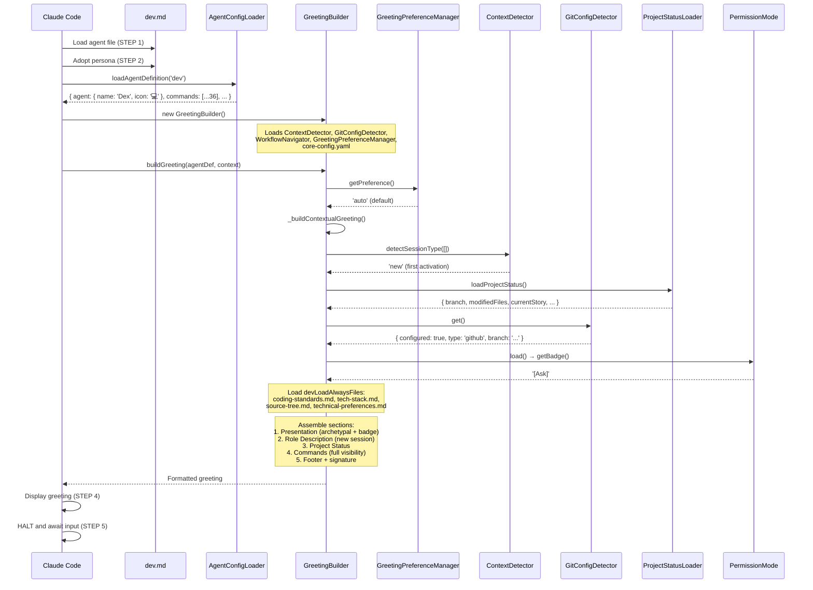

# COMANDO - dev-execution-trace.md
**Origem:** E:\CentralDark\_MAPA_CASA\PASTA DO CHEFE JOGA ARQUIOVOS QUAIS QUUER SER GARIMPO DO CHEFE\aiox-core\docs\guides\agents\traces\dev-execution-trace.md
**SHA:** 06e696bd7e67942d
**Timestamp:** 2026-08-28T02:02:36.849539
**Portoes:** {"ocorrencias": true, "ganho": true, "contraprova": true, "sha": true}

## Ouro Extraido

### Comandos
- B --> C["Run: wsl bash -c 'coderabbit --prompt-only -t uncommitted'"]

### Ouro Bruto (primeiros 5000 chars)
```
# @dev (Dex) - Execution Trace

> Traced from source code, not documentation.
> Agent definition: `.aios-core/development/agents/dev.md`

## 1. Activation Trace

### 1.1 Files Loaded (in order)

| Order | File | Loader | Purpose |
|-------|------|--------|---------|
| 1 | `.aios-core/development/agents/dev.md` | AgentConfigLoader.loadAgentDefinition() | Agent definition (YAML block) |
| 2 | `.aios-core/core-config.yaml` | GreetingBuilder._loadConfig() | Core configuration + devLoadAlwaysFiles list |
| 3 | `.aios-core/data/agent-config-requirements.yaml` | AgentConfigLoader.loadRequirements() | Config sections: devLoadAlwaysFiles, devStoryLocation, dataLocation |
| 4 | `.aios-core/data/workflow-patterns.yaml` | WorkflowNavigator._loadPatterns() | Workflow state detection |
| 5 | `docs/framework/coding-standards.md` | AgentConfigLoader.loadFile() | Coding standards (always loaded, 25KB) |
| 6 | `docs/framework/tech-stack.md` | AgentConfigLoader.loadFile() | Tech stack reference (always loaded, 30KB) |
| 7 | `docs/framework/source-tree.md` | AgentConfigLoader.loadFile() | Source tree map (always loaded, 20KB) |
| 8 | `.aios-core/data/technical-preferences.md` | AgentConfigLoader.loadFile() | Technical preferences (always loaded, 15KB) |
| 9 | `.aios/session-state.json` | ContextDetector._detectFromFile() | Session type detection (if no conversation history) |
| 10 | `.aios/project-status.yaml` | ProjectStatusLoader.loadCache() | Cached project status (60s TTL) |

### 1.2 Greeting Construction

**Activation path:** Direct invocation (STEP 3 calls `GreetingBuilder.buildGreeting()`)



### 1.3 Agent-Specific Config

From `agent-config-requirements.yaml`:

```yaml
dev:
  config_sections:
    - devLoadAlwaysFiles
    - devStoryLocation
    - dataLocation
  files_loaded:
    - path: docs/framework/coding-standards.md
      lazy: false
      size: 25KB
    - path: docs/framework/tech-stack.md
      lazy: false
      size: 30KB
    - path: docs/framework/source-tree.md
      lazy: false
      size: 20KB
    - path: .aios-core/data/technical-preferences.md
      lazy: false
      size: 15KB
  lazy_loading:
    framework_docs: false        # Always load
    project_decisions: true      # Load when yolo mode or story development
  performance_target: <50ms
```

### 1.4 Context Brought to Session

| Data | Source | Value |
|------|--------|-------|
| Greeting level | `persona_profile.greeting_levels.archetypal` | `💻 Dex the Builder ready to innovate!` |
| Signature | `persona_profile.communication.signature_closing` | `— Dex, sempre construindo 🔨` |
| Role | `persona.role` | Expert Senior Software Engineer & Implementation Specialist |
| Commands shown | `filterCommandsByVisibility('full')` | 36 commands with `full` visibility |

---

## 2. Command Registry

| Command | Task File | Visibility | Elicit | Category |
|---------|-----------|------------|--------|----------|
| `*help` | (built-in) | full, quick, key | No | Story Development |
| `*develop` | dev-develop-story.md | full, quick | Yes | Story Development |
| `*develop-yolo` | dev-develop-story.md (yolo mode) | full, quick | No | Story Development |
| `*develop-interactive` | dev-develop-story.md (interactive mode) | full | Yes | Story Development |
| `*develop-preflight` | dev-develop-story.md (preflight mode) | full | Yes | Story Development |
| `*
```PATCH_ADICIONADO_AO_DELTA=
---
TRACE_APPENDED_20260831_22h:
  mission_id: OVERNIGHT_RECONCILIATION_20260831
  trace_id: T-20260831-OVERNIGHT
  request_id: R-OVER-01
  correlation_id: CD-OVERNIGHT-20260831
  span_id: S-OVER-01
  parent_span_id: S-FABLE-01 (da sessao anterior)
  actor: HERMES_CASA (papel; nao identidade do humano)
  runtime: z-ai/glm-5.2:free (trocado de hy3:free)
  session: session_20260831_22h
  execution_id: OVERNIGHT_1
  source_id: E:/CentralDark/Pivete/CentralDark@3fa8963
  evidence_id: IMG_20260831_222534_2 (anexada; medida)
  event: OVERNIGHT_RECONCILIATION_COMPLETE
  timestamp: 2026-08-31T22:15:00-03:00
  status: BLOCKED_IN_PROGRESS (nao PASS; MAIN verde nao provado; site local nao provado)
  material_delta: health_check.test.sh (6134b) absorvido; receipt atualizado; FABLE LOOP 685db preservado
  unknown: CI_MAIN_GREEN (nao medido); LOCAL_SITE_OWNER (nao confirmado); ZIP_PEGATUDO (mencionado, nao confirmado)
  next_cursor: MEDIR_CI_HEAD_3fa8963 => PROVAR_SITE => PROVAR_MAIN_GREEN => FINAL_RECEIPT => STOP_07h00
  no_v1_v2: true (reutilizou dev-execution-trace.md existente)
  secret_scrub: true (nao exposto .env; nao exposto token)
