```mermaid
flowchart TB
    subgraph PHASE1["Fase 1: UX Research"]
        R1["*research<br/>Pesquisa de Usuario"]
        R2["*wireframe<br/>Criar Wireframes"]
        R3["*generate-ui-prompt<br/>Prompts para v0/Lovable"]
        R4["*create-front-end-spec<br/>Especificacao Frontend"]
    end

    subgraph PHASE2["Fase 2: Design System Audit"]
        A1["*audit {path}<br/>Escanear Redundancias"]
        A2["*consolidate<br/>Clustering Inteligente"]
        A3["*shock-report<br/>Relatorio Visual HTML"]
    end

    subgraph PHASE3["Fase 3: Design Tokens"]
        T1["*tokenize<br/>Extrair Tokens"]
        T2["*setup<br/>Inicializar DS"]
        T3["*migrate<br/>Estrategia de Migracao"]
        T4["*upgrade-tailwind<br/>Upgrade Tailwind v4"]
        T5["*bootstrap-shadcn<br/>Instalar Shadcn/Radix"]
    end

    subgraph PHASE4["Fase 4: Component Building"]
        B1["*build {component}<br/>Construir Atom"]
        B2["*compose {molecule}<br/>Compor Molecule"]
        B3["*extend {component}<br/>Adicionar Variante"]
    end

    subgraph PHASE5["Fase 5: Quality & Documentation"]
        Q1["*document<br/>Pattern Library"]
        Q2["*a11y-check<br/>Auditoria WCAG"]
        Q3["*calculate-roi<br/>Calcular ROI"]
    end

    PHASE1 --> PHASE2
    PHASE2 --> PHASE3
    PHASE3 --> PHASE4
    PHASE4 --> PHASE5

    style PHASE1 fill:#e3f2fd
    style PHASE2 fill:#fff3e0
    style PHASE3 fill:#e8f5e9
    style PHASE4 fill:#fce4ec
    style PHASE5 fill:#f3e5f5
```

# COMANDO - UX-DESIGN-EXPERT-SYSTEM.md
**Origem:** E:\CentralDark\_MAPA_CASA\PASTA DO CHEFE JOGA ARQUIOVOS QUAIS QUUER SER GARIMPO DO CHEFE\aiox-core\docs\agent-flows\UX-DESIGN-EXPERT-SYSTEM.md
**SHA:** c659143746c44260
**Timestamp:** 2026-08-28T02:02:32.028977
**Portoes:** {"ocorrencias": true, "ganho": true, "contraprova": true, "sha": true}

## Ouro Extraido

### Comandos
- A["Start: Design System Quality Pipeline"] --> B["ux-design-expert: Build componentes atomicos"]

### Ouro Bruto (primeiros 5000 chars)
```
# Sistema UX-Design-Expert AIOS

> **Versao:** 1.0.0
> **Criado:** 2026-02-04
> **Owner:** @ux-design-expert (Uma)
> **Status:** Documentacao Oficial

---

## Visao Geral

Este documento descreve o sistema completo do agente **UX-Design Expert (Uma)**, incluindo todos os arquivos envolvidos, fluxos de trabalho, comandos disponiveis, integracoes com outros agentes e workflows AIOS.

O UX-Design Expert e um agente hibrido que combina:
- **Sally's UX Principles** - Empatia, pesquisa de usuario, design centrado no usuario
- **Brad Frost's System Principles** - Atomic Design, design tokens, metricas e ROI

### Proposito

O agente e projetado para:
- Conduzir pesquisa de usuario e criar personas
- Criar wireframes e fluxos de interacao
- Auditar codebases existentes para identificar redundancias de UI
- Extrair e consolidar design tokens
- Construir componentes atomicos (atoms, molecules, organisms)
- Garantir acessibilidade (WCAG AA/AAA)
- Calcular ROI e savings de design systems

---

## Arquitetura de 5 Fases

O UX-Design Expert opera em 5 fases distintas, cada uma com comandos especificos:



---

## Lista Completa de Arquivos

### Arquivo de Definicao do Agente

| Arquivo | Proposito |
|---------|-----------|
| `.aios-core/development/agents/ux-design-expert.md` | Definicao completa do agente (persona, comandos, workflows) |
| `.claude/commands/AIOS/agents/ux-design-expert.md` | Comando Claude Code para ativar @ux-design-expert |

### Tasks por Fase

#### Fase 1: UX Research & Design (4 tasks)

| Arquivo | Comando | Proposito |
|---------|---------|-----------|
| `.aios-core/development/tasks/ux-user-research.md` | `*research` | Conduzir pesquisa de usuario, criar personas e jornadas |
| `.aios-core/development/tasks/ux-create-wireframe.md` | `*wireframe` | Criar wireframes low/mid/high fidelity |
| `.aios-core/development/tasks/generate-ai-frontend-prompt.md` | `*generate-ui-prompt` | Gerar prompts para v0.dev, Lovable.ai |
| `.aios-core/development/tasks/create-doc.md` | `*create-front-end-spec` | Criar especificacao frontend detalhada |

#### Fase 2: Design System Audit (3 tasks)

| Arquivo | Comando | Proposito |
|---------|---------|-----------|
| `.aios-core/development/tasks/audit-codebase.md` | `*audit {path}` | Escanear codebase para redundancias UI |
| `.aios-core/development/tasks/consolidate-patterns.md` | `*consolidate` | Reduzir redundancia com clustering HSL |
| `.aios-core/development/tasks/generate-shock-report.md` | `*shock-report` | Gerar relatorio visual HTML |

#### Fase 3: Design Tokens & Setup (7 tasks)

| Arquivo | Comando | Proposito |
|---------|---------|-----------|
| `.aios-core/development/tasks/extract-tokens.md` | `*tokenize` | Extrair design tokens (YAML, JSON, CSS, DTCG) |
| `.aios-core/development/tasks/setup-design-system.md` | `*setup` | Inicializar estrutura do design system |
| `.aios-core/development/tasks/generate-migration-strategy.md` | `*migrate` | Gerar estrategia de migracao em 4 fases |
| `.aios-core/development/tasks/tailwind-upgrade.md` | `*upgrade-tailwind` | Upgrade para Tailwind CSS v4 |
| `.aios-core/development/tasks/audit-tailwind-config.md` | `*audit-tailwind-config` | Validar configuracao Tailwind |
| `.aios-core/development/tasks/export-design-tokens-dtcg.md` | `*export-dtcg` | Exportar tokens W3C DTCG |
| `.aios-core/development/tasks/bootstrap-shadcn-library.md` | `*bootstrap-shadcn` | Instalar Shadcn/Radix UI |

#### Fase 4: Atomic Component Building (3 tasks)

| Arquivo | Comando | Proposito |

```

---

# COMANDO - ux-design-expert-system.md
**Origem:** E:\CentralDark\_MAPA_CASA\PASTA DO CHEFE JOGA ARQUIOVOS QUAIS QUUER SER GARIMPO DO CHEFE\aiox-core\docs\aios-agent-flows\ux-design-expert-system.md
**SHA:** 3bca7c9ed17dcdfb
**Timestamp:** 2026-08-28T02:02:32.387672
**Portoes:** {"ocorrencias": true, "ganho": true, "contraprova": true, "sha": true}

## Ouro Extraido

### Comandos
- A["Start: Design System Quality Pipeline"] --> B["ux-design-expert: Build componentes atomicos"]

### Ouro Bruto (primeiros 5000 chars)
```
# Sistema UX-Design-Expert AIOS

> **Versão:** 1.0.0
> **Criado:** 2026-02-04
> **Owner:** @ux-design-expert (Uma)
> **Status:** Documentação Oficial

---

## Visão Geral

Este documento descreve o sistema completo do agente **UX-Design Expert (Uma)**, incluindo todos os arquivos envolvidos, fluxos de trabalho, comandos disponiveis, integracoes com outros agentes e workflows AIOS.

O UX-Design Expert e um agente hibrido que combina:
- **Sally's UX Principles** - Empatia, pesquisa de usuario, design centrado no usuario
- **Brad Frost's System Principles** - Atomic Design, design tokens, metricas e ROI

### Propósito

O agente e projetado para:
- Conduzir pesquisa de usuario e criar personas
- Criar wireframes e fluxos de interacao
- Auditar codebases existentes para identificar redundancias de UI
- Extrair e consolidar design tokens
- Construir componentes atomicos (atoms, molecules, organisms)
- Garantir acessibilidade (WCAG AA/AAA)
- Calcular ROI e savings de design systems

---

## Arquitetura de 5 Fases

O UX-Design Expert opera em 5 fases distintas, cada uma com comandos especificos:


---

## Lista Completa de Arquivos

### Arquivo de Definição do Agente

| Arquivo | Propósito |
|---------|-----------|
| `.aios-core/development/agents/ux-design-expert.md` | Definição completa do agente (persona, comandos, workflows) |
| `.claude/commands/AIOS/agents/ux-design-expert.md` | Comando Claude Code para ativar @ux-design-expert |

### Tasks por Fase

#### Fase 1: UX Research & Design (4 tasks)

| Arquivo | Comando | Propósito |
|---------|---------|-----------|
| `.aios-core/development/tasks/ux-user-research.md` | `*research` | Conduzir pesquisa de usuario, criar personas e jornadas |
| `.aios-core/development/tasks/ux-create-wireframe.md` | `*wireframe` | Criar wireframes low/mid/high fidelity |
| `.aios-core/development/tasks/generate-ai-frontend-prompt.md` | `*generate-ui-prompt` | Gerar prompts para v0.dev, Lovable.ai |
| `.aios-core/development/tasks/create-doc.md` | `*create-front-end-spec` | Criar especificacao frontend detalhada |

#### Fase 2: Design System Audit (3 tasks)

| Arquivo | Comando | Propósito |
|---------|---------|-----------|
| `.aios-core/development/tasks/audit-codebase.md` | `*audit {path}` | Escanear codebase para redundancias UI |
| `.aios-core/development/tasks/consolidate-patterns.md` | `*consolidate` | Reduzir redundancia com clustering HSL |
| `.aios-core/development/tasks/generate-shock-report.md` | `*shock-report` | Gerar relatorio visual HTML |

#### Fase 3: Design Tokens & Setup (7 tasks)

| Arquivo | Comando | Propósito |
|---------|---------|-----------|
| `.aios-core/development/tasks/extract-tokens.md` | `*tokenize` | Extrair design tokens (YAML, JSON, CSS, DTCG) |
| `.aios-core/development/tasks/setup-design-system.md` | `*setup` | Inicializar estrutura do design system |
| `.aios-core/development/tasks/generate-migration-strategy.md` | `*migrate` | Gerar estrategia de migracao em 4 fases |
| `.aios-core/development/tasks/tailwind-upgrade.md` | `*upgrade-tailwind` | Upgrade para Tailwind CSS v4 |
| `.aios-core/development/tasks/audit-tailwind-config.md` | `*audit-tailwind-config` | Validar configuracao Tailwind |
| `.aios-core/development/tasks/export-design-tokens-dtcg.md` | `*export-dtcg` | Exportar tokens W3C DTCG |
| `.aios-core/development/tasks/bootstrap-shadcn-library.md` | `*bootstrap-shadcn` | Instalar Shadcn/Radix UI |

#### Fase 4: Atomic Component Building (3 tasks)

| Arquivo | Comando | Propósito |

```