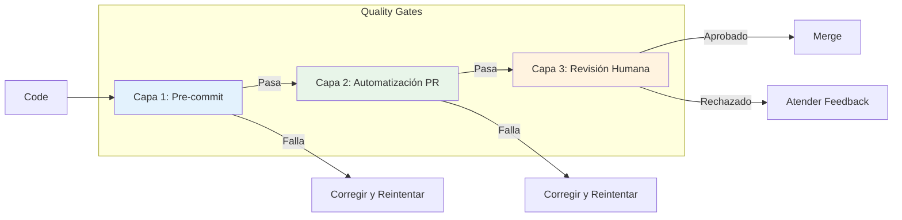
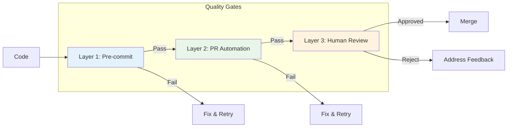
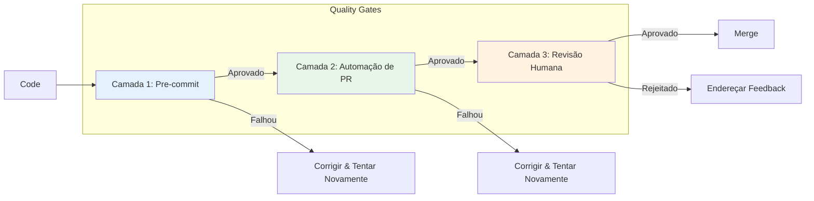

# CONTRATO - quality-gates.md
**Origem:** E:\CentralDark\_MAPA_CASA\PASTA DO CHEFE JOGA ARQUIOVOS QUAIS QUUER SER GARIMPO DO CHEFE\aiox-core\docs\es\guides\quality-gates.md
**SHA:** 2a4d153844320b8d
**Timestamp:** 2026-08-28T02:02:35.029609
**Portoes:** {"ocorrencias": true, "ganho": true, "contraprova": true, "sha": true}

## Ouro Extraido

### Comandos
- - run: npm ci
- - run: aios qa run --layer=1
- - run: npm ci
- - run: aios qa run --layer=2
- - run: aios qa request-review --pr=${{ github.event.pull_request.number }}

### Ouro Bruto (primeiros 5000 chars)
```
<!--
  Traducción: ES
  Original: /docs/en/guides/quality-gates.md
  Última sincronización: 2026-01-26
-->

# Guía del Sistema de Quality Gates de AIOS

> 🌐 [EN](../../guides/quality-gates.md) | [PT](../../pt/guides/quality-gates.md) | **ES**

---

> Guía completa del sistema de quality gates de 3 capas para Synkra AIOS.

**Versión:** 2.1.0
**Última Actualización:** 2025-12-01

---

## Resumen

El Sistema de Quality Gates de AIOS proporciona aseguramiento de calidad automatizado a través de tres capas progresivas de validación. Cada capa detecta diferentes tipos de problemas en la etapa apropiada del desarrollo.

### La Arquitectura de 3 Capas



| Capa       | Tipo            | Velocidad | Propósito                                       |
| ---------- | --------------- | --------- | ----------------------------------------------- |
| **Capa 1** | Automatizada    | ~30s      | Detectar errores de sintaxis, linting, tipos    |
| **Capa 2** | Asistida por IA | ~5m       | Detectar errores de lógica, seguridad, patrones |
| **Capa 3** | Humana          | Variable  | Revisión estratégica, aprobación final          |

---

## Capa 1: Verificaciones Pre-commit

### Propósito

Verificaciones rápidas y locales que se ejecutan antes de que el código sea comprometido. Detecta problemas obvios inmediatamente.

### Verificaciones Incluidas

| Verificación  | Herramienta | Timeout | Descripción                          |
| ------------- | ----------- | ------- | ------------------------------------ |
| **Lint**      | ESLint      | 60s     | Estilo de código y mejores prácticas |
| **Test**      | Jest        | 5m      | Pruebas unitarias con cobertura      |
| **TypeCheck** | TypeScript  | 2m      | Validación de tipos estáticos        |

### Configuración

```yaml
# .aios-core/core/quality-gates/quality-gate-config.yaml
layer1:
  enabled: true
  failFast: true # Detener en la primera falla
  checks:
    lint:
      enabled: true
      command: 'npm run lint'
      failOn: 'error' # error | warning
      timeout: 60000 # 1 minuto
    test:
      enabled: true
      command: 'npm test'
      timeout: 300000 # 5 minutos
      coverage:
        enabled: true
        minimum: 80
    typecheck:
      enabled: true
      command: 'npm run typecheck'
      timeout: 120000 # 2 minutos
```

### Ejecutando Capa 1

```bash
# Ejecutar todas las verificaciones de Capa 1
aios qa run --layer=1

# Ejecutar verificación específica
aios qa run --layer=1 --check=lint
aios qa run --layer=1 --check=test
aios qa run --layer=1 --check=typecheck

# Ejecutar con salida detallada
aios qa run --layer=1 --verbose
```

### Salida Esperada

```
Capa 1: Verificaciones Pre-commit
=================================

[1/3] Verificación de Lint
  Ejecutando: npm run lint
  ✓ Pasó (12.3s)
  Sin advertencias ni errores

[2/3] Verificación de Test
  Ejecutando: npm test
  ✓ Pasó (45.2s)
  Cobertura: 87.3% (mínimo: 80%)

[3/3] TypeCheck
  Ejecutando: npm run typecheck
  ✓ Pasó (28.1s)
  0 errores

CAPA 1 APROBADA (85.6s)
```

---

## Capa 2: Automatización de PR

### Propósito

Revisión de código asistida por IA que se ejecuta en pull requests. Detecta problemas más profundos como errores de lógica, vulnerabilidades de seguridad y problemas arquitectónicos.

### Herramientas Integradas

| Herramienta     | Propósito                   | Severidad Bloqueante |
| --------------- | --------------------------- | -------------------- |
| **CodeRabbit**  | Revisión de código con IA   | CRÍTICO              |
| **Quinn (@qa)** | Revisión de QA automatizada | CRÍTICO              |

### Configuración

```yaml
# .aios-core/core/quality-gates/quality-gate-config.yaml
layer2:
  enabled: true
  coderabbit:
    enabled: true
    command: 'coderabbit --prompt-only -t uncommitted'
    timeout: 900000 # 15 minutos
    blockOn:
      - CRITICAL
    warnOn:
      - HIGH
    documentOn:
      - MEDIUM
    ignoreOn:
      - LOW
  quinn:
    enabled: true
    autoReview: true
    agentPath: '.claude/commands/AIOS/agents/qa.md'
    severity:
      block: ['CRITICAL']
      warn: ['HIGH', 'MEDIUM']
```

### Ejecutando Capa 2

```bash
# Ejecutar todas las verificaciones de Capa 2
aios qa run --layer=2

# Ejecutar solo CodeRabbit
aios qa run --layer=2 --tool=coderabbit

# Ejecutar revisión de Quinn (@qa)
aios qa run --layer=2 --tool=quinn
```

### Niveles de Severidad

| Severidad   | Acción                | Descripción                                                                |
| ----------- | --------------------- | ---
```

---

# CONTRATO - quality-gates.md
**Origem:** E:\CentralDark\_MAPA_CASA\PASTA DO CHEFE JOGA ARQUIOVOS QUAIS QUUER SER GARIMPO DO CHEFE\aiox-core\docs\guides\quality-gates.md
**SHA:** f491a46bf1ae3f82
**Timestamp:** 2026-08-28T02:02:36.399074
**Portoes:** {"ocorrencias": true, "ganho": true, "contraprova": true, "sha": true}

## Ouro Extraido

### Comandos
- - run: npm ci
- - run: aios qa run --layer=1
- - run: npm ci
- - run: aios qa run --layer=2
- - run: aios qa request-review --pr=${{ github.event.pull_request.number }}

### Ouro Bruto (primeiros 5000 chars)
```
# AIOS Quality Gate System Guide

> **EN** | [PT](../pt/guides/quality-gates.md) | [ES](../es/guides/quality-gates.md)

---

> Comprehensive guide to the 3-layer quality gate system for Synkra AIOS.

**Version:** 2.1.0
**Last Updated:** 2025-12-01

---

## Overview

The AIOS Quality Gate System provides automated quality assurance through three progressive layers of validation. Each layer catches different types of issues at the appropriate stage of development.

### The 3-Layer Architecture



| Layer       | Type        | Speed    | Purpose                            |
| ----------- | ----------- | -------- | ---------------------------------- |
| **Layer 1** | Automated   | ~30s     | Catch syntax, linting, type errors |
| **Layer 2** | AI-Assisted | ~5m      | Catch logic, security, patterns    |
| **Layer 3** | Human       | Variable | Strategic review, sign-off         |

---

## Layer 1: Pre-commit Checks

### Purpose

Fast, local checks that run before code is committed. Catches obvious issues immediately.

### Checks Included

| Check         | Tool       | Timeout | Description                   |
| ------------- | ---------- | ------- | ----------------------------- |
| **Lint**      | ESLint     | 60s     | Code style and best practices |
| **Test**      | Jest       | 5m      | Unit tests with coverage      |
| **TypeCheck** | TypeScript | 2m      | Static type validation        |

### Configuration

```yaml
# .aios-core/core/quality-gates/quality-gate-config.yaml
layer1:
  enabled: true
  failFast: true # Stop on first failure
  checks:
    lint:
      enabled: true
      command: 'npm run lint'
      failOn: 'error' # error | warning
      timeout: 60000 # 1 minute
    test:
      enabled: true
      command: 'npm test'
      timeout: 300000 # 5 minutes
      coverage:
        enabled: true
        minimum: 80
    typecheck:
      enabled: true
      command: 'npm run typecheck'
      timeout: 120000 # 2 minutes
```

### Running Layer 1

```bash
# Run all Layer 1 checks
aios qa run --layer=1

# Run specific check
aios qa run --layer=1 --check=lint
aios qa run --layer=1 --check=test
aios qa run --layer=1 --check=typecheck

# Run with verbose output
aios qa run --layer=1 --verbose
```

### Expected Output

```
Layer 1: Pre-commit Checks
==========================

[1/3] Lint Check
  Running: npm run lint
  ✓ Passed (12.3s)
  No warnings or errors

[2/3] Test Check
  Running: npm test
  ✓ Passed (45.2s)
  Coverage: 87.3% (minimum: 80%)

[3/3] TypeCheck
  Running: npm run typecheck
  ✓ Passed (28.1s)
  0 errors

LAYER 1 PASSED (85.6s)
```

---

## Layer 2: PR Automation

### Purpose

AI-assisted code review that runs on pull requests. Catches deeper issues like logic errors, security vulnerabilities, and architectural problems.

### Tools Integrated

| Tool            | Purpose             | Blocking Severity |
| --------------- | ------------------- | ----------------- |
| **CodeRabbit**  | AI code review      | CRITICAL          |
| **Quinn (@qa)** | Automated QA review | CRITICAL          |

### Configuration

```yaml
# .aios-core/core/quality-gates/quality-gate-config.yaml
layer2:
  enabled: true
  coderabbit:
    enabled: true
    command: 'coderabbit --prompt-only -t uncommitted'
    timeout: 900000 # 15 minutes
    blockOn:
      - CRITICAL
    warnOn:
      - HIGH
    documentOn:
      - MEDIUM
    ignoreOn:
      - LOW
  quinn:
    enabled: true
    autoReview: true
    agentPath: '.claude/commands/AIOS/agents/qa.md'
    severity:
      block: ['CRITICAL']
      warn: ['HIGH', 'MEDIUM']
```

### Running Layer 2

```bash
# Run all Layer 2 checks
aios qa run --layer=2

# Run CodeRabbit only
aios qa run --layer=2 --tool=coderabbit

# Run Quinn (@qa) review
aios qa run --layer=2 --tool=quinn
```

### Severity Levels

| Severity     | Action          | Description                                             |
| ------------ | --------------- | ------------------------------------------------------- |
| **CRITICAL** | Block           | Security vulnerability, data loss risk, breaking change |
| **HIGH**     | Warn + Document | Performance issue, missing validation, anti-pattern     |
| **MEDIUM**   | Document        | Code smell, improvement suggestion, minor risk          |
| **LOW**      | Ignore          | Style preference, minor optimization                    |

### CodeRabbit Integration

CodeRabbit performs AI-powered code review with these focus areas:

- Security vulnerabilities
- Performance issues
- Code quality and maintainability
- Best practices viola
```

---

# CONTRATO - quality-gates.md
**Origem:** E:\CentralDark\_MAPA_CASA\PASTA DO CHEFE JOGA ARQUIOVOS QUAIS QUUER SER GARIMPO DO CHEFE\aiox-core\docs\pt\guides\quality-gates.md
**SHA:** f3ea90b97cd767b2
**Timestamp:** 2026-08-28T02:02:39.500750
**Portoes:** {"ocorrencias": true, "ganho": true, "contraprova": true, "sha": true}

## Ouro Extraido

### Comandos
- - run: npm ci
- - run: aios qa run --layer=1
- - run: npm ci
- - run: aios qa run --layer=2
- - run: aios qa request-review --pr=${{ github.event.pull_request.number }}

### Ouro Bruto (primeiros 5000 chars)
```
<!--
  Tradução: PT-BR
  Original: /docs/en/guides/quality-gates.md
  Última sincronização: 2026-01-26
-->

# Guia do Sistema de Quality Gates AIOS

> 🌐 [EN](../../guides/quality-gates.md) | **PT** | [ES](../../es/guides/quality-gates.md)

---

> Guia completo para o sistema de quality gates de 3 camadas do Synkra AIOS.

**Versão:** 2.1.0
**Última Atualização:** 2025-12-01

---

## Visão Geral

O Sistema de Quality Gates do AIOS fornece garantia de qualidade automatizada através de três camadas progressivas de validação. Cada camada captura diferentes tipos de problemas no estágio apropriado do desenvolvimento.

### A Arquitetura de 3 Camadas



| Camada       | Tipo             | Velocidade | Propósito                                 |
| ------------ | ---------------- | ---------- | ----------------------------------------- |
| **Camada 1** | Automatizado     | ~30s       | Capturar erros de sintaxe, linting, tipos |
| **Camada 2** | Assistido por IA | ~5m        | Capturar lógica, segurança, padrões       |
| **Camada 3** | Humano           | Variável   | Revisão estratégica, aprovação            |

---

## Camada 1: Verificações Pre-commit

### Propósito

Verificações rápidas e locais que executam antes do código ser commitado. Captura problemas óbvios imediatamente.

### Verificações Incluídas

| Verificação   | Ferramenta | Timeout | Descrição                            |
| ------------- | ---------- | ------- | ------------------------------------ |
| **Lint**      | ESLint     | 60s     | Estilo de código e melhores práticas |
| **Test**      | Jest       | 5m      | Testes unitários com cobertura       |
| **TypeCheck** | TypeScript | 2m      | Validação estática de tipos          |

### Configuração

```yaml
# .aios-core/core/quality-gates/quality-gate-config.yaml
layer1:
  enabled: true
  failFast: true # Parar na primeira falha
  checks:
    lint:
      enabled: true
      command: 'npm run lint'
      failOn: 'error' # error | warning
      timeout: 60000 # 1 minuto
    test:
      enabled: true
      command: 'npm test'
      timeout: 300000 # 5 minutos
      coverage:
        enabled: true
        minimum: 80
    typecheck:
      enabled: true
      command: 'npm run typecheck'
      timeout: 120000 # 2 minutos
```

### Executando a Camada 1

```bash
# Executar todas as verificações da Camada 1
aios qa run --layer=1

# Executar verificação específica
aios qa run --layer=1 --check=lint
aios qa run --layer=1 --check=test
aios qa run --layer=1 --check=typecheck

# Executar com saída detalhada
aios qa run --layer=1 --verbose
```

### Saída Esperada

```
Camada 1: Verificações Pre-commit
=================================

[1/3] Verificação de Lint
  Executando: npm run lint
  ✓ Aprovado (12.3s)
  Sem alertas ou erros

[2/3] Verificação de Test
  Executando: npm test
  ✓ Aprovado (45.2s)
  Cobertura: 87.3% (mínimo: 80%)

[3/3] TypeCheck
  Executando: npm run typecheck
  ✓ Aprovado (28.1s)
  0 erros

CAMADA 1 APROVADA (85.6s)
```

---

## Camada 2: Automação de PR

### Propósito

Code review assistido por IA que executa em pull requests. Captura problemas mais profundos como erros de lógica, vulnerabilidades de segurança e problemas arquiteturais.

### Ferramentas Integradas

| Ferramenta      | Propósito                  | Severidade Bloqueadora |
| --------------- | -------------------------- | ---------------------- |
| **CodeRabbit**  | Code review por IA         | CRITICAL               |
| **Quinn (@qa)** | Revisão automatizada de QA | CRITICAL               |

### Configuração

```yaml
# .aios-core/core/quality-gates/quality-gate-config.yaml
layer2:
  enabled: true
  coderabbit:
    enabled: true
    command: 'coderabbit --prompt-only -t uncommitted'
    timeout: 900000 # 15 minutos
    blockOn:
      - CRITICAL
    warnOn:
      - HIGH
    documentOn:
      - MEDIUM
    ignoreOn:
      - LOW
  quinn:
    enabled: true
    autoReview: true
    agentPath: '.claude/commands/AIOS/agents/qa.md'
    severity:
      block: ['CRITICAL']
      warn: ['HIGH', 'MEDIUM']
```

### Executando a Camada 2

```bash
# Executar todas as verificações da Camada 2
aios qa run --layer=2

# Executar apenas CodeRabbit
aios qa run --layer=2 --tool=coderabbit

# Executar revisão do Quinn (@qa)
aios qa run --layer=2 --tool=quinn
```

### Níveis de Severidade

| Severidade   | Ação                 | Descrição                                                                 |
| ------------ | -------------------- | -----------------------
```