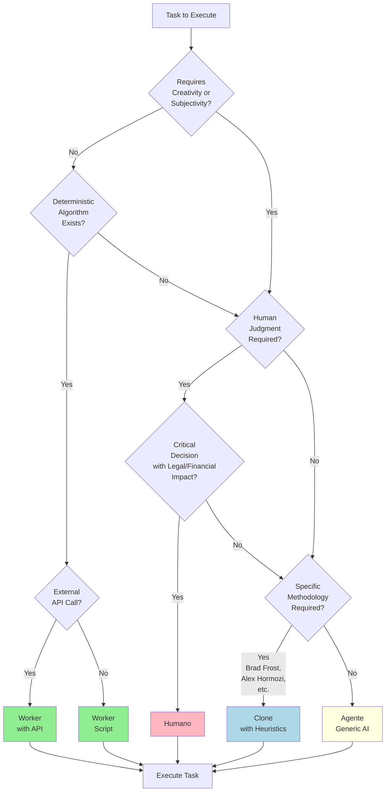

# DECISAO - EXECUTOR-DECISION-TREE.md
**Origem:** E:\CentralDark\_MAPA_CASA\PASTA DO CHEFE JOGA ARQUIOVOS QUAIS QUUER SER GARIMPO DO CHEFE\aiox-core\.aios-core\docs\standards\EXECUTOR-DECISION-TREE.md
**SHA:** 106af2a8bc009c12
**Timestamp:** 2026-08-28T02:02:10.649074
**Portoes:** {"ocorrencias": true, "ganho": true, "contraprova": true, "sha": true}

## Ouro Extraido

### Comandos
- prompt: "Check if components follow best practices"

### Riscos
- blocker: false
- blocker: false

### Ouro Bruto (primeiros 5000 chars)
```
# AIOS Executor Decision Tree

**Date:** 2025-11-13  
**Version:** 1.0.0  
**Status:** Standard  
**Author:** Brad Frost Cognitive Clone

---

## Purpose

This document defines HOW to choose the appropriate executor type (Agente, Worker, Humano, Clone) for any AIOS Task based on task characteristics, requirements, and constraints.

---

## The Four Executor Types

### 1. Agente (AI-Powered Execution)

**Definition:** AI agent that uses Large Language Models to perform creative, analytical, or generative tasks.

**When to use:**
- Task requires creativity or subjective judgment
- Task involves natural language understanding/generation
- Task needs contextual analysis
- Task has no deterministic algorithm

**Examples:**
- Analyze brief and extract key insights
- Generate ad copy from brief
- Design component styles based on brand
- Select optimal template for campaign

**Cost:** $$$$ High ($0.001 - $0.01 per execution)  
**Speed:** Slow (3-10 seconds)  
**Deterministic:** ❌ No (stochastic outputs)

---

### 2. Worker (Script-Based Execution)

**Definition:** Deterministic script or function that transforms data using predefined logic.

**When to use:**
- Task is deterministic (same input → same output)
- Task is a data transformation or validation
- Task reads/writes files or databases
- Task calls external APIs with no AI

**Examples:**
- Load configuration from JSON file
- Validate HTML structure
- Export PNG from HTML using Puppeteer
- Calculate spacing based on safe zones

**Cost:** $ Low ($0 - $0.001 per execution)  
**Speed:** Fast (< 1 second)  
**Deterministic:** ✅ Yes (same input → same output)

---

### 3. Humano (Manual Human Execution)

**Definition:** Human operator who performs the task manually, often requiring subjective judgment or approval.

**When to use:**
- Task requires human subjective judgment
- Task is a quality gate or approval step
- Task involves sensitive decisions
- Task cannot be automated (yet)

**Examples:**
- Review ad quality and approve/reject
- Make strategic campaign decisions
- Handle edge cases that AI can't resolve
- Provide creative direction

**Cost:** $$$ Medium ($5 - $50 per execution)  
**Speed:** Very Slow (minutes to hours)  
**Deterministic:** ❌ No (subjective)

---

### 4. Clone (Mind Emulation with Heuristics)

**Definition:** AI agent augmented with personality heuristics and domain axioms to emulate a specific person's methodology.

**When to use:**
- Task requires specific domain expertise
- Task must follow a specific methodology (e.g., Atomic Design)
- Task needs validation against established principles
- Task benefits from "personality-driven" execution

**Examples:**
- Validate components against Atomic Design principles (Brad Frost)
- Review copy using specific writing methodology (Alex Hormozi)
- Evaluate design system consistency (Design System Specialist)
- Apply specific mental models (Domain Expert)

**Cost:** $$$$ High ($0.002 - $0.015 per execution) [AI + validation]  
**Speed:** Slow (5-15 seconds)  
**Deterministic:** ⚠️ Partial (heuristics guide AI, but AI is stochastic)

---

## Decision Tree



---

## Detailed Decision Criteria

### Criterion 1: Creativity / Subjectivity Required

**Question:** Does the task require creative thinking, subjective judgment, or contextual understanding?

**Examples:**

| Task | Requires Creativity? | Why? |
|------|---------------------|------|
| Analyze brief and extract insights | ✅ Yes | Requires understanding nuance, context, emotional triggers |
| Load brand config from JSON | ❌ No | Deterministic file read |
| Generate ad copy | ✅ Yes | Requires creativity, brand voice adaptation |
| Calculate content area height | ❌ No | Simple math: `canvas.height - safeZones.top - safeZones.bottom` |
| Select optimal template | ✅ Yes | Requires matching brief goals with template strengths |

**If YES → Consider Agente, Clone, or Humano**  
**If NO → Consider Worker**

---

### Criterion 2: Deterministic Algorithm Exists

**Question:** Can the task be
```