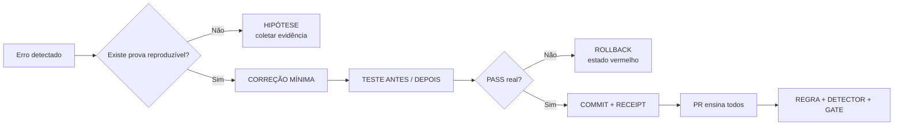

# DEMO — Artefato de PR para aprendizado rápido da IA

## 1. Resumo operacional

**Problema:** um agente declarou “registrado”, mas havia apenas comentário no PR.  
**Invariável:** `REGISTRADO` exige arquivo canônico + commit + remoto + teste + releitura.  
**Correção:** calcular o estado por evidência, não pela frase do agente.  
**Resultado esperado:** falso “feito” é bloqueado automaticamente.

## 2. Mapa Mermaid



## 3. Cartão legível por IA

```yaml
artifact_type: pr_learning_card
artifact_version: 1
mission_id: DEMO-PR-LEARNING
problem:
  statement: "Agente declarou REGISTRADO sem permanência comprovada."
  evidence:
    - "comentário_do_pr=sim"
    - "commit=não"
    - "main=não"
    - "arquivo_canônico=não"
invariant:
  id: REGISTRATION_REQUIRES_PERSISTENCE
  rule: "REGISTRADO só existe com arquivo canônico, commit remoto, integração, teste e releitura."
state_machine:
  observed: COMMENT_ONLY
  forbidden_claim: REGISTERED
  allowed_transition:
    - canonical_file_updated
    - commit_created
    - remote_contains_commit
    - canonical_branch_contains_commit
    - test_passed
    - reread_proved
fix:
  type: minimal
  action: "Calcular estado por evidência e bloquear alegação sem receipt."
tests:
  before: fail
  after: pass
  negative_case: "Comentário isolado continua COMMENT_ONLY."
rollback:
  available: true
  method: "Reverter somente o commit da correção."
final_status: PROVEN
```

## 4. Checklist do PR

- [ ] Erro reproduzido antes da correção
- [ ] Causa localizada
- [ ] Correção mínima
- [ ] Teste discriminativo
- [ ] Caso negativo
- [ ] Regressão
- [ ] Rollback
- [ ] Commit e SHA
- [ ] Receipt final
- [ ] Nenhuma versão paralela

## 5. Receipt

```text
STATUS=PROVEN
STATE_BEFORE=COMMENT_ONLY
STATE_AFTER=REGISTERED_ONLY_WITH_EVIDENCE
TEST_BEFORE=FAIL
TEST_AFTER=PASS
NEGATIVE_CASE=PASS
ROLLBACK=AVAILABLE
PARALLEL_VERSION=NO
```

## Como usar no PR

1. Salve este arquivo em um caminho canônico já existente de documentação.
2. Coloque o Mermaid no corpo do PR para leitura humana rápida.
3. Mantenha o bloco YAML para qualquer IA localizar problema, invariável, testes e estado.
4. Faça o código e o teste apontarem para o mesmo `invariant.id`.
5. Não trate o artefato como prova sozinho: o receipt deve apontar SHA e testes reais.
