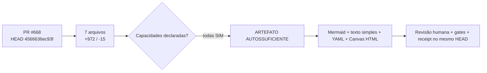

<!-- centraldark-pr-learning-artifact -->
# 🧠 Artefato automático de aprendizado do PR

**PR:** #668 · **HEAD:** `4566636ec93fcdebb2d956ff3dd692a6e205a275` · **Estado:** `READY`

**Título:** feat(pr): artefato automático de aprendizado e suporte por capacidade

## Mapa visual (Mermaid)



## Fallback universal em texto simples

PR #668 no HEAD 4566636ec93fcdebb2d956ff3dd692a6e205a275. 7 arquivos alterados; +972 e -15. Todas as capacidades foram declaradas como suportadas. O artefato não aprova o PR: ele organiza contexto; testes, revisão e gates continuam obrigatórios.

## Cartão estruturado para IAs

```yaml
artifact_type: pr_learning_card
artifact_schema: 1
repository: "ServerVpss/CentralDark"
pr_number: 668
head_sha: "4566636ec93fcdebb2d956ff3dd692a6e205a275"
base_sha: "f692e3118304724c0c860b56bb00a33e18edeac5"
title: "feat(pr): artefato automático de aprendizado e suporte por capacidade"
author: "segredounlock"
status: READY
capabilities:
  mermaid: SIM
  canvas_html: SIM
  structured_yaml: SIM
support:
  required: NAO
  missing: []
  labels: ["🤖 AUTO"]
change_summary:
  files: 7
  additions: 972
  deletions: 15
  workflows: 2
  docs: 3
  tests: 1
  code: 1
  sensitive_paths: 0
artifact_digest: 5e6e163326728fb7144b7cd2b5ded7bffb70da0e7079ce3a839bb22609d902fd
```

## 🟢 Capacidades declaradas

A autoria declarou suporte aos três formatos. Nenhuma transferência de suporte foi solicitada.

## Receipt

```text
ARTIFACT_STATUS=READY
HEAD_SHA=4566636ec93fcdebb2d956ff3dd692a6e205a275
FILES=7
SUPPORT_REQUIRED=NAO
MISSING_CAPABILITIES=NENHUMA
SENSITIVE_PATHS=0
ARTIFACT_DIGEST=5e6e163326728fb7144b7cd2b5ded7bffb70da0e7079ce3a839bb22609d902fd
PR_APPROVED=NAO
MERGE_AUTHORIZED=NAO
```

> Este comentário é idempotente e deve ser atualizado no mesmo marcador. É contexto verificável, não prova de funcionamento do código.