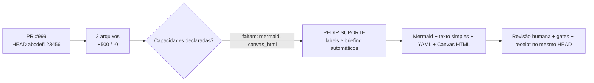

<!-- centraldark-pr-learning-artifact -->
# 🧠 Artefato automático de aprendizado do PR

**PR:** #999 · **HEAD:** `abcdef1234567890abcdef1234567890abcdef12` · **Estado:** `SUPPORT_REQUIRED`

**Título:** feat: bot de artefato

## Mapa visual (Mermaid)



## Fallback universal em texto simples

PR #999 no HEAD abcdef1234567890abcdef1234567890abcdef12. 2 arquivos alterados; +500 e -0. Faltam capacidades declaradas: mermaid, canvas_html. O bot pede suporte sem mudar a autoria do código. O artefato não aprova o PR: ele organiza contexto; testes, revisão e gates continuam obrigatórios.

## Cartão estruturado para IAs

```yaml
artifact_type: pr_learning_card
artifact_schema: 1
repository: "ServerVpss/CentralDark"
pr_number: 999
head_sha: "abcdef1234567890abcdef1234567890abcdef12"
base_sha: "1111111111111111111111111111111111111111"
title: "feat: bot de artefato"
author: "hermes"
status: SUPPORT_REQUIRED
capabilities:
  mermaid: NAO
  canvas_html: UNKNOWN
  structured_yaml: SIM
support:
  required: SIM
  missing: ["mermaid", "canvas_html"]
  labels: ["🤖 AUTO", "🆘 AJUDA-NECESSÁRIA", "🤖 IA-DOCUMENTAR", "assign:chatgpt"]
change_summary:
  files: 2
  additions: 500
  deletions: 0
  workflows: 1
  docs: 0
  tests: 0
  code: 1
  sensitive_paths: 0
artifact_digest: 35216d5ab4cd80fc39b0c282a27b794a643f838324b2f48f44d4fb33496a2f6a
```

## 🆘 Solicitação automática de suporte

A IA/autoria deste PR não declarou suporte completo para: **mermaid, canvas_html**.

O bot aplicará labels de ajuda e pedirá a uma rota com suporte para traduzir/revisar o artefato, sem trocar o Writer do código e sem reiniciar a missão.

Labels solicitadas: `🤖 AUTO`, `🆘 AJUDA-NECESSÁRIA`, `🤖 IA-DOCUMENTAR`, `assign:chatgpt`.

## Receipt

```text
ARTIFACT_STATUS=SUPPORT_REQUIRED
HEAD_SHA=abcdef1234567890abcdef1234567890abcdef12
FILES=2
SUPPORT_REQUIRED=SIM
MISSING_CAPABILITIES=mermaid,canvas_html
SENSITIVE_PATHS=0
ARTIFACT_DIGEST=35216d5ab4cd80fc39b0c282a27b794a643f838324b2f48f44d4fb33496a2f6a
PR_APPROVED=NAO
MERGE_AUTHORIZED=NAO
```

> Este comentário é idempotente e deve ser atualizado no mesmo marcador. É contexto verificável, não prova de funcionamento do código.