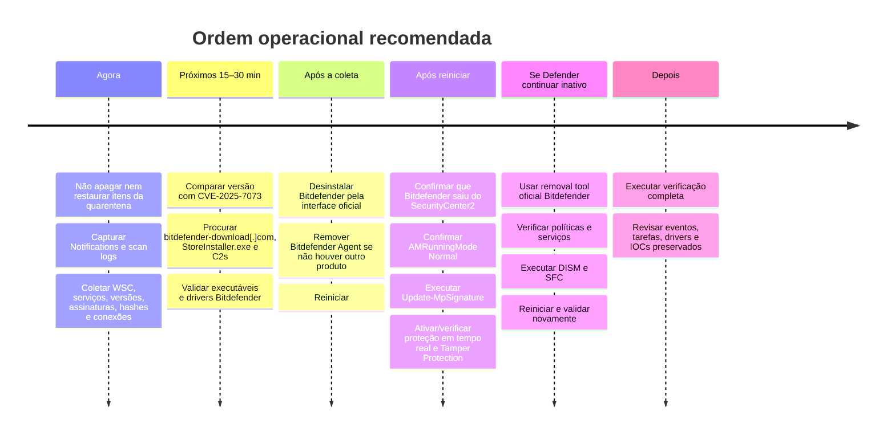

# Bitdefender falso, sequestrado ou abusado como vetor de malware: análise técnica e roteiro forense

## Resumo executivo

**Data da pesquisa: 22 de agosto de 2026.** O dado de entrada considerado é apenas este: Bitdefender aparece em execução no Windows e o Microsoft Defender Antivirus aparece desativado.

A conclusão principal é direta: **sim, existem casos documentados de software falso se passando por Bitdefender, páginas falsas de download entregando malware, interfaces de “antivírus” clonadas, suporte Bitdefender falsificado, binários Bitdefender legítimos abusados para DLL side-loading e vulnerabilidades reais em componentes Bitdefender que permitiram elevação de privilégio ou enfraquecimento da inspeção HTTPS.** Isso não é hipótese abstrata; há documentação do próprio Bitdefender, CVEs publicados e pesquisas independentes com IOCs concretos. citeturn19view3turn18view8turn15view3turn19view0turn14view0

Ao mesmo tempo, em Windows 10/11, **o simples fato de o Microsoft Defender estar desativado enquanto um antivírus não-Microsoft está registrado como principal é comportamento previsto pelo Windows**. A Microsoft documenta que, sem Defender for Endpoint, Windows 10/11 coloca o Defender Antivirus automaticamente em estado desativado quando outra solução antivírus é a principal; ao desinstalar o outro antivírus, o Defender deve voltar a se ativar. Portanto, `Defender OFF + Bitdefender ON` **não é, sozinho, um IOC de malware**. citeturn20view4turn18view0

O que separa uma instalação Bitdefender autêntica de uma falsa/abusada é a combinação:

**origem do instalador + registro no Windows Security Center + caminho real dos serviços + assinatura Authenticode + identidade do signatário + versão + hashes + drivers + localização dos executáveis + tarefas agendadas + histórico de eventos + relações pai/filho + presença dos IOCs documentados.**

| Achado | Conclusão operacional | Peso |
|---|---|---:|
| Defender desativado enquanto Bitdefender está registrado como AV principal | Compatível com comportamento normal do Windows | Baixo como IOC citeturn20view4 |
| Serviço “Bitdefender” executando de `%TEMP%`, `%APPDATA%`, Downloads ou pasta aleatória | Fortemente anômalo | **Crítico** |
| Binário Bitdefender com `Signature = NotSigned`, `HashMismatch` ou signatário estranho | Fortemente anômalo | **Crítico** |
| Binário legítimo Bitdefender assinado executando fora da instalação normal, junto de DLLs desconhecidas | Compatível com técnica real de DLL side-loading | **Crítico** citeturn19view0 |
| Contato com `bitdefender-download[.]com` ou IOC da campanha VenomRAT | Correspondência com campanha documentada | **Crítico** citeturn15view3 |
| Bitdefender consumer anterior à correção de CVE-2025-7073 | Exposição a elevação local de privilégio | **Alta** citeturn14view0 |
| GUI com logotipo Bitdefender, mas sem instalação verificável em Programas/WSC/serviços assinados | Compatível com spoof/rogue AV | **Alta** citeturn19view3turn18view8 |
| `msedgewebview2.exe` múltiplas vezes, mas Microsoft-signed e com pais legítimos | Normal para WebView2 | Baixo citeturn20view0turn15view4 |
| JavaScript ofuscado em `/cdn-cgi/challenge-platform/...` com `_cf_chl_opt` | Padrão oficial do Cloudflare Challenge; verificar origem/TLS | Baixo isoladamente citeturn20view1turn20view2 |

**Prioridade prática:** antes de desinstalar qualquer coisa, preserve a quarentena e logs; depois valide a instalação com os comandos abaixo. Se a instalação falhar nos testes de assinatura/origem ou bater em um IOC conhecido, trate-a como comprometida. Se passar, remova-a pelo procedimento oficial e deixe o próprio Windows reassumir o Defender.

## Cenários documentados de falsificação e abuso

O próprio Bitdefender documentou em 2010 o **ByteDefender**, um rogue antivirus criado para se passar visualmente pelo produto legítimo. O site falso copiava layout, embalagens e identidade visual do Bitdefender; usuários podiam chegar ao domínio por typosquatting, instalar voluntariamente o falso antivírus e receber alertas fraudulentos. O malware, detectado como `Trojan.FakeAV.KZO`, também tentou encerrar serviços de antivírus. [Aviso original do Bitdefender](https://www.bitdefender.com/en-us/news/bitdefender-product-impersonated-by-rogue-av-1548). citeturn19view3turn19view4

Em 2011, a própria empresa analisou outro rogue chamado **“BitDefender 2011”** que copiava logotipo e interface, disparava pop-ups falsos, bloqueava o desktop e interferia nos navegadores. Um detalhe forense particularmente útil: a amostra alterava entradas sob `Image File Execution Options`, usando configuração de debugger para impedir navegadores de iniciarem normalmente. [Análise original](https://www.bitdefender.com/en-us/blog/hotforsecurity/bitdefender-warns-of-rogue-antivirus-spoof). citeturn18view8

Há também um cenário contemporâneo. Em pesquisa publicada em 2025, a DomainTools acompanhou infraestrutura que utilizava **`bitdefender-download[.]com` para imitar uma página legítima de download do Bitdefender**. O pacote falso `BitDefender.zip` e executáveis `StoreInstaller.exe` estavam associados à entrega de **VenomRAT, StormKitty e SilentTrinity**, com roubo de credenciais, informações de carteiras e capacidade de acesso persistente. A pesquisa publicou domínios, hashes e C2s. [Pesquisa técnica da DomainTools](https://dti.domaintools.com/research/venomrat). citeturn15view3

Isso responde objetivamente à pergunta “uma instalação do Bitdefender pode ser falsa?”: **sim, há campanha documentada com exatamente essa isca.** A presença de um ícone, interface ou nome de processo não autentica o software. citeturn15view3turn19view3

Há ainda uma classe mais sutil: **o executável pode ser genuíno e assinado, mas estar sendo abusado.** Pesquisadores da Kaspersky documentaram que o grupo HoneyMyte utilizou, entre 2021 e 2025, executáveis legítimos e assinados de diversos fabricantes, **incluindo BitDefender**, como carregadores para DLL side-loading. Nesse cenário, `Get-AuthenticodeSignature` pode retornar `Valid` para o EXE e ainda assim a cadeia de execução ser maliciosa, porque a DLL carregada ao lado dele é a peça hostil. citeturn19view0

Isso muda o critério forense:

```text
Assinatura válida = evidência importante
Assinatura válida ≠ prova absoluta de execução benigna

Assinatura
    +
caminho
    +
versão
    +
origem
    +
DLLs adjacentes
    +
processo pai
    +
rede
    +
registro no Security Center
= validação forte
```

Existe também a família de ataques **BYOVD — Bring Your Own Vulnerable Driver**. O próprio Bitdefender explica que atacantes podem trazer drivers legitimamente assinados, mas vulneráveis, para obter capacidade privilegiada no kernel e cegar/encerrar ferramentas de segurança. Isso não significa que “todo driver Bitdefender é malware”; significa que a assinatura digital é apenas uma camada do modelo de confiança e que drivers carregados merecem inventário e validação. citeturn18view9turn19view2

Por fim, há falsificação de **suporte e interface**, não necessariamente do produto instalado. A página oficial brasileira do Bitdefender alerta para pop-ups falsos, páginas falsas de suporte e pessoas que convencem a vítima a conceder acesso remoto; a própria empresa descreve casos em que a vítima termina instalando um RAT. [Aviso Bitdefender Brasil](https://www.bitdefender.com.br/consumer/support/answer/39794/). citeturn16view0

## Vulnerabilidades e avisos oficiais do Bitdefender

As CVEs abaixo são especialmente relevantes porque demonstram que uma instalação **verdadeira** também precisa ter a versão conferida. Elas não significam que um sistema esteja comprometido; significam que existem versões nas quais um atacante poderia explorar o produto caso as condições fossem satisfeitas.

| CVE | Produto/componente | Impacto relevante | Estado a verificar | Fontes |
|---|---|---|---|---|
| **CVE-2025-7073** | Total Security / Internet Security / Antivirus Plus no Windows; `bdservicehost.exe` | Elevação local de privilégio mediante operações de arquivo, symlink e cadeia envolvendo cópia de arquivo/DLL injection. Bitdefender atribuiu CVSS-B 8.8 | O registro CNA no NVD considera versões anteriores a **27.0.47.241** afetadas para esses produtos | [Advisory Bitdefender](https://www.bitdefender.com/support/security-advisories/local-privilege-escalation-via-arbitrary-file-operation-in-bitdefender-atc-va-12590) · [NVD](https://nvd.nist.gov/vuln/detail/CVE-2025-7073) citeturn14view0 |
| **CVE-2023-6154** | `seccenter.exe` em Total Security, Internet Security, Antivirus Plus e Free | Configuração controlável capaz de alterar comportamento e potencialmente levar ao carregamento de biblioteca de terceiros; CVSS 7.8 | NVD/CNA identifica **27.0.25.114** como afetada | [Advisory Bitdefender](https://bitdefender.com/support/security-advisories/local-privilege-escalation-in-bitdefender-total-security-va-11168/) · [NVD](https://nvd.nist.gov/vuln/detail/CVE-2023-6154) citeturn14view1 |
| **CVE-2023-6055** | HTTPS Scanning do Total Security | Validação inadequada de certificado, com cenário de interceptação/MITM | Comparar versão instalada com advisory | [Advisory Bitdefender](https://bitdefender.com/support/security-advisories/improper-certificate-validation-in-bitdefender-total-security-https-scanning-va-11158/) · [NVD](https://nvd.nist.gov/vuln/detail/CVE-2023-6055) citeturn14view2 |
| **CVE-2023-49567** | HTTPS Scanning do Total Security | Confiança insegura envolvendo certificados com funções hash suscetíveis a colisões; impacto na validação TLS | Comparar versão instalada com advisory | [Advisory Bitdefender](https://www.bitdefender.com/support/security-advisories/insecure-trust-of-certificates-using-collision-hash-functions-in-bitdefender-total-security-https-scanning-va-11239/) · [NVD](https://nvd.nist.gov/vuln/detail/CVE-2023-49567) citeturn14view3 |
| **CVE-2023-49570** | HTTPS Scanning do Total Security | Validação inadequada de restrições de certificado, abrindo cenário MITM | Comparar versão instalada com advisory | [Advisory Bitdefender](https://www.bitdefender.com/support/security-advisories/insecure-trust-of-basic-constraints-certificate-in-bitdefender-total-security-https-scanning-va-11210/) · [NVD](https://nvd.nist.gov/vuln/detail/CVE-2023-49570) citeturn14view4 |

A **CVE-2025-7073 é a primeira que eu verificaria nesta máquina**, porque é recente, afeta produtos consumer Windows e cita diretamente `bdservicehost.exe`, nome comum em instalações do Bitdefender. O diretório envolvido na vulnerabilidade é `C:\ProgramData\Atc\Feedback`; o problema descrito envolve operações a partir de um diretório gravável pelo usuário e falta de validação correta de links simbólicos. citeturn14view0

Verifique a versão instalada sem abrir a GUI:

```powershell
$U = 'HKLM:\SOFTWARE\Microsoft\Windows\CurrentVersion\Uninstall\*',
     'HKLM:\SOFTWARE\WOW6432Node\Microsoft\Windows\CurrentVersion\Uninstall\*'

Get-ItemProperty $U -ErrorAction SilentlyContinue |
Where-Object DisplayName -Match 'Bitdefender' |
Select-Object DisplayName, DisplayVersion, Publisher, InstallLocation
```

E verifique se o diretório citado pela CVE foi transformado em reparse point:

```cmd
fsutil reparsepoint query "C:\ProgramData\Atc\Feedback"
```

Um retorno indicando que a pasta **não é um reparse point**, ou que ela nem existe, não demonstra exploração. Um reparse point inesperado nesse local, combinado com uma versão afetada, passa a ser um artefato de alta prioridade. Essa conclusão é uma inferência forense baseada no mecanismo descrito na CVE. citeturn14view0

## Relatos em português e falsos positivos

As fontes comunitárias em português são úteis para uma coisa específica: mostrar que **uma detecção do Bitdefender também não deve ser interpretada automaticamente como prova de comprometimento**. Elas são relatos de usuários, portanto têm peso muito inferior a advisory oficial, hash, assinatura ou artefato forense.

No fórum brasileiro **Projeto ACBr**, um usuário relatou em 2019 que o Bitdefender colocou em quarentena um arquivo de controle SVN como `Trojan.GenericKD.42068482`. A resposta aceita considerou provável falso positivo, mantendo a ressalva de que uma cópia local realmente infectada continuaria sendo possível. [Tópico “Virus ou Falso Positivo”](https://www.projetoacbr.com.br/forum/topic/55110-virus-ou-falso-positivo/). citeturn16view2

No **Stack Overflow em Português**, há outro relato de desenvolvedor sobre binário gerado em modo Debug no Visual Studio sendo detectado pelo Bitdefender, ilustrando a ocorrência de falsos positivos em executáveis produzidos localmente. [Discussão em português](https://pt.stackoverflow.com/questions/416560/bitdefender-falso-positivo-ao-compilar-usando-modo-debug-visual-studio-2019). citeturn16view3

O próprio Bitdefender reconhece que bloqueios incorretos podem ocorrer e mantém mecanismo de submissão a seus laboratórios para correção de falso positivo. Portanto, “Bitdefender detectou X” é um **evento a investigar**, não um veredito isolado. citeturn17search7

Para fraude/falsificação especificamente, a melhor fonte em português é a documentação oficial brasileira já citada: [“Cuidado com os golpistas que fingem ser o suporte do Bitdefender”](https://www.bitdefender.com.br/consumer/support/answer/39794/). Ela descreve pop-ups falsos, páginas clonadas, telefonemas e instalação induzida de ferramentas de acesso remoto. citeturn16view0

Assim, há dois fenômenos diferentes e ambos existem:

```text
A) BITDEFENDER FALSO / MALWARE DISFARÇADO
   → documentado pelo próprio Bitdefender e por pesquisas de threat intel

B) BITDEFENDER VERDADEIRO GERANDO FALSO POSITIVO
   → também existe e é reconhecido pelo fornecedor

A diferença é resolvida por artefatos, não pela aparência da GUI.
```

## Verificação forense da instalação, WebView2 e Cloudflare

Todos os comandos abaixo são **somente leitura**, exceto quando explicitamente indicado na seção de remediação. Execute PowerShell como Administrador para reduzir resultados incompletos.

### Tabela de comandos, finalidade e resultado esperado

| Comando | Finalidade | Esperado em instalação legítima / sinal de alerta |
|---|---|---|
| `Get-ItemProperty` nas chaves de Uninstall | Descobrir produto, versão, publicador, caminho e desinstalador | Publisher coerente com Bitdefender e instalação em localização de software; `%TEMP%`, `%APPDATA%`, Downloads ou publisher estranho elevam prioridade |
| `Get-CimInstance root/SecurityCenter2 AntiVirusProduct` | Ver quem está registrado no Windows Security Center | Bitdefender deve aparecer enquanto instalado; caminho de reporting/product, quando fornecido, deve ser coerente. O Defender poder estar desativado nesse momento é esperado no Win10/11. citeturn20view4 |
| `Get-CimInstance Win32_Service` | Enumerar serviços e caminhos | Serviços Bitdefender devem apontar para instalação coerente; serviço “Bitdefender” executando de pasta gravável pelo usuário é forte IOC |
| `Get-AuthenticodeSignature` | Validar assinatura digital do EXE/DLL/SYS | `Status = Valid` e signatário identificando Bitdefender; `NotSigned`, `HashMismatch` ou signatário inesperado = alerta |
| `Get-FileHash -Algorithm SHA256` | Criar identidade estável do binário | Hash pode ser comparado com IOCs/repositórios do fornecedor; correspondência exata com hash malicioso é evidência forte |
| `Get-CimInstance Win32_SystemDriver` | Inventariar drivers | Arquivo deve ter metadados/signatura coerentes; driver desconhecido em pasta gravável é crítico |
| `fltmc filters` | Listar minifiltros do kernel | Permite identificar filtros adicionais de segurança e anomalias |
| `Get-ScheduledTask` | Encontrar persistência | Tarefas que lançam Bitdefender de Program Files podem ser legítimas; tarefas “Bitdefender” lançando Temp/AppData/PowerShell/MSHTA exigem investigação |
| `Get-MpComputerStatus` | Estado real do Defender | Enquanto outro AV é principal, `Not running`/desativado pode ser normal; depois da remoção do Bitdefender, deve voltar a `Normal`/ativo. citeturn20view4turn18view0 |
| `Get-WinEvent ... Defender/Operational` | Reconstruir mudanças do Defender | Mudanças devem coincidir temporalmente com instalação/desinstalação do AV; alterações inexplicadas antes disso merecem análise |
| `reg query ... Image File Execution Options` | Detectar interceptação via Debugger | Debugger estranho em Chrome/Edge/Firefox é anômalo; rogue BitDefender histórico usou essa técnica. citeturn18view8 |
| `Get-Content -Stream Zone.Identifier` | Obter origem registrada do instalador | `HostUrl`/`ReferrerUrl` pode revelar domínio de download; IOC conhecido é crítico |
| `Get-DnsClientCache` / `Get-NetTCPConnection` | Procurar infraestrutura da campanha | Match exato com domínio/IP publicado = prioridade máxima citeturn15view3 |

**Inventário de instalação:**

```powershell
$U = 'HKLM:\SOFTWARE\Microsoft\Windows\CurrentVersion\Uninstall\*',
     'HKLM:\SOFTWARE\WOW6432Node\Microsoft\Windows\CurrentVersion\Uninstall\*'

Get-ItemProperty $U -ErrorAction SilentlyContinue |
Where-Object DisplayName -Match 'Bitdefender' |
Select-Object DisplayName, DisplayVersion, Publisher,
              InstallLocation, InstallDate, UninstallString |
Format-List
```

**Registro no Windows Security Center:**

```powershell
Get-CimInstance -Namespace root/SecurityCenter2 -ClassName AntiVirusProduct |
Select-Object displayName,
              instanceGuid,
              pathToSignedProductExe,
              pathToSignedReportingExe,
              productState |
Format-List
```

Não use `productState` sozinho para declarar infecção. Aqui o dado mais útil é **qual produto está registrado e a coerência dos caminhos**. A própria arquitetura do Windows usa a presença do antivírus não-Microsoft para decidir o estado do Defender. citeturn20view4

**Serviços Bitdefender:**

```powershell
Get-CimInstance Win32_Service |
Where-Object {
    $_.DisplayName -match 'Bitdefender' -or
    $_.PathName    -match 'Bitdefender|bdservicehost|bdredline'
} |
Select-Object Name, DisplayName, State, StartMode, StartName, PathName |
Format-Table -AutoSize
```

Agora autentique **os processos em execução**, não apenas seus nomes:

```powershell
Get-CimInstance Win32_Process |
Where-Object {
    $_.ExecutablePath -and (
        $_.ExecutablePath -match 'Bitdefender' -or
        $_.Name -match '^(bdservicehost|bdagent|seccenter)\.exe$'
    )
} |
ForEach-Object {
    $p   = $_.ExecutablePath
    $sig = Get-AuthenticodeSignature -FilePath $p

    [PSCustomObject]@{
        PID       = $_.ProcessId
        Name      = $_.Name
        Path      = $p
        Signature = $sig.Status
        Signer    = if ($sig.SignerCertificate) {
                        $sig.SignerCertificate.Subject
                    } else {
                        $null
                    }
        SHA256    = (Get-FileHash -Path $p -Algorithm SHA256).Hash
    }
} | Format-List
```

Resultado forte de legitimidade:

```text
Path      = diretório de instalação coerente
Signature = Valid
Signer    = ... Bitdefender ...
SHA256    = valor estável para aquele arquivo
```

Resultado de alta gravidade:

```text
Path      = C:\Users\...\AppData\...
            C:\Users\...\Downloads\...
            C:\Windows\Temp\...
Signature = NotSigned / HashMismatch
Signer    = desconhecido ou ausente
```

Por causa do caso real de DLL side-loading documentado pela Kaspersky, faça também uma busca por **executáveis genuinamente assinados pelo Bitdefender fora do diretório normal do produto**. Um EXE assinado em Downloads/AppData/Temp pode ter sido copiado para servir como loader de uma DLL maliciosa. citeturn19view0

```powershell
$roots = @(
    "$env:USERPROFILE\Downloads",
    "$env:TEMP",
    "$env:APPDATA",
    "$env:LOCALAPPDATA"
)

Get-ChildItem $roots -Recurse -File -Filter *.exe -ErrorAction SilentlyContinue |
ForEach-Object {
    $sig = Get-AuthenticodeSignature $_.FullName

    if (
        $sig.Status -eq 'Valid' -and
        $sig.SignerCertificate -and
        $sig.SignerCertificate.Subject -match 'Bitdefender'
    ) {
        [PSCustomObject]@{
            File   = $_.FullName
            Signer = $sig.SignerCertificate.Subject
            SHA256 = (Get-FileHash $_.FullName -Algorithm SHA256).Hash
        }
    }
}
```

**Resultado esperado:** normalmente nenhum executável Bitdefender precisa estar sendo executado de `%TEMP%`, `%APPDATA%` ou Downloads. Encontrá-lo ali não prova sozinho malware, mas, diante do abuso documentado de binários Bitdefender para side-loading, torna os DLLs adjacentes prioridade imediata. citeturn19view0

Liste DLLs próximas:

```powershell
Get-ChildItem "C:\CAMINHO\ONDE\O\EXE\FOI\ENCONTRADO" -File |
Where-Object Extension -In '.dll','.exe' |
ForEach-Object {
    $sig = Get-AuthenticodeSignature $_.FullName
    [PSCustomObject]@{
        File      = $_.FullName
        Signature = $sig.Status
        Signer    = if ($sig.SignerCertificate) {
                        $sig.SignerCertificate.Subject
                    } else {
                        $null
                    }
        SHA256    = (Get-FileHash $_.FullName -Algorithm SHA256).Hash
    }
}
```

**Drivers:**

```powershell
Get-CimInstance Win32_SystemDriver |
ForEach-Object {
    $raw = $_.PathName

    if ($raw) {
        $p = $raw -replace '^\\\?\?\\',''
        $p = $p -replace '^\\SystemRoot', $env:SystemRoot
        $p = $p.Trim('"')

        if (Test-Path $p) {
            $file = Get-Item $p

            if ($file.VersionInfo.CompanyName -match 'Bitdefender') {
                $sig = Get-AuthenticodeSignature $p

                [PSCustomObject]@{
                    Service   = $_.Name
                    State     = $_.State
                    StartMode = $_.StartMode
                    Path      = $p
                    Company   = $file.VersionInfo.CompanyName
                    Version   = $file.VersionInfo.FileVersion
                    Signature = $sig.Status
                    Signer    = if ($sig.SignerCertificate) {
                                    $sig.SignerCertificate.Subject
                                }
                }
            }
        }
    }
} | Format-List
```

E:

```cmd
fltmc filters
```

**Tarefas agendadas:**

```powershell
Get-ScheduledTask |
ForEach-Object {
    $task = $_

    foreach ($a in $task.Actions) {
        [PSCustomObject]@{
            Task      = $task.TaskPath + $task.TaskName
            Execute   = $a.Execute
            Arguments = $a.Arguments
        }
    }
} |
Where-Object {
    $_.Execute -match 'Bitdefender|AppData|Temp|Downloads|powershell|mshta|rundll32'
} |
Format-List
```

Uma tarefa que combina um nome “Bitdefender” com algo semelhante a:

```text
%APPDATA%\random\something.exe
%TEMP%\...
powershell.exe ...
mshta.exe ...
rundll32.exe <DLL em perfil do usuário>
```

merece prioridade muito maior do que uma tarefa cujo executável está dentro da instalação assinada.

**Origem de um instalador ainda presente em Downloads:**

```powershell
Get-Content -Path 'C:\CAMINHO\BitdefenderInstaller.exe' -Stream Zone.Identifier
```

Procure:

```text
HostUrl=
ReferrerUrl=
```

A ausência do `Zone.Identifier` não prova adulteração porque esse ADS pode desaparecer em algumas formas de cópia. Porém, se aparecer origem como `bitdefender-download[.]com`, há correspondência direta com a campanha pesquisada pela DomainTools. citeturn15view3

**Image File Execution Options**, relevante por causa do rogue histórico:

```cmd
reg query "HKLM\SOFTWARE\Microsoft\Windows NT\CurrentVersion\Image File Execution Options" /s /v Debugger
```

Analise especialmente entradas para navegadores. O rogue “BitDefender 2011” documentado pelo fornecedor utilizava justamente alteração de debugger nessa região do Registro para bloquear browsers. citeturn18view8

**Eventos do Defender:**

```powershell
Get-WinEvent -LogName 'Microsoft-Windows-Windows Defender/Operational' -MaxEvents 500 |
Select-Object TimeCreated, Id, LevelDisplayName, Message |
Format-List
```

**Eventos de serviços:**

```powershell
Get-WinEvent -FilterHashtable @{
    LogName      = 'System'
    ProviderName = 'Service Control Manager'
    StartTime    = (Get-Date).AddDays(-30)
} |
Where-Object {
    $_.Message -match 'WinDefend|WdNisSvc|Bitdefender|bdservicehost'
} |
Select-Object TimeCreated, Id, Message |
Format-List
```

**Certificados Bitdefender colocados na lista de não confiáveis:**

```powershell
Get-ChildItem Cert:\LocalMachine\Disallowed,Cert:\CurrentUser\Disallowed `
    -ErrorAction SilentlyContinue |
Where-Object Subject -Match 'Bitdefender' |
Select-Object Subject, Issuer, Thumbprint, NotBefore, NotAfter
```

O ponto crítico é comparar o **thumbprint do certificado que assina o executável em execução** com certificados explicitamente colocados na lista `Disallowed`.

### Validação de `msedgewebview2.exe`

O `msedgewebview2.exe` é o processo do Microsoft Edge WebView2 Runtime. A Microsoft recomenda explicitamente que ferramentas de segurança **confiem no runtime pela assinatura digital**; também documenta que o WebView2 cria subprocessos para renderer/compositor, GPU, rede e Crashpad, de modo que múltiplas instâncias não são anormais. Alguns componentes do próprio Windows podem carregar binários WebView2 diretamente de `C:\Windows\System32`. citeturn20view0turn15view4

Valide todas as instâncias:

```powershell
$wv = Get-CimInstance Win32_Process -Filter "Name='msedgewebview2.exe'"

$wv | ForEach-Object {
    $p   = $_.ExecutablePath
    $sig = if ($p) { Get-AuthenticodeSignature $p }

    [PSCustomObject]@{
        PID       = $_.ProcessId
        ParentPID = $_.ParentProcessId
        Path      = $p
        Signature = if ($sig) { $sig.Status }
        Signer    = if ($sig -and $sig.SignerCertificate) {
                        $sig.SignerCertificate.Subject
                    }
        CommandLine = $_.CommandLine
    }
} | Format-List
```

O esperado é:

```text
Signature = Valid
Signer    = Microsoft...
Path      = runtime gerenciado pela Microsoft/Windows
```

Para descobrir **quem abriu cada WebView2**:

```powershell
$parentIds = $wv.ParentProcessId | Sort-Object -Unique

Get-CimInstance Win32_Process |
Where-Object ProcessId -In $parentIds |
Select-Object ProcessId, ParentProcessId, Name, ExecutablePath, CommandLine |
Format-List
```

Agora as conexões de rede dessas instâncias:

```powershell
$wvPids = $wv.ProcessId

Get-NetTCPConnection -State Established |
Where-Object OwningProcess -In $wvPids |
Select-Object LocalAddress, LocalPort,
              RemoteAddress, RemotePort,
              OwningProcess |
Format-Table -AutoSize
```

O critério forte não é “WebView2 conectou à internet”; o componente possui subprocesso de rede por design. O que deve ser correlacionado é **assinatura + caminho + processo pai + linha de comando + destino**. citeturn15view4turn20view0

### Validação do JavaScript de Cloudflare Challenge

Cloudflare documenta oficialmente que domínios protegidos por sua infraestrutura recebem o endpoint especial `/cdn-cgi/`, gerenciado pela própria Cloudflare, e que o JavaScript Detection utiliza caminhos iniciados por:

```text
/cdn-cgi/challenge-platform/...
```

citeturn15view5turn20view2

Cloudflare também documenta a variável:

```javascript
window._cf_chl_opt
```

como parte do mecanismo de Challenge Pages. Portanto, **JavaScript muito ofuscado contendo `_cf_chl_opt` vindo do mesmo host e de `/cdn-cgi/challenge-platform/` é compatível com um Cloudflare Challenge legítimo**; ofuscação, nesse caso, não basta para classificar o script como malware. citeturn20view1

Validação DNS/TLS/headers do host:

```powershell
$h = '<HOST_DA_PAGINA>'

Resolve-DnsName $h

curl.exe -v "https://$h/cdn-cgi/trace" -o NUL 2>&1 |
Select-String 'subject:|issuer:|server:|cf-ray:|HTTP/'
```

No DevTools → **Network**, o request do challenge deve manter o host esperado e ter caminho semelhante a:

```text
/cdn-cgi/challenge-platform/...
```

Pontos que mudam a classificação para suspeita:

```text
challenge script vindo de domínio totalmente diferente sem razão
chrome-extension://<ID desconhecido>/...
file://...
certificate/TLS inconsistente
redirect inesperado para domínio recém-criado
script local injetado antes da navegação
processo navegador iniciado por executável desconhecido
```

## IOCs e artefatos prioritários para coletar

A campanha falsa de Bitdefender investigada pela DomainTools fornece IOCs concretos. Um dos domínios de entrega foi `bitdefender-download[.]com`; foram observados `BitDefender.zip`, múltiplas amostras `StoreInstaller.exe` e C2s do VenomRAT. Uma das amostras `StoreInstaller.exe` publicadas tem SHA-256 `eb2b61a5f15b19bf7dd0ff3914d3019c26499dd693647b00c1b073037db72e35`. citeturn15view3

| Prioridade | IOC / artefato | O que coletar/procurar | Interpretação |
|---|---|---|---|
| **Crítica** | `bitdefender-download[.]com` | DNS cache, histórico/downloads, Zone.Identifier, logs de firewall | Domínio documentado como página falsa de Bitdefender citeturn15view3 |
| **Crítica** | `BitDefender.zip` proveniente da campanha | Downloads, Temp, hashes, MOTW | Nome usado na entrega maliciosa; nome sozinho não basta, origem/hash decide citeturn15view3 |
| **Crítica** | `StoreInstaller.exe` SHA-256 `eb2b61a5f15b19bf7dd0ff3914d3019c26499dd693647b00c1b073037db72e35` | Downloads, Temp, Prefetch, Amcache | Match exato = IOC publicado pela DomainTools citeturn15view3 |
| **Crítica** | C2 `67.217.228[.]160:4449` | conexões, firewall, DNS/proxy | C2 VenomRAT publicado citeturn15view3 |
| **Crítica** | Outros C2s: `172.93.222[.]102:4449`, `15.228.248[.]225:5552`, `94.141.123[.]234:4449`, `157.20.182[.]72:4449`, `185.208.159[.]121:6000`, `109.248.144[.]175:4449`, `95.216.115[.]242:9090` | NetTCPConnection, firewall/proxy, SIEM | Infraestrutura publicada na mesma investigação citeturn15view3 |
| **Crítica** | EXE chamado Bitdefender em `%TEMP%`, `%APPDATA%`, Downloads | assinatura, SHA-256, DLLs vizinhas | Incompatível com expectativa de serviço instalado; também relevante para DLL side-loading |
| **Crítica** | Bitdefender-signed EXE + DLL não assinada no mesmo diretório gravável | EXE, DLL, hashes, timestamps | Técnica de side-loading envolvendo binários BitDefender foi documentada citeturn19view0 |
| **Alta** | Serviço Bitdefender apontando para user profile | `HKLM\SYSTEM\CurrentControlSet\Services`, `Win32_Service` | Caminho anômalo para serviço privilegiado |
| **Alta** | Signatário não-Bitdefender | certificados Authenticode e thumbprints | GUI/nome podem ser falsos; assinatura diverge |
| **Alta** | `C:\ProgramData\Atc\Feedback` como reparse point em versão afetada | diretório, reparse data, timestamps | Relevante ao mecanismo da CVE-2025-7073 citeturn14view0 |
| **Alta** | WSC registra “Bitdefender” com caminho inesperado | `root\SecurityCenter2:AntiVirusProduct` | Possível registro inconsistente/falso |
| **Alta** | `Image File Execution Options\<browser>\Debugger` | chave e valor completos | Técnica usada pelo rogue “BitDefender 2011” histórico citeturn18view8 |
| **Alta** | Tarefa “Bitdefender” → PowerShell/MSHTA/Temp/AppData | XML da tarefa, ação, autor, timestamps | Persistência anômala |
| **Média** | Mudança do Defender sem instalação correlacionada do AV | `Windows Defender/Operational`, System/SCM | Pode mostrar momento da adulteração ou simplesmente instalação normal do AV |
| **Média** | Certificado Bitdefender ativo também presente em `Disallowed` | thumbprint dos dois lados | Conflito de confiança a investigar |
| **Baixa isoladamente** | `WinDefend` parado enquanto Bitdefender é AV principal | WSC + `Get-MpComputerStatus` | Comportamento normal documentado no Win10/11 citeturn20view4 |
| **Baixa isoladamente** | várias instâncias `msedgewebview2.exe` | signer, parent PID, path | Modelo multiprocessos esperado citeturn15view4turn20view0 |
| **Baixa isoladamente** | `_cf_chl_opt` e `/cdn-cgi/challenge-platform/` | request URL, TLS, initiator | Padrões oficiais de Cloudflare Challenge citeturn20view1turn20view2 |

Busca direta pelos IOCs da campanha:

```powershell
# Arquivos/nome da campanha
$roots = @(
    "$env:USERPROFILE\Downloads",
    "$env:TEMP",
    "$env:LOCALAPPDATA\Temp"
)

Get-ChildItem $roots -Recurse -File -ErrorAction SilentlyContinue |
Where-Object {
    $_.Name -in @('BitDefender.zip','StoreInstaller.exe')
} |
Select-Object FullName, Length, CreationTime, LastWriteTime
```

Para cada `StoreInstaller.exe` encontrado:

```powershell
Get-FileHash "C:\CAMINHO\StoreInstaller.exe" -Algorithm SHA256
Get-AuthenticodeSignature "C:\CAMINHO\StoreInstaller.exe" |
Format-List Status, StatusMessage, SignerCertificate
```

Pesquisa de DNS:

```powershell
Get-DnsClientCache |
Where-Object Entry -Match 'bitdefender-download\.com' |
Format-List
```

Pesquisa das conexões C2 publicadas:

```powershell
$badIPs = @(
    '67.217.228.160',
    '172.93.222.102',
    '15.228.248.225',
    '94.141.123.234',
    '157.20.182.72',
    '185.208.159.121',
    '109.248.144.175',
    '95.216.115.242'
)

Get-NetTCPConnection -ErrorAction SilentlyContinue |
Where-Object RemoteAddress -In $badIPs |
Select-Object State, LocalAddress, LocalPort,
              RemoteAddress, RemotePort, OwningProcess
```

Se algum PID aparecer:

```powershell
Get-CimInstance Win32_Process |
Where-Object ProcessId -EQ <PID> |
Select-Object ProcessId, ParentProcessId, Name,
              ExecutablePath, CommandLine |
Format-List
```

Para o inventário do Registro e artefatos, preserve pelo menos estas áreas antes de qualquer limpeza:

| Artefato | Caminho / log | Motivo |
|---|---|---|
| Instalação do produto | `HKLM\SOFTWARE\Microsoft\Windows\CurrentVersion\Uninstall` | Nome, versão, publisher, desinstalador |
| Instalações 32-bit | `HKLM\SOFTWARE\WOW6432Node\Microsoft\Windows\CurrentVersion\Uninstall` | Segunda visão do inventário |
| Serviços | `HKLM\SYSTEM\CurrentControlSet\Services` | Executável, drivers, StartType |
| Políticas Defender | `HKLM\SOFTWARE\Policies\Microsoft\Windows Defender` | Identificar política que mantém Defender desativado |
| Configuração Defender | `HKLM\SOFTWARE\Microsoft\Windows Defender` | Estado/configuração local |
| IFEO | `HKLM\SOFTWARE\Microsoft\Windows NT\CurrentVersion\Image File Execution Options` | Hijack/debugger de processos |
| Event log Defender | `Microsoft-Windows-Windows Defender/Operational` | Linha do tempo de alterações |
| Event log de serviços | `System` / `Service Control Manager` | Start/stop/falhas de serviços |
| Security Center | `root\SecurityCenter2\AntiVirusProduct` | AVs registrados no Windows |
| Executáveis Bitdefender | `C:\Program Files\Bitdefender\...` e caminhos reportados pelos serviços | Assinatura, hash, versão |
| Dados do produto | `C:\ProgramData\Bitdefender\...` quando existente | Configuração/logs/artefatos |
| CVE-2025-7073 | `C:\ProgramData\Atc\Feedback` | Reparse point e timestamps citeturn14view0 |
| Downloads/Temp | `%USERPROFILE%\Downloads`, `%TEMP%`, `%LOCALAPPDATA%\Temp` | Installer falso, ZIP, side-loading |
| Tarefas | Task Scheduler Library | Persistência |
| Certificados bloqueados | `Cert:\LocalMachine\Disallowed`, `Cert:\CurrentUser\Disallowed` | Alterações no trust store |

## Remediação segura e linha do tempo

A ordem importa. **Não force `WinDefend` a iniciar enquanto Bitdefender ainda estiver instalado e registrado como antivírus principal.** No Windows 10/11, o estado desativado do Defender nessa condição é justamente o comportamento documentado pela Microsoft. Primeiro preserve evidências, depois remova o antivírus de terceiro corretamente, reinicie e só então verifique se o Defender reassumiu. citeturn20view4turn18view0

Antes da remoção, preserve a quarentena. O Bitdefender informa que arquivos em quarentena ficam isolados e não podem ser executados/lidos normalmente; **desinstalar o Bitdefender não restaura automaticamente esses itens ao local original — eles permanecem isolados**. A documentação também informa que a opção “Delete content older than 30 days”, quando habilitada, pode apagar definitivamente itens com mais de 30 dias. citeturn22view0

Portanto, antes de desinstalar:

1. Abra **Bitdefender → Protection → Antivirus → Open → Settings → Manage quarantine**. Registre nome do arquivo, detecção, caminho original e data. Não restaure arquivos suspeitos apenas para “salvá-los”. citeturn22view0
2. Em **View Settings**, verifique temporariamente se `Delete content older than 30 days` está desabilitado enquanto coleta os dados. citeturn22view0
3. Abra **Notifications** e registre os eventos críticos, warning e informational; a própria documentação diz que essa área mantém histórico detalhado das atividades do produto, com ação, data e horário. citeturn22view1
4. Se houver scan recente, abra **View Log** e copie o arquivo XML do scan para uma pasta de evidência; a documentação oficial descreve exatamente esse formato/exportação. citeturn22view2

Uma pasta simples para preservar a coleta:

```powershell
$ev = "$env:USERPROFILE\Desktop\Bitdefender_Evidence_$(Get-Date -Format yyyyMMdd_HHmmss)"
New-Item -ItemType Directory -Path $ev
$ev
```

Salve também o inventário antes da remoção:

```powershell
Get-CimInstance -Namespace root/SecurityCenter2 -ClassName AntiVirusProduct |
Format-List * |
Out-File "$ev\SecurityCenter_before.txt"

Get-CimInstance Win32_Service |
Where-Object {
    $_.DisplayName -match 'Bitdefender' -or
    $_.PathName -match 'Bitdefender|bdservicehost|bdredline'
} |
Format-List * |
Out-File "$ev\Bitdefender_services_before.txt"

Get-MpComputerStatus |
Format-List * |
Out-File "$ev\Defender_before.txt"

Get-WinEvent -LogName 'Microsoft-Windows-Windows Defender/Operational' `
    -MaxEvents 500 |
Format-List TimeCreated,Id,LevelDisplayName,Message |
Out-File "$ev\Defender_events.txt"
```

Depois, remova o produto pelo procedimento oficial:

```text
Configurações
→ Aplicativos
→ Aplicativos instalados
→ Bitdefender
→ Desinstalar
→ concluir
→ REINICIAR
```

O suporte oficial Bitdefender determina reinicialização após a remoção. Se não houver mais nenhum outro produto Bitdefender instalado, o fornecedor também orienta remover o **Bitdefender Agent**. Se a desinstalação normal falhar, deve-se usar o **Bitdefender Uninstall Tool oficial**, e o modo de segurança é a alternativa indicada pelo fornecedor caso o próprio removal tool encontre erros. [Procedimento oficial de desinstalação](https://www.bitdefender.com/consumer/support/answer/2791/). citeturn15view1

Ferramenta oficial de remoção:

`https://www.bitdefender.com/links/uninstall_consumer_paid.html` citeturn15view1

Depois do reboot, **não baixe um “Defender Antivirus” de site de terceiros**. O Microsoft Defender Antivirus é componente integrado ao Windows 10/11 e deve se reativar quando o antivírus concorrente é removido. citeturn18view0turn20view4

Confirme primeiro que o Bitdefender desapareceu do Security Center:

```powershell
Get-CimInstance -Namespace root/SecurityCenter2 -ClassName AntiVirusProduct |
Select-Object displayName,
              pathToSignedProductExe,
              pathToSignedReportingExe,
              productState
```

Depois:

```powershell
Get-MpComputerStatus |
Select-Object AMRunningMode,
              AMServiceEnabled,
              AntivirusEnabled,
              AntispywareEnabled,
              BehaviorMonitorEnabled,
              IoavProtectionEnabled,
              RealTimeProtectionEnabled,
              AntivirusSignatureVersion,
              AntivirusSignatureLastUpdated
```

O alvo depois da remoção/reboot é:

```text
AMRunningMode                 Normal
AMServiceEnabled              True
AntivirusEnabled              True
BehaviorMonitorEnabled        True
IoavProtectionEnabled         True
RealTimeProtectionEnabled     True
```

A Microsoft documenta `AMRunningMode` como a forma de verificar se o Defender está em modo Normal, Passivo ou outro estado suportado. citeturn15view0

Atualize imediatamente as assinaturas:

```powershell
Update-MpSignature -UpdateSource MicrosoftUpdateServer
```

A documentação Microsoft confirma que `Update-MpSignature` obtém as definições antimalware mais recentes e que `MicrosoftUpdateServer` pode ser especificado diretamente como origem. citeturn20view3

Confira novamente:

```powershell
Get-MpComputerStatus |
Select-Object AMRunningMode,
              AntivirusEnabled,
              RealTimeProtectionEnabled,
              BehaviorMonitorEnabled,
              AntivirusSignatureVersion,
              AntivirusSignatureLastUpdated
```

Na GUI:

```text
Segurança do Windows
→ Proteção contra vírus e ameaças
→ verificar Microsoft Defender Antivirus
→ Proteção em tempo real = Ativado
→ Proteção contra adulteração = Ativado
```

A proteção contra adulteração é particularmente relevante porque a Microsoft documenta que malware tenta desabilitar proteção em tempo real, monitoramento comportamental, proteção em cloud, atualização de inteligência e notificações; Tamper Protection existe para dificultar exatamente essas alterações. citeturn18view0

Se **Bitdefender já tiver sido removido e reiniciado**, mas o Defender continuar `Not running`, aí sim faça diagnóstico:

```powershell
Get-Service WinDefend,WdNisSvc,wscsvc,SecurityHealthService `
    -ErrorAction SilentlyContinue |
Format-Table Name,Status,StartType -AutoSize
```

Verifique políticas:

```cmd
reg query "HKLM\SOFTWARE\Policies\Microsoft\Windows Defender" /s
```

E política aplicada:

```powershell
gpresult /h "$env:USERPROFILE\Desktop\gpresult-defender.html"
```

Não apague essas chaves cegamente: uma política empresarial/MDM legítima pode existir. O objetivo primeiro é descobrir **quem está impondo o estado**.

Se o Security Center ainda mostrar Bitdefender depois da remoção normal, use o removal tool oficial Bitdefender, reinicie e consulte `root\SecurityCenter2` novamente. citeturn15view1

Se o Bitdefender desaparecer completamente, mas componentes do Windows ainda não funcionarem, execute a sequência oficial de reparo Microsoft:

```cmd
DISM.exe /Online /Cleanup-Image /RestoreHealth
```

Quando terminar:

```cmd
sfc /scannow
```

A Microsoft orienta executar DISM antes do SFC para restaurar componentes/arquivos de sistema ausentes ou danificados. citeturn21search0turn21search1

Reinicie e valide:

```powershell
Get-MpComputerStatus |
Select AMRunningMode,
       AMServiceEnabled,
       AntivirusEnabled,
       RealTimeProtectionEnabled,
       BehaviorMonitorEnabled,
       IoavProtectionEnabled
```



A ordem acima evita dois erros importantes: interpretar como ataque um Defender desativado normalmente por coexistência com outro antivírus, e destruir evidência antes de saber se a instalação Bitdefender é legítima. O Windows foi projetado para reativar o Defender após a remoção do antivírus de terceiro, enquanto a documentação do Bitdefender permite preservar os metadados de quarentena, notificações e logs antes da desinstalação. citeturn20view4turn18view0turn22view0turn22view1turn22view2

**Conclusão analítica:** instalações e interfaces falsas de Bitdefender são um fenômeno documentado; uma campanha recente chegou a distribuir RAT/stealers sob a aparência de download do produto. Binários Bitdefender genuínos também já foram empregados em DLL side-loading, e vulnerabilidades relevantes existem em versões legítimas. Mas o estado `Bitdefender ativo → Defender desativado`, sozinho, é compatível com o funcionamento normal do Windows. A decisão sobre esta instalação específica deve ser feita principalmente pelos quatro testes de maior valor probatório: **WSC registration → caminho dos serviços/processos → Authenticode/signatário → hash/origem do instalador**, seguidos da comparação da versão com a CVE-2025-7073 e da busca dos IOCs da campanha `bitdefender-download[.]com`. citeturn20view4turn15view3turn19view0turn14view0