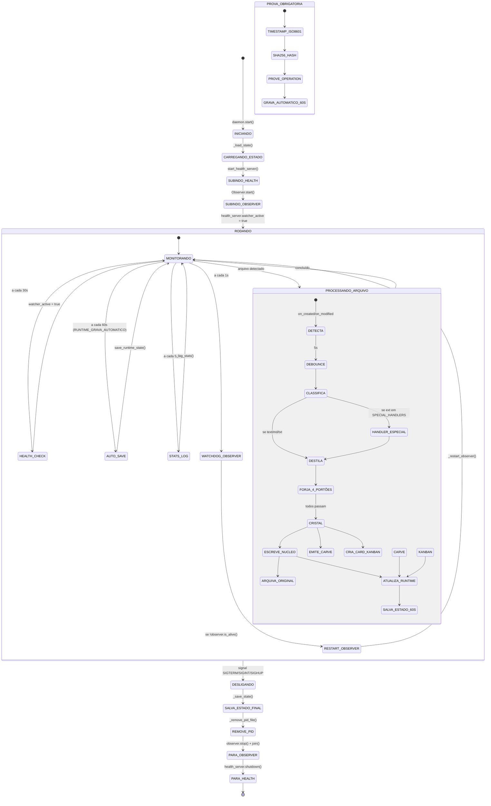
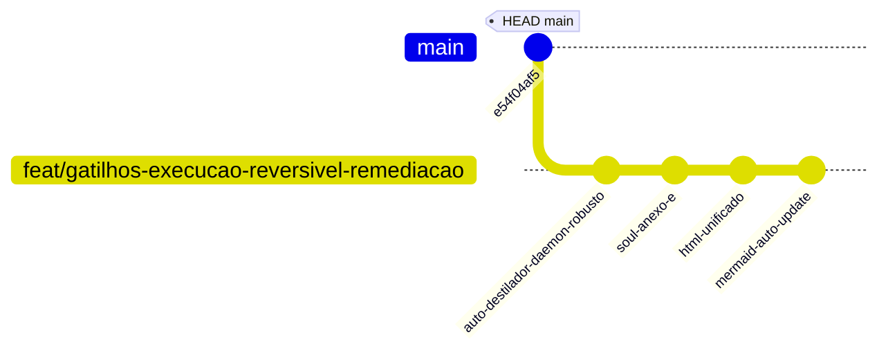

# CentralDark — Diagramas Mermaid Auto-Atualizáveis (Verdade Atual)
> **Regra**: Zero regressão. Sem v1/v2/v3. Apenas a verdade atual.
> **Fonte**: Estado real observado (arquivos, runtime, screenshots, logs).
> **Atualização**: Manual apenas quando a arquitetura REAL mudar.

---

## 1. ARQUITETURA GERAL — CAMADAS (Layered Architecture)

```mermaid
graph TB
    %% STYLES
    classDef human fill:#fbbf24,color:#000,stroke:#f59e0b,stroke-width:3px;
    classDef coord fill:#fbbf24,color:#000,stroke:#f59e0b,stroke-width:2px,stroke-dasharray: 4 4;
    classDef exec fill:#22d3ee,color:#000,stroke:#06b6d4,stroke-width:2px;
    classDef infra fill:#34d399,color:#000,stroke:#10b981,stroke-width:1.5px;
    classDef pipeline fill:#fb923c,color:#000,stroke:#f97316,stroke-width:2px;
    classDef storage fill:#fbbf24,color:#000,stroke:#f59e0b,stroke-width:1.5px;
    classDef external fill:#fbbf24,color:#000,stroke:#f59e0b,stroke-width:1px,stroke-dasharray: 8 4;
    classDef frozen fill:#64748b,color:#fff,stroke:#475569,stroke-width:1px,stroke-dasharray: 4 4;

    %% LAYER 0: AUTORIDADE HUMANA
    CHEFE[👑 SEGREDO / CHEFE<br/>Autoridade Final · Intenção · Prioridade · Risco Aceitável]
    class CHEFE human

    %% LAYER 1: COORDENAÇÃO
    SOL[☀️ SOL — Coordenação<br/>Preserva fio · Organiza papéis · Consolida deltas<br/>Coordena Writer/Judge · Ausente = Modelo forte coordena]
    class SOL coord

    %% LAYER 2: CORPO OPERACIONAL
    HERMES[🤖 HERMES / PIVETE — Corpo Operacional / Mordomo<br/>Identidade: HERMES-CASA · Não é CHEFE · Não é SOL · Não finge produto<br/>Modelos: nemotron-3-ultra · MiniMax-M3 · gpt-5.5 (substituíveis)]
    class HERMES exec

    %% LAYER 3: CAPACIDADES (4 colunas)
    subgraph CAPS [CAMADA 3: CAPACIDADES DO HERMES]
        direction LR
        SKILLS[📚 SKILLS — 60 Canônicas<br/>E:\CentralDark\Pivete\NUCLEO\skills\ (OURO)<br/>Symlinks → C:\Users\danda\AppData\Local\hermes\profiles\pivete\skills\<br/>auto-destilador · trilho · meta-lupa · centraldark-operational-method<br/>kimetsu-legacy · tauri-code-signing · architecture-diagram<br/>hermes-agent · github-* · software-development-*<br/>REUSE_BEFORE_CREATE · ONE_SYSTEM_ONLY]
        MCP[🔧 MCP LOCAL — 110 Tools<br/>localhost:9100 · Health OK · Catálogo v110<br/>GitHub(37) · VPS/PM2(7) · Supabase(4) · Deploy(6)<br/>Skills(8) · Consciência(5) · Aprendizado(4)<br/>Elite Gateway(6) · Gemini(5) · Linear(4) · Notion(4)<br/>Sentry(3) · Semantic(3) · Code Reviewer(5)<br/>Execute Command(2) · Obsidian(4) · Snapshot(3)<br/>OAuth faltando · VPS SSH faltando · GitHub OAuth faltando<br/>DETERMINÍSTICO · READ_ONLY por padrão]
        WORKSPACE[💾 WORKSPACE TRI-RAIZ<br/>C:\CentralDark = Repo Canônico (Git)<br/>E:\CentralDark\Pivete = Home Operacional / NÚCLEO (OURO)<br/>C:\Users\danda\AppData\Local\hermes = Runtime Hermes<br/>Worktrees: C:\CentralDark\.worktrees\ + E:\CentralDark\Pivete\worktrees\<br/>Storage: E: = OURO (canônico) | C: = RUNTIME (symlinks/copy)<br/>SOUL.md sync E:→C: | config.yaml divergente (documentado)<br/>E: = OURO | C: = RUNTIME | GitHub = VERDADE ESTRUTURAL]
        SESSIONS[💬 SESSÕES / INTERFACES<br/>Hermes WebUI (BFF) :8787<br/>Hermes TUI (terminal) · Profile: pivete<br/>SOL Desktop POC (Tauri v2 + React 19)<br/>Sessões WebUI/CLI/Desktop via /api/sessions<br/>Runtime Adapter: legacy-journal mode funcional<br/>Chat/start → stream_id · Kanban CRUD + SSE<br/>Chat · Tasks · Kanban · Skills · Memory · Spaces]
    end
    class SKILLS exec
    class MCP infra
    class WORKSPACE storage
    class SESSIONS exec

    %% LAYER 4: INFRAESTRUTURA CONECTADA
    subgraph INFRA [CAMADA 4: INFRAESTRUTURA CONECTADA]
        direction LR
        MCP2[🔧 MCP :9100<br/>110 tools · 12 grupos]
        BFF[🌐 BFF hermes-webui :8787<br/>RuntimeAdapter + KanbanBridge + Sessions]
        KANBAN[🎯 KANBAN BRIDGE<br/>Dispatcher único · claim-lock · workspace_path]
        GATE[🛡️ FILE SECURITY GATE v2<br/>Fail-closed · SHA-bound · TOCTOU protection]
        TRILHO[🛤️ TRILHO<br/>Chassi (T1-T7) + Lâmina (CARVE) + Falsificadores]
    end
    class MCP2,MCP2 infra
    class BFF infra
    class KANBAN infra
    class GATE infra
    class TRILHO pipeline

    %% LAYER 5: AUTO-DESTILADOR
    subgraph PIPELINE [CAMADA 5: AUTO-DESTILADOR]
        DETECTA[📥 DETECTA<br/>on_created/on_modified<br/>_MAPA_CASA\Nova pasta*]
        CLASSIFICA[🧠 CLASSIFICA<br/>Semântica + Nome<br/>CLASSIFICACAO + IGNORE_PATTERNS]
        DESTILA[⛏️ DESTILA<br/>Extrai ouro<br/>comandos/decisoes/padroes/contratos/...]
        CRISTALIZA[💎 CRISTALIZA<br/>4 portões FORJA<br/>ocorrencias · ganho · contraprova · sha]
        ESCREVE[📝 ESCREVE<br/>Destino canônico<br/>Merge inteligente · SHA-bound]
        ARQUIVA[📦 ARQUIVA<br/>history/downloads/<br/>12 categorias · 70+ arquivos]
    end
    class DETECTA,CLASSIFICA,DESTILA,CRISTALIZA,ESCREVE,ARQUIVA pipeline

    %% LAYER 6: NÚCLEO + OUTPUTS
    subgraph NUCLEO [CAMADA 6: NÚCLEO — OURO CANÔNICO]
        NUCLEO_ROOT[🏛️ NÚCLEO — E:\CentralDark\Pivete\NUCLEO\]
        subgraph SUBPASTAS [Sub-pastas]
            COMMANDS[📋 commands/<br/>7 comandos operacionais<br/>PROMPT File Security Gate]
            CONTRACTS[🛡️ contracts/<br/>File Security Gate v2<br/>Antídoto Cognitivo]
            DECISIONS[📝 decisions/<br/>4 decisões cristalizadas<br/>Freeze Legacy · Storage Arch · Exec Broker · TRILHO]
            PATTERNS[🛤️ patterns/<br/>Mapa Mestre + TRILHO<br/>Segundo Cérebro + Fixed Point]
            CHECKPOINTS[📊 checkpoints/<br/>2 checkpoints<br/>Reconciliação + Runtime Wiring]
            SKILLS2[📚 skills/<br/>60 canônicas<br/>Symlinks E:→C:]
        end
        subgraph OUTPUTS [Outputs do Auto-Destilador]
            KANBAN_OUT[📋 Kanban Cards (Auto)<br/>Hook pronto · Cada cristal → card]
            LEGENDA_OUT[📄 Legenda HTML/MD<br/>NUCLEO/docs/reference/LEGENDA-SESSAO-20260823.html]
            RASTRO_OUT[📜 Rastro CARVE (rastro.jsonl)<br/>8+ entradas CRISTAL · Append-only]
            HISTORY_OUT[📦 History/Downloads<br/>12 pastas organizadas · 70+ arquivos]
        end
    end
    class NUCLEO_ROOT storage
    class COMMANDS,CONTRACTS,DECISIONS,PATTERNS,CHECKPOINTS,SKILLS2 storage
    class KANBAN_OUT,LEGENDA_OUT,RASTRO_OUT,HISTORY_OUT pipeline

    %% LAYER 7: EXTERNO
    subgraph EXTERNO [CAMADA 7: EXTERNO — GitHub + VPS]
        GITHUB[☁️ GitHub: ServerVpss/CentralDark<br/>main: e54f04af5 · 100+ workflows · PRs draft]
        VPS[☁️ VPS: 187.15.72.86<br/>/root/CentralDark · PM2 apps<br/>MCP Remoto: mcp.centralldark.com]
    end
    class GITHUB,VPS external

    %% FROZEN LEGACY
    FROZEN[🔒 LEGACY CONGELADO<br/>elite-gateway/zendriver/chatgpt<br/>Não deletado · Não roda · Zero uso]
    class FROZEN frozen

    %% FLUXO DE AUTORIDADE (sólido âmbar)
    CHEFE -->|intenção · prioridade · autorização| SOL
    SOL -->|coordena · delega · consolida| HERMES

    %% CAPACIDADES (tracejado ciano)
    HERMES -.->|usa| SKILLS
    HERMES -.->|usa| MCP
    HERMES -.->|opera em| WORKSPACE
    HERMES -.->|interface via| SESSIONS

    %% INFRA (tracejado verde)
    HERMES -.->|tools| MCP2
    HERMES -.->|HTTP/WS| BFF
    BFF -.->|RPC| KANBAN
    HERMES -.->|valida| GATE
    HERMES -.->|fluxo| TRILHO

    %% PIPELINE (laranja sólido)
    DETECTA --> CLASSIFICA --> DESTILA --> CRISTALIZA --> ESCREVE --> ARQUIVA

    %% NÚCLEO RECEBE (laranja sólido)
    ARQUIVA --> NUCLEO_ROOT
    ESCREVE --> NUCLEO_ROOT

    %% OUTPUTS (tracejado)
    NUCLEO_ROOT -.->|auto| KANBAN_OUT
    NUCLEO_ROOT -.->|gera| LEGENDA_OUT
    NUCLEO_ROOT -.->|append| RASTRO_OUT
    NUCLEO_ROOT -.->|organiza| HISTORY_OUT

    %% EXTERNO (tracejado longo âmbar)
    NUCLEO_ROOT -.->|Git sync / Deploy| GITHUB
    NUCLEO_ROOT -.->|Git sync / Deploy| VPS

    %% HOOK KANBAN (tracejado pontilhado laranja)
    CRISTALIZA -.->|hook pronto → card/cristal| KANBAN

    %% FROZEN (isolado)
    FROZEN -.->|isolado · não roda| HERMES
```

---

## 2. FLUXO DE DADOS — PIPELINE AUTO-DESTILADOR (Data Flow)

```mermaid
flowchart TD
    %% STYLES
    classDef input fill:#22d3ee,color:#000,stroke:#06b6d4,stroke-width:2px;
    classDef process fill:#fb923c,color:#000,stroke:#f97316,stroke-width:2px;
    classDef gate fill:#fbbf24,color:#000,stroke:#f59e0b,stroke-width:2px;
    classDef output fill:#34d399,color:#000,stroke:#10b981,stroke-width:2px;
    classDef storage fill:#fbbf24,color:#000,stroke:#f59e0b,stroke-width:1.5px;
    classDef proof fill:#fb7185,color:#000,stroke:#fb7185,stroke-width:2px;

    %% INPUT
    FILE[📁 Arquivo cai em<br/>_MAPA_CASA\Nova pasta*<br/>.txt .md .zip .png .jpg .pdf .webp .gif]
    class FILE input

    %% DETECÇÃO
    WATCHDOG[👁️ Watchdog (watchdog lib)<br/>Debounce 5s<br/>on_created / on_modified<br/>Thread pool assíncrono]
    class WATCHDOG process

    %% CLASSIFICAÇÃO
    CLASSIFY{🧠 CLASSIFICA<br/>1. Por nome (CLASSIFICACAO regex)<br/>2. Por conteúdo (keywords)<br/>3. Por extensão (SPECIAL_HANDLERS)}
    class CLASSIFY process

    %% HANDLERS ESPECIAIS
    subgraph HANDLERS [HANDLERS ESPECIAIS]
        ZIP_H[📦 ZIP<br/>extraí → processa cada arquivo<br/>arquiva ZIP original]
        IMG_H[🖼️ IMAGEM<br/>PIL metadata + EXIF<br/>destila metadados]
        PDF_H[📄 PDF<br/>pymupdf/pdfplumber/PyPDF2<br/>extraí texto → destila]
    end
    class ZIP_H,IMG_H,PDF_H process

    %% DESTILAÇÃO
    DISTILL[⛏️ DESTILA<br/>Extrai ouro:<br/>comandos · decisoes · padroes · contratos<br/>principios · arquitetura · riscos · gaps<br/>sha256 · tamanho · timestamp ISO8601]
    class DISTILL process

    %% CRISTALIZAÇÃO (4 PORTÕES FORJA)
    subgraph FORJA [4 PORTÕES FORJA]
        G1[✅ GATE 1: OCORRÊNCIAS<br/>total_itens >= 1]
        G2[✅ GATE 2: GANHO<br/>ouro extraído > 0]
        G3[✅ GATE 3: CONTRAPROVA<br/>sha256 válido · estrutura íntegra]
        G4[✅ GATE 4: SHA<br/>sha256 do conteúdo gerado]
    end
    class G1,G2,G3,G4 gate

    CRISTAL[💎 CRISTAL GERADO<br/>tipo · conteudo · sha · portoes<br/>destino · timestamp ISO8601 · origem<br/>sha256 completo (64 chars)]
    class CRISTAL output

    %% ESCRITA CANÔNICA
    WRITE[📝 ESCREVE NO NÚCLEO<br/>Merge inteligente (SHA-bound)<br/>Atomic write (.tmp → os.replace)<br/>Preserva histórico existente]
    class WRITE output

    %% ARQUIVAMENTO
    ARCHIVE[📦 ARQUIVA ORIGINAL<br/>history/downloads/<categoria>/<br/>12 categorias · contador anti-colisão<br/>shutil.move (atômico no mesmo FS)]
    class ARCHIVE storage

    %% CARVE (PROVA)
    CARVE[📜 EMITE CARVE (rastro.jsonl)<br/>Append-only · JSONL<br/>carve{ancora,missao,passo,writer,sha}<br/>curva · gume · veredito=CRISTAL · carry<br/>timestamp ISO8601 · sha256 completo]
    class CARVE proof

    %% KANBAN HOOK
    KANBAN[🎯 CRIA CARD KANBAN<br/>POST /api/kanban/tasks<br/>title: [TIPO] arquivo<br/>body: SHA + destino + ouro<br/>priority=1 · status=todo]
    class KANBAN output

    %% RUNTIME STATE
    RUNTIME[💾 RUNTIME STATE (auto-destilador-state.json)<br/>Auto-save 60s · SHA256 do estado<br/>processed_files[] · errors[] · stats<br/>timestamp ISO8601 + sha256 do estado]
    class RUNTIME storage

    %% HEALTH CHECK
    HEALTH[🏥 HEALTH CHECK :8788<br/>GET /health → proved=true + sha256<br/>GET /state → runtime state<br/>Watcher watchdog 30s + auto-restart]
    class HEALTH proof

    %% FLOW
    FILE --> WATCHDOG --> CLASSIFY
    CLASSIFY -->|ext in SPECIAL_HANDLERS| HANDLERS
    CLASSIFY -->|text/md/txt| DISTILL
    HANDLERS --> DISTILL
    DISTILL --> FORJA
    FORJA -->|todos passam| CRISTAL
    CRISTAL --> WRITE
    WRITE --> ARCHIVE
    CRISTAL --> CARVE
    CRISTAL --> KANBAN
    WRITE --> RUNTIME
    CARVE --> RUNTIME
    KANBAN --> RUNTIME
    RUNTIME -.->|auto-save 60s| HEALTH

    %% PROVA OBRIGATÓRIA EM TUDO
    PROVA[🔒 PROVA OBRIGATÓRIA EM TUDO<br/>now_iso() + sha256_hash() + prove_operation()<br/>RUNTIME_GRAVA_AUTOMATICO=SIM]
    class PROVA proof

    %% CONEXÕES DE PROVA
    WATCHDOG -.-> PROVA
    CLASSIFY -.-> PROVA
    DISTILL -.-> PROVA
    FORJA -.-> PROVA
    WRITE -.-> PROVA
    ARCHIVE -.-> PROVA
    CARVE -.-> PROVA
    KANBAN -.-> PROVA
    HEALTH -.-> PROVA
    RUNTIME -.-> PROVA
```

---

## 3. ESTADO DO RUNTIME — HEALTH & OBSERVABILIDADE



---

## 4. STORAGE ARCHITECTURE — E: (OURO) ↔ C: (RUNTIME)

```mermaid
graph LR
    subgraph E_DRIVE [E: = OURO (CANÔNICO) ✅]
        E_NUCLEO[E:\CentralDark\Pivete\NUCLEO\<br/>skills/ (60 canônicas)<br/>docs/reference/ (HTML/MD)<br/>rastro/rastro.jsonl<br/>checkpoints/<br/>patterns/<br/>commands/ · contracts/ · decisions/ · patterns/]
        E_SOUL[E:\CentralDark\Pivete\SOUL.md<br/>CANÔNICO]
        E_CONFIG[E:\CentralDark\Pivete\config.yaml<br/>CANÔNICO (glm-5.2/nous)]
        E_VAULT[E:\CentralDark\vault\<br/>Obsidian Vault]
        E_WORKTREES[E:\CentralDark\Pivete\worktrees\<br/>Worktrees operacionais]
    end

    subgraph C_DRIVE [C: = RUNTIME (SYMLINKS/COPY) ⚡]
        C_SKILLS[C:\Users\danda\AppData\Local\hermes\profiles\pivete\skills\<br/>SYMLINKS → E:\NUCLEO\skills\ (60)]
        C_SOUL[C:\Users\danda\AppData\Local\hermes\profiles\pivete\SOUL.md<br/>COPY SYNC ← E: (não symlink — runtime precisa own)]
        C_CONFIG[C:\Users\danda\AppData\Local\hermes\profiles\pivete\config.yaml<br/>RUNTIME (gpt-5.5/openai-codex) — DIVERGÊNCIA DOCUMENTADA]
        C_OBSIDIAN[C:\Users\danda\.obsidian\<br/>Config local]
        C_KANABN_DB[C:\Users\danda\AppData\Local\hermes\profiles\pivete\kanban.db<br/>Runtime DB (quente)]
        C_STATE_DB[C:\Users\danda\AppData\Local\hermes\profiles\pivete\state.db<br/>Runtime State (24MB, quente)]
        C_AUTO_DESTILADOR[C:\Users\danda\AppData\Local\hermes\profiles\pivete\skills\auto-destilador\<br/>SYMLINK → E:\NUCLEO\skills\auto-destilador\]
    end

    subgraph CENTRALDARK_REPO [C:\CentralDark = REPO CANÔNICO (GIT) 📦]
        REPO_ROOT[C:\CentralDark\<br/>.git · AGENTS.md · CLAUDE.md · LEIA-ME-IA.md<br/>apps/ · scripts/ · docs/CONSCIENCIA/<br/>CentralDark.code-workspace]
    end

    %% SYMLINKS (OURO → RUNTIME)
    E_NUCLEO -.->|SYMLINK (junction)| C_SKILLS
    E_NUCLEO -.->|SYMLINK| C_AUTO_DESTILADOR
    E_SOUL -.->|COPY SYNC (E→C)| C_SOUL
    E_CONFIG -.->|DIVERGÊNCIA DOCUMENTADA| C_CONFIG

    %% REPO ↔ E: (Git sync)
    REPO_ROOT <--->|Git pull/push| E_NUCLEO

    %% LEGEND
    classDef ouro fill:#fbbf24,color:#000,stroke:#f59e0b,stroke-width:3px;
    classDef runtime fill:#22d3ee,color:#000,stroke:#06b6d4,stroke-width:2px;
    classDef repo fill:#34d399,color:#000,stroke:#10b981,stroke-width:2px;
    classDef sync fill:#fb923c,color:#000,stroke:#f97316,stroke-width:2px,stroke-dasharray: 4 4;

    class E_NUCLEO,E_SOUL,E_CONFIG,E_VAULT,E_WORKTREES ouro
    class C_SKILLS,C_SOUL,C_CONFIG,C_OBSIDIAN,C_KANABN_DB,C_STATE_DB,C_AUTO_DESTILADOR runtime
    class REPO_ROOT repo
```

---

## 5. KIMETSU LEGACY — MOTOR DE DECISÃO (14 FORMAS)

```mermaid
graph TD
    %% STYLES
    classDef core fill:#fb7185,color:#fff,stroke:#fb7185,stroke-width:3px;
    classDef root fill:#fbbf24,color:#000,stroke:#f59e0b,stroke-width:2px;
    classDef water fill:#22d3ee,color:#000,stroke:#06b6d4,stroke-width:2px;
    classDef fire fill:#fb923c,color:#000,stroke:#f97316,stroke-width:2px;
    classDef thunder fill:#fbbf24,color:#000,stroke:#f59e0b,stroke-width:2px;
    classDef wind fill:#a78bfa,color:#000,stroke:#8b5cf6,stroke-width:2px;
    classDef stone fill:#64748b,color:#fff,stroke:#475569,stroke-width:2px;
    classDef moon fill:#fb7185,color:#fff,stroke:#fb7185,stroke-width:2px;
    classDef spec fill:#22d3ee,color:#000,stroke:#06b6d4,stroke-width:1.5px,stroke-dasharray: 4 4;

    %% NÚCLEO GLOBAL
    CORE[🫁 CONCENTRAÇÃO TOTAL<br/>Kernel contínuo<br/>MEASURE_STATE → CHECK_WRITER → ISOLATE_KNOWN_UNKNOWN<br/>→ EXECUTE_SPECIALIST → REMEASURE<br/>"Nenhuma técnica permanece precisa quando o estado deixa de ser observado."]
    class CORE core

    %% 1. RAIZ
    SOL_B[☀️ RESPIRAÇÃO DO SOL<br/>Meta-Orquestrador<br/>Orquestração macro · Triagem complexidade · Seleção especialidade<br/>"Veja o sistema inteiro antes de escolher qual força deve governar."<br/>EVIDÊNCIA: STATE_CLASSIFIED=TRUE · BREATH_SELECTED=<especialidade>]
    class SOL_B root

    %% 2. ÁGUA + ESPECIALIZAÇÕES
    WATER[🌊 RESPIRAÇÃO DA ÁGUA<br/>Adaptabilidade<br/>Contorno bloqueios · Preservação legados · Adaptação erros<br/>"Não confronte resistência sem necessidade; encontre o caminho que continua fluindo."<br/>EVIDÊNCIA: BLOCK_IDENTIFIED · PRESERVED_MODULES · MINIMAL_ADAPTATION]
    class WATER water

    FLOWER[🌸 RESPIRAÇÃO DA FLOR<br/>Precisão estética · Interceptação fluxos secundários<br/>Validação de borda]
    SERPENT[🐍 RESPIRAÇÃO DA SERPENTE<br/>Trajetória sinuosa · Contornamento dependências complexas]
    INSECT[🦋 RESPIRAÇÃO DO INSETO<br/>Correção cirúrgica · Baixo impacto · Alta letalidade no bug exato]
    class FLOWER,SERPENT,INSECT spec

    WATER --> FLOWER
    WATER --> SERPENT
    WATER --> INSECT

    %% 3. CHAMAS + ESPECIALIZAÇÃO
    FLAME[🔥 RESPIRAÇÃO DAS CHAMAS<br/>Sustentação<br/>Processos multietapas · Loops correção delta · Persistência guiada por evidência<br/>"Mantenha o espírito de luta flamejante e sustente o foco até fechar o objetivo."<br/>EVIDÊNCIA: EXECUTION_LOOP=ACTIVE · FIXED_POINT=FALSE→TRUE]
    class FLAME fire

    LOVE[💗 RESPIRAÇÃO DO AMOR<br/>Coesão interfaces · União componentes desconectados<br/>Alta intensidade]
    class LOVE spec

    FLAME --> LOVE

    %% 4. TROVÃO + ESPECIALIZAÇÃO
    THUNDER[⚡ RESPIRAÇÃO DO TROVÃO<br/>Velocidade Direcional<br/>Execução atômica · Curtíssima latência · Pré-condições validadas<br/>"Mova-se rápido como um relâmpago, bata forte e direto no alvo provado."<br/>EVIDÊNCIA: TARGET_LOCKED · LATENCY_MINIMAL · VERDICT=PASS]
    class THUNDER thunder

    SOUND[🎵 RESPIRAÇÃO DO SOM<br/>Análise frequência · Rastreio telemetria · Logs · Detecção ruído anômalo]
    class SOUND spec

    THUNDER --> SOUND

    %% 5. VENTO + ESPECIALIZAÇÕES
    WIND[🌪️ RESPIRAÇÃO DO VENTO<br/>Propagação<br/>Blast radius · Consumidores diretos/indiretos · Side effects mapeados<br/>"Uma mudança raramente termina onde nasceu; siga a corrente até onde seus efeitos alcançam."<br/>EVIDÊNCIA: CHANGE_VECTOR · AFFECTED_CONSUMERS · SIDE_EFFECTS_MAPPED]
    class WIND wind

    MIST[🌫️ RESPIRAÇÃO DA NÉVOA<br/>Ocultação complexidade desnecessária · Isolamento escopo · Clareza em ambientes turvos]
    BEAST[🐗 RESPIRAÇÃO DA FERA<br/>Investigação bruta não-linear · Sistemas legados obscuros · Mapeamento anomalias espaciais]
    class MIST,BEAST spec

    WIND --> MIST
    WIND --> BEAST

    %% 6. PEDRA
    STONE[🪨 RESPIRAÇÃO DA PEDRA<br/>Invariantes<br/>Verificação contratos integridade · DB · Imutabilidade schemas · Segurança estrutural<br/>"Torne-se inabalável; proteja o núcleo e garanta que as fundações nunca cedam."<br/>EVIDÊNCIA: INVARIANTS_CHECKED · SCHEMA_SECURE · ZERO_REGRESSION=TRUE]
    class STONE stone

    %% 7. LUA
    MOON[🌙 RESPIRAÇÃO DA LUA<br/>Espelho Adversarial<br/>Teste adversarial · Simulação falhas · Busca brechas · Validação resiliência<br/>"Antecipe o caos criando o contra-argumento antes que o erro quebre a produção."<br/>EVIDÊNCIA: ADVERSARIAL_SCENARIO · FAILURE_MODE_TESTED · PATCH_APPLIED]
    class MOON moon

    %% FLUXO DE DECISÃO
    CORE --> SOL_B
    SOL_B -->|Se adaptação necessária| WATER
    SOL_B -->|Se sustentação necessária| FLAME
    SOL_B -->|Se velocidade atômica| THUNDER
    SOL_B -->|Se propagação/blast radius| WIND
    SOL_B -->|Se invariantes/segurança| STONE
    SOL_B -->|Se teste adversarial| MOON

    SOL_B -.->|Seleciona especialidade baseada em<br/>STATE_CLASSIFIED + BREATH_SELECTED| DECISION[🎯 DECISÃO DE RESPIRAÇÃO<br/>EVIDÊNCIA: BREATH_SELECTED=<especialidade>]
```

---

## 6. TRILHO FRAMEWORK — CHASSI + LÂMINA

```mermaid
flowchart TD
    %% STYLES
    classDef chassi fill:#fbbf24,color:#000,stroke:#f59e0b,stroke-width:2px;
    classDef lamina fill:#fb7185,color:#fff,stroke:#fb7185,stroke-width:2px;
    classDef falsificador fill:#fb7185,color:#fff,stroke:#fb7185,stroke-width:1.5px,stroke-dasharray: 4 4;
    classDef evidence fill:#34d399,color:#000,stroke:#10b981,stroke-width:2px;

    %% CHASSI (7 TRAVAS)
    subgraph CHASSI [CHASSI — 7 TRAVAS DE INTEGRIDADE]
        T1[T1 — INTENÇÃO DECLARADA<br/>O que se quer fazer + por quê<br/>Evidência: declaração explícita do CHEFE]
        T2[T2 — ESCOPO DELIMITADO<br/>O que está DENTRO e FORA<br/>Evidência: lista explícita de alvos/arquivos]
        T3[T3 — AUTORIZAÇÃO VÁLIDA<br/>Quem autorizou + quando + escopo<br/>Evidência: ordem explícita do CHEFE]
        T4[T4 — BASELINE MEDIDO<br/>Estado ANTES da mudança<br/>Evidência: hash/snapshot/state.json]
        T5[T5 — MENOR MOVIMENTO<br/>Delta mínimo que resolve<br/>Evidência: diff minimal + justificativa]
        T6[T6 — TESTE DE PROVA<br/>Como saber se funcionou<br/>Evidência: teste executado + resultado]
        T7[T7 — ROLLBACK PRONTO<br/>Como voltar se der errado<br/>Evidência: comando de rollback testado]
    end
    class T1,T2,T3,T4,T5,T6,T7 chassi

    %% LÂMINA (CARVE)
    subgraph LAMINA [LÂMINA — CARVE (Corte Preciso)]
        CARVE[📜 CARVE — Registro Imutável<br/>carve{ancora,missao,passo,writer,sha}<br/>curva · gume · veredito · carry<br/>timestamp ISO8601 · sha256 completo<br/>Append-only → rastro.jsonl]
        PROOF[🔒 PROVA OBRIGATÓRIA<br/>now_iso() + sha256_hash() + prove_operation()<br/>RUNTIME_GRAVA_AUTOMATICO=SIM]
    end
    class CARVE,PROOF lamina

    %% FALSIFICADORES (O que NÃO é TRILHO)
    subgraph FALSIFICADORES [FALSIFICADORES — O que NÃO é TRILHO]
        F1[❌ Ação sem intenção declarada]
        F2[❌ Escopo vago/expandindo silenciosamente]
        F3[❌ Autorização assumida/antiga]
        F4[❌ Baseline não medido]
        F5[❌ Movimento maior que o necessário]
        F6[❌ "Funcionou" sem teste executado]
        F7[❌ Sem rollback / "tenta de novo"]
        F8[❌ Teatro: skill carregada sem ler / fallback sem rastro / modelo mudou sem prova]
    end
    class F1,F2,F3,F4,F5,F6,F7,F8 falsificador

    %% FLUXO TRILHO
    INTENCAO[👑 INTENÇÃO DO CHEFE] --> T1
    T1 --> T2 --> T3 --> T4 --> T5 --> T6 --> T7
    T7 --> EXECUCAO[⚡ EXECUÇÃO COM PROVA]
    EXECUCAO --> CARVE
    CARVE --> PROOF
    PROOF --> VEREDICTO{VEREDICTO}
    VEREDICTO -->|CRISTAL| CONSOLIDA[✅ CONSOLIDA NO NÚCLEO]
    VEREDICTO -->|FALHA| ROLLBACK[🔄 ROLLBACK IMEDIATO (T7)]
    
    %% FALSIFICADORES BLOQUEIAM
    F1 -.->|BLOQUEIA| T1
    F2 -.->|BLOQUEIA| T2
    F3 -.->|BLOQUEIA| T3
    F4 -.->|BLOQUEIA| T4
    F5 -.->|BLOQUEIA| T5
    F6 -.->|BLOQUEIA| T6
    F7 -.->|BLOQUEIA| T7
    F8 -.->|BLOQUEIA| T1 & T4 & T6
```

---

## 7. GIT WORKFLOW — ZERO REGRESSÃO



---

## 8. COMANDOS DE VERIFICAÇÃO RÁPIDA (Quick Verification)

```bash
# ============================================================
# VERIFICAÇÃO RÁPIDA DO ESTADO ATUAL (07:00 BOOT)
# ============================================================

# 1. HEALTH CHECKS (devem retornar proved=true)
curl -s http://localhost:9100/health   # MCP 110 tools
curl -s http://localhost:8787/health   # BFF + Kanban + Sessions
curl -s http://localhost:8788/health   # Auto-Destilador
curl -s http://localhost:8788/state    # Runtime State

# 2. AUTO-DESTILADOR
ps aux | grep auto_destilador          # PID ativo
cat /e/CentralDark/Pivete/NUCLEO/auto-destilador-state.json  # timestamp + sha256
tail -3 /e/CentralDark/Pivete/NUCLEO/rastro/rastro.jsonl    # últimos CARVEs

# 3. KANBAN
curl -s http://127.0.0.1:8787/api/kanban/board | jq '.columns[].tasks[] | select(.title|contains("FINAL"))'

# 4. GIT STATUS
cd /e/CentralDark/Pivete/CentralDark && git status
cd /e/CentralDark/Pivete/CentralDark && git log --oneline -5

# 5. WORKTREE ROOT (fix pendente)
grep -r "/root/CentralDark" /e/CentralDark/Pivete/CentralDark/apps/modulos/HERMES-CORE/

# 6. MODELOS DISPONÍVEIS
# Verificar no Nous Portal: nvidia/nemotron-3-ultra (FREE) + $10 top-up

# 7. BILLING STATUS
# $10.10 total ($0.10 subscription + $10 top-up) — modelo ativo FREE
```

---

## 📋 REGRA DE OURO PARA ATUALIZAÇÃO

> **Estes diagramas SÃO a verdade atual.**
> 
> **Atualize APENAS quando:**
> 1. Arquitetura REAL mudou (novo componente, porta, fluxo)
> 2. Novo serviço subiu/baixou permanentemente
> 3. Nova regra de ouro cristalizada
> 4. Storage architecture mudou
> 
> **NUNCA:**
> - Criar v2/v3/v4
> - Manter histórico de versões no diagrama
> - Documentar "ia fazer" ou "planejado"
> - Inventar componentes que não existem no runtime
> 
> **Fonte da verdade**: `git status` + `curl /health` + `ps aux` + `cat rastro.jsonl` + `ls -la NUCLEO/`
> 
> **Última sincronização**: `2026-08-23T17:44:00` | `HEAD: e54f04af5` | `LIVE_MINIMO=PASS`
> 
> **REALIDADE É O JUIZ** 😈