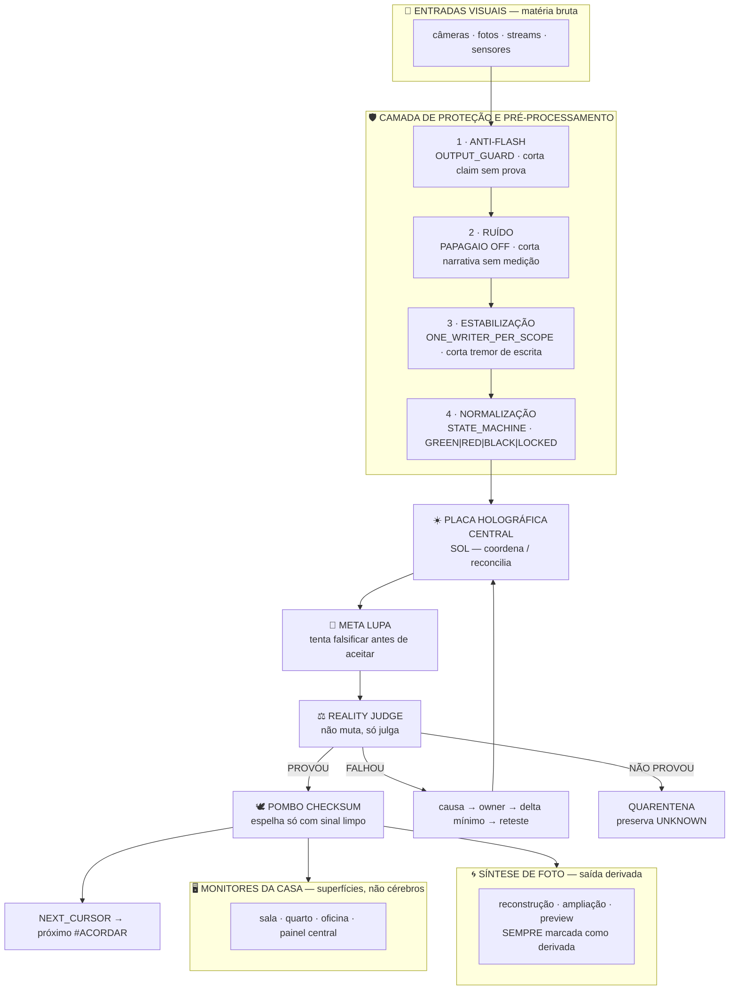

# 01 — ARQUITETURA ANTI-FLASH

> **Tese:** o infográfico da casa não descreve um sistema novo.
> Ele é a **vista óptica** do mesmo `PROOF_CARRYING_CLOSED_LOOP_CONTROL` que já está na `main`.
> "Flash" na imagem = **falso-verde** na engenharia. É a mesma doença, com outro nome.

---

## 1. A tradução — cada caixa cai num owner existente

`REUSE_BEFORE_CREATE=true`. Nenhuma linha abaixo inventa motor.

| Caixa do infográfico | Owner canônico na `main` | Invariante que a sustenta |
|---|---|---|
| **1 · ANTI-FLASH** — corta picos de luz | `OUTPUT_GUARD` (claim ↔ proof) | `ACTION_IS_NOT_PROOF` |
| **2 · REDUÇÃO DE RUÍDO** — filtra distorção | `PAPAGAIO_MODE=OFF` | narrativa sem medição = ruído |
| **3 · ESTABILIZAÇÃO** — reduz tremor | `SERIALIZED_SINGLE_WRITER` | `ONE_WRITER_PER_SCOPE` |
| **4 · NORMALIZAÇÃO** — equaliza brilho/contraste | `EPISTEMIC_STATE_MACHINE` | `UNKNOWN_IS_NOT_PASS` |
| **PLACA HOLOGRÁFICA CENTRAL** | ☀️ `SOL` — coordena / reconcilia | não é dono, é reconciliador |
| **MONITORES DA CASA** (sala/quarto/oficina/painel) | superfícies de leitura | `MULTIPLE_SURFACES_ARE_NOT_MULTIPLE_BRAINS` |
| **ESPELHAMENTO INTELIGENTE** | 🕊️ `POMBO CHECKSUM` | `PROOF_MUST_REACH_DESTINATION` |
| **CONTROLE DE FRONTEIRA** | `contracts/INVARIANTS.md` | ver [03](03-CONTROLE-DE-FRONTEIRA.md) |
| **SÍNTESE DE FOTO** (reconstrução/ampliação/preview) | `GRAFO DERIVADO` | `GRAPH_IS_DERIVED_NOT_AUTHORITY` |
| **ENTRADAS VISUAIS** (câmeras/fotos/streams/sensores) | `MATERIAL_INGEST / MOINHO` | `RAW_MATERIAL_IS_NOT_GOLD` |

---

## 2. O flash — o que a camada 1 realmente corta

Um "pico de luz" numa câmera estoura o sensor: a imagem fica **branca e parece limpa**,
mas perdeu toda a informação. É indistinguível de uma cena perfeita.

Na casa, o pico de luz tem nome:

```text
FLASH = claim que chega ao destino sem prova anexada
      = tela verde sem medição por trás
      = screenshot apresentado como live state
      = histórico apresentado como estado atual
      = UNKNOWN removido pra parecer verde
```

Todos esses estouram o mesmo sensor: **o CHEFE olha e acha que está tudo certo.**

A camada ANTI-FLASH não embeleza a saída. Ela **recusa** a saída quando o claim
não vem com prova. É por isso que ela é a primeira e não a última.

```text
claim + proof   → passa
claim sem proof → BLOQUEADO na fronteira, não sanitizado depois
```

---

## 3. A pilha completa



---

## 4. Por que a ordem das 4 camadas é essa e não outra

Não é estética. É dependência:

1. **ANTI-FLASH primeiro** — se você deixa o claim sem prova entrar, ele contamina tudo
   depois. Filtrar ruído de um sinal já estourado não recupera nada.
2. **RUÍDO segundo** — só depois de garantir que existe prova, dá pra separar
   prova real de repetição decorativa em cima dela.
3. **ESTABILIZAÇÃO terceiro** — com o sinal íntegro, serializa a escrita.
   Tremor aqui = dois writers no mesmo escopo = corrupção silenciosa.
4. **NORMALIZAÇÃO por último** — só um sinal íntegro, limpo e estável pode ser
   pintado de verde/vermelho/preto sem mentir.

Inverter a ordem produz exatamente o falso-verde que a casa combate:
um sinal estourado, normalizado bonito, com ruído estabilizado por cima.

---

## 5. O amarelo é proibido

```text
YELLOW = FORBIDDEN AS PASS SEMANTICS
```

Não existe "quase verde", "verde com ressalva", "provavelmente ok".
A normalização tem quatro saídas e só quatro:

| Cor | Significado | Pode passar? |
|---|---|---|
| 🟢 `GREEN` | `PROVEN` — medido, contraprovado | sim |
| 🔴 `RED` | `FAILED / BLOCKED` | não — vai pra remediação |
| ⚫ `BLACK` | `UNKNOWN / NOT_PROVEN` | **não** — vai pra quarentena, preservado |
| 🔒 `LOCKED` | `QUARANTINE / HUMAN_LOCK` | não — exige CHEFE |
| 🛠️ `WORKING` | forja em curso | ainda não é saída |

O ⚫ é o mais importante. É ele que a casa **não deixa apagar** pra fingir verde.

---

## 6. Espelhamento — a regra dos monitores

O infográfico mostra quatro monitores recebendo a mesma placa central. Regra:

```text
MULTIPLE_SURFACES_ARE_NOT_MULTIPLE_BRAINS = true
ESPELHAMENTO_ACONTECE_SOMENTE_COM_SINAL_LIMPO = true
```

Sala, quarto, oficina e painel são **vidros**, não cérebros.
Nenhum deles decide. Nenhum deles escreve. Todos recebem a mesma verdade
já julgada pelo `REALITY_JUDGE` e carimbada pelo `POMBO`.

Um monitor que mostra algo que os outros não mostram não é "visão local":
é **drift**, e é falha de espelhamento.

---

## 7. Síntese de foto — a saída que sempre confessa

Reconstrução, ampliação e preview derivado são úteis e permitidos.
Com uma condição inegociável:

```text
SAÍDA_SINTÉTICA → MARCADA_COMO_DERIVADA
```

Uma foto reconstruída é uma **hipótese com aparência de evidência**.
Ela pode circular, mas nunca sem o carimbo. É o mesmo motivo pelo qual
o grafo é derivado e não autoridade: quem sintetiza não pode virar juiz do que sintetizou.

```text
EXECUTOR_CANNOT_SELF_APPROVE = true
JUDGE_DOES_NOT_MUTATE = true
```

---

## 8. Evolução segura

```text
STATE_CHANGED → REMEASURE → RECALIBRATE
FAIL   → ROOT_CAUSE → EXISTING_OWNER → MINIMAL_DELTA → RETEST → COUNTERPROOF
PROVEN → RECEIPT → SHA/CHECKSUM → LEARNING → NEXT_CURSOR
NOT_PROVEN → permanece NOT_PROVEN
```

A última linha é a que sustenta as outras três.

→ Continua em [02 — OS DOIS OLHOS](02-OS-DOIS-OLHOS.md)
