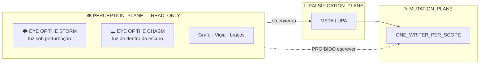

# 02 — OS DOIS OLHOS

> Cristalização de `Eye of the Storm` e `Eye of the Chasm` na arquitetura.
> Regra que governa este documento: `NO_NEW_ENGINE_FROM_METAPHOR = true`.

---

## 1. O que os itens são de fato (medido, não imaginado)

Fui buscar os atributos reais antes de cristalizar qualquer coisa.
`tibiawiki.com.br` devolveu **HTTP 403** e `tibia.fandom.com` devolveu **HTTP 402** — sem acesso direto.
O que segue veio de busca indireta e está marcado com o nível de confiança.

| Atributo | Eye of the Storm | Eye of the Chasm |
|---|---|---|
| Tipo | gema / fonte de luz | gema / fonte de luz |
| Peso | `1.50 oz` | `2.50 oz` |
| Slot | belt (cinto) | ⚫ `UNKNOWN` |
| Descrição | gema que emite luz | *"gema que irradia luz branca de dentro"* |
| Origem | ⚫ `UNKNOWN` | Feaster of Souls Quest · drop de **Thaian** |
| Forma bruta | ⚫ `UNKNOWN` | ✅ existe: **Raw Eye of the Chasm** |
| Armadura / resistência elemental | ❌ **nenhuma encontrada** | ❌ **nenhuma encontrada** |

### O achado que muda tudo

**Os dois Olhos não são armadura. São fonte de luz.**

Isso é o oposto do que o pedido sugeria ("pra poder proteger meu sistema").
E é exatamente por isso que precisa ser dito antes de qualquer cristalização:

```text
OLHO != ESCUDO
OLHO  = PERCEPÇÃO
```

Cristalizar um Olho como camada de proteção teria criado um motor a partir de
uma metáfora — violando `NO_NEW_ENGINE_FROM_METAPHOR`. A casa proíbe.
Quem protege é a camada **ANTI-FLASH**, e ela já existe ([01](01-ARQUITETURA-ANTI-FLASH.md)).

---

## 2. Onde os Olhos entram então

No `PERCEPTION_PLANE` — `READ_ONLY`. Ao lado de Grafo, Vigia, J.R.V.S. e os outros braços.



Um Olho **ilumina**. Nunca muta. Nunca aprova. Nunca decide.
Se um Olho começa a escrever, deixou de ser Olho e virou writer clandestino.

---

## 3. Eye of the Storm — luz que não apaga na perturbação

O olho do furacão é o ponto **calmo no centro da tempestade**.
Não é ausência de tempestade — é um ponto de leitura estável **enquanto** ela acontece.

**Papel canônico:** ver o estado real durante a turbulência, sem esperar ela passar.

```text
STORM_EYE = LIVE_STATE lido no meio da mudança
          ≠ esperar estabilizar pra medir
          ≠ medir antes e chamar de agora
```

Aterrissagem em owner existente:

| Função do Olho | Owner que já faz isso |
|---|---|
| ler estado sob perturbação | `LIVE_STATE` / `REMEASURE` |
| não confundir calmaria com ausência de risco | `HISTORY_IS_NOT_CURRENT_STATE` |
| recusar screenshot como prova | `SCREENSHOT_IS_NOT_RUNTIME_PROOF` |

Vínculo direto com o que acabou de entrar na `main`:
o commit `01135a7` — **🛡️ CASCO VIVO — resiliência adaptativa contraprovada** —
e o `c00d5e84` — **🕊️ CRISTAL — estabilidade sob perturbação e liberdade com fronteira**.
"Estabilidade sob perturbação" **é** o Eye of the Storm, já implementado, com outro nome.

🟢 Este Olho não precisa ser construído. Ele já está na `main`. Isto aqui é o **nome** dele.

---

## 4. Eye of the Chasm — luz que vem de dentro do abismo

A descrição do item é literal e serve inteira: *gema que irradia luz branca **de dentro***.
Não reflete luz externa. Produz a própria.

**Papel canônico:** iluminar o `UNKNOWN` sem fingir que ele virou conhecido.

```text
CHASM_EYE = olhar pro ⚫ BLACK e conseguir descrevê-lo
          ≠ apagar o ⚫ pra tela ficar verde
```

Um abismo iluminado continua sendo um abismo. A luz não o preenche —
ela deixa você **medir a profundidade**. É a diferença entre:

| ❌ Papagaio | ✅ Chasm Eye |
|---|---|
| remove o `UNKNOWN` da tela | mantém o `UNKNOWN` e o descreve |
| "está tudo verde" | "estes 5 pontos são `NOT_PROVEN`, e é por isto" |

O owner que já faz isso é [`evidence/CURRENT_UNKNOWN.md`](../../_RECONCILIATION/ARQUITETURA-ANTI-FLASH-2026-08-25/04-RASTRO-MEDIDO.md) —
a "Fronteira Honesta" do pacote canônico. Ela lista o que **não** foi provado, nominalmente.

---

## 5. Raw Eye of the Chasm — a peça que fecha o círculo

O achado mais forte da pesquisa: o Eye of the Chasm tem uma **forma bruta** no jogo,
o `Raw Eye of the Chasm`, que precisa ser trabalhada até virar a gema acabada.

Isso não é analogia frouxa. É o pipeline da casa, exato:

```text
Raw Eye of the Chasm   →   Eye of the Chasm
        ▼                          ▼
   RAW_MATERIAL   →  ASSAY  →  CANDIDATE  →  COUNTERPROOF
                  →  GOLD    →  OWNER_BINDING
                  →  TEST + GATE  →  CRYSTAL  →  FLASH
```

E a invariante que o jogo já respeita sem saber:

```text
RAW_MATERIAL_IS_NOT_GOLD = true
GOLD_IS_NOT_CRYSTAL      = true
CRYSTAL_REQUIRES_OWNER_CONSUMER_TEST_GATE = true
```

Uma gema bruta **não é** a gema. Um material coletado **não é** capacidade.
Um doc na `main` **não é** runtime rodando.

🟡 **Confiança:** a existência do `Raw Eye of the Chasm` veio de busca indireta
(resultado de índice do TibiaWiki/Fandom), não de leitura direta da página — as duas
wikis bloquearam o acesso. Trata-se como `CANDIDATE`, não como `GOLD`.

---

## 6. Status honesto da cristalização

```text
CRYSTAL_REQUIRES = GOLD + OWNER + SKILL + CONSUMER + TEST + GATE + PROVENANCE + ROUTE
```

Contra esse padrão:

| Requisito | Storm | Chasm |
|---|---|---|
| `GOLD` (sobreviveu à contraprova) | 🟢 sim — `c00d5e84` na main | 🟢 sim — `CURRENT_UNKNOWN.md` |
| `OWNER` existente | 🟢 `LIVE_STATE`/`REMEASURE` | 🟢 Fronteira Honesta |
| `PROVENANCE` | 🟡 wiki bloqueada, fonte indireta | 🟡 wiki bloqueada, fonte indireta |
| `TEST` + `GATE` | ⚫ `NOT_PROVEN` — nenhum gate cita os Olhos | ⚫ `NOT_PROVEN` |
| `CONSUMER` | ⚫ `NOT_PROVEN` | ⚫ `NOT_PROVEN` |

### Veredito

```text
OS_DOIS_OLHOS = NOMES_CANÔNICOS_PARA_CAPACIDADES_QUE_JÁ_EXISTEM
              = CULTURAL_ALIAS  (mesma classe de Alchemistic Cabinet)
              ≠ CRYSTAL         (falta TEST + GATE + CONSUMER)
              ≠ ENGINE
              ≠ OWNER
              ≠ AUTORIDADE
```

🟢 **O que ganhamos:** dois nomes precisos para duas capacidades reais já na `main`,
que antes não tinham nome curto — "ver sob perturbação" e "iluminar o desconhecido sem apagá-lo".

⚫ **O que NÃO ganhamos:** proteção nova. Os Olhos não protegem nada.
Quem protege é o [Controle de Fronteira](03-CONTROLE-DE-FRONTEIRA.md).

Promover de `CULTURAL_ALIAS` para `CRYSTAL` exige: um gate que os cite,
um consumidor real, e um teste discriminante. Enquanto não houver, permanece alias.

→ Continua em [03 — CONTROLE DE FRONTEIRA](03-CONTROLE-DE-FRONTEIRA.md)

---

## Fontes

- [Eye Of The Storm — Tibia Wiki BR](https://www.tibiawiki.com.br/wiki/Eye_Of_The_Storm) (403 no acesso direto)
- [Eye of the Storm — TibiaWiki Fandom](https://tibia.fandom.com/wiki/Eye_of_the_Storm) (402 no acesso direto)
- [Eye of the Chasm — TibiaWiki Fandom](https://tibia.fandom.com/wiki/Eye_of_the_Chasm)
- [Raw Eye of the Chasm — TibiaWiki Fandom](https://tibia.fandom.com/wiki/Raw_Eye_of_the_Chasm)
- [Eye of the Chasm — TibiaBuddy](https://www.tibiabuddy.com/database/items/Eye%20of%20the%20Chasm)
- [Przedmioty: Eye Of The Storm — Tibiopedia](https://tibiopedia.pl/items/Eye_Of_The_Storm)
