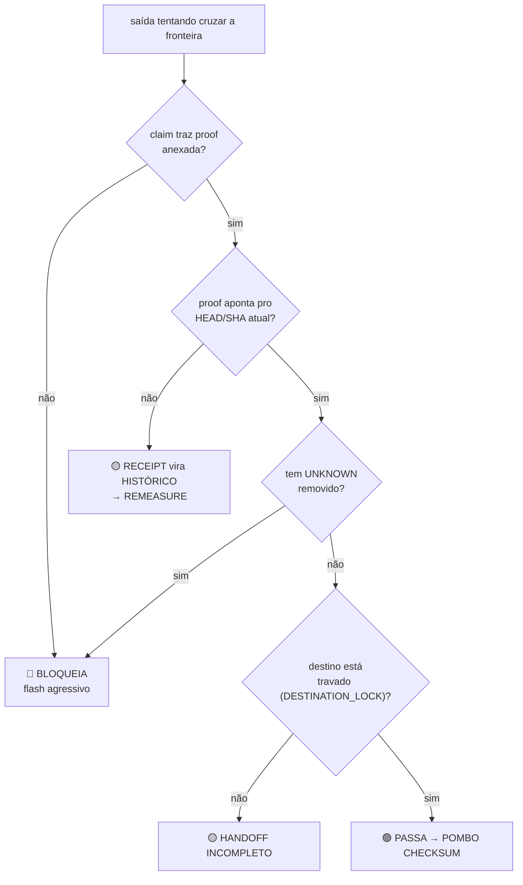

# 03 — CONTROLE DE FRONTEIRA

> A camada que efetivamente **protege o sistema**.
> Quatro regras no infográfico, cada uma amarrada num invariante que já está na `main`.

---

## 1. As quatro regras da fronteira

| Regra visual | Ação | Invariante canônico |
|---|---|---|
| ⚡ Flash agressivo | 🔴 **bloqueia** | `ACTION_IS_NOT_PROOF` · `OUTPUT_GUARD` |
| 〰️ Ruído forte | 🟡 **quarentena** | `PAPAGAIO_MODE=OFF` |
| 🖼️ Saída sintética | ⚪ **marcada como derivada** | `GRAPH_IS_DERIVED_NOT_AUTHORITY` |
| 🔄 Espelhamento | 🟢 **só com sinal limpo** | `PROOF_MUST_REACH_DESTINATION` |

Repare no desenho: **três das quatro não destroem nada.**
Bloqueia, quarentena, marca. Só a primeira barra — e mesmo ela barra a *passagem*, não o dado.

```text
QUARANTINE_PRESERVE_UNKNOWN = true
```

A fronteira da casa é **conservadora**: ela prefere reter a apagar.
Um dado retido pode ser reprocessado. Um dado apagado pra "limpar o painel" é perda permanente —
e é exatamente o comportamento do Papagaio.

---

## 2. Flash agressivo — o que dispara o bloqueio



As seis assinaturas de flash, nomeadas no `POMBO_HANDOFF.md`:

```text
1. narrativa sem medição
2. repetição sem estado
3. trabalho mecânico devolvido ao CHEFE
4. screenshot apresentado como live state
5. histórico apresentado como current state
6. UNKNOWN removido pra parecer verde
   (+ prova deixada fora do destino)
```

---

## 3. A lei temporal — por que prova envelhece

Esta é a regra mais afiada da casa, e a que **este pacote acabou de sofrer na pele**:

```text
RECEIPT_HEAD_SHA != CURRENT_HEAD_SHA
→ RECEIPT_BECOMES_HISTORY
→ REMEASURE
→ NEW_RECEIPT
```

Um recibo não é falso quando o HEAD muda. Ele vira **histórico**.
Continua verdadeiro sobre o passado, e para de ser verdadeiro sobre o agora.

O ZIP `CENTRALDARK_ARQUITETURA_CANONICA_2026-08-24` foi selado em `main@53ba5d5`.
A `main` andou 2 commits. O recibo dele é história — não é erro, é a lei funcionando.
Rastro completo em [04](04-RASTRO-MEDIDO.md).

---

## 4. A lei de destino

```text
PROOF_WITHOUT_DESTINATION_BINDING = INCOMPLETE_HANDOFF
```

Provar e não entregar no destino travado é o mesmo que não provar.
Não existe "eu testei aqui do meu lado". Existe prova **amarrada ao destino**:

```text
DESTINATION_LOCK + OBSERVED_AT + HEAD_SHA/CONTENT_SHA256
+ PROVENANCE + EVIDENCE + UNKNOWN + RESIDUAL + RECEIPT + NEXT_CURSOR
```

Faltando qualquer campo, o handoff é incompleto — mesmo com o trabalho feito.

---

## 5. O que o Pombo NÃO é

```text
POMBO != BRAIN
POMBO != OWNER
POMBO != WRITER
POMBO != JUDGE
POMBO != AUTHORITY
```

O Pombo carrega. Não decide, não escreve, não julga, não manda.
Um mensageiro que começa a decidir vira um segundo cérebro — e
`ONE_SYSTEM_ONLY=true` mata isso na fronteira.

---

## 6. Separação de poderes

Talvez a proteção mais forte da arquitetura inteira, e ela é estrutural, não procedural:

```text
EXECUTOR_CANNOT_SELF_APPROVE = true
JUDGE_DOES_NOT_MUTATE        = true
GRAPH_IS_DERIVED_NOT_AUTHORITY = true
```

| Plano | Pode escrever? | Pode aprovar? |
|---|---|---|
| `AUTHORITY` (CHEFE) | — | 🟢 sim, final |
| `PERCEPTION` (Olhos, Grafo, Vigia) | ❌ nunca | ❌ nunca |
| `FALSIFICATION` (META LUPA) | ❌ nunca | ❌ só tenta derrubar |
| `MUTATION` (writer único) | 🟢 sim, serializado | ❌ nunca |
| `EXECUTION` (Hermes/Pivete) | 🟢 via writer | ❌ **nunca a si mesmo** |
| `JUDGMENT` (Reality Judge) | ❌ nunca | 🟢 sim |

Quem faz não carimba. Quem carimba não faz.
É por isso que o PR **#1150 — SOL: contraprova independente do CASCO VIVO** existe
separado do #1149: a contraprova não pode vir de quem construiu.

---

## 7. Checklist operacional da fronteira

Antes de qualquer coisa cruzar pra `main`, pra VPS ou pro CHEFE:

- [ ] O claim vem com prova anexada?
- [ ] A prova aponta pro `HEAD_SHA` **atual**, medido agora?
- [ ] Os `UNKNOWN` continuam listados, nominalmente, sem maquiagem?
- [ ] A saída derivada está marcada como derivada?
- [ ] O destino está travado (`DESTINATION_LOCK`)?
- [ ] Existe writer único no escopo, sem concorrência?
- [ ] Quem aprovou é diferente de quem executou?
- [ ] O `NEXT_CURSOR` está preenchido?

Qualquer `não` → não cruza. Sem exceção por pressa.

→ Continua em [04 — RASTRO MEDIDO](04-RASTRO-MEDIDO.md)
