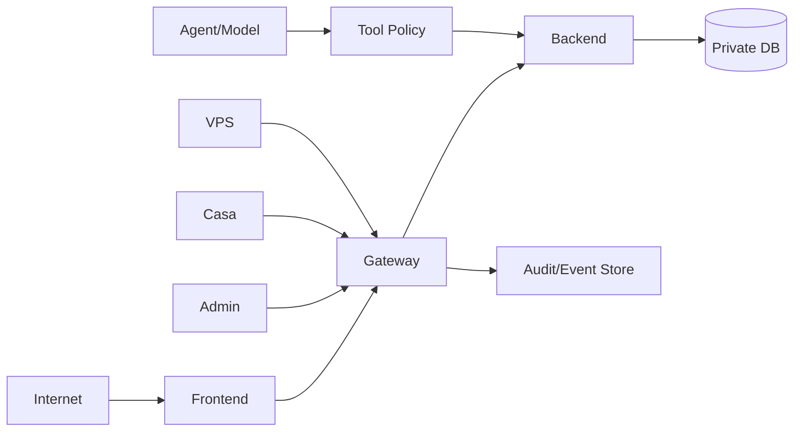

# Arquitetura de segurança privada

Nenhuma seta concede confiança implícita.

## Invariantes
- `AUTHENTICATED != AUTHORIZED`
- `LOCAL != TRUSTED`
- `MODEL_OUTPUT != AUTHORITY`
- `HISTORY != AUTHORITY`
- `FRONTEND != SECRET_STORE`
- `LOG != SECRET_STORE`
- `REVOKED_SESSION -> FAIL`
- `UNKNOWN != PASS`
- `DEFAULT -> DENY`
- `DECOY -> ISOLATED + NO_ATTACK_BACK`

## Fluxo de defesa
`DETECT -> VALIDATE -> DENY/THROTTLE/REVOKE/DROP/QUARANTINE -> AUDIT -> RECOVER -> LEARN -> HARDEN`.
