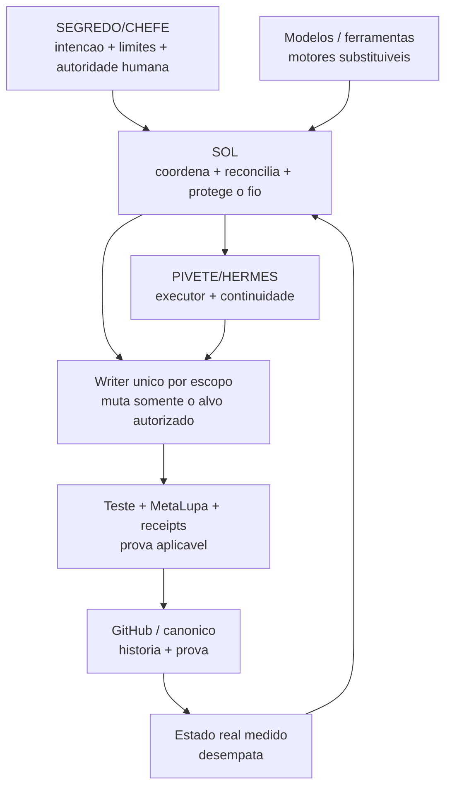
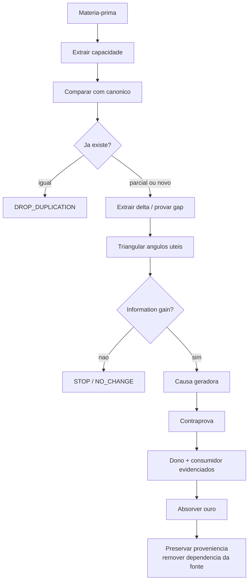
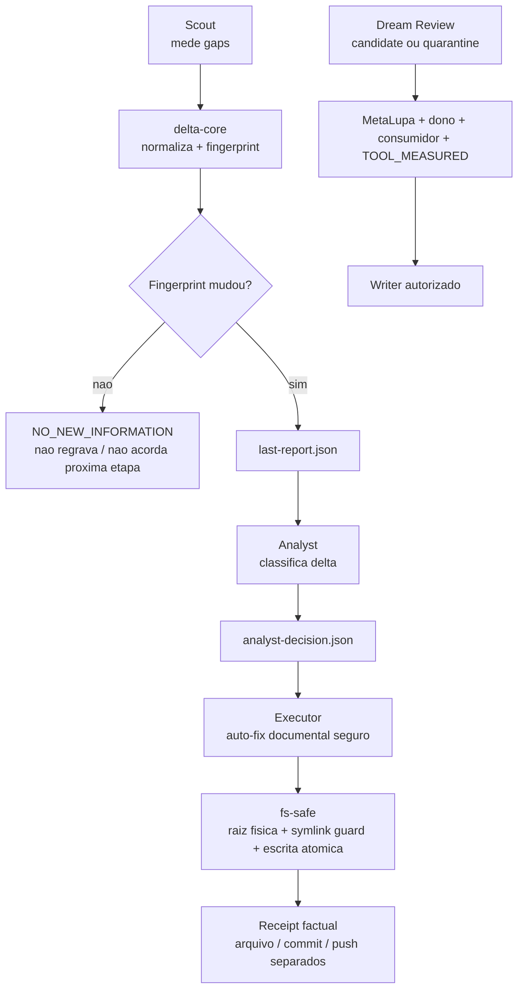
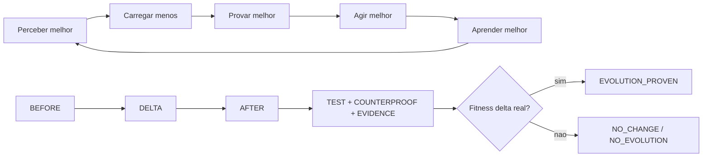
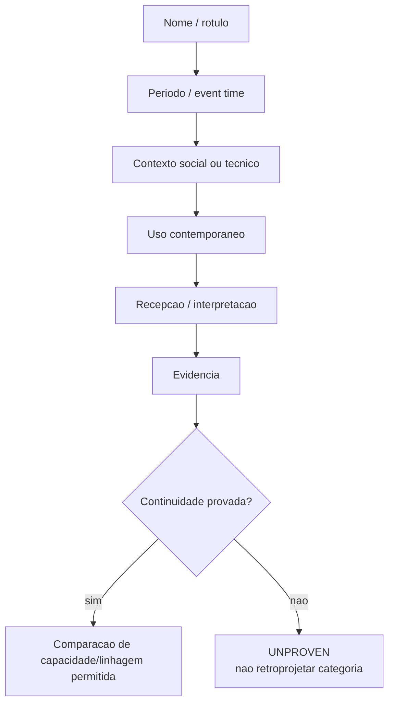

# Diagramas CentralDark — visão derivada do canônico

> Estes diagramas são uma **visualização derivada**, não fonte da verdade.
> Estado físico/runtime que não foi medido nesta rodada permanece `UNKNOWN|UNPROVEN`.
> Histórico anterior continua preservado no Git.

```text
MERMAID != VERDADE
CANONICO -> MERMAID
MERMAID -> INVENTAR_CANONICO = FORBIDDEN
```

Fontes canônicas desta visão:

- `LEIA-ME-IA.md` — boot, autoridade e precedência;
- `docs/ARQUITETURA/JARVIS-ORQUESTRACAO-DELTA-E-ESCRITOR-UNICO.md` — coordenação e Writer único;
- `docs/CONSCIENCIA/01-IDENTIDADE-E-REGRAS/CAPACIDADES-COGNITIVAS.md` — método cognitivo/mineração;
- `scripts/memory-linker/README.md` — pipeline de memória;
- `apps/modulos/artifacts-builder/CONTRATO-ARTEFATO-UNIVERSAL.md` — artefato derivado.

## 1. Autoridade, identidade e execução



Regras representadas:

```text
MODELO != PAPEL
PAPEL != AUTORIDADE
PARALELIZE_PERCEPCAO
SERIALIZE_MUTACAO
ONE_WRITER_PER_SCOPE=true
```

## 2. Refinaria cognitiva causal



```text
FONTE = PROVENIENCIA
CAPACIDADE = VALOR
PROVA = FILTRO
OURO = ABSORCAO
```

## 3. Memory Linker — pipeline canônico atual



Não há claim aqui sobre scheduler, PM2, Telegram ou VPS corrente. Sem medição física recente:

```text
SCHEDULE=UNPROVEN
RUNTIME_TOPOLOGY=UNPROVEN
```

## 4. Evolução verificável e autoaplicação



```text
META(X) = X APLICA A PROPRIA LEI SOBRE X
EVOLUTION = MEASURABLE_FITNESS_DELTA
EVOLUTION_REQUIRED != CHANGE_REQUIRED
```

## 5. Proveniência temporal — nome não atravessa o tempo sozinho



```text
SAME_NAME_ACROSS_TIME != SAME_MEANING
SAME_LABEL != SAME_LINEAGE
```

## Regra de manutenção deste artefato

```text
CANONICO_MUDOU_ESTRUTURALMENTE
→ atualizar este arquivo existente
→ conferir contra os donos canônicos
→ validar Mermaid quando houver parser/renderer aplicável
→ discrepância vira matéria-prima

SEM_DELTA_ESTRUTURAL
→ NO_ARTIFACT_CHANGE
```
