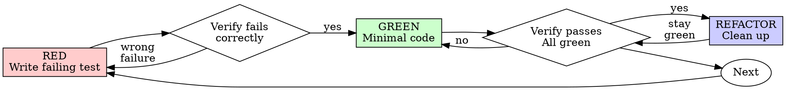

# MISSAO - SKILL.md
**Origem:** E:\CentralDark\_MAPA_CASA\PASTA DO CHEFE JOGA ARQUIOVOS QUAIS QUUER SER GARIMPO DO CHEFE\.codex\.tmp\plugins\plugins\expo\skills\building-native-ui\SKILL.md
**SHA:** 6c0ae7dbd727a0d8
**Timestamp:** 2026-08-26T18:31:13.390638
**Portoes:** {"ocorrencias": true, "ganho": true, "contraprova": true, "sha": true}

## Ouro Extraido

### Comandos
- Most Expo apps work in Expo Go without any custom native code. Before running `npx expo run:ios` or `npx expo run:android`:
- You need `npx expo run:ios/android` or `eas build` ONLY when using:

### Ouro Bruto (primeiros 5000 chars)
```
---
name: building-native-ui
description: Complete guide for building beautiful apps with Expo Router. Covers fundamentals, styling, components, navigation, animations, patterns, and native tabs.
version: 1.0.1
license: MIT
---

# Expo UI Guidelines

## References

Consult these resources as needed:

```
references/
  animations.md          Reanimated: entering, exiting, layout, scroll-driven, gestures
  controls.md            Native iOS: Switch, Slider, SegmentedControl, DateTimePicker, Picker
  form-sheet.md          Form sheets in expo-router: configuration, footers and background interaction.
  gradients.md           CSS gradients via experimental_backgroundImage (New Arch only)
  icons.md               SF Symbols via expo-image (sf: source), names, animations, weights
  media.md               Camera, audio, video, and file saving
  route-structure.md     Route conventions, dynamic routes, groups, folder organization
  search.md              Search bar with headers, useSearch hook, filtering patterns
  storage.md             SQLite, AsyncStorage, SecureStore
  tabs.md                NativeTabs, migration from JS tabs, iOS 26 features
  toolbar-and-headers.md Stack headers and toolbar buttons, menus, search (iOS only)
  visual-effects.md      Blur (expo-blur) and liquid glass (expo-glass-effect)
  webgpu-three.md        3D graphics, games, GPU visualizations with WebGPU and Three.js
  zoom-transitions.md    Apple Zoom: fluid zoom transitions with Link.AppleZoom (iOS 18+)
```

## Running the App

**CRITICAL: Always try Expo Go first before creating custom builds.**

Most Expo apps work in Expo Go without any custom native code. Before running `npx expo run:ios` or `npx expo run:android`:

1. **Start with Expo Go**: Run `npx expo start` and scan the QR code with Expo Go
2. **Check if features work**: Test your app thoroughly in Expo Go
3. **Only create custom builds when required** - see below

### When Custom Builds Are Required

You need `npx expo run:ios/android` or `eas build` ONLY when using:

- **Local Expo modules** (custom native code in `modules/`)
- **Apple targets** (widgets, app clips, extensions via `@bacons/apple-targets`)
- **Third-party native modules** not included in Expo Go
- **Custom native configuration** that can't be expressed in `app.json`

### When Expo Go Works

Expo Go supports a huge range of features out of the box:

- All `expo-*` packages (camera, location, notifications, etc.)
- Expo Router navigation
- Most UI libraries (reanimated, gesture handler, etc.)
- Push notifications, deep links, and more

**If you're unsure, try Expo Go first.** Creating custom builds adds complexity, slower iteration, and requires Xcode/Android Studio setup.

## Code Style

- Be cautious of unterminated strings. Ensure nested backticks are escaped; never forget to escape quotes correctly.
- Always use import statements at the top of the file.
- Always use kebab-case for file names, e.g. `comment-card.tsx`
- Always remove old route files when moving or restructuring navigation
- Never use special characters in file names
- Configure tsconfig.json with path aliases, and prefer aliases over relative imports for refactors.

## Routes

See `./references/route-structure.md` for detailed route conventions.

- Routes belong in the `app` directory.
- Never co-locate components, types, or utilities in the app directory. This is an anti-pattern.
- Ensure the app always has a route that matches "/", it may be inside a group route.

## Library Preferences

- Never use modules removed from React Native such as Picker, WebView, SafeAreaView, or AsyncStorage
- Never use legacy expo-permissions
- `expo-audio` not `expo-av`
- `expo-video` not `expo-av`
- `expo-image` with `source="sf:name"` for SF Symbols, not `expo-symbols` or `@expo/vector-icons`
- `react-native-safe-area-context` not react-native SafeAreaView
- `process.env.EXPO_OS` not `Platform.OS`
- `React.use` not `React.useContext`
- `expo-image` Image component instead of intrinsic element `img`
- `expo-glass-effect` for liquid glass backdrops

## Responsiveness

- Always wrap root component in a scroll view for responsiveness
- Use `<ScrollView contentInsetAdjustmentBehavior="automatic" />` instead of `<SafeAreaView>` for smarter safe area insets
- `contentInsetAdjustmentBehavior="automatic"` should be applied to FlatList and SectionList as well
- Use flexbox instead of Dimensions API
- ALWAYS prefer `useWindowDimensions` over `Dimensions.get()` to measure screen size

## Behavior

- Use expo-haptics conditionally on iOS to make more delightful experiences
- Use views with built-in haptics like `<Switch />` from React Native and `@react-native-community/datetimepicker`
- When a route belongs to a Stack, its first child should almost always be a ScrollView with `contentInsetAdjustmentBehavior="automatic"` set
- When adding a `ScrollView` to the page it should almost always be the first component inside the route component
- Prefer `headerSearchBarOptions`
```

---

# MISSAO - SKILL.md
**Origem:** E:\CentralDark\_MAPA_CASA\PASTA DO CHEFE JOGA ARQUIOVOS QUAIS QUUER SER GARIMPO DO CHEFE\.codex\.tmp\plugins\plugins\superpowers\skills\test-driven-development\SKILL.md
**SHA:** 7dee67b4af6bdccc
**Timestamp:** 2026-08-26T18:42:06.166582
**Portoes:** {"ocorrencias": true, "ganho": true, "contraprova": true, "sha": true}

## Ouro Extraido

### Principios
- **Core principle:** If you didn't watch the test fail, you don't know if it tests the right thing.

### Ouro Bruto (primeiros 5000 chars)
```
---
name: test-driven-development
description: Use when implementing any feature or bugfix, before writing implementation code
---

# Test-Driven Development (TDD)

## Overview

Write the test first. Watch it fail. Write minimal code to pass.

**Core principle:** If you didn't watch the test fail, you don't know if it tests the right thing.

**Violating the letter of the rules is violating the spirit of the rules.**

## When to Use

**Always:**
- New features
- Bug fixes
- Refactoring
- Behavior changes

**Exceptions (ask your human partner):**
- Throwaway prototypes
- Generated code
- Configuration files

Thinking "skip TDD just this once"? Stop. That's rationalization.

## The Iron Law

```
NO PRODUCTION CODE WITHOUT A FAILING TEST FIRST
```

Write code before the test? Delete it. Start over.

**No exceptions:**
- Don't keep it as "reference"
- Don't "adapt" it while writing tests
- Don't look at it
- Delete means delete

Implement fresh from tests. Period.

## Red-Green-Refactor



### RED - Write Failing Test

Write one minimal test showing what should happen.

<Good>
```typescript
test('retries failed operations 3 times', async () => {
  let attempts = 0;
  const operation = () => {
    attempts++;
    if (attempts < 3) throw new Error('fail');
    return 'success';
  };

  const result = await retryOperation(operation);

  expect(result).toBe('success');
  expect(attempts).toBe(3);
});
```
Clear name, tests real behavior, one thing
</Good>

<Bad>
```typescript
test('retry works', async () => {
  const mock = jest.fn()
    .mockRejectedValueOnce(new Error())
    .mockRejectedValueOnce(new Error())
    .mockResolvedValueOnce('success');
  await retryOperation(mock);
  expect(mock).toHaveBeenCalledTimes(3);
});
```
Vague name, tests mock not code
</Bad>

**Requirements:**
- One behavior
- Clear name
- Real code (no mocks unless unavoidable)

### Verify RED - Watch It Fail

**MANDATORY. Never skip.**

```bash
npm test path/to/test.test.ts
```

Confirm:
- Test fails (not errors)
- Failure message is expected
- Fails because feature missing (not typos)

**Test passes?** You're testing existing behavior. Fix test.

**Test errors?** Fix error, re-run until it fails correctly.

### GREEN - Minimal Code

Write simplest code to pass the test.

<Good>
```typescript
async function retryOperation<T>(fn: () => Promise<T>): Promise<T> {
  for (let i = 0; i < 3; i++) {
    try {
      return await fn();
    } catch (e) {
      if (i === 2) throw e;
    }
  }
  throw new Error('unreachable');
}
```
Just enough to pass
</Good>

<Bad>
```typescript
async function retryOperation<T>(
  fn: () => Promise<T>,
  options?: {
    maxRetries?: number;
    backoff?: 'linear' | 'exponential';
    onRetry?: (attempt: number) => void;
  }
): Promise<T> {
  // YAGNI
}
```
Over-engineered
</Bad>

Don't add features, refactor other code, or "improve" beyond the test.

### Verify GREEN - Watch It Pass

**MANDATORY.**

```bash
npm test path/to/test.test.ts
```

Confirm:
- Test passes
- Other tests still pass
- Output pristine (no errors, warnings)

**Test fails?** Fix code, not test.

**Other tests fail?** Fix now.

### REFACTOR - Clean Up

After green only:
- Remove duplication
- Improve names
- Extract helpers

Keep tests green. Don't add behavior.

### Repeat

Next failing test for next feature.

## Good Tests

| Quality | Good | Bad |
|---------|------|-----|
| **Minimal** | One thing. "and" in name? Split it. | `test('validates email and domain and whitespace')` |
| **Clear** | Name describes behavior | `test('test1')` |
| **Shows intent** | Demonstrates desired API | Obscures what code should do |

## Why Order Matters

**"I'll write tests after to verify it works"**

Tests written after code pass immediately. Passing immediately proves nothing:
- Might test wrong thing
- Might test implementation, not behavior
- Might miss edge cases you forgot
- You never saw it catch the bug

Test-first forces you to see the test fail, proving it actually tests something.

**"I already manually tested all the edge cases"**

Manual testing is ad-hoc. You think you tested everything but:
- No record of what you tested
- Can't re-run when code changes
- Easy to
```

---

# MISSAO - SKILL.md
**Origem:** E:\CentralDark\_MAPA_CASA\PASTA DO CHEFE JOGA ARQUIOVOS QUAIS QUUER SER GARIMPO DO CHEFE\.codex\.tmp\plugins\plugins\twilio-developer-kit\skills\twilio-regulatory-compliance-bundles\SKILL.md
**SHA:** c5877b728fb73536
**Timestamp:** 2026-08-26T18:42:40.550202
**Portoes:** {"ocorrencias": true, "ganho": true, "contraprova": true, "sha": true}

## Ouro Extraido

### Comandos
- ## Quickstart: Provision a Number with a Bundle

### Ouro Bruto (primeiros 5000 chars)
```
---
name: twilio-regulatory-compliance-bundles
description: >
  Manage regulatory compliance for international phone numbers. Covers
  what bundles are, which countries require them, how to create End-Users
  and Supporting Documents, evaluate and submit bundles, fix evaluation
  failures, update bundles when regulations change, and ISV multi-account
  patterns. Use this skill when provisioning numbers outside the US.
---

## Overview

Phone numbers are national resources — many countries require **identity verification of the end-user** before provisioning. A Regulatory Bundle is a container holding an End-User record + Supporting Documents that proves your right to use numbers in a specific country.

**Not all countries require bundles** — check the [Regulatory Guidelines page](https://www.twilio.com/en-us/guidelines/regulatory) for country-specific requirements. If a country requires a bundle, provisioning fails without one.

---

## Key Concepts

| Resource | What it is |
|----------|-----------|
| **Regulation** | Country-specific requirement defining what End-User types and document types are needed |
| **Bundle** | Container that holds an End-User + Supporting Documents for a specific regulation |
| **End-User** | The entity answering calls or receiving messages (`individual` or `business` type) |
| **Supporting Document** | Identity/address verification documents (business registration, proof of address, etc.) |
| **Evaluation** | Synchronous check that validates a bundle against its regulation before submission |
| **Item Assignment** | Links an End-User or Supporting Document to a Bundle |

---

## Quickstart: Provision a Number with a Bundle

### Step 1 — Query the Regulation

Find out what's required for the country and number type:

**Python**
```python
import os, requests

account_sid = os.environ["TWILIO_ACCOUNT_SID"]
auth_token = os.environ["TWILIO_AUTH_TOKEN"]

# What does Germany require for local business numbers?
regulations = requests.get(
    "https://numbers.twilio.com/v2/RegulatoryCompliance/Regulations",
    params={"IsoCountry": "DE", "NumberType": "local", "EndUserType": "business"},
    auth=(account_sid, auth_token)
).json()

for reg in regulations["results"]:
    print(f"Regulation: {reg['sid']}")
    print(f"Requirements: {reg['requirements']}")
```

### Step 2 — Create an End-User

**Python**
```python
end_user = requests.post(
    "https://numbers.twilio.com/v2/RegulatoryCompliance/EndUsers",
    data={
        "FriendlyName": "Acme GmbH",
        "Type": "business",
        "Attributes": '{"business_name": "Acme GmbH", "business_registration_number": "HRB12345"}'
    },
    auth=(account_sid, auth_token)
).json()
```

### Step 3 — Upload Supporting Documents

**Python**
```python
document = requests.post(
    "https://numbers.twilio.com/v2/RegulatoryCompliance/SupportingDocuments",
    data={
        "FriendlyName": "Acme Business Registration",
        "Type": "business_registration",
        "Attributes": '{"business_name": "Acme GmbH"}'
    },
    auth=(account_sid, auth_token)
).json()
```

### Step 4 — Create a Bundle and Assign Items

**Python**
```python
# Create the bundle
bundle = requests.post(
    "https://numbers.twilio.com/v2/RegulatoryCompliance/Bundles",
    data={
        "FriendlyName": "Germany Local - Acme",
        "RegulationSid": regulations["results"][0]["sid"],
        "IsoCountry": "DE",
        "EndUserType": "business",
        "Email": "compliance@acme.com"
    },
    auth=(account_sid, auth_token)
).json()

bundle_sid = bundle["sid"]

# Assign End-User to bundle
requests.post(
    f"https://numbers.twilio.com/v2/RegulatoryCompliance/Bundles/{bundle_sid}/ItemAssignments",
    data={"ObjectSid": end_user["sid"]},
    auth=(account_sid, auth_token)
)

# Assign Supporting Document to bundle
requests.post(
    f"https://numbers.twilio.com/v2/RegulatoryCompliance/Bundles/{bundle_sid}/ItemAssignments",
    data={"ObjectSid": document["sid"]},
    auth=(account_sid, auth_token)
)
```

### Step 5 — Evaluate and Submit

**Python**
```python
# Run evaluation (synchronous — returns field-level failures)
evaluation = requests.post(
    f"https://numbers.twilio.com/v2/RegulatoryCompliance/Bundles/{bundle_sid}/Evaluations",
    auth=(account_sid, auth_token)
).json()

if evaluation["status"] == "noncompliant":
    for violation in evaluation["results"]:
        print(f"Field: {violation['friendly_name']} — {violation['description']}")
    # Fix the issues, then re-evaluate
else:
    # Submit for review
    requests.post(
        f"https://numbers.twilio.com/v2/RegulatoryCompliance/Bundles/{bundle_sid}",
        data={"Status": "pending-review"},
        auth=(account_sid, auth_token)
    )
```

### Step 6 — Provision Number with Bundle

Once the bundle is approved:

**Python**
```python
from twilio.rest import Client
client = Client(account_sid, auth_token)

number = client.incoming_phone_numbers.create(
    phone_number="+4930xxxxxxx",
    bundle_sid=bundle_s
```