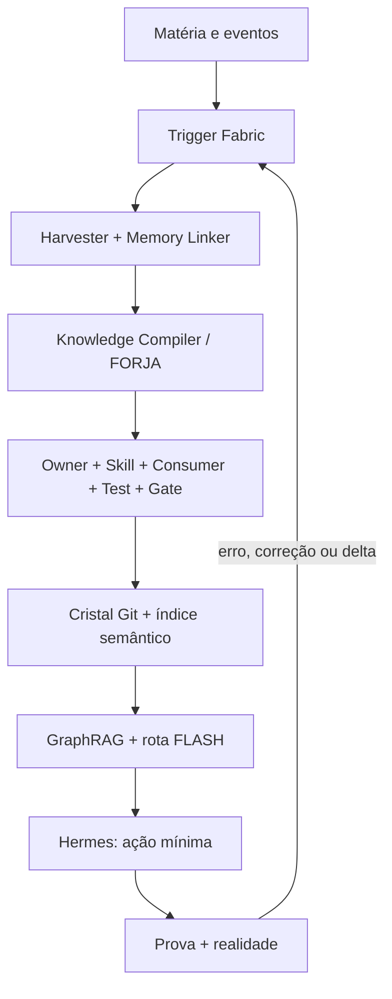

# CentralDark — FORJA → CRISTAL → FLASH

**Pacote de arquitetura + comando one-shot para Grok Build**  
**Data:** 2026-08-24  
**Missão:** absorver o ouro das fontes no Segundo Cérebro CentralDark já existente no GitHub e nas superfícies locais, com gatilhos automáticos, generalização por evidência e zero cérebro paralelo.

---

## 1. Veredito executivo

Não criar `AutoBot V2`, novo RAG, segundo cérebro **paralelo**, novo MCP, novo daemon nem novo workflow.

A CentralDark já possui os órgãos principais:

- `CENTRALDARK-TRIGGER-FABRIC`: entrada, retomada, pré-retorno, gates e continuidade;
- `session-intelligence-harvester`: colhe decisão, erro, padrão, contradição, evidência e delta temporal;
- `scripts/memory-linker`: normalização, fingerprint, dedupe, Dream Review, padrão determinístico e handoff ao Writer;
- `knowledge-compiler`: FORJA rigorosa, owner/skill/consumer/test/gate, cristal operacional e rota `FLASH_READY`;
- `vector-memory`: owner declarado da memória semântica, ainda sem runtime provado;
- `GraphRAG-Master`: consumidor real do Hermes, hoje com grafo + fallback textual local;
- Hermes/PIVETE: único executor e preservador da continuidade;
- GitHub: ledger **e camada canônica do Segundo Cérebro** (`docs/CONSCIENCIA`, owners, skills, memória/knowledge, contratos, histórico e provas);
- superfícies locais/Obsidian/arquivos: captura, trabalho e consulta do mesmo Segundo Cérebro lógico;
- grafo e índice vetorial: projeções derivadas desse mesmo cérebro, nunca autoridade paralela;
- realidade/runtime: Judge.

```text
SECOND_BRAIN_LOGICAL=ONE
SECOND_BRAIN_SURFACES=GITHUB_CANONICAL+LOCAL_OBSIDIAN_FILES+DERIVED_GRAPH_VECTOR
GITHUB_IS_NOT_JUST_OUTPUT=true
LOCAL_IS_NOT_PARALLEL_BRAIN=true
GRAPH_VECTOR_ARE_DERIVED_INDEXES=true
```

O delta útil é **interligar e endurecer**, não reconstruir:

```text
MATÉRIA NOVA | CORREÇÃO | ERRO | FALHA | CONTRADIÇÃO | DELTA DE ESTADO
→ TRIGGER FABRIC
→ SESSION INTELLIGENCE HARVESTER
→ MEMORY LINKER
→ KNOWLEDGE COMPILER
→ OWNER + SKILL + CONSUMER + TEST + GATE
→ CRISTAL CANÔNICO
→ VECTOR MEMORY + GRAPH RAG
→ ROTA FLASH DO HERMES
→ AÇÃO + PROVA + CONTRAPROVA
→ NOVA MATÉRIA
```

Isso é um **autobot generalizador deliberado**, mas com fronteira correta:

```text
ROTINA CONHECIDA → DETERMINÍSTICA
AMBIGUIDADE MATERIAL → GENERATIVA/DELIBERATIVA
MUTAÇÃO → UM WRITER
PROMOÇÃO → PROVA + GATE
REALIDADE → JUDGE
```

## 2. Estado vivo usado como baseline

> Este snapshot serve só como ponto de partida. O Grok deve medir tudo novamente antes da primeira mutação e antes do veredito final.

```yaml
repository: ServerVpss/CentralDark
default_branch: main
main_head_observed: d85a5c27058fa131a16783831aaacc0edb9a275d
live_pr:
  number: 1131
  state_observed: OPEN
  mergeable_observed: true
  branch: feat/trigger-fabric-camisa-forca-operacional
  head_observed: 61d7127db11410726cc58131b2bf24af4d9aaeae
  writer_declared: SOL
  scope: trigger-fabric+bot-entry+hermes-engine-binding+autonomia-ci
collision_watch:
  - pr: 1130
    writer_declared: Grok/SOL
    scope: writer-safe-push+labels+autonomia-varredura
mutation_done_by_this_package: false
deploy_authorized_by_this_package: false
```

O PR [#1131](https://github.com/ServerVpss/CentralDark/pull/1131) já implementa `BOT_ENTRY`, `PRE_HUMAN_RETURN`, `RESUME`, `OUTPUT_GUARD`, engine binding e gate de pacote. Portanto, toda evolução desta missão deve continuar nesse mesmo owner/PR quando o estado vivo ainda confirmar isso.

## 3. Ouro extraído das fontes

| Fonte | Ciência útil | Tradução CentralDark | Decisão |
|---|---|---|---|
| [Grok Build — DataCamp](https://www.datacamp.com/pt/tutorial/grok-build-tutorial) | instruções permanentes de projeto, permissões seguras, hooks, worktrees, memória entre sessões, loop e inspeção | `AGENTS.md`/boot já são instruções permanentes; Trigger Fabric já é a família de hooks; worktree serve para isolamento; engine nunca vira owner | **Reusar**; acrescentar somente hook físico/prova e binding de Grok como engine |
| [De engenheiro a sênior](https://ps11.hashnode.dev/from-software-engineer-to-senior) | perguntar “por quê”, escolher impacto máximo com solução simples, equilibrar velocidade/qualidade, assumir ponta a ponta, buscar feedback | `DESTINATION_LOCK`, `META_MENOS_E_MAIS`, owner/consumer, Writer responsável e ciclo erro→correção→aprendizado | **NO_CHANGE arquitetural**; virar critério de roteamento/receipt |
| [RAG Builder local](https://ps11.hashnode.dev/beyond-google-search-understand-and-build-your-personal-ai-with-rag-builder) | load→chunk→embed→store; busca semântica + keyword; query expansion; rerank; contexto com fonte e score; local-first | ativar o owner `vector-memory` e conectá-lo ao `GraphRAG-Master`; indexar o Segundo Cérebro canônico do GitHub e as fontes locais permitidas, respeitando sensibilidade/proveniência | **GAP REAL** |
| [Robô Keku](https://ps11.hashnode.dev/i-built-a-robot-crab-named-keku-here-s-everything-that-went-wrong-and-right) | testar cada parte antes da montagem, construir diagnóstico mínimo, trocar caminho quando a realidade invalida a hipótese, converter falha em aprendizado | `TEST_AS_YOU_GO`, teste discriminante, menor instrumento observável, `FAILURE_EVENT → HARVEST → CANDIDATE` | **GAP DE GATILHO**, não de filosofia |
| [Segundo cérebro Obsidian + IA](https://alysondarugna.com/como-montar-segundo-cerebro-obsidian-ia/) | contexto antes de geração; nomes explícitos; links como relações; estrutura mínima; manutenção curta e recorrente | Markdown/GitHub já formam a camada canônica do Segundo Cérebro; Obsidian é superfície local conectada ao mesmo cérebro lógico, sem owner ou memória concorrente | **Reusar a Casa**; integrar GitHub + local |
| [Obsidian para engenheiros](https://ps11.hashnode.dev/engineers-guide-to-building-a-second-brain-in-obsidian-practical-tips) | local-first, Markdown, links bidirecionais, templates, hábito, poucos plugins/tags | projeções `ATIVOS | INFRAESTRUTURA | ARQUIVO` podem ser views sobre owners atuais; não mover árvore canônica para PARA | **Aplicar como ergonomia**, não topologia nova |

### Ouro que não deve ser importado literalmente

- nomes/topologias externas não viram owners CentralDark;
- modelo Grok não vira mente, memória, autoridade ou identidade;
- Chroma/Ollama/LangChain não são requisitos arquiteturais por aparecerem num tutorial;
- Obsidian não vira **uma segunda** fonte da verdade; sua matéria entra no mesmo fluxo de classificação e promoção do cérebro canônico;
- recorrência não vira prova causal;
- loop automático não autoriza deploy, exclusão, gasto ou mutação concorrente;
- material externo é `EXTERNAL_UNTRUSTED` até confirmação independente.

## 4. Arquitetura integrada



### 4.1 Camada 1 — captura confiável

Entradas admitidas:

```text
CHAT | LINK | PDF | MARKDOWN | CÓDIGO | LOG | PRINT | ÁUDIO
| RECEIPT | TESTE | ERRO | CORREÇÃO DO CHEFE | EVENTO GIT | RUNTIME
```

Envelope mínimo:

```json
{
  "schema": "centraldark.learning-event.v1",
  "event_id": "sha256-conteudo-normalizado+origem+tempo-do-fato",
  "event_time": "quando ocorreu",
  "observed_at": "quando a Casa ingeriu",
  "source": "origem verificável",
  "source_class": "HUMAN_AUTHORITY|TOOL_MEASURED|INTERNAL|EXTERNAL_UNTRUSTED|UNDECLARED",
  "session_id": "identidade estável ou UNKNOWN",
  "head_sha": "HEAD observado ou UNKNOWN",
  "kind": "MEMORY|SKILL|RULE|TEST|GUARDRAIL|CONTRACT",
  "target": "owner/consumer/fronteira afetada",
  "claim": "achado",
  "learning_delta": "o que muda se sobreviver",
  "evidence": [],
  "sensitivity": "PUBLIC|INTERNAL|SENSITIVE_QUARANTINE"
}
```

Antes de qualquer LLM:

```text
INVENTORY
→ HASH
→ SECRET/PII SCAN
→ SOURCE CLASS CLAMP
→ DEDUPE EXATO
→ NORMALIZAÇÃO
→ SÓ ENTÃO ANÁLISE SEMÂNTICA
```

### 4.2 Camada 2 — FORJA deliberativa

```text
INGEST
→ SEGMENTAR POR TARGET/TEMPO/OWNER
→ FACT | INFERENCE | HYPOTHESIS | UNKNOWN
→ COMPARAR COM CANÔNICO + ESTADO VIVO
→ EXTRAIR DELTA
→ BUSCAR CONTRAEXEMPLO
→ RESOLVER CONFLITO POR TESTE DISCRIMINANTE
→ PROVEN | CANDIDATE | QUARANTINE | DROP_DUPLICATE
```

A geração entra somente no resíduo sem regra determinística. Ela propõe, não promove.

### 4.3 Camada 3 — cristalização

Um cristal operacional só existe quando fecha:

```text
CANONICAL_OWNER
+ CALLABLE_SKILL
+ REAL_CONSUMER
+ TEST
+ GATE
+ PROVENANCE
+ COUNTERPROOF
+ ROUTE_IR
= OPERATIONAL_CRYSTAL
```

Sem consumidor: `KNOWLEDGE_ONLY`.  
Sem teste/gate: `CANDIDATE`.  
Sem owner: `UNPROVEN`.  
Sem autoridade vigente: `BLOCKED`.  
Com todos os checks: `FLASH_READY`.

### 4.4 Camada 4 — recuperação híbrida local

Não criar outro RAG. Ativar o owner já existente:

```text
SANITIZED_CANONICAL_MARKDOWN
→ CHUNK POR HEADING/PARÁGRAFO COM OVERLAP CONTROLADO
→ EMBEDDING LOCAL MULTILÍNGUE
→ ÍNDICE EMBUTIDO LOCAL NO OWNER vector-memory
→ METADATA: source_path, owner, head_sha, content_sha256, observed_at,
              source_class, sensitivity, capability, boundary, status
```

Consulta:

```text
QUERY
→ NORMALIZE + EXPAND SOMENTE QUANDO ÚTIL
→ KEYWORD/BM25
+ VECTOR SIMILARITY
+ GRAPH NEIGHBORS
→ RRF/RERANK DETERMINÍSTICO
→ DEDUPE
→ TOP CONTEXT COM SOURCE + SCORE + FRESHNESS
→ HERMES
```

Escolha arquitetural: índice **local e embutido**, sem servidor vetorial novo e sem MCP novo. O backend deve ser resolvido dentro do owner `vector-memory` após capability probe do runtime; `sqlite-vec` é a direção natural já declarada, mas versão/dependência só pode ser fixada após teste real. O embedding deve ser local, multilíngue e substituível; nome de modelo não vira lei da Casa.

O conteúdo que **já pertence ao Segundo Cérebro canônico no GitHub** continua sendo corpus legítimo, não mero “resultado final”. Matéria local sensível não sobe automaticamente para Git/VPS; após classificação, parte autorizada pode permanecer como fonte/corpus canônico e o ouro reutilizável pode virar cristal. Cada runtime reconstrói seu índice derivado a partir das superfícies permitidas do mesmo cérebro lógico.

### 4.5 Camada 5 — execução FLASH

```text
INTENÇÃO
→ ROUTE IR
→ OWNER
→ SKILL
→ CONSUMER
→ LIVE STATE
→ AÇÃO MÍNIMA
→ TESTE/PROVA
→ PASS | FAIL | UNKNOWN
```

Nova fonte não recompila tudo. Ela invalida apenas rotas/chunks dependentes.

## 5. Mapa canônico de gatilhos

Todos os eventos são considerados; somente o eixo material executa. Gatilho não significa LLM obrigatório.

| Evento | Owner existente | Ação automática | Pode escrever? |
|---|---|---|---|
| `BOT_ENTRY` | Trigger Fabric + boot | carregar contrato, medir engine/tools/HEAD/writer | não |
| `RESUME` | continuidade/receipt | `LAST_GOOD_STATE → INPUT_DIFF → TARGETED_REVALIDATION` | não |
| `MATERIAL_INGEST` | session harvester | inventariar, hash, sanitizar, classificar, dedupe | não |
| `HUMAN_CORRECTION` | harvester + metacognição | extrair delta de crença/método/capacidade | não |
| `TOOL_ERROR` / `TEST_FAILURE` | harvester + memory-linker | registrar causa/evidência; propor teste discriminante | não |
| `CONTRADICTION_FOUND` | MetaLupa | preservar conflito e escolher teste que separa hipóteses | não |
| `PATTERN_FOUND` | memory-linker | complete-link/Jaccard como sensor de recorrência | não |
| `KNOWLEDGE_CRYSTAL` | knowledge-compiler | owner/skill/consumer/test/gate + route IR | só Writer autorizado |
| `POST_MUTATION` | remedição + harvester | T0→T1, teste, regressão, impacto e receipt | não para o provador |
| `CRYSTAL_PROMOTED` | vector-memory | upsert incremental por `content_sha256`; invalidar versão anterior | índice derivado apenas |
| `SOURCE_CHANGED/DELETED` | vector-memory + compiler | remover/inativar chunks e rotas afetadas; preservar provenance | índice derivado apenas |
| `GRAPH_REFRESH` | GraphRAG-Master | atualizar grafo e índice afetado, sem rebuild global | índice derivado apenas |
| `SESSION_END` | session harvester | colher somente delta novo; checkpoint/next cursor | não |
| `PRE_HUMAN_RETURN` | output guard | claim↔proof, temporalidade, owner, contraprova, residual | não |
| `PR_UPDATED/MERGED` | workflows existentes | revalidar HEAD, gates e índice derivado do corpus canônico | conforme owner/gate |
| `RUNTIME_DRIFT` | applicable runtime owner | invalidar prova dependente e medir o mesmo alvo | somente no escopo autorizado |

### Política de autonomia

```text
AUTO_READ_CLASSIFY_DEDUPE=true
AUTO_RETRIEVE_COMPARE_COUNTERPROVE=true
AUTO_BUILD_CANDIDATE=true
AUTO_HANDOFF_TO_AUTHORIZED_WRITER=true
DIRECT_CANONICAL_WRITE_BY_MINER=false
GENERATIVE_OUTPUT_IS_NOT_AUTHORITY=true
DESTRUCTIVE_OR_EXTERNAL_SIDE_EFFECT_REQUIRES_APPLICABLE_AUTHORITY=true
UNKNOWN_NEVER_PASS=true
```

## 6. Delta mínimo no repositório

### Atualizar no PR #1131, se ele continuar canônico

1. `docs/ARQUITETURA/CENTRALDARK-TRIGGER-FABRIC/TRIGGERS.yml`
   - adicionar os eventos ausentes da tabela acima;
   - cada evento aponta para owner existente e status real (`IMPLEMENTED`, `DECLARED_NOT_PROVEN`, `RUNTIME_NOT_PROVEN`).

2. `docs/ARQUITETURA/CENTRALDARK-TRIGGER-FABRIC/CONTRACT.yml`
   - adicionar `material_ingest`, `learning_event`, `deterministic_first`, `generative_residual`, `promotion_boundary` e `derived_index`;
   - proibir matéria externa de elevar a própria autoridade;
   - exigir provenance/hash/freshness/sensitivity.

3. `docs/ARQUITETURA/CENTRALDARK-TRIGGER-FABRIC/ENGINE_BINDING.yml`
   - registrar Grok Build somente como `REPLACEABLE_ENGINE`;
   - herdar boot/Trigger Fabric por referência;
   - nenhum copy-brain, memória paralela ou permissão nova.

4. `scripts/memory-linker/`
   - criar/estender um adaptador determinístico de eventos dentro deste owner;
   - normalizar `HUMAN_CORRECTION`, `TOOL_ERROR`, `TEST_FAILURE`, `POST_MUTATION`, `SESSION_END` no schema JSONL existente;
   - preservar `DIRECT_APPLY=0` e `AUTO_HANDOFF` ao Writer.

5. `.agents/skills/vector-memory/`
   - transformar contrato em implementação mínima executável e testada;
   - `ingest/upsert/delete/search`, namespace, metadados, content hash, stale invalidation;
   - segredo nunca entra em embedding;
   - banco/índice é derivado e reconstruível, nunca fonte da verdade.

6. `apps/modulos/HERMES-CORE/agents/GraphRAG-Master/agent.mjs`
   - preservar grafo vivo e fallback atual;
   - acrescentar recuperação híbrida do `vector-memory`;
   - retornar contexto com path, owner, SHA/hash, score e freshness;
   - falha vetorial degrada para grafo/texto sem fabricar PASS.

7. `apps/modulos/HERMES-CORE/prompts/hermes-core.md`
   - carregar a rota de aprendizado e declarar que erro/correção é matéria;
   - `SESSION_END`/`PRE_HUMAN_RETURN` não podem descartar delta material silenciosamente.

8. `scripts/trigger-fabric/verify_repo_contract.py` e `verify_package.py`
   - exigir gatilhos/owners/consumidores novos;
   - distinguir `CONTRACT_PASS`, `IMPLEMENTATION_PASS` e `RUNTIME_PASS`.

9. Workflows existentes apenas
   - ampliar `trigger-fabric-package.yml`/`lupa-conformance.yml` somente onde já são owners;
   - nenhum quarto workflow equivalente.

### Não tocar

- nenhuma nova árvore `second-brain`, `autobot-v2`, `rag-builder`, `memory-v2`;
- nenhuma cópia indiscriminada do vault/local privado para VPS; a integração GitHub↔local preserva classificação, sensibilidade, owner e autorização;
- nenhum token, `.env`, cookie, chave ou auth em índice/commit/log;
- nenhum deploy, restart, DNS, VPS ou exposição pública nesta missão;
- nenhum force-push ou reset destrutivo;
- nenhuma mutação no escopo de PR/Writer concorrente sem handoff.

## 7. Prova e critérios de aceitação

### Testes positivos

- material novo com hash novo gera um evento e um único candidato;
- o mesmo conteúdo em duas fontes mantém duas proveniências, mas processa semanticamente uma vez;
- correção do CHEFE gera delta explícito, owner e estado de promoção;
- falha de teste gera candidato com evidência e contraprova, sem escrita canônica direta;
- cristal completo promove rota `FLASH_READY`;
- busca híbrida recupera uma nota por correspondência exata e outra por semântica;
- cada hit retorna `source_path`, `owner`, `head_sha/content_sha256`, score e freshness;
- mudança/deleção invalida somente chunks e rotas dependentes;
- GraphRAG continua respondendo pelo fallback quando índice vetorial não está disponível.

### Testes negativos/adversariais

- prompt externo dizendo `source_class=HUMAN_AUTHORITY` continua `EXTERNAL_UNTRUSTED`;
- texto com segredo é `SENSITIVE_QUARANTINE` e não gera embedding;
- resultado gerado pelo Grok não promove a si mesmo;
- `SESSION_END` sem delta não regrava, não notifica e não acorda etapa cara;
- `UNKNOWN`, timeout, índice ausente, score ausente ou log ausente não viram PASS;
- receipt antigo não prova runtime atual;
- mesma evidência com nomes diferentes não conta como prova independente;
- Writer concorrente bloqueia mutação;
- package/CI verde não é declarado runtime global verde.

### Denominador de conclusão

```text
APPLICABLE_CHECKS =
  repo_contract
  event_adapter
  memory_linker_regression
  knowledge_compiler_regression
  vector_memory_positive_negative
  graphrag_hybrid_and_fallback
  secret_quarantine
  writer_collision
  package_fresh_extraction
  final_head_remeasurement

100% = somente se todos os checks aplicáveis acima estiverem PASS.
RUNTIME_HERMES = UNKNOWN até teste no corpo Hermes real.
```

## 8. One-shot para colar no Grok Build

```text
#ACORDAR
!CALIBRAR
!MULTIBUSSOLA
!META_LUPA

MISSION_ID=CENTRALDARK_FORJA_CRISTAL_FLASH_TRIGGER_DELTA_20260824

INTENÇÃO_DO_SEGREDO_CHEFE:
Garimpar e absorver no Segundo Cérebro CentralDark já existente — cuja camada canônica também vive no GitHub e se conecta às superfícies locais/Obsidian — o delta útil de agentes de código com hooks/memória, engenharia sênior, RAG local e aprendizado por falha. Tornar o fluxo deliberadamente automático, generalizador e generativo somente no resíduo ambíguo, sem criar segundo cérebro paralelo, AutoBot V2, RAG paralelo, MCP, daemon, scheduler, promotor ou workflow equivalente.

AUTHORITY:
  HUMAN_INTENT_OWNER=SEGREDO/CHEFE
  COORDINATOR=SOL
  EXECUTOR_CONTINUITY=HERMES/PIVETE
  ENGINE=GROK_BUILD
  ENGINE_IS_OWNER=false
  REALITY_IS_JUDGE=true

EXECUTION_SCOPE:
  REPOSITORY=ServerVpss/CentralDark
  GITHUB_REPO_MUTATION=AUTHORIZED_FOR_THIS_DELTA
  DEPLOY=false
  VPS_MUTATION=false
  DNS_MUTATION=false
  RESTART=false
  DESTRUCTIVE_ACTION=false
  FORCE_PUSH=false
  SECRETS_IN_CHAT_LOG_COMMIT_INDEX=false

WRITER_HANDOFF:
  AUTHORIZED_BY=SEGREDO/CHEFE
  FROM=SOL
  TO=GROK
  PREFERRED_SCOPE=EXISTING_PR_1131_DELTA_ONLY
  START_READ_ONLY=true
  ACQUIRE_WRITER_BEFORE_FIRST_MUTATION=true
  SERIALIZE_MUTATION=true

OBSERVED_BASELINE_STALE_UNTIL_REMEASURED:
  MAIN=d85a5c27058fa131a16783831aaacc0edb9a275d
  PR_1131_STATE=OPEN
  PR_1131_HEAD=61d7127db11410726cc58131b2bf24af4d9aaeae
  PR_1131_WRITER=SOL
  PR_1130_OPEN_COLLISION_WATCH=true

BOOT:
1. Abra o repo remoto e leia integralmente LEIA-ME-IA.md na branch default viva.
2. Carregue os owners exigidos pelo boot, especialmente AGENTS.md, SOUL-SOL, CAPACIDADES-COGNITIVAS, CONTRATO-RECONCILIACAO, MULTIBUSSOLA, MetaLupa, PROOF-OWNERSHIP, METACOGNICAO-OPERACIONAL, EXECUCAO-REVERSIVEL e REMEDICAO.
3. Meça agora: default branch, main HEAD, PRs 1131 e 1130, HEADs, diffs, checks, reviews, Writer/Writer-Scope, worktrees/processos, runtime e ferramentas aplicáveis.
4. Emita CENTRALDARK_AI_BOOT uma vez.
5. Reconcile este prompt contra o estado vivo. Snapshot divergente não é erro: incorpore somente o delta causal.

ONE_WRITER:
- Este comando é handoff explícito do CHEFE para Grok neste escopo.
- Antes da primeira mutação, prove que não há outro processo escrevendo a mesma branch/ferida.
- Se PR #1131 continuar aberto e canônico, continue nele; não abra outro PR.
- Atualize o receipt de Writer/Handoff no PR antes de escrever, sem apagar provenance anterior.
- Se outro Writer estiver materialmente ativo ou o HEAD tiver mudado sem reconciliação segura, permaneça READ_ONLY e produza o handoff delta; não sobrescreva.
- Não toque no escopo independente do PR #1130; quando ambos alterarem o mesmo consumidor, rebase/merge seguro e validação do conteúdo final, nunca `-X ours`, force-push ou escolha cega por posição.

REUSE MAP OBRIGATÓRIO:
- Trigger owner: docs/ARQUITETURA/CENTRALDARK-TRIGGER-FABRIC/
- Harvester: .agents/skills/session-intelligence-harvester/
- Deterministic learning pipeline: scripts/memory-linker/
- Compiler/crystal/route: .agents/skills/knowledge-compiler/
- Semantic memory owner: .agents/skills/vector-memory/
- Query consumer: apps/modulos/HERMES-CORE/agents/GraphRAG-Master/agent.mjs
- Runtime prompt: apps/modulos/HERMES-CORE/prompts/hermes-core.md
- Existing gates only: porta-de-entrada, autonomia-promocao, trigger-fabric-package, lupa-conformance.

SOURCE GOLD TO ABSORB:
1. Permanent project instructions, safe permissions, isolated worktree and lifecycle hooks.
2. Senior behavior: ask why, maximize impact with simplest solution, balance speed/quality by risk, own end-to-end, turn feedback into course correction.
3. Local RAG: load/chunk/embed/store; keyword+semantic retrieval; rerank; source/score/freshness; incremental refresh.
4. Failure science: test components as you go, build the smallest diagnostic, pivot when reality falsifies the path, convert failure into reusable learning.
5. Segundo Cérebro GitHub + local/Obsidian: Markdown, nomes explícitos, links como relações declaradas e manutenção mínima; GitHub contém camada canônica real, Obsidian/local é outra superfície do mesmo cérebro, nunca um cérebro paralelo.

TARGET ARCHITECTURE:
SECOND_BRAIN_LOGICAL_ONE
= GITHUB_CANONICAL_KNOWLEDGE_AND_MEMORY
+ LOCAL_OBSIDIAN_FILES_AND_CAPTURE_SURFACES
+ DERIVED_GRAPH_VECTOR_INDEXES

MATTER_OR_EVENT_FROM_ANY_AUTHORIZED_SURFACE
→ TRIGGER_FABRIC
→ SESSION_INTELLIGENCE_HARVESTER
→ MEMORY_LINKER
→ KNOWLEDGE_COMPILER_FORJA
→ OWNER+SKILL+CONSUMER+TEST+GATE
→ GITHUB_CANONICAL_SOURCE_OR_CRYSTAL_BY_CLASSIFICATION
→ VECTOR_MEMORY_DERIVED_INDEX
→ GRAPH_RAG_HYBRID_RETRIEVAL
→ HERMES_FLASH_ROUTE
→ MINIMAL_ACTION
→ PROOF+COUNTERPROOF+REALITY_JUDGE
→ LEARNING_EVENT

DETERMINISTIC_FIRST:
- inventory/hash/secret scan/source clamp/dedupe/routing/invalidation are deterministic;
- use generative deliberation only for semantic extraction, ambiguity, conflict hypotheses and candidate synthesis;
- generated text is CANDIDATE, never authority/proof;
- miner/proposer never writes canonical owner directly;
- Writer writes only after owner+consumer+authority+same-HEAD+test path are proven.

IMPLEMENT MINIMAL DELTA:
A. Extend TRIGGERS.yml with MATERIAL_INGEST, HUMAN_CORRECTION, TOOL_ERROR, TEST_FAILURE, CONTRADICTION_FOUND, POST_MUTATION, CRYSTAL_PROMOTED, SOURCE_CHANGED_OR_DELETED, PR_UPDATED_OR_MERGED and RUNTIME_DRIFT. Preserve existing BOT_ENTRY, RESUME, PRE_HUMAN_RETURN, SESSION_END, KNOWLEDGE_CRYSTAL and GRAPH_REFRESH.
B. Extend CONTRACT.yml with learning-event schema, provenance/hash/freshness/sensitivity, deterministic-first/generative-residual, external-untrusted authority clamp, derived-index boundary and selective invalidation.
C. Bind Grok only as replaceable engine in ENGINE_BINDING.yml; no copy-brain or new permission.
D. Inside scripts/memory-linker, add/extend one deterministic event adapter that emits the existing JSONL schema for correction/error/failure/post-mutation/session-end. Preserve DIRECT_APPLY=0 and AUTO_HANDOFF only.
E. Turn vector-memory from contract-only into the smallest local embedded implementation with ingest/upsert/delete/search, namespaces, metadata, content hash and stale invalidation. Never embed secrets. The index is derived/rebuildable. Probe runtime before choosing/pinning dependency; prefer the existing declared embedded-local route, and keep embedding model multilingual, local and replaceable.
F. Extend GraphRAG-Master in place: preserve live graph and lexical fallback; add hybrid keyword+vector+graph retrieval, deterministic fusion/rerank, dedupe and hits with source path/owner/SHA or content hash/score/freshness. Vector failure must degrade safely to current fallback.
G. Extend Hermes prompt with learning-event routing and ZERO_SILENT_LEARNING, without copying full owners into the prompt.
H. Strengthen existing verifiers/tests/gates only. No new equivalent workflow.

TESTS REQUIRED BEFORE CLAIM:
- exact duplicate = process once, keep provenance;
- new hash = one new event/candidate;
- external prompt cannot self-elevate authority;
- secret = quarantine, zero embedding;
- correction/error/failure = candidate + evidence, zero direct canonical write;
- crystal lacks owner/consumer/test/gate = not FLASH_READY;
- valid crystal = FLASH_READY only after every receipt PASS;
- hybrid retrieval proves exact keyword + semantic relation + graph neighbor;
- each result includes provenance/score/freshness;
- change/delete invalidates only affected chunks/routes;
- vector unavailable = GraphRAG fallback remains functional;
- Writer collision blocks mutation;
- old receipt and package PASS do not become live runtime PASS.

EXECUTION LOOP:
RECOVER_STATE
→ PLAN_MINIMAL_DELTA
→ ACQUIRE_ONE_WRITER
→ IMPLEMENT
→ STATIC_CHECKS
→ UNIT/POSITIVE/NEGATIVE/ADVERSARIAL_TESTS
→ FRESH_EXTRACTION_PACKAGE_TEST
→ COUNTERPROOF
→ REMEASURE_MAIN_PR_HEAD_CHECKS_WRITER
→ FIX_UNTIL_FIXED_POINT_OR_REAL_BLOCKER
→ COMMIT_SMALL_COHERENT_DELTA
→ PUSH_SAME_BRANCH
→ UPDATE_EXISTING_PR_RECEIPT

Do not deploy, restart, mutate VPS/DNS, expose secrets, open parallel PR/workflow/brain or call UNKNOWN a PASS.

FINAL RECEIPT:
O_QUE_FOI_FEITO=
FILES_CHANGED=
OWNER_REUSED=
TESTS_AND_RESULTS=
COUNTERPROOF=
START_HEAD=
FINAL_HEAD=
PR=
WRITER=
IMPLEMENTATION_STATUS=
RUNTIME_HERMES_STATUS=
UNKNOWN_RESIDUAL=
WHAT_WAS_NOT_TOUCHED=
ROLLBACK=
PENDING=
NEXT_CURSOR=
FIXED_POINT=YES|NO
```

## 9. Fio da missão

```text
CHEFE TROUXE MATÉRIA
→ SOL GARIMPOU
→ CASA MOSTROU QUE JÁ TINHA FORJA, COMPILADOR E MEMÓRIA
→ GAP REAL = EVENTOS + HOOK FÍSICO + VETOR OBSERVÁVEL + RETRIEVAL HÍBRIDO
→ GROK RECEBE HANDOFF PARA COSTURAR NO PR/OWNER EXISTENTE
→ HERMES HERDA A ROTA FLASH
→ REALIDADE JULGA
```

**BOOT a usar:** `CENTRALDARK_AI_BOOT` canônico de `LEIA-ME-IA.md`, seguido dos owners sob demanda; nunca um “Grok Boot” paralelo.
