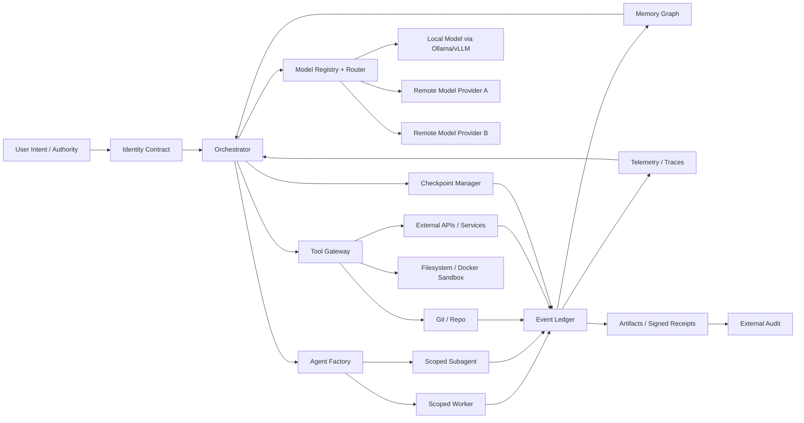
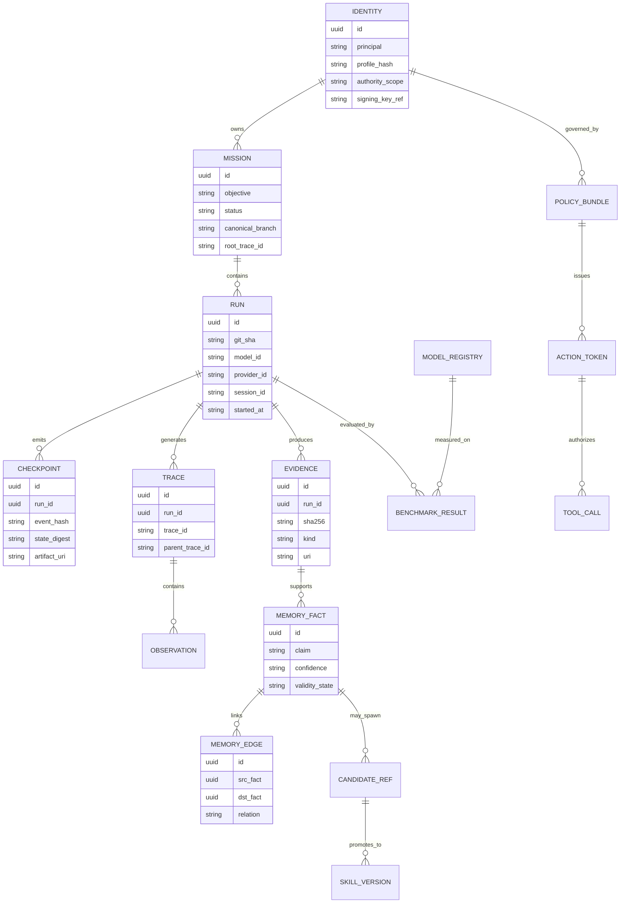

# Cognitive Sovereign Infrastructure and Omega Evidence Audit

## Executive summary

The strongest design choice for Pivete’s target is not “a powerful agent,” but a **model-agnostic cognitive control plane**: identity, policy, memory, evidence, and recovery must live outside any single LLM session. The base model then becomes a replaceable execution component, not the sovereign center. In practice, that means an event-sourced ledger for every action and decision, a causal memory graph linked to evidence, durable workflow execution for long missions, a model registry plus benchmark router, and a guarded self-modification loop that only promotes changes after tests, evals, and audit receipts pass. The research literature points in the same direction from different angles: ReAct shows why reasoning and acting should be interleaved; Reflexion shows how linguistic feedback and episodic memory can improve future runs without weight updates; Voyager shows the value of a growing skill library and automatic curriculum; continual-learning work frames the core problem as balancing plasticity with stability under resource constraints. Official platform docs reinforce the systems side: Kubernetes controllers and Operators formalize reconciling loops, StatefulSets preserve stable identities for stateful services, PostgreSQL WAL and logical replication support durable recovery and replication, Redis Streams and Kafka provide append-only event flow, and durable workflow systems such as Temporal exist exactly to resume long-running work after crashes. citeturn0search0turn0search2turn0search1turn6search2turn4search11turn4search1turn4search0turn2search1turn13search2turn2search2turn2search3turn7search16

For implementation, the best near-term route is a **hybrid local + VPS architecture**. Local execution maximizes privacy, cheap iteration, and interface proximity; a small VPS adds always-on orchestration, logs, alerts, and durable mission continuity. Cloud-first is justified only when Pivete wants multi-user scale, stronger SRE guarantees, or always-on managed services from day one. The MVP should therefore start with Docker Compose, PostgreSQL, Redis Streams, LiteLLM, LangGraph or Temporal, OpenTelemetry, Langfuse, pytest/Hypothesis/mutmut, and a hard Git-based promotion workflow. Kubernetes should come later, when there is actual operational pressure for workload placement, autoscaling, and policy enforcement at cluster scope. Rootless Docker, policy-as-code, signed artifacts, and provenance attestation should be added before any serious self-modification is allowed to touch canonical components. citeturn3search1turn3search2turn3search14turn13search1turn2search2turn12search15turn7search8turn7search16turn14search7turn14search1turn18search2turn18search9turn17search2turn15search1turn15search4turn15search6

For the Omega audit, the evidentiary situation is straightforward. **Receipt 1** is a Git forensics problem: prove from baseline commit to solution commit that only `desafios/omega_autolupa/omega_solver.py` changed, while contract, generator, and tests remained byte-identical. Git already supports this cleanly with commit-to-commit diff, blob addressing via `<rev>:<path>`, and object inspection. **Receipt 2** is a runtime-correlation problem: tie the model/provider string `tencent/hy3:free` (with `nous` if applicable) to the specific Omega run and the exact commit SHA. If the original runtime log can still be found in the Hermes session store, gateway logs, CI logs, or any observability backend, that closes the chain. If it cannot, the honest external-audit stance is: capability proven, benchmark integrity proven, strong contemporaneous evidence of Free Tier use present, but the machine-to-machine historical binding between model log and exact run is incomplete. That is still a valid forensic conclusion; it is not a failure to solve the challenge, only a missing historical receipt. citeturn8search0turn21search0turn21search2turn8search3turn8search10turn10search3turn14search3turn14search1

## What a sovereign cognitive infrastructure actually requires

A **cognitive sovereign infrastructure** is best understood as a persistent operational system with five non-negotiable layers: a stable identity contract, durable mission state, instrumented action execution, bounded self-modification, and externally auditable evidence. This is an inference from both agent-design and continual-learning literature: ReAct motivates an action loop that updates plan state through tool-mediated interaction; Reflexion motivates explicit memory of feedback; Voyager motivates a compositional skill library; continual-learning work shows why any system that adapts over time must manage catastrophic forgetting and stability-plasticity trade-offs. In other words, “autonomy” without state continuity and evidence tracking is only session-local improvisation, not sovereignty. citeturn0search0turn0search2turn0search1turn6search0turn5search0turn5search6turn6search2

The practical interpretation of your requirements is shown below.

| Requirement | Operational meaning | Concrete mechanism |
|---|---|---|
| Continuity of identity | The system remains “the same operator” across sessions, hosts, and models | signed identity contract, policy bundle, profile hash, authority scopes |
| Prolonged autonomy | Missions survive crashes, timeouts, and host changes | durable workflows, checkpoints, event history, resumable runs |
| Action capability | The system can change external state safely | tool gateway, scoped credentials, idempotency keys, reversible actions |
| Safe self-modification | It may improve itself, but only through guarded promotion | branch isolation, tests, evals, mutation checks, signed promotion |
| Generative independence | It may create plans/subagents/strategies not explicitly enumerated | agent factory, planner policies, benchmarked model routing |
| Distributed replaceable models | No single provider or model is existential | model registry, adapters, router, fallback policy |
| Autocure | It detects and repairs local failures | health probes, replay, rollback, reconciliation loop |
| Governance | Freedom to reason does not equal freedom to execute | OPA/Kyverno policies, approval classes, budget caps |
| Memory causal graph | Memory is evidence-linked and queryable by “why” | event ledger + fact graph + trace IDs |
| Production pipeline | It can turn cognition into repeatable output | CI/CD gates, artifacts, provenance, deployment policy |

The key design consequence is this: **identity must not be stored only in conversational memory**. It must be a first-class artifact with its own lifecycle. Kubernetes already treats long-lived stateful workloads differently from stateless workloads; StatefulSets deliberately give pods sticky identities because some systems break if identity is treated as disposable. A sovereign cognitive stack needs the same idea at the agent layer: the “identity” is a durable resource with stable names, policy bindings, and recovery rules, not just a prompt. citeturn4search0turn4search10turn4search11

The same applies to learning. The safest design is **operational continual learning first, model-weight adaptation second**. Continual-learning work repeatedly shows the danger of catastrophic forgetting when new adaptation overwrites old competence; PEFT methods exist precisely because full fine-tuning is costly and risky, while smaller adapters preserve more of the base model and reduce compute/storage costs. For your system, that means the dominant learning path should be: new evidence enters the ledger, candidate rules or skills are proposed, tests and benchmarks run, and only then does the canonical skill/policy set advance. Adapter or fine-tune work should be optional and late-stage, not the default mechanism for every correction. citeturn6search0turn5search0turn5search6turn19search1turn19search5turn19search11

## Reference architecture and data model

The recommended reference architecture is a **three-plane system**: a control plane for identity, policy, routing, and orchestration; an execution plane for tools, code, and model calls; and a memory/evidence plane for ledger, checkpoints, traces, and replay. Durable execution belongs in the control plane; model serving and tool work belong in the execution plane; facts, traces, and receipts belong in the memory plane. Temporal’s description of durable execution is especially relevant here: workflows keep state/progress in an event history and resume from where they left off after failures, which is precisely what prolonged autonomy requires. LangGraph is also explicitly aimed at long-running, stateful agents. citeturn7search16turn7search8turn7search14



### Control plane

The control plane should be built around **workflow orchestration with replay**, not just chained prompts. Temporal is the highest-discipline option if you want strong long-run durability, retries, and resumability. Prefect is lighter and easier for Python-native flows. LangGraph is attractive when the agent graph itself is the product. A pragmatic stack is: LangGraph for agent state transitions plus Temporal or Prefect for long-lived mission scheduling and retries. If you do not want two orchestrators, choose Temporal when reliability and replay dominate, or LangGraph when graph-native agent experimentation dominates. citeturn7search16turn7search2turn7search20turn7search8

### Execution plane

The execution plane needs **sandboxed, policy-scoped tool use**. Docker Compose is ideal for MVP, with rootless mode enabled where possible to reduce daemon attack surface. Persist important data with volumes rather than ad hoc bind mounts; Docker’s own docs are explicit that bind mounts expose raw host paths to the container and are not managed by Docker, while volumes are the preferred persistence mechanism for generated data. For cluster-scale scheduling, Kubernetes gives you the control-loop model, Deployments for stateless infrastructure, StatefulSets for stateful services, probes for self-healing, and Operators when you want domain-specific reconcilers. citeturn3search2turn3search14turn3search0turn3search8turn4search10turn4search0turn4search6turn4search1

### Memory and evidence plane

For the persistent state layer, the cleanest design is:

- **PostgreSQL** as the canonical database for identity, missions, checkpoints, evidence, policies, and signed receipts, using `jsonb` for flexible records and logical replication when you need downstream copies or read replicas. citeturn13search1turn13search2turn13search9
- **Redis Streams** as the low-latency append-only event bus for in-flight orchestration, retries, and consumer groups when Kafka is too heavy. Redis documents Streams as an append-only log built for ordered event processing. citeturn2search2turn2search9turn2search11
- **Kafka** when you need large-scale durable event streaming, partitioned consumption, and stronger guarantees around exactly-once event processing. Kafka’s official documentation explicitly calls out durable topics and exactly-once processing guarantees. citeturn2search3turn1search3
- **pgvector** if you want vector retrieval without introducing a second primary database. citeturn13search0
- **Object storage** for large immutable artifacts: run transcripts, patches, screenshots, session exports, model-eval outputs, signed receipts.

This combination supports a dual-memory strategy that is much stronger than a flat “chat history”: first, an **append-only event ledger** that answers “what happened, in what order, with what evidence”; second, a **causal memory graph** that answers “why did the system believe this and what changed because of it.” OpenTelemetry traces fit naturally here because they give correlated, hierarchical execution context across services and runs, while Langfuse makes LLM/application traces inspectable at the session level. citeturn14search7turn14search13turn14search3turn14search1turn14search18



### Identity, ledger, checkpointing, and recovery

The identity contract should include at least the following immutable or slowly changing fields: canonical principal, allowed namespaces, model routing policy, spending ceilings, maximum autonomy class, approval thresholds, retention policy, and signing key reference. Every mission run then references the active identity contract hash so later audits can prove **which identity policy** governed the run. This matters because identity drift is one of the easiest ways autonomous systems become unexplainable. The operational principle is simple: **state changes are append-only; interpretations are revisable.** In other words, events are never overwritten, but higher-level summaries can be superseded by later evidence. That mirrors how log-structured systems and traces work much better than mutable “memory blobs.” citeturn2search9turn2search3turn14search3turn14search23

Checkpointing should sit on top of event history, not replace it. A checkpoint record should include at least: the run ID, task node, git SHA, model ID, provider ID, container image digest, policy bundle hash, tool token scope, previous event hash, current state digest, and artifact pointers. Temporal’s event-history approach is the gold standard reference for this idea; even if you do not use Temporal, its design principle is the right one. Recovery then becomes: locate last valid checkpoint, verify chain hashes, reconstruct in-memory graph state, replay idempotent pending steps, and resume only from the last confirmed boundary. citeturn7search16turn7search2

### Model selection, benchmarking, and migration across providers

A sovereign system cannot let routing decisions remain implicit. You need a **model registry** with per-model records for capability tags, latency percentiles, cost, tool-use behavior, structured-output reliability, context limits, hallucination rate on your own evals, and failure signatures. LiteLLM is useful here because it gives a uniform API plus retries, fallbacks, and routing across providers; vLLM and Ollama cover high-throughput and local-serving sides of the same abstraction boundary. The benchmark layer should combine **static evals** and **operational evals**: LM Evaluation Harness for standard academic tasks, plus your own Omega-style adversarial tasks for long-run tool behavior, integrity, and constraint-following. vLLM’s benchmarking tools and LM Eval Harness are a strong open-source foundation for this. citeturn12search9turn12search15turn12search19turn12search1turn12search3turn16search0turn16search1turn16search21

Migration across providers should therefore be designed up front:

1. All model calls go through a **provider adapter layer**.
2. The persisted run record stores **canonical request metadata** independent of provider.
3. Prompts, tools, traces, and artifacts are all persisted in neutral schemas.
4. Fallbacks are allowed only by policy class, not silently.
5. Canonical benchmark missions pin an exact model/provider tuple unless the purpose of the mission is routing experimentation.

That design is what gives you replaceable models rather than a fragile stack hidden behind “OpenAI-compatible” surface syntax. citeturn12search9turn12search15turn12search3turn12search1

### Agent factory pattern

The right abstraction for your “army that can be regenerated” goal is an **agent factory**, not a static directory of agents. The factory consumes a mission spec and emits a short-lived worker with:

- a role template,
- scoped capabilities,
- allowed tools,
- routeable model class,
- budget and timeout,
- memory visibility scope,
- and a destruction/retention policy.

Voyager’s skill-library pattern is the closest research analogue: instead of persisting only raw transcripts, it grows reusable executable skills and retrieves them compositionally for future tasks. Reflexion adds the feedback-memory loop, which is ideal for postmortem correction. In practice, the factory should never create a worker that can self-escalate its permission class; only the control plane can mint a stronger token. citeturn0search1turn0search2turn15search1

### Security, governance, auditability, and tamper detection

The required governance stack is straightforward:

- **Rootless Docker** wherever possible, to reduce daemon privilege exposure. citeturn3search2turn3search14
- **OPA** for policy-as-code decisions across workflows, APIs, and CI. citeturn15search1turn15search9
- **Kyverno** if and when Kubernetes is introduced, to enforce admission and image-verification policies. citeturn15search3turn15search7
- **Cosign** to sign and verify containers/blobs, and **SLSA provenance** to attest how artifacts were produced. citeturn15search4turn15search6
- **OpenTelemetry** and **Langfuse** to correlate every model call, tool action, and checkpoint with a trace ID that later external audits can follow end to end. citeturn14search7turn14search3turn14search1

Tamper detection should use layered hashes, not only Git history. Git is already content-addressed at the object layer, which is excellent for repository integrity, but sovereign cognitive evidence goes beyond repository files. Each ledger event should therefore be hashed into a chained event digest; each artifact should have a stored SHA-256 and immutable URI; and each public receipt should include both the Git SHA and the artifact hash. Git’s own content-addressable object model makes it ideal for repository-side proofs, while signed artifacts and provenance attestations extend the chain outside the repo. citeturn22search1turn21search0turn15search4turn15search6

### Testing and CI for self-modification

Self-modification should be treated like a software-supply-chain change, not like a chat improvement. The minimum CI stack is:

- `pytest` for unit/integration regression, because it scales from small tests to complex suites. citeturn18search2turn17search3
- `Hypothesis` for property-based tests, especially on parsers, ledgers, retry logic, and memory transforms. citeturn18search9
- `mutmut` for mutation testing, because line coverage alone is weak protection against “looks green but is logically hollow.” citeturn17search2
- `lm-evaluation-harness` and custom adversarial evals for model-facing functionality. citeturn16search0

The promotion rule should be rigid: **candidate reference → isolated branch → tests → mutation/property/eval gates → human or policy approval → signed promotion**. If you later introduce weight adaptation, start with PEFT adapters rather than full model rewrites. citeturn19search1turn19search5

## Implementation options, roadmap, estimates, and failure handling

The trade-offs among local-only, hybrid, and cloud-first align with official tool characteristics: Docker Compose excels for compact local stacks, Kubernetes adds orchestration complexity but powerful control loops, rootless/container isolation improves local safety, LiteLLM and Ollama/vLLM support model abstraction across local and remote execution, and PostgreSQL/Redis/Kafka scale from laptop to distributed deployment with different operational costs. citeturn3search1turn4search5turn3search2turn12search9turn12search3turn12search1turn13search1turn2search2turn2search3

| Option | Cost | Latency | Resilience | Privacy | Complexity | Time-to-MVP | Best use |
|---|---|---:|---:|---:|---:|---:|---|
| Local-only | lowest | best for interactive work | weakest when host sleeps/crashes | strongest | lowest | fastest | solo build, rapid iteration, privacy-first lab |
| Hybrid local + VPS | low to medium | good | strong enough for serious missions | high | medium | fast | best default for Pivete |
| Cloud-first | medium to high | variable | strongest if fully managed | lowest unless self-hosted | highest | slowest | teams, multi-tenant ops, formal production |

### Recommended MVP

The most credible MVP is:

- Docker Compose stack on the main workstation.
- PostgreSQL as canonical store.
- Redis Streams for orchestration/eventing.
- LiteLLM as routing gateway.
- Ollama or vLLM for local open-model runs.
- LangGraph or Temporal for durable orchestration.
- OpenTelemetry + Langfuse for tracing.
- GitHub Actions for CI gates.
- A strict branch-based self-modification policy.

That MVP is enough to demonstrate identity continuity, prolonged autonomy, action capability, model replaceability, evidence retention, and bounded self-modification without prematurely paying the Kubernetes tax. citeturn3search1turn13search1turn2search2turn12search9turn12search3turn12search1turn7search8turn7search16turn14search7turn14search1turn8search7

### Prioritized milestones

A sensible delivery order is:

| Milestone | Deliverable | Why first |
|---|---|---|
| Identity and ledger | identity contract, append-only event store, action scopes | without this, autonomy is not governable |
| Durable mission runtime | checkpointed workflows, replay, retries | without this, autonomy dies on timeout |
| Tool gateway and evidence receipts | scoped execution, immutable artifacts, trace IDs | without this, action is unauditable |
| Model registry and router | explicit per-model routing policy and benchmarks | without this, model drift is invisible |
| Agent factory | on-demand specialized workers with TTL and scopes | without this, parallelism turns chaotic |
| Self-modification gates | CI, evals, mutation/property tests, signed promotion | without this, learning becomes corruption |
| Distributed deployment | VPS, then optional Kubernetes | do this only after actual load/uptime need |

### Practical resource estimates

These estimates are architectural heuristics, not vendor-quoted prices.

| Profile | Compute | Storage | Monthly budget band | Notes |
|---|---|---:|---:|---|
| Local-only MVP | modern laptop/desktop CPU, optional one consumer GPU | 100–500 GB SSD | near-zero to low | greatest privacy, weakest always-on continuity |
| Hybrid MVP | local dev box + 1 small VPS | 100–500 GB local + 50–200 GB VPS | low to mid double digits for CPU-only; more if renting GPU | best balance |
| Cloud-first MVP | managed DB + queue + object store + VMs | scalable | mid double digits to several hundred, depending on observability/GPU/API spend | justified only if uptime/team scale matters now |

### Failure modes and mitigations

| Failure mode | Consequence | Mitigation |
|---|---|---|
| Identity drift | system changes behavior but cannot explain why | sign and pin identity contract hash per run |
| Memory poisoning | false facts become canon | evidence-linked facts, confidence states, revocation, human review for high-impact promotions |
| Silent router fallback | benchmark evidence no longer matches claimed model | forbid silent fallback in canonical missions; persist model/provider tuple in every run |
| Duplicate/replayed actions | external side effects repeat after crash | idempotency keys and action receipts |
| Checkpoint corruption | run cannot resume safely | hash-chained checkpoints + artifact digests + cold backups |
| Skill regression | new “fix” breaks old capability | regression suite + hidden evals + mutation testing |
| Overfitting to benchmark | system games Omega-like tests | holdout adversarial tasks and human red-team reviews |
| Policy bypass | worker exceeds granted authority | central token minting, OPA decisions, sandbox boundaries |
| Evidence decay | logs disappear before audit | explicit retention policy, artifact export, signed receipts at mission close |
| Vendor lock-in | provider failure stalls system | adapter layer, neutral schemas, benchmarked alternatives |

## Omega evidence audit procedure

The evidentiary ladder for Omega has two target receipts. **Receipt 1** is deterministic and should be closed from Git alone. **Receipt 2** is historical/runtime and depends on whether the original execution logs still exist. Git’s official docs make commit-to-commit diffing and blob-path resolution exact; GitHub Actions docs explain how to inspect and download workflow logs/artifacts; XDG and macOS filesystem conventions help narrow where local session state is typically stored; `journalctl` is the standard interface for Linux journal logs. citeturn8search0turn21search0turn21search2turn8search3turn8search10turn10search2turn3search3turn9search3turn20search1turn9search2

### Forensic checklist

Use this order and do not skip steps:

| Step | Goal | Output |
|---|---|---|
| Freeze references | ensure local repo and remote refs are up to date | fetched refs, no ambiguity |
| Prove Receipt 1 | show only `omega_solver.py` changed between baseline and solution | diff, stat, blob IDs |
| Establish run window | anchor timestamps from commits and any ledger/session clocks | time interval for log search |
| Search Hermes local state | find session DB/JSONL/logs containing Omega/model strings | direct runtime evidence if present |
| Search gateway/system logs | find request logs proving provider/model around the run window | independent runtime evidence |
| Search CI/Actions artifacts | recover captured logs or session artifacts | secondary evidence |
| Correlate | bind model string, trace/session, and commit SHA in one packet | Receipt 2 if found |
| If missing | prepare alternative-evidence packet with explicit limitations | honest external-audit package |

### Receipt 1 commands

Use the exact baseline and solution SHAs already identified.

```bash
#!/usr/bin/env bash
set -euo pipefail

BASE=d9f45b258
SOL=2d4acb9c3
OMEGA_DIR=desafios/omega_autolupa
OUT=audit/omega
mkdir -p "$OUT"

git fetch --all --prune

# Commit metadata
git show --no-patch --pretty=fuller "$BASE" | tee "$OUT/base_commit_fuller.txt"
git show --no-patch --pretty=fuller "$SOL"  | tee "$OUT/solution_commit_fuller.txt"

# Prove which files changed between baseline and solution
git diff --name-status "$BASE..$SOL" | tee "$OUT/receipt1_name_status.txt"
git diff --stat "$BASE..$SOL"        | tee "$OUT/receipt1_stat.txt"

# Full patch for the solver only
git diff --unified=0 "$BASE..$SOL" -- "$OMEGA_DIR/omega_solver.py" \
  | tee "$OUT/receipt1_solver_patch_u0.diff"

# Show the baseline commit created the whole challenge
git show --name-status --format=fuller "$BASE" -- "$OMEGA_DIR" \
  | tee "$OUT/base_commit_omega_files.txt"

# Show the solution commit touched only the solver
git show --name-status --format=fuller "$SOL" -- "$OMEGA_DIR" \
  | tee "$OUT/solution_commit_omega_files.txt"

# Blob IDs for non-solver files must match across commits
for f in \
  "$OMEGA_DIR/CONTRACT.md" \
  "$OMEGA_DIR/README.md" \
  "$OMEGA_DIR/omega_generator.py" \
  "$OMEGA_DIR/tests/test_omega.py"
do
  {
    echo "FILE=$f"
    echo -n "BASE_BLOB="; git rev-parse "$BASE:$f"
    echo -n "SOL_BLOB=";  git rev-parse "$SOL:$f"
    echo
  } | tee -a "$OUT/receipt1_blob_ids.txt"
done

# Optional: blob sizes for a stronger external packet
while read -r blob; do
  git cat-file -s "$blob"
done < <(awk -F= '/_BLOB=/{print $2}' "$OUT/receipt1_blob_ids.txt") \
  | tee "$OUT/receipt1_blob_sizes.txt"
```

**Expected conclusion:** `receipt1_name_status.txt` should show only `M desafios/omega_autolupa/omega_solver.py` for `BASE..SOL`, and the blob IDs for `CONTRACT.md`, `README.md`, `omega_generator.py`, and `tests/test_omega.py` should be identical across both commits. Git’s `<rev>:<path>` addressing and object inspection commands are the right tools for that proof. citeturn21search0turn21search2turn21search5

### Receipt 2 commands

The target is a direct chain like this:

`session / trace / log record` → `model=tencent/hy3:free` → `provider=nous` → `Omega identifiers` → `run window` → `commit SHA(s)`.

Start by fixing the time window from Git:

```bash
#!/usr/bin/env bash
set -euo pipefail

BASE=d9f45b258
SOL=2d4acb9c3

git show --no-patch --date=iso-strict \
  --format='COMMIT=%H%nAUTHOR=%an%nWHEN=%aI%nSUBJECT=%s%n' "$BASE" "$SOL"
```

Now search common local Hermes locations. On Linux, state and app data commonly follow XDG directories such as `~/.local/state`, `~/.config`, and `~/.cache`; on macOS, application state is commonly under `~/Library/Application Support` and logs under `~/Library/Logs`, while app-generated support data belongs in Application Support by convention. citeturn9search3turn3search3turn20search1turn20search5

```bash
#!/usr/bin/env bash
set -euo pipefail

OUT=audit/omega
mkdir -p "$OUT"

ROOTS=(
  "$HOME/.local/state"
  "$HOME/.config"
  "$HOME/.cache"
  "$HOME/Library/Application Support"
  "$HOME/Library/Logs"
)

# Find likely Hermes/session files
find "${ROOTS[@]}" \
  \( -iname '*hermes*' -o -iname '*session*' -o -iname '*.db' -o -iname '*.sqlite' -o -iname '*.sqlite3' -o -iname '*.jsonl' -o -iname '*.log' \) \
  -type f 2>/dev/null | sort -u | tee "$OUT/local_candidate_files.txt"

# Search for Omega/model/provider/commit markers
grep -RInaE 'omega_autolupa|omega|25/25|tencent/hy3:free|nous|d9f45b258|2d4acb9c3' \
  $(cat "$OUT/local_candidate_files.txt") 2>/dev/null | tee "$OUT/local_hits.txt" || true
```

If you find a SQLite database, inspect schema first, then query likely tables. SQLite’s CLI officially supports `.tables`, `.mode`, and schema inspection, which makes it suitable for this kind of quick forensic drill. citeturn9search1turn9search13

```bash
DB="/path/to/suspect.db"

sqlite3 "$DB" ".tables"
sqlite3 "$DB" ".mode box" "SELECT name, type FROM sqlite_master ORDER BY type, name;"
sqlite3 "$DB" ".mode box" "SELECT name, sql FROM sqlite_master WHERE type='table';" > audit/omega/sqlite_schema.txt

# Fast crude pass even if schema is unknown
strings "$DB" | grep -E 'omega_autolupa|omega|25/25|tencent/hy3:free|nous|d9f45b258|2d4acb9c3' \
  | tee audit/omega/sqlite_strings_hits.txt || true
```

Now search system and gateway logs. `journalctl` is the standard interface for Linux journal data; official NGINX docs describe access logging, and Caddy/Traefik also document access logs. If Hermes used a gateway or reverse proxy, these logs are often the strongest independent source because they may include timestamp, request path, client/session identifiers, and sometimes upstream/provider markers. citeturn9search2turn11search0turn11search4turn11search1turn11search5turn11search18

```bash
#!/usr/bin/env bash
set -euo pipefail

SINCE="2026-07-22 15:00:00"
UNTIL="2026-07-22 17:00:00"
OUT=audit/omega
mkdir -p "$OUT"

journalctl --user --since "$SINCE" --until "$UNTIL" \
  | grep -Ei 'hermes|omega|25/25|tencent/hy3:free|nous|d9f45b258|2d4acb9c3' \
  | tee "$OUT/journal_user_hits.txt" || true

sudo journalctl -u nginx -u caddy -u traefik --since "$SINCE" --until "$UNTIL" \
  | grep -Ei 'chat|responses|completions|omega|tencent|nous|trace|request|session' \
  | tee "$OUT/journal_gateway_hits.txt" || true

grep -RInaE 'omega_autolupa|tencent/hy3:free|nous|d9f45b258|2d4acb9c3' \
  /var/log/nginx /var/log/caddy /var/log/traefik 2>/dev/null \
  | tee "$OUT/file_gateway_hits.txt" || true
```

If gateways or supporting services ran in containers:

```bash
docker ps --format 'table {{.ID}}\t{{.Names}}\t{{.Image}}'
docker logs --since "2026-07-22T15:00:00" --until "2026-07-22T17:00:00" <container_name> 2>&1 \
  | grep -Ei 'omega|tencent/hy3:free|nous|d9f45b258|2d4acb9c3|trace|session' \
  | tee audit/omega/docker_gateway_hits.txt || true
```

Then inspect GitHub Actions, if the repo uses CI. GitHub’s docs and CLI both support listing runs, viewing logs, and downloading artifacts; GitHub also notes that logs and artifacts are retained for a limited period by default. citeturn8search10turn8search11turn10search0turn10search2turn10search3

```bash
#!/usr/bin/env bash
set -euo pipefail

OUT=audit/omega
mkdir -p "$OUT"

gh run list --limit 30 | tee "$OUT/gh_run_list.txt"

# Replace RUN_ID after inspection
RUN_ID="<run_id>"
gh run view "$RUN_ID" --log | tee "$OUT/gh_run_${RUN_ID}.log"
gh run download "$RUN_ID" -D "$OUT/gh_artifacts_${RUN_ID}"

grep -RInaE 'omega_autolupa|omega|25/25|tencent/hy3:free|nous|d9f45b258|2d4acb9c3' \
  "$OUT/gh_run_${RUN_ID}.log" "$OUT/gh_artifacts_${RUN_ID}" 2>/dev/null \
  | tee "$OUT/gh_hits_${RUN_ID}.txt" || true
```

If you already have an observability layer such as LiteLLM logging, Langfuse, or OpenTelemetry, filter by trace/session and tags. OpenTelemetry traces exist exactly to correlate distributed operations; Langfuse is explicitly built to inspect LLM/application traces. citeturn14search7turn14search3turn14search1turn14search21

### Acceptable alternative evidence if the original log is missing

If no direct runtime log survives, present the evidence ladder honestly.

| Evidence class | What it proves | External-audit strength |
|---|---|---|
| Direct runtime log with model/provider + trace/session + Omega markers + commit SHA | closes Receipt 2 fully | strongest |
| Gateway access/request log with model/provider + time window + session ID, correlated to Git commit timestamps | strong runtime correlation | strong |
| CI artifact containing model/provider line plus same mission identifiers | strong if artifacts are immutable | strong |
| Local session DB/JSONL entry with model string and Omega markers, correlated to commit times | direct but app-local | medium to strong |
| Memory snapshot / ledger entry noting model string before later model switch | contemporaneous but indirect | medium |
| UI screenshot or timeout line naming model/provider, plus commit authorship/timestamps and Receipt 1 | contemporaneous but not machine-correlated | medium |
| Fresh rerun on same model/provider | proves repeatability, not historical usage | separate class only |

For an external packet, bundle the following:

1. `receipt1_name_status.txt`, `receipt1_stat.txt`, `receipt1_blob_ids.txt`.
2. Commit metadata for baseline and solution.
3. The strongest runtime/log artifact found.
4. A one-page timeline with local timezone, timestamps, session or trace IDs, and SHA-256 hashes of every included file.
5. A short statement of limitations if Receipt 2 remains partial.

The critical rule is: **do not present a rerun as if it were the original historical receipt**. Treat it as repeatability evidence only.

### Paste-ready request for missing logs

```text
Subject: Request for Omega run log export for external audit

I need a raw log export for the Omega challenge run executed on 2026-07-22, approximately between 15:00 and 17:00 America/Bahia time, in the Hermes profile or gateway that handled the run.

Please search for any session, request, trace, or gateway records containing one or more of the following markers:

- omega_autolupa
- omega
- 25/25
- tencent/hy3:free
- nous
- d9f45b258
- 2d4acb9c3

What I need exported:
1. the raw log lines or DB rows showing the model/provider used;
2. any session_id / trace_id / request_id present;
3. timestamps in original timezone/format;
4. if available, the prompt/run title or mission label tying the log to Omega;
5. file hash or artifact hash of the exported material.

If sensitive fields exist, please redact secrets only, but keep timestamps, IDs, model/provider names, and mission markers intact.

This is for external evidentiary audit, so preserving original ordering and raw formatting matters.
```

## Prioritized sources

For the **agent-and-learning foundations**, prioritize ReAct, Reflexion, Voyager, and the continual-learning literature. ReAct gives the reasoning-plus-action loop; Reflexion gives feedback memory without weight updates; Voyager gives a growing skill library and automatic curriculum; the continual-learning survey, EWC, Learning without Forgetting, and Progress & Compress give the discipline for preserving competence while adapting over time. citeturn0search0turn0search2turn0search1turn6search2turn6search0turn5search0turn5search6

For the **systems substrate**, prioritize official documentation for Kubernetes, Docker, PostgreSQL, Redis, Kafka, Temporal, and OpenTelemetry. Those sources are the most relevant foundation for durable execution, control loops, stateful scheduling, persistence, event streaming, and cross-service traceability. citeturn4search5turn4search0turn4search1turn3search1turn3search2turn13search1turn13search2turn2search2turn2search3turn7search16turn14search7turn14search3

For the **model and evaluation layer**, prioritize official or maintainer sources for LiteLLM, Ollama, vLLM, LM Evaluation Harness, PEFT, Transformers, pytest, Hypothesis, and mutmut. That stack covers routing, local serving, performance benchmarking, cheap adaptation, and the regression discipline required for any bounded self-modification loop. citeturn12search9turn12search15turn12search3turn12search1turn16search0turn19search1turn19search19turn18search2turn18search9turn17search2

For the **governance and auditability layer**, prioritize OPA, Kyverno, Cosign, SLSA provenance, Git’s object/diff documentation, GitHub Actions logs/artifacts docs, and Langfuse. Together those sources support the exact discipline your target architecture needs: policy enforcement, artifact verification, provenance, diff-based evidence, retention-aware artifact capture, and trace-level introspection. citeturn15search1turn15search3turn15search4turn15search6turn22search1turn8search0turn21search0turn8search10turn10search3turn14search1