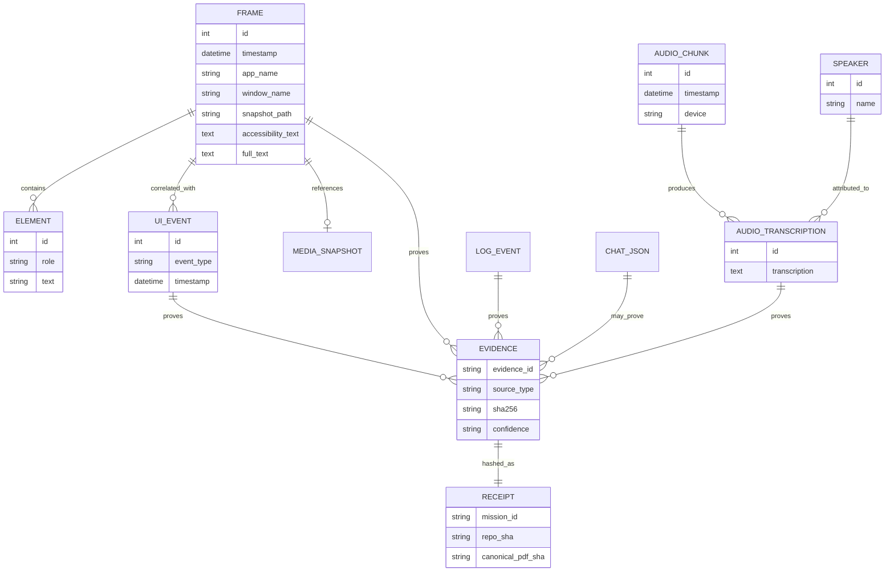
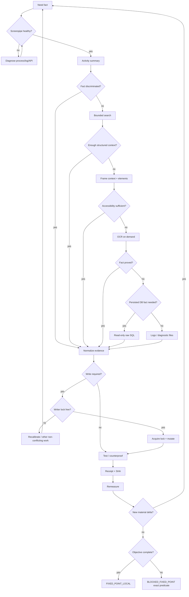
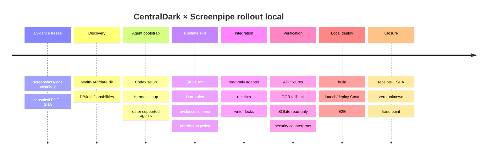

# Arquitetura Operacional e Skill de Runtime do Screenpipe para a CentralDark

## Resumo executivo

A evidência disponível sustenta uma decisão arquitetural clara: **Screenpipe deve entrar na CentralDark como infraestrutura sensorial global da Casa, e não como uma integração exclusiva de SOL/Codex ou HERMES**. A ferramenta já fornece captura de tela orientada a eventos, texto via árvore de acessibilidade, OCR de fallback, transcrição de áudio, metadados de aplicação/janela/URL, armazenamento SQLite local, API REST em `localhost:3030`, MCP para agentes e Pipes para automações. A documentação atual inclusive oferece instalação dirigida para `codex` e `hermes`, além de outros agentes. citeturn9view0turn9view2turn10view1

As capturas locais fornecidas confirmam que a instalação real da Casa é mais rica do que o contrato público mínimo: `C:\Users\danda\.screenpipe` contém `db.sqlite`, `db.sqlite-wal`, `db.sqlite-shm`, logs de aplicação, `chats/`, `pipes/`, `skills/`, `live-views/`, `data/`, `trajectories/`, `structured-outputs/`, `crash-dumps/`, `digital-clone-cache/` e arquivos sensíveis como `secrets.sqlite` e `store.bin`. A pasta `chats/` contém muitos JSONs, inclusive artefatos `imported-codex-*` e `pipe_digital-clone_*`. As capturas de Timeline também demonstram operações de **copiar imagem do frame, copiar texto, copiar deeplink e perguntar sobre o frame**. [E9–E12]


A arquitetura recomendada é um **Screenpipe Evidence Provider**: Screenpipe continua sendo a fonte de captura; uma skill `centraldark-screenpipe-runtime` define política, ordem de consulta, formato de evidência, permissões e ponto fixo; um boot valida Screenpipe, PDF canônico, versão, data-dir e capacidade dos agentes; e uma camada mínima de normalização gera receipts imutáveis com SHA-256. **Não se duplica a base do Screenpipe e não se cria outro recorder.**

A política operacional deve ser **accessibility/API first, OCR only when needed, raw SQLite only when a API semântica não discriminar o fato, filesystem/logs only for diagnóstico**. A própria arquitetura do Screenpipe prioriza accessibility e usa OCR como fallback; `/activity-summary`, `/search`, `/frames/{id}/context`, `/elements` e `/raw_sql` permitem aumentar progressivamente a granularidade. O `/raw_sql` oficial é somente leitura. citeturn9view0turn9view1

O modelo formal do PDF deve ser aplicado como fecho de regras: fatos iniciais finitos, regras de Horn, constraints que derivam `F`, objetivo explícito e parada quando uma rodada completa não produz novo fato material nem nova ação causal e o objetivo está satisfeito. **Limitação probatória:** o PDF original citado anteriormente na conversa não está acessível ao mecanismo de arquivos nesta rodada; `file_search` retornou `NoSourcesAvailable` e o runtime contém apenas as PNGs. Portanto, uso abaixo os axiomas do PDF já registrados na conversa — `p1 ∧ ... ∧ pn → p`, constraints `→ F`, programa finito e fecho até ponto fixo — mas o boot definitivo deve exigir o **arquivo PDF real + SHA-256**; sem isso, `CANONICAL_PDF_LOADED=false`.

O ponto final proposto é:

```text
SCREENPIPE_RUNTIME_FIXED_POINT =
    CANONICAL_PDF_LOADED
    ∧ SCREENPIPE_DISCOVERED
    ∧ SCREENPIPE_HEALTHY
    ∧ DATA_LAYOUT_PROVED
    ∧ CODEX_ACCESS_PROVED
    ∧ HERMES_ACCESS_PROVED
    ∧ GLOBAL_AGENT_DISCOVERY_PROVED
    ∧ PERMISSIONS_ENFORCED
    ∧ RECEIPTS_VERIFIABLE
    ∧ TESTS_PASS
    ∧ LOCAL_DEPLOY_PASS
    ∧ MATERIAL_UNKNOWN = 0
    ∧ OPEN_CAUSAL_GAPS = 0
```

## Evidência primária e arquitetura Screenpipe

O conjunto local analisado compreende todas as doze capturas disponíveis: **E1** `12b3318c...`, **E2** `49c8d21d...`, **E3** `a4111f14...`, **E4** `0edc6b46...`, **E5** `1fe829eb...`, **E6** `b3b68f08...`, **E7** `ae5a1696...`, **E8** `44a9658c...`, **E9** `ff007c23...`, **E10** `691785fe...`, **E11** `7b887776...`, **E12** `474bf18f...`. E1–E8 mostram simultaneamente SOL, PIVETE/HERMES, Codex/terminal, navegador, Timeline e uso de skills; E7/E8 mostram a Timeline e seu menu de extração; E9 prova que a UI considera `~/.screenpipe` o diretório de dados e separa Data/Cache/Free; E10/E11 materializam a árvore local; E12 prova persistência de conversas em JSON. O log textual colado pelo usuário é **L1** e mostra HERMES lendo skills, medindo processos e reconciliando working tree.

A documentação oficial coincide com o núcleo dessa instalação: Screenpipe usa captura orientada a eventos, associa screenshot e árvore de acessibilidade no mesmo instante, aplica OCR quando a acessibilidade é insuficiente e persiste o estado principal em `~/.screenpipe/db.sqlite`, com mídia em `~/.screenpipe/data/`. As tabelas documentadas incluem `frames`, `elements`, `audio_chunks`, `audio_transcriptions`, `speakers` e `ui_events`. citeturn9view0

| Componente | Status | Função operacional na CentralDark |
|---|---|---|
| `~/.screenpipe/db.sqlite` | Oficial + observado | Fonte persistente de frames, texto acessível/OCR, transcrições, UI e metadados. Preferir API ou `/raw_sql` read-only. citeturn9view0turn9view1 |
| `db.sqlite-wal` / `db.sqlite-shm` | Observado; padrão SQLite WAL | Estado auxiliar de uma base ativa. Não copiar/apagar isoladamente durante execução; WAL pode conter transações ainda não consolidadas. citeturn8search4turn8search17 |
| `data/` | Oficial + observado | Screenshots e chunks de mídia gravados localmente. citeturn9view0turn9view3 |
| `screenpipe-app.YYYY-MM-DD.log` | Oficial + observado | Logs do desktop/Tauri, settings, pipes e erros de aplicação. A skill oficial de logs documenta esse padrão. citeturn9view4 |
| `screenpipe.YYYY-MM-DD.log` | Oficial | Backend/engine: captura, OCR, áudio e frames. citeturn9view4 |
| `pipes/` | Oficial + observado | Agentes/automação `pipe.md`, execução programada, outputs e logs. citeturn10view0 |
| `chats/` | Observado em E12 | Artefatos JSON de chats/imports; útil como evidência histórica, mas deve ser tratado como formato interno potencialmente mutável. |
| `skills/` | Observado em E10 | Ativos locais de skills. Não encontrei contrato público que garanta que essa árvore específica permaneça estável entre versões; a CentralDark deve tratar como descoberta, não como ABI. |
| `live-views/` | Observado em E10 | Diretório real da instalação; sem semântica estável documentada nas fontes oficiais pesquisadas. Catalogar, mas não construir dependência dura. |
| `trajectories/`, `structured-outputs/`, `digital-clone-cache/` | Observado | Evidência auxiliar privada da versão instalada. Ler apenas quando uma missão exigir e sempre por whitelist. |
| `secrets.sqlite`, `store.bin*` | Observado em E11 | **Opaque sensitive state.** Nunca usar como fonte genérica de contexto e nunca despejar seu conteúdo em prompt, receipt ou log. |
| `mcp_servers.json`, `screenpipe-tools.mjs`, configs JSON | Observado | Indícios de configuração/instrumentação da instalação; consultar somente quando necessário para diagnóstico. |

A captura abaixo é particularmente importante porque prova que `chats/` não é uma hipótese: existem numerosos JSONs persistidos, incluindo imports ligados ao Codex e outputs de Digital Clone.


A coleta deve seguir uma **escada de evidência**. Primeiro `/activity-summary` para contexto compacto; depois `/search` com janela temporal, app/janela/URL e `content_type=all`; depois `frame/text`, `frame/context` e `elements`; OCR explícito somente se a informação estruturada não resolver; `/raw_sql` somente para fatos persistidos não expostos convenientemente pela API; finalmente logs e filesystem para diagnóstico. A documentação recomenda consultas temporais delimitadas, permite buscar elementos estruturados e oferece SQL estritamente read-only. citeturn9view1

| Fonte | Extração preferida | Confiança operacional | Ferramentas |
|---|---|---:|---|
| Accessibility/API | `/search`, `/elements`, `/frames/{id}/context` | Alta para texto/UI estruturada | REST, MCP, curl/PowerShell. citeturn9view0turn9view1 |
| Banco SQLite | `/raw_sql`; snapshot seguro somente quando indispensável | Alta para estado persistido | API read-only; `sqlite3` em modo seguro. citeturn9view1turn8search5 |
| Logs | `screenpipe*.log`, `screenpipe-app*.log` | Alta para eventos/erros; não prova sozinho estado atual | `Select-String`, `Get-Content`, skill oficial de logs. citeturn9view4 |
| Screenshot/frame | imagem original + metadata | Alta para aparência visual no instante | `/frames/{id}`, Timeline, Screenpipe. citeturn5search11 |
| OCR | OCR on-demand do frame | Média-alta; corroborar quando texto é crítico | Endpoint de OCR/frame. citeturn5search10 |
| `chats/*.json` | JSON parse read-only | Média-alta para artefato histórico; não necessariamente para live-state | PowerShell/Python JSON [E12] |
| Filesystem | enumeração/metadata/hash | Alta para existência; baixa para significado interno não documentado | `Get-ChildItem`, `Get-FileHash` [E10–E11] |
| Texto copiado da Timeline | Copy text / deeplink / frame | Alta quando associado ao timestamp/frame | UI observada [E7–E8] |

## Modelo operacional CentralDark e regras de Horn

A capacidade deve ser global. A documentação atual oferece `agent setup` especificamente para `hermes`, `codex`, Claude, Cursor, OpenClaw e outros, e o MCP permite que clientes compatíveis consultem a memória do Screenpipe. Assim, SOL/Codex e HERMES são consumidores importantes, **não proprietários da capacidade**. citeturn9view2turn10view1

| Ator | Papel recomendado | Escrita | Screenpipe |
|---|---|---|---|
| SOL/Codex | Implementação da skill, adapter, contratos, testes e build | Writer do código quando possuir lock | MCP + REST + filesystem read-only |
| HERMES | Medição do runtime, reconciliação, contraprova, deploy/health | Writer somente da frente explicitamente adquirida | MCP + REST + logs + processos |
| Outros agentes da Casa | Consumidores de evidência | Reader por padrão | `npx screenpipe setup`, MCP ou REST conforme capacidade |
| Pipes | Automações de tempo/rotina | `reader` por padrão; ampliar somente por missão | API local com token injetado. citeturn10view0 |
| Screenpipe | Sensor/source of truth | Único writer normal de sua DB/captura | Recorder, index, API, Timeline |

A política **minimal-sufficient-context** não significa “ver pouco”; significa buscar exatamente o menor conjunto que discrimina o fato. Isso reduz latência, contexto inútil e risco de exposição. A própria documentação de privacidade recomenda escopo estreito para agentes e permite filtros por app/janela/conteúdo, enquanto Pipes aceitam `permissions: reader` e denies que prevalecem sobre allows. citeturn11view0turn11view3

Formalização operacional:

```text
FACTS

AGENT(a)
MISSION(m)
NEEDS_FACT(a,f)
PERMISSION(a,capability,scope)

SCREENPIPE_PRESENT(path)
SCREENPIPE_HEALTHY
SCREENPIPE_API(url)
SCREENPIPE_AUTH_REQUIRED
SCREENPIPE_TOKEN_AVAILABLE

DATA_DIR(path)
DB_PRESENT(path)
LOG_PRESENT(path,date)
CHAT_JSON_PRESENT(path)
FRAME(id,time,app,window)
ACCESSIBILITY_TEXT(id,text)
OCR_TEXT(id,text)
UI_ELEMENT(id,element)
LOG_EVENT(id,event)
DB_FACT(id,fact)

EVIDENCE(eid,source,hash,confidence,time)
PROVES(eid,fact)

RESOURCE(r)
WRITER_LOCK(r,agent,lease)
WRITER_CONFLICT(r)

SECRET_PATH(path)
SENSITIVE_SCOPE(scope)

REQUIREMENT(req)
REQUIREMENT_PROVED(req,eid)
MATERIAL_UNKNOWN(req)
OPEN_CAUSAL_GAP(gap)
```

```text
RULES

SCREENPIPE_PRESENT(p)
∧ SCREENPIPE_HEALTHY
→ SCREENPIPE_AVAILABLE

NEEDS_FACT(a,f)
∧ PERMISSION(a,screenpipe,scope)
∧ SCREENPIPE_AVAILABLE
→ QUERY_ACTIVITY_SUMMARY(a,f)

QUERY_ACTIVITY_SUMMARY(a,f)
∧ FACT_DISCRIMINATED(f)
→ EVIDENCE_SUFFICIENT(f)

QUERY_ACTIVITY_SUMMARY(a,f)
∧ ¬FACT_DISCRIMINATED(f)
→ QUERY_SEARCH_BOUNDED(a,f)

QUERY_SEARCH_BOUNDED(a,f)
∧ FRAME_RELEVANT(id)
→ QUERY_FRAME_CONTEXT(id)

ACCESSIBILITY_TEXT(id,t)
∧ TEXT_SUFFICIENT(t,f)
→ PROVE_FROM_ACCESSIBILITY(f)

FRAME(id,...)
∧ ¬ACCESSIBILITY_TEXT_SUFFICIENT(id)
∧ PERMISSION(a,ocr,scope)
→ RUN_OCR(id)

API_SEMANTICS_INSUFFICIENT(f)
∧ PERMISSION(a,raw_sql,scope)
→ QUERY_RAW_SQL_READ_ONLY(f)

DIAGNOSTIC_GAP(f)
→ QUERY_LOGS_BOUNDED(f)

EVIDENCE(e,source,hash,c,time)
∧ PROVES(e,f)
→ FACT_PROVED(f)

FACT_PROVED(f)
∧ REQUIREMENT_DEPENDS_ON(req,f)
→ UPDATE_REQUIREMENT(req)

WRITE_REQUIRED(resource)
∧ ¬WRITER_LOCK(resource,other,live)
→ ACQUIRE_WRITER_LOCK(resource,agent)

WRITER_LOCK(resource,agent,live)
∧ WRITE_REQUIRED(resource)
→ MUTATE(resource)

MUTATE(resource)
→ TEST(resource)

TEST_PASS(resource)
→ COUNTERPROVE(resource)

COUNTERPROOF_PASS(resource)
→ RECEIPT(resource,sha)

STATE_CHANGED
→ REMEASURE_DEPENDENTS

OTHER_AGENT_CHANGED_SHARED_STATE
→ RECALIBRATE

SAME_EVIDENCE_HASH
∧ SAME_QUERY_SCOPE
→ DO_NOT_REPROCESS

NO_MATERIAL_DELTA
→ ADVANCE_OR_EVALUATE_FIXED_POINT
```

```text
CONSTRAINTS

DIRECT_DB_WRITE
→ F

READ_SECRET_CONTENT_WITHOUT_EXPLICIT_SECRET_MISSION
→ F

EXPORT_SECRET_TO_PROMPT_OR_RECEIPT
→ F

WRITER_CONFLICT
→ F

UNKNOWN_AS_PASS
→ F

UNBOUNDED_SCREEN_HISTORY_QUERY_WITHOUT_CAUSE
→ F

OCR_WHEN_ACCESSIBILITY_ALREADY_PROVES_FACT
∧ NO_COUNTERPROOF_REASON
→ F

DELETE_SCREENPIPE_DATA_WITHOUT_REVIEWED_BACKUP
→ F

CLOUD_EXFILTRATION
∧ ¬EXPLICIT_PERMISSION
→ F

MUTATE_SCREENPIPE_INTERNAL_PRIVATE_FILE
∧ ¬DOCUMENTED_API
→ F
```

O uso de `F` é importante porque transforma “boa prática” em invariantes verificáveis: se dois writers ocupam o mesmo recurso, se um secret é despejado em contexto ou se um UNKNOWN vira PASS, o estado é inválido, não apenas “subótimo”.

```text
OBJECTIVE

CENTRALDARK_SCREENPIPE_READY =
    CANONICAL_PDF_LOADED
    ∧ CANONICAL_PDF_SHA_VERIFIED
    ∧ SCREENPIPE_AVAILABLE
    ∧ DATA_DIR_DISCOVERED
    ∧ CORE_DB_PROVED
    ∧ LOG_PATHS_PROVED
    ∧ CODEX_SCREENPIPE_ACCESS
    ∧ HERMES_SCREENPIPE_ACCESS
    ∧ GLOBAL_DISCOVERY_PATH_DOCUMENTED
    ∧ MINIMAL_CONTEXT_POLICY_ACTIVE
    ∧ PERMISSION_POLICY_ACTIVE
    ∧ WRITER_LOCK_POLICY_ACTIVE
    ∧ NORMALIZED_EVIDENCE_API_ACTIVE
    ∧ RECEIPT_CHAIN_VALID
    ∧ BUILD_LOCAL_PASS
    ∧ DEPLOY_LOCAL_PASS
    ∧ E2E_PASS
    ∧ COUNTERPROOF_PASS
    ∧ MATERIAL_UNKNOWN = 0
    ∧ OPEN_CAUSAL_GAPS = 0
```

```text
FIXED_POINT

Repeat while:
    NEW_MATERIAL_FACTS > 0
    OR NEW_REQUIRED_ACTIONS > 0

FIXED_POINT_LOCAL =
    NEW_MATERIAL_FACTS = 0
    ∧ NEW_REQUIRED_ACTIONS = 0
    ∧ CENTRALDARK_SCREENPIPE_READY = true

If:
    NEW_MATERIAL_FACTS = 0
    ∧ CENTRALDARK_SCREENPIPE_READY = false

then:
    BLOCKED_FIXED_POINT
    ∧ record exact missing predicate
    ∧ do not invent unrelated work
```

## Skill runtime, boot e APIs

A implementação deve ser pequena e explícita. Screenpipe já é o recorder, banco, search engine, MCP e API; CentralDark precisa somente de **contrato + policy enforcement + normalização + receipts**. A documentação oficial já suporta MCP para Codex e outros clientes, Pipes e REST local; duplicar essas funções aumentaria superfície de ataque e drift. citeturn10view1turn10view0turn9view0

Estrutura recomendada:

```text
CentralDark/
  .centraldark/
    screenpipe/
      manifest.yaml
      locks/
  skills/
    centraldark-screenpipe-runtime/
      SKILL.md
      horn-rules.md
      evidence-schema.json
  runtime/
    screenpipe/
      boot.ps1
      discover.ps1
      collect.ps1
      normalize.ps1
      test.ps1
  receipts/
    screenpipe/
      sol/
      hermes/
      merged/
  canonical/
    horn-reference.pdf
    horn-reference.txt
    horn-reference.manifest.json
```

`manifest.yaml` deve guardar **referências**, não secrets:

```text
schema: centraldark.screenpipe.runtime/v1

screenpipe:
  api: http://127.0.0.1:3030
  data_dir: "${SCREENPIPE_DATA_DIR:-~/.screenpipe}"
  access: read-first
  raw_sql: read-only
  ocr_policy: fallback-only

canonical_reference:
  path: canonical/horn-reference.pdf
  sha256: REQUIRED
  derivative_text: canonical/horn-reference.txt
  derivative_sha256: REQUIRED

security:
  sensitive_paths:
    - "**/secrets.sqlite"
    - "**/store.bin"
    - "**/store.bin.*"
  deny_secret_contents: true
  direct_db_write: false
  localhost_only: true

agents:
  default_permission: reader
  writer_lock_required: true

receipts:
  algorithm: SHA256
  append_only: true
```

O boot deve verificar PDF por hash, Screenpipe por `/health`, data-dir, versão, agentes configurados, espaço e policy antes de liberar a skill. `/health` é o primeiro teste recomendado na documentação; o Screenpipe mantém a API local em 3030, e autenticação pode ser ativada nas configurações. citeturn9view2turn10view2

Formato normalizado de receipt:

```text
{
  "schema": "centraldark.evidence/v1",
  "evidence_id": "uuid",
  "agent": "sol|hermes|other",
  "mission_id": "...",
  "observed_at": "ISO-8601",
  "source_type": "api|frame|accessibility|ocr|log|sqlite|json|filesystem",
  "source_locator": "...",
  "scope": {
    "start": "...",
    "end": "...",
    "app": "...",
    "window": "..."
  },
  "content_sha256": "...",
  "confidence": "high|medium-high|medium",
  "proves": ["FACT_X", "FACT_Y"],
  "repo_sha": "...",
  "canonical_pdf_sha": "...",
  "secret_material": false
}
```

Para outros agentes, a API CentralDark recomendada é uma **fachada read-only local** sobre Screenpipe, não uma cópia da base:

```text
GET  /centraldark/screenpipe/health
GET  /centraldark/screenpipe/capabilities
GET  /centraldark/screenpipe/context/recent
GET  /centraldark/screenpipe/search
GET  /centraldark/screenpipe/frame/{id}
POST /centraldark/screenpipe/frame/{id}/ocr
POST /centraldark/screenpipe/sql/read
GET  /centraldark/screenpipe/logs
POST /centraldark/evidence/receipt
GET  /centraldark/evidence/receipt/{id}
```

Essa fachada aplica limits, tempo máximo, redaction, denylist e normalização; por baixo, delega ao REST/MCP oficial. A API nativa já fornece search, frames, elements, activity summary e read-only SQL. citeturn5search4turn9view1

A fase de implantação recomendada é:

| Fase | Resultado obrigatório |
|---|---|
| Congelar referência | PDF real copiado para `canonical/`; SHA PDF + SHA do texto derivados |
| Descobrir | `~/.screenpipe`, versão, health, banco, logs e capabilities registrados |
| Instalar capacidade oficial | setup oficial para Codex, Hermes e demais agentes detectados |
| Cristalizar skill | `SKILL.md`, Horn rules, evidence schema e manifest versionados |
| Implementar gateway | Só leitura, localhost, bounded queries, redaction |
| Provar | fixtures + API real + logs + frame + OCR fallback + SQLite |
| Deploy local | build da CentralDark, launch local e E2E |
| Fechar | receipts/SHA, contraprova, zero gap e fixed point |

## Execução operacional para SOL/Codex e HERMES

A documentação atual fornece uma vantagem decisiva: `npx -y screenpipe@latest agent setup codex` e `... hermes` são caminhos oficialmente suportados; para agentes adicionais, o setup geral/MCP pode ser instalado conforme o cliente. citeturn9view2turn10view2

**COMANDO SOL/CODEX — PowerShell, ponta a ponta até build/deploy local.** O bloco pressupõe apenas que sejam preenchidos `$Repo` e `$Pdf`. A porta `1420` aparece nas capturas da CentralDark, mas é tratada como variável e não como contrato permanente.

```text
# ==========================
# SOL / CODEX
# ==========================

$ErrorActionPreference = "Stop"

$Repo = "C:\PATH\TO\CentralDark"
$Pdf  = "C:\PATH\TO\horn-reference.pdf"

$Sp = Join-Path $HOME ".screenpipe"
$Out = Join-Path $Repo "receipts\screenpipe\sol"
$Canonical = Join-Path $Repo "canonical"
$LockDir = Join-Path $Repo ".centraldark\locks"

New-Item -ItemType Directory -Force $Out,$Canonical,$LockDir | Out-Null
Set-Location $Repo

# 1. Descoberta local, SEM ler secrets.
if (-not (Test-Path $Sp)) { throw "SCREENPIPE_DATA_DIR_NOT_FOUND: $Sp" }

Get-ChildItem $Sp -Force |
  Where-Object { $_.Name -notin @("secrets.sqlite","store.bin","store.bin.last-good","store.bin.last-good.prev") } |
  Select-Object Name,Length,LastWriteTime,Mode |
  ConvertTo-Json -Depth 4 |
  Set-Content (Join-Path $Out "data-dir-inventory.json")

# 2. Instalar/atualizar skill + MCP oficial para Codex.
npx -y screenpipe@latest agent setup codex
npx -y screenpipe@latest --version |
  Set-Content (Join-Path $Out "screenpipe-version.txt")

# 3. Health.
$Health = Invoke-RestMethod "http://127.0.0.1:3030/health"
$Health | ConvertTo-Json -Depth 20 |
  Set-Content (Join-Path $Out "health.json")

# 4. Token, somente em memória. NÃO gravar em receipt.
$Headers = @{}
try {
    $Token = (npx -y screenpipe@latest auth token 2>$null | Select-Object -Last 1).Trim()
    if ($Token) { $Headers["Authorization"] = "Bearer $Token" }
} catch {}

# 5. Contexto mínimo primeiro.
$Summary = Invoke-RestMethod `
  "http://127.0.0.1:3030/activity-summary?start_time=2h+ago&end_time=now" `
  -Headers $Headers

$Summary | ConvertTo-Json -Depth 30 |
  Set-Content (Join-Path $Out "activity-summary.json")

# 6. Busca limitada de contexto recente.
$Recent = Invoke-RestMethod `
  "http://127.0.0.1:3030/search?content_type=all&limit=50&start_time=2h+ago&end_time=now" `
  -Headers $Headers

$Recent | ConvertTo-Json -Depth 40 |
  Set-Content (Join-Path $Out "search-recent.json")

# 7. Logs: somente janela relevante.
Get-ChildItem $Sp -Filter "*.log" |
  Sort-Object LastWriteTime -Descending |
  Select-Object -First 4 |
  ForEach-Object {
      $dst = Join-Path $Out ("log-tail-" + $_.Name)
      Get-Content $_.FullName -Tail 500 | Set-Content $dst
  }

Get-ChildItem $Out -Filter "log-tail-*" |
  ForEach-Object {
      Select-String -Path $_.FullName -Pattern "error|failed|panic|warn" -CaseSensitive:$false
  } |
  Out-String |
  Set-Content (Join-Path $Out "log-errors.txt")

# 8. SQLite: preferir endpoint read-only do Screenpipe.
$Sql = @{
  query = @"
select name, type
from sqlite_master
where type in ('table','view')
order by type, name
"@
} | ConvertTo-Json

$Schema = Invoke-RestMethod `
  "http://127.0.0.1:3030/raw_sql" `
  -Method Post `
  -Headers $Headers `
  -ContentType "application/json" `
  -Body $Sql

$Schema | ConvertTo-Json -Depth 30 |
  Set-Content (Join-Path $Out "sqlite-schema-via-api.json")

# 9. Frame/OCR.
# O agente deve extrair um frame_id relevante de search-recent.json.
# Accessibility/text/context PRIMEIRO.
# OCR somente se o fato ainda não estiver discriminado.

$FrameId = $null   # preencher automaticamente após parse do search result

if ($FrameId) {
    $FrameText = Invoke-RestMethod `
      "http://127.0.0.1:3030/frames/$FrameId/text" `
      -Headers $Headers

    $FrameContext = Invoke-RestMethod `
      "http://127.0.0.1:3030/frames/$FrameId/context" `
      -Headers $Headers

    $FrameText | ConvertTo-Json -Depth 30 |
      Set-Content (Join-Path $Out "frame-$FrameId-text.json")

    $FrameContext | ConvertTo-Json -Depth 30 |
      Set-Content (Join-Path $Out "frame-$FrameId-context.json")

    # Somente se accessibility/context não bastarem:
    # Invoke-RestMethod "http://127.0.0.1:3030/frames/$FrameId/text" `
    #   -Method Post -Headers $Headers
}

# 10. Canonicalizar PDF.
if (-not (Test-Path $Pdf)) { throw "CANONICAL_PDF_MISSING" }

Copy-Item $Pdf (Join-Path $Canonical "horn-reference.pdf") -Force

$PdfHash = (Get-FileHash `
  (Join-Path $Canonical "horn-reference.pdf") `
  -Algorithm SHA256).Hash

@{
  source_path = $Pdf
  canonical_path = (Join-Path $Canonical "horn-reference.pdf")
  sha256 = $PdfHash
  created_at = (Get-Date).ToUniversalTime().ToString("o")
} | ConvertTo-Json |
  Set-Content (Join-Path $Canonical "horn-reference.manifest.json")

# 11. Writer lock da integração.
$Lock = Join-Path $LockDir "screenpipe-skill.lock"
$OwnLock = $false

try {
    $fs = [System.IO.File]::Open(
      $Lock,
      [System.IO.FileMode]::CreateNew,
      [System.IO.FileAccess]::Write,
      [System.IO.FileShare]::None
    )

    $payload = [Text.Encoding]::UTF8.GetBytes(
      "owner=SOL-CODEX`npid=$PID`ntime=" +
      (Get-Date).ToUniversalTime().ToString("o")
    )

    $fs.Write($payload,0,$payload.Length)
    $fs.Close()
    $OwnLock = $true
} catch {
    throw "WRITER_CONFLICT: screenpipe-skill.lock already exists"
}

# 12. Implementar/cristalizar:
# skills/centraldark-screenpipe-runtime/SKILL.md
# skills/centraldark-screenpipe-runtime/horn-rules.md
# skills/centraldark-screenpipe-runtime/evidence-schema.json
# runtime/screenpipe/boot.ps1
# runtime/screenpipe/discover.ps1
# runtime/screenpipe/collect.ps1
# runtime/screenpipe/normalize.ps1
# runtime/screenpipe/test.ps1
#
# Regra: nunca editar secrets.sqlite/store.bin ou escrever direto em db.sqlite.

# 13. Test/build auto-detectado.
$pkgPath = Join-Path $Repo "package.json"

if (Test-Path $pkgPath) {
    $pkg = Get-Content $pkgPath -Raw | ConvertFrom-Json

    if (Test-Path (Join-Path $Repo "bun.lock")) {
        $PM = "bun"
    } elseif (Test-Path (Join-Path $Repo "bun.lockb")) {
        $PM = "bun"
    } elseif (Test-Path (Join-Path $Repo "pnpm-lock.yaml")) {
        $PM = "pnpm"
    } else {
        $PM = "npm"
    }

    if ($pkg.scripts.test) {
        & $PM run test
        if ($LASTEXITCODE -ne 0) { throw "TEST_FAIL" }
    }

    if ($pkg.scripts.build) {
        & $PM run build
        if ($LASTEXITCODE -ne 0) { throw "BUILD_FAIL" }
    }

    if ($pkg.scripts.'deploy:local') {
        & $PM run "deploy:local"
        if ($LASTEXITCODE -ne 0) { throw "LOCAL_DEPLOY_FAIL" }
    }
}

# 14. Se for Tauri e não houver deploy:local, construir bundle local.
$TauriCargo = Join-Path $Repo "src-tauri\Cargo.toml"
if (Test-Path $TauriCargo) {
    if ($pkg -and $pkg.scripts.tauri) {
        & $PM run tauri build
    } else {
        Push-Location (Split-Path $TauriCargo)
        cargo build --release
        Pop-Location
    }

    if ($LASTEXITCODE -ne 0) { throw "TAURI_BUILD_FAIL" }
}

# 15. Smoke test CentralDark local.
$CentralDarkUrl = $env:CENTRALDARK_LOCAL_URL
if (-not $CentralDarkUrl) { $CentralDarkUrl = "http://127.0.0.1:1420" }

try {
    $resp = Invoke-WebRequest $CentralDarkUrl -UseBasicParsing -TimeoutSec 10
    "status=$($resp.StatusCode)" |
      Set-Content (Join-Path $Out "centraldark-smoke.txt")
} catch {
    $_ | Out-String |
      Set-Content (Join-Path $Out "centraldark-smoke-error.txt")
}

# 16. Receipts/SHA.
$RepoSha = git rev-parse HEAD
$GitStatus = git status --porcelain=v1

@{
  schema = "centraldark.screenpipe.receipt/v1"
  agent = "SOL-CODEX"
  observed_at = (Get-Date).ToUniversalTime().ToString("o")
  repo_sha = $RepoSha
  canonical_pdf_sha256 = $PdfHash
  screenpipe_health = $Health
  git_dirty = [bool]$GitStatus
  direct_db_write = $false
  secret_contents_read = $false
} | ConvertTo-Json -Depth 20 |
  Set-Content (Join-Path $Out "final-receipt.json")

Get-ChildItem $Out -File |
  Where-Object { $_.Name -notmatch "token|secret" } |
  ForEach-Object {
    "{0}  {1}" -f `
      (Get-FileHash $_.FullName -Algorithm SHA256).Hash,
      $_.Name
  } |
  Set-Content (Join-Path $Out "SHA256SUMS.txt")

# 17. Libera lock somente após receipt.
if ($OwnLock -and (Test-Path $Lock)) {
    Remove-Item $Lock -Force
}

"FIXED_POINT_CANDIDATE: remedir health + E2E + counterproof"
```

**COMANDO HERMES — medição, logs, contraprova, runtime e deploy local sem colidir com SOL.**

```text
# ==========================
# HERMES
# ==========================

$ErrorActionPreference = "Stop"

$Repo = "C:\PATH\TO\CentralDark"
$Pdf  = "C:\PATH\TO\horn-reference.pdf"

$Sp = Join-Path $HOME ".screenpipe"
$Out = Join-Path $Repo "receipts\screenpipe\hermes"
$LockDir = Join-Path $Repo ".centraldark\locks"

New-Item -ItemType Directory -Force $Out,$LockDir | Out-Null
Set-Location $Repo

# 1. Skill/MCP oficial.
npx -y screenpipe@latest agent setup hermes

# 2. Descoberta.
if (-not (Test-Path $Sp)) { throw "SCREENPIPE_NOT_FOUND" }

$Health = Invoke-RestMethod "http://127.0.0.1:3030/health"
$Health | ConvertTo-Json -Depth 20 |
  Set-Content (Join-Path $Out "health.json")

# 3. Auth somente em memória.
$Headers = @{}
try {
    $Token = (npx -y screenpipe@latest auth token 2>$null | Select-Object -Last 1).Trim()
    if ($Token) { $Headers["Authorization"] = "Bearer $Token" }
} catch {}

# 4. Primeiro contexto compacto.
Invoke-RestMethod `
  "http://127.0.0.1:3030/activity-summary?start_time=2h+ago&end_time=now" `
  -Headers $Headers |
  ConvertTo-Json -Depth 30 |
  Set-Content (Join-Path $Out "activity-summary.json")

# 5. Depois busca limitada.
Invoke-RestMethod `
  "http://127.0.0.1:3030/search?content_type=all&limit=50&start_time=2h+ago&end_time=now" `
  -Headers $Headers |
  ConvertTo-Json -Depth 40 |
  Set-Content (Join-Path $Out "search-recent.json")

# 6. Logs + processos.
Get-ChildItem $Sp -Filter "*.log" |
  Sort-Object LastWriteTime -Descending |
  Select-Object -First 6 |
  ForEach-Object {
      Get-Content $_.FullName -Tail 750 |
        Set-Content (Join-Path $Out ("tail-" + $_.Name))
  }

Get-CimInstance Win32_Process |
  Where-Object {
      $_.Name -match "screenpipe|codex|hermes|node|bun|cargo|centraldark"
  } |
  Select-Object ProcessId,Name,ExecutablePath,CommandLine |
  ConvertTo-Json -Depth 5 |
  Set-Content (Join-Path $Out "processes.json")

# 7. Estado Git para detectar writer.
git status --porcelain=v1 |
  Set-Content (Join-Path $Out "git-status.txt")

git rev-parse HEAD |
  Set-Content (Join-Path $Out "repo-sha.txt")

# 8. Banco somente por API read-only.
$Body = @{
  query = @"
select
  app_name,
  count(*) as n
from frames
group by app_name
order by n desc
limit 30
"@
} | ConvertTo-Json

try {
    Invoke-RestMethod `
      "http://127.0.0.1:3030/raw_sql" `
      -Method Post `
      -Headers $Headers `
      -ContentType "application/json" `
      -Body $Body |
      ConvertTo-Json -Depth 30 |
      Set-Content (Join-Path $Out "db-app-counts.json")
} catch {
    $_ | Out-String |
      Set-Content (Join-Path $Out "db-query-error.txt")
}

# 9. Frame/OCR somente se necessário.
# A partir de search-recent.json:
#   frame text/context -> accessibility
#   se insuficiente -> POST /frames/{id}/text para OCR on-demand
#
# Não repetir OCR quando o mesmo frame/hash já possuir prova suficiente.

# 10. Confirmar PDF canônico sem alterar.
$CanonicalPdf = Join-Path $Repo "canonical\horn-reference.pdf"
if (-not (Test-Path $CanonicalPdf)) {
    throw "CANONICAL_PDF_NOT_CRYSTALLIZED"
}

$PdfHash = (Get-FileHash $CanonicalPdf -Algorithm SHA256).Hash

# 11. Contraprova de segurança.
$Sensitive = @(
  (Join-Path $Sp "secrets.sqlite"),
  (Join-Path $Sp "store.bin"),
  (Join-Path $Sp "store.bin.last-good"),
  (Join-Path $Sp "store.bin.last-good.prev")
)

$Sensitive |
  ForEach-Object {
    if (Test-Path $_) {
      Get-Item $_ | Select-Object FullName,Length,LastWriteTime
    }
  } |
  ConvertTo-Json |
  Set-Content (Join-Path $Out "sensitive-metadata-only.json")

# NÃO Get-Content secrets.sqlite
# NÃO strings secrets.sqlite
# NÃO copiar conteúdo para prompts
# NÃO abrir store.bin para "descobrir o que é"

# 12. Writer lock para runtime/deploy.
# Se SOL estiver usando este recurso, Hermes continua em read-only
# e valida o que SOL produzir.

$DeployLock = Join-Path $LockDir "runtime-deploy.lock"
$OwnDeployLock = $false

try {
    $fs = [System.IO.File]::Open(
      $DeployLock,
      [System.IO.FileMode]::CreateNew,
      [System.IO.FileAccess]::Write,
      [System.IO.FileShare]::None
    )

    $bytes = [Text.Encoding]::UTF8.GetBytes(
      "owner=HERMES`npid=$PID`ntime=" +
      (Get-Date).ToUniversalTime().ToString("o")
    )

    $fs.Write($bytes,0,$bytes.Length)
    $fs.Close()
    $OwnDeployLock = $true
} catch {
    $OwnDeployLock = $false
}

# 13. Test/build/deploy apenas se possuir lock de runtime.
if ($OwnDeployLock -and (Test-Path "package.json")) {
    $pkg = Get-Content "package.json" -Raw | ConvertFrom-Json

    if (Test-Path "bun.lock" -or Test-Path "bun.lockb") {
        $PM = "bun"
    } elseif (Test-Path "pnpm-lock.yaml") {
        $PM = "pnpm"
    } else {
        $PM = "npm"
    }

    if ($pkg.scripts.test) {
        & $PM run test
        if ($LASTEXITCODE -ne 0) { throw "TEST_FAIL" }
    }

    if ($pkg.scripts.build) {
        & $PM run build
        if ($LASTEXITCODE -ne 0) { throw "BUILD_FAIL" }
    }

    if ($pkg.scripts.'deploy:local') {
        & $PM run "deploy:local"
        if ($LASTEXITCODE -ne 0) { throw "DEPLOY_LOCAL_FAIL" }
    }
}

# 14. E2E do estado realmente implantado.
$CentralDarkUrl = $env:CENTRALDARK_LOCAL_URL
if (-not $CentralDarkUrl) { $CentralDarkUrl = "http://127.0.0.1:1420" }

$Checks = [ordered]@{}

try {
    $r = Invoke-WebRequest $CentralDarkUrl -UseBasicParsing -TimeoutSec 10
    $Checks.centraldark_http = $r.StatusCode
} catch {
    $Checks.centraldark_http = "FAIL: $($_.Exception.Message)"
}

try {
    $h = Invoke-RestMethod "http://127.0.0.1:3030/health"
    $Checks.screenpipe_health = $h
} catch {
    $Checks.screenpipe_health = "FAIL: $($_.Exception.Message)"
}

$Checks |
  ConvertTo-Json -Depth 20 |
  Set-Content (Join-Path $Out "e2e.json")

# 15. Receipt final de HERMES.
@{
  schema = "centraldark.screenpipe.receipt/v1"
  agent = "HERMES"
  observed_at = (Get-Date).ToUniversalTime().ToString("o")
  canonical_pdf_sha256 = $PdfHash
  screenpipe_healthy = [bool]$Health
  direct_db_write = $false
  secrets_read = $false
  writer_lock_owned = $OwnDeployLock
  e2e = $Checks
} |
  ConvertTo-Json -Depth 30 |
  Set-Content (Join-Path $Out "final-receipt.json")

Get-ChildItem $Out -File |
  ForEach-Object {
    "{0}  {1}" -f `
      (Get-FileHash $_.FullName -Algorithm SHA256).Hash,
      $_.Name
  } |
  Set-Content (Join-Path $Out "SHA256SUMS.txt")

if ($OwnDeployLock -and (Test-Path $DeployLock)) {
    Remove-Item $DeployLock -Force
}

# 16. Ponto fixo:
# remedir depois das alterações de SOL/Codex;
# se hash/estado mudou, recalibrar;
# se nenhum fato/ação material novo surgir e todos os predicates
# objetivos estiverem PASS -> FIXED_POINT_LOCAL.
```

Para o restante da Casa, o bootstrap é deliberadamente menor:

```text
# Instalar capacidade Screenpipe em agentes suportados detectados:
npx -y screenpipe@latest setup

# Ou por alvo:
npx -y screenpipe@latest agent setup codex
npx -y screenpipe@latest agent setup hermes

# Prova mínima:
curl http://127.0.0.1:3030/health
```

O README oficial atualmente recomenda `npx screenpipe setup` para instalar skills e MCP nos agentes compatíveis detectados; a documentação atual também oferece a variante direcionada `agent setup <target>`. citeturn3search0turn10view2

## Segurança, privacidade, testes e deploy

Screenpipe é local-first, mas “local” não significa automaticamente “sem risco”: agentes podem consultar texto visível, OCR e transcrições, e contexto pode sair da máquina quando se escolhe cloud AI, integrações ou sync. A documentação recomenda escopo estreito, exclusão de janelas sensíveis e revisão de logs. citeturn9view3turn11view3

Checklist obrigatório:

- **`secrets.sqlite` e `store.bin*`: metadata only.** A existência desses arquivos é evidência local [E11], mas sua semântica não foi estabelecida pelas fontes públicas consultadas. Não executar `Get-Content`, `strings`, upload, OCR, dump ou inclusão em prompt.
- **`db.sqlite` é read-only para agentes.** Preferir `/raw_sql`, que rejeita writes, e APIs semânticas de maior nível. citeturn9view1
- **Não separar `db.sqlite` do WAL/SHM de uma base ativa.** SQLite documenta `-wal` e `-shm` como componentes associados no modo WAL; para snapshot de banco ativo, use mecanismo de backup apropriado, não cópia improvisada do arquivo principal. citeturn8search4turn8search17
- **Não usar `immutable=1` em uma DB viva.** SQLite alerta que declarar immutable um arquivo que muda pode produzir resultados incorretos ou erros de corrupção. citeturn8search2turn8search5
- **Backup da árvore Screenpipe:** se for necessário mover/copiar toda a instalação, a documentação recomenda encerrar o Screenpipe primeiro, copiar a árvore e manter backup protegido; para deleções, confirmar range, fazer backup e verificar depois. citeturn11view3
- **Pipes sensores ficam `permissions: reader`.** `writer` ou `admin` só quando a missão requer; denies devem bloquear apps/janelas sensíveis. citeturn11view0
- **API CentralDark apenas loopback por padrão.** O próprio Screenpipe alerta que exposição remota/LAN transfere a responsabilidade de segurança ao operador. citeturn9view3
- **Secret nunca em receipt.** Receipts carregam SHA de artefatos públicos da missão, repo SHA, PDF SHA, timestamps e fatos provados; tokens e conteúdo confidencial ficam fora.
- **Queries sempre bounded.** Um incidente de 15 minutos recebe uma janela de 15 minutos mais margem, não “todo meu histórico”; a API suporta `start_time` e `end_time` precisamente para isso. citeturn9view1
- **OCR é contraprova/fallback, não primeira ferramenta.** Accessibility é o método principal no Windows/macOS; OCR é fallback para conteúdo não exposto estruturalmente. citeturn9view0

A estratégia de teste precisa provar comportamento, não apenas presença de arquivos:

```text
GATE_SCREENPIPE_DISCOVERY
  data-dir existe
  health responde
  versão registrada
  db existe
  logs descobertos

GATE_EVIDENCE
  activity-summary retorna
  search bounded retorna
  frame context retorna
  accessibility prova texto conhecido
  OCR prova fixture visual quando accessibility é insuficiente
  raw_sql aceita SELECT
  raw_sql rejeita write

GATE_SECURITY
  secrets não aparecem em receipts
  direct-db-write impossível pelo adapter
  query ilimitada rejeitada
  endpoint externo/LAN bloqueado por default
  writer conflict rejeitado

GATE_AGENT
  Codex vê Screenpipe
  Hermes vê Screenpipe
  outro agente suportado descobre capability
  todos retornam o mesmo schema normalizado

GATE_RUNTIME
  CentralDark build PASS
  local deploy PASS
  Screenpipe continua healthy
  E2E após deploy PASS
  contraprova PASS
  receipts + SHA PASS

FIXED_POINT
  zero material unknown
  zero causal gap
  zero new required action
```

Remediação segura é sempre **provar antes de destruir**. Para cache ou retenção, usar controles/API documentados; para problemas de DB, preservar DB+WAL+SHM ou usar snapshot suportado; para logs, rotacionar/copiar sem ler secrets; para formato privado desconhecido, catalogar e deixar `UNKNOWN` até a semântica ser provada. A API oficial inclui retenção e remoção de intervalos e alerta que exclusão é permanente e requer backup revisado. citeturn9view1turn11view3

## Diagramas, fontes prioritárias e pressupostos

O ER abaixo é **conceitual**, não afirma foreign keys físicas que não foram verificadas na instalação local. As entidades centrais refletem as tabelas publicamente documentadas; `CHAT_JSON` e `RECEIPT` são camadas observada/da CentralDark. citeturn9view0



O loop de agentes:



E o rollout:



Prioridade das fontes para cristalização:

| Prioridade | Fonte | Uso |
|---|---|---|
| Máxima | **E1–E12 + L1 locais** | Verdade da instalação da Casa: paths, arquivos, UI, agentes simultâneos, menus e logs. |
| Máxima | **PDF Horn fornecido pelo usuário** | Semântica canônica de fatos, regras, constraints e fixed point. O arquivo real precisa ser reintroduzido no boot por path+SHA porque não pôde ser reaberto nesta rodada. |
| Máxima | Arquitetura/API oficial Screenpipe | Contrato estável de DB, mídia, accessibility, OCR, endpoints e Pipes. citeturn9view0turn9view1 |
| Máxima | Setup/MCP oficial Screenpipe | Integração de Codex, Hermes e demais agentes. citeturn9view2turn10view1 |
| Alta | Privacidade e permissões oficiais Screenpipe | Local/cloud boundary, scope, reader/writer/admin, ignored windows e deleção. citeturn11view0turn11view3 |
| Alta | Skill oficial `screenpipe-logs` | Convenções de logs e troubleshooting. citeturn9view4 |
| Alta | SQLite oficial | WAL, read-only, backup e proteção contra snapshots inconsistentes. citeturn8search4turn8search17turn8search5 |

Pressupostos ainda não provados e que devem permanecer `UNKNOWN` até o boot real medir:

1. **Path exato do repositório CentralDark:** não foi fornecido; os scripts usam placeholder.
2. **Path/nome exato do PDF:** não está montado nesta rodada; portanto o SHA canônico ainda não existe.
3. **Semântica de `secrets.sqlite`, `store.bin`, `live-views/`, `skills/`, `trajectories/` e alguns outros artefatos locais:** existência é provada pelas capturas, mas contrato estável não foi encontrado na documentação oficial pesquisada.
4. **Versão exata do Screenpipe instalado na Casa:** deve ser registrada pelo boot com `screenpipe --version`.
5. **Estado de API authentication:** pode estar habilitado ou não; os scripts suportam ambos os casos. A documentação informa que `/health` não exige token e que os demais endpoints podem usar bearer quando API security está ativa. citeturn9view2turn10view2
6. **Schema físico exato do `db.sqlite` local:** a documentação fornece tabelas centrais, mas o schema da instalação do usuário ainda não foi consultado; o primeiro `/raw_sql` deve congelar essa prova. citeturn9view0
7. **Package manager/build system da CentralDark:** as capturas sugerem aplicação web/desktop local, mas o script deliberadamente detecta Bun/pnpm/npm e Tauri em vez de transformar inferência em fato.
8. **Porta local definitiva da CentralDark:** `localhost:1420` aparece repetidamente nas capturas e por isso serve como fallback de smoke test, não como constante arquitetural.
9. **Permissão para contexto cloud:** a arquitetura assume **local-only por default**. Qualquer envio de Screenpipe para modelo ou serviço externo exige autorização explícita, porque a documentação confirma que cloud AI e integrações podem enviar contexto selecionado para fora da máquina. citeturn9view3

O desenho resultante transforma Screenpipe em uma capacidade universal da Casa:

```text
ANY_AUTHORIZED_CENTRALDARK_ACTOR
∧ NEEDS_DESKTOP_FACT
∧ SCREENPIPE_AVAILABLE
∧ PERMISSION_OK
→ DISCOVER
→ QUERY_MINIMUM_SUFFICIENT_CONTEXT
→ CORROBORATE_IF_NEEDED
→ NORMALIZE_EVIDENCE
→ HASH
→ RECEIPT
→ RETURN_TO_MISSION

NOT:
SCREENPIPE = "ferramenta do Codex"
NOT:
SCREENPIPE = "ferramenta do Hermes"

YES:
SCREENPIPE = GLOBAL_HOUSE_SENSOR
CENTRALDARK_SKILL = GLOBAL_OPERATIONAL_CONTRACT
PDF = CANONICAL_REASONING_REFERENCE
RECEIPTS = PROOF_LAYER
HORN_CLOSURE = STOPPING_DISCIPLINE
FIXED_POINT_LOCAL = DONE
```