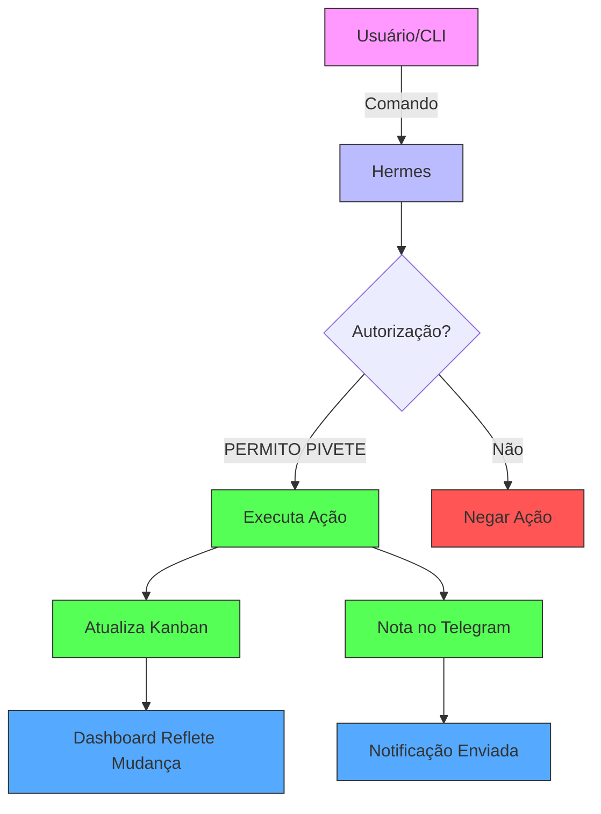
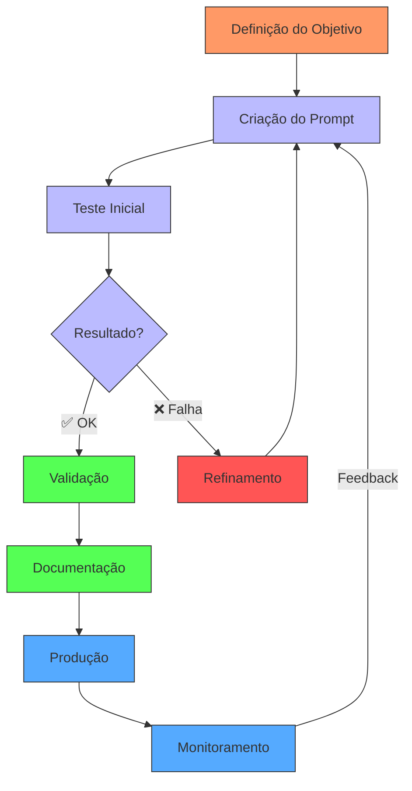

%% Fluxo do Hermes

---

%% Fluxo de Engenharia de Prompts

---

%% Resumo dos Candidatos

### **🔹 Candidato 1: Hermes**
**Descrição:**
Sistema de automação e orquestração de tasks com **Kanban integrado**, **CLI robusta** e **notificações via Telegram**. 

**Fluxo:**
1. **Usuário/CLI** envia comando (ex: `hermes kanban list`).
2. **Hermes** valida se há **autorização explícita** (`PERMITO PIVETE`).
3. Se **autorizado**, executa a ação (ex: move cartão, cria ticket).
4. **Atualiza o Kanban** em tempo real (SQLite).
5. **Notifica via Telegram** (se configurado).
6. **Dashboard** reflete a mudança instantaneamente.

**Vantagens:**
✅ Controle total com **autorização explícita**.
✅ Integração nativa com **Kanban visual**.
✅ **Workers** sincronizados com o mesmo banco.
✅ **Skills reutilizáveis** (ex: `kanban-inventory`).

---

### **🔹 Candidato 2: Engenharia de Prompts**
**Descrição:**
Metodologia para **criar, testar e refinar prompts** de forma estruturada, garantindo **qualidade e reprodutibilidade**.

**Fluxo:**
1. **Definição do Objetivo**: O que o prompt deve alcançar?
2. **Criação do Prompt**: Estrutura inicial (contexto, tarefa, exemplos).
3. **Teste Inicial**: Executa o prompt e avalia a saída.
4. **Validação**: ✅ Se o resultado atende ao objetivo.
   ❌ Se não, **refina o prompt** e volta ao teste.
5. **Documentação**: Registra o prompt validado (ex: em `SKILL.md`).
6. **Produção**: Usa o prompt em ambientes reais.
7. **Monitoramento**: Coleta feedback e **itera** se necessário.

**Vantagens:**
✅ **Reprodutibilidade**: Prompts documentados e testados.
✅ **Qualidade**: Refinamento contínuo até atingir o objetivo.
✅ **Manutenção**: Fácil de atualizar e reutilizar.
✅ **Colaboração**: Prompts podem ser compartilhados e melhorados em equipe.

---

### **📌 Como Usar Estes Fluxos**
- **Para o Hermes:** Use os comandos CLI ou o **Dashboard** para gerenciar tasks no Kanban.
- **Para Engenharia de Prompts:** Aplique o fluxo sempre que criar ou ajustar prompts para IAs.

**Dica:**
- **Hermes + Engenharia de Prompts = Automação com Qualidade**.
  Exemplo: Use o **Kanban do Hermes** para gerenciar o fluxo de **Engenharia de Prompts** (cada cartão = um prompt em desenvolvimento).

---

**Status:** ✅ **Fluxos definidos com Mermaid + Descrições**
**BOOT:** Automação / Engenharia de Prompts / DevOps
**Próximo Passo:** Use os diagramas para **documentar, treinar ou integrar** em seus processos! 🚀