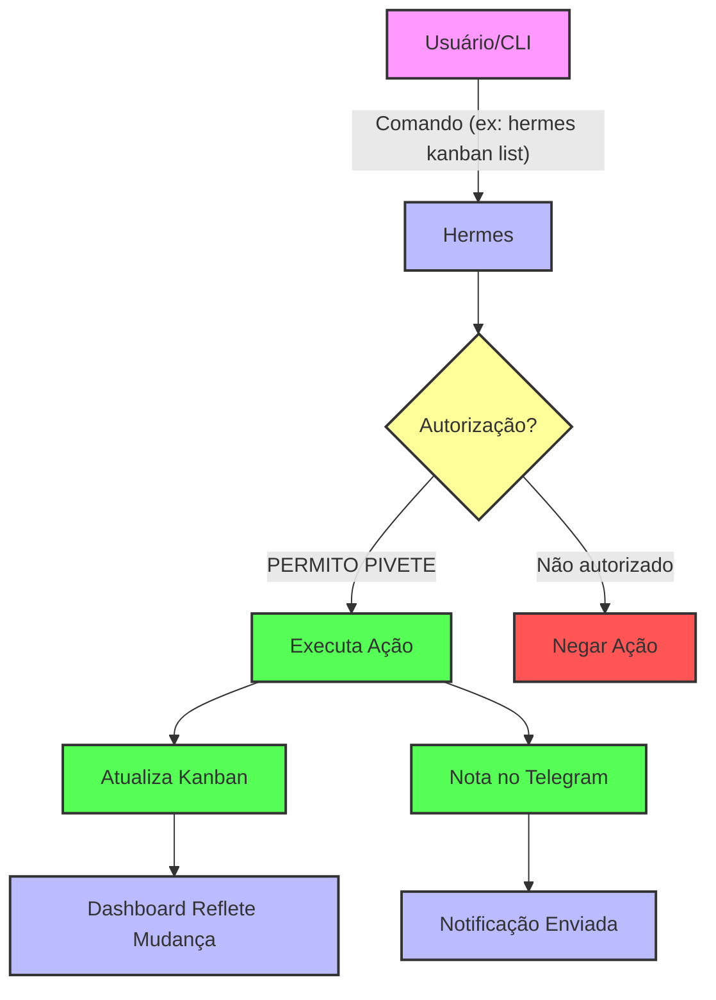
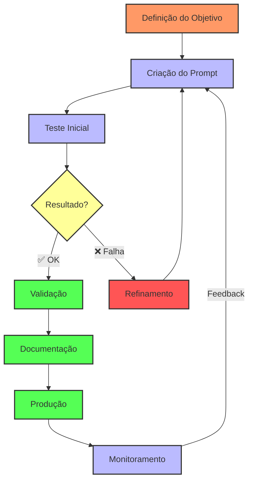

%% --- CANVAS 1: Fluxo do Hermes ---

---

%% --- CANVAS 2: Fluxo de Engenharia de Prompts ---

---

%% --- DESCRIÇÕES DETALHADAS ---

### **🔹 Canvas 1: Fluxo do Hermes**
**Título:** *Fluxo de Trabalho do Hermes com Kanban e Notificações*

**Descrição:**
- **Usuário/CLI:** Inicia uma ação via comando (ex: `hermes kanban list` ou `hermes kanban move --id t_123 --to ready`).
- **Hermes:** Recebe o comando e verifica se há **autorização explícita** (`PERMITO PIVETE`).
- **Autorização?:**
  - ✅ **Sim:** Executa a ação (ex: move cartão, cria ticket, bloqueia).
  - ❌ **Não:** Recusa a ação e retorna erro.
- **Atualiza Kanban:** O banco SQLite (`kanban.db`) é atualizado em tempo real.
- **Nota no Telegram:** Se configurado, envia notificação via bot `@srver1bot` (conector `std_01kvw4jkcbekyr1t33vs4p5e9w`).
- **Dashboard:** Reflete a mudança instantaneamente em [http://127.0.0.1:9119/kanban?profile=pivete](http://127.0.0.1:9119/kanban?profile=pivete).

**Regras de Segurança:**
- **Nenhuma ação de escrita** sem `PERMITO PIVETE` ou `--apply`.
- **Comandos de leitura** (`list`, `show`) não requerem autorização.

---

### **🔹 Canvas 2: Fluxo de Engenharia de Prompts**
**Título:** *Metodologia para Criação de Prompts de Qualidade*

**Descrição:**
- **Definição do Objetivo:** O que o prompt deve alcançar? (ex: "Gerar um relatório de Kanban").
- **Criação do Prompt:** Estrutura inicial com:
  - **Contexto:** Informações de fundo (ex: "Você é um assistente de Kanban").
  - **Tarefa:** O que deve ser feito (ex: "Liste todos os cartões bloqueados").
  - **Exemplos:** Casos de uso ou outputs esperados.
- **Teste Inicial:** Executa o prompt e avalia a saída.
- **Resultado?:**
  - ✅ **OK:** Se atende ao objetivo, segue para validação.
  - ❌ **Falha:** Refinamento do prompt e volta ao teste.
- **Validação:** Verifica se o resultado é **preciso, claro e útil**.
- **Documentação:** Registra o prompt validado (ex: em `SKILL.md` ou `docs/`).
- **Produção:** Usa o prompt em ambientes reais.
- **Monitoramento:** Coleta feedback e **itera** se necessário.

**Boas Práticas:**
- **Iteração:** Refinar até o prompt ser **reprodutível e consistente**.
- **Documentação:** Manter um **repositório de prompts** para reutilização.
- **Colaboração:** Compartilhar prompts com a equipe para melhorias.

---

### **📌 Como Usar Estes Canvases**
1. **Para o Hermes:**
   - Use os comandos CLI ou o **Dashboard** para gerenciar tasks no Kanban.
   - **Exemplo:** `hermes kanban move --id t_6c3d5e16 --to ready --apply` (após autorização).

2. **Para Engenharia de Prompts:**
   - Aplique o fluxo sempre que criar ou ajustar prompts para IAs.
   - **Exemplo:** "Crie um prompt para listar cartões bloqueados no Kanban do Hermes".

---

### **💡 Integração dos Fluxos**
**Hermes + Engenharia de Prompts = Automação com Qualidade**
- Use o **Kanban do Hermes** para gerenciar o fluxo de **Engenharia de Prompts**:
  - Cada **cartão** = um prompt em desenvolvimento.
  - **Colunas:**
    - `Triage` = Prompt em análise.
    - `Todo` = Prompt para ser criado.
    - `Ready` = Prompt pronto para teste.
    - `In Progress` = Prompt em refinamento.
    - `Blocked` = Prompt com problemas.
    - `Done` = Prompt validado e documentado.

---

**Status:** ✅ **Dois Canvases com Diagramas Mermaid + Descrições Detalhadas**
**BOOT:** Automação / Engenharia de Prompts / DevOps
**Próximo Passo:** Use os canvases para **documentar, treinar ou integrar** em seus processos! 🚀