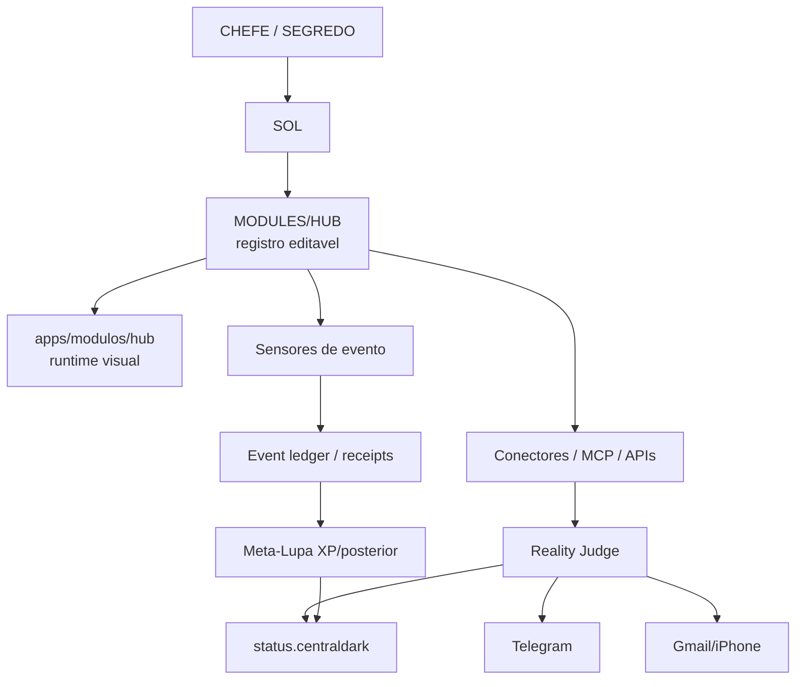

# Receipt — Megazord Event Sensors / MODULES-HUB

Data: 2026-09-24  
Escopo: Centralizar conexoes, sensores, notificacoes e rotas do Hub sem criar cerebro paralelo.  
Modo: `REUSE_BEFORE_CREATE=true`, `ONE_SYSTEM_ONLY=true`, `REALITY_IS_JUDGE=true`.

## O que foi provado

```text
apps/modulos/hub existe e e o owner runtime visual do Hub.
apps/modulos/hub/src/services existe com clientes api/mcp/telegram.
apps/modulos/hub/src/components/connectors existe com cards/conectores.
apps/modulos/hub/src/components/dashboard existe com cards de status.
Telegram Bot API registra notas/memoria e mostra NOTA GRAVADA NO CEREBRO.
MTProto source existe em scripts/telegram-mtproto/server.js.
MTProto CONFIG_BLOCKED health mode foi versionado na main.
GitHub/Gmail push notifications aparecem no celular do CHEFE como sinal externo.
Meta-Lupa possui motor XP/posterior, mas feedback '+1 ponto' ainda nao esta ligado ao reward ledger.
```

## O que foi registrado agora

```text
MODULES/HUB/README.md
MODULES/HUB/hub-connections.registry.json
MODULES/HUB/controls/notifications-and-sensors.json
MODULES/HUB/status-centraldark.routes.json
MODULES/HUB/receipts/2026-09-24-megazord-event-sensors.md
```

## Estados separados

### PASS

```text
HUB_RUNTIME_OWNER_EXISTS = apps/modulos/hub
HUB_CONNECTORS_OWNER_EXISTS = apps/modulos/hub/src/components/connectors
HUB_DASHBOARD_OWNER_EXISTS = apps/modulos/hub/src/components/dashboard
GITHUB_CANONICAL_RECORD = ServerVpss/CentralDark
TELEGRAM_NOTE_CAPTURE = PASS visual/runtime observado
MTPROTO_SOURCE = PASS
MTPROTO_CONFIG_BLOCKED_PATTERN = PASS versionado
GMAIL_GITHUB_SIGNAL = PASS visual como EVENT_ONLY
```

### UNKNOWN / nao promover

```text
status.centraldark lendo MODULES/HUB = UNKNOWN
UI toggle escrevendo nesses JSONs = UNKNOWN
Gmail/GitHub event alimentando ledger = UNKNOWN
CHEFE '+1 ponto' alimentando XP/posterior = UNKNOWN
MTProto conta pessoal conectada = UNKNOWN
VPS PM2 owner canonico do mtproto = UNKNOWN/PENDENTE_RECONCILIAR
```

### Bloqueios de falso-verde

```text
NOTIFICATION != PASS
EMAIL_PUSH != CI_GREEN
COMMIT != DEPLOY
MERGED != RUNNING
CONFIG_BLOCKED != READY
HUMAN_FEEDBACK != TECHNICAL_PROOF
XP_ENGINE_EXISTS != TELEGRAM_FEEDBACK_BOUND
```

## Diagrama operacional



## NEXT_CURSOR

```text
1. Criar adaptador de leitura: apps/modulos/hub le MODULES/HUB/*.json.
2. Expor cards de controle no Hub/status.centraldark.
3. Conectar GitHub/Gmail event -> EVENT_ONLY ledger.
4. Conectar Telegram feedback do CHEFE -> HUMAN_FEEDBACK ledger.
5. Promover XP/posterior somente quando houver receipt validado.
6. Reconciliar MTProto PM2 owner canonico.
```
