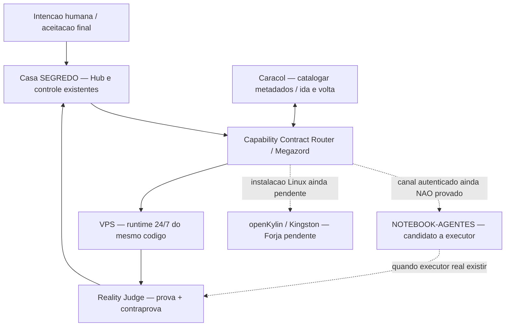

# 🪬🍒 Receipt — Megazord por setores / Caracol / NOTEBOOK-AGENTES / Viver em Paz

Data: 2026-10-26 (America/Bahia). Escopo: CentralDark, **um unico produto**, Casa SEGREDO como controle local; NOTEBOOK-AGENTES como **candidato** a nova base de execucao. Registro no owner ja existente `MODULES/HUB/receipts/`; nao e novo orchestrator, brain, gateway ou skill.

## Intencao humana e descoberta

O CHEFE/Megazorde corrigiu a metafora: **um Zord e um setor completo plugavel**, nao necessariamente um agente, uma ferramenta, uma janela ou uma unica maquina. A referencia a `Power Rangers` engloba equipes e combinacoes de periodos/espacos/universos variados; essa analogia e inspiracao **arquitetural**, nao uma prova de que os runtimes estao integrados.

Resultado humano desejado: **menos mudanca manual de janelas, menos trabalho operacional, mais liberdade para Viver em Paz**. A lembranca pessoal continua **sem autoridade de execucao** no owner `docs/CONSCIENCIA/LEMBRANCAS/2026-07-30-VIVER-EM-PAZ.md`. Rigor aplicado a status e testes, nao a permissoes inferidas de musica ou afeicao.

## Topologia de Zords — sem novo controle

O Caracol e **travessia de navegacao**, nao cria arestas semanticas do grafo, identidade ou acesso a maquinas. Contratos canônicos **nao alterados**: `docs/ARQUITETURA/CENTRALDARK-TRIGGER-FABRIC/MEGAZORD-CENTRALDARK.yml`, `SPIRAL-TRAVERSAL.yml`, `RUNTIME-PLUG-CONTRACT.yml`, `ENGINE_BINDING.yml`.

## Provas nesta sessao

- GitHub via `gh` na Casa: conta autenticada e arquivo `MEGAZORD-CENTRALDARK.yml` presente na `main`. Isso prova fonte, nao runtime.
- Caracol `scripts/trigger-fabric/spiral_traversal.py --self-test`: `PASS`, positivo, ida/volta e duplicata negativa bloqueada.
- Caracol `--repo-root K:\ --source repo --compact`: `PASS`, **16.586** caminhos versionados visitados ida/volta, `fragment_drop=0`, `semantic_edges_created=0`; hash da travessia `05863be78883137c8ffb654d54364048a5d54c5197cc80d7be628b65c7d1c818`.
- Caracol `--source graph` no arquivo padrao `apps/modulos/status/graph-data.json`: `FAIL_FILE_MISSING` nesse caminho. **Nao substituir por PASS visual**; o teste pelo repositorio e independente.
- NOTEBOOK-AGENTES Windows: Wi-Fi `192.168.100.2`; Casa Ethernet `192.168.100.5/24`. Notebook->Casa ping `PASS` (2-3 ms). Casa->Notebook ping `NO_REPLY`; TCP LAN `5985/445/22/3389` `TIMEOUT`.
- Radmin Notebook `26.251.127.144:5985` `OPEN_UNAUTHENTICATED`; Tailscale Notebook `100.102.99.102` sem peer confirmado na tailnet da Casa. LAN testada primeiro; diagnostico Bridge usa Radmin como fallback de observacao. **Nenhum comando remoto executado**.
- AnyDesk controlou visualmente o notebook sob acao do humano. **AnyDesk != terminal autenticado A2A**.
- Connected Remote Desktop Commander desta sessao: apenas dispositivo `SEGREDO` listado, notebook nao confirmado no conector.
- Casa Commander `http://127.0.0.1:9101/health` retornou HTTP 200 mas `engine_connected=false`. **HTTP 200 != engine pronta**.
- Em Casa, Screenpipe e Hermes Desktop apareceram como processos; processo visto nao prova integracao end-to-end.
- Forja openKylin no Kingston segue pendente; dual-boot ou VMware rawDisk exige acesso exclusivo e autorizacao, nenhuma particao modificada.

## Delta material implementado agora (source local, nao deploy)

- `MODULES/HUB/hub-connections.registry.json`: duas conexoes setoriais adicionadas (`casa-segredo-control-plane` e `notebook-agentes-execution-node`), com `proof_state` honesto e notebook `enabled=false`. URLs, senhas e tokens nao foram adicionados.
- `apps/modulos/hub/src/components/dashboard/MegazordHubCard.tsx`: substituiu sete linhas hardcoded por leitura `?raw` do unico registro canônico, com schema, validacao de IDs e fail-closed se registro invalido/duplicado; expõe `proof_state`, owner e setor. Esse **snapshot fica no build**; atualizar JSON requer reconstruir/publicar o Hub. Nao foi implementado polling de health remoto nem autenticação de notebook.
- `apps/modulos/hub/scripts/megazord-hub-registry.test.mjs`: **4 testes PASS / 0 FAIL**, incluidos os invariantes de nao declarar notebook autenticado e engine saudável sem prova.
- `git diff --check` do delta funcional = exit 0. **Build TypeScript/Vite nao medido** porque `node_modules` do Hub/raiz esta ausente na Casa; **nenhum deploy/CI/PR/merge** nesta rodada.

## Escopo preservado

Sem novo runtime, novo brain, nova ponte, porta de firewall, regra de rede, login, agente instalado ou gravacao no Kingston. Nao alterar a doutrina protegida nem memoria afetiva. Alteracoes anteriores em `scripts/remote-bridge/*` continuam locais e nao foram apagadas nem promovidas automaticamente.

## NEXT_CURSOR — no ja existente, setor por setor

1. Validar build TypeScript/Vite do Hub em ambiente autorizado **com dependencias existentes**; executar CI do mesmo SHA antes de publicar. Nenhum falso verde.
2. Casa Commander: localizar no owner existente a causa de `engine_connected=false`, corrigir minimo delta e provar handshake e execucao.
3. NOTEBOOK-AGENTES: comprovar identidade e transporte autenticado pelo conector correto ou canal ja existente; LAN primeiro quando disponivel; nao abrir WinRM/Firewall automaticamente.
4. Reusar o Runtime Plug para registrar capacidades reais do notebook, executar primeira missao A2A com receipt e provar Casa->Notebook->Casa.
5. Atualizar o mesmo card com estado vivo de fonte autenticada/health quando o adaptador canônico existir; preservar diferenca **catalogo != runtime**.
6. Forja openKylin so apos seguranca do disco e autorizacao expressa; VPS continua executando o mesmo codigo promovido por CI.

**Selo:** `SOURCE_DELTA=PASS`, `REGISTRY_TESTS=4/4`, `CARACOL_REPO=PASS`, `NOTEBOOK_A2A=NOT_PROVEN`, `CASA_ENGINE=DISCONNECTED`, `HUB_BUILD=NOT_MEASURED`, `DEPLOY=NOT_DONE`, `GLOBAL_FIXED_POINT=OPEN`.
