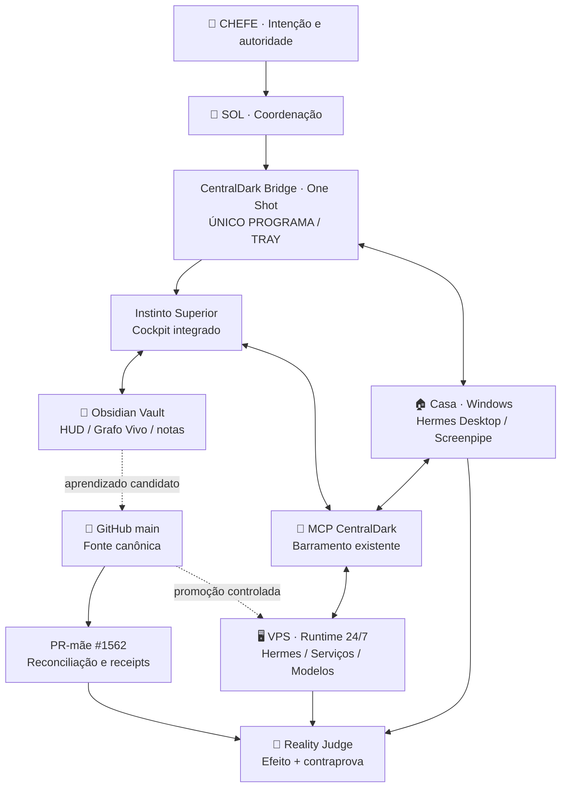

# 🪬 CENTRALDARK — INSTINTO SUPERIOR

**Design 4K · Sistema único integrado · 08/10/2026**  
**Tipo:** especificação visual e mapa de convergência da imagem produzida nesta conversa.  
**Estado:** **CONCEITO VISUAL**, não prova de que todos os serviços estejam online ou integrados.

## 1. Intenção do CHEFE

**UM SISTEMA · UM PROGRAMA DE ENTRADA · UM ÍCONE AO LADO DO RELÓGIO.**

Evoluir o **CentralDark Bridge · One Shot** para ser a porta de entrada do **CentralDark — Instinto Superior**, preservando as capacidades já existentes, sem criar outro aplicativo, outro núcleo, outro HUD, segundo MCP ou projeto paralelo.

- O **One Shot** abre, controla a janela e permanece acessível pelo **Tray do Windows**.
- O **Instinto Superior** é o cockpit integrado; não um sistema concorrente.
- O **Obsidian Vault** apresenta memória, notas, mapas, HUD e Grafo Vivo.
- A **Casa** oferece a interface humana, Screenpipe, Hermes Desktop e laboratório local.
- A **VPS** hospeda os serviços que precisam operar 24/7, independentemente da janela do Windows.
- A **main do GitHub** conserva fonte, aprendizados, contratos, mudanças e provas.
- O **PR-mãe #1562** é o ponto de reconciliação/registro, **não** um segundo executor nem autorização automática de merge.

## 2. Desenho da tela 4K

**Estética:** central de comando futurista, tema escuro, neon azul/ciano com sinais verdes, âmbar e vermelhos, painéis nítidos e texto em português.

**Composição:**

1. **Topo:** “CENTRALDARK — SISTEMA ÚNICO INTEGRADO” e leis `REUSE_BEFORE_CREATE`, `ONE_SYSTEM_ONLY`, `ONE_WRITER_PER_SCOPE`, `UNKNOWN_IS_NOT_PASS`.
2. **Centro:** janela **CentralDark Bridge · One Shot / CentralDark — Instinto Superior**, logo ocular 🪬, anel com Casa, Obsidian, GitHub, VPS e Bots, menu lateral de módulos existentes.
3. **Esquerda, alto:** Casa/Windows, Vault Obsidian e `HUD.html`.
4. **Esquerda, baixo:** exemplo do **menu do mesmo programa na bandeja do Windows**: Abrir Instinto Superior, Obsidian, HUD, Hermes, Guardião, Screenpipe, MCP, GitHub, Logs, Minimizar, Sair.
5. **Direita, alto:** GitHub (`main`, commits, PRs, CI) e VPS (serviços e disponibilidade).
6. **Direita, meio/baixo:** serviços reutilizados (Hermes, Omni Router, Screenpipe, Docker/modelo, Tailscale), bots Telegram e evidências.
7. **Rodapé:** conectores, runtimes/modelos, memória, aprendizados, Grafo Vivo, Reality Judge.
8. **Setas bidirecionais:** integração entre superfícies pelo barramento existente; seta **não prova** que o vínculo esteja funcionando.

## 3. Mapa unificado — os mesmos donos, sem cópias

**Nota:** o fluxograma expressa a **topologia desejada** e os owners existentes. Não confundir desenho, código disponível, processo iniciado, sincronização provada e deploy.

## 4. Componentes concretos identificados

| Elemento | Local ou owner existente | Uso na integração |
|---|---|---|
| Vault da Casa | `C:\Users\Administrador\Documents\Obsidian Vault\🪬Centraldark -HUD🪬` | Origem do HUD, memória e mapas locais |
| HUD do Vault | `HUD.html` | Superfície visual existente, com abas HUD / MAPA / FORJA |
| Plugin Grafo Vivo | `.obsidian/plugins/centraldark-grafo-vivo/` | Visualização e integração com o Hub/Grafo |
| Bridge local do Vault | `CENTRALDARK-CORPO-UNICO-HUD-BRIDGE.ps1` | Monitoramento e probes existentes; evitar rodar um segundo laço se o One Shot já for dono |
| Logs locais | `CENTRALDARK-CORPO-UNICO-HUD-LOGS.bat` | Referência de interface/observabilidade existente, não segundo cockpit definitivo |
| One Shot | `CentralDark-Unified-OneShot` / `CentralDarkBridge.exe` | Mesmo programa Windows, janela + Tray e autenticação |
| MCP canônico | `apps/modulos/mcp` | Control plane, autenticação e ferramentas |
| Código do HUD canônico | `docs/HUD/HUD.html` | Fonte versionada do HUD no GitHub |
| Instinto Superior visual | `public/central-dark-instinct-2` | Superfície visual canônica indicada pelo plano do cockpit |
| Mapa canônico | `docs/CONSCIENCIA/MAPA-DO-CEREBRO.md` | **Atualizar esse mapa**, não abrir outro |
| Plano cockpit/OS | `docs/ARQUITETURA/CENTRALDARK-INSTINTO-SUPERIOR-OS/INVENTARIO-KERNEL-PROPRIO.md` | Owner existente da evolução de interface/OS |
| PR-mãe | `#1562` | Rastro central de reconciliação; `NÃO MERGEAR` enquanto essa for a trava vigente |

## 5. O que preservar no One Shot

- **Um único processo para janela e Tray**, quando esse contrato estiver implementado/validado na versão recuperada.
- **OAuth central do MCP**, perfis isolados, cache protegido localmente e consentimento humano quando necessário.
- **Conexão Casa ↔ VPS** com as rotas já autorizadas; Tailscale e Desktop Commander como capacidades existentes, sem tomar o lugar do MCP canônico.
- **Screenpipe local**, Hermes, bots, logs, receipts e monitoramento, evitando duplicar processos existentes.
- **HUD/Obsidian abertos pela janela e pelo Tray do One Shot**, reutilizando arquivos originais em vez de clonar o Vault.
- **Sem apagar legado que ainda tem consumidor único comprovado**.

## 6. Prova atual ≠ imagem ilustrativa

A arte 4K é um **mockup de arquitetura**. Os indicadores, percentuais, horários e marcas de online representados nela são **visuais**, não medições de produção. A tela final deverá consultar **as fontes atuais** e mostrar `PASS`, `FAIL` ou `UNKNOWN` de acordo com evidência.

**Medições desta sessão (08/10/2026):**

- 🟢 Vault e `HUD.html` encontrados na Casa; plugin Grafo Vivo e quatro entradas de plugins presentes.
- 🟢 HUD de uma cópia local do repositório respondeu HTTP 200.
- 🟢 AionUi, Hermes e Screenpipe observados como processos no Windows em leitura anterior.
- ⚪ Obsidian **não estava em execução** no momento da leitura.
- ⚪ `CentralDarkBridge.exe` **não foi localizado em execução nem no caminho histórico de instalação**. Não declarar integração One Shot entregue.
- ⚪ Sincronização bidirecional Obsidian ↔ VPS **não comprovada**.
- ⚪ VPS com worktree/branch diferente da main e alterações locais: **não sincronizar por reset/pull cego**.
- 🟢 GitHub `main` medido nesta conversa em `fc87e65e9d0a4a8197f5ee7da724593a8458c539`; valor histórico de medição, revalidar antes de qualquer escrita.

## 7. Menor delta contínuo

1. **Reusar** `docs/CONSCIENCIA/MAPA-DO-CEREBRO.md` como mapa de navegação; reaproveitar o plano já existente do Instinto Superior.
2. **Recuperar a fonte/binário original do One Shot** pela linhagem documentada antes de modificar a interface. Não inventar substituto.
3. **Adicionar no programa original**, sem segundo processo, as entradas de menu `Instinto Superior`, `HUD` e `Obsidian`, apontando para os mesmos owners/arquivos.
4. **Conectar sensores reais** de Casa, VPS, GitHub, Hermes e Hub ao HUD existente; qualquer rota não medida exibe `UNKNOWN`.
5. **Testar** Tray minimiza/restaura, OAuth e perfis preservados, mesmo processo, links corretos e funcionamento com Casa offline para o que pertence à VPS.
6. **Registrar só o delta comprovado** no owner existente e no PR-mãe #1562; promover à main somente após regras de CI/merge e readback.

## 8. Peles visuais no Designer — implementação incremental

**@code_ref:** `apps/instinto-superior/src/components/central/DesignCenter.tsx`  
**@last_updated:** `2026-10-20T22:58:54Z`  
**@estado:** implementado no source; publicação, instalação, render autenticado e ACP E2E permanecem `UNKNOWN` até medição específica.

O Designer existente materializa quatro composições visuais no mesmo cockpit, sem criar outro runtime, outro Hermes ou outro armazenamento:

| Pele | Tema persistido compatível | Intenção visual | Superfícies compostas |
|---|---|---|---|
| `DEFAULT` | `default` | orientação geral e base canônica | Visão geral, Design Center, Hermes |
| `MONKPUP` | `ouro` | forja silenciosa, memória e precisão | Minha Oficina, Ledger, Mapa de owners |
| `OPERATOR` | `ops` | operação, rotas e estado | Sincronização, Raio-X Vivo, Receipts |
| `DREAM REVIEWER` | `esmeralda` | revisão, padrões e aprendizado | Dream Reviewer, Goals, Auditoria |

Os valores antigos `default`, `ouro`, `ops` e `esmeralda` continuam aceites pela chave `centraldark.cockpit.pele`; os nomes novos são aliases visuais apresentados no Designer. A seleção continua a usar o armazenamento existente e não constitui prova de que Hermes, ACP, publicação ou deploy estejam ligados.

### Regra final

> **Um sistema CentralDark. Um Bridge · One Shot. Um ícone no relógio. Um mapa canônico.**  
> O passado serve de linhagem e prova reutilizável. O que muda é apenas o menor delta ainda não entregue.

**Referências canônicas no GitHub:**

- [Mapa do Cérebro](https://github.com/ServerVpss/CentralDark/blob/main/docs/CONSCIENCIA/MAPA-DO-CEREBRO.md)
- [Inventário do Instinto Superior](https://github.com/ServerVpss/CentralDark/blob/main/docs/ARQUITETURA/CENTRALDARK-INSTINTO-SUPERIOR-OS/INVENTARIO-KERNEL-PROPRIO.md)
- [HUD](https://github.com/ServerVpss/CentralDark/blob/main/docs/HUD/HUD.html)
- [Bridge único / Tray e MCP](https://github.com/ServerVpss/CentralDark/blob/main/docs/RECEIPTS/CENTRALDARK_DIRECT_MCP_BRIDGE_2026-09-18.md)
- [PR-mãe #1562](https://github.com/ServerVpss/CentralDark/pull/1562)
