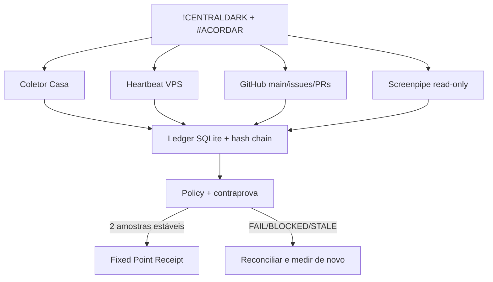

# Arquitetura

O Fabric não cria outro cérebro. Ele estende os contratos do Trigger Fabric já presentes no
CentralDark e fornece a peça executável que faltava: um denominador temporal único.

## Invariantes

1. Um escritor por escopo, com lease.
2. Nenhum `UNKNOWN`, `BLOCKED` ou `STALE` vira verde.
3. Screenpipe é sensor, nunca autoridade de merge.
4. Segredos entram por ambiente e são redigidos antes do ledger.
5. Main só muda por PR provado no mesmo HEAD.
6. Duas amostras iguais são o mínimo; aumente para três em ambientes instáveis.

