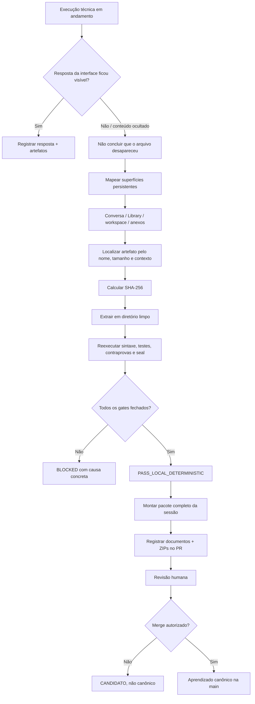
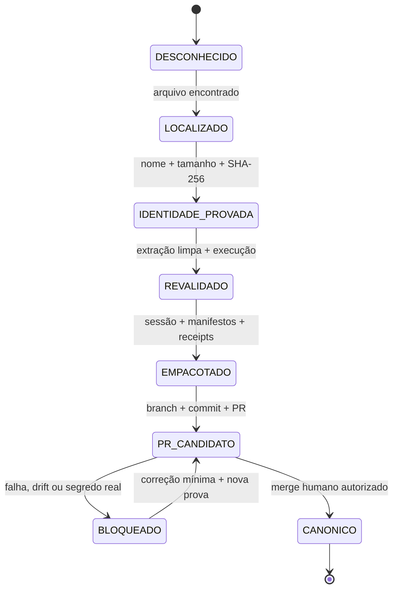
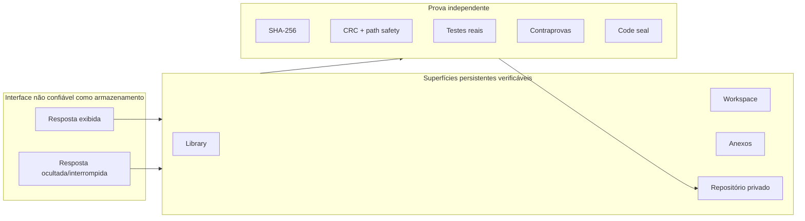
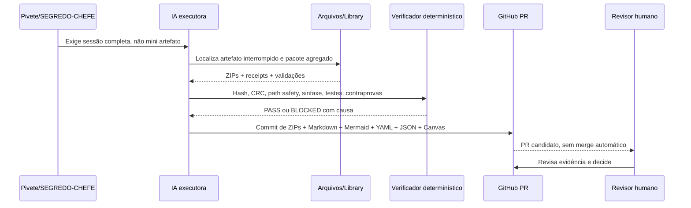

# Mapas Mermaid — recuperação, prova e aplicação segura

## 1. Cadeia de custódia da evidência

## 2. Máquina de estados anti-falso-verde

## 3. Fronteiras de confiança

## 4. Aplicação na CentralDark

