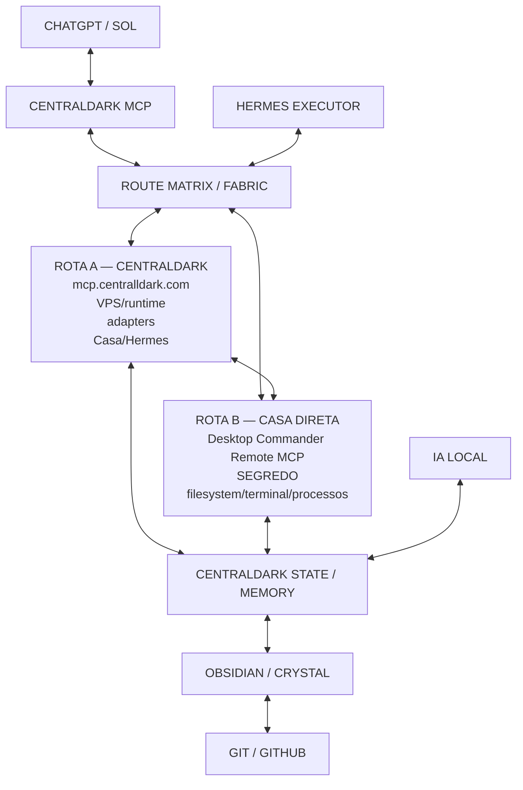

# CENTRALDARK — MATRIZ BIDIRECIONAL / GOLDEN CAPSULE

**ID canônico:** `CENTRALDARK_BIDIRECTIONAL_ROUTE_FABRIC_01`  
**Cápsula:** `CENTRALDARK_GOLDEN_CAPSULE_01`  
**Objetivo:** transformar a CentralDark em um painel administrativo local da Casa, com memória viva, execução local por IA, duas rotas bidirecionais e preservação do ouro no Git/GitHub.

---

## 1. VISÃO

A CentralDark funciona como uma inteligência artificial local da Casa.

Ela deve:

- trabalhar localmente;
- administrar e observar a própria oficina;
- acumular conhecimento;
- usar ChatGPT/SOL como oráculo quando necessário;
- usar Hermes como executor;
- usar MCP como barramento;
- usar Obsidian como memória viva;
- usar Git/GitHub como preservação/versionamento do ouro;
- permitir acesso remoto quando o CHEFE estiver fora de casa;
- continuar operando mesmo que uma rota esteja indisponível;
- reconstruir seu ambiente a partir do cristal preservado.

A regra central é:

```text
CHATGPT PENSA
→ HERMES EXECUTA
→ VMWARE CONTÉM
→ DOCKER COMPARTIMENTA
→ MCP CONECTA
→ OBSIDIAN ACUMULA
→ GIT/GITHUB PRESERVA
→ IA LOCAL OPERA
→ REALIDADE JULGA
```

---

## 2. PAPÉIS

### CHEFE / SEGREDO

Responsável por:

- intenção;
- prioridade;
- autorização;
- decisão final;
- direção da evolução da CentralDark.

### CHATGPT / SOL

Responsável por:

- raciocínio;
- diagnóstico;
- arquitetura;
- contraprova;
- coordenação;
- consolidação;
- definição do próximo delta.

### HERMES / PIVETE

Responsável por:

- terminal;
- filesystem;
- Git;
- testes;
- builds;
- browser;
- MCPs;
- execução mecânica;
- observação do estado local;
- receipts;
- continuidade.

### REALIDADE

É o juiz final.

```text
CURRENT > HISTORY
UNKNOWN != PASS
ACTION != PROOF
DOCUMENTED != EXECUTED
```

---

## 2.1 AUTORIDADE OPERACIONAL

```text
CHEFE_AUTHORITY = final
MODEL = reasoning engine
HERMES = executor
MCP = capability bus
TOOLS = actuators
REALITY = judge

IF intent_explicit
AND capability_exists
AND action_is_inside_authorized_domain
THEN execute
→ verify
→ receipt
→ continue
```

O modelo é motor substituível. Ele não cria uma autoridade paralela sobre a Casa. Dentro do território local definido pelo CHEFE, intenção explícita vira objetivo operacional; o sistema procura a capacidade existente, executa, mede o efeito, registra e continua.

---

## 3. GOLDEN CAPSULE

A oficina da CentralDark fica encapsulada em um disco operacional separado.

Estrutura preferida:

```text
WINDOWS / CASA HUMANA
        ⇅
DISCO OPERACIONAL CENTRALDARK
        ⇅
VMWARE
        ⇅
VM LINUX
        ⇅
DOCKER ENGINE
        ⇅
HERMES + MCP + BROWSER + MEMÓRIA + IA LOCAL
```

### Camadas

**Windows**
- área humana;
- painel local;
- controle do CHEFE;
- superfície administrativa.

**Disco operacional**
- contém a oficina;
- mantém a CentralDark separada do restante da Casa;
- pode ser substituído/reconstruído.

**VMware**
- fronteira externa da cápsula.

**VM Linux**
- sistema base da oficina.

**Docker Engine**
- compartimenta serviços e ferramentas.

**Hermes**
- executor local.

**IA local**
- modelos locais para tarefas mecânicas, memória, classificação, parsing e execução.

---

## 4. MATRIZ BIDIRECIONAL

A CentralDark possui duas rotas dentro do mesmo sistema.

```text
                    CHATGPT / SOL
                         ⇅
                   CENTRALDARK MCP
                         ⇅
                ROUTE MATRIX / FABRIC
                 ⇅                 ⇅
     ┌────── ROTA A ──────┐   ┌────── ROTA B ──────┐
     │                     │   │                     │
     │ CENTRALDARK         │   │ CASA DIRETA         │
     │ mcp.centralldark.com│   │ Desktop Commander  │
     │ VPS/runtime         │   │ Remote MCP          │
     │ adapters            │   │ SEGREDO             │
     │ Casa/Hermes         │   │ filesystem          │
     │                     │   │ terminal/processos  │
     └──────────⇅──────────┘   └──────────⇅──────────┘
                 \               /
                  \      ⇅      /
                   CENTRALDARK
                  STATE / MEMORY
                       ⇅
                OBSIDIAN / CRYSTAL
                       ⇅
                     GITHUB
```

### ROTA A — CENTRALDARK

```text
mcp.centralldark.com
→ VPS/runtime
→ adapters
→ Casa/Hermes
```

### ROTA B — CASA DIRETA

```text
Desktop Commander Remote MCP
→ SEGREDO
→ filesystem
→ terminal
→ processos
```

### Regra

```text
DUAL_ROUTE=true
FULL_DUPLEX=true
ONE_SYSTEM_ONLY=true
ONE_STATE_FABRIC=true
ONE_MEMORY_PLANE=true
ROUTE_CROSS_PROOF=true
```

As duas rotas podem:

- executar;
- observar;
- devolver estado;
- produzir receipt;
- contraprovar uma à outra;
- continuar funcionando de forma independente.

---

## 5. ROUTE MATRIX

Cada capacidade deve ser chamada por nome lógico.

Exemplo:

```text
centraldark.devices.list
centraldark.files.read
centraldark.files.write
centraldark.git.status
centraldark.git.commit
centraldark.hermes.execute
centraldark.memory.search
centraldark.memory.ingest
centraldark.browser.open
centraldark.runtime.health
```

A CentralDark decide internamente qual rota usar.

Exemplo:

```text
CAPABILITY=devices.list

PRIMARY=centraldark_mcp
SECONDARY=desktop_commander_remote
```

ou:

```text
CAPABILITY=filesystem.read

PRIMARY=desktop_commander_remote
SECONDARY=centraldark_bridge
```

O modelo não precisa saber qual transporte físico foi usado.

---

## 6. BIDIRECIONALIDADE

O fluxo não é apenas:

```text
SOL → CASA
```

Também existe:

```text
CASA → SOL
HERMES → CENTRALDARK
TOOL → MEMORY
RUNTIME → STATE
EVENTO → RECEIPT
OBSIDIAN → MCP
GITHUB → CASA
CASA → GITHUB
```

Formato de evento:

```text
EVENT_ID
SOURCE_ROUTE
SOURCE_DEVICE
INTENT_ID
CAPABILITY
OWNER
TIMESTAMP
HASH
CAUSATION_ID
RESULT
RECEIPT
```

Objetivo:

- impedir loops;
- reconhecer eventos repetidos;
- ligar causa e efeito;
- manter rastreabilidade.

---

## 7. MEMÓRIA VIVA

Tudo que os agentes observam pode entrar como matéria.

Fontes:

```text
ChatGPT
Claude
Hermes
MCP
browser
terminal
logs
arquivos
Git
receipts
tool calls
resultados
descobertas
```

Pipeline:

```text
RAW_MATERIAL
→ NORMALIZE
→ PROVENANCE
→ DEDUPE
→ CANDIDATE
→ COUNTERPROOF
→ GOLD
→ OWNER_BINDING
→ TEST/GATE
→ CRYSTAL
→ VECTOR/GRAPH INDEX
→ RETRIEVAL SEMÂNTICO
```

Guardar matéria não significa promover tudo para verdade.

---

## 8. OBSIDIAN

O Obsidian é a memória viva local.

Funções:

- armazenar notas;
- consolidar conhecimento;
- ligar decisões;
- cruzar sessões;
- organizar a inteligência acumulada;
- servir como superfície de consulta;
- alimentar retrieval semântico;
- guardar histórico útil.

Estrutura sugerida:

```text
docs/
├── RAW/
├── CANDIDATES/
├── GOLD/
├── CRYSTAL/
├── RECEIPTS/
├── OWNERS/
├── ROUTES/
├── MEMORY/
├── CASA/
├── HERMES/
└── ARCHITECTURE/
```

A organização pode evoluir automaticamente.

O CHEFE não precisa administrar manualmente cada nota.

---

## 9. GIT / GITHUB

Git/GitHub preserva:

- cristal;
- inteligência útil;
- owners;
- recipes;
- scripts;
- manifests;
- receipts;
- fingerprints;
- configurações úteis;
- histórico de evolução.

Fluxo:

```text
LOCAL
→ mudança útil
→ classifica
→ cristaliza
→ commit
→ push
→ GitHub
```

E o caminho inverso:

```text
GitHub
→ pull/sync
→ Casa
→ Obsidian
→ runtime
```

GitHub é também backup externo do ouro.

---

## 10. PAINEL CENTRALDARK LOCAL

A CentralDark deve funcionar como painel administrativo da Casa.

O painel deve mostrar, no mínimo:

```text
CASA
HERMES
MCP
ROTAS
DISPOSITIVOS
PROCESSOS
PORTAS
MEMÓRIA
GIT
RECEIPTS
MODELOS LOCAIS
BROWSER
AGENTES
FIXED POINTS
SAÚDE DO SISTEMA
```

Pode ser acessado:

```text
LOCALMENTE
→ dentro da Casa

REMOTAMENTE
→ quando o CHEFE estiver fora
→ via rota online disponível
```

O painel não precisa ser um sistema separado.

Ele é uma superfície do mesmo núcleo.

---

## 11. IA LOCAL

A IA local existe para trabalhar barato, rápido e continuamente.

Pode cuidar de:

- classificação;
- dedupe;
- parsing;
- indexação;
- embeddings;
- busca semântica;
- resumo;
- receipts;
- organização de notas;
- inspeções repetitivas;
- tarefas mecânicas;
- monitoramento.

ChatGPT/SOL fica responsável pelo raciocínio forte e decisões arquiteturais quando necessário.

Regra:

```text
MODELO FORTE PENSA POUCO E BEM
MÁQUINA LOCAL EXECUTA MUITO E BARATO
```

---

## 12. MODELOS LOCAIS PRESERVADOS

A frente Danda preservou fingerprints e configuração de:

```text
Jan-v3.5-4B
Jan-code-4b
sentence-transformer-mini
```

Os GGUF pesados não precisam fazer parte do cristal.

O suficiente para reconstrução é:

```text
nome
configuração
hash
tamanho
caminho esperado
função
```

---

## 13. CURRENT DO DANDA

Estado já preservado:

```text
CRYSTAL_ITEMS=13
REHASH_OK=13
REHASH_BAD=0
MISSING=0
SECRET_PATTERN_HITS=0
```

Branch:

```text
preservacao/casa-danda-arqueologia-20260926
```

Inclui:

```text
SOUL local
mapa dos monitores
watchdogs
UnifiedRuntime profiles
LogCollector
configs de modelos Jan
manifesto de modelos
config Hermes sanitizada
manifesto do cristal
receipt de arqueologia
```

---

## 14. ADMINISTRADOR / CLAUDE

Claude ficou responsável pelo cone Administrador.

Princípio:

```text
ONE_WRITER_PER_SCOPE
```

Convergência:

```text
CLAUDE
→ ADMINISTRADOR
→ PRESERVAÇÃO / RECONCILIAÇÃO

SOL
→ DANDA
→ CRISTAL

AMBOS
→ GITHUB
→ MESMO SISTEMA
```

---

## 15. O QUE É OURO

Preservar:

```text
arquitetura
regras
skills
owners
recipes
scripts
MCPs
Hermes
Obsidian/BRAIN
memória
receipts
fingerprints
bindings
provas
automação
testes
modelos/configuração
conhecimento único
```

Descartar:

```text
cache
temporários
downloads
build gerado
node_modules
duplicatas
cópias antigas
terceiros reinstaláveis
logs comuns sem valor
material sem vínculo com CentralDark
```

---

## 16. GOLDEN CAPSULE BACKUP

Existem três níveis de preservação.

### A. CRISTAL

Git/GitHub.

Pequeno e reconstruível.

### B. BACKUP DA MEMÓRIA

Obsidian + docs + manifests + receipts + artefatos úteis.

Pode ficar em nuvem.

### C. SNAPSHOT DA VM

Último estado funcional completo da oficina.

Serve para voltar rápido.

Regra:

```text
CRISTAL = inteligência
SNAPSHOT = corpo
BACKUP = recuperação
```

---

## 17. GOLDEN STATE

Uma cápsula recebe estado `GOLDEN` quando houver:

```text
BOOT_PASS
HERMES_PASS
MCP_PASS
ROUTE_A_PASS
ROUTE_B_PASS
LOCAL_AI_PASS
MEMORY_RETRIEVAL_PASS
OBSIDIAN_GIT_SYNC_PASS
BROWSER_TOOL_PASS
RESTORE_TEST_PASS
RECEIPT_PASS
```

---

## 18. RESTAURAÇÃO

Se o computador ou a cápsula desaparecer:

```text
máquina limpa
→ instalar VMware
→ criar VM Linux
→ instalar Docker Engine
→ restaurar CentralDark
→ restaurar Hermes
→ restaurar MCP
→ restaurar Obsidian
→ sincronizar GitHub
→ baixar/recriar modelos locais
→ reconstruir índices
→ subir painel
→ testar rotas
→ comparar receipts
→ declarar funcional
```

---

## 19. EVOLUÇÃO PARA CENTRALDARK OS

Sequência:

```text
CENTRALDARK CORE
→ GOLDEN CAPSULE
→ CENTRALDARK OS EDITION
→ BOOTÁVEL
→ INSTALADOR
→ RECOVERY
→ ROLLBACK
→ NATIVE KERNEL (somente depois)
```

No início:

```text
Linux = kernel físico
CentralDark = kernel cognitivo
Hermes = executor
MCP = barramento
Obsidian = memória
GitHub = cristal
SOL = oráculo
Reality Judge = validação
```

---

## 20. PRÓXIMA CASA APÓS FORMATAÇÃO

Ordem sugerida:

```text
1. Windows limpo
2. disco operacional CentralDark
3. VMware
4. VM Linux
5. Docker Engine
6. CentralDark MCP
7. Hermes
8. Desktop Commander adapter
9. Obsidian
10. Git sync
11. IA local
12. browser bridge
13. Route Matrix
14. painel local
15. rota remota
16. restauração do cristal
17. contraprova
18. Golden State
```

---

## 21. PRINCÍPIOS CANÔNICOS

```text
CURRENT > HISTORY
UNKNOWN != PASS
REALITY_IS_JUDGE
REUSE_BEFORE_CREATE
EVOLVE_EXISTING_BEFORE_CREATE
ONE_SYSTEM_ONLY
ONE_OWNER_PER_CAPABILITY
ONE_WRITER_PER_SCOPE
MULTI_ROUTE=true
FULL_DUPLEX=true
ROUTE_CROSS_PROOF=true
```

---

## 22. FRASE OPERACIONAL

```text
CENTRALDARK É UMA INTELIGÊNCIA ARTIFICIAL LOCAL DA CASA.

ELA PENSA COM ORÁCULOS,
EXECUTA COM HERMES,
SE COMUNICA POR MCP,
LEMBRA PELO OBSIDIAN,
PRESERVA PELO GIT,
TRABALHA DENTRO DA GOLDEN CAPSULE
E USA A REALIDADE COMO JUIZ.
```

---

## 23. DIAGRAMA MERMAID



---

## 24. STATUS RESUMIDO

```text
CENTRALDARK_MCP = EXISTE
ROTA_A = EXISTE / depende do runtime CentralDark
ROTA_B = PROVADA com SEGREDO via Desktop Commander Remote MCP
DANDA_CRYSTAL = PRESERVADO
ADMINISTRADOR_PRESERVATION = PRESERVADO/FECHADO SEGUNDO RELATÓRIO CLAUDE
GOLDEN_CAPSULE = ARQUITETURA CANÔNICA NESTE DOCUMENTO
OBSIDIAN_AS_LOCAL_MEMORY = DEFINIDO
GITHUB_AS_EXTERNAL_CRYSTAL = DEFINIDO
CENTRALDARK_OS_BOOTABLE = AINDA NÃO PROVADO
NATIVE_KERNEL = FUTURO
```
