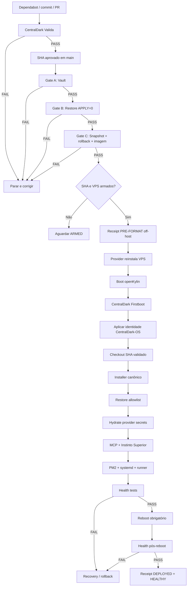

# CentralDark-OS autônomo para reinstalação, restore e auto-provisionamento da VPS

> **Proveniência:** deep research report do CHEFE, cristalizado no repo como owner de arquitetura.
> **Owner operacional irmão:** [`docs/INSTALADOR/24-rebuild-deterministico.md`](../../INSTALADOR/24-rebuild-deterministico.md) (rebuild determinístico executável) — este doc é o spec/pesquisa, não o substitui.
> **Owners já materializados deste spec:** `scripts/vps/centraldark-preformat-go-no-go.sh` (Gates A/B/C), `scripts/vps/centraldark-firstboot.sh` (first boot idempotente), `.github/workflows/centraldark-reinstall.yml` (orquestrador), `scripts/vps/contabo-control.py` (wrapper único Contabo — o "P0 provider" do report).
> `ONE_SYSTEM_ONLY=true · UNKNOWN != PASS · REALITY=JUDGE`

## Resumo executivo

A arquitetura correta é transformar a reinstalação da VPS em uma **máquina de estados determinística e idempotente**, não em uma sequência de comandos soltos. O fluxo deve ser: `CI verde → Gate A (Vault íntegro) → Gate B (restore/bootstrap em modo somente leitura) → Gate C (snapshot/rollback + rota de instalação comprovados) → ARMED → reinstalação → primeiro boot openKylin → identidade CentralDark-OS → restore allowlist → secrets/providers → MCP → runtime PM2/systemd → runner GitHub → health pós-reboot → receipt final`. Os arquivos-base já identificados no `ServerVpss/CentralDark` cobrem Vault, restore, hidratação de providers, roteamento de eventos e validação; o que falta para um sistema realmente autônomo é **um owner único de preflight/reinstall, um first-boot idempotente e uma prova externa de rollback**. O Dependabot pode alimentar esse fluxo, mas não deve possuir sozinho a autoridade destrutiva: ele leva o código até o verde; o workflow determinístico, preso ao `main`, ao SHA exato, à instância allowlisted e a um estado `ARMED`, é quem pode reinstalar. Com as evidências disponíveis nesta sessão, a decisão conservadora é **`GO_REINSTALL=NO` neste instante**: Gate A aparenta estar maduro, Gate B tem o mecanismo `RESTORE_APPLY=0`, mas Gate C não possui nesta leitura uma prova primária suficiente de snapshot `READY` + rollback realmente disponível + imagem openKylin identificada. Assim que A+B+C produzirem receipts verdes para o mesmo SHA e a mesma VPS, a decisão muda automaticamente para `YES`.

## Inventário técnico do repositório

O núcleo já existente deve ser **reutilizado**, não substituído por uma segunda arquitetura. Os owners abaixo são owners lógicos; eles não afirmam ser entradas atuais de `CODEOWNERS`.

| Caminho / componente | Função no sistema autônomo | Owner lógico | Estado para este plano | Risco |
|---|---|---|---|---|
| [`scripts/vps/centraldark-vault-bootstrap-inventory.sh`](https://github.com/ServerVpss/CentralDark/blob/main/scripts/vps/centraldark-vault-bootstrap-inventory.sh) | Inventariar a VPS e gerar o Vault antes da destruição | Vault | Owner primário já identificado no repo | **Crítico** |
| [`scripts/vps/centraldark-os-bootstrap-restore.sh`](https://github.com/ServerVpss/CentralDark/blob/main/scripts/vps/centraldark-os-bootstrap-restore.sh) | Validar e posteriormente aplicar o restore | Bootstrap/Restore | Já existente; deve permanecer READONLY por default | **Crítico** |
| [`scripts/vps/hydrate-provider-secrets.sh`](https://github.com/ServerVpss/CentralDark/blob/main/scripts/vps/hydrate-provider-secrets.sh) | Reidratar credenciais/providers sem duplicar lógica de secrets | Providers | Reutilizar como único owner de hidratação | **Crítico** |
| [`docs/ARQUITETURA/CENTRALDARK-INSTINTO-SUPERIOR-OS/INVENTARIO-KERNEL-PROPRIO.md`](https://github.com/ServerVpss/CentralDark/blob/main/docs/ARQUITETURA/CENTRALDARK-INSTINTO-SUPERIOR-OS/INVENTARIO-KERNEL-PROPRIO.md) | Contrato arquitetural e inventário CentralDark-OS | Arquitetura | Já usado como owner documental | Médio |
| `.github/workflows/centraldark-validate.yml` | Validação determinística que deve substituir qualquer identidade operacional “Codex Validate” | CI CentralDark | Preservar o conceito `CentralDark Valida — determinístico`; confirmar que o arquivo está em `main` no SHA de execução | Alto |
| `.github/workflows/selo-fabric.yml` | Sensoriamento/receipts de eventos | HUB/Observabilidade | Não deve disparar reinstalação diretamente | Médio |
| [`MODULES/HUB/controls/notifications-and-sensors.json`](https://github.com/ServerVpss/CentralDark/blob/main/MODULES/HUB/controls/notifications-and-sensors.json) | Classificação dos eventos GitHub e roteamento para owners | HUB | Deve distinguir `evento` de `estado verde` | Alto |
| `.github/dependabot.yml` | Produzir PRs de atualização | Dependabot | Deve terminar em validação/merge, nunca possuir credencial destrutiva da VPS | Médio |
| `install.sh` | Instalador canônico pós-first-boot, caso esteja presente no HEAD-alvo | Installer | **Confirmar caminho/contrato exato no HEAD que será reinstalado** | **Crítico** |
| `CENTRALDARK_AI_BOOT.yaml` | Manifesto de boot/inteligência, caso seja o owner atual | Instinto Superior | **Confirmar owner e consumidores antes do GO** | Alto |
| `scripts/vps/centraldark-preformat-go-no-go.sh` **novo** | Consolidar Gates A/B/C e produzir JSON assinado/imutável | Preflight | Recomendo criar | **Crítico** |
| `scripts/vps/centraldark-firstboot.sh` **novo** | Único bootstrap pós-reinstalação; idempotente | First Boot | Recomendo criar | **Crítico** |
| `.github/workflows/centraldark-reinstall.yml` **novo** | Orquestrar preflight → provider → primeiro boot → provas | CI/Deploy | Recomendo criar | **Crítico** |
| `scripts/providers/contabo/` ou owner provider já existente | Encapsular GET de estado, snapshot, reinstall e recovery | Provider/Contabo | **Não inventar endpoint; consolidar owner existente ou criar wrapper único** | **Crítico** |
| `systemd: centraldark-firstboot.service` **novo** | Garantir retomada automática após reboot/falha de rede | Runtime | Instalado pela imagem/bootstrap | Alto |
| configuração PM2 canônica existente | Declarar processos Node/runtime e `pm2 save` | Runtime | Localizar owner; evitar scripts concorrentes criando processos duplicados | Alto |
| `actions.runner.*.service` | Executor self-hosted GitHub | Runner | Deve haver identidade/diretório exclusivos por runner | Alto |

Os três arquivos VPS — inventário do Vault, restore e hidratação — são particularmente importantes porque separam corretamente três responsabilidades diferentes: **capturar estado**, **restaurar estado** e **reidratar credenciais**. Misturar essas etapas em `install.sh` tornaria rollback, auditoria e idempotência muito mais difíceis.

A arquitetura alvo deve ficar assim:

```text
GitHub / main / SHA imutável
          │
          ▼
CentralDark Valida
          │ PASS
          ▼
PRE-FORMAT
├── Gate A: VAULT
├── Gate B: RESTORE/BOOTSTRAP
└── Gate C: PROVIDER/ROLLBACK/IMAGEM
          │
      A=B=C=PASS
          │
          ▼
     REINSTALL_ARMED
          │
          ▼
   Contabo / VPS
          │
          ▼
 openKylin técnico
          │
          ▼
 CentralDark-OS
          │
          ▼
 centraldark-firstboot
          │
          ├── Git SHA pinado
          ├── install.sh
          ├── Vault restore
          ├── provider secrets
          ├── MCP
          ├── Instinto Superior
          ├── PM2/systemd
          ├── GitHub Runner
          └── health
          │
          ▼
        REBOOT
          │
          ▼
 POST-REBOOT PROOF
          │
          ▼
 DEPLOYED + HEALTHY
```

Uma regra de projeto é fundamental: **openKylin é substrato técnico, não identidade de produto**. O branding visível pode ser CentralDark-OS/Instinto Superior, mas o bootstrap não deve destruir metadados internos necessários ao gerenciador de pacotes ou à detecção de compatibilidade da distribuição. Em outras palavras, trocar `PRETTY_NAME`, splash, Plymouth, GRUB, login e assets é diferente de adulterar arbitrariamente identificadores usados por software para dependências.

## Gates pré-formatação e comandos de prova

A formatação somente deve ser autorizada quando os três gates estiverem verdes **para a mesma instância, mesmo snapshot, mesmo Vault e mesmo SHA do Git**.

### Matriz dos gates

| Gate | O que precisa provar | PASS mínimo | Se falhar |
|---|---|---|---|
| **A — Vault** | Tudo necessário para reconstrução existe fora do estado descartável da VPS e possui integridade verificável | archive legível + SHA OK + inventário/allowlist + cópia off-host + nenhum segredo em log | **NO-GO** |
| **B — Bootstrap/Restore** | O novo sistema sabe exatamente o que restaurará sem escrever no modo de ensaio | `RESTORE_APPLY=0` retorna 0, todas as dependências/owners resolvidos, nenhum item crítico `UNKNOWN` | **NO-GO** |
| **C — Recovery/Reinstall** | A destruição tem retorno real e a nova instalação tem rota conhecida | snapshot `READY`, rollback/recovery verificável no provider, acesso out-of-band, imagem/ID openKylin definida, firstboot conhecido | **NO-GO absoluto** |

### Preparação comum

Não hardcode o caminho do repo sem confirmar:

```bash
set -Eeuo pipefail
umask 077

REPO="${CENTRALDARK_REPO:-/root/CentralDark}"

test -d "$REPO/.git" || {
  echo "FAIL: repo não encontrado em $REPO" >&2
  exit 1
}

cd "$REPO"

git fetch origin main --prune
printf 'LOCAL_SHA=%s\n'  "$(git rev-parse HEAD)"
printf 'REMOTE_SHA=%s\n' "$(git rev-parse origin/main)"
git status --short
git rev-list --left-right --count HEAD...origin/main
```

Para uma reinstalação determinística, o preflight deve registrar o SHA final. Uma árvore suja não deve ser silenciosamente descartada:

```bash
test -z "$(git status --porcelain)" || {
  echo "NO_GO: working tree dirty"
  exit 20
}
```

Se a VPS estiver deliberadamente executando um commit diferente de `origin/main`, isso precisa aparecer no receipt; não use `git reset --hard` para “resolver” essa divergência antes de inventariar o que ela contém.

### Gate A — Vault

Primeiro, syntax/readback dos scripts:

```bash
cd "$REPO"

bash -n scripts/vps/centraldark-vault-bootstrap-inventory.sh
bash -n scripts/vps/centraldark-os-bootstrap-restore.sh
bash -n scripts/vps/hydrate-provider-secrets.sh
```

Localize o Vault mais recente sem imprimir o conteúdo:

```bash
sudo find /root /var/backups /opt \
  -xdev \
  -type f \
  -name 'Vault-Cofre-CentralDark-*.tar.gz' \
  -printf '%T@ %p\n' 2>/dev/null |
  sort -nr |
  head -n 5
```

Depois defina explicitamente qual archive será a fonte de restauração:

```bash
VAULT='/CAMINHO/EXATO/Vault-Cofre-CentralDark-XXXX.tar.gz'

test -f "$VAULT"
test -s "$VAULT"
test -f "${VAULT}.sha256"
```

Valide a soma sem revelar segredo:

```bash
cd "$(dirname "$VAULT")"
sha256sum -c "$(basename "${VAULT}.sha256")"
```

Se o formato do sidecar for diferente, a regra é a mesma: **hash armazenado fora do próprio archive e readback `OK`**.

Teste estrutural:

```bash
gzip -t "$VAULT"
tar -tzf "$VAULT" >/dev/null
```

Bloqueie path traversal antes de qualquer extração:

```bash
if tar -tzf "$VAULT" |
   awk '
     /^\/+/ { bad=1 }
     /(^|\/)\.\.(\/|$)/ { bad=1 }
     END { exit bad ? 0 : 1 }
   '
then
  echo "NO_GO: archive contém caminho inseguro"
  exit 21
fi
```

Cheque nomes duplicados:

```bash
DUP_COUNT="$(
  tar -tzf "$VAULT" |
  LC_ALL=C sort |
  uniq -d |
  wc -l
)"

printf 'DUPLICATE_PATHS=%s\n' "$DUP_COUNT"
test "$DUP_COUNT" -eq 0
```

Isso detecta duplicidade de **path**; deduplicação real de **conteúdo** deve acontecer no inventário por SHA-256, porque dois arquivos com nomes diferentes podem ser bytes idênticos.

O Gate A somente recebe PASS depois de uma cópia do archive **fora da VPS que será apagada**. Um Vault que existe exclusivamente em `/root` da VPS a ser formatada não é um backup de reinstalação.

### Gate B — Restore em ensaio

O teste obrigatório solicitado é:

```bash
cd "$REPO"

sudo env \
  CENTRALDARK_RESTORE_APPLY=0 \
  bash scripts/vps/centraldark-os-bootstrap-restore.sh
```

Para manter um receipt temporário protegido:

```bash
sudo sh -c '
  umask 077
  cd "'"$REPO"'"
  CENTRALDARK_RESTORE_APPLY=0 \
    bash scripts/vps/centraldark-os-bootstrap-restore.sh \
    > /root/centraldark-restore-dryrun.log 2>&1
'
RC=$?

printf 'RESTORE_DRYRUN_RC=%s\n' "$RC"
sudo grep -E \
  'PASS|FAIL|ERROR|MISSING|UNKNOWN|APPLY|READONLY|VAULT' \
  /root/centraldark-restore-dryrun.log || true

test "$RC" -eq 0
```

Não execute:

```bash
CENTRALDARK_RESTORE_APPLY=1
```

durante o pre-format. A finalidade do Gate B é provar que `1` **teria todos os inputs**, não realizar a restauração sobre a máquina antiga.

Um hardening muito útil é comprovar que o modo zero não abre destinos para escrita. Se `strace` estiver disponível:

```bash
sudo sh -c '
  umask 077
  cd "'"$REPO"'"
  CENTRALDARK_RESTORE_APPLY=0 \
    strace -f -qq \
      -e trace=openat,creat,rename,renameat,unlink,unlinkat,mkdir,mkdirat \
      -o /root/restore-readonly.strace \
      bash scripts/vps/centraldark-os-bootstrap-restore.sh
'

sudo grep -E \
  'O_WRONLY|O_RDWR|O_CREAT|rename|unlink|mkdir' \
  /root/restore-readonly.strace || true
```

Algumas escritas benignas de runtime podem aparecer; o critério é que **nenhum destino pertencente ao futuro restore seja modificado**. Idealmente o script zero produz apenas um plano.

Também faça o inventário dos owners que precisarão ressurgir:

```bash
systemctl list-units \
  --type=service \
  --all \
  --no-pager |
  grep -Ei 'centraldark|actions\.runner|cloudflare|mcp' || true

pm2 ping 2>/dev/null || true
pm2 list 2>/dev/null || true
pm2 jlist > /tmp/centraldark-pm2-before.json 2>/dev/null || true
```

E capture as portas, sem alterar firewall:

```bash
sudo ss -lntup
```

O Gate B deve falhar se o plano disser algo equivalente a:

```text
MISSING
UNKNOWN
NOT_IMPLEMENTED
RESTORE_OWNER_UNKNOWN
PROVIDER_SECRET_OWNER_UNKNOWN
```

em qualquer item necessário ao boot.

### Gate C — snapshot, rollback e rota de instalação

Este é o gate que **não deve ser falsificado de dentro do guest**. A própria VPS não consegue provar sozinha que um snapshot recuperável existe no plano de controle da Contabo. Essa prova precisa vir da API/MCP/provider control plane.

Como os IDs e os endpoints atuais não foram fornecidos, não é seguro inventá-los. O contrato correto é:

```bash
: "${CONTABO_INSTANCE_ID:?INSTANCE_ID ausente}"
: "${CONTABO_SNAPSHOT_ID:?SNAPSHOT_ID ausente}"
: "${CONTABO_INSTANCE_STATUS_URL:?URL GET da instância ausente}"
: "${CONTABO_SNAPSHOT_STATUS_URL:?URL GET do snapshot ausente}"
```

Com a credencial vindo de um owner secreto, nunca da linha de comando:

```bash
sudo test -f /etc/centraldark/providers/contabo.env
sudo test "$(stat -c '%a' /etc/centraldark/providers/contabo.env)" = "600"
```

Uma leitura GET genérica pode ser feita assim quando o owner tiver produzido URLs oficiais:

```bash
set -a
# Não executar com set -x.
source /etc/centraldark/providers/contabo.env
set +a

curl --fail --silent --show-error \
  -H "Authorization: Bearer ${CONTABO_ACCESS_TOKEN}" \
  "$CONTABO_INSTANCE_STATUS_URL" |
  jq .

curl --fail --silent --show-error \
  -H "Authorization: Bearer ${CONTABO_ACCESS_TOKEN}" \
  "$CONTABO_SNAPSHOT_STATUS_URL" |
  jq .
```

O wrapper definitivo deve transformar isso em algo simples e auditável:

```text
INSTANCE_FOUND=PASS
INSTANCE_ID_MATCH=PASS
SNAPSHOT_FOUND=PASS
SNAPSHOT_STATE=READY
ROLLBACK_ROUTE=PASS
OUT_OF_BAND_ACCESS=PASS
TARGET_IMAGE_FOUND=PASS
TARGET_IMAGE_ID=<id>
TARGET_ARCH=x86_64
```

A ação destrutiva de rollback **não** faz parte do Gate C. O que se testa antes da formatação é o caminho e a autoridade para acioná-la.

Também devem ser comprovados:

```text
VNC/recovery/rescue acessível
        +
imagem openKylin exata
        +
arquitetura correta
        +
método não interativo ou firstboot possível
        +
credencial SSH inicial definida
        +
GitHub/release acessível após first boot
```

Até existir `TARGET_IMAGE_ID` ou uma rota de custom-image/ISO comprovada, **Gate C é NO-GO**.

## CI, Dependabot e reinstalação determinística

A principal mudança conceitual é esta:

```text
Dependabot
    ↓
PR
    ↓
CentralDark Valida
    ↓
auto-merge somente verde
    ↓
push em main
    ↓
CentralDark Valida do SHA mergeado
    ↓ PASS
workflow_run
    ↓
Pre-format A/B/C
    ↓
ARMED?
    ├── NÃO → parar verde, sem destruir nada
    └── SIM
         ↓
      Reinstall
```

O Dependabot não deve possuir diretamente:

```text
CONTABO client secret
snapshot-delete
reinstall permission
root SSH
Vault de produção
```

A função dele é produzir o delta. A autorização destrutiva pertence ao workflow de deploy.

O GitHub recomenda tratar com extremo cuidado workflows privilegiados disparados por outros workflows; `workflow_run` é particularmente sensível porque o segundo workflow pode ter acesso a secrets/credenciais que não estavam disponíveis ao workflow anterior. Portanto, não se deve fazer checkout e executar código arbitrário vindo de uma PR do Dependabot ou de um fork em um job que contém credenciais de reinstalação. A separação entre validação não privilegiada e deploy privilegiado é justamente o controle de segurança necessário. Fonte primária: [GitHub Actions — eventos que disparam workflows](https://docs.github.com/actions/using-workflows/events-that-trigger-workflows) e [GitHub Actions — segurança](https://docs.github.com/actions/security-for-github-actions).

### Workflow do orquestrador

Um modelo seguro:

```yaml
name: ⚙️ CentralDark Reinstall — determinístico

on:
  workflow_run:
    workflows:
      - "⚙️ CentralDark Valida — determinístico"
    types:
      - completed

  workflow_dispatch:
    inputs:
      sha:
        description: "SHA exato a reinstalar"
        required: true
        type: string

permissions:
  contents: read
  actions: read

concurrency:
  group: centraldark-reinstall-production
  cancel-in-progress: false

jobs:
  preflight:
    name: "🧭 GO/NO-GO"
    runs-on: self-hosted

    if: >-
      github.event_name == 'workflow_dispatch' ||
      (
        github.event.workflow_run.conclusion == 'success' &&
        github.event.workflow_run.head_branch == 'main' &&
        github.event.workflow_run.head_repository.full_name == github.repository &&
        github.event.workflow_run.event == 'push'
      )

    outputs:
      go_reinstall: ${{ steps.gate.outputs.go_reinstall }}
      sha: ${{ steps.sha.outputs.sha }}

    steps:
      - name: Resolver SHA imutável
        id: sha
        shell: bash
        run: |
          if [ "${{ github.event_name }}" = "workflow_run" ]; then
            SHA="${{ github.event.workflow_run.head_sha }}"
          else
            SHA="${{ inputs.sha }}"
          fi

          test -n "$SHA"
          echo "sha=$SHA" >> "$GITHUB_OUTPUT"

      - name: Checkout do SHA validado
        uses: actions/checkout@v4
        with:
          ref: ${{ steps.sha.outputs.sha }}
          persist-credentials: false

      - name: Executar Gates A/B/C
        id: gate
        shell: bash
        run: |
          set -Eeuo pipefail

          ./scripts/vps/centraldark-preformat-go-no-go.sh \
            --strict \
            --sha "${{ steps.sha.outputs.sha }}" \
            --receipt "$RUNNER_TEMP/go-no-go.json"

          jq -e '.go_reinstall == true' \
            "$RUNNER_TEMP/go-no-go.json"

          echo "go_reinstall=true" >> "$GITHUB_OUTPUT"

      - name: Publicar somente receipt sem segredos
        uses: actions/upload-artifact@v4
        with:
          name: "centraldark-preformat-${{ steps.sha.outputs.sha }}"
          path: ${{ runner.temp }}/go-no-go.json
          retention-days: 30

  reinstall:
    name: "🔥 Reinstalar VPS"
    needs: preflight

    if: needs.preflight.outputs.go_reinstall == 'true'

    environment:
      name: vps-reinstall-production

    runs-on: ubuntu-latest

    permissions:
      contents: read

    steps:
      - uses: actions/checkout@v4
        with:
          ref: ${{ needs.preflight.outputs.sha }}
          persist-credentials: false

      - name: Exigir ARM explícito
        shell: bash
        env:
          REINSTALL_ARMED: ${{ vars.REINSTALL_ARMED }}
          REINSTALL_ARMED_SHA: ${{ vars.REINSTALL_ARMED_SHA }}
          EXPECTED_SHA: ${{ needs.preflight.outputs.sha }}
        run: |
          set -Eeuo pipefail
          test "$REINSTALL_ARMED" = "YES"
          test "$REINSTALL_ARMED_SHA" = "$EXPECTED_SHA"

      - name: Provider reinstall
        shell: bash
        env:
          CONTABO_INSTANCE_ID: ${{ vars.CONTABO_INSTANCE_ID }}
          CONTABO_IMAGE_ID: ${{ vars.CONTABO_IMAGE_ID }}
          CONTABO_CLIENT_ID: ${{ secrets.CONTABO_CLIENT_ID }}
          CONTABO_CLIENT_SECRET: ${{ secrets.CONTABO_CLIENT_SECRET }}
        run: |
          set +x
          ./scripts/providers/contabo/reinstall-instance.sh \
            --instance "$CONTABO_INSTANCE_ID" \
            --image "$CONTABO_IMAGE_ID" \
            --idempotency-key \
              "centraldark:${{ needs.preflight.outputs.sha }}"
```

O ponto mais importante é que a validação que ficou verde não autoriza um SHA diferente. O SHA verde é exatamente o SHA reinstalado.

### Aprovação e autonomia

Há dois modos válidos:

**Modo protegido**, recomendado inicialmente:

```text
CI PASS
→ Gates PASS
→ GitHub Environment "vps-reinstall-production"
→ aprovação humana
→ reinstalação automática até o fim
```

**Modo totalmente autônomo**, depois de várias reinstalações comprovadas:

```text
CI PASS
→ Gates PASS
→ REINSTALL_ARMED=YES
→ REINSTALL_ARMED_SHA == validated SHA
→ INSTANCE_ID pertence à allowlist
→ reinstala automaticamente
```

Assim “autônomo” não significa “qualquer PR verde pode apagar a VPS”.

### Prevenção de loop

Não use:

```yaml
concurrency:
  group: "...-${{ github.run_id }}"
```

para o job de reinstalação. Como `run_id` é sempre diferente, isso não impede duas reinstalações simultâneas.

Use um grupo único por alvo:

```yaml
concurrency:
  group: centraldark-reinstall-production
  cancel-in-progress: false
```

E mais três travas:

```text
SHA idempotency key
+
INSTANCE_ID allowlist
+
receipt off-host LAST_REINSTALL_SHA
```

O provider deve receber:

```text
centraldark:<INSTANCE_ID>:<HEAD_SHA>
```

e recusar uma segunda reinstalação se aquela chave já tiver sido concluída.

Para o `Selo Fabric`, não transforme comentários em gatilhos destrutivos. A arquitetura deve ser:

```text
evento GitHub
→ sensor
→ receipt
```

e nunca:

```text
receipt
→ issue_comment
→ sensor
→ novo receipt
→ issue_comment
→ ...
```

Se o workflow escuta `issue_comment`, coloque um marcador:

```text
<!-- centraldark:selo-fabric-generated -->
```

e ignore entradas que já possuam esse marcador.

## Vault, segredos e reconstrução segura

O atual `.tar.gz` é útil como recipiente, mas uma propriedade precisa ficar explícita: **gzip é compressão, não criptografia**. Se o Vault realmente carrega material secreto, o artefato off-host deve ser criptografado ou armazenado em storage que forneça criptografia e controle de acesso adequados.

O fluxo seguro deve ser:

```text
origem viva
   ↓
ALLOWLIST
   ↓
hash individual SHA-256
   ↓
dedupe por conteúdo
   ↓
archive
   ↓
SHA-256 do archive
   ↓
criptografia
   ↓
cópia off-host
   ↓
readback
   ↓
Gate A PASS
```

A allowlist deve ser explícita. Exemplos de **classes que normalmente pertencem ao ouro**:

```text
configuração CentralDark
manifestos do runtime
configurações MCP
configurações dos providers
material necessário à reconstrução de credenciais
dados persistentes próprios da aplicação
chaves que não sejam regeneráveis
unidades/configuração canônica de serviços
receipts de estado necessários
```

E o denylist deve excluir lixo reconstruível:

```text
node_modules
npm/pnpm/yarn cache
pip cache
Cargo build cache
target/
tmp/
*.log
journald histórico
worktrees temporárias
.git/objects redundantes
downloads
build artifacts reproduzíveis
PM2 logs
core dumps
backups dentro de backups
```

Isso reduz tempo, risco e a chance de restaurar corrupção histórica.

O manifesto ideal contém:

```text
sha256
tamanho
path lógico
mode
uid
gid
tipo
owner lógico
restore_policy
```

mas nunca:

```text
conteúdo do segredo
token
senha
private key em texto
env completo
```

Deduplicação:

```text
SHA(A) == SHA(B)
→ guardar bytes uma única vez
→ duas referências lógicas no manifest
```

Para automação de shell:

```bash
set +x
umask 077
```

devem ser obrigatórios antes de manipular segredo.

Não faça:

```bash
env
printenv
cat /etc/centraldark/providers/contabo.env
echo "$TOKEN"
set -x
```

em runners ou logs.

O restore seguro não deve extrair o Vault diretamente em `/`:

```text
Vault
 ↓
staging protegido
 ↓
path validation
 ↓
hash validation
 ↓
allowlist validation
 ↓
owner/mode validation
 ↓
atomic install/copy para destino
```

Um staging aceitável:

```bash
sudo install -d \
  -m 0700 \
  /run/centraldark-restore
```

`/run` normalmente é temporário, o que também reduz o tempo que segredos restaurados ficam duplicados em disco.

Após a restauração:

```text
arquivo/configuração
→ hydrate-provider-secrets.sh
→ providers validam presença, não valor
→ MCP sobe
→ services sobem
```

A prova deve mostrar:

```text
CONTABO_CREDENTIALS_PRESENT=PASS
GITHUB_CREDENTIALS_PRESENT=PASS
CLOUDFLARE_CREDENTIALS_PRESENT=PASS
TELEGRAM_CREDENTIALS_PRESENT=PASS
```

e não o conteúdo de nenhuma dessas credenciais.

Também recomendo que o Vault final não seja considerado suficiente apenas porque:

```text
sha256sum -c = OK
```

O hash prova integridade contra corrupção **se o hash esperado for confiável**; ele não substitui uma cadeia de confiança. O receipt/hash esperado deve ficar off-host e idealmente ser assinado ou autenticado.

## Runners, systemd, PM2 e agentes

As capturas enviadas anteriormente mostram o problema mais importante desta camada: havia dois nomes de serviço `actions.runner.*` aparentemente ativos. Antes de destruir a instalação antiga, isso deve ser transformado em inventário; depois da reinstalação, só deve ser restaurado o runner canônico.

Detecte todos os runners:

```bash
systemctl list-unit-files \
  'actions.runner.*.service' \
  --no-pager

systemctl list-units \
  'actions.runner.*.service' \
  --all \
  --no-pager
```

Veja processos reais:

```bash
pgrep -af 'Runner.Listener|Runner.Worker' || true
```

Para cada unidade:

```bash
for svc in $(systemctl list-unit-files \
  'actions.runner.*.service' \
  --no-legend |
  awk '{print $1}')
do
  echo "===== $svc ====="

  systemctl show "$svc" \
    -p ActiveState \
    -p SubState \
    -p FragmentPath \
    -p WorkingDirectory

  systemctl cat "$svc" |
    grep -E 'WorkingDirectory=|ExecStart=' || true
done
```

Detecte dois serviços apontando para o mesmo diretório:

```bash
for svc in $(systemctl list-unit-files \
  'actions.runner.*.service' \
  --no-legend |
  awk '{print $1}')
do
  systemctl show "$svc" \
    -p WorkingDirectory \
    --value
done |
sort |
uniq -c
```

Um diretório aparecendo com contagem maior que `1` é forte indício de configuração duplicada.

A correção segura para um serviço que foi **comprovadamente identificado como duplicado** é primeiro pará-lo sem apagar registration:

```bash
DUP='actions.runner.NOME-DUPLICADO.service'

sudo systemctl stop "$DUP"
sudo systemctl disable "$DUP"
sudo systemctl reset-failed "$DUP"
```

Só remova a configuração GitHub depois de identificar qual runner deve sobreviver. Não delete ambos “para limpar”.

No sistema novo, a regra deve ser:

```text
1 runner
=
1 nome GitHub único
=
1 diretório único
=
1 .runner config
=
1 systemd unit
```

Se houver dois runners propositalmente, aplique a mesma regra individualmente; eles não devem compartilhar diretório ou identidade.

Para serviços CentralDark:

```bash
systemctl list-units \
  --type=service \
  --all \
  --no-pager |
  grep -Ei 'centraldark|mcp|cloudflare|actions\.runner'
```

E a prova individual:

```bash
systemctl is-enabled NOME.service
systemctl is-active NOME.service
systemctl --no-pager --full status NOME.service
journalctl -u NOME.service \
  --since '-10 min' \
  --no-pager
```

PM2:

```bash
pm2 ping
pm2 list
pm2 jlist | jq '
  map({
    name: .name,
    status: .pm2_env.status,
    pid: .pid,
    restarts: .pm2_env.restart_time
  })
'
```

No primeiro boot, o fluxo não deve depender de alguém abrir SSH para digitar `pm2 resurrect`. O bootstrap precisa registrar persistência, salvar o estado e provar que sobrevive a reboot.

A prova final é obrigatoriamente:

```text
boot
→ services UP
→ reboot
→ services UP novamente
```

não apenas “PM2 estava verde antes do reboot”.

### Desktop Commander da Casa

A Casa não é o alvo da reinstalação. Para recolocar o Desktop Commander remoto online, o comando já validado no material enviado anteriormente é:

```powershell
npx @wonderwhy-er/desktop-commander@latest remote
```

Depois, mantenha esse processo ativo. 

A instalação local anteriormente identificada também pode ser chamada diretamente:

```powershell
C:\Users\Administrador\AppData\Local\CentralDark\desktop-commander\node_modules\.bin\desktop-commander.cmd remote
```



## Sequência automatizada da reinstalação

O fluxo completo deveria ser implementado como abaixo.



### Antes de apagar a VPS

Tempo estimado: **5–15 min**, se o Vault incremental estiver pronto.

```bash
cd "$REPO"

git fetch origin main --prune

SHA="$(git rev-parse origin/main)"
printf 'TARGET_SHA=%s\n' "$SHA"

sudo ./scripts/vps/centraldark-preformat-go-no-go.sh \
  --strict \
  --sha "$SHA" \
  --receipt /root/centraldark-preformat.json
```

O receipt deve terminar:

```json
{
  "gate_a": "PASS",
  "gate_b": "PASS",
  "gate_c": "PASS",
  "go_reinstall": true
}
```

O receipt deve sair da VPS antes da destruição.

### Congelamento do estado

Tempo: **2–5 min**.

Não faça atualizações cosméticas de Ubuntu, Cargo etc. se a máquina vai desaparecer. Em vez disso:

```text
parar mutações de aplicação
→ último delta de dados
→ atualizar Vault
→ hash/readback
→ receipt off-host
```

A prioridade é preservar o estado útil, não “consertar” a instalação antiga.

### Reinstall no provider

Tempo esperado do provider: **aproximadamente 10–30 min**, mas não deve haver timeout rígido curto.

O workflow chama apenas o owner provider:

```bash
./scripts/providers/contabo/reinstall-instance.sh \
  --instance "$CONTABO_INSTANCE_ID" \
  --image "$CONTABO_IMAGE_ID" \
  --idempotency-key \
    "centraldark:${CONTABO_INSTANCE_ID}:${TARGET_SHA}"
```

Esse comando é a **interface recomendada a implementar**, não uma afirmação de que esse arquivo já exista hoje.

Não coloque chamadas Contabo espalhadas por cinco workflows.

### Primeiro boot

Tempo: **5–15 min**.

A nova imagem precisa disparar uma unidade semelhante a:

```ini
[Unit]
Description=CentralDark-OS First Boot
Wants=network-online.target
After=network-online.target

[Service]
Type=oneshot
ExecStart=/usr/local/sbin/centraldark-firstboot
RemainAfterExit=yes
Restart=on-failure
RestartSec=30

[Install]
WantedBy=multi-user.target
```

O script deve ser idempotente:

```text
se fase já PASS → não repita
se fase incompleta → retome
se SHA diferente → pare
```

Estado:

```text
/var/lib/centraldark/bootstrap/state.json
```

Exemplo:

```json
{
  "target_sha": "abc123...",
  "phase": "runtime",
  "vault_restored": true,
  "providers_hydrated": true,
  "reboot_proof": false
}
```

### Instalação e transformação em CentralDark-OS

Tempo estimado: **10–30 min**.

```text
openKylin limpo
→ packages mínimos
→ Git/GitHub
→ checkout TARGET_SHA
→ installer canônico
→ branding CentralDark-OS
→ restore
→ providers
→ MCP
→ runtime
```

O checkout precisa ser exato:

```bash
git clone \
  https://github.com/ServerVpss/CentralDark.git \
  /opt/CentralDark

cd /opt/CentralDark

git fetch origin "$TARGET_SHA"
git checkout --detach "$TARGET_SHA"

test "$(git rev-parse HEAD)" = "$TARGET_SHA"
```

Depois o instalador canônico — **somente após confirmar qual arquivo é owner no HEAD**:

```bash
sudo bash ./install.sh
```

Não escreva um segundo instalador dentro do workflow.

### Restore real

Agora, no sistema novo:

```bash
cd /opt/CentralDark

sudo env \
  CENTRALDARK_RESTORE_APPLY=0 \
  bash scripts/vps/centraldark-os-bootstrap-restore.sh
```

Só se retornar PASS:

```bash
sudo env \
  CENTRALDARK_RESTORE_APPLY=1 \
  bash scripts/vps/centraldark-os-bootstrap-restore.sh
```

Depois:

```bash
sudo bash scripts/vps/hydrate-provider-secrets.sh
```

Nesse ponto:

```text
RESTORE != HEALTHY
```

Ainda faltam runtime e prova.

### Runtime

Tempo estimado: **5–15 min**.

```text
MCP
→ providers
→ Hermes/agents aplicáveis
→ PM2
→ systemd
→ Cloudflare/túneis aplicáveis
→ GitHub runner
→ Instinto Superior
```

E então health checks locais e externos.

### Reboot obrigatório

```bash
sudo systemctl reboot
```

Após o retorno:

```bash
systemctl --failed --no-pager

systemctl list-units \
  --type=service \
  --state=running \
  --no-pager |
  grep -Ei 'centraldark|actions\.runner|mcp|cloudflare' || true

pm2 ping
pm2 list

ss -lntup
```

Somente o pós-reboot pode produzir:

```text
DEPLOYED=YES
RUNTIME_HEALTH=PASS
SELF_PROVISIONING=PASS
```

### Contingência

A árvore de recuperação precisa ser objetiva:

```text
provider ainda não apagou VPS
→ cancelar

VPS reinstalada mas primeiro boot falhou
→ VNC/recovery/rescue
→ reparar firstboot
→ retomar pelo state.json

SO sobe mas restore falha
→ NÃO refazer reinstall
→ corrigir owner/allowlist
→ reaplicar restore

SO irrecuperável
→ usar recovery/rollback comprovado no Gate C

nova instalação íntegra, runtime defeituoso
→ manter novo SO
→ rollback do SHA/runtime
→ não restaurar automaticamente imagem antiga

perda de segredo
→ Vault criptografado off-host
→ rehydrate provider owner
```

Estimativa global, se a imagem openKylin já estiver disponível e compatível:

```text
preflight/freeze        10–20 min
provider reinstall      10–30 min
primeiro boot            5–15 min
bootstrap/restore        15–30 min
runtime/health            5–15 min
reboot/prova              5–10 min
                         ─────────
total típico             50–120 min
```

São estimativas operacionais, não SLA.

## Bloqueadores prioritários e decisão GO/NO-GO

A lista abaixo é o que precisa existir antes de permitir que Claude, GitHub Actions ou qualquer agente dispare a formatação.

| Prioridade | Item | Critério de encerramento | Esforço estimado |
|---|---|---|---:|
| **P0** | Snapshot real no provider | `SNAPSHOT_FOUND=PASS` e `STATE=READY` por readback externo | 15–45 min se API owner já existe |
| **P0** | Rollback/recovery | rota de recovery/VNC/rollback comprovada sem executar destruição | 15–60 min |
| **P0** | Imagem openKylin | `IMAGE_ID`, arquitetura e método de instalação comprovados | 30–90 min se provider já possui imagem; **4–12 h+** se exigir imagem customizada |
| **P0** | Vault fora da VPS | archive off-host + hash readback + proteção/criptografia | 30–90 min |
| **P0** | `RESTORE_APPLY=0` | execução real retorna PASS e plano contém todos os owners | 20–60 min |
| **P0** | Restore real implementado | nenhuma fase crítica marcada `NOT_IMPLEMENTED` | 30 min–3 h, conforme código atual |
| **P0** | Preflight único | script A/B/C produz receipt JSON e falha fechado | 1–3 h |
| **P1** | Firstboot idempotente | consegue começar do zero e retomar após reboot/falha | 1–3 h |
| **P1** | Workflow reinstall | SHA pinado + environment/ARM + concurrency + idempotency | 1–3 h |
| **P1** | Runner duplicado | um owner por diretório/identidade ou múltiplos explicitamente distintos | 15–45 min |
| **P1** | systemd/PM2 persistência | runtime volta sozinho após reboot | 30–90 min |
| **P1** | Health externo | GitHub/MCP/app/túnel provados após reboot | 30–90 min |
| **P2** | Branding integral | identidade visível CentralDark-OS sem quebrar compatibilidade do substrato | 1–4 h |

Se a Contabo oferecer imediatamente uma imagem openKylin utilizável e o restore já estiver completo, esse delta pode ser fechado em **algumas horas**. Se for necessária uma imagem própria, unattended installer ou custom ISO, a preparação tende a passar para **um a três dias de engenharia**, principalmente porque o firstboot precisa ser reproduzível antes de apagar a máquina de origem.

A decisão deve ser gerada mecanicamente:

```bash
if \
  [ "$GATE_A" = PASS ] &&
  [ "$GATE_B" = PASS ] &&
  [ "$GATE_C" = PASS ] &&
  [ "$VAULT_OFFHOST" = PASS ] &&
  [ "$SNAPSHOT_STATE" = READY ] &&
  [ "$ROLLBACK_ROUTE" = PASS ] &&
  [ "$TARGET_IMAGE" != UNKNOWN ] &&
  [ "$TARGET_SHA" = "$VALIDATED_SHA" ] &&
  [ "$INSTANCE_ID" = "$ALLOWLISTED_INSTANCE_ID" ] &&
  [ "$RESTORE_DRYRUN" = PASS ]
then
  echo 'GO_REINSTALL=YES'
else
  echo 'GO_REINSTALL=NO'
fi
```

### Decisão com a evidência disponível

```text
VAULT_EXISTENCE             = evidência anterior positiva
VAULT_INTEGRITY             = evidência anterior positiva, requer receipt final no mesmo SHA
RESTORE_APPLY_0             = mecanismo identificado
RESTORE_APPLY_1             = não deve ser presumido sem prova
SNAPSHOT_EXISTS             = citado anteriormente, mas exige readback atual do provider
SNAPSHOT_READY              = não provado nesta leitura final
ROLLBACK_ROUTE              = não provado nesta leitura final
OPENKYLIN_IMAGE_ID          = UNKNOWN
FIRSTBOOT_AUTONOMOUS        = ainda precisa virar owner explícito
VALIDATED_SHA == TARGET_SHA = deve ser provado no momento do GO

GO_REINSTALL=NO
```

O `NO` não significa que é preciso consertar `.cargo/env`, atualizar Ubuntu ou fazer manutenção cosmética na instalação que será descartada. **Esses itens deixam de ser relevantes.** Significa apenas que, para autorizar uma operação irreversível com padrão de “100% de certeza operacional”, ainda faltam as provas de **Gate C**, a identificação imutável da imagem alvo e a garantia de que `RESTORE_APPLY=1`/firstboot possuem todos os owners necessários. Quando os três gates emitirem `PASS` no mesmo receipt, o fluxo deve mudar sozinho para:

```text
GO_REINSTALL=YES
→ FREEZE
→ LAST VAULT
→ OFF-HOST READBACK
→ REINSTALL
→ CENTRALDARK-FIRSTBOOT
→ RESTORE
→ RUNTIME
→ REBOOT
→ HEALTH
→ RECEIPT
→ DEPLOYED
```

A limitação principal desta pesquisa é que **nomes/IDs atuais da imagem openKylin, instance ID, snapshot ID e endpoint/provider wrapper exatos não foram fornecidos e não devem ser inventados**. Esses valores são deliberadamente tratados como `UNKNOWN`, e no desenho acima `UNKNOWN != PASS`.

## Cristalização operacional — MICRODEPLOY_DIRECT_VPS_PROVED (2026-10-01)

**Prova material:** `MICRODEPLOY_DIRECT_VPS_PROVED=PASS` no SHA `aeab0853fa5fe4b926460098bd895f2d3c818ebd`.

A rota comprovada deve ser **reutilizada**, não recriada:

1. medir `origin/main` e o HEAD da VPS;
2. se o shell Git da VPS não tiver autenticação, reutilizar a credencial GitHub já pertencente ao runtime Hermes **sem imprimir o valor** e preparar o Git;
3. executar `scripts/vps/main-pinned-microdeploy.sh` por owner, sempre com `--source <SHA exato>`;
4. preservar o worktree vivo; o fast-path usa scratch worktree + backup por owner + rollback;
5. exigir receipt com `source_sha == main_sha`, `action_proved=true`, `receipt_persisted=true`, `result=PASS` e `secrets_exposed=false`;
6. contraprovar PM2 + health. Estado `online` isolado não basta; para suspeita de restart-loop medir PID/restart counter em duas amostras;
7. só depois declarar `MERGED_IS_DEPLOYED=PROVED_FOR_SCOPED_OWNERS_AT_CURRENT_SHA`.

### Binding com CentralDark-OS / pre-format

O microdeploy provado **não autoriza formatação**. Ele passa a ser uma receita de recuperação e promoção dentro da máquina de estados já existente.

`main/SHA imutável → Gate A Vault off-host → Gate B restore READONLY → Gate C provider/rollback/imagem → ARMED → reinstall → centraldark-firstboot → restore/hydrate → PM2/MCP → health → receipt final`.

Travas cristalizadas:

- Gate A não aceita “GitHub contém o código” como prova de que o **Vault** está off-host. O hash do archive atual precisa casar com um receipt de readback off-host.
- Gate C não aceita mais receipt manual criado dentro do guest como prova do control plane. Snapshot/rollback/out-of-band/image precisam vir da API/MCP do provider.
- `TARGET_IMAGE_ID` precisa estar pinado antes de `GO_REINSTALL=YES`.
- `centraldark-firstboot.sh` exige `CENTRALDARK_PINNED_SHA` de 40 hex e falha fechado se clone/fetch/checkout divergirem.
- A autenticação de bootstrap do Git pode ser injetada por `CENTRALDARK_GH_TOKEN`/`GH_TOKEN`; o valor nunca é impresso e o askpass temporário é removido ao sair.
- Falha de `install.sh --install` ou de hidratação de providers é **FAIL**, nunca PASS parcial.

### Recovery da prova de 2026-10-01

Antes do alinhamento da referência Git da VPS foi criada a âncora local `recovery/pre-main-sync-20261001T053630Z`. O alinhamento terminou com `VPS_HEAD == origin/main == aeab0853...` e `AHEAD_BEHIND=0 0`. Os owners `hermes`, `mcp`, `hub_bot` e `oauth_broker` produziram receipts PASS no mesmo SHA.

Essa prova é histórica e reaproveitável como **receita**; em qualquer execução futura, o SHA, receipts e health devem ser medidos novamente. `HISTORY != CURRENT`.
