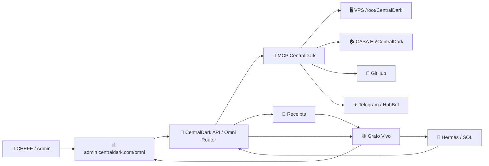
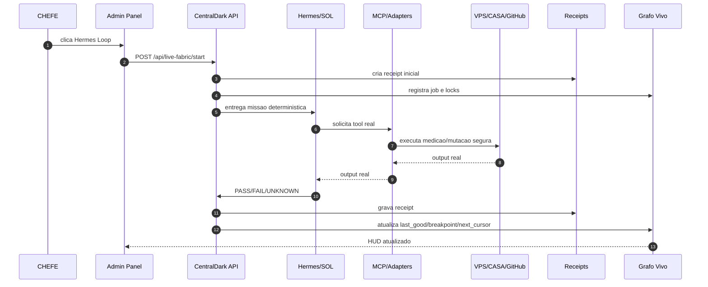

# CentralDark Live Execution Fabric

Esta arquitetura cristaliza um fluxo unico para o CHEFE iniciar, observar e continuar execucoes reais da CentralDark pelo painel admin, pelo Hermes Desktop/CASA ou por qualquer agente autorizado.

O objetivo nao e criar um segundo painel, segundo router ou segundo MCP. O objetivo e ligar o painel existente `admin.centraldark.com/omni` a uma rota viva: API CentralDark -> MCP -> alvos reais -> receipts -> grafo vivo -> consumidores de inteligencia.

## Regra curta

```text
BOTAO_ADMIN_OU_HERMES
-> CENTRALDARK_API
-> JOB_DETERMINISTICO
-> MCP_OU_ADAPTER_REAL
-> VPS_CASA_GITHUB_TELEGRAM
-> OUTPUT_REAL
-> RECEIPT
-> GRAFO_VIVO
-> HUD_ADMIN
-> NEXT_TIK_TAK
```

## Entradas suportadas

```text
ADMIN_PANEL=https://admin.centralldark.com/omni
HERMES_DESKTOP_CASA=E:\CentralDark
VPS_RUNTIME=/root/CentralDark
GITHUB_REPO=ServerVpss/CentralDark
MCP_RUNTIME=http://127.0.0.1:9100
OMNI_ROUTER=http://127.0.0.1:8099
```

## Botoes canonicos no painel

```text
HERMES_FIXED_POINT_LOOP="🌀 Hermes Loop — ate quebrar"
MEASURE_CURRENT="🔎 Medir CURRENT"
MICRODEPLOY_GREEN_SCOPE="🚀 Micro-deploy escopo verde"
COUNTERPROOF="⚖️ Contraprovar"
OPEN_RECEIPTS="🧾 Abrir receipts"
LIVE_GRAPH="🕸️ Grafo vivo"
```

O botao principal nao dispara prompt solto. Ele cria um job deterministico com escopo, locks, fontes de receipt e condicoes de parada.

## Topologia viva



## Fluxo de execucao



## Contrato de job

```yaml
schema: centraldark.live-execution-job.v1
job_id: required
scope: required
entrypoint: admin_panel | hermes_desktop | api | telegram
mode: fixed_point_breakpoint_loop
locks:
  UNKNOWN_IS_NOT_PASS: true
  UNKNOWN_IS_NOT_LIXO: true
  ACTION_IS_NOT_PROOF: true
  PRINTED_COMMAND_IS_NOT_EXECUTED: true
  NO_BLIND_DELETE: true
  NO_BLIND_PULL_OVER_DIRTY_RUNTIME: true
  SECRET_EXPOSED: false
required_outputs:
  - current_head
  - dirty_count_before
  - dirty_count_after
  - crystal_preserved
  - junk_deleted
  - unknown_kept
  - tests
  - health
  - receipt_path
  - next_cursor
```

## HUD minimo

```text
LAST_GOOD_POINT=<ultimo PASS comprovado>
FIRST_FAILURE_POINT=<primeiro FAIL material>
UNKNOWN_CONE=<pendencias que nao podem virar verde>
CURRENT_ROUTE=<rota em execucao>
RECEIPT_ATUAL=<arquivo ledger>
NEXT_CURSOR=<de onde continuar>
```

## Condicao de parada

```text
FIXED_POINT quando:
- CURRENT remedido;
- nenhum delta causal conhecido restante no escopo;
- testes PASS ou not_applicable com motivo;
- health PASS quando runtime foi tocado;
- receipt gravado;
- NEXT_CURSOR escrito.

BLOCKED real quando:
- tool ausente;
- segredo/autenticacao humana inevitavel;
- servico externo indisponivel;
- escolha destrutiva sem owner seguro.
```

## Frase canonica

> O Live Execution Fabric e a rota unica que transforma clique no painel ou comando Hermes em execucao real medida, com receipt, grafo vivo e continuidade por NEXT_TIK_TAK.
