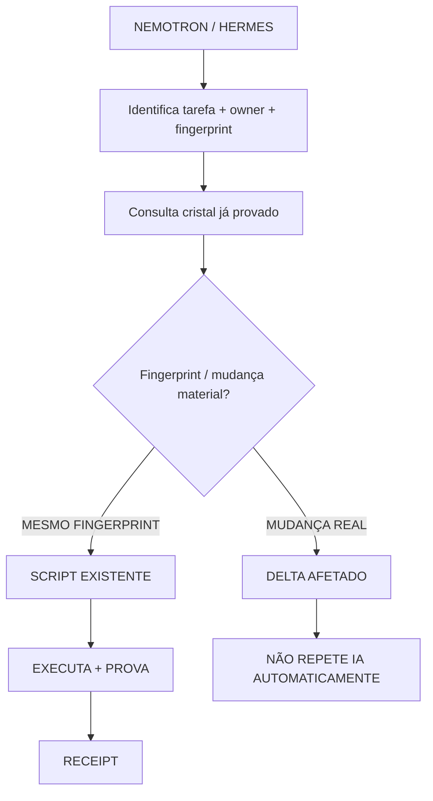

# Delegação determinística por cristal provado — Nemotron / Hermes

Transcrição do fluxograma fornecido pelo CHEFE em 2026-10-24, em **Mermaid nativo para Obsidian**. Arquivo no GitHub não comprova sincronização ao vault físico.

## Fluxograma Mermaid



## Memória textual do fluxograma apresentado

```text
NEMOTRON / HERMES
        ↓
Identifica tarefa + owner + fingerprint
        ↓
Consulta cristal já provado
        ↓
┌────────────────────┬─────────────────────┐
↓                    ↓
MESMO FINGERPRINT    MUDANÇA REAL
↓                    ↓
SCRIPT EXISTENTE     DELTA AFETADO
↓                    ↓
EXECUTA + PROVA      NÃO REPETE IA AUTOMATICAMENTE
↓
RECEIPT
```

## Receita existente — reuse before create

- **Owner da receita:** `docs/ARQUITETURA/CENTRALDARK-TRIGGER-FABRIC/PROVEN-EXECUTABLE-RECIPE.yml`.
- **Lock existente:** `docs/ARQUITETURA/CENTRALDARK-TRIGGER-FABRIC/PROVEN-DETERMINISTIC-LOCK.yml`.
- **Runner canônico:** `scripts/trigger-fabric/centraldark_full_trigger_boot.py` (`replay`, `replay-run`).
- **Delegador:** `scripts/trigger-fabric/proven_script_delegate.py`.
- **Teste:** `scripts/trigger-fabric/test_proven_script_delegate.py`.
- **PR equivalente da receita:** [#1681](https://github.com/ServerVpss/CentralDark/pull/1681).
- **Rastro permanente:** [#1562](https://github.com/ServerVpss/CentralDark/pull/1562).

**Regra:** IA DESCOBRE UMA VEZ → SCRIPT PROVADO EXECUTA N VEZES → IA SÓ VOLTA COM DELTA REAL.

Mesmo claim/owner/fingerprint/receita selada → `replay` antes de qualquer redescoberta; `replay-run` só no escopo autorizado; contraprova e receipt. Mudança material → somente cone afetado. UNKNOWN != PASS.

## Fronteira de evidência

- Prova anterior relatada na captura: **6/6 testes isolados** e commit `c132b8ce261b07efccbc1f0c09ca09ae29f935e2`. Este registro não repete esses testes.
- **UNKNOWN:** hook automático do Nemotron/Hermes instalado na Casa — sem contraprova viva nesta gravação.
- **UNKNOWN:** escrita no vault do Obsidian. O sensor CentralDark retornou `configured_vault=null` e `vault_accessible_from_this_runtime=false`.
- Nota subordinada ao mesmo owner. Não cria engine, runtime, plugin ou owner paralelo.

NEXT_CURSOR: quando houver acesso real ao vault, sincronizar este Markdown e comprovar readback; testar hook do consumidor sem reconstruir a receita.
