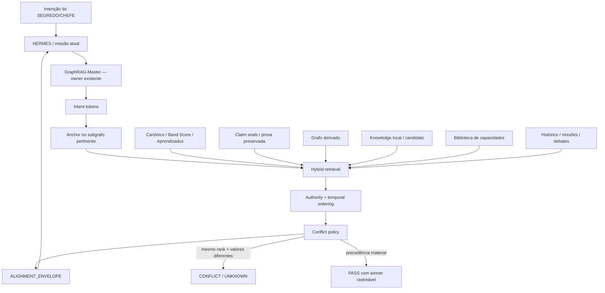

# HERMES GraphRAG — alinhamento cognitivo por evidência

Status: `EXTENSAO_CANONICA`
Owner: `apps/modulos/HERMES-CORE/agents/GraphRAG-Master/`

## Objetivo

Fazer o GraphRAG-Master entregar ao HERMES contexto ordenado por autoridade, temporalidade e pertinência sem criar segundo cérebro, segundo RAG, segundo Judge ou nova fonte da verdade.

```text
ONE_SYSTEM_ONLY=true
REUSE_BEFORE_CREATE=true
GRAPH_IS_DERIVED_NOT_AUTHORITY=true
CURRENT_STATE_BEATS_HISTORY=true
UNKNOWN_IS_NOT_PASS=true
```

## Fluxo



## Ordem de autoridade

```text
CANONICAL
> PROOF_LEDGER
> DERIVED_INDEX
> CANDIDATE
> CAPABILITY_INDEX
> HISTORY
> UNKNOWN
```

Temporalidade é desempate material: `CURRENT > NON_TEMPORAL > MIXED > HISTORY > UNKNOWN`.

O grafo continua índice derivado. Ele ajuda a localizar anchor e vizinhança; não ganha autoridade por aparência, centralidade ou quantidade de ligações.

## Contrato de conflito

```text
autoridade/tempo diferentes
→ maior precedência vence

mesma autoridade + mesmo tempo + valores diferentes
→ CONFLICT
→ winner=null
→ UNKNOWN até teste discriminante/evidência superior
```

Não existe votação de modelos como mecanismo de verdade.

## Envelope cognitivo

A extensão `cognitive-alignment.mjs` produz:

```text
ALIGNMENT_ENVELOPE centraldark.cognitive-context.v1
- status=EVIDENCE_ROUTING_ACTIVE
- anchor=<nó pertinente ou UNKNOWN>
- intent_tokens=<tokens relevantes>
- authority_order=...
- temporal_order=...
- conflict_policy=SAME_RANK_DIFFERENT_VALUE=>CONFLICT/UNKNOWN
- graph_role=DERIVED_INDEX_NOT_AUTHORITY
- current_state_beats_history=true
```

## Self-test

O módulo possui `--self-test` para provar deterministicamente:

- grafo classificado como `DERIVED_INDEX`;
- histórico classificado como `HISTORY`;
- canônico atual vencendo histórico no mesmo claim;
- empate de autoridade/tempo com valores diferentes permanecendo `CONFLICT`;
- envelope contendo anchor;
- canônico ordenado antes do grafo;
- grafo permanecendo não-autoritativo.

O receipt é explícito:

```text
live_sources_contacted=false
proof_scope=STATIC_ALIGNMENT_ROUTING_AND_CONFLICT_POLICY_ONLY
```

Logo, esse teste NÃO prova runtime da VPS, disponibilidade do Graph Panel, qualidade real de recuperação nem ganho sobre baseline.

## Matriz de prova

| Claim | Estado deste delta | Próxima prova |
|---|---|---|
| Visualização/anchor | IMPLEMENTADO NO MÓDULO | observar payload real do grafo |
| Organização associativa | IMPLEMENTADO NO MÓDULO | medir contexto produzido |
| Recupera informação certa | UNKNOWN | benchmark com missões reais |
| Resolve conflitos corretamente | PARCIAL: política determinística testável | casos reais estruturados |
| Alinhamento comportamental | UNKNOWN | executar HERMES em holdout |
| Melhor que RAG anterior | UNKNOWN | A/B baseline × alinhado |

## Integração e runtime

Este PR prepara a extensão canônica dentro do owner existente. A promoção para consumo padrão pelo `decisor.mjs` deve acontecer somente junto da prova de regressão do decisor, sem criar segundo caminho de memória.

```text
MERGED != DEPLOYED
EXISTS != RUNNING
STATIC_TEST != RUNTIME_PROOF
```

Depois do merge, o runtime elegível deve puxar a `main`, executar:

```bash
node apps/modulos/HERMES-CORE/agents/GraphRAG-Master/cognitive-alignment.mjs --self-test
```

e só então avançar para teste vivo/benchmark antes de declarar ganho de recuperação.
